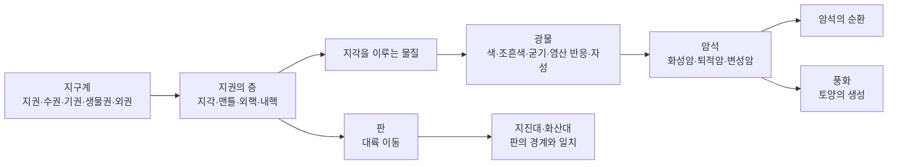
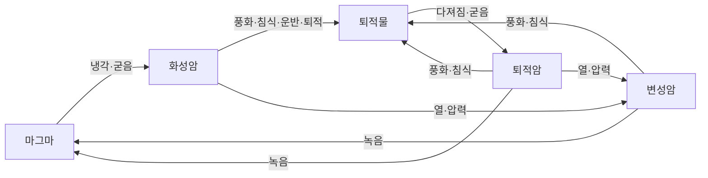

# 중2-2. 지권의 변화 — 발밑의 돌과 흙이 들려주는 지구 이야기
<!-- prev: m1-07, m2-01 -->
<!-- next: 2-5, 3-1, 3-2, earth-2, esys-1 -->

> [!NOTE]
> **성취기준**
> - **[9과09-01]** 지구계의 구성 요소를 알고, 지권의 층상 구조와 그 특징을 조사⋅발표할 수 있다.
> - **[9과09-02]** 조암 광물의 주요 특성을 관찰하고, 암석과 광물의 활용 방안 및 자원으로서 가치에 대해 조사할 수 있다.
> - **[9과09-03]** 지각을 이루는 암석을 생성 과정에 따라 분류하고, 암석의 순환 과정을 설명할 수 있다.
> - **[9과09-04]** 풍화 과정을 이해하고, 토양 생성 과정을 풍화 작용의 예로 설명할 수 있다.
> - **[9과09-05]** 대륙이동설을 이해하고, 지진과 화산이 발생하는 지역의 분포를 판의 경계와 관련지어 설명할 수 있다.

**학습 목표**

1. 지구계를 이루는 다섯 구성 요소를 알고, 지권을 이루는 네 층의 이름과 상태를 말할 수 있다.
2. 색, 조흔색, 굳기, 염산 반응, 자성을 이용하여 조암 광물을 구별하고, 광물과 암석이 자원으로서 가치가 있음을 설명할 수 있다.
3. 화성암, 퇴적암, 변성암을 생성 과정에 따라 분류하고, 암석이 순환하는 과정을 설명할 수 있다.
4. 풍화 작용의 원인을 알고, 토양이 만들어지는 과정을 풍화 작용으로 설명할 수 있다.
5. 대륙이동설의 증거를 알고, 지진대·화산대의 분포가 판의 경계와 일치함을 설명할 수 있다.

**이 단원의 학습 사다리**

| 단계 | 무엇을 하나? |
|---|---|
| STEP 1. 이전 학습 다시 보기 | 초등학교 「땅의 변화」, 중1 「태양계」, 중2 「물질의 특성」을 다시 꺼내 본다 |
| STEP 2. 기초 다지기 | 계(system), 광물과 암석의 차이, 결정의 크기를 디딤돌로 놓는다 |
| STEP 3. 핵심 개념 | 지구계와 지권의 층 → 광물 → 암석과 순환 → 풍화와 토양 → 대륙 이동과 판 |
| STEP 4. 오개념 바로잡기 | "맨틀은 펄펄 끓는 액체이다?" 같은 착각을 바로잡는다 |
| STEP 5. 다음 단계로 | 규산염 광물, 판구조론, 마그마와 화성암, 지구 내부 탐사로 이어지는 길 |
| STEP 6. 생활·산업·진로 | 반도체와 건축 자재, 지질공원, 지진 대비 |

---

## 🗺️ 단원 들어가기

제주도의 돌하르방은 왜 구멍이 숭숭 뚫린 검은 돌로 만들었을까? 서울 북한산의 바위는 왜 희끗희끗한 밝은색일까? 히말라야산맥 꼭대기에서는 왜 바다 생물의 화석이 발견될까?

우리 발밑의 돌과 흙은 가만히 있는 것처럼 보이지만, 사실 아주 긴 시간에 걸쳐 녹고, 굳고, 부서지고, 쌓이고, 움직이며 끊임없이 변하고 있다. 이 단원에서는 지구를 이루는 층부터 시작하여, 암석을 이루는 광물, 암석이 만들어지고 바뀌는 과정, 흙이 생기는 과정, 그리고 대륙이 움직이며 지진과 화산이 일어나는 곳까지 차례로 살펴본다.

---

## STEP 1. 🔙 이전 학습 다시 보기

### 연계 개념표

| 이전 단원 | 그때 배운 것 | 이 단원에서 확장되는 것 |
|---|---|---|
| 초등학교 3~4학년 「땅의 변화」 | 흐르는 물이 땅을 깎고(침식) 옮기고(운반) 쌓는다(퇴적). 화산과 지진이 땅의 모습을 바꾼다 | 땅을 이루는 **광물과 암석**을 생성 과정에 따라 분류하고, 풍화·순환·판의 움직임으로 땅의 변화를 설명한다 |
| 중학교 1학년 「태양계」 [9과07-01] | 지구는 단단한 암석 표면을 가진 지구형 행성이다 | 지구형 행성인 지구의 **속(층상 구조)과 겉(암석)** 을 자세히 들여다본다 |
| 중학교 1학년 「물질의 상태 변화」 [9과04] | 액체가 식으면 고체로 굳는다(응고). 물이 얼면 부피가 늘어난다 | 마그마가 식어 굳으면 화성암이 되고, 물이 얼며 부피가 늘어나 암석을 부순다 |
| 중학교 2학년 「물질의 특성」 [9과08-01] | 물질은 밀도, 녹는점 같은 고유한 특성으로 구별한다 | 광물도 **조흔색, 굳기, 염산 반응, 자성** 같은 특성으로 구별한다 |

### 준비 운동 (사전 진단)

**Q1.** 흐르는 물이 땅을 깎아 내는 작용을 무엇이라고 하는가?

**Q2.** 지구 속은 겉에서 중심까지 모두 같은 물질로 되어 있다. (O / X)

**Q3.** 유리병에 물을 가득 담고 마개를 꼭 닫아 냉동실에 넣어 두면 어떻게 될까? 그 까닭은?

**Q4.** 지진과 화산은 지구 어디에서나 고르게 일어난다. (O / X)

정답 및 해설

**Q1.** 침식 — 초등학교 「땅의 변화」에서 배운 흐르는 물의 작용이다.

**Q2. X** — 지구 속은 성질이 다른 여러 층으로 나뉜다(STEP 3의 ①).

**Q3.** 병이 깨질 수 있다. 물이 얼음이 되면 부피가 늘어나기 때문이다. 이 현상은 바위를 쪼개는 풍화 작용에서도 일어난다(STEP 3의 ⑤).

**Q4. X** — 지진과 화산은 특정한 띠 모양의 지역에 집중되어 있다(STEP 3의 ⑥).

---

## STEP 2. 🧱 기초 다지기

### ① '계(system)'란 무엇일까?

**계(system)** 는 서로 영향을 주고받는 여러 요소가 모여 하나의 전체를 이루는 것이다. 우리 몸은 소화계, 순환계, 호흡계 등이 함께 일하는 계이고, 학교도 학생, 선생님, 건물, 규칙이 서로 영향을 주고받는 계이다. 지구도 땅, 물, 공기, 생물이 서로 영향을 주고받는 하나의 계이다.

> [!TIP]
> 💡 **비유** — 계는 '축구 팀'과 같다. 공격수, 수비수, 골키퍼가 따로 뛰는 것 같아도 한 명이 바뀌면 팀 전체의 경기 방식이 달라진다.

### ② 광물과 암석은 어떻게 다를까?

- **광물(mineral)**: 자연에서 만들어진, 일정한 성분을 가진 고체 알갱이. 암석을 이루는 기본 단위이다.
- **암석(rock)**: 한 가지 또는 여러 가지 광물이 모여 이루어진 고체 덩어리.

| 비유 | 광물 | 암석 |
|---|---|---|
| 초콜릿 쿠키 | 초콜릿 조각, 견과류, 밀가루 반죽 | 쿠키 전체 |
| 레고 작품 | 레고 블록 하나하나 | 블록으로 만든 작품 |

중2 「물질의 특성」에서 배운 말로 하면, 광물은 성분이 일정한 **순물질에 가깝고**, 여러 광물이 섞인 암석은 일종의 **혼합물**이다.

### ③ 결정의 크기는 '식는 속도'가 정한다

녹은 물질이 천천히 식으면 입자들이 차근차근 자리를 잡을 시간이 있어 **큰 결정**이 생기고, 빨리 식으면 자리를 잡을 시간이 부족해 **작은 결정**이 생긴다.

> [!TIP]
> 💡 **생활 속 예** — 설탕물을 천천히 식히면 큰 설탕 결정(얼음 사탕)이 생기지만, 빨리 식히면 작은 결정이 생긴다. 이 원리는 STEP 3의 화성암 분류에서 그대로 쓰인다.

### ④ 지질학의 시간 감각

산이 깎이고 대륙이 움직이는 일은 사람의 한평생으로는 거의 느낄 수 없을 만큼 느리다. 1년에 몇 cm씩만 움직여도 수천만 년, 수억 년이 지나면 수천 km가 된다. 지구에서 일어나는 변화를 생각할 때는 **아주 긴 시간**을 함께 떠올려야 한다.

---

## STEP 3. 📘 핵심 개념

### ① 지구계와 지권의 층상 구조 [9과09-01]

#### 지구계의 구성 요소

**지구계(Earth system)** 는 지구를 이루며 서로 영향을 주고받는 요소들의 모임이다.

| 구성 요소 | 무엇인가? | 예 |
|---|---|---|
| **지권(geosphere)** | 지구의 겉과 속을 이루는 암석과 흙, 지구 내부 | 산, 들, 바다 밑 땅, 지구 내부 |
| **수권(hydrosphere)** | 지구에 있는 모든 물 | 바닷물(대부분을 차지), 빙하, 지하수, 강과 호수 |
| **기권(atmosphere)** | 지구를 둘러싼 공기의 층 | 질소와 산소가 대부분인 대기 |
| **생물권(biosphere)** | 지구에 사는 모든 생물 | 사람, 동물, 식물, 미생물 |
| **외권(outer space)** | 기권 바깥의 우주 공간 | 태양, 달 등 우주 공간 |

이 요소들은 서로 영향을 주고받는다.

| 상호작용 | 예 |
|---|---|
| 지권 → 기권 | 화산이 폭발하면 화산재와 기체가 대기로 퍼진다 |
| 수권 → 지권 | 파도와 흐르는 물이 해안과 땅을 깎는다 |
| 생물권 → 지권 | 식물 뿌리가 바위를 쪼개고, 생물이 죽어 흙에 양분이 된다 |
| 외권 → 지구계 | 태양 에너지가 들어와 물이 증발하고 바람이 분다 |

#### 지권의 층상 구조

지권은 겉에서 중심까지 성질이 다른 네 개의 층으로 나뉜다. 이것을 **지권의 층상 구조**라고 한다. 지구의 반지름은 약 6400 km이다.

| 층 (겉에서부터) | 상태 | 특징 |
|---|---|---|
| **지각(crust)** | 고체 | 지구의 가장 바깥을 이루는 얇은 겉껍질. 우리가 사는 땅과 바다 밑바닥 |
| **맨틀(mantle)** | 고체 | 지각 아래에 있는 층. 지권에서 가장 두껍다 |
| **외핵(outer core)** | **액체** | 맨틀 아래, 핵의 바깥 부분 |
| **내핵(inner core)** | 고체 | 지구의 중심 부분 |

> [!IMPORTANT]
> 네 층 가운데 **외핵만 액체**이고 나머지 지각, 맨틀, 내핵은 고체이다. 지권의 층 이름과 상태를 짝 지어 기억하자.

> [!TIP]
> 💡 **비유** — 지권은 '삶은 달걀'과 비슷하다. 얇은 껍데기는 지각, 두꺼운 흰자는 맨틀, 가운데 노른자는 핵이다. 다만 진짜 지구의 핵은 바깥쪽(외핵)이 액체이고 가운데(내핵)는 고체라는 점이 다르다.

<!-- fig:m2-02-earth-layers -->

#### 예제 1

다음 설명에 해당하는 지권의 층을 쓰시오.
(1) 지권의 층 중 유일하게 액체 상태인 층
(2) 지권의 가장 바깥에 있는 얇은 고체 층
(3) 지구의 중심에 있는 고체 층

**풀이** (1) **외핵** (2) **지각** (3) **내핵**

#### ✔ 바로 확인

1. 바닷물, 빙하, 지하수는 지구계의 구성 요소 중 무엇에 속하는가?
2. (O/X) 맨틀은 액체 상태이다.
3. 화산이 폭발하여 화산재가 대기로 퍼지는 것은 어느 권이 어느 권에 영향을 준 예인가?
4. 빈칸: 지권의 층은 겉에서부터 지각, (    ), 외핵, (    ) 순서이다.

정답

1. 수권
2. X — 맨틀은 고체이다. 지권에서 액체인 층은 외핵뿐이다.
3. 지권이 기권에 영향을 준 예
4. 맨틀, 내핵

### ② 조암 광물과 광물의 특성 [9과09-02]

지각을 이루는 광물은 수천 종이 넘지만, 암석을 이루는 주요 광물은 몇 가지뿐이다. 이처럼 **암석을 이루는 주요 광물**을 **조암 광물(rock-forming mineral)** 이라고 한다.

| 조암 광물 | 겉보기 색 | 비고 |
|---|---|---|
| **장석** | 흰색, 분홍색 | 지각에 가장 많은 광물 |
| **석영** | 무색, 흰색 | 장석 다음으로 많다. 매우 단단하다 |
| 흑운모 | 검은색 | 얇은 판처럼 잘 벗겨진다 |
| 각섬석 | 검은색, 녹흑색 | 길쭉한 기둥 모양 |
| 휘석 | 검은색, 녹흑색 | 짧은 기둥 모양 |
| 감람석 | 황록색 | 작은 알갱이 모양 |

> [!NOTE]
> 장석과 석영처럼 밝은색 광물이 많으면 암석이 밝게 보이고, 흑운모·각섬석·휘석·감람석 같은 어두운색 광물이 많으면 암석이 어둡게 보인다. 이 생각은 STEP 3의 ③ 화성암 분류에 그대로 쓰인다.

#### 광물을 구별하는 다섯 가지 특성

중2 「물질의 특성」에서 물질을 밀도·끓는점 등으로 구별했듯이, 광물도 고유한 특성으로 구별한다.

| 특성 | 방법 | 예 |
|---|---|---|
| **색** | 겉으로 보이는 색을 관찰한다 | 석영은 무색, 흑운모는 검은색, 감람석은 황록색 |
| **조흔색(streak)** | 광물을 **조흔판**(유약을 바르지 않은 흰 도자기 판)에 긁어 나타나는 **가루의 색**을 본다 | 금: 노란색, 황철석: 검은색, 황동석: 녹흑색 |
| **굳기(hardness)** | 두 광물을 서로 긁어 보아 **긁히는 쪽이 더 무르다** | 석영으로 방해석을 긁으면 방해석이 긁힌다 → 석영이 방해석보다 단단하다 |
| **염산 반응** | 묽은 염산을 떨어뜨려 거품이 생기는지 본다 | 방해석은 거품(이산화 탄소)이 생긴다 |
| **자성** | 클립이나 쇳가루가 붙는지 본다 | 자철석은 클립을 끌어당긴다 |

> [!IMPORTANT]
> **조흔색**은 겉보기 색이 비슷한 광물을 구별할 때 특히 쓸모 있다. 금, 황철석, 황동석은 모두 노랗게 반짝이지만, 조흔판에 긁으면 금은 노란색, 황철석은 검은색, 황동석은 녹흑색 가루가 나온다. 겉보기 색은 불순물에 따라 달라지기 쉽지만, 조흔색은 잘 변하지 않는다. (금, 황철석, 황동석은 조암 광물은 아니지만, 조흔색의 쓸모를 보여 주는 대표적인 예라서 함께 다룬다.)

> [!TIP]
> 💡 **생활 속 예** — 황철석은 금처럼 보여서 '바보의 금'이라는 별명이 있다. 옛날 금광에서 황철석을 금으로 착각한 사람들이 있었다고 한다. 조흔판 하나만 있었다면 속지 않았을 것이다.

#### 방해석과 석영 비교하기

방해석과 석영은 둘 다 흰색이나 무색으로 비슷해 보인다. 두 광물은 굳기와 염산 반응으로 구별할 수 있다.

| 비교 | 방해석 | 석영 |
|---|---|---|
| 겉보기 색 | 무색, 흰색 | 무색, 흰색 |
| 굳기 (서로 긁기) | 석영에 긁힌다 (더 무르다) | 방해석을 긁는다 (더 단단하다) |
| 묽은 염산 반응 | 거품이 생긴다 | 반응하지 않는다 |

#### 예제 2 — 정체불명의 흰 광물

흰색 광물 A, B가 있다. A를 B에 긁었더니 B에 자국이 생겼고, B에 묽은 염산을 떨어뜨렸더니 거품이 생겼다. A와 B는 각각 석영과 방해석 중 무엇일까?

**풀이** A가 B를 긁었으므로 A가 더 단단하다. B는 염산과 반응해 거품이 생겼다. 따라서 **A는 석영, B는 방해석**이다.

#### 광물과 암석의 활용, 그리고 자원으로서의 가치

| 광물·암석 | 쓰임 |
|---|---|
| 석영 | 유리의 원료, 반도체에 쓰이는 규소의 원료 |
| 장석 | 도자기와 유리의 원료 |
| 운모 | 열과 전기가 잘 통하지 않아 전기 기구의 절연체, 화장품의 반짝이는 재료 |
| 방해석, 석회암 | 시멘트의 원료, 제철 과정의 재료 |
| 자철석, 적철석 | 철을 얻는 광석(철광석) |
| 화강암 | 건물 외벽, 계단, 비석 등 건축 석재 |
| 대리암 | 조각품, 건물 바닥과 장식 |

> [!WARNING]
> 광물과 암석은 만들어지는 데 수백만 년 이상이 걸리므로, 사람이 쓰는 속도로는 다시 채워지지 않는 **유한한 자원**이다. 스마트폰 한 대에도 수십 가지 광물에서 얻은 원소가 들어 있다. 다 쓴 전자 제품을 모아 금속을 다시 뽑아내는 '도시 광산'처럼, 자원을 아끼고 재활용하는 노력이 필요하다.

#### ✔ 바로 확인

1. 빈칸: 조흔색은 광물을 (    )에 긁었을 때 나타나는 가루의 색이다.
2. (O/X) 석영으로 방해석을 긁으면 석영에 자국이 생긴다.
3. 클립을 끌어당기는 광물은 무엇인가?
4. 묽은 염산을 떨어뜨렸을 때 거품이 생기는 광물은 방해석과 석영 중 무엇인가?

정답

1. 조흔판
2. X — 더 무른 방해석이 긁힌다.
3. 자철석 — 자성이 있다.
4. 방해석

### ③ 암석의 분류 — 생성 과정에 따라 [9과09-03]

지각을 이루는 암석은 **만들어진 과정**에 따라 화성암, 퇴적암, 변성암으로 나눈다.

#### (1) 화성암 — 마그마가 식어 굳은 암석

땅속 깊은 곳에서 암석이 녹은 것을 **마그마(magma)** 라고 한다. 마그마가 식어서 굳은 암석이 **화성암(igneous rock)** 이다. 화성암은 **식은 장소(속도)** 에 따라 결정의 크기가 다르고, **광물의 색**에 따라 암석의 색이 다르다.

화산에서 흘러나온 용암이 지표에서 식어 굳는 모습은 아래 사진과 같다.

<!-- photo:m2-02-lava-flow -->

| 식은 곳 | 식는 속도 | 결정 크기 |
|---|---|---|
| 지표 근처 (화산암) | 빠르다 | 작다 (눈으로 잘 안 보임) |
| 지하 깊은 곳 (심성암) | 느리다 | 크다 (눈으로 잘 보임) |

| | 어두운색 (어두운색 광물이 많음) | 밝은색 (석영·장석이 많음) |
|---|---|---|
| **결정이 작다** (지표 근처에서 빠르게 식음) | **현무암** | **유문암** |
| **결정이 크다** (지하 깊은 곳에서 천천히 식음) | **반려암** | **화강암** |

실제 화강암과 현무암의 표면을 가까이에서 비교하면 아래 사진과 같다. 그 아래 모식도는 식는 장소에 따라 결정의 크기가 달라지는 까닭을 단순하게 나타낸 것이다.

<!-- photo:m2-02-granite-basalt -->

<!-- fig:m2-02-igneous-rocks -->

> [!TIP]
> 💡 **생활 속 예** — 제주도와 한탄강 주변에는 현무암이 많다. 현무암에 구멍이 많은 것은 용암 속에 있던 기체가 빠져나간 자리이다. 북한산과 설악산의 밝은 바위는 화강암으로, 땅속 깊은 곳에서 천천히 식은 마그마가 오랜 시간이 지나 지표로 드러난 것이다.

#### (2) 퇴적암 — 쌓이고 다져지고 굳은 암석

자갈, 모래, 진흙 같은 **퇴적물**이 물이나 바람에 운반되어 쌓인 뒤, 위에 쌓이는 퇴적물의 무게로 **다져지고**, 알갱이 사이에 물속 물질이 들어가 **굳어서** 만들어진 암석이 **퇴적암(sedimentary rock)** 이다.

| 퇴적암 | 주요 퇴적물 | 특징 |
|---|---|---|
| **역암** | 자갈 (+ 모래, 진흙) | 둥근 자갈이 박혀 있다 |
| **사암** | 모래 | 손으로 만지면 까슬까슬하다 |
| **이암** | 진흙 | 알갱이가 매우 작아 매끈하다 |
| **석회암** | 석회 물질 (조개껍데기, 산호 등) | 묽은 염산에 거품이 생긴다 |

- 퇴적암에서는 퇴적물이 쌓이면서 생긴 줄무늬인 **층리**를 볼 수 있다.
- 퇴적암에는 생물의 몸이나 흔적이 남은 **화석**이 들어 있는 경우가 많다.

> [!TIP]
> 💡 **비유** — 퇴적암은 '시루떡'과 같다. 떡가루와 팥을 켜켜이 쌓고 눌러 찌면 층이 생긴다. 그 층이 퇴적암의 층리이다. 히말라야산맥 꼭대기에서 바다 생물 화석이 발견되는 것은, 옛 바다 밑에 쌓인 퇴적암이 높이 솟아올랐기 때문이다.

#### (3) 변성암 — 열과 압력으로 성질이 바뀐 암석

이미 만들어진 암석이 땅속 깊은 곳에서 **높은 열과 압력**을 받아, 녹지는 않은 채로 광물의 배열이나 성질이 바뀐 암석이 **변성암(metamorphic rock)** 이다.

| 원래 암석 | → | 변성암 | 특징 |
|---|---|---|---|
| 이암 | → | **편암** → **편마암** | 압력을 받아 광물이 한 방향으로 나란히 늘어선 줄무늬(**엽리**)가 생긴다 |
| 화강암 | → | **편마암** | 밝고 어두운 광물이 띠를 이룬 줄무늬가 뚜렷하다 |
| 석회암 | → | **대리암** | 결정이 커지고 반짝인다. 묽은 염산에 거품이 생긴다 |
| 사암 | → | **규암** | 매우 단단하다 |

> [!NOTE]
> 엽리는 압력을 받은 방향과 수직으로 생긴다. 반죽을 위에서 누르면 납작하게 옆으로 퍼지는 것처럼, 광물도 누르는 방향에 수직으로 늘어선다.

<!-- fig:m2-02-foliation -->

#### 예제 3 — 암석 분류해 보기

다음 특징을 가진 암석의 이름을 쓰시오.
(1) 어두운색이고 결정이 매우 작으며, 작은 구멍이 많다.
(2) 둥근 자갈이 모래·진흙과 함께 굳어 있다.
(3) 석회암이 변성되어 만들어졌고, 묽은 염산에 거품이 생긴다.
(4) 밝은색이고, 석영·장석 결정이 눈으로 보일 만큼 크다.

**풀이** (1) **현무암** (2) **역암** (3) **대리암** (4) **화강암**

#### ✔ 바로 확인

1. 짝짓기: (가) 화성암 (나) 퇴적암 (다) 변성암 — ㄱ. 열과 압력을 받아 성질이 바뀜 ㄴ. 마그마가 식어 굳음 ㄷ. 퇴적물이 다져지고 굳음
2. 지하 깊은 곳에서 천천히 식은 화성암의 결정은 (크다 / 작다).
3. 빈칸: 석회암이 높은 열과 압력을 받으면 (    )이 된다.
4. 층리가 보이고 화석이 들어 있는 경우가 많은 암석의 종류는?

정답

1. (가)–ㄴ, (나)–ㄷ, (다)–ㄱ
2. 크다 — 입자가 자리를 잡을 시간이 충분하다.
3. 대리암
4. 퇴적암

### ④ 암석의 순환 [9과09-03]

암석은 한번 만들어지면 그대로 있는 것이 아니라, 오랜 시간에 걸쳐 주변 환경에 따라 다른 암석으로 계속 바뀐다. 이것을 **암석의 순환(rock cycle)** 이라고 한다.

| 과정 | 무엇이 일어나나? |
|---|---|
| 마그마 → 화성암 | 마그마가 식어 굳는다 |
| 모든 암석 → 퇴적물 | 지표에 드러난 암석이 풍화·침식되어 부서지고, 물과 바람에 운반되어 쌓인다 |
| 퇴적물 → 퇴적암 | 쌓인 퇴적물이 다져지고 굳는다 |
| 화성암·퇴적암 → 변성암 | 땅속 깊은 곳에서 높은 열과 압력을 받는다 |
| 모든 암석 → 마그마 | 더 높은 온도에서 녹는다 |

> [!TIP]
> 💡 **비유** — 암석의 순환은 '양초의 재활용'과 같다. 양초(화성암)를 깎아 부스러기(퇴적물)를 모아 꾹 눌러 덩어리(퇴적암)를 만들고, 따뜻한 손으로 주무르면 모양이 바뀌고(변성암), 완전히 녹이면 다시 촛농(마그마)이 된다. 지구에서는 이 과정이 수백만 년 이상에 걸쳐 일어난다.

<!-- sim:rock-cycle -->

#### ✔ 바로 확인

1. (O/X) 암석은 한번 만들어지면 다른 암석으로 바뀌지 않는다.
2. 마그마가 화성암이 되는 과정은 무엇인가?
3. 퇴적물이 퇴적암이 되려면 어떤 과정을 거쳐야 하는가?

정답

1. X — 환경에 따라 계속 다른 암석으로 바뀐다(암석의 순환).
2. 마그마가 식어 굳는다.
3. 다져지고 굳는다.

### ⑤ 풍화와 토양의 생성 [9과09-04]

지표의 암석이 오랜 시간에 걸쳐 잘게 부서지거나 성분이 변하는 현상을 **풍화(weathering)** 라고 한다. 풍화를 일으키는 것은 물, 공기, 생물 등이다.

| 풍화의 원인 | 어떻게 부수나? | 예 |
|---|---|---|
| **물의 얼고 녹음** | 바위 틈에 스며든 물이 얼면 부피가 늘어나 틈을 벌린다. 이것이 반복되면 바위가 쪼개진다 | 겨울을 지난 산길에 떨어진 돌 조각 |
| **식물의 뿌리** | 바위 틈에 자란 뿌리가 굵어지면서 틈을 넓힌다 | 바위를 가르고 자란 소나무 |
| **지하수와 빗물** | 이산화 탄소가 녹아 있는 물이 석회암을 녹인다 | 석회 동굴 (강원도·충청북도 등의 석회 동굴) |
| **공기 중의 산소** | 암석 속 철 성분이 산소와 만나 녹슬 듯 변하고 약해진다 | 붉은빛을 띠는 흙과 바위 |

> [!NOTE]
> 물이 얼면 부피가 약 9% 늘어난다. 물 $100\ \mathrm{cm^3}$가 얼면 얼음은 약 $109\ \mathrm{cm^3}$가 된다. 꽉 막힌 바위 틈에서 이 '늘어날 자리'가 없으면 틈을 벌리는 큰 힘이 생긴다. 중1 「물질의 상태 변화」에서 배운 내용이 바위를 쪼개는 힘이 되는 것이다.

<!-- fig:m2-02-frost-wedging -->

> [!TIP]
> 💡 풍화는 암석이 **잘게 쪼개질수록 더 빨리** 일어난다. 각설탕보다 가루 설탕이 물에 빨리 녹는 것처럼, 잘게 쪼개진 암석은 물과 공기에 닿는 겉넓이가 넓어지기 때문이다.

#### 토양은 어떻게 만들어질까?

**토양(soil)** 은 암석이 풍화되어 생긴 작은 알갱이에 생물이 썩어 생긴 물질(유기물)이 섞인 것이다. 토양은 아래 순서로 만들어진다.

| 순서 | 층 | 어떻게 생기나? |
|---|---|---|
| 1 | **기반암** | 풍화되기 전의 단단한 암석 |
| 2 | **모질물** | 기반암이 풍화되어 생긴 암석 조각과 모래 |
| 3 | **표토** | 모질물이 더 잘게 풍화되고, 식물이 자라고 생물이 썩어 유기물이 많아진 흙. 가장 위에 있으며 생물이 살기 좋다 |
| 4 | **심토** | 표토에서 빗물에 녹아 내려간 물질과 진흙이 쌓인 층. 표토와 모질물 사이에 생긴다 |

완성된 토양을 위에서부터 보면 **표토 – 심토 – 모질물 – 기반암** 순서로 놓여 있지만, 만들어진 순서는 **기반암 → 모질물 → 표토 → 심토**이다.

> [!IMPORTANT]
> 토양은 풍화 작용으로 만들어지는 대표적인 예이다. 비옥한 표토 1 cm가 만들어지는 데 수백 년 이상 걸리기도 한다. 그래서 토양은 쉽게 다시 만들 수 없는 소중한 자원이며, 산사태나 개발로 표토가 쓸려 나가지 않도록 보호해야 한다.

<!-- fig:m2-02-soil-formation -->

#### 예제 4

어느 산의 땅을 깊이 파 보았더니, 그림과 같이 위에서부터 (가) 검은빛이 돌고 식물 뿌리가 많은 흙, (나) 진흙이 많고 단단한 흙, (다) 크고 작은 암석 조각이 섞인 층, (라) 단단한 암석이 차례로 나타났다.
(1) (가)~(라)의 이름을 쓰시오. (2) 가장 먼저 만들어진 층과 가장 나중에 만들어진 층을 쓰시오.

<!-- fig:m2-02-q-soil-profile -->

**풀이**
(1) (가) 표토, (나) 심토, (다) 모질물, (라) 기반암
(2) 가장 먼저 있었던 층은 **(라) 기반암**, 가장 나중에 만들어진 층은 **(나) 심토**이다. 심토는 표토가 생긴 뒤 표토에서 물질이 내려가 쌓여 만들어진다.

#### ✔ 바로 확인

1. 다음 중 풍화를 일으키는 원인이 **아닌** 것은? 물의 얼고 녹음, 식물의 뿌리, 지하수, 지구 자기장
2. (O/X) 암석이 잘게 쪼개질수록 풍화가 더 빨리 일어난다.
3. 빈칸: 토양이 만들어지는 순서는 기반암 → (    ) → 표토 → (    )이다.
4. 완성된 토양에서 유기물이 가장 많은 층은?

정답

1. 지구 자기장
2. O — 물과 공기에 닿는 겉넓이가 넓어진다.
3. 모질물, 심토
4. 표토

### ⑥ 대륙이동설과 판의 경계 [9과09-05]

#### 대륙이동설

세계 지도를 보면 남아메리카 대륙의 동쪽 해안선과 아프리카 대륙의 서쪽 해안선이 퍼즐 조각처럼 잘 맞는다. 독일의 과학자 **베게너(Wegener)** 는 1910년대에 "과거에 모든 대륙은 하나로 붙어 있는 거대한 대륙(**판게아, Pangaea**)이었는데, 이것이 갈라지고 이동하여 지금과 같이 되었다"는 **대륙이동설(continental drift)** 을 주장하였다.

| 베게너가 제시한 증거 | 내용 |
|---|---|
| **해안선 모양의 일치** | 남아메리카 동쪽 해안선과 아프리카 서쪽 해안선이 잘 들어맞는다 |
| **화석 분포의 일치** | 바다를 건널 수 없는 같은 생물(예: 민물에 살던 파충류 메소사우루스, 고사리를 닮은 식물 글로소프테리스)의 화석이 멀리 떨어진 여러 대륙에서 발견된다 |
| **지질 구조의 연속성** | 떨어진 대륙의 산맥과 암석 분포를 붙여 보면 이어진다 |
| **빙하 흔적의 분포** | 지금은 따뜻한 지역(인도, 아프리카 남부 등)에서 옛 빙하의 흔적이 발견되며, 대륙을 모으면 한곳에 모인다 |

<!-- fig:m2-02-continental-drift -->

> [!NOTE]
> 베게너의 주장은 증거가 많았지만 당시에는 널리 받아들여지지 않았다. **대륙을 움직이는 힘(원동력)** 을 설명하지 못했기 때문이다. 이후 바다 밑을 조사하는 기술이 발달하면서 새로운 증거들이 발견되었고, 대륙 이동의 생각은 오늘날의 '판구조론'으로 발전하였다. 과학 이론은 새로운 증거가 쌓이며 받아들여지고 다듬어진다.

> [!TIP]
> 💡 **비유** — 찢어진 신문지 두 조각을 맞출 때, 찢어진 모양(해안선)만 맞는 것보다 글자(화석)와 줄(산맥)까지 이어지면 원래 한 장이었다고 확신할 수 있다.

#### 판과 판의 경계

오늘날 과학자들은 지구의 겉부분이 여러 개의 큰 조각으로 나뉘어 있다고 본다. 이 조각을 **판(plate)** 이라고 하며, 판은 1년에 수 cm 정도의 아주 느린 속도로 움직인다. 판과 판이 만나는 곳을 **판의 경계(plate boundary)** 라고 한다.

- 주요 판: 유라시아판, 태평양판, 북아메리카판, 남아메리카판, 아프리카판, 인도-오스트레일리아판, 남극판, 필리핀판 등. 우리나라는 **유라시아판**에 속한다.

#### 지진대·화산대와 판의 경계

지진이 자주 일어나는 지역을 **지진대**, 화산이 자주 활동하는 지역을 **화산대**라고 한다. 세계 지도에 지진과 화산이 일어난 곳을 점으로 찍으면, 점들이 고르게 퍼져 있지 않고 **좁고 긴 띠 모양**으로 모인다.

> [!IMPORTANT]
> **지진대와 화산대의 분포는 판의 경계와 거의 일치한다.** 판이 서로 움직이면서 경계 부분에 힘이 집중되기 때문이다. 판의 안쪽은 상대적으로 지진과 화산이 적다.

| 대표적인 띠 | 위치 |
|---|---|
| **환태평양 지진대·화산대** ('불의 고리') | 태평양 둘레 — 일본, 필리핀, 인도네시아, 뉴질랜드, 남·북아메리카 서해안 |
| **알프스-히말라야 지진대** | 유럽 남부(알프스) → 서아시아 → 히말라야 → 동남아시아 |

<!-- fig:m2-02-plate-boundaries -->

환태평양 화산대에 있는 화산이 분화하는 모습을 우주에서 내려다보면 아래와 같다.

<!-- photo:m2-02-volcano-from-space -->

> [!TIP]
> 💡 **생활 속 예** — 일본은 여러 판의 경계 근처에 있어 지진과 화산이 잦다. 우리나라는 판의 안쪽에 있어 상대적으로 지진이 적지만, 2016년 경주와 2017년 포항에서 규모 5 이상의 지진이 일어났듯이 **지진의 안전지대는 아니다.**

#### 예제 5

다음 세 지역 A, B, C 중 큰 지진과 화산 활동이 가장 자주 일어날 것으로 예상되는 곳을 고르고, 그 까닭을 쓰시오.
A: 넓은 대륙의 한가운데 B: 태평양 둘레의 섬나라 C: 판의 안쪽에 있는 오래된 평원

**풀이** **B**이다. 태평양 둘레는 판의 경계를 따라 있는 환태평양 지진대·화산대에 속한다. 지진대와 화산대는 판의 경계와 거의 일치하므로 판의 경계 근처인 B에서 지진과 화산 활동이 가장 활발하다.

#### ✔ 바로 확인

1. 과거에 하나였던 대륙이 갈라져 이동했다는 대륙이동설을 주장한 과학자는?
2. (O/X) 지진대와 화산대의 분포는 판의 경계와 거의 일치한다.
3. 우리나라는 어느 판에 속하는가?
4. 「판의 경계와 지진대·화산대」 지도에서 일본과 남·북아메리카 서해안을 함께 지나는 띠의 이름은?

정답

1. 베게너
2. O — 판이 움직이며 경계 부분에 힘이 집중된다.
3. 유라시아판
4. 환태평양 지진대·화산대

---

## STEP 4. ⚠️ 오개념 바로잡기

| 흔한 오개념 | 올바른 개념 | 왜 그럴까? |
|---|---|---|
| 맨틀은 펄펄 끓는 액체(마그마)로 되어 있다 | 맨틀은 **고체**이다. 지권에서 액체인 층은 **외핵**뿐이다 | 화산에서 나오는 용암을 보고 땅속이 모두 녹아 있다고 생각하기 쉽지만, 마그마는 일부 지역에서만 만들어진다 |
| 광물은 겉보기 색만으로 구별할 수 있다 | 색이 비슷한 광물이 많으므로 **조흔색, 굳기, 염산 반응, 자성**을 함께 확인한다 | 금, 황철석, 황동석은 겉보기 색이 비슷하지만 조흔색이 다르다 |
| 화강암과 현무암은 색만 다를 뿐 만들어진 곳은 같다 | 현무암은 **지표 근처에서 빠르게**, 화강암은 **지하 깊은 곳에서 천천히** 식었다 | 결정의 크기가 식는 속도를 알려 주는 단서이다 |
| 변성암은 암석이 녹았다가 다시 굳은 것이다 | 변성암은 **녹지 않은 채로** 열과 압력을 받아 변한 암석이다 | 녹았다가 굳으면 화성암이 된다 |
| 토양은 위층부터 차례로 쌓여 생긴다 | 토양은 기반암이 **풍화되어** 아래에서부터 만들어지며, 심토는 표토보다 **나중에** 생긴다 | 표토에서 녹아 내려간 물질이 쌓여 심토가 된다 |
| 대륙은 바다 위에 떠서 떠다닌다 | 대륙은 **판의 일부**로서 판과 함께 아주 천천히 움직인다 | 바다 밑도 판의 일부이며, 대륙과 바다 밑이 함께 움직인다 |
| 우리나라에서는 큰 지진이 일어나지 않는다 | 판의 안쪽이라 상대적으로 적을 뿐, **지진이 일어날 수 있다** | 경주(2016)·포항(2017)에서 규모 5 이상의 지진이 있었다 |

---

## STEP 5. 🎓 다음 단계로 한 걸음 더

> [!CAUTION]
> 이 절은 **중학교 2학년 교육과정 범위 밖의 심화 내용**으로 평가 대상이 아니다. 지구 내부 구조를 알아내는 지진파의 성질, 각 층의 깊이, 판의 경계에서 나타나는 다양한 지질학적 특성은 중학교에서 다루지 않는다. 이 개념이 앞으로 어떻게 이어지는지 맛보기로 보여 주기 위한 내용이다.

### 다음 학년·과목과의 연결

| 학년·과목 | 단원 | 이어지는 내용 |
|---|---|---|
| 고등학교 통합과학1 | 「지각과 생명체 구성 물질의 규칙성」 | 조암 광물의 대부분인 **규산염 광물**이 규소와 산소로 된 기본 단위(Si–O 사면체)로 이루어진다 |
| 고등학교 통합과학1 | 「지구시스템의 구성과 상호작용」 | 지구계의 각 권이 에너지와 물질을 주고받는 지구시스템 |
| 고등학교 통합과학1 | 「판구조론과 지권의 변화」 | 판의 경계의 종류와, 판을 움직이는 에너지의 흐름 |
| 일반 선택 지구과학 | 「지구의 역사와 한반도의 암석」 | 마그마의 생성과 화성암, 변성 작용, 지층과 화석으로 읽는 지질 시대, 우리나라 지질공원 |
| 진로 선택 지구시스템과학 | 「지구 탄생과 생동하는 지구」 | 판을 움직이는 맨틀의 운동과 플룸, 지진파로 알아낸 지구 내부 구조 |

### ① 지구 속은 어떻게 알았을까? — 지진파

지구 중심까지 땅을 파 내려간 사람은 없다. 과학자들은 지진이 일어날 때 퍼져 나가는 **지진파**가 지구 속을 지나며 빨라지거나 느려지고, 휘어지거나 통과하지 못하는 모습을 분석하여 층의 경계와 상태를 알아냈다. 예를 들어 어떤 지진파는 액체를 통과하지 못하는데, 이 지진파가 외핵을 통과하지 못하는 것이 외핵이 액체라는 증거가 된다. 이렇게 알아낸 대략적인 깊이는 다음과 같다.

| 층 | 대략적인 깊이 |
|---|---|
| 지각 | 대륙은 평균 약 35 km, 바다 밑은 약 5 km 두께 |
| 맨틀 | 지각 아래 ~ 약 2900 km |
| 외핵 | 약 2900 km ~ 약 5100 km |
| 내핵 | 약 5100 km ~ 중심(약 6400 km) |

### ② 판은 왜 움직일까? — 판구조론

맨틀은 고체이지만 아주 오랜 시간에 걸쳐 매우 천천히 흐를 수 있다. 고등학교에서는 맨틀 속 열의 흐름과 무거운 판이 가라앉으며 끌어당기는 힘 등으로 판이 움직인다는 **판구조론**을 배운다. 베게너가 설명하지 못했던 '대륙을 움직이는 힘'에 대한 답이다. 판의 경계는 판이 서로 멀어지는 곳, 부딪히는 곳, 어긋나는 곳으로 나뉘며 각각 해령, 해구와 습곡 산맥, 변환 단층 같은 지형이 생긴다.

#### 맛보기 계산 — 1년에 몇 cm가 쌓이면

판이 1년에 3 cm씩 움직인다면 1억 년 동안 움직이는 거리는 다음과 같다.

$$
3\ \mathrm{cm/년} \times 100\,000\,000\ \text{년} = 300\,000\,000\ \mathrm{cm} = 3000\ \mathrm{km}
$$

대서양의 너비가 수천 km라는 것을 생각하면, 아주 느린 움직임도 긴 시간이 쌓이면 대륙을 바꿀 수 있다는 것을 알 수 있다.

### ③ 광물은 왜 모양과 성질이 일정할까? — 결정 구조

광물은 원자들이 규칙적으로 배열된 **결정**이다. 석영이 단단하고 방해석이 무른 까닭, 운모가 얇게 벗겨지는 까닭은 원자들이 결합한 방식과 배열에 달려 있다. 통합과학1에서는 지각의 대부분을 이루는 규산염 광물이 Si–O 사면체가 연결되는 방식에 따라 여러 구조를 가진다는 것을 배운다. 또 광물의 굳기를 10단계로 비교하는 **모스 굳기계**라는 기준도 있다.

### 지금 vs 다음 단계

| 구분 | 중학교 2학년 (지금) | 고등학교 통합과학·지구과학·지구시스템과학 |
|---|---|---|
| 지구 내부 | 네 층의 이름과 상태 | 지진파로 층의 경계·상태를 해석, 지진파 단층 촬영 |
| 광물 | 색, 조흔색, 굳기(방해석·석영), 염산 반응, 자성 | 규산염 광물의 구조(Si–O 사면체의 연결 방식) |
| 암석 | 화성암·퇴적암·변성암 대표 12종, 암석의 순환 | 마그마 생성 조건, 화성암의 조직과 생성 환경, 변성 작용의 종류 |
| 판 | 대륙이동설, 지진대·화산대가 판의 경계와 일치 | 판구조론, 판의 경계 종류별 지형, 맨틀 대류와 플룸 |

---

## STEP 6. 🏭 생활·산업·진로 연결

### 사례 1. 반도체와 유리 — 석영에서 시작되는 첨단 산업

- **원리** 석영의 주성분은 규소와 산소이다. 석영이 많은 모래(규사)에서 규소를 뽑아 매우 순수하게 만들면 반도체의 재료가 된다.
- **어디에 쓰이나** 컴퓨터와 스마트폰의 칩, 태양 전지, 창유리, 광섬유. 발밑의 흔한 광물이 첨단 산업의 바탕이 된다.

### 사례 2. 건축 자재와 시멘트

- **원리** 화강암은 단단하고 풍화에 강하며, 대리암은 무늬가 아름답고 가공이 쉽다. 석회암을 높은 온도로 구워 시멘트를 만든다.
- **어디에 쓰이나** 건물 외벽과 계단(화강암), 실내 바닥과 조각(대리암), 도로·다리·건물의 콘크리트(시멘트).

### 사례 3. 국가지질공원 — 암석으로 읽는 지역의 역사

- **원리** 지질공원은 지질학적으로 중요한 암석과 지형을 보호하면서 교육과 관광에 활용하는 곳이다.
- **어디에 쓰이나** 우리나라에는 제주도, 한탄강, 울릉도·독도 등 여러 국가지질공원이 있으며, 제주도처럼 유네스코 세계지질공원으로 인증된 곳도 있다. 현무암 주상 절리, 화강암 봉우리, 석회 동굴 등을 직접 관찰할 수 있다.

### 사례 4. 지진 관측과 내진 설계

- **원리** 지진대·화산대가 판의 경계와 일치하므로, 판의 경계 근처일수록 지진 대비가 더 중요하다. 우리나라처럼 판 안쪽이라도 지진에 대비해야 한다.
- **어디에 쓰이나** 기상청은 지진을 관측하여 지진 정보를 알리고, 건물·다리·발전소는 흔들림에 견디도록 **내진 설계**를 한다. 전 세계 지진 자료(빅데이터)를 지도에 표시하면 판의 경계가 그대로 드러난다.

### 관련 진로와 학과

| 진로 | 하는 일 | 관련 학과 |
|---|---|---|
| 지질학자 | 암석과 지층을 조사하여 지구의 역사와 지하자원을 연구한다 | 지질학, 지구환경과학, 지구시스템과학 |
| 지진 연구원 | 지진을 관측·분석하고 지진 위험을 평가한다 | 지구물리학, 지구환경과학 |
| 자원 개발 엔지니어 | 광물 자원을 찾고 채굴하며 재활용 기술을 개발한다 | 에너지자원공학, 광산공학 |
| 토목·건설 엔지니어 | 지반을 조사하고 내진 구조물을 설계한다 | 토목공학, 건축공학 |
| 지질공원 해설사 | 지질 명소를 안내하고 교육한다 | 지구과학교육, 지리학 |

---

## 🔬 탐구 활동

### 활동 A. 광물 특성 관찰하기

**목표** 색, 조흔색, 굳기, 염산 반응, 자성을 관찰하여 여러 광물을 구별한다.

**준비물** 광물 표본(석영, 장석, 흑운모, 방해석, 자철석, 황철석, 황동석), 조흔판, 묽은 염산과 스포이트, 클립(또는 나침반), 돋보기, 보안경, 장갑

**과정**
1. 각 광물의 겉보기 색을 관찰하고 기록한다.
2. 조흔판에 광물을 긁어 가루의 색(조흔색)을 기록한다.
3. 석영과 방해석을 서로 긁어 보고, 어느 쪽에 자국이 생기는지 확인한다.
4. 광물 위에 묽은 염산을 한두 방울 떨어뜨려 거품이 생기는지 관찰한다.
5. 클립을 가까이 가져가 끌려오는지 확인한다.

**결과 기록**

| 광물 | 겉보기 색 | 조흔색 | 굳기 (석영·방해석 비교) | 염산 반응 | 자성 |
|---|---|---|---|---|---|
| 석영 | | | | | |
| 방해석 | | | | | |
| 장석 | | | — | | |
| 흑운모 | | | — | | |
| 자철석 | | | — | | |
| 황철석 | | | — | | |
| 황동석 | | | — | | |

**생각해 보기**
1. 겉보기 색은 비슷하지만 다른 특성으로 구별할 수 있었던 광물은 무엇인가?
2. 다섯 가지 특성 중 광물을 구별하는 데 가장 쓸모 있었던 것은 무엇이고, 그 까닭은?

> [!WARNING]
> **안전 수칙** 묽은 염산은 피부와 눈에 닿지 않도록 보안경과 장갑을 착용하고, 묻었을 때는 즉시 많은 물로 씻는다. 사용한 광물은 물로 헹군 뒤 정리한다. 광물 조각의 날카로운 부분에 손을 베지 않도록 주의한다.

### 활동 B. 빅데이터를 활용하여 화산대·지진대와 판의 경계의 관련성 탐구하기

1. 지진·화산 정보를 공개하는 기관의 누리집이나 지도 앱에서 최근 몇 년 동안 일어난 규모가 큰 지진과 활화산의 위치 자료를 모은다.
2. 세계 지도(디지털 지도 또는 종이 지도)에 지진은 빨간 점, 화산은 노란 점으로 표시한다.
3. 판의 경계가 그려진 지도를 겹쳐 보고, 점들의 분포와 판의 경계를 비교한다.
4. 최근 일어난 지진이나 화산 분출 한 가지를 골라, 어느 판의 경계 근처에서 일어났는지 조사하여 발표한다.

**생각해 보기** 점들이 거의 찍히지 않은 넓은 지역은 판의 어느 부분에 해당하는가?

### 활동 C. 암석을 관찰하여 분류하기 (짧은 활동)

표본 암석(현무암, 유문암, 화강암, 반려암, 역암, 사암, 이암, 석회암, 편암, 편마암, 대리암, 규암)을 돋보기로 관찰하고, '결정이 보이는가?', '알갱이(퇴적물)가 보이는가?', '줄무늬(층리·엽리)가 있는가?', '염산에 거품이 생기는가?'의 질문으로 분류표를 만들어 본다.

---

## ✅ 개념 확인 문제

### 기본

**1.** 지권의 층 가운데 액체 상태인 층은?
① 지각 ② 맨틀 ③ 외핵 ④ 내핵

정답 및 해설

**정답 ③**

지각, 맨틀, 내핵은 고체이고 외핵만 액체이다.

**2.** 광물을 조흔판에 긁었을 때 나타나는 가루의 색을 무엇이라고 하는가? 또 이 특성으로 구별하기 좋은 광물의 짝을 하나 쓰시오.

정답 및 해설

**정답** 조흔색. 예: 금(노란색)과 황철석(검은색), 또는 황철석과 황동석(녹흑색)

겉보기 색이 비슷한 광물도 조흔색이 다르면 구별할 수 있다.

**3.** 다음 화성암을 결정의 크기와 색에 따라 표의 빈칸에 알맞게 넣으시오.
현무암, 유문암, 반려암, 화강암

| | 어두운색 | 밝은색 |
|---|---|---|
| 결정이 작다 | ( ㄱ ) | ( ㄴ ) |
| 결정이 크다 | ( ㄷ ) | ( ㄹ ) |

정답 및 해설

**정답** ㄱ: 현무암, ㄴ: 유문암, ㄷ: 반려암, ㄹ: 화강암

결정이 작은 것은 지표 근처에서 빠르게, 큰 것은 지하 깊은 곳에서 천천히 식은 것이다.

**4.** 다음 중 원래 암석과 변성암의 짝이 **옳지 않은** 것은?
① 석회암 → 대리암 ② 사암 → 규암 ③ 이암 → 편암 ④ 현무암 → 사암

정답 및 해설

**정답 ④**

사암은 모래가 쌓여 굳은 퇴적암이며 변성암이 아니다. ①~③은 모두 옳은 짝이다.

**5.** 베게너가 대륙이동설의 증거로 제시한 것이 **아닌** 것은?
① 대륙의 해안선 모양이 일치한다. ② 멀리 떨어진 대륙에서 같은 생물의 화석이 발견된다. ③ 대륙을 움직이는 힘이 맨틀의 흐름이다. ④ 떨어진 대륙의 산맥이 이어진다.

정답 및 해설

**정답 ③**

베게너는 대륙을 움직이는 힘을 제대로 설명하지 못하였고, 이 때문에 당시에 대륙이동설이 널리 받아들여지지 않았다.

### 응용

**6.** 흰색 광물 A, B의 특성을 조사한 결과이다.

| 광물 | 서로 긁었을 때 | 묽은 염산 | 클립 |
|---|---|---|---|
| A | B에 긁힌다 | 거품이 생긴다 | 붙지 않는다 |
| B | A를 긁는다 | 반응 없음 | 붙지 않는다 |

(1) A와 B는 각각 석영과 방해석 중 무엇인가? (2) 검은색 광물 C에 클립이 붙었다. C는 무엇으로 추정할 수 있는가?

정답 및 해설

**정답** (1) A: 방해석, B: 석영 (2) 자철석

(1) A는 B에 긁히므로 더 무르고, 염산에 거품이 생기므로 방해석이다. B는 더 단단하고 염산과 반응하지 않으므로 석영이다.
(2) 자성이 있어 클립을 끌어당기는 대표적인 광물은 자철석이다.

**7.** 겨울이 매우 추운 산간 지역의 바위가 따뜻한 지역의 바위보다 잘게 쪼개진 경우가 많다. (1) 이 지역에서 활발한 풍화의 원인을 쓰고, (2) 바위 틈에 갇힌 물 $50\ \mathrm{cm^3}$가 모두 얼면 부피는 약 몇 $\mathrm{cm^3}$가 되는지 구하시오. (물이 얼면 부피가 약 9% 늘어난다.)

정답 및 해설

**정답** (1) 물이 얼고 녹기를 반복하는 것 (2) 약 $54.5\ \mathrm{cm^3}$

(1) 바위 틈의 물이 얼면 부피가 늘어나 틈을 벌리고, 녹고 얼기를 반복하며 바위가 쪼개진다.
(2) $50 \times 1.09 = 54.5\ \mathrm{cm^3}$ — 약 $4.5\ \mathrm{cm^3}$만큼 늘어나려는 힘이 바위 틈을 벌린다.

**8.** 어떤 암석 X에서 층리가 보이고, 조개 화석이 들어 있으며, 묽은 염산을 떨어뜨리자 거품이 생겼다.
(1) 암석 X의 이름은? (2) X가 땅속 깊은 곳에서 높은 열과 압력을 받으면 어떤 암석이 되는가? (3) (2)의 암석이 더 높은 온도에서 녹은 뒤 식어 굳으면 어떤 종류의 암석이 되는가?

정답 및 해설

**정답** (1) 석회암 (2) 대리암 (3) 화성암

(1) 층리와 화석이 있으므로 퇴적암이고, 염산에 거품이 생기므로 석회 물질로 된 석회암이다.
(2) 석회암이 변성되면 대리암이 된다.
(3) 암석이 녹으면 마그마가 되고, 마그마가 식어 굳으면 화성암이 된다. 이것이 암석의 순환이다.

### 융합·서술형

**9. [자원·환경 연계]** 스마트폰과 컴퓨터에는 여러 광물에서 얻은 원료가 쓰인다. "광물은 땅속에 얼마든지 있으니 마음껏 써도 된다."라는 주장을 광물·암석이 만들어지는 과정과 관련지어 반박하고, 자원을 지키기 위해 할 수 있는 실천을 한 가지 제시하시오.

정답 및 해설

**예시 답안**
광물과 암석은 마그마가 식거나, 퇴적물이 쌓여 굳거나, 열과 압력을 받는 과정을 거쳐 아주 오랜 시간(수백만 년 이상)에 걸쳐 만들어진다. 사람이 캐내어 쓰는 속도가 만들어지는 속도보다 훨씬 빠르므로 광물은 다시 채워지지 않는 유한한 자원이다. 따라서 마음껏 써도 된다는 주장은 옳지 않다. 쓰지 않는 휴대 전화를 수거함에 내어 금속을 재활용하게 하거나(도시 광산), 전자 제품을 오래 아껴 쓰는 실천을 할 수 있다.

**채점 포인트** ① 광물·암석의 생성에 긴 시간이 걸림 ② 유한한 자원임 ③ 타당한 실천 방안

**10. [빅데이터·안전 연계]** 한 학생이 세계 지진 자료를 지도에 표시한 뒤 "지진은 아무 곳에서나 무작위로 일어난다."라고 결론 내렸다. (1) 실제 지진 분포의 특징을 판의 경계와 관련지어 설명하여 이 결론을 고쳐 쓰고, (2) 우리나라가 판의 안쪽에 있는데도 지진 대비가 필요한 까닭을 쓰시오.

정답 및 해설

**예시 답안**
(1) 지진은 무작위로 일어나지 않고 환태평양 지진대, 알프스-히말라야 지진대처럼 좁고 긴 띠 모양으로 모여 일어난다. 이 띠는 판의 경계와 거의 일치하므로, "지진은 주로 판의 경계를 따라 집중적으로 일어난다."라고 고쳐야 한다.
(2) 판의 안쪽은 경계보다 지진이 적을 뿐 전혀 일어나지 않는 것은 아니다. 실제로 2016년 경주, 2017년 포항에서 규모 5 이상의 지진이 일어났으므로, 내진 설계와 지진 대피 훈련 같은 대비가 필요하다.

**채점 포인트** ① 띠 모양 분포 ② 판의 경계와 일치 ③ 판 안쪽도 지진 가능, 대비 필요

### 실력 다지기

**11.** 다음은 광물 다섯 가지(자철석, 방해석, 황철석, 황동석, 금)를 차례로 질문하며 구별하는 순서이다.

| 순서 | 질문 | '예'이면 | '아니요'이면 |
|---|---|---|---|
| ① | 클립이 끌려오는가? | ( ㄱ ) | ②로 |
| ② | 묽은 염산에 거품이 생기는가? | ( ㄴ ) | ③으로 |
| ③ | 조흔색이 검은색인가? | ( ㄷ ) | ④로 |
| ④ | 조흔색이 노란색인가? | ( ㄹ ) | ( ㅁ ) |

(1) ㄱ~ㅁ에 알맞은 광물을 쓰시오.
(2) ③, ④에서 겉보기 색 대신 조흔색을 묻는 까닭을 쓰시오.

정답 및 해설

**정답** (1) ㄱ: 자철석, ㄴ: 방해석, ㄷ: 황철석, ㄹ: 금, ㅁ: 황동석 (2) ③, ④에 남은 황철석, 금, 황동석은 모두 노랗게 반짝여 겉보기 색으로는 구별하기 어렵지만, 조흔색은 각각 검은색, 노란색, 녹흑색으로 달라 구별할 수 있기 때문이다.

해설 자성이 있는 자철석을 먼저 고르고, 염산과 반응하는 방해석을 고른다. 남은 세 광물은 겉보기 색이 비슷하므로 잘 변하지 않는 조흔색으로 나눈다.

**채점 포인트** ① 다섯 광물의 특성을 바르게 연결 ② 겉보기 색이 비슷한 광물은 조흔색으로 구별함을 설명

**12.** 설악산 정상에서 밝은색이고 석영·장석 결정이 눈으로 보일 만큼 큰 암석을 관찰하였다.
(1) 이 암석의 이름과, 처음 만들어진 장소를 쓰시오.
(2) 이 암석이 지금 산꼭대기에서 보이는 까닭을 쓰시오.
(3) 이 암석이 오랜 시간 풍화·침식되어 생긴 모래가 바닷가에 쌓인 뒤 다져지고 굳으면 어떤 암석이 되는가? 또 그 암석이 다시 높은 열과 압력을 받으면 어떤 암석이 되는가?

정답 및 해설

**정답** (1) 화강암, 지하 깊은 곳 (2) 땅속 깊은 곳에서 천천히 식어 굳은 뒤, 오랜 시간에 걸쳐 그 위를 덮고 있던 암석이 깎여 나가 지표로 드러났기 때문이다. (3) 사암, 규암

해설 결정이 크면 천천히 식은 것이고, 천천히 식으려면 지하 깊은 곳이어야 한다. 밝은색이므로 화강암이다. 화성암 → 퇴적물 → 퇴적암(사암) → 변성암(규암)으로 이어지는 것은 암석의 순환의 한 경로이다.

<!-- fig:m2-02-q-granite-exposure -->

**채점 포인트** ① 결정 크기로 생성 장소 추론 ② 지표로 드러난 과정 ③ 순환 경로에 따른 암석 이름

**13.** 「판의 경계와 지진대·화산대」 지도를 보고 답하시오.
(1) 다음 네 곳 중 지진이 가장 드물게 일어날 것으로 예상되는 곳을 고르고 까닭을 쓰시오.
ㄱ. 일본 ㄴ. 히말라야산맥 ㄷ. 오스트레일리아 대륙 가운데 ㄹ. 남아메리카 서해안
(2) 남아메리카에서 화산이 동해안이 아니라 서해안을 따라 늘어선 까닭을 지도에서 찾아 쓰시오.

정답 및 해설

**정답** (1) ㄷ. 오스트레일리아 대륙 가운데는 판(인도-오스트레일리아판)의 안쪽으로, 판의 경계에서 멀기 때문이다. (2) 남아메리카 서해안을 따라 남아메리카판과 나스카판의 경계가 지나기 때문이다. 동해안 쪽은 판의 안쪽이다.

해설 일본과 남아메리카 서해안은 환태평양 지진대, 히말라야산맥은 알프스-히말라야 지진대에 속해 판의 경계에 있다. 지진과 화산은 판의 경계를 따라 띠 모양으로 모인다.

**14.** 그림과 같이 한 변이 2 cm인 정육면체 암석이 한 변이 1 cm인 정육면체 8개로 쪼개졌다.
(1) 쪼개지기 전과 후의 겉넓이를 각각 구하시오.
(2) 이 결과를 이용하여, 바위가 물이 얼고 녹기를 되풀이하여 잘게 쪼개지면 풍화가 더 빨라지는 까닭을 설명하시오.

<!-- fig:m2-02-q-cube-split -->

정답 및 해설

**정답** (1) 전: $24\ \mathrm{cm^2}$, 후: $48\ \mathrm{cm^2}$ (2) 전체 부피는 같아도 겉넓이가 2배로 넓어져, 물과 공기에 닿는 면이 늘어나므로 풍화가 더 빨리 일어난다.

해설
- 전: 한 면 $2 \times 2 = 4\ \mathrm{cm^2}$, 면 6개 → $4 \times 6 = 24\ \mathrm{cm^2}$
- 후: 한 조각 $1 \times 1 \times 6 = 6\ \mathrm{cm^2}$, 8조각 → $6 \times 8 = 48\ \mathrm{cm^2}$

물이 얼고 녹으며 바위를 쪼개면, 넓어진 겉넓이에서 지하수·산소에 의한 풍화도 함께 빨라진다. 여러 풍화 작용이 서로 돕는 것이다.

### 도전

**15.** 같은 기반암 위에 생긴 두 지역의 토양을 조사하여 그림과 표에 나타냈다.

| 지역 | 땅의 모습 | 표토의 두께 | 심토 |
|---|---|---|---|
| A | 나무가 우거진 평평한 숲 | 약 30 cm | 뚜렷하다 |
| B | 나무가 거의 없는 가파른 비탈 | 약 3 cm | 거의 없다 |

(1) B의 표토가 A보다 훨씬 얇은 까닭을 두 가지 추론하시오.
(2) B에 심토가 거의 없는 까닭을 토양이 만들어지는 순서와 관련지어 쓰시오.
(3) A 지역의 숲이 산불로 모두 타 버렸다. 이후 큰비가 자주 내리면 A의 토양은 어떻게 변할지 예상하고, 이것이 문제가 되는 까닭을 쓰시오.

<!-- fig:m2-02-q-soil-compare -->

정답 및 해설

**예시 답안**
(1) ① 비탈이 가팔라서 빗물에 표토가 쉽게 쓸려 내려간다. ② 식물이 적어 유기물이 덜 쌓이고, 뿌리가 흙을 붙잡아 주지 못한다.
(2) 심토는 표토가 생긴 뒤 표토에서 빗물에 녹아 내려간 물질과 진흙이 쌓여 만들어지는 층이다. 표토가 잘 쌓이지 못하고 쓸려 가니 심토가 만들어질 재료와 시간이 부족하다.
(3) 뿌리가 흙을 붙잡지 못하고 식물이 빗물을 막아 주지 못해 표토가 쓸려 나가 얇아진다. 비옥한 표토 1 cm가 만들어지는 데 수백 년 이상 걸리므로 쉽게 되돌릴 수 없다.

**채점 포인트** ① 경사와 식물에 따른 침식 차이 ② 심토가 표토 다음에 생긴다는 순서 ③ 표토 유실과 회복에 걸리는 긴 시간

**16.** 어느 탐사대가 대서양을 사이에 두고 수천 km 떨어진 두 대륙 P, Q의 해안 가까운 곳에서 같은 종류의 민물 동물 화석을 발견하였다. 세 학생이 다음과 같이 해석하였다.

- 갑: "이 동물이 바다를 헤엄쳐 건너 두 대륙에 퍼졌다."
- 을: "화석이 만들어질 때 두 대륙은 붙어 있었다."
- 병: "두 대륙에서 같은 동물이 따로따로 생겨났다."

(1) 갑의 해석이 알맞지 않은 까닭을 쓰시오.
(2) 을의 해석을 더 확실하게 뒷받침하려면 어떤 증거를 더 찾아보면 좋을지 두 가지 제안하고, 각각 어떤 결과가 나오면 을의 해석을 지지하는지 쓰시오.

정답 및 해설

**예시 답안**
(1) 민물에 사는 동물은 짠 바닷물을 수천 km나 건널 수 없다.
(2) ① 두 대륙의 해안선 모양을 비교한다 → 퍼즐처럼 잘 들어맞으면 지지한다. ② 두 대륙 해안 근처의 산맥과 암석 분포를 조사한다 → 같은 종류·같은 시기의 암석이나 산맥이 붙였을 때 이어지면 지지한다. (그 밖에 다른 생물 화석의 분포, 옛 빙하 흔적이 붙였을 때 한곳에 모이는지 확인하는 것도 좋다.)

해설 하나의 증거만으로는 여러 해석이 가능하다. 해안선, 화석, 지질 구조, 빙하 흔적처럼 서로 다른 종류의 증거가 모두 같은 결론을 가리킬 때 그 해석을 더 믿을 수 있다. 베게너도 여러 증거를 모아 대륙이동설을 주장하였다.

**채점 포인트** ① 민물 생물이 바다를 건널 수 없음 ② 대륙이동설의 다른 증거 두 가지 ③ 각 증거에서 기대되는 결과

**17.** 한 학생이 "지진은 판의 경계에서만 일어나는가?"를 알아보려고, 어제 하루 동안 우리나라와 그 주변에서 일어난 작은 지진 3건의 위치만 지도에 찍은 뒤 "세 지진 모두 판의 경계에서 먼 곳이므로, 지진은 판의 경계와 관계없다."라고 결론 내렸다.
(1) 이 탐구 설계의 문제점을 두 가지 찾으시오.
(2) 결론을 바르게 내리기 위한 탐구 방법을 제안하시오.
(3) 탐구 방법을 고쳐서 얻은 결과에서도 우리나라 근처에 지진 점이 몇 개 찍혔다. 이 결과를 판의 경계와 지진의 관계로 어떻게 해석해야 하는지 쓰시오.

정답 및 해설

**예시 답안**
(1) ① 자료가 너무 적다(하루, 3건). ② 우리나라 주변만 조사하여 전 세계 분포를 볼 수 없다. (작은 지진만 골라 큰 지진이 빠졌다는 점도 문제이다.)
(2) 전 세계에서 여러 해 동안 일어난 지진(특히 규모가 큰 지진)의 위치를 모두 지도에 찍고, 판의 경계가 그려진 지도와 겹쳐 비교한다.
(3) 지진은 대부분 판의 경계를 따라 띠 모양으로 모이지만, 판의 안쪽에서도 상대적으로 적을 뿐 일어날 수 있다. 따라서 "지진은 주로 판의 경계에서 일어나며, 판의 안쪽에서도 드물게 일어난다."로 해석해야 한다.

**채점 포인트** ① 자료의 양과 범위의 문제 지적 ② 전 세계·장기간 자료와 판의 경계 지도 비교 ③ 경계 집중과 판 안쪽의 드문 지진을 함께 해석

---

## 📝 한눈에 정리

### 핵심 요약

- **지구계**는 지권, 수권, 기권, 생물권, 외권으로 이루어지며 서로 영향을 주고받는다.
- 지권은 **지각(고체) – 맨틀(고체) – 외핵(액체) – 내핵(고체)** 의 층상 구조를 이룬다.
- 암석을 이루는 주요 광물을 **조암 광물**(장석, 석영, 흑운모, 각섬석, 휘석, 감람석)이라 하며, **색, 조흔색, 굳기, 염산 반응, 자성**으로 구별한다. 석영은 방해석보다 단단하고, 방해석은 염산에 거품이 생긴다.
- 광물과 암석은 유리, 반도체, 시멘트, 건축 석재 등으로 쓰이는 **유한한 자원**이다.
- **화성암**(현무암·유문암·반려암·화강암)은 마그마가 식어, **퇴적암**(역암·사암·이암·석회암)은 퇴적물이 다져지고 굳어, **변성암**(편암·편마암·대리암·규암)은 열과 압력을 받아 만들어진다.
- 암석은 환경에 따라 다른 암석으로 계속 바뀌며 **순환**한다.
- **풍화**는 물의 얼고 녹음, 식물 뿌리, 지하수, 산소 등으로 암석이 부서지고 변하는 현상이며, 토양은 **기반암 → 모질물 → 표토 → 심토** 순서로 만들어진다.
- 베게너의 **대륙이동설**은 해안선·화석·지질 구조·빙하 흔적을 증거로 하며, 오늘날 **지진대·화산대는 판의 경계와 거의 일치**한다.

### 핵심 용어

| 용어 | 뜻 |
|---|---|
| 지구계 | 지권, 수권, 기권, 생물권, 외권이 서로 영향을 주고받는 하나의 계 |
| 지권의 층상 구조 | 지각, 맨틀, 외핵, 내핵으로 이루어진 지권의 층 |
| 조암 광물 | 암석을 이루는 주요 광물 |
| 조흔색 | 광물을 조흔판에 긁었을 때 나타나는 가루의 색 |
| 화성암 | 마그마가 식어 굳어진 암석 |
| 퇴적암 | 퇴적물이 다져지고 굳어 만들어진 암석 |
| 변성암 | 암석이 열과 압력을 받아 성질이 변한 암석 |
| 엽리 | 변성암에서 광물이 압력에 수직 방향으로 나란히 배열된 줄무늬 |
| 암석의 순환 | 암석이 환경에 따라 다른 암석으로 계속 바뀌는 과정 |
| 풍화 | 지표의 암석이 오랜 시간에 걸쳐 부서지거나 성분이 변하는 현상 |
| 대륙이동설 | 하나였던 대륙(판게아)이 갈라져 이동했다는 베게너의 학설 |
| 판 | 지구의 겉부분을 이루는 여러 개의 큰 조각 |

### 다음 단원으로

이 단원에서 지구의 땅(지권)이 쉬지 않고 변한다는 것을 보았다. 중학교 3학년 「수권과 해수의 순환」과 「날씨와 기후변화」에서는 지구계의 다른 구성 요소인 물과 공기의 움직임을 살펴보고, 고등학교 통합과학1 「판구조론과 지권의 변화」에서는 판을 움직이는 에너지의 흐름까지 탐구한다.
