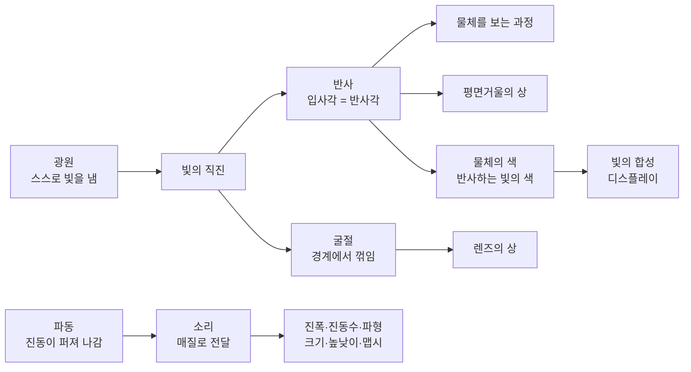

# 중2-3. 빛과 파동 — 보이고 들리는 모든 것의 길

<!-- prev: m1-03 -->
<!-- next: 2-1, 1-4, phy-3, emq-2, mech-3 -->

> [!NOTE]
> **성취기준**
> - **[9과10-01]** 빛의 반사와 굴절의 원리를 이해하고, 물체를 보는 과정을 빛의 경로를 이용하여 표현할 수 있다.
> - **[9과10-02]** 평면거울에서 상이 생기는 원리를 설명하고, 일상생활에서 사용되는 거울과 렌즈의 종류를 분류하고 상의 특징을 비교할 수 있다.
> - **[9과10-03]** 물체의 색을 빛의 반사와 관련지어 설명하고, 영상 장치에서 빛의 합성을 이용하여 다양한 색이 표현되는 원리를 이해할 수 있다.
> - **[9과10-04]** 파동의 발생과 전달 과정을 이해하고, 소리의 특성을 진폭, 진동수, 파형 등의 과학적 용어로 표현할 수 있다.

**학습 목표**

1. 광원에서 나온 빛이 직접 또는 물체에 반사되어 눈에 들어오는 경로를 화살표로 그려, 물체를 보는 과정을 설명할 수 있다.
2. 빛의 반사 법칙과 굴절의 특징(꺾이는 방향)을 실험으로 확인하고, 생활 속 현상을 빛의 경로로 설명할 수 있다.
3. 평면거울에 상이 생기는 원리를 반사 법칙으로 설명하고, 여러 가지 거울과 렌즈를 분류하여 상의 특징을 비교할 수 있다.
4. 물체의 색이 반사하는 빛의 색으로 정해짐을 알고, 영상 장치가 빛의 삼원색을 합성하여 여러 색을 표현하는 원리를 설명할 수 있다.
5. 파동이 매질을 따라 에너지를 전달하는 과정을 설명하고, 소리의 크기·높낮이·맵시를 진폭·진동수·파형으로 표현할 수 있다.

**이 단원의 학습 사다리**

| 단계 | 무엇을 하나? |
|---|---|
| STEP 1. 이전 학습 다시 보기 | 초등학교에서 배운 빛의 직진·굴절, 소리의 떨림과 전달을 다시 꺼내 본다 |
| STEP 2. 기초 다지기 | 광원, 빛의 직진, 법선과 각, '1초에 몇 번'이라는 진동수의 생각을 디딤돌로 놓는다 |
| STEP 3. 핵심 개념 | 물체를 보는 과정 → 반사 → 굴절 → 평면거울의 상 → 거울·렌즈 → 색 → 파동 → 소리 |
| STEP 4. 오개념 바로잡기 | "눈에서 빛이 나간다?", "파동은 물질을 실어 나른다?" 같은 착각을 바로잡는다 |
| STEP 5. 다음 단계로 | 통합과학의 스펙트럼, 물리학의 렌즈 공식과 간섭, 역학과 에너지의 소리 |
| STEP 6. 생활·산업·진로 | 디스플레이, 카메라·안경, 초음파 진단, 음향 기술 |

---

## 🗺️ 단원 들어가기

캄캄한 방에 들어가면 책상 위의 빨간 사과도, 하얀 공책도 보이지 않는다. 그런데 불을 켜는 순간 모든 것이 보인다. 사과와 공책은 스스로 빛을 내지 않는데, 불을 켰을 뿐인데 왜 갑자기 보이게 될까? 그리고 같은 전등 아래에서 사과는 왜 빨갛고 공책은 왜 하얗게 보일까?

이번에는 귀를 기울여 보자. 멀리서 친구가 부르는 소리는 들리지만, 친구의 입김이 내 귀까지 날아오는 것은 아니다. 그렇다면 무엇이 건너온 것일까? 이 단원에서는 **눈에 보이는 것**(빛)과 **귀에 들리는 것**(소리)을 하나의 실로 꿰어 본다. 빛은 반사하고 굴절하며 우리 눈까지 길을 찾아오고, 소리는 공기를 흔들며 **파동**이 되어 귀까지 전해진다.

---

## STEP 1. 🔙 이전 학습 다시 보기

### 연계 개념표

| 이전 단원·성취기준 | 그때 배운 것 | 이 단원에서 확장되는 것 |
|---|---|---|
| 초등학교 5∼6학년군 「빛의 성질」 | 빛은 곧게 나아간다(그림자). 빛은 거울에서 반사되어 방향이 바뀐다 | 반사의 규칙(입사각 = 반사각)과 법선을 이용해 빛의 경로를 정확히 그린다 |
| 초등학교 5∼6학년군 「빛의 성질」 | 빛이 물이나 유리를 지날 때 꺾인다. 프리즘으로 햇빛을 여러 색으로 나눈다. 볼록렌즈로 빛을 모은다 | 꺾이는 **방향**을 법선 기준으로 설명하고, 렌즈와 거울을 상의 특징으로 분류한다. 햇빛이 여러 색의 빛이 합쳐진 것이라는 생각을 '빛의 합성'으로 넓힌다 |
| 초등학교 3∼4학년군 「소리의 성질」 | 소리는 물체의 떨림으로 생기고 공기·물·고체를 통해 전달된다. 소리의 세기와 높낮이 | 떨림이 퍼져 나가는 것을 **파동**으로 이해하고, 세기·높낮이를 **진폭·진동수**로 표현한다. 맵시(파형)를 새로 배운다 |
| 중1 「열」 [9과03-02] | 열은 전도·대류·복사로 전달된다. 복사는 물질 없이도 전달된다 | 빛도 물질 없이 전달되지만, 소리는 반드시 **매질**이 있어야 전달된다는 차이를 비교한다 |

### 준비 운동 (사전 진단)

**Q1.** 해가 비치는 운동장에서 막대를 세우면 그림자가 생긴다. 그림자가 생기는 까닭과 관련 있는 빛의 성질은?

**Q2.** 물이 담긴 컵에 젓가락을 비스듬히 꽂으면 젓가락이 수면에서 꺾여 보인다. 젓가락이 실제로 꺾인 것일까?

**Q3.** 다음 중 소리가 전달되지 **않는** 곳은?
ㄱ. 물속 ㄴ. 철로(레일) ㄷ. 공기가 없는 우주 공간 ㄹ. 실 전화기의 실

정답 및 해설

**Q1. 빛의 직진** — 빛은 곧게 나아가므로 막대에 가로막힌 곳에는 빛이 닿지 않아 어두운 그림자가 생긴다.

**Q2. 아니다** — 젓가락은 곧다. 물속 젓가락에서 나온 빛이 물에서 공기로 나올 때 꺾여(굴절) 눈에 들어오기 때문에 꺾여 보인다. 이 단원 STEP 3 ③에서 자세히 다룬다.

**Q3. ㄷ** — 소리는 떨림을 전해 줄 물질(공기, 물, 고체)이 있어야 전달된다. 우주 공간에는 공기가 거의 없어 소리가 전달되지 않는다.

---

## STEP 2. 🧱 기초 다지기

### ① 광원 — 스스로 빛을 내는 물체

**광원(light source)** 은 스스로 빛을 내는 물체이다. 태양, 전등, 촛불, 스마트폰 화면, 반딧불이가 광원이다. 반면 달, 책, 사과, 거울은 스스로 빛을 내지 않는다. 이런 물체가 보이는 것은 **광원에서 온 빛을 반사하기 때문**이다.

> [!TIP]
> 💡 **비유** — 광원은 '공을 던지는 투수', 광원이 아닌 물체는 '공을 받아 다시 던져 주는 벽'이다. 투수가 없으면(불을 끄면) 벽은 아무것도 돌려줄 수 없다. 그래서 캄캄한 방에서는 책이 보이지 않는다.

### ② 빛은 곧게 나아간다 — 광선으로 그리기

같은 물질 속에서 빛은 곧게 나아간다. 이것을 **빛의 직진**이라고 한다. 이 단원에서는 빛이 나아가는 길을 **화살표가 달린 직선(광선)** 으로 그린다. 화살표 방향이 곧 빛이 가는 방향이다.

- 그림자, 일식과 월식, 구름 사이로 곧게 뻗은 햇살은 빛의 직진으로 설명된다.

### ③ 법선과 각 — 빛의 방향을 재는 기준

빛이 거울이나 물의 표면에 닿을 때, 방향을 비교하려면 기준선이 필요하다. 빛이 닿은 점에서 **표면에 수직으로 세운 가상의 선**을 **법선(normal)** 이라고 한다.

| 용어 | 뜻 |
|---|---|
| 입사 광선 | 표면으로 들어오는 빛 |
| 반사 광선 | 표면에서 되돌아 나가는 빛 |
| 굴절 광선 | 다른 물질 속으로 꺾여 들어간 빛 |
| 입사각 | 입사 광선과 **법선** 사이의 각 |
| 반사각 | 반사 광선과 **법선** 사이의 각 |
| 굴절각 | 굴절 광선과 **법선** 사이의 각 |

> [!IMPORTANT]
> 각은 항상 **표면이 아니라 법선**을 기준으로 잰다. 표면과 이루는 각을 입사각이라고 착각하는 경우가 많다. 표면과 30°를 이루며 들어온 빛의 입사각은 $90° - 30° = 60°$이다.

### ④ '1초에 몇 번?' — 진동과 진동수의 생각

그네를 타는 친구를 떠올려 보자. 한 번 앞으로 갔다가 제자리로 돌아오는 것을 **1회 진동**이라고 한다.

- 1회 진동하는 데 걸리는 시간을 **주기(period)** 라고 한다. 단위는 초(s)이다.
- 1초 동안 진동하는 횟수를 **진동수(frequency)** 라고 한다. 단위는 **헤르츠(Hz)** 이다. 1초에 5번 진동하면 5 Hz이다. (진동수 = 진동 횟수 ÷ 걸린 시간)

예를 들어 10초 동안 20번 진동하면 진동수는 $20 \div 10 = 2\ \mathrm{Hz}$, 주기는 0.5초이다. **진동수가 클수록 주기는 짧다.**

---

## STEP 3. 📘 핵심 개념

### ① 물체를 보는 과정 — 빛이 눈에 들어와야 보인다 [9과10-01]

우리가 물체를 보는 것은 **물체에서 출발한 빛이 우리 눈에 들어오기 때문**이다. 이때 빛이 어디에서 출발하느냐에 따라 두 가지 경우가 있다.

| 경우 | 빛의 경로 | 예 |
|---|---|---|
| 광원을 볼 때 | 광원 → 눈 | 전등, 촛불, 모니터 화면을 볼 때 |
| 광원이 아닌 물체를 볼 때 | 광원 → 물체(반사) → 눈 | 책, 친구의 얼굴, 달을 볼 때 |

빛의 경로를 그릴 때는 다음 순서를 지킨다.

1. **출발점**은 광원이다.
2. 빛은 **직선**으로 나아가고, 물체에 닿으면 방향이 바뀐다.
3. **도착점**은 눈이다. 화살표는 반드시 눈 쪽을 향한다.

예를 들어 달을 보는 과정은 "태양 → 달 표면에서 반사 → 지구에 있는 사람의 눈"이다. 그래서 달은 태양 빛이 닿은 부분만 밝게 보이고, 이것이 중1 「태양계」에서 배운 달의 위상 변화로 이어진다.

> [!WARNING]
> 빛의 경로를 그릴 때 **눈에서 물체 쪽으로 화살표를 그리는 것은 틀린 표현**이다. 눈은 빛을 받아들이는 기관이지 빛을 내보내는 기관이 아니다.

#### 예제 1

캄캄한 방에서 손전등으로 벽에 걸린 그림을 비추었더니 그림이 보였다. 그림을 보는 과정을 빛의 경로로 쓰시오. 또 손전등을 끄면 그림이 보이지 않는 까닭을 설명하시오.

**풀이**
- 경로: 손전등(광원) → 그림에서 반사 → 눈
- 그림은 광원이 아니므로 스스로 빛을 내지 못한다. 손전등을 끄면 그림에 닿는 빛이 없고, 반사되어 눈에 들어오는 빛도 없으므로 보이지 않는다.

### ② 빛의 반사 — 입사각과 반사각은 같다 [9과10-01]

빛이 나아가다가 다른 물체의 표면에 부딪혀 되돌아 나오는 현상을 **빛의 반사(reflection)** 라고 한다. 반사에는 다음 규칙이 있다.

> [!IMPORTANT]
> **반사 법칙**
> 1. 입사 광선, 반사 광선, 법선은 **같은 평면** 위에 있다.
> 2. **입사각 = 반사각**

이 규칙은 반사면이 매끄럽든 울퉁불퉁하든 **빛이 닿는 각 점에서 항상** 성립한다. 그런데 표면 상태에 따라 반사된 빛이 퍼지는 모습은 크게 다르다.

| 구분 | 정반사 | 난반사 |
|---|---|---|
| 표면 | 거울, 잔잔한 수면처럼 매끄럽다 | 종이, 옷, 벽처럼 울퉁불퉁하다 |
| 반사된 빛 | 한 방향으로 나란히 나간다 | 여러 방향으로 흩어진다 |
| 보이는 모습 | 특정 위치에서만 밝게 보이고 상이 비친다 | 어느 방향에서나 물체가 보인다 |
| 예 | 거울에 얼굴이 비친다, 잔잔한 호수에 산이 비친다 | 교실 어디서나 칠판 글씨가 보인다, 영화관 스크린 |

> [!TIP]
> 💡 **비유** — 매끄러운 벽에 탱탱볼을 한 줄로 던지면 모두 같은 방향으로 튀어나온다(정반사). 울퉁불퉁한 돌담에 던지면 공이 사방으로 튄다(난반사). 다만 공 하나하나가 부딪힌 그 자리에서는 '들어온 각 = 나간 각'이 지켜진다.

**난반사 덕분에 우리는 세상을 본다.** 책상, 친구의 얼굴, 나뭇잎은 모두 빛을 난반사하므로 우리가 어느 자리에 있든 반사된 빛 일부가 눈에 들어온다. 만약 모든 물체가 거울처럼 정반사만 한다면, 물체는 보이지 않고 주변의 모습만 비쳐 보일 것이다.

#### 예제 2

빛이 평면거울의 표면과 $35°$를 이루며 들어왔다. (1) 입사각과 (2) 반사각, (3) 입사 광선과 반사 광선 사이의 각을 구하시오.

**풀이**
(1) 입사각은 법선 기준이므로 $90° - 35° = 55°$
(2) 반사각 = 입사각 = $55°$
(3) $55° + 55° = 110°$

### ③ 빛의 굴절 — 경계에서 꺾이는 빛 [9과10-01]

빛이 공기에서 물로, 물에서 공기로처럼 **서로 다른 물질의 경계면을 비스듬히 지날 때 진행 방향이 꺾이는 현상**을 **빛의 굴절(refraction)** 이라고 한다. 빛이 꺾이는 까닭은 **물질에 따라 빛의 속력이 다르기 때문**이다. 빛은 공기 속에서보다 물이나 유리 속에서 더 느리게 나아간다.

| 빛이 지나는 방향 | 꺾이는 방향 | 각의 크기 비교 |
|---|---|---|
| 공기 → 물(유리) | **법선 쪽으로** 꺾인다 | 입사각 > 굴절각 |
| 물(유리) → 공기 | **법선에서 멀어지게** 꺾인다 | 입사각 < 굴절각 |
| 경계면에 수직으로 들어올 때 | 꺾이지 않고 곧게 지난다 | 입사각 = 굴절각 = 0° |

> [!TIP]
> 💡 **비유** — 모래사장과 아스팔트 경계를 비스듬히 지나는 바퀴 달린 장난감 자동차를 떠올려 보자. 모래에 먼저 닿은 쪽 바퀴가 먼저 느려지므로 자동차가 방향을 틀게 된다. 빛도 느려지는 물질(물)에 들어가면 법선 쪽으로 방향이 꺾인다.

굴절 때문에 생기는 착시는 **"눈은 빛이 곧게 왔다고 믿는다"** 는 것으로 설명할 수 있다. 꺾여서 들어온 빛을 거꾸로 곧게 연장한 곳에 물체가 있는 것처럼 보인다.

| 생활 속 현상 | 빛의 경로로 설명하기 |
|---|---|
| 물컵 속 젓가락이 꺾여 보인다 | 물속 젓가락에서 나온 빛이 물→공기로 나오며 법선에서 멀어지게 꺾인다. 눈은 연장선 위, 실제보다 **얕은 곳**에 젓가락이 있다고 느낀다 |
| 수영장 바닥이 실제보다 얕아 보인다 | 바닥에서 나온 빛이 수면에서 꺾여 들어와 바닥이 떠 보인다. 깊이를 얕보고 들어가면 위험하다 |
| 컵 바닥의 동전이 물을 부으면 보이기 시작한다 | 물이 없을 때는 컵 벽에 가려 동전의 빛이 눈에 못 오지만, 물을 부으면 빛이 수면에서 꺾여 눈에 들어온다 |

#### 예제 3 — 동전이 떠오르는 컵

불투명한 컵 바닥에 동전을 놓고, 동전이 컵 가장자리에 막 가려 보이지 않는 위치에 눈을 두었다. 컵에 물을 천천히 부으면 어떤 일이 일어나는지 빛의 경로로 설명하시오.

**풀이** 물이 없을 때 동전에서 눈 쪽으로 곧게 가는 빛은 컵 가장자리에 가로막힌다. 물을 부으면 동전에서 나온 빛이 수면을 지나 공기로 나올 때 **법선에서 멀어지는 쪽**(수면에 더 눕는 쪽, 즉 컵 바깥쪽)으로 꺾여 컵 가장자리를 넘어 눈에 들어온다. 눈은 그 빛이 곧게 온 것으로 여기므로 동전이 원래보다 **위로 떠오른 곳**에 보인다.

> [!NOTE]
> 굴절이 얼마나 일어나는지를 계산하는 식(굴절 법칙)은 이 단원에서 다루지 않는다. 지금은 **어느 쪽으로 꺾이는지**와 **그 때문에 무엇이 어떻게 보이는지**를 설명할 수 있으면 충분하다.

### ④ 평면거울에 생기는 상 — 거울 속의 '나'는 어디에 있을까? [9과10-02]

거울을 볼 때 우리는 거울 **속**에 내 모습이 있는 것처럼 느낀다. 이처럼 거울이나 렌즈를 통해 보이는 물체의 모습을 **상(image)** 이라고 한다.

평면거울에서 상이 생기는 과정을 반사 법칙으로 따라가 보자.

1. 물체의 한 점(예: 코끝)에서 여러 방향으로 빛이 나와 거울에 닿는다.
2. 각 빛은 거울에서 **입사각 = 반사각**으로 반사되어 눈에 들어온다.
3. 눈은 빛이 곧게 왔다고 믿으므로, 반사 광선을 **거울 뒤쪽으로 곧게 연장**한다.
4. 연장선들이 거울 뒤의 **한 점에서 만난다.** 눈은 그곳에 코끝이 있다고 느낀다. 이 점이 코끝의 상이다.

이렇게 물체의 모든 점에 대해 상을 찾으면, 평면거울에 생기는 상의 특징을 알 수 있다.

| 평면거울에 생기는 상의 특징 | 설명 |
|---|---|
| 크기 | 물체와 **같다** |
| 거리 | 상은 거울 뒤쪽, 물체와 거울 사이의 거리와 **같은 거리**에 생긴다 |
| 방향 | 바로 서 있다(위아래가 뒤집히지 않는다) |
| 좌우 | 좌우가 **바뀐 것처럼** 보인다. 오른손을 들면 거울 속의 나는 왼손을 든 것처럼 보인다 |
| 보이는 까닭 | 반사 광선을 거울 뒤쪽으로 곧게 연장한 선들이 만나는 곳에 물체가 있는 것처럼 보이는 것이다. 빛이 실제로 거울 뒤로 가는 것은 아니다 |

> [!TIP]
> 💡 구급차 앞쪽에 `AMBULANCE`라는 글자를 **좌우를 뒤집어** 써 놓는 까닭이 바로 이것이다. 앞차 운전자가 백미러(평면거울에 가까운 거울)로 보면 글자가 바르게 읽힌다.

#### 예제 4

민지가 평면거울에서 2 m 떨어진 곳에 서 있다.
(1) 민지의 상은 거울에서 몇 m 떨어진 곳에 생기는가?
(2) 민지와 민지의 상 사이의 거리는 몇 m인가?
(3) 민지가 거울 쪽으로 0.5 m 걸어가면 민지와 상 사이의 거리는 몇 m가 되는가?

**풀이**
(1) 상은 거울 뒤, 물체와 같은 거리에 생기므로 2 m
(2) $2 + 2 = 4\ \mathrm{m}$
(3) 거울까지 거리가 $2 - 0.5 = 1.5\ \mathrm{m}$가 되므로, 민지와 상 사이의 거리는 $1.5 \times 2 = 3\ \mathrm{m}$이다. 내가 0.5 m 다가가면 상도 0.5 m 다가오므로 둘 사이 거리는 1 m 줄어든다.

### ⑤ 여러 가지 거울과 렌즈 — 생김새로 분류하고 상을 비교하기 [9과10-02]

거울은 빛을 **반사**시켜 상을 만들고, 렌즈는 빛을 **굴절**시켜 상을 만든다. 생김새에 따라 다음과 같이 분류한다.

| 종류 | 생김새 | 빛을 어떻게 바꾸나? |
|---|---|---|
| 평면거울 | 반사면이 평평하다 | 나란한 빛이 나란하게 반사된다 |
| 오목거울 | 반사면이 안쪽으로 오목하다(숟가락의 안쪽) | 나란한 빛을 **한 점으로 모은다** |
| 볼록거울 | 반사면이 바깥쪽으로 볼록하다(숟가락의 바깥쪽) | 나란한 빛을 **퍼지게** 반사한다 |
| 볼록렌즈 | 가운데가 가장자리보다 두껍다 | 나란한 빛을 굴절시켜 **한 점으로 모은다** |
| 오목렌즈 | 가운데가 가장자리보다 얇다 | 나란한 빛을 굴절시켜 **퍼지게** 한다 |

> [!TIP]
> 💡 **기억하기** — '오목거울'과 '볼록렌즈'는 빛을 **모으는** 짝, '볼록거울'과 '오목렌즈'는 빛을 **퍼뜨리는** 짝이다. 거울과 렌즈는 이름이 반대로 짝지어진다.

이제 각각에 비친(또는 보이는) 상의 특징을 비교해 보자. 상의 위치나 크기를 계산하지 않고, **보이는 모습의 특징**만 비교한다.

| 종류 | 물체가 가까이 있을 때 | 물체가 멀리 있을 때 | 생활 속 쓰임 |
|---|---|---|---|
| 평면거울 | 같은 크기, 바로 선 모습 | 같은 크기, 바로 선 모습 | 화장대 거울, 잠망경, 자동차 실내 백미러 |
| 오목거울 | **크고 바로 선** 모습 | **거꾸로 선** 모습(크기는 거리에 따라 다르다) | 화장용 확대 거울, 손전등·전조등의 반사판, 태양열 조리기 |
| 볼록거울 | 작고 바로 선 모습 | 더 작고 바로 선 모습 | 굽은 길의 도로 반사경, 자동차 측면 거울, 가게의 감시용 거울 |
| 볼록렌즈 | **크고 바로 선** 모습 | **거꾸로 선** 모습(크기는 거리에 따라 다르다) | 돋보기, 원시용 안경, 카메라·현미경·망원경의 렌즈 |
| 오목렌즈 | 작고 바로 선 모습 | 더 작고 바로 선 모습 | 근시용 안경, 현관문 보안 렌즈(문 바깥을 넓게 본다) |

> [!IMPORTANT]
> - 볼록거울과 오목렌즈는 물체가 어디에 있든 **항상 작고 바로 선** 모습이 보인다. 그 대신 **넓은 범위**를 한눈에 볼 수 있다. 그래서 굽은 길 반사경이나 자동차 측면 거울에 쓴다.
> - 오목거울과 볼록렌즈는 물체가 가까우면 **크게** 보여 확대에 쓰이고, 멀면 거꾸로 선 모습이 보인다.

> [!WARNING]
> 자동차 측면 거울에 "사물이 거울에 보이는 것보다 가까이 있음"이라고 적혀 있는 것은 볼록거울이 물체를 **작게** 보여 주어 실제보다 멀리 있는 것처럼 느껴지기 때문이다. 차선을 바꿀 때 특히 주의해야 한다.

#### 예제 5

다음 상황에 알맞은 거울이나 렌즈를 고르고 그 까닭을 쓰시오.
(1) 아파트 지하 주차장의 굽은 통로에서 반대편 차를 넓게 보고 싶다.
(2) 작은 글씨를 크게 확대해서 읽고 싶다.

**풀이**
(1) 볼록거울 — 상은 작아지지만 넓은 범위가 보인다.
(2) 볼록렌즈(돋보기) — 물체를 가까이 두면 크고 바로 선 모습이 보인다. (화장용 오목거울도 얼굴을 크게 보여 주지만, 글씨를 렌즈 너머로 보려면 볼록렌즈가 알맞다.)

### ⑥ 빛의 합성과 물체의 색 — 색은 '반사한 빛'이 정한다 [9과10-03]

초등학교에서 햇빛을 프리즘에 통과시키면 빨강부터 보라까지 여러 색의 빛으로 나뉘는 것을 보았다. 거꾸로 생각하면, **햇빛(백색광)은 여러 색의 빛이 합쳐진 것**이다.

두 가지 이상의 색의 빛이 합쳐져 다른 색으로 보이는 현상을 **빛의 합성(addition of light)** 이라고 한다. 빨간색(R), 초록색(G), 파란색(B) 빛을 적절히 합치면 거의 모든 색을 만들 수 있어서, 이 세 빛을 **빛의 삼원색(three primary colors of light)** 이라고 한다.

| 합성하는 빛 | 보이는 색 |
|---|---|
| 빨강 + 초록 | 노랑 |
| 초록 + 파랑 | 청록(사이안) |
| 빨강 + 파랑 | 자홍(마젠타) |
| 빨강 + 초록 + 파랑 | 흰색 |

이제 물체의 색을 설명해 보자. 물체에 백색광이 비치면 물체는 어떤 색의 빛은 **반사**하고 나머지는 **흡수**한다. 우리 눈에 들어오는 것은 반사된 빛이므로, **물체의 색은 물체가 반사하는 빛의 색**이다.

| 물체(백색광 아래) | 반사하는 빛 | 흡수하는 빛 | 보이는 색 |
|---|---|---|---|
| 빨간 사과 | 빨강 | 초록, 파랑 | 빨강 |
| 초록 나뭇잎 | 초록 | 빨강, 파랑 | 초록 |
| 노란 바나나 | 빨강, 초록 | 파랑 | 노랑 |
| 흰 종이 | 빨강, 초록, 파랑(모두) | 없음 | 흰색 |
| 검은 옷 | 거의 없음 | 거의 모두 | 검은색 |

그렇다면 **비추는 빛의 색이 바뀌면** 어떻게 될까? 물체는 자기가 반사할 수 있는 빛이 비칠 때만 그 색으로 보인다.

| 비추는 빛 | 빨간 사과 | 흰 종이 | 초록 나뭇잎 | 노란 바나나 |
|---|---|---|---|---|
| 빨간빛 | 빨강 | 빨강 | 검정 | 빨강 |
| 초록빛 | 검정 | 초록 | 초록 | 초록 |
| 파란빛 | 검정 | 파랑 | 검정 | 검정 |

#### 예제 6

흰 종이에 빨간 글씨와 파란 글씨가 쓰여 있다. 이 종이를 빨간빛으로만 비추면 각각 어떻게 보이는가?

**풀이** 흰 종이는 빨간빛을 반사하므로 빨갛게 보인다. 빨간 글씨도 빨간빛을 반사하므로 빨갛게 보여 **종이와 구별되지 않아 사라진 것처럼** 보인다. 파란 글씨는 빨간빛을 흡수하므로 **검게** 보여 또렷이 읽힌다.

### ⑦ 영상 장치의 색 — 세 가지 빛으로 수많은 색을 [9과10-03]

스마트폰이나 텔레비전 화면을 돋보기로 아주 가까이 들여다보면, 작은 점들이 빽빽하게 늘어서 있다. 이 점 하나를 **화소(pixel, 픽셀)** 라고 하고, 화소 하나는 다시 **빨강·초록·파랑의 작은 발광 부분**으로 이루어져 있다.

영상 장치는 빛의 삼원색 각각의 **밝기를 조절**하여 수많은 색을 만든다. 점들이 너무 작고 촘촘해서 우리 눈은 가까이 있는 세 빛을 따로 구별하지 못하고 **합성된 하나의 색**으로 느낀다.

| 화면에 보이는 색 | 켜진 빛(밝기) |
|---|---|
| 흰색 | 빨강·초록·파랑 모두 밝게 |
| 검은색 | 모두 끔 |
| 노란색 | 빨강·초록 밝게, 파랑 끔 |
| 하늘색 | 초록·파랑 밝게, 빨강 조금 |

> [!NOTE]
> 많은 디지털 기기는 빨강·초록·파랑 각각의 밝기를 0부터 255까지 256단계로 나누어 정한다. 그러면 만들 수 있는 색의 수는 $256 \times 256 \times 256 = 16\,777\,216$, 약 1700만 가지이다. 그림 프로그램에서 색을 고를 때 보이는 `R 255 G 255 B 0` 같은 숫자가 이것이다(이 경우 노랑).

### ⑧ 파동의 발생과 전달 — 물질은 제자리, 에너지는 멀리 [9과10-04]

잔잔한 연못에 돌을 던지면 동그란 물결이 퍼져 나간다. 이처럼 **한 곳에서 생긴 진동이 주위로 퍼져 나가는 현상**을 **파동(wave)** 이라고 한다.

| 용어 | 뜻 | 연못 물결의 예 |
|---|---|---|
| **파원(wave source)** | 파동이 처음 생긴 곳 | 돌이 떨어진 곳 |
| **매질(medium)** | 파동을 전달해 주는 물질 | 물 |
| 전달되는 것 | 진동과 **에너지** | 물결이 멀리 있는 나뭇잎을 흔든다 |

파동에서 가장 중요한 사실은 다음과 같다.

> [!IMPORTANT]
> 파동이 퍼져 나갈 때 **매질은 제자리에서 진동할 뿐 파동과 함께 이동하지 않는다.** 파동을 따라 멀리 전달되는 것은 **에너지**(와 진동의 모양)이다.

물에 떠 있는 나뭇잎을 보면 확인할 수 있다. 물결이 지나가도 나뭇잎은 제자리에서 오르락내리락할 뿐, 물결을 따라 멀리 떠내려가지 않는다. 경기장의 '파도타기 응원'도 같다. 관중은 자기 자리에서 일어났다 앉을 뿐인데, 파도 모양은 경기장을 한 바퀴 돈다.

| 생활 속 파동 | 매질 | 전달되는 에너지·정보 |
|---|---|---|
| 물결파 | 물 | 물 위의 물체를 흔든다 |
| 소리(음파) | 공기, 물, 고체 | 고막을 진동시켜 소리를 듣게 한다 |
| 지진파 | 땅(암석) | 건물을 흔든다 |
| 빛, 전파 | 매질이 **없어도** 된다 | 햇빛이 우주를 지나 지구를 데운다, 휴대 전화 통신 |

### ⑨ 파동을 나타내는 말 — 마루·골·진폭·파장·진동수 [9과10-04]

긴 줄의 한쪽 끝을 위아래로 일정하게 흔들면, 줄에 물결 모양이 만들어져 퍼져 나간다. 이 모양을 그래프처럼 나타내고 각 부분에 이름을 붙인다.

| 용어 | 뜻 | 줄 파동에서 찾기 |
|---|---|---|
| **마루(crest)** | 파동에서 가장 높은 곳 | 물결의 꼭대기 |
| **골(trough)** | 파동에서 가장 낮은 곳 | 물결의 바닥 |
| **진폭(amplitude)** | 진동의 중심에서 마루(또는 골)까지의 높이 | 줄을 얼마나 **크게** 흔드는가 |
| **파장(wavelength)** | 이웃한 마루와 마루(또는 골과 골) 사이의 거리 | 물결 한 개의 길이 |
| **진동수(frequency)** | 매질의 한 점이 1초 동안 진동하는 횟수(Hz) | 줄을 1초에 몇 번 흔드는가 |
| 주기(period) | 매질의 한 점이 1회 진동하는 데 걸리는 시간(s) | 한 번 흔드는 데 걸리는 시간 |

> [!WARNING]
> **진폭은 마루에서 골까지의 높이가 아니다.** 진동의 중심선에서 마루까지의 높이이다. 마루에서 골까지의 높이가 20 cm이면 진폭은 그 절반인 10 cm이다.

같은 줄을 같은 방법으로 흔들 때 다음과 같은 관계를 관찰할 수 있다.

- 줄을 **더 크게** 흔들면 진폭과 전달되는 에너지가 커지고, **더 자주** 흔들면 진동수가 커지며 파장은 **짧아진다**(물결이 촘촘해진다).

#### 예제 7

줄의 한쪽 끝을 4초 동안 12번 위아래로 흔들었더니 줄에 물결이 생겼다. 이웃한 두 마루 사이의 거리는 50 cm였고, 마루에서 골까지의 높이는 16 cm였다.
(1) 진동수 (2) 주기 (3) 파장 (4) 진폭을 구하시오.

**풀이**
(1) $12 \div 4 = 3\ \mathrm{Hz}$
(2) 1초에 3번 진동하므로 1번 진동하는 데 $1 \div 3 \approx 0.33$초
(3) 이웃한 마루 사이 거리이므로 50 cm
(4) 마루에서 골까지의 절반이므로 $16 \div 2 = 8\ \mathrm{cm}$

### ⑩ 소리 — 공기를 흔드는 파동과 소리의 3요소 [9과10-04]

소리는 물체의 **진동**으로 생긴다. 스피커의 진동판이나 기타 줄, 우리 목의 성대가 떨리면 주변 공기가 밀렸다 당겨지기를 반복하고, 이 진동이 공기를 따라 퍼져 나간다. 이것이 **음파(sound wave)** 이다. 음파가 귀에 도착하면 고막을 진동시키고, 이 진동이 뇌에 전달되어 소리를 듣는다.

- 소리는 **매질이 있어야** 전달된다. 진공 속에서는 소리가 전달되지 않는다.
- 소리가 전달되는 빠르기는 매질에 따라 다르다. 공기 속에서는 1초에 약 340 m를 가고, 일반적으로 물이나 고체 속에서 더 빠르다. 철로에 귀를 대면 기차 소리를 더 빨리 들을 수 있는 까닭이다.
- 빛(1초에 약 30만 km)은 소리보다 훨씬 빠르다. 그래서 번개가 먼저 보이고 천둥소리가 나중에 들린다.

#### 예제 8 — 천둥까지의 거리

번개가 친 뒤 3초 만에 천둥소리가 들렸다. 공기 중 소리의 속력을 340 m/s라고 할 때, 번개가 친 곳까지의 거리는 약 몇 m인가? (빛이 오는 데 걸린 시간은 무시한다.)

**풀이** 거리 = 속력 × 시간 = $340 \times 3 = 1020\ \mathrm{m}$, 약 1 km이다. "번개와 천둥 사이 초를 세어 3으로 나누면 대략 몇 km인지 알 수 있다"는 생활 요령이 여기서 나온다.

이제 소리를 구별하는 세 가지 특성, **소리의 3요소**를 파동의 용어로 나타내 보자. 마이크와 소리 분석 앱(디지털 탐구 도구)을 쓰면 소리를 그래프(파형)로 볼 수 있다.

| 소리의 특성 | 결정하는 것 | 파형에서 보이는 모습 | 예 |
|---|---|---|---|
| 소리의 **크기(세기)** | **진폭** | 진폭이 클수록 위아래로 크게 출렁인다 → 큰 소리 | 북을 세게 치면 큰 소리 |
| 소리의 **높낮이** | **진동수** | 진동수가 클수록 물결이 촘촘하다 → 높은 소리 | 기타의 가는 줄, 짧은 줄은 높은 소리 |
| 소리의 **맵시(음색)** | **파형** | 물결의 모양 자체가 다르다 | 같은 '도'라도 피아노와 바이올린 소리가 다르다 |

> [!TIP]
> 💡 **비유** — 소리의 3요소를 사람의 '목소리'로 생각해 보자. 소리를 지르면 **크기**(진폭)가 커지고, 노래에서 고음을 내면 **높낮이**(진동수)가 올라간다. 그런데 친구가 같은 크기, 같은 높이로 "도"를 불러도 누구 목소리인지 알아들을 수 있다. 사람마다 목소리의 **맵시**(파형)가 다르기 때문이다.

사람이 들을 수 있는 소리의 진동수는 대략 20 Hz에서 20 000 Hz 사이이다(나이가 들면 높은 소리를 잘 못 듣게 된다). 이보다 진동수가 큰 소리를 **초음파(ultrasound)** 라고 한다. 박쥐와 돌고래는 초음파를 내고, 되돌아오는 소리로 먹이와 장애물을 찾는다.

#### 예제 9 — 파형 비교하기

같은 시간 동안 소리 분석 앱으로 소리 A, B, C를 측정하였다.
- A: 물결 4개, 위아래 높이 작음
- B: 물결 4개, 위아래 높이 큼
- C: 물결 8개, 위아래 높이 작음 (A와 같은 높이)

(1) 가장 큰 소리 (2) 가장 높은 소리 (3) A와 높낮이가 같은 소리를 고르시오.

**풀이**
(1) B — 진폭이 가장 크다.
(2) C — 같은 시간 동안 물결 수가 많으므로 진동수가 가장 크다.
(3) B — 물결 수(진동수)가 A와 같다. B는 A와 높이는 같고 더 큰 소리이다.

---

## STEP 4. ⚠️ 오개념 바로잡기

| 흔한 오개념 | 올바른 개념 | 왜 그럴까? |
|---|---|---|
| 눈에서 무언가가 나가서 물체를 보는 것이다 | 물체에서 출발한 빛이 **눈으로 들어와야** 보인다 | 캄캄한 방에서는 눈을 크게 떠도 아무것도 보이지 않는다. 눈은 빛을 받는 기관이다 |
| 울퉁불퉁한 면에서는 반사 법칙이 성립하지 않는다 | 난반사에서도 빛이 닿는 **각 점마다** 입사각 = 반사각이다 | 점마다 법선의 방향이 달라서 반사된 빛이 여러 방향으로 흩어질 뿐이다 |
| 물속 젓가락은 실제로 휘어진 것이다 | 젓가락은 곧고, **빛의 경로가 꺾여서** 꺾여 보인다 | 눈은 빛이 곧게 왔다고 믿고 연장선 위에 물체가 있다고 느낀다 |
| 평면거울의 상은 거울 표면에 붙어 있다 | 상은 거울 **뒤쪽**, 물체와 거울 사이 거리만큼 떨어진 곳에 생긴다 | 거울에서 멀어지면 상도 똑같이 멀어지는 것으로 확인할 수 있다 |
| 빨강·초록·파랑 빛을 섞으면 물감처럼 검게 된다 | 빛은 합성할수록 **밝아지며** 세 빛을 합치면 흰색이 된다 | 물감은 빛을 흡수하고, 빛의 합성은 빛을 더한다 |
| 파동이 지나가면 매질도 함께 멀리 이동한다 | 매질은 **제자리에서 진동**하고, 에너지가 전달된다 | 물결 위의 나뭇잎은 떠내려가지 않고 오르락내리락한다 |
| 큰 소리가 높은 소리이다 | 소리의 크기는 **진폭**, 높낮이는 **진동수**로 서로 다른 특성이다 | 작은 소리로 높은 음을, 큰 소리로 낮은 음을 낼 수 있다 |

---

## STEP 5. 🎓 다음 단계로 한 걸음 더

> [!CAUTION]
> 이 절은 **중학교 교육과정 범위 밖의 심화 내용**으로 평가 대상이 아니다. 지금 배운 빛과 파동의 개념이 고등학교에서 어떻게 이어지는지 맛보기로 보여 주기 위한 것이다.

### 다음 학년·과목과의 연결

| 단계 | 단원 | 이어지는 내용 |
|---|---|---|
| 고1 통합과학1 | 「빛의 스펙트럼과 우주 초기 원소」 | 프리즘으로 나눈 빛의 띠(스펙트럼)를 분석해 멀리 있는 별의 성분을 알아낸다 |
| 고1 통합과학1 | 「정보와 신호: 아날로그에서 디지털로」 | 마이크가 소리(파동)를 전기 신호로 바꾸고, 0과 1의 디지털 신호로 저장·전송한다 |
| 고2 물리학 | 「빛과 물질」 | 빛의 간섭으로 보는 파동성, 볼록렌즈에서 상이 맺히는 과정, 디스플레이와 반도체 |
| 고2·3 전자기와 양자 | 「빛과 정보 통신」 | 렌즈와 거울을 이용한 광학 기기와 수차, 편광, 레이저와 광통신 |
| 고2·3 역학과 에너지 | 「탄성파와 소리」 | 소리의 반사·투과, 도플러 효과, 소음 제어, 악기의 원리(정상파) |

### ① 굴절은 '얼마나' 꺾일까? — 굴절률

이 단원에서는 굴절의 **방향**만 다루었다. 고등학교에서는 물질마다 빛이 얼마나 느려지는지를 **굴절률**이라는 수로 나타내고, 꺾이는 정도를 식(스넬 법칙)으로 계산한다. 물의 굴절률은 약 1.33, 유리는 약 1.5이다. 물속에서 빛의 속력은 진공에서의 약 $\dfrac{1}{1.33}$, 즉 약 75%이다.

### ② 상의 위치를 계산하기 — 렌즈 공식과 실상·허상

이 단원에서는 상의 특징을 '크다·작다, 바로 섰다·거꾸로 섰다'로만 비교했다. 고등학교에서는 렌즈의 초점 거리와 물체·상까지의 거리 사이의 관계식(렌즈 공식)으로 상의 위치와 크기를 계산하고, 빛이 실제로 모여 생기는 **실상**과 연장선이 만나 생기는 **허상**을 구분한다. 이 단원 ④의 평면거울 상이 바로 허상이다.

### ③ 파동의 빠르기 = 진동수 × 파장

파동은 1회 진동하는 동안 한 파장만큼 나아간다. 그래서 다음 관계가 성립한다.

$$
v = f\lambda \qquad (\text{파동의 속력} = \text{진동수} \times \text{파장})
$$

공기 중 소리의 속력이 약 340 m/s일 때 진동수 340 Hz인 소리의 파장은 1 m이다. 높은 소리일수록 파장이 짧은 까닭이 여기에 있다. 고등학교에서는 파동이 겹칠 때 커지거나 작아지는 **간섭**을 배우고, 이것을 이용한 소음 제거 헤드폰, 비눗방울의 무지갯빛, 홀로그램을 이해하게 된다. 또 이 단원에서 구분하지 않은 **횡파**(진동 방향과 진행 방향이 수직)와 **종파**(진동 방향과 진행 방향이 나란함)를 구분하게 된다. 공기 속 소리는 종파이다.

### 지금 vs 다음 단계

| 구분 | 중학교 2학년(지금) | 고등학교 물리학·진로 선택 |
|---|---|---|
| 반사·굴절 | 반사 법칙, 굴절의 방향(정성적) | 굴절률, 스넬 법칙, 전반사와 광섬유 |
| 거울·렌즈 | 종류 분류, 상의 특징 비교 | 렌즈 공식, 배율, 실상과 허상, 수차 |
| 색 | 물체의 색, 빛의 삼원색과 합성 | 스펙트럼, 빛의 에너지와 광전 효과, 디스플레이 소자 |
| 파동 | 매질, 진폭, 진동수, 파장, 파형 | $v = f\lambda$, 횡파와 종파, 간섭·회절, 정상파, 도플러 효과 |

---

## STEP 6. 🏭 생활·산업·진로 연결

### 사례 1. 디스플레이 — 빛의 삼원색을 다스리는 기술

- **원리** 화소마다 빨강·초록·파랑 빛의 밝기를 따로 조절해 색을 합성한다(STEP 3 ⑦).
- **어디에 쓰이나** 스마트폰, 텔레비전, 모니터, 전광판. 화소가 작고 촘촘할수록(해상도가 높을수록) 눈이 점을 구별하지 못해 화면이 매끄럽게 보인다.
### 사례 2. 카메라와 안경 — 렌즈가 빛을 모으고 퍼뜨린다

- **원리** 볼록렌즈는 빛을 모으고, 오목렌즈는 빛을 퍼뜨린다(STEP 3 ⑤).
- **어디에 쓰이나** 스마트폰 카메라는 여러 장의 렌즈를 겹쳐 빛을 이미지 센서에 모은다. 가까운 것은 잘 보이지만 먼 것이 흐린 **근시**는 오목렌즈 안경으로, 먼 것은 잘 보이지만 가까운 것이 흐린 **원시**는 볼록렌즈 안경으로 교정한다.

### 사례 3. 초음파 진단과 음파 탐지 — 들리지 않는 소리로 보기

- **원리와 쓰임** 사람이 듣지 못하는 높은 진동수의 소리(초음파)를 보내고 반사되어 돌아오는 소리를 분석한다. 병원의 초음파 검사, 배의 어군 탐지기와 수심 측정, 자동차 후방 감지기에 쓰인다.

### 관련 진로와 학과

| 진로 | 하는 일 | 관련 학과 |
|---|---|---|
| 디스플레이·광학 엔지니어 | 화면 소자, 카메라 렌즈, 조명 설계 | 전자공학, 물리학, 광학공학, 신소재공학 |
| 안경사·안과 의사·의료 영상 기사 | 시력 검사와 렌즈 처방, 초음파 영상으로 몸속 관찰 | 안경광학과, 의학, 방사선학, 의공학 |
| 음향 엔지니어 | 공연장 음향 설계, 녹음, 소음 저감 | 음향공학, 전자공학, 건축공학 |

---

## 🔬 탐구 활동 — 거울과 렌즈에 의한 상, 소리의 진폭·진동수·파형 탐구하기

### 활동 A. 거울과 렌즈로 본 상의 특징 비교하기

**목표** 여러 가지 거울과 렌즈로 물체를 보며, 물체와의 거리에 따라 상의 특징이 어떻게 다른지 비교하고 분류한다.

**준비물** 평면거울, 오목거울, 볼록거울(또는 숟가락의 안쪽·바깥쪽), 볼록렌즈, 오목렌즈, 글자 카드(예: '과학 F'), 자

**과정**
1. 글자 카드를 거울(렌즈)에 바짝 붙였다가 30 cm, 1 m 정도로 천천히 멀리하며 상을 관찰한다. 렌즈는 렌즈를 눈 가까이 들고 카드를 보며 렌즈와 카드 사이 거리를 바꾼다.
2. 상의 **크기**(물체보다 큰가, 같은가, 작은가)와 **방향**(바로 섰나, 거꾸로 섰나)을 기록한다.
3. 같은 특징을 보이는 것끼리 묶어 분류 기준을 정한다.

**결과 기록**

| 종류 | 가까울 때 크기 | 가까울 때 방향 | 멀 때 크기 | 멀 때 방향 |
|---|---|---|---|---|
| 평면거울 | | | | |
| 오목거울 | | | | |
| 볼록거울 | | | | |
| 볼록렌즈 | | | | |
| 오목렌즈 | | | | |

**생각해 보기**
1. 물체와의 거리와 상관없이 항상 작고 바로 선 상이 보이는 것은 무엇과 무엇인가? 이 둘의 공통점은 무엇인가?
2. 평면거울에서 '과학 F'라는 글자는 어떻게 보였는가? 좌우가 바뀐 것처럼 보이는 까닭을 반사 법칙으로 설명해 보자.

> [!WARNING]
> **안전 수칙** 볼록렌즈나 오목거울로 **햇빛을 모으지 않는다.** 빛이 모인 곳은 매우 뜨거워져 화상이나 화재가 날 수 있다. 렌즈나 거울로 태양을 직접 보면 눈을 크게 다친다. 유리 거울은 떨어뜨리지 않도록 조심한다.

### 활동 B. 디지털 탐구 도구로 소리의 파형 분석하기

**목표** 스마트폰 소리 분석 앱이나 마이크 센서로 여러 소리의 파형을 보고, 진폭·진동수·파형을 비교한다.

**준비물** 소리 분석 앱이 설치된 스마트폰(또는 컴퓨터와 마이크 센서), 소리굽쇠 또는 기타·리코더 등 악기, 고무망치

**과정**
1. 같은 소리굽쇠를 약하게 칠 때와 세게 칠 때의 파형을 저장한다.
2. 진동수가 다른 두 소리굽쇠(또는 같은 악기의 낮은 '도'와 높은 '도')의 파형을 저장한다.
3. 서로 다른 악기로 같은 높이의 음을 내어 파형을 저장한다. 친구 두 명의 "아" 소리도 비교해 본다.
4. 파형에서 같은 시간 동안 물결의 수와 위아래 높이를 비교한다.

**결과 기록**

| 비교한 소리 | 진폭(크다/작다) | 같은 시간 동안 물결 수 | 파형 모양 | 들린 느낌 |
|---|---|---|---|---|
| 소리굽쇠 약하게 / 세게 | | | | |
| 낮은 음 / 높은 음 | | | | |
| 악기 1 / 악기 2 | | | | |

**생각해 보기**
1. 세게 친 소리와 약하게 친 소리의 파형에서 무엇이 달랐는가? 진동수는 달라졌는가?
2. 높은 음의 파형이 낮은 음보다 촘촘했는가? 이것을 진동수라는 말로 설명해 보자.

> [!WARNING]
> **안전 수칙** 이어폰을 끼고 큰 소리를 오래 듣지 않는다. 큰 소리는 청각을 손상시킬 수 있다. 소리굽쇠는 고무망치로만 치고 책상 모서리에 내리치지 않는다.

---

## ✅ 개념 확인 문제

### 기본

**1.** 다음 중 광원이 **아닌** 것을 모두 고르시오.
ㄱ. 태양 ㄴ. 달 ㄷ. 켜진 스마트폰 화면 ㄹ. 거울 ㅁ. 촛불

정답 및 해설

**정답 ㄴ, ㄹ**

달과 거울은 스스로 빛을 내지 않는다. 달은 햇빛을 반사하여 보이고, 거울은 다른 물체에서 온 빛을 반사한다.

**2.** 빛이 평면거울에 입사각 $40°$로 들어왔다. 반사각과, 반사 광선이 거울 표면과 이루는 각을 각각 구하시오.

정답 및 해설

**정답** 반사각 $40°$, 거울 표면과 이루는 각 $50°$

반사 법칙에 따라 반사각 = 입사각 = $40°$이다. 반사각은 법선과의 각이므로 거울 표면과 이루는 각은 $90° - 40° = 50°$이다.

**3.** 빛의 삼원색 중 빨간빛과 초록빛을 흰 스크린에 겹쳐 비추면 겹친 부분은 무슨 색으로 보이는가?

정답 및 해설

**정답** 노란색

빛의 합성에서 빨강 + 초록 = 노랑이다.

**4.** 줄을 흔들어 만든 파동에서 이웃한 두 골 사이의 거리가 30 cm이고, 줄의 한 점이 5초 동안 10번 진동했다. 이 파동의 파장과 진동수를 구하시오.

정답 및 해설

**정답** 파장 30 cm, 진동수 2 Hz

파장은 이웃한 골과 골 사이의 거리이다. 진동수는 $10 \div 5 = 2\ \mathrm{Hz}$이다.

### 응용

**5.** 노란 바나나를 (1) 빨간빛, (2) 파란빛으로 각각 비추면 무슨 색으로 보이는가? 그 까닭도 쓰시오. (노란 바나나는 백색광 중 빨간빛과 초록빛을 반사한다고 한다.)

정답 및 해설

**정답** (1) 빨간색 (2) 검은색

(1) 바나나는 빨간빛을 반사하므로 빨갛게 보인다.
(2) 바나나는 파란빛을 반사하지 못하고 흡수하므로, 눈에 들어오는 빛이 거의 없어 검게 보인다.

**6.** 다음 현상 중 빛의 **굴절**로 설명할 수 있는 것을 모두 고르시오.
ㄱ. 잔잔한 호수에 산의 모습이 거꾸로 비친다.
ㄴ. 물속에 있는 물고기가 실제보다 얕은 곳에 있는 것처럼 보인다.
ㄷ. 교실 어느 자리에서나 칠판의 글씨가 보인다.
ㄹ. 돋보기로 보면 글씨가 크게 보인다.

정답 및 해설

**정답 ㄴ, ㄹ**

ㄱ은 수면에서의 정반사, ㄷ은 칠판에서의 난반사이다. ㄴ은 물에서 공기로 나오는 빛의 굴절, ㄹ은 볼록렌즈에서의 굴절로 설명된다.

**7.** 소리 A와 B를 소리 분석 앱으로 같은 시간 동안 측정했더니, A는 물결 5개에 진폭이 3칸, B는 물결 10개에 진폭이 1칸이었다. 옳은 설명을 모두 고르시오.
ㄱ. A가 B보다 큰 소리이다.
ㄴ. A가 B보다 높은 소리이다.
ㄷ. B의 진동수는 A의 2배이다.

정답 및 해설

**정답 ㄱ, ㄷ**

ㄱ. 진폭이 큰 A가 더 큰 소리이다.
ㄴ. 같은 시간 동안 물결 수가 많은 B의 진동수가 더 크므로 B가 더 높은 소리이다. 틀렸다.
ㄷ. 같은 시간 동안 물결 수가 $10 \div 5 = 2$배이므로 진동수도 2배이다.

### 융합·서술형

**8. [안전 연계]** 친구가 "자동차 측면 거울을 평면거울로 바꾸면 차가 실제 크기로 보여서 더 안전할 거야."라고 말했다. 측면 거울로 볼록거울을 쓰는 까닭과, 볼록거울을 쓸 때 운전자가 주의해야 할 점을 상의 특징과 관련지어 서술하시오.

정답 및 해설

**예시 답안**
볼록거울은 빛을 퍼지게 반사하므로 물체가 항상 작고 바로 선 모습으로 보이는 대신, 평면거울보다 **훨씬 넓은 범위**를 비춘다. 측면 거울은 옆 차선과 뒤쪽을 넓게 보아 사각지대를 줄여야 하므로 볼록거울을 쓴다. 그러나 볼록거울에서는 물체가 실제보다 **작게** 보여 멀리 있는 것처럼 느껴지므로, 차선을 바꿀 때는 뒤차가 보이는 것보다 가까이 있다고 생각하고 고개를 돌려 직접 확인해야 한다.

**채점 포인트** ① 볼록거울의 상이 작고 바로 섬 ② 넓은 범위를 볼 수 있음 ③ 실제보다 멀게 느껴지는 점에 대한 주의

**9. [음악·미술 연계]** 미술 시간에 빨강·초록·파랑 물감을 모두 섞었더니 어두운 갈색에 가까운 색이 되었는데, 과학 시간에 빨강·초록·파랑 조명을 한곳에 비추었더니 흰색이 되었다. (1) 두 결과가 다른 까닭을 설명하고, (2) 스마트폰 화면에서 흰 바탕 위의 노란 글자가 어떻게 표현되는지 화소의 빛으로 설명하시오.

정답 및 해설

**예시 답안**
(1) 물감은 빛을 흡수하는 물질이다. 여러 물감을 섞으면 각 물감이 흡수하는 빛이 모두 흡수되어 반사되는 빛이 줄어들므로 어두워진다. 반면 조명은 빛 자체를 더하는 것이므로, 세 빛이 합성되면 밝아져 흰색으로 보인다.
(2) 흰 바탕 부분의 화소는 빨강·초록·파랑을 모두 밝게 켜고, 노란 글자 부분의 화소는 빨강과 초록만 밝게 켜고 파랑은 끈다. 화소가 매우 작아 눈은 각 화소의 빛을 합성된 색으로 느낀다.

**채점 포인트** ① 물감은 흡수, 빛은 합성(더하기) ② 흰색 = R+G+B ③ 노랑 = R+G, 파랑을 끔

---

## 📝 한눈에 정리

### 핵심 요약

- 물체를 보려면 **물체에서 출발한 빛이 눈에 들어와야** 한다. 광원은 직접, 광원이 아닌 물체는 반사한 빛으로 보인다.
- **반사 법칙**: 입사각 = 반사각(법선 기준). 매끄러운 면은 정반사, 울퉁불퉁한 면은 난반사를 한다.
- **굴절**: 빛은 공기→물에서 법선 쪽으로, 물→공기에서 법선에서 멀어지게 꺾인다. 그래서 물속 물체가 떠 보인다.
- **평면거울의 상**: 크기가 같고, 거울 뒤 같은 거리에 생기며, 좌우가 바뀐 것처럼 보인다.
- 오목거울·볼록렌즈는 빛을 모으고 가까운 물체를 크게 보이게 한다. 볼록거울·오목렌즈는 빛을 퍼뜨리고 항상 작고 바로 선 모습을 넓게 보여 준다.
- **물체의 색**은 물체가 반사하는 빛의 색이다. **빛의 삼원색**(빨강·초록·파랑)을 합성하면 여러 색과 흰색을 만들 수 있고, 영상 장치는 이를 이용한다.
- **파동**은 진동이 퍼져 나가는 현상이며, 매질은 제자리에서 진동하고 **에너지**가 전달된다. 소리는 매질이 있어야 전달된다.
- **소리의 3요소**: 크기 ↔ 진폭, 높낮이 ↔ 진동수, 맵시 ↔ 파형.

### 핵심 용어

| 용어 | 뜻 |
|---|---|
| 광원 | 스스로 빛을 내는 물체 |
| 법선 | 빛이 닿은 점에서 표면에 수직으로 세운 가상의 선 |
| 반사 법칙 | 입사각과 반사각이 같다는 규칙 |
| 굴절 | 빛이 서로 다른 물질의 경계를 지나며 진행 방향이 꺾이는 현상 |
| 상 | 거울이나 렌즈를 통해 보이는 물체의 모습 |
| 빛의 삼원색 | 빨강·초록·파랑. 합성하여 여러 색을 만드는 기본 빛 |
| 빛의 합성 | 두 가지 이상의 색의 빛이 합쳐져 다른 색으로 보이는 현상 |
| 파동 | 한 곳에서 생긴 진동이 주위로 퍼져 나가는 현상 |
| 매질 | 파동을 전달해 주는 물질 |
| 진폭 | 진동의 중심에서 마루(또는 골)까지의 높이. 소리의 크기를 정한다 |
| 진동수 | 1초 동안 진동하는 횟수(Hz). 소리의 높낮이를 정한다 |
| 파장 | 이웃한 마루와 마루 사이의 거리 |
| 파형 | 파동의 모양. 소리의 맵시(음색)를 정한다 |

### 다음 단원으로

빛과 소리는 모두 **에너지와 정보를 실어 나르는 파동**이었다. 다음 단원 「물질의 구성」에서는 눈을 돌려, 빛을 반사하고 흡수하는 그 **물질 자체**가 무엇으로 이루어져 있는지 원소와 원자의 세계로 들어가 본다. 고등학교에 가면 이 두 이야기가 다시 만난다. 「빛의 스펙트럼과 우주 초기 원소」에서 원소마다 내는 빛의 띠를 분석해 별을 이루는 원소를 알아내게 된다.
