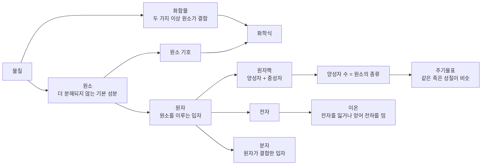

# 중2-4. 물질의 구성 — 세상을 짓는 118가지 블록

<!-- prev: m1-04, m2-01 -->
<!-- next: m2-07, m3-01, 2-3, 2-4, chem-1, chem-2 -->

> [!NOTE]
> **성취기준**
> - **[9과11-01]** 원소와 화합물의 정의를 알고, 원소와 화합물을 화학식으로 표현할 수 있다.
> - **[9과11-02]** 원소를 구성하는 입자인 원자는 양성자, 중성자, 전자로 구성되며, 양성자의 수에 따라 원소의 종류가 달라짐을 입자 모형을 활용하여 설명할 수 있다.
> - **[9과11-03]** 원소는 양성자의 수에 따라 주기율표에 배치됨을 알고, 주기율표에서 성질이 유사한 원소를 찾을 수 있다.
> - **[9과11-04]** 물질을 이루는 입자는 원자, 분자, 이온 등으로 존재할 수 있음을 알고, 이온은 전하를 띠고 있음을 설명할 수 있다.

**학습 목표**

1. 원소와 화합물의 뜻을 알고, 물의 전기 분해 실험으로 물이 원소가 아님을 설명할 수 있다.
2. 원소 기호와 화학식을 읽고 쓰며, 화학식에서 원자의 종류와 개수를 셀 수 있다.
3. 원자가 원자핵(양성자·중성자)과 전자로 이루어져 있고, 양성자 수가 원소의 종류를 정한다는 것을 입자 모형으로 설명할 수 있다.
4. 주기율표가 양성자 수 순서로 배열되어 있음을 알고, 같은 족에서 성질이 비슷한 원소(1족, 18족)를 찾을 수 있다.
5. 물질이 원자, 분자, 이온 등으로 존재함을 알고, 원자가 전자를 잃거나 얻어 이온이 되는 과정을 전하로 설명할 수 있다.

**이 단원의 학습 사다리**

| 단계 | 무엇을 하나? |
|---|---|
| STEP 1. 이전 학습 다시 보기 | 입자 모형, 확산, 순물질과 혼합물을 다시 꺼내 본다 |
| STEP 2. 기초 다지기 | '분해할 수 있나?', 전하의 (+)와 (−), 모형으로 생각하기를 디딤돌로 놓는다 |
| STEP 3. 핵심 개념 | 원소 → 원소 기호·화학식 → 원자의 구조 → 양성자 수 → 주기율표 → 같은 족 → 분자 → 이온 |
| STEP 4. 오개념 바로잡기 | "원소와 원자는 같은 말?", "이온은 양성자가 늘어난 것?" 같은 착각을 바로잡는다 |
| STEP 5. 다음 단계로 | 중3 화학 반응식, 통합과학의 주기성과 화학 결합, 화학의 몰과 전기 음성도 |
| STEP 6. 생활·산업·진로 | 이차 전지, 수소 에너지, 네온·아르곤 기체, 환경 물질 관리 |

---

## 🗺️ 단원 들어가기

레고 블록 몇 가지 모양만으로 집도, 자동차도, 우주선도 만들 수 있다. 우리 주변의 물질도 비슷하다. 물, 공기, 스마트폰, 우리 몸까지 수없이 많은 물질이 있지만, 이것들을 쪼개고 또 쪼개 보면 결국 **몇 가지 기본 성분**으로 이루어져 있다. 지금까지 알려진 기본 성분, 곧 **원소**는 118가지이다.

그렇다면 질문이 생긴다. 물은 기본 성분일까, 아니면 더 쪼갤 수 있을까? 금과 은은 왜 서로 다른 물질일까? 그리고 소금물에 전기가 통하는 까닭은 무엇일까? 이 단원에서는 물질을 이루는 기본 성분(원소)에서 출발해, 그 원소를 이루는 아주 작은 입자(원자)의 속으로 들어갔다가, 원자들이 모여 이루는 분자와 이온까지 차례로 살펴본다.

---

## STEP 1. 🔙 이전 학습 다시 보기

### 연계 개념표

| 이전 단원·성취기준 | 그때 배운 것 | 이 단원에서 확장되는 것 |
|---|---|---|
| 초등학교 5∼6학년군 「용해와 용액」 | 설탕이 물에 녹으면 보이지 않지만 없어진 것이 아니다. 용액의 무게는 용질과 용매 무게의 합이다 | 눈에 보이지 않는 작은 입자(분자, 이온)가 물 사이에 퍼져 있다는 생각으로 이어진다 |
| 중1 「물질의 상태 변화」 [9과04-01] | 확산과 증발로 물질을 이루는 입자가 운동하고 있음을 추론했다 | 그 '입자'의 정체를 원자, 분자, 이온으로 구체화한다 |
| 중1 「물질의 상태 변화」 [9과04-02] | 고체·액체·기체를 입자 모형으로 표현했다 | 입자 모형을 원자 내부(원자핵과 전자)와 분자 모형으로 넓힌다 |
| 중2 「물질의 특성」 [9과08-02] | 물질을 순물질과 혼합물로 분류했다 | 순물질을 다시 **원소**와 **화합물**로 나눈다 |

### 준비 운동 (사전 진단)

**Q1.** 향수 뚜껑을 열어 두면 교실 뒤쪽까지 냄새가 퍼진다. 이 현상으로 알 수 있는 물질을 이루는 입자의 성질은?

**Q2.** 다음 중 순물질을 모두 고르시오.
ㄱ. 공기 ㄴ. 증류수 ㄷ. 소금물 ㄹ. 금 ㅁ. 우유

**Q3.** 털가죽으로 문지른 풍선을 머리카락에 가까이 하면 머리카락이 끌려 온다. 이처럼 물체가 띠는 전기를 무엇이라 할까?

정답 및 해설

**Q1.** 물질을 이루는 입자는 스스로 끊임없이 **운동**한다(확산).

**Q2. ㄴ, ㄹ** — 증류수는 물 한 가지, 금은 금 한 가지로 이루어진 순물질이다. 공기, 소금물, 우유는 여러 물질이 섞인 혼합물이다.

**Q3.** 정전기(마찰 전기). 이 단원 STEP 2에서 (+)와 (−) 전하를 다시 정리하고, 「전기와 자기」에서 자세히 배운다.

---

## STEP 2. 🧱 기초 다지기

### ① 순물질을 다시 나누는 기준 — '더 분해할 수 있는가?'

「물질의 특성」에서 순물질은 한 가지 물질로만 이루어져 녹는점, 끓는점, 밀도가 일정하다고 배웠다. 이번에는 순물질을 하나 더 들여다보자. 같은 순물질이라도 **가열하거나 전기를 흘려 더 간단한 물질로 나눌 수 있는 것**과 **어떤 방법으로도 더 나눌 수 없는 것**이 있다.

| 물질 | 더 간단한 물질로 분해되는가? | 결과 |
|---|---|---|
| 물 | 전기를 흘리면 수소와 산소로 분해된다 | 화합물 |
| 산화 수은(붉은 가루) | 가열하면 수은과 산소로 분해된다 | 화합물 |
| 수소, 산소, 철, 금 | 어떤 화학적 방법으로도 더 분해되지 않는다 | 원소 |

> [!TIP]
> 💡 **비유** — 한글로 생각해 보자. '강'이라는 글자는 'ㄱ, ㅏ, ㅇ'으로 나눌 수 있지만, 'ㄱ'은 더 나눌 수 없다. 물질에서 'ㄱ, ㅏ, ㅇ'처럼 더 나눌 수 없는 기본 성분이 **원소**이고, 이것들이 모여 만든 '강' 같은 글자가 **화합물**이다.

### ② 전하 — (+)와 (−)

물체가 띠는 전기의 양을 **전하(electric charge)** 라고 한다. 전하에는 (+)전하와 (−)전하 두 종류가 있다.

- 같은 종류의 전하끼리는 **밀어내고**, 다른 종류의 전하끼리는 **끌어당긴다**.
- (+)와 (−)의 양이 같으면 서로 상쇄되어 **전기적으로 중성**이다. 3개의 (+)와 3개의 (−)가 있으면 전체 전하는 0이다.

이 생각이 원자와 이온을 이해하는 열쇠가 된다.

### ③ 모형으로 생각하기

원자는 너무 작아 눈으로 볼 수 없다. 과학자들은 실험 결과를 설명할 수 있는 **모형(model)** 을 만들어 원자를 이해해 왔다. 이 단원에서 그리는 원자 그림, 분자 모형은 실제 사진이 아니라 **특징을 알기 쉽게 나타낸 약속된 그림**이다. 모형은 새로운 실험 결과가 나오면 고쳐질 수 있다.

---

## STEP 3. 📘 핵심 개념

### ① 원소와 화합물 — 물은 원소일까? [9과11-01]

옛날 그리스의 철학자 아리스토텔레스는 세상의 모든 물질이 물, 불, 흙, 공기 네 가지 기본 성분으로 이루어져 있다고 생각했다. 이 생각은 2000년 가까이 이어졌다. 그런데 18세기 후반 프랑스의 과학자 **라부아지에**는 뜨겁게 달군 철 관에 물을 통과시켜 물을 수소와 산소로 분해하였다. **물은 기본 성분이 아니었던 것이다.**

> [!IMPORTANT]
> - **원소(element)**: 물질을 이루는 기본 성분으로, 화학적인 방법으로 더 이상 다른 물질로 분해되지 않는다. (예: 수소, 산소, 탄소, 철, 금)
> - **화합물(compound)**: 두 가지 이상의 원소가 화학적으로 결합하여 만들어진 물질이다. 성분 원소와는 전혀 다른 성질을 가진다. (예: 물, 이산화 탄소, 염화 나트륨)

오늘날 학교 실험실에서는 **물의 전기 분해**로 물이 원소가 아님을 확인할 수 있다.

| 전극 | 모이는 기체 | 확인 방법 | 모인 기체의 부피 |
|---|---|---|---|
| (−)극 | 수소 | 성냥불을 가까이 하면 '퍽' 소리를 내며 탄다 | 약 2 |
| (+)극 | 산소 | 꺼져 가는 불씨를 넣으면 불씨가 다시 살아난다 | 약 1 |

물(액체)에서 수소(불에 타는 기체)와 산소(타는 것을 돕는 기체)라는 전혀 다른 성질의 두 물질이 생겼다. 물은 수소와 산소, 두 원소로 이루어진 **화합물**이다.

> [!NOTE]
> 순수한 물에는 전기가 거의 흐르지 않으므로, 전기 분해할 때는 수산화 나트륨이나 황산 나트륨을 조금 녹여 전류가 잘 흐르게 한다. 이 물질들은 반응을 돕기만 하고, 생기는 기체는 물에서 나온다.

| 분류 | 뜻 | 예 |
|---|---|---|
| 혼합물 | 두 가지 이상의 물질이 섞여 있음 | 공기, 바닷물, 우유, 흙탕물 |
| 순물질 – 원소 | 한 가지 원소로만 이루어짐 | 산소, 질소, 철, 구리, 금, 다이아몬드(탄소) |
| 순물질 – 화합물 | 두 가지 이상 원소가 결합함 | 물, 이산화 탄소, 소금(염화 나트륨), 설탕, 메테인 |

> [!TIP]
> 💡 **화합물은 성분 원소와 성질이 전혀 다르다.** 소금(염화 나트륨)을 이루는 나트륨은 물에 넣으면 격렬하게 반응하는 무른 금속이고, 염소는 독성이 있는 노란빛을 띤 초록색 기체이다. 그러나 둘이 결합한 소금은 우리가 매일 먹는 하얀 고체이다.

#### 예제 1

다음 실험 결과를 보고 물질 A, B가 원소인지 화합물인지 판단하시오.
- A: 가열하였더니 검은색 고체(탄소)와 물이 생겼다.
- B: 가열하거나 전기를 흘리는 등 여러 방법을 써도 다른 물질로 분해되지 않았다.

**풀이** A는 서로 다른 물질로 분해되었으므로 **화합물**, B는 더 이상 분해되지 않으므로 **원소**이다. (A의 예로 설탕을 들 수 있다.)

### ② 원소 기호와 화학식 — 세계 공통의 화학 언어 [9과11-01]

원소마다 이름이 나라마다 다르면 과학자들끼리 소통하기 어렵다. 그래서 19세기 초 스웨덴의 과학자 **베르셀리우스**는 원소 이름의 알파벳을 이용한 **원소 기호(element symbol)** 를 제안했고, 오늘날 전 세계가 이 방식을 쓴다.

- 원소 이름(주로 라틴어나 영어)의 **첫 글자를 대문자**로 쓴다. (예: 수소 Hydrogenium → H)
- 첫 글자가 같은 원소가 있으면 **중간 글자 하나를 소문자로** 덧붙인다. (예: 탄소 C, 칼슘 Ca, 염소 Cl, 구리 Cu)

| 원소 | 기호 | 원소 | 기호 | 원소 | 기호 |
|---|---|---|---|---|---|
| 수소 | H | 나트륨 | Na | 칼륨 | K |
| 헬륨 | He | 마그네슘 | Mg | 칼슘 | Ca |
| 탄소 | C | 알루미늄 | Al | 철 | Fe |
| 질소 | N | 규소 | Si | 구리 | Cu |
| 산소 | O | 황 | S | 아연 | Zn |
| 플루오린 | F | 염소 | Cl | 은 | Ag |
| 네온 | Ne | 아르곤 | Ar | 금 | Au |

> [!TIP]
> 💡 나트륨(Na)은 라틴어 natrium, 칼륨(K)은 kalium, 철(Fe)은 ferrum, 구리(Cu)는 cuprum, 은(Ag)은 argentum, 금(Au)은 aurum에서 왔다. 기호가 영어 이름과 다르게 보이는 원소는 대부분 라틴어 이름에서 온 것이다.

물질을 원소 기호와 숫자로 나타낸 것을 **화학식(chemical formula)** 이라고 한다. 분자로 이루어진 물질의 화학식은 다음 규칙으로 쓰고 읽는다.

| 규칙 | 예: 물 $\mathrm{H_2O}$ | 예: $\mathrm{3CO_2}$ |
|---|---|---|
| 성분 원소를 원소 기호로 쓴다 | H(수소), O(산소) | C(탄소), O(산소) |
| 원자의 개수를 원소 기호 **오른쪽 아래**에 작게 쓴다(1은 생략) | H 2개, O 1개 | 분자 하나에 C 1개, O 2개 |
| 분자의 개수는 화학식 **앞에** 크게 쓴다(1은 생략) | 분자 1개 | 분자 3개 |

| 물질 | 화학식 | 분자 1개를 이루는 원자 | 원소/화합물 |
|---|---|---|---|
| 수소 | $\mathrm{H_2}$ | H 2개 | 원소 |
| 산소 | $\mathrm{O_2}$ | O 2개 | 원소 |
| 오존 | $\mathrm{O_3}$ | O 3개 | 원소 |
| 물 | $\mathrm{H_2O}$ | H 2개, O 1개 | 화합물 |
| 이산화 탄소 | $\mathrm{CO_2}$ | C 1개, O 2개 | 화합물 |
| 암모니아 | $\mathrm{NH_3}$ | N 1개, H 3개 | 화합물 |
| 메테인 | $\mathrm{CH_4}$ | C 1개, H 4개 | 화합물 |
| 과산화 수소 | $\mathrm{H_2O_2}$ | H 2개, O 2개 | 화합물 |

> [!WARNING]
> $\mathrm{H_2O}$(물)와 $\mathrm{H_2O_2}$(과산화 수소)는 숫자 하나 차이지만 **전혀 다른 물질**이다. 과산화 수소는 상처 소독이나 표백에 쓰이며 마시면 안 된다. 화학식의 작은 숫자 하나가 물질의 정체를 바꾼다.

금속인 철, 구리처럼 분자를 이루지 않고 원자가 계속 늘어서 있는 물질은 원소 기호 하나로 Fe, Cu처럼 나타낸다. 염화 나트륨처럼 이온으로 이루어진 물질은 ⑧에서 다룬다.

#### 예제 2

$\mathrm{2H_2O}$와 $\mathrm{3NH_3}$에 대해 각각 (1) 분자의 수, (2) 원자의 종류, (3) 전체 원자의 수를 구하시오.

**풀이**
- $\mathrm{2H_2O}$: (1) 물 분자 2개 (2) 수소, 산소 (3) 분자 1개에 원자 3개이므로 $2 \times 3 = 6$개 (H 4개, O 2개)
- $\mathrm{3NH_3}$: (1) 암모니아 분자 3개 (2) 질소, 수소 (3) 분자 1개에 원자 4개이므로 $3 \times 4 = 12$개 (N 3개, H 9개)

#### 예제 3 — 지구 환경과 화학식

다음은 지구 환경에 영향을 주는 물질이다. 각각 원소인지 화합물인지 분류하시오.

| 물질 | 화학식 | 환경과의 관계 |
|---|---|---|
| 이산화 탄소 | $\mathrm{CO_2}$ | 대표적인 온실 기체 |
| 메테인 | $\mathrm{CH_4}$ | 가축의 소화 과정, 쓰레기 매립지 등에서 나오는 온실 기체 |
| 오존 | $\mathrm{O_3}$ | 성층권에서는 자외선을 막고, 지표 근처에서는 호흡기에 해롭다 |
| 이산화 황 | $\mathrm{SO_2}$ | 화석 연료를 태울 때 나와 산성비의 원인이 된다 |
| 프레온 가스(한 종류) | $\mathrm{CCl_2F_2}$ | 성층권 오존층을 파괴하여 사용이 금지되었다 |
| 수은 | $\mathrm{Hg}$ | 생물의 몸에 쌓이는 중금속 |

**풀이** 한 가지 원소로만 이루어진 오존($\mathrm{O_3}$)과 수은($\mathrm{Hg}$)은 **원소**이고, 두 가지 이상의 원소가 결합한 $\mathrm{CO_2}$, $\mathrm{CH_4}$, $\mathrm{SO_2}$, $\mathrm{CCl_2F_2}$는 **화합물**이다. 프레온 가스의 분자 1개는 C 1개, Cl 2개, F 2개로 모두 5개의 원자로 이루어져 있다.

### ③ 원자의 구조 — 원자핵과 전자 [9과11-02]

원소를 이루는 아주 작은 입자를 **원자(atom)** 라고 한다. 원자는 너무 작아서 머리카락 굵기에 원자 수십만 개를 늘어놓을 수 있을 정도이다. 오랫동안 원자는 더 쪼갤 수 없는 알갱이라고 여겨졌지만, 19세기 말부터 20세기 초에 걸친 실험으로 원자 속에 더 작은 입자들이 있다는 것이 밝혀졌다.

| 입자 | 위치 | 전하 | 질량 |
|---|---|---|---|
| **양성자(proton)** | 원자핵 | (+) | 중성자와 거의 같다 |
| **중성자(neutron)** | 원자핵 | 없음 | 양성자와 거의 같다 |
| **전자(electron)** | 원자핵 주위 | (−) | 양성자의 약 1800분의 1로 매우 가볍다 |

- 원자의 중심에는 양성자와 중성자로 이루어진 **원자핵(nucleus)** 이 있고, 전자는 원자핵 주위를 움직이고 있다.
- 원자핵은 원자 질량의 거의 전부를 차지하지만, 크기는 원자의 약 10만분의 1 정도로 매우 작다. 원자의 대부분은 빈 공간이다.
- 원자 속 **양성자 수와 전자 수는 같다.** 따라서 (+)전하와 (−)전하의 양이 같아 원자는 **전기적으로 중성**이다.

> [!TIP]
> 💡 **비유** — 원자를 커다란 축구 경기장이라고 하면, 원자핵은 경기장 한가운데 놓인 작은 구슬 정도이고, 전자는 관중석 근처를 날아다니는 먼지 같다. 그런데 경기장 무게의 거의 전부가 그 구슬에 들어 있다.

원자를 입자 모형으로 나타낼 때는 가운데에 원자핵을 그리고 그 안에 (+)의 개수(양성자 수)를 쓰고, 주위에 (−)로 표시한 전자를 양성자 수만큼 그린다.

#### 예제 4

어떤 원자의 원자핵에 양성자가 8개, 중성자가 8개 들어 있다.
(1) 이 원자의 전자 수는? (2) 원자 전체의 전하는? (3) 원자핵의 전하는?

**풀이**
(1) 원자는 양성자 수와 전자 수가 같으므로 8개
(2) (+)8과 (−)8이 상쇄되어 0(중성)
(3) 중성자는 전하가 없으므로 원자핵의 전하는 양성자 8개에 의한 (+)8

### ④ 양성자 수가 원소의 종류를 정한다 [9과11-02]

수소 원자와 산소 원자, 금 원자는 무엇이 다를까? 바로 **원자핵 속 양성자의 수**이다. 양성자 수가 다르면 다른 원소이고, 양성자 수가 같으면 같은 원소이다. 원소마다 양성자 수가 정해져 있으므로 이 수를 그 원소의 번호로 쓰고 **원자 번호(atomic number)** 라고 한다.

| 원소 | 원소 기호 | 원자 번호(양성자 수) | 전자 수 |
|---|---|---|---|
| 수소 | H | 1 | 1 |
| 헬륨 | He | 2 | 2 |
| 탄소 | C | 6 | 6 |
| 산소 | O | 8 | 8 |
| 나트륨 | Na | 11 | 11 |
| 염소 | Cl | 17 | 17 |
| 금 | Au | 79 | 79 |

> [!IMPORTANT]
> 원소의 종류를 정하는 것은 **양성자 수**이다. 전자 수는 원자가 이온이 될 때 바뀔 수 있지만, 양성자 수가 바뀌지 않는 한 원소의 종류는 그대로이다.

> [!TIP]
> 💡 **비유** — 양성자 수는 원소의 '주민 등록 번호'이다. 옷(전자)을 갈아입어도 사람이 바뀌지 않듯, 전자 수가 변해도 양성자 수가 같으면 같은 원소이다.

#### 예제 5

입자 A는 양성자 8개·전자 8개, 입자 B는 양성자 8개·전자 10개, 입자 C는 양성자 9개·전자 10개를 가지고 있다. 같은 원소인 것끼리 묶으시오.

**풀이** 원소의 종류는 양성자 수로 정해진다. A와 B는 양성자 수가 8로 같으므로 같은 원소(산소)이다. 전자 수가 다른 것은 B가 전자를 얻은 상태(⑧에서 배울 이온)이기 때문이다. C는 전자 수가 B와 같지만 양성자 수가 9이므로 다른 원소(플루오린)이다. **전자 수가 아니라 양성자 수**로 판단해야 한다.

### ⑤ 주기율표 — 원소의 지도 [9과11-03]

원소가 하나둘 발견되면서 과학자들은 원소들을 규칙에 따라 정리하고 싶어 했다. 1869년 러시아의 **멘델레예프**는 당시 알려진 원소를 원자의 질량 순서로 늘어놓고 성질이 비슷한 원소가 같은 줄에 오도록 표를 만들었다. 그는 빈칸을 남기고 아직 발견되지 않은 원소의 성질을 예측하기도 했는데, 뒤에 실제로 그런 원소가 발견되었다. 그 뒤 20세기 초 영국의 **모즐리**가 원자 번호를 밝혀내면서, 오늘날의 주기율표는 **원자 번호(양성자 수) 순서**로 원소를 배열하게 되었다.

**주기율표(periodic table)** 는 원소를 원자 번호 순서로 배열하되, 성질이 비슷한 원소가 같은 세로줄에 오도록 만든 표이다.

| 용어 | 뜻 |
|---|---|
| **족(group)** | 주기율표의 **세로줄**. 1족부터 18족까지 있다. 같은 족 원소는 화학적 성질이 비슷하다 |
| **주기(period)** | 주기율표의 **가로줄**. 1주기부터 7주기까지 있다 |
| 금속 원소 | 주로 주기율표의 왼쪽과 가운데에 있다. 광택이 있고 전기와 열이 잘 통한다 |
| 비금속 원소 | 주로 주기율표의 오른쪽에 있다(수소는 예외로 왼쪽 위에 있다) |

주기율표의 1~3주기를 원자 번호와 함께 간단히 나타내면 다음과 같다(3~12족은 4주기부터 나타나므로 생략).

| 주기 | 1족 | 2족 | 13족 | 14족 | 15족 | 16족 | 17족 | 18족 |
|---|---|---|---|---|---|---|---|---|
| 1 | 1 H | | | | | | | 2 He |
| 2 | 3 Li | 4 Be | 5 B | 6 C | 7 N | 8 O | 9 F | 10 Ne |
| 3 | 11 Na | 12 Mg | 13 Al | 14 Si | 15 P | 16 S | 17 Cl | 18 Ar |

#### 예제 6

주기율표에서 원자 번호 19인 칼륨(K)은 4주기 1족에 있다. (1) 칼륨 원자의 양성자 수와 전자 수는? (2) 위 표에서 칼륨과 같은 족에 있는 원소를 모두 쓰시오.

**풀이** (1) 원자 번호 = 양성자 수 = 19, 원자는 중성이므로 전자 수도 19 (2) 1족이므로 H, Li, Na. 이 가운데 수소는 비금속이어서 성질이 크게 다르므로, 칼륨과 성질이 비슷한 원소는 리튬(Li)과 나트륨(Na)이다.

### ⑥ 같은 족, 비슷한 성질 — 1족과 18족 [9과11-03]

주기율표의 진짜 힘은 **같은 세로줄(족)의 원소들이 비슷한 성질을 가진다**는 데 있다. 대표적인 두 족을 살펴보자.

| 족 | 원소 | 비슷한 성질 | 생활 속 모습 |
|---|---|---|---|
| **1족**(수소 제외) | 리튬(Li), 나트륨(Na), 칼륨(K) | 칼로 자를 수 있을 만큼 무른 금속이다. 자른 면은 은백색으로 빛나다가 곧 광택을 잃는다. **물과 격렬하게 반응**하여 기체가 생기고, 반응 후 용액에 페놀프탈레인 용액을 떨어뜨리면 붉게 변한다 | 공기 중 산소나 물과 반응하지 않도록 **석유(기름) 속에 보관**한다. 리튬은 이차 전지의 재료이다 |
| **18족** | 헬륨(He), 네온(Ne), 아르곤(Ar) | 다른 물질과 **거의 반응하지 않아 매우 안정**하다. 상온에서 모두 기체이며 원자 하나가 그대로 입자로 존재한다 | 헬륨은 풍선과 비행선, 네온은 네온사인(전기를 흘리면 붉은빛), 아르곤은 전구 속이나 용접할 때 공기를 막는 기체로 쓴다 |
| 17족(참고) | 플루오린(F), 염소(Cl), 브로민(Br), 아이오딘(I) | 금속과 잘 반응하는 비금속 원소들이다 | 염소는 수돗물 소독, 아이오딘은 상처 소독약 성분 |

> [!NOTE]
> 1족 원소가 왜 물과 잘 반응하는지, 18족 원소가 왜 안정한지, 그리고 주기율표에서 성질이 일정한 간격으로 되풀이되는 까닭은 이 단원에서 다루지 않는다. 지금은 **"같은 족에는 성질이 비슷한 원소가 모여 있다"** 는 것을 실험 결과로 추론할 수 있으면 된다.

> [!TIP]
> 💡 **비유** — 주기율표는 아파트 우편함과 같다. 가로줄(주기)은 층, 세로줄(족)은 호수이다. 같은 '1호 라인'에 사는 가족들(1족)은 생활 습관이 비슷하고, 맨 끝 '18호 라인'(18족)에는 누구와도 잘 어울리지 않는 조용한 이웃들이 산다.

#### 예제 7

어떤 미지의 금속 X를 칼로 잘라 보니 쉽게 잘렸고, 자른 면이 은백색이었다가 곧 광택을 잃었다. 작은 조각을 물에 넣었더니 기체가 발생하며 격렬하게 반응했고, 반응한 용액에 페놀프탈레인 용액을 넣자 붉게 변했다. X는 주기율표에서 몇 족 원소일 가능성이 높은가?

**풀이** 무르고, 공기 중에서 광택을 잃고, 물과 격렬하게 반응하며 용액이 페놀프탈레인을 붉게 만드는 성질은 리튬·나트륨·칼륨과 같다. 따라서 X는 **1족** 원소일 가능성이 높다.

### ⑦ 원자와 분자 — 물질을 이루는 입자 ① [9과11-04]

물질을 이루는 입자는 한 가지가 아니다. 물질에 따라 **원자, 분자, 이온** 등으로 존재한다.

여러 원자가 결합하여 만들어진, **독립된 입자로 존재하면서 물질의 성질을 나타내는 가장 작은 입자**를 **분자(molecule)** 라고 한다. 물 분자는 수소 원자 2개와 산소 원자 1개가 결합한 것이다. 물 분자를 다시 원자로 쪼개면 더 이상 물이 아니라 수소와 산소가 된다.

| 물질을 이루는 입자 | 특징 | 예 |
|---|---|---|
| 원자 | 원자가 그대로 입자가 되거나, 수많은 원자가 규칙적으로 늘어서 있다 | 헬륨, 네온(원자 하나가 입자), 철, 구리, 다이아몬드(원자가 계속 늘어섬) |
| 분자 | 원자 몇 개가 결합한 입자가 하나하나 떨어져 있다 | 산소($\mathrm{O_2}$), 물($\mathrm{H_2O}$), 이산화 탄소($\mathrm{CO_2}$), 설탕 |
| 이온 | (+)이온과 (−)이온이 서로 끌어당겨 규칙적으로 배열되어 있다 | 염화 나트륨, 염화 칼슘 |

> [!TIP]
> 💡 **원자와 분자는 '알파벳'과 '단어'** — 알파벳(원자) 26개로 수많은 단어(분자)를 만들듯, 원자 몇 가지로 수많은 분자를 만든다. 같은 알파벳으로도 순서와 개수가 다르면 다른 단어가 되는 것처럼, 같은 원소라도 결합하는 원자의 개수가 다르면 $\mathrm{O_2}$(산소)와 $\mathrm{O_3}$(오존)처럼 다른 물질이 된다.

> [!IMPORTANT]
> **원소와 원자를 구별하자.** 원소는 물질을 이루는 기본 성분의 **종류**이고, 원자는 물질을 이루는 **입자**이다. "물은 수소와 산소 두 가지 **원소**로 이루어져 있다." "물 분자 1개는 수소 **원자** 2개와 산소 **원자** 1개로 이루어져 있다." 종류를 말할 때는 원소, 개수를 셀 때는 원자이다.

#### 예제 8

다음 문장에서 밑줄 대신 괄호 안에 '원소' 또는 '원자' 중 알맞은 말을 쓰시오.
(1) 이산화 탄소는 2가지 ( )로 이루어진 화합물이다.
(2) 이산화 탄소 분자 1개는 3개의 ( )로 이루어져 있다.
(3) 지금까지 알려진 ( )는 118가지이다.

**풀이** (1) 원소 (2) 원자 (3) 원소

### ⑧ 이온 — 전하를 띤 입자 [9과11-04]

원자는 양성자 수와 전자 수가 같아 전기적으로 중성이다. 그런데 원자가 **전자를 잃거나 얻으면** 양성자 수와 전자 수가 달라져 전하를 띠게 된다. 이렇게 전하를 띠는 입자를 **이온(ion)** 이라고 한다.

| 구분 | 만들어지는 과정 | 전하 | 예 |
|---|---|---|---|
| **양이온(cation)** | 원자가 전자를 **잃는다** → 양성자 수 > 전자 수 | (+) | $\mathrm{Na^+}$, $\mathrm{K^+}$, $\mathrm{Mg^{2+}}$, $\mathrm{Ca^{2+}}$, $\mathrm{Cu^{2+}}$ |
| **음이온(anion)** | 원자가 전자를 **얻는다** → 양성자 수 < 전자 수 | (−) | $\mathrm{Cl^-}$, $\mathrm{O^{2-}}$, $\mathrm{S^{2-}}$ |

**이온식** 쓰기: 원소 기호의 **오른쪽 위**에 잃거나 얻은 전자의 수와 전하의 종류를 쓴다. 1은 생략한다. 전자 1개를 잃은 나트륨 이온은 $\mathrm{Na^+}$, 전자 2개를 얻은 산화 이온은 $\mathrm{O^{2-}}$이다.

| 이온 | 이온식 | 양성자 수 | 전자 수 | 이름 짓기 |
|---|---|---|---|---|
| 나트륨 이온 | $\mathrm{Na^+}$ | 11 | 10 | 양이온: 원소 이름 + '이온' |
| 마그네슘 이온 | $\mathrm{Mg^{2+}}$ | 12 | 10 | |
| 염화 이온 | $\mathrm{Cl^-}$ | 17 | 18 | 음이온: 원소 이름 끝을 '~화'로 바꾸고 + '이온' (염소 → 염화) |
| 산화 이온 | $\mathrm{O^{2-}}$ | 8 | 10 | (산소 → 산화) |

여러 원자가 모여 하나의 이온처럼 행동하는 이온도 있다. 수산화 이온($\mathrm{OH^-}$), 황산 이온($\mathrm{SO_4^{2-}}$), 질산 이온($\mathrm{NO_3^-}$), 탄산 이온($\mathrm{CO_3^{2-}}$), 암모늄 이온($\mathrm{NH_4^+}$), 과망가니즈산 이온($\mathrm{MnO_4^-}$)이 그 예이다.

> [!WARNING]
> 이온이 될 때 변하는 것은 **전자 수뿐**이다. 양성자 수가 변하는 것이 아니다. $\mathrm{Na^+}$는 양성자를 하나 더 얻은 것이 아니라 **전자를 하나 잃은** 것이다. 그래서 나트륨 이온은 여전히 나트륨이다.

#### 예제 9

(1) 양성자 수가 20인 칼슘 원자가 전자 2개를 잃었다. 이 이온의 전자 수와 이온식을 쓰시오.
(2) 양성자 수 16, 전자 수 18인 입자는 무엇인가?

**풀이**
(1) 전자 수: $20 - 2 = 18$개. 양성자보다 전자가 2개 적으므로 (+)2의 전하를 띤다 → $\mathrm{Ca^{2+}}$ (칼슘 이온)
(2) 양성자 수 16은 황(S)이다. 전자가 2개 많으므로 (−)2의 전하를 띤 황화 이온 $\mathrm{S^{2-}}$이다.

#### 이온은 전하를 띠므로 전극으로 끌려간다

이온이 전하를 띤다는 것을 어떻게 확인할 수 있을까? 이온이 들어 있는 수용액에 전원을 연결하면, **양이온은 (−)극으로, 음이온은 (+)극으로** 이동한다. 다른 전하끼리 끌어당기기 때문이다.

| 관찰하는 이온 | 색 | 이동하는 쪽 | 까닭 |
|---|---|---|---|
| 구리 이온 $\mathrm{Cu^{2+}}$ (황산 구리 수용액) | 파란색 | (−)극 | (+)전하를 띤 양이온 |
| 과망가니즈산 이온 $\mathrm{MnO_4^-}$ (과망가니즈산 칼륨 수용액) | 보라색 | (+)극 | (−)전하를 띤 음이온 |

또 소금(염화 나트륨)은 고체일 때는 전기가 통하지 않지만, 물에 녹이면 $\mathrm{Na^+}$과 $\mathrm{Cl^-}$이 자유롭게 움직일 수 있게 되어 **전기가 통한다.** 땀을 흘린 손으로 전기 기구를 만지면 위험한 까닭도 땀 속의 이온 때문이다.

> [!TIP]
> 💡 이온 음료(스포츠 음료) 성분표에서 나트륨, 칼륨, 마그네슘, 칼슘 같은 이름을 찾아보자. 땀으로 빠져나간 이온을 보충하기 위해 넣은 것이다. 성분표의 '나트륨'은 대부분 나트륨 원자가 아니라 나트륨 **이온**으로 들어 있다.

---

## STEP 4. ⚠️ 오개념 바로잡기

| 흔한 오개념 | 올바른 개념 | 왜 그럴까? |
|---|---|---|
| 원소와 원자는 같은 말이다 | 원소는 성분의 **종류**, 원자는 **입자**이다 | "물을 이루는 원소는 2가지, 물 분자를 이루는 원자는 3개"처럼 쓰임이 다르다 |
| 화합물은 성분 원소의 성질을 그대로 가진다 | 화합물은 성분 원소와 **전혀 다른 성질**을 가진다 | 타는 기체(수소)와 타는 것을 돕는 기체(산소)가 결합한 물은 불을 끈다 |
| 한 가지 원소로 이루어진 물질은 모두 같은 물질이다 | 같은 원소라도 원자의 결합 방식이 다르면 다른 물질이다 | 산소($\mathrm{O_2}$)와 오존($\mathrm{O_3}$), 흑연과 다이아몬드(모두 탄소) |
| 원자는 꽉 찬 공 모양이다 | 원자는 가운데 작은 원자핵과 전자로 되어 있고 **대부분 빈 공간**이다 | 원자핵의 크기는 원자의 약 10만분의 1 정도이다 |
| 원자는 전자를 가지고 있어 (−)전하를 띤다 | 원자는 양성자 수와 전자 수가 같아 **중성**이다 | (+)와 (−)의 양이 같아 상쇄된다 |
| 양이온은 양성자를 얻어서 생긴다 | 양이온은 **전자를 잃어서** 생긴다 | 이온이 될 때 원자핵(양성자 수)은 변하지 않는다. 변하면 다른 원소가 된다 |
| $\mathrm{2H}$와 $\mathrm{H_2}$는 같은 뜻이다 | $\mathrm{2H}$는 따로 떨어진 수소 원자 2개, $\mathrm{H_2}$는 수소 원자 2개가 결합한 **분자 1개**이다 | 앞의 큰 숫자는 입자의 개수, 오른쪽 아래 작은 숫자는 분자 속 원자의 개수이다 |

---

## STEP 5. 🎓 다음 단계로 한 걸음 더

> [!CAUTION]
> 이 절은 **중학교 교육과정 범위 밖의 심화 내용**으로 평가 대상이 아니다. 원소·원자·이온이라는 개념이 다음 학년과 고등학교에서 어떻게 이어지는지 맛보기로 보여 주기 위한 것이다.

### 다음 학년·과목과의 연결

| 단계 | 단원 | 이어지는 내용 |
|---|---|---|
| 중2 | 「전기와 자기」 | 물체가 대전되는 것은 **전자**가 이동하기 때문이다. 이 단원의 전자가 전기 현상의 주인공이 된다 |
| 중3 | 「화학 반응의 규칙성」 | 화학식을 이용해 **화학 반응식**을 쓰고, 반응 전후 원자의 수와 질량이 보존됨을 배운다 |
| 고1 통합과학1 | 「원소의 주기성과 화학 결합의 이유」 | 주기율표에서 성질이 되풀이되는 까닭을 **전자 배치**로 설명하고, 18족처럼 안정해지려는 경향으로 결합을 이해한다 |
| 고1 통합과학1 | 「이온 결합과 공유 결합」 | 소금(이온 결합)과 물·산소(공유 결합)가 만들어지는 방식과 성질의 차이 |
| 고2 화학 | 「화학의 언어」, 「물질의 구조와 성질」 | 입자 수를 세는 단위 **몰**, 전기 음성도, 루이스 전자점식과 분자의 모양 |

### ① 같은 원소인데 무게가 다르다? — 질량수와 동위 원소

같은 탄소 원자라도 원자핵 속 중성자 수가 6개인 것과 7개인 것이 있다. 양성자 수가 같으니 둘 다 탄소이다. 고등학교에서는 양성자 수와 중성자 수를 더한 값을 **질량수**라 하고, 이렇게 양성자 수는 같고 중성자 수가 다른 원자를 **동위 원소**라고 한다. 탄소의 동위 원소 가운데 하나는 화석이나 유물의 나이를 알아내는 데 쓰인다.

### ② 전자는 아무 데나 있지 않다 — 전자 배치

이 단원에서는 전자를 원자핵 주위에 '그냥' 그렸다. 통합과학에서는 전자가 원자핵 주위의 정해진 층(전자 껍질)에 차례로 채워진다는 모형을 배운다. 같은 족 원소는 가장 바깥 껍질의 전자 수가 같아서 성질이 비슷하고, 18족 원소는 바깥 껍질이 꽉 차 있어 안정하다. 1족 원소가 $\mathrm{Na^+}$처럼 +1의 양이온이 되기 쉬운 까닭, 17족 원소가 $\mathrm{Cl^-}$처럼 −1의 음이온이 되기 쉬운 까닭도 이것으로 설명된다.

### ③ 원소는 어디에서 왔을까?

통합과학의 「빛의 스펙트럼과 우주 초기 원소」, 「별의 진화와 원소의 생성」에서는 우주 초기에 수소와 헬륨이 만들어지고, 탄소·산소·철 같은 원소는 별 속에서 만들어졌다는 것을 배운다. 우리 몸을 이루는 원소도 오래전 별에서 만들어진 것이다.

### 지금 vs 다음 단계

| 구분 | 중학교 2학년(지금) | 고등학교 통합과학·화학 |
|---|---|---|
| 원자 | 양성자·중성자·전자, 원자 번호 | 질량수, 동위 원소, 전자 배치, 오비탈 |
| 주기율표 | 양성자 수 순서 배열, 같은 족의 비슷한 성질 | 원소의 주기성, 원자 반지름·이온화 에너지의 주기적 변화 |
| 이온 | 전자를 잃으면 양이온, 얻으면 음이온 | 이온이 되기 쉬운 까닭, 이온 결합과 이온 결합 물질의 성질 |
| 화학식 | 원자의 종류와 개수 읽기 | 화학 반응식, 몰과 양적 관계, 분자의 구조 |

---

## STEP 6. 🏭 생활·산업·진로 연결

### 사례 1. 이차 전지 — 1족 원소 리튬과 이온의 이동

- **원리** 스마트폰과 전기 자동차에 쓰는 **리튬 이온 전지**는 충전과 방전을 할 때 리튬 이온($\mathrm{Li^+}$)이 전지 안의 두 전극 사이를 오가며 전기를 저장하고 내놓는다. "이온은 전하를 띠어 전기에 이끌려 이동한다"는 이 단원의 내용이 그대로 쓰인다.
- **어디에 쓰이나** 휴대 전화, 노트북, 전기 자동차, 에너지 저장 장치. 우리나라는 이차 전지 산업이 활발한 나라 가운데 하나이다.

### 사례 2. 수소 — 원자 번호 1번이 여는 에너지

- **원리** 물을 전기 분해하면 수소를 얻을 수 있고(STEP 3 ①), 수소 연료 전지는 반대로 수소와 산소를 반응시켜 전기를 만들고 물만 내보낸다.
- **어디에 쓰이나** 수소 자동차, 수소 버스, 발전. 재생 에너지로 만든 전기로 물을 분해해 얻은 수소는 이산화 탄소를 거의 내놓지 않는 에너지원으로 연구되고 있다.

### 사례 3. 18족 기체 — 반응하지 않아서 쓸모 있다

- 헬륨은 매우 가볍고 타지 않아 풍선과 기상 관측 기구에 쓰이고, 액체 헬륨은 아주 차가워서 병원의 자기 공명 영상(MRI) 장치를 냉각하는 데 쓰인다.
- 아르곤은 반응하지 않는 성질 덕분에 금속을 용접할 때 공기 중의 산소를 막아 주고, 반도체 공정에서도 쓰인다.

### 사례 4. 환경 물질 관리 — 화학식으로 지구를 지킨다

- 온실 기체($\mathrm{CO_2}$, $\mathrm{CH_4}$), 오존층 파괴 물질(프레온 가스), 대기 오염 물질($\mathrm{SO_2}$, $\mathrm{NO_2}$)은 모두 화학식으로 관리된다. 국제 협약과 환경 기준도 화학식으로 물질을 정한다.

### 관련 진로와 학과

| 진로 | 하는 일 | 관련 학과 |
|---|---|---|
| 화학자·화학 연구원 | 새로운 물질 합성, 물질의 성분 분석 | 화학과, 화학공학과 |
| 배터리 엔지니어 | 이차 전지 소재와 셀 설계 | 화학공학, 신소재공학, 전기공학 |
| 수소 에너지 연구원 | 수전해 장치, 연료 전지 개발 | 화학공학, 에너지공학, 기계공학 |
| 환경 분석 연구원 | 대기·물 속 오염 물질 측정과 관리 | 환경공학, 화학과 |
| 반도체 공정 엔지니어 | 규소·특수 기체를 다루는 미세 공정 | 신소재공학, 전자공학, 화학공학 |

---

## 🔬 탐구 활동 — 같은 족 원소의 유사성, 이온의 이동 관찰하기

### 활동 A. 같은 족 원소들의 유사성 탐구하기 (교사 시범 + 자료 분석)

**목표** 1족 원소와 물의 반응, 18족 원소의 성질을 관찰하거나 자료로 비교하여, 같은 족 원소의 성질이 비슷함을 추론한다.

**준비물** (교사 시범) 리튬·나트륨 아주 작은 조각, 칼, 거름종이, 큰 수조, 물, 페놀프탈레인 용액, 보안경, 투명한 안전 가림막 / (모둠) 1족·18족 원소 성질 자료 카드, 1족 원소와 물의 반응 동영상

**과정**
1. 교사가 석유 속에 보관된 리튬과 나트륨을 꺼내 기름을 닦고 쌀알보다 작은 조각으로 잘라 자른 면을 보여 준다.
2. 페놀프탈레인 용액을 몇 방울 떨어뜨린 수조의 물에 조각을 하나씩 넣고, 가림막 뒤에서 반응을 관찰한다.
3. 칼륨의 반응은 동영상으로 관찰한다.
4. 18족 원소(헬륨, 네온, 아르곤)의 성질 자료 카드를 읽고, 다른 물질과의 반응 여부를 정리한다.

**결과 기록**

| 원소 | 자른 면의 변화 | 물에 넣었을 때 | 페놀프탈레인 색 변화 | 공통점 |
|---|---|---|---|---|
| 리튬 | | | | |
| 나트륨 | | | | |
| 칼륨(영상) | | | | |
| 헬륨·네온·아르곤(자료) | — | — | — | |

**생각해 보기**
1. 리튬, 나트륨, 칼륨의 공통점을 세 가지 이상 써 보자.
2. 1족 원소를 석유 속에 보관하는 까닭은 무엇일까?
3. 18족 원소를 전구 속이나 용접할 때 쓰는 까닭을 성질과 관련지어 설명해 보자.

> [!WARNING]
> **안전 수칙** 1족 금속과 물의 반응은 **반드시 교사 시범**으로만 한다. 맨손으로 만지지 않고, 아주 작은 조각만 쓰며, 보안경과 가림막을 사용한다. 남은 조각은 물에 버리지 않고 교사가 안전하게 처리한다.

### 활동 B. 전기력을 이용하여 이온의 이동 관찰하기

**목표** 색을 띤 이온이 전극 쪽으로 이동하는 모습을 관찰하여 이온이 전하를 띠고 있음을 확인한다.

**준비물** 페트리 접시(또는 유리판), 거름종이, 질산 칼륨 수용액, 황산 구리 수용액, 과망가니즈산 칼륨 수용액, 집게 달린 전선 2개, 9 V 전지(또는 직류 전원 장치), 스포이트, 보안경, 장갑

**과정**
1. 거름종이를 질산 칼륨 수용액에 적셔 유리판 위에 펴고, 양쪽 끝에 전선 집게를 물려 전원의 (+)극과 (−)극에 연결한다.
2. 거름종이 가운데에 황산 구리 수용액과 과망가니즈산 칼륨 수용액을 각각 한 방울씩 떨어뜨린다.
3. 전원을 켜고 10~15분 동안 색깔 띠가 어느 쪽으로 움직이는지 관찰한다.
4. 전극을 반대로 연결하면 어떻게 되는지 확인한다.

**결과 기록**

| 떨어뜨린 수용액 | 보이는 색 | 이동한 방향 | 그 이온의 전하 |
|---|---|---|---|
| 황산 구리 | | | |
| 과망가니즈산 칼륨 | | | |
| 전극을 바꾼 뒤 | | | |

**생각해 보기**
1. 파란색 띠와 보라색 띠는 각각 어떤 이온 때문인가?
2. 질산 칼륨 수용액에 적신 종이를 쓰는 까닭은 무엇일까?
3. 이 실험 결과로 '이온은 전하를 띤다'는 것을 어떻게 설명할 수 있을까?

> [!WARNING]
> **안전 수칙** 과망가니즈산 칼륨은 피부와 옷을 갈색으로 물들이고, 황산 구리는 삼키면 해롭다. 보안경과 장갑을 끼고, 실험 후 손을 씻는다. 전선 집게끼리 서로 닿지 않게 한다.

---

## ✅ 개념 확인 문제

### 기본

**1.** 다음 물질을 원소와 화합물로 분류하시오.
산소, 물, 철, 이산화 탄소, 헬륨, 염화 나트륨, 메테인, 구리

정답 및 해설

**정답** 원소: 산소, 철, 헬륨, 구리 / 화합물: 물, 이산화 탄소, 염화 나트륨, 메테인

한 가지 원소로만 이루어진 물질은 원소, 두 가지 이상의 원소가 결합한 물질은 화합물이다.

**2.** 원소 기호를 바르게 짝지은 것을 모두 고르시오.
ㄱ. 나트륨 – N ㄴ. 칼슘 – Ca ㄷ. 염소 – Cl ㄹ. 구리 – Co ㅁ. 칼륨 – K

정답 및 해설

**정답 ㄴ, ㄷ, ㅁ**

나트륨은 Na(N은 질소), 구리는 Cu이다.

**3.** $\mathrm{3CH_4}$에서 (1) 분자의 수, (2) 수소 원자의 수, (3) 전체 원자의 수를 구하시오.

정답 및 해설

**정답** (1) 3개 (2) 12개 (3) 15개

메테인 분자 1개는 C 1개, H 4개로 원자 5개이다. 분자가 3개이므로 H는 $3 \times 4 = 12$개, 전체 원자는 $3 \times 5 = 15$개이다.

**4.** 원자 번호가 12인 마그네슘 원자에 대한 설명으로 옳은 것을 모두 고르시오.
ㄱ. 양성자 수는 12이다. ㄴ. 전자 수는 12이다. ㄷ. 원자 전체는 (+)12의 전하를 띤다.

정답 및 해설

**정답 ㄱ, ㄴ**

원자 번호 = 양성자 수 = 12이고, 원자는 양성자 수와 전자 수가 같아 전자도 12개이다. (+)12와 (−)12가 상쇄되어 원자 전체는 중성이므로 ㄷ은 틀렸다.

**5.** 다음 중 18족 원소의 공통된 성질로 가장 알맞은 것은?
① 물과 격렬하게 반응한다. ② 칼로 자를 수 있는 무른 금속이다. ③ 다른 물질과 거의 반응하지 않는다. ④ 상온에서 모두 액체이다.

정답 및 해설

**정답 ③**

헬륨, 네온, 아르곤 같은 18족 원소는 매우 안정하여 다른 물질과 거의 반응하지 않는다. ①, ②는 1족 원소의 성질이고, 18족 원소는 상온에서 기체이다.

### 응용

**6.** 표는 입자 (가)~(라)의 양성자 수와 전자 수이다.

| 입자 | (가) | (나) | (다) | (라) |
|---|---|---|---|---|
| 양성자 수 | 11 | 11 | 17 | 8 |
| 전자 수 | 11 | 10 | 18 | 10 |

(1) 같은 원소인 것끼리 묶고, (2) 양이온과 음이온을 각각 고르고, (3) (라)의 이온식을 쓰시오.

정답 및 해설

**정답** (1) (가)와 (나) (2) 양이온: (나), 음이온: (다), (라) (3) $\mathrm{O^{2-}}$

(1) 양성자 수가 11로 같은 (가)와 (나)는 같은 원소(나트륨)이다.
(2) (나)는 전자가 양성자보다 1개 적어 양이온($\mathrm{Na^+}$), (다)는 1개 많아 음이온($\mathrm{Cl^-}$), (라)는 2개 많아 음이온이다. (가)는 중성 원자이다.
(3) 양성자 수 8은 산소이고, 전자가 2개 많으므로 $\mathrm{O^{2-}}$(산화 이온)이다.

**7.** 물을 전기 분해하였더니 (−)극에서 기체 A가 20 mL, (+)극에서 기체 B가 10 mL 모였다. (1) A와 B는 각각 무엇이며 어떻게 확인할 수 있는가? (2) 이 실험으로 물이 원소가 아니라고 말할 수 있는 까닭은?

정답 및 해설

**정답** (1) A: 수소 — 성냥불을 대면 '퍽' 소리를 내며 탄다. B: 산소 — 꺼져 가는 불씨를 넣으면 다시 살아난다. (2) 물이 성질이 다른 두 물질(수소, 산소)로 분해되었기 때문이다.

원소는 더 이상 다른 물질로 분해되지 않는 기본 성분이다. 물은 분해되었으므로 원소가 아니라 수소와 산소로 이루어진 화합물이다. 부피비는 수소 : 산소 = 20 : 10 = 2 : 1이다.

**8.** 이온의 이동 실험에서 거름종이 가운데에 떨어뜨린 어떤 수용액의 초록색 띠가 (−)극 쪽으로 이동하였다. 이 색은 양이온과 음이온 중 어느 것 때문인가? 전극을 반대로 연결하면 띠는 어떻게 움직이겠는가?

정답 및 해설

**정답** 양이온 때문이다. 전극을 바꾸면 띠는 반대쪽(새로 (−)극이 된 쪽)으로 움직인다.

(+)전하를 띤 양이온은 다른 전하인 (−)극으로 끌려간다. 전극을 바꾸면 (−)극의 위치가 바뀌므로 양이온도 그쪽으로 이동한다.

### 융합·서술형

**9. [환경 연계]** 친구가 "이산화 탄소($\mathrm{CO_2}$)는 탄소와 산소가 섞여 있는 혼합물이니까, 체로 거르듯 분리하면 탄소와 산소를 쉽게 얻을 수 있어."라고 말했다. 이 말에서 잘못된 점을 원소·화합물·혼합물의 뜻을 이용해 서술하시오.

정답 및 해설

**예시 답안**
이산화 탄소는 탄소와 산소가 단순히 섞인 혼합물이 아니라, 두 원소가 **화학적으로 결합한 화합물**이다. 화합물은 성분 원소와 전혀 다른 성질을 가지며, 거름이나 증류처럼 물질의 특성을 이용한 물리적 분리 방법으로는 성분 원소로 나눌 수 없다. 탄소와 산소를 얻으려면 화학적인 방법으로 분해해야 하고, 이때 많은 에너지가 필요하다. 그래서 대기 중 이산화 탄소를 줄이는 일은 쉽지 않다.

**채점 포인트** ① 이산화 탄소는 화합물임 ② 혼합물과 화합물의 차이(결합 여부, 성질 변화) ③ 물리적 분리로는 성분 원소를 얻을 수 없음

**10. [과학사·모형 연계]** 멘델레예프는 1869년 주기율표를 만들면서 빈칸을 남겨 두었고, 그 자리에 들어갈 원소의 성질을 예측했다. (1) 오늘날의 주기율표는 원소를 무엇의 순서로 배열하는가? (2) 새로 발견된 원소가 양성자 19개를 가지고 무르며 물과 격렬하게 반응한다면, 이 원소가 들어갈 자리를 어떻게 예측할 수 있는지 서술하시오.

정답 및 해설

**예시 답안**
(1) 원자 번호, 곧 원자핵 속 **양성자 수**의 순서로 배열한다.
(2) 양성자 수가 19이므로 원자 번호 19번 자리, 곧 18번 아르곤 다음 칸에 들어간다. 또 무르고 물과 격렬하게 반응하는 성질이 리튬·나트륨과 비슷하므로 **1족**에 들어갈 것이라고 예측할 수 있다. 실제로 이 원소는 칼륨(K)이다.

**채점 포인트** ① 양성자 수(원자 번호) 순서 ② 같은 족 원소의 성질이 비슷하다는 근거 ③ 1족이라는 결론

---

## 📝 한눈에 정리

### 핵심 요약

- **원소**는 더 이상 분해되지 않는 물질의 기본 성분이고, **화합물**은 두 가지 이상의 원소가 화학적으로 결합한 물질이다. 물의 전기 분해로 물이 화합물임을 알 수 있다.
- **원소 기호**는 알파벳 첫 글자(대문자)와 필요하면 둘째 글자(소문자)로 쓰고, **화학식**은 원소 기호와 숫자로 물질을 나타낸다.
- **원자**는 원자핵(양성자 + 중성자)과 전자로 이루어지며, 양성자 수 = 전자 수이므로 전기적으로 중성이다.
- 원소의 종류는 **양성자 수(원자 번호)** 로 정해진다.
- **주기율표**는 원소를 원자 번호 순서로 배열한 표이며, 같은 **족**의 원소는 성질이 비슷하다(1족: 물과 격렬히 반응, 18족: 매우 안정).
- 물질을 이루는 입자는 **원자, 분자, 이온** 등이다. 분자는 물질의 성질을 나타내는 가장 작은 입자이다.
- 원자가 전자를 **잃으면 양이온**, **얻으면 음이온**이 된다. 이온은 전하를 띠므로 전극 쪽으로 이동한다.

### 핵심 용어

| 용어 | 뜻 |
|---|---|
| 원소 | 물질을 이루는 기본 성분. 더 이상 다른 물질로 분해되지 않는다 |
| 화합물 | 두 가지 이상의 원소가 화학적으로 결합한 물질 |
| 원소 기호 | 원소를 알파벳으로 나타낸 기호 |
| 화학식 | 원소 기호와 숫자로 물질을 나타낸 식 |
| 원자 | 원소를 이루는 작은 입자. 원자핵과 전자로 이루어진다 |
| 원자핵 | 원자 중심에 있는 양성자와 중성자의 덩어리 |
| 양성자 | 원자핵 속의 (+)전하를 띤 입자 |
| 중성자 | 원자핵 속의 전하를 띠지 않는 입자 |
| 전자 | 원자핵 주위의 (−)전하를 띤 매우 가벼운 입자 |
| 원자 번호 | 원자핵 속 양성자의 수. 원소마다 정해져 있다 |
| 주기율표 | 원소를 원자 번호 순서로 배열하고 성질이 비슷한 원소를 같은 족에 둔 표 |
| 분자 | 원자가 결합하여 만들어진, 물질의 성질을 나타내는 가장 작은 입자 |
| 이온 | 원자가 전자를 잃거나 얻어 전하를 띠게 된 입자 |

### 다음 단원으로

이 단원에서 배운 화학식 $\mathrm{CO_2}$, $\mathrm{H_2O}$, $\mathrm{O_2}$는 다음 단원 「식물과 에너지」에서 바로 다시 만난다. 식물은 이산화 탄소와 물이라는 화합물로 포도당과 산소를 만들어 낸다. 원자들이 새로운 짝을 찾아 다른 물질이 되는 이 과정을 중3 「화학 반응의 규칙성」에서는 화학 반응식으로 정확하게 표현하게 된다.
