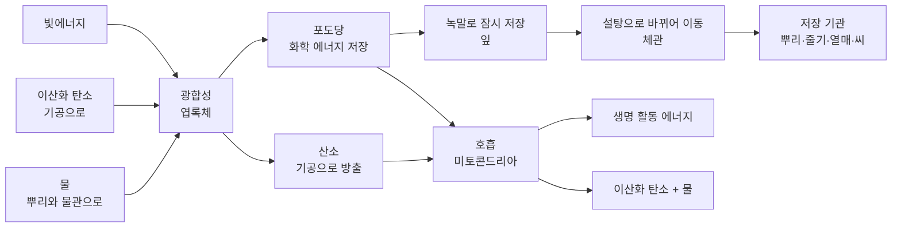
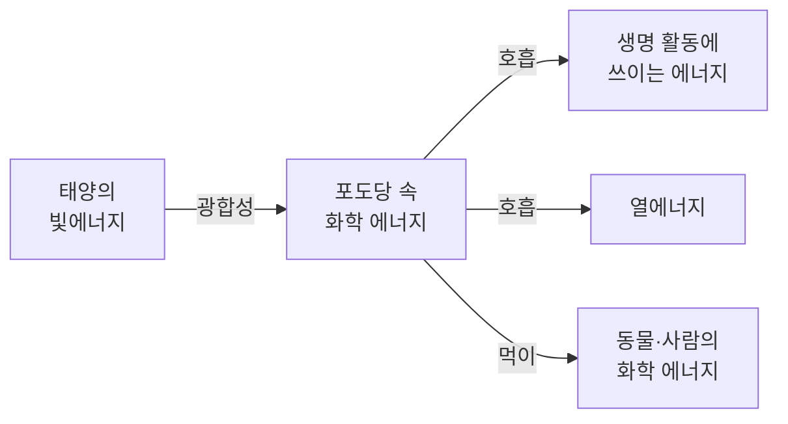

# 중2-5. 식물과 에너지 — 햇빛을 밥으로 바꾸는 초록 공장

<!-- prev: m1-02, m2-04 -->
<!-- next: m2-06, 3-5, 4-3, bio-1, cell-3 -->

> [!NOTE]
> **성취기준**
> - **[9과12-01]** 광합성 과정을 이해하고, 환경 요인과 광합성의 관계를 탐구하는 실험을 설계할 수 있다.
> - **[9과12-02]** 식물의 호흡과 광합성의 관계를 이해하고, 호흡과 광합성 과정에서 출입하는 에너지와 물질의 변화를 분석할 수 있다.
> - **[9과12-03]** 광합성 산물의 저장과 이용 과정을 이해하고, 모형으로 설명할 수 있다.

**학습 목표**

1. 광합성의 재료, 장소, 필요한 에너지, 산물을 말하고, 광합성 과정을 식으로 나타낼 수 있다.
2. 빛의 세기, 이산화 탄소 농도, 온도가 광합성량에 미치는 영향을 설명하고, 변인을 통제하는 실험을 설계할 수 있다.
3. 식물의 호흡이 모든 살아 있는 세포에서 밤낮없이 일어남을 알고, 광합성과 호흡을 비교할 수 있다.
4. 낮과 밤에 식물에서 출입하는 기체를 광합성량과 호흡량의 크기로 분석하고, 에너지가 빛에너지 → 화학 에너지 → 생명 활동 에너지로 바뀌는 과정을 설명할 수 있다.
5. 광합성 산물이 녹말, 설탕 등으로 바뀌어 이동·저장되고, 생명 활동의 에너지원과 몸을 이루는 재료로 쓰이는 과정을 모형으로 설명할 수 있다.

**이 단원의 학습 사다리**

| 단계 | 무엇을 하나? |
|---|---|
| STEP 1. 이전 학습 다시 보기 | 잎·줄기·뿌리의 기능, 엽록체와 미토콘드리아, 화학식을 다시 꺼내 본다 |
| STEP 2. 기초 다지기 | 잎의 구조와 기공, 물관과 체관, 확인 시약, 변인 통제를 디딤돌로 놓는다 |
| STEP 3. 핵심 개념 | 광합성 → 산물 확인 → 환경 요인 → 실험 설계 → 호흡 → 광합성과 호흡의 관계 → 에너지 흐름 → 산물의 이동·저장·이용 |
| STEP 4. 오개념 바로잡기 | "식물은 낮에 광합성, 밤에만 호흡?", "식물은 흙을 먹고 자란다?" 같은 착각을 바로잡는다 |
| STEP 5. 다음 단계로 | 동물의 세포호흡, 물질대사, 산화·환원, 명반응과 탄소 고정 반응 |
| STEP 6. 생활·산업·진로 | 스마트팜, 작물의 저장 기관, 바이오 연료, 숲과 탄소 흡수 |

---

## 🗺️ 단원 들어가기

작은 씨앗 하나가 수십 년 뒤에는 몇 톤이 넘는 커다란 나무가 된다. 그 엄청난 무게는 어디에서 왔을까? 흙에서 왔다고 생각하기 쉽지만, 큰 나무가 자란 뒤에도 화분의 흙은 거의 줄지 않는다. 놀랍게도 나무 몸의 대부분은 **공기 속 이산화 탄소**와 **뿌리로 빨아들인 물**에서 왔다. 그리고 이 둘을 엮어 양분으로 바꾸는 힘은 **햇빛**에서 나온다.

우리가 먹는 밥, 빵, 감자, 과일은 모두 식물이 햇빛으로 만든 양분이다. 고기를 먹는 경우도 그 동물이 결국 식물을 먹고 자랐으니, 우리 몸을 움직이는 에너지를 거슬러 올라가면 대부분 식물의 잎에 닿은 햇빛이 출발점이다. 이 단원에서는 식물이라는 '초록 공장'이 어떻게 양분을 만들고(광합성), 어떻게 그 양분에서 에너지를 꺼내 쓰며(호흡), 남은 양분을 어디에 어떻게 저장하는지 따라가 본다.

---

## STEP 1. 🔙 이전 학습 다시 보기

### 연계 개념표

| 이전 단원·성취기준 | 그때 배운 것 | 이 단원에서 확장되는 것 |
|---|---|---|
| 초등학교 3∼4학년군 「식물의 생활」 | 식물은 사는 곳에 따라 생김새가 다르고, 잎·줄기·뿌리로 이루어져 있다 | 잎은 광합성 공장, 줄기는 운반 통로, 뿌리·줄기·열매는 저장 창고로 역할을 연결한다 |
| 초등학교 5∼6학년군 「식물의 구조와 기능」 | 뿌리는 물을 흡수하고, 줄기는 물을 이동시키며, 잎에서 빛을 받아 양분을 만든다. 아이오딘 용액으로 잎의 녹말을 확인한다 | 양분을 만드는 과정을 **광합성**이라는 이름과 식으로 정리하고, 재료·산물·환경 요인을 실험으로 따진다 |
| 중1 「생물의 구성과 다양성」 [9과02-01] | 식물 세포에는 세포벽, 엽록체가 있고, 동물·식물 세포 모두 미토콘드리아가 있다 | 엽록체는 **광합성**, 미토콘드리아는 **호흡**이 일어나는 장소임을 연결한다 |
| 중1 「생물의 구성과 다양성」 [9과02-02] | 식물의 구성 단계(세포 → 조직 → 조직계 → 기관 → 개체) | 잎·줄기·뿌리라는 **기관**이 협력하여 양분을 만들고 나르고 저장한다 |
| 중2 「물질의 구성」 [9과11-01] | $\mathrm{CO_2}$, $\mathrm{H_2O}$, $\mathrm{O_2}$ 같은 화학식, 원소와 화합물 | 광합성과 호흡에서 이 물질들이 어떻게 바뀌는지 원자 수준에서 상상해 본다 |

### 준비 운동 (사전 진단)

**Q1.** 잎을 따서 아이오딘-아이오딘화 칼륨 용액을 떨어뜨렸더니 청람색으로 변했다. 잎에 어떤 물질이 있다는 뜻인가?

**Q2.** 다음 중 식물 세포에만 있는 구조를 모두 고르시오.
ㄱ. 핵 ㄴ. 세포막 ㄷ. 엽록체 ㄹ. 세포벽 ㅁ. 미토콘드리아

**Q3.** 뿌리에서 흡수한 물은 식물 몸속 어디를 통해 잎까지 올라갈까?

정답 및 해설

**Q1. 녹말** — 아이오딘-아이오딘화 칼륨 용액은 녹말과 만나면 청람색으로 변한다. 잎에서 만들어진 양분이 녹말로 있다는 뜻이다.

**Q2. ㄷ, ㄹ** — 엽록체와 세포벽은 식물 세포에만 있다. 핵, 세포막, 미토콘드리아는 동물 세포와 식물 세포에 모두 있다.

**Q3. 줄기의 물관** — 뿌리털로 흡수한 물은 뿌리, 줄기, 잎으로 이어진 **물관**을 따라 이동한다. STEP 2에서 자세히 정리한다.

---

## STEP 2. 🧱 기초 다지기

### ① 잎의 구조 — 광합성 공장의 설계도

잎은 넓고 얇아서 빛을 많이 받고 기체가 잘 드나들 수 있다. 잎의 단면을 현미경으로 보면 다음과 같은 구조가 있다.

| 구조 | 특징 | 하는 일 |
|---|---|---|
| 표피 | 잎의 겉을 싸는 한 층의 세포. 엽록체가 거의 없어 투명하다 | 잎 내부를 보호하고 빛을 통과시킨다 |
| 잎살(엽육) 세포 | 엽록체가 많이 들어 있다 | **광합성**이 활발히 일어난다 |
| **기공(stoma)** | 주로 잎 뒷면 표피에 있는 작은 구멍. 두 개의 **공변세포**가 둘러싸고 있다 | 이산화 탄소·산소·수증기가 드나드는 문이다 |
| 잎맥 | 물관과 체관이 모여 있는 다발 | 물을 잎으로 들여오고, 만든 양분을 내보낸다 |

> [!TIP]
> 💡 **비유** — 잎은 '공장'이다. 지붕(표피)은 유리처럼 빛을 들여보내고, 작업실(잎살 세포)에는 기계(엽록체)가 가득하며, 출입문(기공)으로 원료 기체가 들어오고 제품 기체가 나간다. 수도관(물관)으로 물이 들어오고, 택배 통로(체관)로 제품(양분)이 나간다.

### ② 물관과 체관 — 식물의 두 가지 길

| 통로 | 이동하는 것 | 방향 |
|---|---|---|
| **물관(xylem)** | 뿌리에서 흡수한 **물과 무기 양분** | 뿌리 → 줄기 → 잎 (위쪽) |
| **체관(phloem)** | 잎에서 만든 **양분**(주로 설탕 형태) | 잎 → 필요하거나 저장할 곳 (위·아래 모두) |

물이 잎까지 올라가는 데에는 잎의 기공에서 물이 수증기로 빠져나가는 **증산 작용**이 큰 역할을 한다. 잎에서 물이 빠져나간 만큼 물관 속 물이 위로 끌려 올라간다.

### ③ 확인 시약 — 눈에 보이지 않는 물질을 색으로 보기

| 확인하려는 것 | 시약·방법 | 결과 |
|---|---|---|
| 녹말 | 아이오딘-아이오딘화 칼륨 용액 | 청람색으로 변한다 |
| 이산화 탄소 | 석회수 | 뿌옇게 흐려진다 |
| 이산화 탄소 양의 변화 | BTB 용액 | 이산화 탄소가 많아지면 노란색, 줄어들면 파란색 쪽(중간은 초록색) |
| 산소 | 꺼져 가는 불씨(향불) | 불씨가 다시 살아난다 |

### ④ 변인 통제 — 공정한 실험의 약속

실험에서 결과에 영향을 줄 수 있는 요인을 **변인**이라고 한다.

| 변인 | 뜻 | 예: "빛이 셀수록 광합성이 활발할까?" |
|---|---|---|
| 조작 변인 | 일부러 다르게 하는 것 | 전등과 식물 사이의 거리(빛의 세기) |
| 통제 변인 | 똑같이 유지하는 것 | 식물의 종류와 크기, 물의 양과 온도, 이산화 탄소 양, 측정 시간 |
| 종속 변인 | 조작 변인 때문에 달라지는지 측정하는 것 | 1분 동안 발생한 기포 수 |

> [!IMPORTANT]
> 한 번에 **조작 변인은 하나만** 바꾸어야 한다. 빛의 세기와 온도를 동시에 바꾸면, 결과가 달라졌을 때 무엇 때문인지 알 수 없다.

---

## STEP 3. 📘 핵심 개념

### ① 광합성 — 빛으로 양분을 만든다 [9과12-01]

식물이 **빛에너지**를 이용하여 **이산화 탄소와 물**로 **포도당**을 만들고 **산소**를 내놓는 과정을 **광합성(photosynthesis)** 이라고 한다. 광합성은 식물 세포의 **엽록체(chloroplast)** 에서 일어난다.

$$
\text{이산화 탄소} + \text{물} \xrightarrow[\text{엽록체}]{\text{빛에너지}} \text{포도당} + \text{산소}
$$

| 구분 | 내용 | 어디에서 어떻게? |
|---|---|---|
| 장소 | 엽록체 | 주로 잎살 세포에 많다 |
| 에너지 | 빛에너지 | 엽록체 속 초록색 색소인 **엽록소**가 흡수한다 |
| 재료 ① | 이산화 탄소 | 공기 중에서 **기공**을 통해 들어온다 |
| 재료 ② | 물 | 뿌리에서 흡수되어 **물관**을 따라 올라온다 |
| 산물 ① | 포도당 | 양분. 곧 **녹말**로 바뀌어 엽록체에 잠시 저장된다 |
| 산물 ② | 산소 | 일부는 식물이 호흡에 쓰고, 나머지는 **기공**을 통해 밖으로 나간다 |

> [!TIP]
> 💡 「빛과 파동」에서 배운 물체의 색을 떠올려 보자. 잎이 초록색으로 보이는 까닭은 엽록소가 **빨간빛과 파란빛은 잘 흡수**하여 광합성에 쓰고, **초록빛은 상대적으로 많이 반사**하기 때문이다. 그래서 식물 재배용 LED 조명은 빨간빛과 파란빛을 많이 내도록 만든 것이 많다.

광합성의 비밀은 수백 년에 걸쳐 조금씩 밝혀졌다.

| 시기 | 과학자 | 실험과 발견 |
|---|---|---|
| 17세기 | 반 헬몬트 | 화분에 버드나무를 5년 동안 키웠더니 나무는 크게 자랐지만 흙의 무게는 거의 줄지 않았다. 그는 나무가 **물**로 자랐다고 결론지었다 |
| 18세기 후반 | 프리스틀리 | 밀폐된 유리 용기 속에서 촛불이 꺼진 공기에 식물을 넣어 두면 다시 촛불이 탈 수 있게 됨을 발견했다. 식물이 공기를 '회복'시킨다(오늘날의 **산소** 발생) |
| 18세기 후반 | 잉엔하우스 | 식물이 공기를 회복시키는 일은 **빛이 있을 때, 초록색 부분**에서만 일어남을 밝혔다 |

#### 예제 1

반 헬몬트의 실험에서 버드나무의 무게가 크게 늘었지만 흙의 무게는 거의 줄지 않았다. 오늘날의 지식으로 버드나무 몸무게가 늘어난 까닭을 광합성과 관련지어 설명하시오.

**풀이** 버드나무는 뿌리로 흡수한 **물**과 공기 중에서 기공으로 들어온 **이산화 탄소**를 재료로, 빛에너지를 이용해 포도당을 만들었다. 이 포도당이 녹말, 셀룰로스 등으로 바뀌어 몸을 이루었으므로 몸무게가 늘었다. 반 헬몬트는 물만 생각했지만, 실제로는 **공기 중의 이산화 탄소**가 큰 몫을 했다. 흙에서는 적은 양의 무기 양분만 얻었다.

### ② 광합성에 필요한 물질과 산물 확인하기 [9과12-01]

광합성의 식에 나온 재료와 산물을 실험으로 하나씩 확인해 보자.

| 확인할 것 | 실험 방법 | 결과와 해석 |
|---|---|---|
| **녹말**이 생긴다 | 하루 동안 어둠에 둔 식물의 잎 일부를 알루미늄 포일로 가리고 빛을 쪼인 뒤, 잎을 에탄올에 넣어 물중탕으로 엽록소를 빼고 아이오딘-아이오딘화 칼륨 용액을 떨어뜨린다 | 빛을 받은 부분만 청람색 → 빛을 받은 곳에서 녹말이 만들어졌다 |
| **산소**가 생긴다 | 물속에 넣은 검정말에 빛을 비추고 발생한 기체를 시험관에 모아 꺼져 가는 불씨를 넣는다 | 불씨가 다시 살아남 → 발생한 기체는 산소이다 |
| **이산화 탄소**가 쓰인다 | 날숨을 불어 넣어 노랗게 만든 BTB 용액에 검정말을 넣고 빛을 비춘다. 검정말을 넣지 않은 시험관과, 검정말을 넣고 빛을 가린 시험관도 함께 둔다 | 검정말 + 빛 시험관만 초록색을 거쳐 파란색 쪽으로 변함 → 이산화 탄소가 광합성에 쓰여 줄었다 |
| **빛**이 필요하다 | 위의 실험들에서 빛을 가린 조건과 비교한다 | 빛을 가리면 녹말·산소가 생기지 않고 BTB 색도 변하지 않는다 |

> [!NOTE]
> - 실험 전에 식물을 **하루 정도 어두운 곳에 두는** 까닭은 잎에 이미 있던 녹말을 없애기 위해서이다. 그래야 실험 중에 새로 생긴 녹말만 확인할 수 있다.
> - 잎을 에탄올에 넣고 물중탕하는 까닭은 초록색 **엽록소를 녹여 내어** 아이오딘 반응의 색 변화를 잘 보기 위해서이다.

#### 예제 2

BTB 용액 실험에서 시험관 A(검정말 + 빛), B(검정말 없음 + 빛), C(검정말 + 알루미늄 포일로 빛 차단)를 준비하였다. 처음에는 모두 노란색이었다. 몇 시간 뒤 A만 파란색으로 변했다. (1) B를 준비한 까닭은? (2) A와 C를 비교하여 알 수 있는 것은?

**풀이**
(1) 빛만으로는 BTB 색이 변하지 않는다는 것, 곧 색 변화가 **검정말 때문**임을 확인하기 위한 대조 실험이다.
(2) 두 시험관의 차이는 빛뿐이다. 빛이 있을 때만 이산화 탄소가 줄었으므로 **광합성에는 빛이 필요하다.** (C는 오히려 검정말의 호흡으로 이산화 탄소가 늘어나 노란색이 더 진해질 수 있다.)

### ③ 환경 요인과 광합성량 [9과12-01]

광합성이 얼마나 활발하게 일어나는지(**광합성량**)는 주변 환경에 따라 달라진다. 대표적인 환경 요인은 **빛의 세기, 이산화 탄소 농도, 온도**이다.

| 환경 요인 | 광합성량의 변화 | 그래프 모양 | 까닭 |
|---|---|---|---|
| **빛의 세기** | 빛이 셀수록 증가하다가, 어느 정도 이상에서는 더 이상 증가하지 않는다 | 올라가다 평평해짐 | 다른 조건(이산화 탄소 양, 엽록체가 일하는 속도)이 한계가 된다 |
| **이산화 탄소 농도** | 농도가 높을수록 증가하다가, 어느 정도 이상에서는 더 이상 증가하지 않는다 | 올라가다 평평해짐 | 빛의 세기 등 다른 조건이 한계가 된다 |
| **온도** | 일정 온도까지는 증가하다가, 그보다 높아지면 **급격히 감소**한다 | 산 모양 | 광합성은 여러 단계의 화학 반응이고, 반응을 돕는 물질(효소)이 높은 온도에서 제 기능을 잃는다 |

> [!TIP]
> 💡 **비유** — 광합성을 '김밥 만들기'라고 하자. 김(빛), 밥(이산화 탄소), 일손(온도에 따라 일하는 속도)이 모두 필요하다. 밥을 아무리 많이 가져와도 김이 모자라면 김밥 수는 늘지 않는다. 가장 **모자란 재료**가 생산량을 정한다. 그리고 너무 더우면 일손이 지쳐 오히려 생산량이 확 줄어든다.

온도의 경우 가장 활발한 온도는 식물마다 다르지만, 많은 식물에서 대략 30~35 ℃ 무렵까지 광합성이 활발해지다가 그보다 더 뜨거워지면 빠르게 줄어든다. 한여름 한낮에 기온이 너무 높고 건조하면, 식물은 물을 잃지 않으려고 기공을 닫기도 한다. 그러면 이산화 탄소가 들어오지 못해 광합성량이 줄어든다.

#### 예제 3 — 실험 결과 해석하기

검정말을 물이 든 시험관에 넣고 전등과의 거리를 바꾸며 1분 동안 발생하는 기포 수를 세었다. (물의 온도와 탄산수소 나트륨의 양은 같게 하였다.)

| 전등과의 거리(cm) | 10 | 20 | 30 | 40 |
|---|---|---|---|---|
| 기포 수(개/분) | 32 | 18 | 9 | 5 |

(1) 조작 변인과 종속 변인은? (2) 결과로부터 알 수 있는 것은? (3) 탄산수소 나트륨을 넣는 까닭은?

**풀이**
(1) 조작 변인: 전등과의 거리(빛의 세기), 종속 변인: 1분 동안의 기포 수(광합성량)
(2) 전등이 가까울수록(빛이 셀수록) 기포 수가 많다. 따라서 **빛이 셀수록 광합성량이 많다.**
(3) 탄산수소 나트륨은 물에 녹아 이산화 탄소를 공급한다. 이산화 탄소가 부족해 광합성이 제한되지 않도록 하기 위해서이다.

> [!WARNING]
> 전등을 너무 가까이 대면 전등의 열 때문에 물의 온도도 함께 올라간다. 그러면 '빛의 세기'와 '온도'라는 두 변인이 동시에 바뀐다. 전등과 시험관 사이에 물이 든 비커를 두어 열을 막거나, 열이 적게 나는 LED 전등을 쓰고 수온을 재며 실험해야 한다.

### ④ 광합성 실험 설계하기 [9과12-01]

이제 직접 실험을 설계해 보자. 설계는 다음 순서로 한다.

1. **탐구 문제 정하기**: "이산화 탄소의 양이 많을수록 광합성이 활발할까?"
2. **가설 세우기**: "물에 녹은 이산화 탄소의 양이 많을수록 검정말의 광합성량이 많을 것이다."
3. **변인 정하기**: 조작 변인(탄산수소 나트륨의 양), 통제 변인(빛의 세기, 수온, 검정말 길이, 측정 시간), 종속 변인(기포 수 또는 산소 센서 값)
4. **실험 방법 쓰기**: 비커 4개에 같은 양의 물을 넣고 탄산수소 나트륨을 0 g, 0.5 g, 1 g, 2 g씩 녹인다. 같은 길이의 검정말을 넣고 같은 거리의 전등을 비춘 뒤 5분 동안 기포 수를 센다. 3번 반복하여 평균을 낸다.
5. **결과 예상과 정리**: 표와 그래프로 정리하고 가설이 맞는지 판단한다.

> [!TIP]
> 💡 **디지털 탐구 도구 활용** — 기포를 세는 대신 **산소 센서**나 **이산화 탄소 센서**를 밀폐 용기에 넣으면 기체 농도 변화를 자동으로 기록하고 그래프로 볼 수 있다. 여러 모둠이 같은 조건으로 측정한 데이터를 공유하면 결과를 더 믿을 수 있다.

#### 예제 4

어떤 학생이 "온도가 광합성에 미치는 영향"을 알아보려고 검정말 실험을 했다. 비커 A는 15 ℃ 물에 두고 창가에, 비커 B는 30 ℃ 물에 두고 교실 안쪽 책상에 두었다. 이 실험 설계의 문제점과 고칠 방법을 쓰시오.

**풀이** 조작 변인인 온도 말고도 **빛의 세기**(창가와 교실 안쪽)가 함께 달라졌다. 결과가 달라도 온도 때문인지 빛 때문인지 알 수 없다. 두 비커를 **같은 거리의 같은 전등** 아래 두고 온도만 다르게 해야 한다. 또 온도를 15 ℃, 25 ℃, 35 ℃, 45 ℃처럼 여러 단계로 나누면 온도에 따른 변화를 더 잘 알 수 있다.

### ⑤ 식물의 호흡 — 양분에서 에너지를 꺼낸다 [9과12-02]

식물도 우리처럼 살아가는 데 에너지가 필요하다. 뿌리가 물을 흡수하고, 새싹이 자라고, 꽃이 피는 모든 생명 활동에 에너지가 쓰인다. 식물은 광합성으로 만든 양분(포도당)을 **산소**로 분해하여 생명 활동에 필요한 에너지를 얻는다. 이 과정을 **호흡(respiration)** 이라고 한다.

$$
\text{포도당} + \text{산소} \xrightarrow{\text{미토콘드리아}} \text{이산화 탄소} + \text{물} + \text{에너지}
$$

| 구분 | 내용 |
|---|---|
| 장소 | 살아 있는 **모든 세포**의 **미토콘드리아** (잎뿐 아니라 뿌리, 줄기, 꽃, 씨에서도) |
| 시간 | **밤낮 구별 없이 항상** 일어난다 |
| 재료 | 포도당, 산소 |
| 산물 | 이산화 탄소, 물 |
| 에너지 | 포도당에 저장된 화학 에너지가 빠져나와 생명 활동에 쓰이고, 일부는 열로 나간다 |

> [!TIP]
> 💡 **비유** — 광합성이 '햇빛으로 도시락을 싸는 일'이라면, 호흡은 '도시락을 먹고 힘을 내는 일'이다. 도시락은 낮에만 쌀 수 있지만, 먹는 일은 밤낮없이 계속해야 살 수 있다.

#### 예제 5 — 싹트는 씨앗도 호흡한다

보온병 A에는 물에 불려 싹트기 시작한 콩을, 보온병 B에는 삶은 콩을 넣고 온도계를 꽂아 하루 동안 두었다. 그 뒤 각 보온병의 기체를 석회수에 통과시켰다. 예상되는 결과와 그 까닭을 쓰시오.

**풀이** A는 온도가 올라가고 기체가 석회수를 뿌옇게 만든다. B는 거의 변화가 없다. 싹트는 콩은 살아 있어 활발하게 **호흡**하므로, 호흡에서 나온 에너지 일부가 **열**로 나오고 **이산화 탄소**가 생긴다. 삶은 콩은 죽은 세포이므로 호흡하지 않는다. (B는 비교를 위한 대조 실험이다.)

### ⑥ 광합성과 호흡의 관계 — 낮과 밤의 기체 출입 [9과12-02]

광합성과 호흡을 나란히 놓으면, 하나의 산물이 다른 하나의 재료가 되는 **거울 같은 관계**가 보인다.

| 비교 | 광합성 | 호흡 |
|---|---|---|
| 장소 | 엽록체가 있는 세포 | 살아 있는 모든 세포(미토콘드리아) |
| 시간 | 빛이 있을 때 | 항상 |
| 재료 | 이산화 탄소, 물 | 포도당, 산소 |
| 산물 | 포도당, 산소 | 이산화 탄소, 물 |
| 에너지 | 빛에너지를 **흡수**하여 포도당에 저장 | 포도당의 에너지를 **방출**하여 생명 활동에 사용 |
| 양분 | 만든다(합성) | 쓴다(분해) |

식물은 낮에도 호흡을 한다. 그런데 왜 낮에 식물은 산소만 내놓는 것처럼 보일까? **광합성과 호흡이 동시에 일어나고, 그 결과를 합한 것이 밖으로 드러나기 때문**이다.

| 시간 | 일어나는 일 | 크기 비교 | 밖으로 드러나는 기체 출입 |
|---|---|---|---|
| 빛이 강한 낮 | 광합성 + 호흡 | 광합성량 > 호흡량 | 이산화 탄소 **흡수**, 산소 **방출** |
| 빛이 약한 이른 아침·저녁 | 광합성 + 호흡 | 광합성량 = 호흡량 | 겉으로 드러나는 출입이 거의 없다 |
| 밤 | 호흡만 | 광합성량 = 0 | 산소 **흡수**, 이산화 탄소 **방출** |

> [!IMPORTANT]
> 식물이 자라려면(양분이 쌓이려면) 하루 전체로 보아 **광합성으로 만든 양분이 호흡으로 쓴 양분보다 많아야** 한다. 빛이 너무 부족한 곳에서 식물이 시들어 가는 까닭은 광합성량이 호흡량을 따라가지 못해 양분이 계속 줄어들기 때문이다.

#### 예제 6 — 기체 출입량 계산하기

어떤 식물이 빛이 강할 때 광합성으로 1시간에 산소 30 mL를 만들고, 호흡으로 밤낮 관계없이 1시간에 산소 5 mL를 쓴다.
(1) 빛이 강한 낮에 이 식물이 1시간 동안 밖으로 내보내는 산소의 양은?
(2) 밤에 1시간 동안 산소는 어떻게 출입하는가?
(3) 하루 중 12시간은 빛이 강하고 12시간은 밤이라면, 하루 동안 이 식물이 밖으로 내보낸 산소의 양은 모두 얼마인가?

**풀이**
(1) 만든 양 − 쓴 양 $= 30 - 5 = 25\ \mathrm{mL}$ 방출
(2) 광합성을 하지 않으므로 산소 5 mL를 **흡수**한다.
(3) 낮 방출량 $25 \times 12 = 300\ \mathrm{mL}$, 밤 흡수량 $5 \times 12 = 60\ \mathrm{mL}$이므로, 하루 동안 $300 - 60 = 240\ \mathrm{mL}$를 내보낸다. 결과가 (+)이므로 이 식물에는 양분이 쌓여 자랄 수 있다.

### ⑦ 에너지와 물질은 어떻게 바뀌나? [9과12-02]

광합성과 호흡을 **에너지**와 **물질**이라는 두 안경으로 나누어 분석해 보자.

**에너지의 변화** — 에너지는 사라지지 않고 형태가 바뀐다.

**물질의 변화** — 물질은 형태를 바꾸며 돈다.

| 물질 | 광합성에서 | 호흡에서 |
|---|---|---|
| 이산화 탄소 | 재료로 **쓰인다** | 산물로 **생긴다** |
| 물 | 재료로 쓰인다 | 산물로 생긴다 |
| 포도당 | 산물로 생긴다 | 재료로 쓰인다 |
| 산소 | 산물로 생긴다 | 재료로 쓰인다 |

> [!TIP]
> 💡 **비유** — 물질은 '돌고 도는 그릇', 에너지는 '그릇에 담겼다가 쏟아지는 물'이다. 광합성은 이산화 탄소와 물이라는 그릇을 조립해 포도당이라는 큰 그릇을 만들고 거기에 햇빛 에너지를 담는다. 호흡은 그 그릇을 다시 분해하며 담긴 에너지를 꺼내 쓴다. 그릇(물질)은 다시 쓰이지만, 쏟아진 물(열로 나간 에너지)은 다시 담을 수 없어 태양이 계속 새로 채워 주어야 한다.

> [!NOTE]
> 「물질의 구성」에서 배운 화학식으로 보면, 광합성은 $\mathrm{CO_2}$와 $\mathrm{H_2O}$의 원자들이 다시 짝을 지어 포도당과 $\mathrm{O_2}$가 되는 변화이고, 호흡은 그 반대 방향의 변화이다. 원자는 새로 생기거나 사라지지 않고 짝만 바뀐다. 이것을 화학 반응식으로 정확히 쓰는 방법은 중3 「화학 반응의 규칙성」에서 배운다.

#### 예제 7

밀폐된 투명한 유리 용기에 화분과 쥐를 함께 넣고 햇빛이 잘 드는 곳에 두었더니 쥐가 오래 살았다. 그러나 같은 용기를 어두운 곳에 두었더니 쥐가 오래 살지 못했다. 이 결과를 광합성과 호흡의 기체 출입으로 설명하시오. (실제로 동물로 이런 실험을 해서는 안 된다.)

**풀이** 밝은 곳에서는 식물의 광합성량이 호흡량보다 많아 산소를 내보내므로, 쥐의 호흡에 필요한 산소가 공급되고 쥐가 내놓은 이산화 탄소는 광합성에 쓰인다. 어두운 곳에서는 식물이 광합성을 못 하고 호흡만 하므로 식물과 쥐가 모두 산소를 소비하고 이산화 탄소를 내놓아 산소가 빨리 부족해진다.

### ⑧ 광합성 산물의 이동과 저장 [9과12-03]

잎에서 만든 포도당은 그대로 머물러 있지 않는다. 형태를 바꾸어 가며 이동하고 저장된다.

| 단계 | 언제·어디서 | 어떤 형태로 | 까닭 |
|---|---|---|---|
| ① 생산 | 낮, 잎의 엽록체 | 포도당 | 광합성의 산물 |
| ② 잠시 저장 | 낮, 잎의 엽록체 | **녹말** | 포도당은 물에 잘 녹아 세포 안에 많이 쌓이면 곤란하므로, 물에 잘 녹지 않는 녹말로 바꾸어 둔다 |
| ③ 이동 | 주로 밤, 잎 → **체관** | **설탕** | 녹말은 물에 녹지 않아 이동할 수 없으므로, 물에 잘 녹는 설탕으로 바꾸어 체관으로 보낸다 |
| ④ 저장·사용 | 뿌리, 줄기, 열매, 씨 등 | 녹말, 포도당, 설탕, 단백질, 지방 | 저장 기관에서 다시 다양한 형태로 바뀌어 저장되거나 쓰인다 |

> [!TIP]
> 💡 **비유** — 포도당을 '현금'이라고 하자. 낮에 번 현금은 잠시 금고(엽록체)에 **금괴(녹말)** 로 바꾸어 두고, 밤에는 들고 다니기 편한 **수표(설탕)** 로 바꾸어 택배 통로(체관)로 보낸다. 도착한 곳에서는 다시 금괴(녹말)로 쌓아 두거나, 다른 자산(단백질, 지방)으로 바꾸어 둔다.

같은 광합성 산물이라도 식물마다 저장하는 **기관**과 **형태**가 다르다. 우리가 먹는 많은 음식이 바로 식물의 저장 창고이다.

| 저장 형태 | 식물(저장 기관) |
|---|---|
| 녹말 | 감자(땅속줄기), 고구마(뿌리), 쌀·밀·옥수수(씨) |
| 설탕 | 사탕수수(줄기), 사탕무(뿌리) |
| 포도당·과당 | 포도, 사과, 감 등의 열매, 양파(비늘줄기) |
| 단백질 | 콩(씨) |
| 지방 | 참깨, 땅콩, 해바라기(씨) |

#### 예제 8

오후 늦게 딴 잎과 다음 날 새벽에 딴 잎을 각각 에탄올로 탈색하고 아이오딘-아이오딘화 칼륨 용액을 떨어뜨렸다. 어느 잎이 더 진한 청람색을 띠겠는가? 그 까닭을 쓰시오.

**풀이** **오후 늦게 딴 잎**이 더 진하다. 낮 동안 광합성으로 만든 포도당이 녹말로 잎에 쌓여 있기 때문이다. 밤에는 광합성이 일어나지 않고, 잎의 녹말이 설탕으로 바뀌어 체관을 통해 다른 곳으로 옮겨 가거나 호흡에 쓰이므로 새벽에는 잎의 녹말이 줄어 있다.

### ⑨ 광합성 산물의 이용 — 모든 생명 활동의 에너지원 [9과12-03]

광합성 산물은 크게 두 가지로 쓰인다.

| 쓰임 | 내용 | 예 |
|---|---|---|
| **에너지원** | 호흡으로 분해되어 생명 활동에 필요한 에너지를 낸다 | 뿌리가 물과 무기 양분을 흡수할 때, 세포가 분열하여 자랄 때, 꽃이 피고 열매를 맺을 때, 씨가 싹틀 때 |
| **몸을 이루는 재료** | 다른 물질로 바뀌어 식물의 몸을 만든다 | 세포벽의 주성분인 **셀룰로스**(나무의 줄기, 종이의 원료), 단백질, 지방 |

> [!IMPORTANT]
> 광합성 산물은 **식물 자신**뿐 아니라 **지구의 거의 모든 생물**에게 에너지원이 된다. 초식 동물은 식물을 먹고, 육식 동물은 초식 동물을 먹는다. 사람이 먹는 밥과 고기의 에너지도 거슬러 올라가면 식물이 광합성으로 저장한 햇빛 에너지이다. 그래서 생태계에서 식물을 **생산자**라고 부른다.

씨앗이 싹틀 때를 생각해 보자. 땅속에서 싹트는 씨앗은 아직 잎이 없어 광합성을 할 수 없다. 그래서 씨앗 속에 저장된 녹말·단백질·지방을 호흡으로 분해하여 싹을 틔우는 에너지를 얻는다. 떡잎이 땅 위로 올라와 초록색 잎을 펼치고 광합성을 시작하면, 그때부터 스스로 양분을 만든다.

#### 모형으로 설명하기 — 광합성 산물의 여행 정보 그림

광합성 산물이 만들어지고, 이동하고, 저장되고, 쓰이는 과정을 하나의 **정보 그림(인포그래픽)** 모형으로 나타내 보자. 다음은 모형에 담을 내용의 예이다.

| 모형의 장면 | 표현할 내용 | 표현 아이디어 |
|---|---|---|
| 1. 잎 공장 | 빛 + 이산화 탄소 + 물 → 포도당 + 산소 | 햇빛 화살표, 기공으로 드나드는 기체 화살표 |
| 2. 엽록체 창고 | 포도당 → 녹말(낮) | 작은 구슬(포도당)이 사슬(녹말)로 연결됨 |
| 3. 체관 고속도로 | 녹말 → 설탕(밤), 체관으로 이동 | 택배 트럭이 줄기를 따라 위아래로 달림 |
| 4. 저장 창고 | 감자·고구마·콩·열매에 각각 다른 형태로 저장 | 창고마다 다른 상자(녹말, 단백질, 지방) |
| 5. 에너지 발전소 | 모든 세포에서 호흡으로 에너지 사용 | 미토콘드리아 발전소, 생명 활동 아이콘 |
| 6. 먹이 연결 | 동물과 사람이 저장 양분을 먹음 | 화살표가 동물로 이어짐 |

#### 예제 9

고구마를 수확해 따뜻하고 습한 곳에 오래 두었더니 무게가 조금씩 줄어들었다. 그 까닭을 호흡과 관련지어 설명하시오.

**풀이** 수확한 고구마의 세포도 살아 있으므로 계속 **호흡**한다. 고구마에 저장된 녹말이 포도당으로 바뀌어 호흡에 쓰이면 이산화 탄소와 물이 되어 빠져나가므로 무게가 줄어든다. 따뜻하면 호흡이 더 활발해지므로, 감자·고구마 같은 작물은 너무 덥지 않은 곳에 보관하는 것이 좋다.

---

## STEP 4. ⚠️ 오개념 바로잡기

| 흔한 오개념 | 올바른 개념 | 왜 그럴까? |
|---|---|---|
| 식물은 낮에는 광합성만, 밤에는 호흡만 한다 | 호흡은 **밤낮없이 항상**, 광합성은 빛이 있을 때 일어난다 | 낮에는 광합성량이 호흡량보다 많아 호흡이 겉으로 드러나지 않을 뿐이다 |
| 식물은 흙을 먹고 자란다 | 식물 몸의 대부분은 **이산화 탄소와 물**로 만든 양분에서 온다 | 반 헬몬트의 실험에서 흙의 무게는 거의 줄지 않았다. 흙에서는 적은 양의 무기 양분을 얻는다 |
| 식물은 호흡하지 않는다(동물만 호흡한다) | 식물도 모든 살아 있는 세포에서 **호흡**하여 에너지를 얻는다 | 싹트는 씨앗이 열과 이산화 탄소를 내는 실험으로 확인할 수 있다 |
| 식물의 호흡은 이산화 탄소를 마시고 산소를 내놓는 것이다 | 호흡은 **산소를 쓰고 이산화 탄소를 내놓는다.** 반대의 기체 출입은 광합성 때문이다 | 광합성과 호흡의 기체 출입이 반대여서 둘을 혼동하기 쉽다 |
| 밤에 침실에 화분을 두면 산소가 모자라 위험하다 | 화분 몇 개의 호흡량은 사람의 호흡량에 비해 **매우 작다** | 식물이 밤에 이산화 탄소를 내놓는 것은 맞지만, 그 양은 방 안 공기를 위험하게 바꿀 정도가 아니다 |
| 잎이 초록색인 것은 초록빛을 가장 많이 흡수하기 때문이다 | 엽록소는 빨간빛과 파란빛을 잘 흡수하고 **초록빛을 상대적으로 많이 반사**한다 | 물체의 색은 반사하는 빛의 색이다(「빛과 파동」) |
| 광합성 산물은 잎에 포도당 상태로 그대로 쌓인다 | 포도당은 **녹말**로 잠시 저장되고, **설탕**으로 바뀌어 체관으로 이동한다 | 물에 녹는 정도에 따라 저장과 이동에 알맞은 형태가 다르다 |

---

## STEP 5. 🎓 다음 단계로 한 걸음 더

> [!CAUTION]
> 이 절은 **중학교 교육과정 범위 밖의 심화 내용**으로 평가 대상이 아니다. 광합성과 호흡이라는 개념이 다음 단원과 고등학교에서 어떻게 이어지는지 맛보기로 보여 주기 위한 것이다.

### 다음 학년·과목과의 연결

| 단계 | 단원 | 이어지는 내용 |
|---|---|---|
| 중2 | 「동물과 에너지」 | 동물은 소화로 양분을, 호흡계로 산소를 얻어 순환계로 세포에 전달하고, 세포에서 **세포호흡**으로 에너지를 얻는다 |
| 고1 통합과학1 | 「생명 시스템과 물질대사」 | 광합성과 세포호흡을 **물질대사**로 묶고, 화학 반응을 돕는 **효소**의 역할을 배운다 |
| 고1 통합과학2 | 「산화와 환원」 | 광합성과 호흡을 **산소의 이동**(산화·환원)이라는 공통 규칙으로 해석한다 |
| 고2 생명과학 | 「생명 시스템의 구성」 | 물질대사에서의 에너지 전환, 생명 활동에 쓰이는 에너지 저장 물질(ATP), 생태계의 에너지 흐름 |
| 고2·3 세포와 물질대사 | 「세포호흡과 광합성」 | 미토콘드리아와 엽록체의 구조, 광합성의 **명반응**과 **탄소 고정 반응**, 세포호흡의 단계 |

### ① 광합성을 화학 반응식으로

중3에서 화학 반응식을 배우면 광합성을 다음과 같이 나타낼 수 있다(과정을 간단히 줄인 식).

$$
6\mathrm{CO_2} + 6\mathrm{H_2O} \xrightarrow{\text{빛에너지}} \mathrm{C_6H_{12}O_6} + 6\mathrm{O_2}
$$

포도당($\mathrm{C_6H_{12}O_6}$) 분자 1개를 만들려면 이산화 탄소 분자 6개가 필요하다. 호흡은 이 식을 거의 거꾸로 한 것이다. 고등학교에서는 광합성에서 나오는 산소가 이산화 탄소가 아니라 **물에서 온다**는 것을 밝힌 실험도 배운다.

### ② 광합성은 두 단계로 일어난다

세포와 물질대사 과목에서는 광합성을 두 단계로 나눈다.

- **명반응**: 엽록체의 막에서 빛에너지를 흡수하여 물을 분해하고(산소 발생), 에너지를 저장한 물질(ATP 등)을 만든다.
- **탄소 고정 반응**: 명반응에서 만든 에너지 물질을 이용해 이산화 탄소를 포도당 같은 유기물로 만든다.

이 단원 ③에서 "빛이 세져도 어느 이상에서는 광합성량이 늘지 않는다"고 한 것은, 빛을 쓰는 단계는 충분히 빨라졌는데 이산화 탄소를 쓰는 단계가 따라가지 못하기 때문으로 설명된다. 또 이 단원 ⑥에서 '광합성량 = 호흡량'이 되는 빛의 세기를 고등학교에서는 **보상점**이라고 부른다.

### ③ 호흡에서 나온 에너지는 어디에 담길까?

세포는 포도당의 에너지를 한꺼번에 꺼내지 않고, 여러 단계에 걸쳐 조금씩 꺼내 **ATP**라는 물질에 담아 둔다. ATP는 세포 속 '충전된 건전지'처럼 근육 운동, 물질 합성, 물질 운반 등에 바로 쓰인다.

### 지금 vs 다음 단계

| 구분 | 중학교 2학년(지금) | 고등학교 통합과학·생명과학·세포와 물질대사 |
|---|---|---|
| 광합성 | 재료·산물·장소, 낱말로 쓴 식 | 화학 반응식, 명반응과 탄소 고정 반응, 엽록체의 구조 |
| 호흡 | 포도당 + 산소 → 이산화 탄소 + 물 + 에너지 | 세포호흡의 단계, 미토콘드리아의 구조, ATP 생성, 발효 |
| 관계 | 낮·밤의 기체 출입, 광합성량과 호흡량 비교 | 보상점·광포화점, 산화·환원, 전자 전달계 비교 |
| 에너지 | 빛 → 화학 → 생명 활동 에너지 | 물질대사와 에너지 전환, 생태계 에너지 흐름 |

---

## STEP 6. 🏭 생활·산업·진로 연결

### 사례 1. 스마트팜 — 광합성 조건을 데이터로 조절한다

- **원리** 빛의 세기, 이산화 탄소 농도, 온도가 광합성량을 정한다(STEP 3 ③).
- **어디에 쓰이나** 스마트팜은 센서로 온실의 빛, 온도, 습도, 이산화 탄소 농도를 측정하고 자동으로 조절한다. 건물 안에서 여러 층으로 작물을 키우는 **식물 공장**은 햇빛 대신 빨간빛·파란빛 LED를 쓰기도 한다. 겨울철 온실에 이산화 탄소를 공급해 작물의 광합성을 돕기도 한다.

### 사례 2. 작물의 저장과 유통 — 호흡을 늦춰라

- **원리** 수확한 채소와 과일도 살아 있어 호흡하며 저장 양분을 쓴다(STEP 3 ⑨ 예제 9).
- **어디에 쓰이나** 농산물 저온 저장 창고는 온도를 낮춰 호흡을 늦추고, 일부 저장고는 공기 속 산소 농도를 낮추어 호흡을 줄여 신선도를 오래 유지한다.

### 사례 3. 바이오 연료 — 저장된 햇빛 에너지를 연료로

- 옥수수·사탕수수에 저장된 녹말과 설탕을 발효시켜 바이오 에탄올을 만들고, 콩·유채 등의 기름으로 바이오 디젤을 만든다. 이 연료들은 식물이 광합성으로 저장한 햇빛 에너지를 꺼내 쓰는 것이다.

### 사례 4. 숲과 탄소 흡수

- 숲의 나무들은 광합성으로 대기 중 이산화 탄소를 흡수해 몸(셀룰로스 등)에 저장한다. 그래서 숲 가꾸기와 나무 심기는 기후변화에 대응하는 방법 가운데 하나로 꼽힌다. 다만 나무도 호흡하고, 죽어 분해되면 이산화 탄소가 다시 나오므로, 숲이 흡수하는 양은 나무의 나이와 상태에 따라 달라진다.

### 관련 진로와 학과

| 진로 | 하는 일 | 관련 학과 |
|---|---|---|
| 스마트팜 전문가 | 센서와 데이터로 작물 재배 환경 설계·관리 | 원예학, 농업공학, 스마트팜학, 정보통신공학 |
| 식물 생리학자 | 광합성 효율이 높은 작물 연구 | 생명과학, 식물학, 농학 |
| 작물 육종가 | 수확량과 저장성이 좋은 품종 개발 | 농학, 원예학, 생명공학 |
| 산림 전문가 | 숲 가꾸기, 산림의 탄소 흡수량 평가 | 산림자원학, 환경생태학 |
| 바이오 에너지 연구원 | 식물 자원으로 연료와 소재 생산 | 생물공학, 화학공학, 환경공학 |

---

## 🔬 탐구 활동 — 광합성에 필요한 물질과 산물 확인하는 실험하기

### 활동 A. 빛이 있을 때 잎에서 녹말이 만들어질까?

**목표** 잎의 일부를 가리고 빛을 쪼인 뒤 녹말이 생긴 곳을 확인하여, 광합성에 빛이 필요하고 그 산물로 녹말이 생김을 확인한다.

**준비물** 하루 동안 어둠에 둔 화분(제라늄, 봉선화 등), 알루미늄 포일, 클립, 에탄올, 비커, 시험관, 뜨거운 물(물중탕용), 페트리 접시, 핀셋, 아이오딘-아이오딘화 칼륨 용액, 보안경, 실험복

**과정**
1. 어둠에 하루 둔 식물의 잎 한 장에서 일부를 알루미늄 포일로 앞뒤 모두 감싸 클립으로 고정한다.
2. 식물을 햇빛이나 밝은 전등 아래 4~6시간 둔다.
3. 그 잎을 따서 포일을 벗기고, 뜨거운 물에 잠깐 담가 부드럽게 한다.
4. 잎을 에탄올이 든 시험관에 넣고, 시험관을 뜨거운 물이 든 비커에 담가 **물중탕**하여 엽록소를 빼낸다.
5. 탈색된 잎을 물로 헹군 뒤 페트리 접시에 펴고 아이오딘-아이오딘화 칼륨 용액을 떨어뜨린다.

**결과 기록**

| 잎의 부분 | 에탄올 처리 후 색 | 아이오딘 용액 반응 후 색 | 녹말이 있나? |
|---|---|---|---|
| 빛을 받은 부분 | | | |
| 포일로 가린 부분 | | | |

**생각해 보기**
1. 실험 전에 식물을 하루 동안 어둠에 둔 까닭은 무엇인가?
2. 이 실험에서 조작 변인과 종속 변인은 무엇인가?
3. 포일 대신 무늬를 오린 검은 종이를 붙이면 결과는 어떻게 나타날까?

> [!WARNING]
> **안전 수칙** 에탄올은 불이 잘 붙으므로 **절대 불꽃으로 직접 가열하지 않고** 반드시 물중탕한다. 주변에 불을 두지 않는다. 뜨거운 물에 데지 않도록 주의하고, 아이오딘 용액이 피부나 옷에 묻지 않게 한다.

### 활동 B. 검정말과 BTB 용액으로 광합성의 재료와 산물 확인하기

**목표** 광합성에 이산화 탄소가 쓰이고 산소가 생기는 것을 확인한다.

**준비물** 검정말, 시험관 3개, 시험관대, BTB 용액, 빨대, 알루미늄 포일, LED 전등, 깔때기, 비커, 향과 성냥(교사 지도), 탄산수소 나트륨

**과정**
1. 물에 BTB 용액을 넣고 빨대로 날숨을 불어 넣어 노란색으로 만든다.
2. 시험관 A(검정말 넣음), B(검정말 없음), C(검정말 넣고 포일로 감쌈)에 노란 BTB 용액을 같은 양씩 채운다.
3. 세 시험관을 같은 LED 전등 아래 2~3시간 두고 색 변화를 관찰한다.
4. 따로 탄산수소 나트륨을 녹인 물이 담긴 비커에 검정말을 넣고 깔때기와 물이 가득 찬 시험관을 거꾸로 씌워 빛을 비춘다. 기체가 모이면 꺼져 가는 향불을 넣어 본다.

**결과 기록**

| 시험관 | 처음 색 | 2~3시간 뒤 색 | 해석 |
|---|---|---|---|
| A (검정말 + 빛) | 노란색 | | |
| B (검정말 없음 + 빛) | 노란색 | | |
| C (검정말 + 빛 차단) | 노란색 | | |
| 모은 기체 + 향불 | — | | |

**생각해 보기**
1. 날숨을 불어 넣어 BTB 용액을 노랗게 만든 까닭은 무엇인가?
2. A와 B, A와 C를 비교하면 각각 무엇을 알 수 있는가?
3. 산소 센서나 이산화 탄소 센서를 쓴다면 이 실험을 어떻게 바꿀 수 있을까?

> [!WARNING]
> **안전 수칙** 빨대로 BTB 용액을 불 때 **빨아들이지 않도록** 주의한다. 향불은 교사의 지도 아래 다루고, 불을 쓴 뒤에는 물로 완전히 끈다. 전등은 뜨거워질 수 있으니 만지지 않는다.

---

## ✅ 개념 확인 문제

### 기본

**1.** 광합성의 (1) 장소, (2) 필요한 에너지, (3) 재료 두 가지, (4) 산물 두 가지를 쓰시오.

정답 및 해설

**정답** (1) 엽록체 (2) 빛에너지 (3) 이산화 탄소, 물 (4) 포도당, 산소

이산화 탄소는 기공으로, 물은 뿌리에서 물관을 통해 엽록체가 있는 세포로 온다.

**2.** 식물의 호흡에 대한 설명으로 옳은 것을 모두 고르시오.
ㄱ. 엽록체에서 일어난다.
ㄴ. 빛이 없는 밤에만 일어난다.
ㄷ. 포도당을 분해하여 생명 활동에 필요한 에너지를 얻는다.
ㄹ. 산소를 쓰고 이산화 탄소를 내놓는다.

정답 및 해설

**정답 ㄷ, ㄹ**

호흡은 살아 있는 모든 세포의 **미토콘드리아**에서 밤낮없이 일어난다. 따라서 ㄱ, ㄴ은 틀렸다.

**3.** 잎에서 만든 광합성 산물이 체관을 통해 이동할 때 주로 어떤 형태로 이동하는가? 또 낮 동안 잎에 잠시 저장될 때는 어떤 형태인가?

정답 및 해설

**정답** 이동할 때: 설탕, 잎에 잠시 저장될 때: 녹말

녹말은 물에 잘 녹지 않아 저장에 알맞고, 설탕은 물에 잘 녹아 체관으로 이동하기에 알맞다.

**4.** 다음 중 광합성 산물을 주로 녹말 형태로 저장하는 것을 모두 고르시오.
ㄱ. 감자 ㄴ. 콩 ㄷ. 고구마 ㄹ. 참깨 ㅁ. 벼(쌀)

정답 및 해설

**정답 ㄱ, ㄷ, ㅁ**

콩은 주로 단백질, 참깨는 주로 지방 형태로 저장한다.

**5.** 광합성량에 영향을 주는 환경 요인 세 가지를 쓰고, 그중 일정 값을 넘으면 광합성량이 **급격히 줄어드는** 요인을 고르시오.

정답 및 해설

**정답** 빛의 세기, 이산화 탄소 농도, 온도. 급격히 줄어드는 요인은 **온도**이다.

빛의 세기와 이산화 탄소 농도는 어느 정도 이상이 되면 광합성량이 더 늘지 않고 일정해지지만, 온도는 너무 높아지면 광합성량이 급격히 줄어든다.

### 응용

**6.** 어떤 식물이 빛이 강할 때 1시간에 이산화 탄소 40 mL를 광합성에 쓰고, 호흡으로 1시간에 이산화 탄소 8 mL를 내놓는다. (1) 빛이 강한 낮에 1시간 동안 공기에서 흡수하는 이산화 탄소의 양은? (2) 빛이 강한 시간이 10시간, 밤이 14시간이라면 하루 동안 공기에서 흡수한 이산화 탄소의 양은 모두 얼마인가?

정답 및 해설

**정답** (1) 32 mL (2) 208 mL

(1) 광합성에 쓴 양 − 호흡으로 낸 양 $= 40 - 8 = 32\ \mathrm{mL}$ 흡수
(2) 낮 흡수량 $32 \times 10 = 320\ \mathrm{mL}$, 밤 방출량 $8 \times 14 = 112\ \mathrm{mL}$이므로 하루 동안 $320 - 112 = 208\ \mathrm{mL}$를 흡수한다.

**7.** 같은 크기의 검정말을 넣은 시험관 4개를 준비하고 아래 조건으로 1분 동안 생기는 기포 수를 세었다.

| 시험관 | 전등과의 거리 | 수온 | 탄산수소 나트륨 |
|---|---|---|---|
| A | 10 cm | 25 ℃ | 넣음 |
| B | 30 cm | 25 ℃ | 넣음 |
| C | 10 cm | 25 ℃ | 넣지 않음 |
| D | 10 cm | 45 ℃ | 넣음 |

(1) 빛의 세기의 영향을 알아보려면 어떤 두 시험관을 비교해야 하는가? (2) 이산화 탄소의 영향을 알아보려면? (3) 온도의 영향을 알아보려면?

정답 및 해설

**정답** (1) A와 B (2) A와 C (3) A와 D

비교하는 두 시험관은 **조작 변인 하나만 다르고** 나머지 조건은 같아야 한다. A와 B는 거리(빛의 세기)만, A와 C는 탄산수소 나트륨(이산화 탄소)만, A와 D는 수온만 다르다.

**8.** 하루 동안 맑은 날 들판에 놓인 투명 용기 속 식물 주변의 이산화 탄소 농도를 측정하였다. 이산화 탄소 농도가 가장 높은 때와 가장 낮은 때는 각각 하루 중 언제쯤일지 예상하고, 그 까닭을 설명하시오.

정답 및 해설

**정답** 가장 높은 때: 해 뜨기 직전 새벽, 가장 낮은 때: 해 지기 직전 늦은 오후

밤 동안에는 광합성 없이 호흡만 일어나 이산화 탄소가 계속 쌓이므로 해 뜨기 직전에 가장 높다. 해가 뜬 뒤에는 광합성량이 호흡량보다 커서 이산화 탄소가 계속 줄어들고, 광합성량이 호흡량보다 작아지는 해 질 무렵 직전에 가장 낮아진다.

### 융합·서술형

**9. [생태·환경 연계]** "지구의 모든 동물이 사라진다면 식물은 이산화 탄소가 부족해 살 수 없다. 그러니 식물과 동물은 서로가 꼭 필요하다."라는 주장이 있다. 식물의 호흡과 광합성의 관계를 이용하여 이 주장에서 맞는 부분과 고쳐야 할 부분을 서술하시오.

정답 및 해설

**예시 답안**
동물이 호흡으로 내놓는 이산화 탄소가 식물의 광합성 재료가 되고, 식물이 내놓는 산소와 양분이 동물에게 쓰이므로 둘이 물질을 주고받는다는 점은 맞다. 그러나 **식물도 스스로 호흡하여 이산화 탄소를 내놓으며**, 미생물의 분해, 화산 활동 등 다른 이산화 탄소 공급원도 있다. 따라서 동물이 없다고 식물이 곧바로 살 수 없다는 말은 지나치다. 반대로 동물은 식물(생산자)이 광합성으로 만든 양분 없이는 에너지를 얻을 수 없으므로, **동물이 식물에 더 크게 의존**한다고 할 수 있다.

**채점 포인트** ① 광합성과 호흡의 물질 교환 ② 식물도 호흡함 ③ 에너지원으로서 식물(생산자)의 중요성

**10. [산업·데이터 연계]** 겨울철 딸기 온실을 운영하는 농부가 센서 자료를 보니, 맑은 날 오전 11시쯤 온실 안 이산화 탄소 농도가 바깥 공기보다 훨씬 낮아져 있었고 그때부터 딸기의 광합성량이 더 늘지 않았다. (1) 이산화 탄소 농도가 낮아진 까닭과, (2) 광합성량을 늘리기 위해 농부가 할 수 있는 방법을 환경 요인과 관련지어 서술하시오. (온실은 추위 때문에 창문을 닫아 두었다.)

정답 및 해설

**예시 답안**
(1) 창문을 닫은 온실 안에서 오전 내내 딸기의 광합성량이 호흡량보다 커서 이산화 탄소를 계속 흡수했지만, 바깥 공기가 들어오지 않아 이산화 탄소가 보충되지 않았기 때문이다.
(2) 빛은 충분한데 **이산화 탄소가 부족해 광합성이 제한**되고 있으므로, 이산화 탄소를 공급하는 장치를 쓰거나 온도가 너무 떨어지지 않는 범위에서 잠깐 환기해 이산화 탄소 농도를 높인다. 동시에 온도가 너무 높아지거나 낮아지지 않도록 관리한다.

**채점 포인트** ① 광합성량 > 호흡량으로 이산화 탄소 소비 ② 이산화 탄소가 제한 요인 ③ 이산화 탄소 공급·환기 등 구체적 방법

---

## 📝 한눈에 정리

### 핵심 요약

- **광합성**: 이산화 탄소 + 물 → (빛에너지, 엽록체) → 포도당 + 산소. 이산화 탄소는 기공으로, 물은 물관으로 들어온다.
- 광합성 산물은 아이오딘 반응(녹말), 향불(산소), BTB 용액(이산화 탄소 감소)으로 확인할 수 있다.
- 광합성량은 **빛의 세기, 이산화 탄소 농도, 온도**의 영향을 받는다. 실험은 조작 변인 하나만 바꾸고 나머지는 통제한다.
- **호흡**: 포도당 + 산소 → (미토콘드리아) → 이산화 탄소 + 물 + 에너지. 모든 살아 있는 세포에서 밤낮없이 일어난다.
- 낮에는 광합성량 > 호흡량이어서 산소를 내놓고, 밤에는 호흡만 하여 이산화 탄소를 내놓는다.
- 에너지는 **빛에너지 → 포도당의 화학 에너지 → 생명 활동 에너지(+열)** 로 바뀌고, 물질은 광합성과 호흡 사이를 돈다.
- 포도당은 잎에서 **녹말**로 잠시 저장되고, **설탕**으로 바뀌어 체관으로 이동한 뒤 저장 기관에 녹말·설탕·단백질·지방 등으로 저장된다.
- 광합성 산물은 식물 자신과 거의 모든 생물의 **에너지원**이자 몸을 이루는 재료이다.

### 핵심 용어

| 용어 | 뜻 |
|---|---|
| 광합성 | 빛에너지로 이산화 탄소와 물을 이용해 포도당을 만들고 산소를 내놓는 과정 |
| 엽록체 | 광합성이 일어나는 세포 속 구조. 초록색 엽록소가 있다 |
| 엽록소 | 엽록체 속 초록색 색소. 빛에너지를 흡수한다 |
| 기공 | 잎 표피의 작은 구멍. 기체가 드나든다 |
| 공변세포 | 기공을 둘러싼 두 개의 세포 |
| 물관 | 뿌리에서 흡수한 물과 무기 양분이 이동하는 통로 |
| 체관 | 잎에서 만든 양분이 이동하는 통로 |
| 호흡 | 포도당을 산소로 분해하여 생명 활동에 필요한 에너지를 얻는 과정 |
| 미토콘드리아 | 호흡이 일어나는 세포 속 구조 |
| 광합성량 | 일정 시간 동안 광합성이 일어나는 양 |
| 변인 통제 | 조작 변인 외의 조건을 같게 유지하는 것 |
| 녹말 | 포도당이 여러 개 연결된 물질. 식물의 대표적인 저장 양분 |

### 다음 단원으로

식물은 햇빛으로 스스로 양분을 만들지만, 동물은 그렇게 할 수 없다. 다음 단원 「동물과 에너지」에서는 동물이 식물이 저장한 양분을 먹고 **소화**하여 흡수하고, **호흡계**로 받아들인 산소와 함께 **순환계**로 온몸의 세포에 전달하여, 이 단원에서 배운 것과 같은 **호흡**으로 에너지를 얻는 과정을 살펴본다. 노폐물을 내보내는 **배설**까지 이어 보면, 식물과 동물이 결국 같은 원리로 에너지를 얻는다는 것을 알게 된다.
