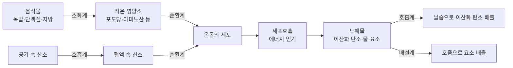
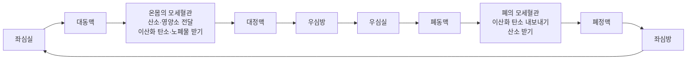
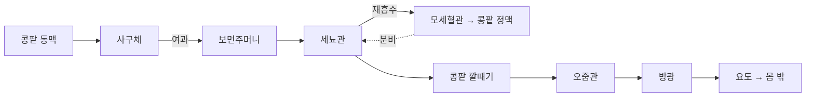
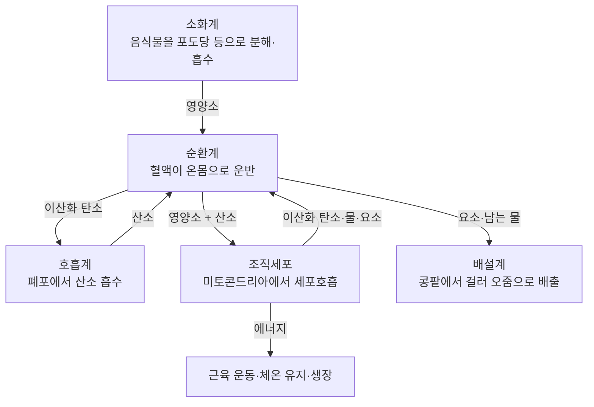

# 중2-6. 동물과 에너지 — 한 끼 식사가 세포의 에너지가 되기까지
<!-- prev: m1-02, m1-06, m2-05 -->
<!-- next: 3-5, bio-1, cell-2, cell-3 -->

> [!NOTE]
> **성취기준**
> - **[9과13-01]** 소화계의 구조와 기능을 이해하고, 소화 과정을 소화 효소의 작용과 관련지어 추론할 수 있다.
> - **[9과13-02]** 순환계의 구조와 기능을 이해하고, 혈액의 순환 경로를 종합하여 발표할 수 있다.
> - **[9과13-03]** 호흡계의 구조와 기능을 이해하고, 호흡 운동의 원리를 나타내는 모형을 만들 수 있다.
> - **[9과13-04]** 배설계의 구조와 기능을 이해하고, 노폐물이 배설되는 과정을 모식도로 표현할 수 있다.
> - **[9과13-05]** 동물이 세포호흡을 통해 에너지를 얻는 과정을 소화, 순환, 호흡, 배설과 관련지어 통합적으로 설명할 수 있다.

**학습 목표**

1. 음식물 속 영양소를 검출하는 방법을 알고, 소화 기관과 소화 효소(아밀레이스, 펩신, 트립신, 라이페이스)의 작용으로 소화 과정을 설명할 수 있다.
2. 심장과 혈관, 혈액의 구조와 기능을 알고, 온몸 순환과 폐순환의 경로를 순서대로 말할 수 있다.
3. 호흡 기관의 구조를 알고, 갈비뼈와 가로막의 움직임으로 숨을 들이쉬고 내쉬는 원리를 모형으로 나타낼 수 있다.
4. 노폐물이 생기는 과정과 콩팥에서 오줌이 만들어지는 과정(여과, 재흡수, 분비)을 모식도로 나타낼 수 있다.
5. 세포호흡으로 에너지를 얻기 위해 소화계·순환계·호흡계·배설계가 어떻게 함께 일하는지 통합적으로 설명할 수 있다.

**이 단원의 학습 사다리**

| 단계 | 무엇을 하나? |
|---|---|
| STEP 1. 이전 학습 다시 보기 | 초등학교 '우리 몸의 구조와 기능', 중1 「생물의 구성과 다양성」, 중2 「식물과 에너지」를 다시 꺼낸다 |
| STEP 2. 기초 다지기 | 영양소, 효소, 확산, 기관계라는 디딤돌을 놓는다 |
| STEP 3. 핵심 개념 | 소화 → 순환 → 호흡 → 배설 → 세포호흡으로 모아 보기 |
| STEP 4. 오개념 바로잡기 | "폐가 스스로 부풀어 숨을 쉰다?" 같은 착각을 바로잡는다 |
| STEP 5. 다음 단계로 | 통합과학의 물질대사, 생명과학의 기관계 통합, 세포호흡의 단계 |
| STEP 6. 생활·산업·진로 | 소화제와 효소 산업, 인공 신장(혈액 투석), 심폐 소생술 |

---

## 🗺️ 단원 들어가기

점심으로 김밥 한 줄을 먹었다고 하자. 김밥 속 밥(녹말), 달걀(단백질), 참기름(지방)은 몇 시간 뒤 어디에 가 있을까? 그리고 그 음식이 정말 "힘"이 되려면 무엇이 더 필요할까?

달리기를 하면 숨이 가빠지고, 심장이 빨리 뛰고, 땀이 나고, 나중에는 배가 고파진다. 이 네 가지 현상은 따로따로 일어나는 것처럼 보이지만 사실은 **한 가지 목적**을 위한 것이다. 바로 우리 몸을 이루는 약 수십조 개의 세포 하나하나가 **에너지를 얻는 것**이다.

이 단원에서는 음식이 잘게 쪼개지는 **소화**, 산소와 영양소를 나르는 **순환**, 산소를 얻고 이산화 탄소를 내보내는 **호흡**, 남은 찌꺼기를 버리는 **배설**을 차례로 살펴보고, 마지막에 이 넷이 **세포호흡**이라는 하나의 목표로 이어지는 모습을 그려 본다.

---

## STEP 1. 🔙 이전 학습 다시 보기

### 연계 개념표

| 이전 단원·성취기준 | 그때 배운 것 | 이 단원에서 확장되는 것 |
|---|---|---|
| 초등 5~6학년 '우리 몸의 구조와 기능' | 뼈와 근육, 소화·순환·호흡·배설 기관의 이름과 하는 일 | 각 기관이 **어떻게** 일하는지를 효소, 압력, 확산, 여과로 설명한다 |
| 초등 3~4학년 '동물의 생활' | 동물은 먹이를 먹어 살아가고, 사는 곳에 따라 생김새가 다르다 | 먹이가 **에너지로 바뀌는 과정**을 세포 수준까지 따라간다 |
| 중1 「생물의 구성과 다양성」 [9과02-01], [9과02-02] | 세포 → 조직 → 기관 → 기관계 → 개체, 미토콘드리아의 역할 | 소화계·순환계·호흡계·배설계가 **함께 일하는 모습**을 본다 |
| 중1 「기체의 성질」 [9과06-02] | 온도가 일정할 때 기체의 부피가 커지면 압력이 작아진다 | 가슴 속 부피가 커지면 폐 속 압력이 낮아져 **공기가 들어온다** |
| 중2 「식물과 에너지」 [9과12-02] | 식물도 호흡하며, 호흡으로 양분을 분해해 에너지를 얻는다 | 동물의 세포호흡에 필요한 양분과 산소가 **어떻게 세포까지 오는지** 본다 |

### 준비 운동 (사전 진단)

**Q1.** 우리 몸의 구성 단계를 작은 것부터 순서대로 쓰시오. (세포, 기관, 조직, 개체, 기관계)

**Q2.** 다음 중 소화 기관이 **아닌** 것은? ① 위 ② 소장 ③ 콩팥 ④ 간

**Q3.** 식물의 호흡과 광합성 중, 낮과 밤 모두 일어나는 것은 무엇인가?

**Q4.** 주사기 입구를 막고 피스톤을 당기면 주사기 속 공기의 압력은 어떻게 될까?

정답 및 해설

**Q1.** 세포 → 조직 → 기관 → 기관계 → 개체. 동물에는 '기관계' 단계가 있다는 것이 식물과 다른 점이다.

**Q2. ③** 콩팥은 오줌을 만드는 배설 기관이다. 간은 음식물이 직접 지나가지는 않지만 쓸개즙을 만드는 소화 기관이다.

**Q3. 호흡** — 광합성은 빛이 있을 때만 일어나지만, 호흡은 살아 있는 모든 세포에서 밤낮없이 일어난다. 동물도 마찬가지이다.

**Q4.** 부피가 커지므로 압력이 **작아진다.** 이 원리가 STEP 3의 '숨 쉬는 원리'에 그대로 쓰인다.

---

## STEP 2. 🧱 기초 다지기

### ① 영양소: 몸을 움직이는 연료와 몸을 만드는 재료

**영양소(nutrient)** 는 음식물에 들어 있으면서 우리 몸에 필요한 물질이다.

| 구분 | 영양소 | 주요 역할 | 많이 든 음식 |
|---|---|---|---|
| 에너지원 | **탄수화물(carbohydrate)** | 주된 에너지원 (1 g당 약 4 kcal) | 밥, 빵, 감자, 고구마 |
| 에너지원 | **단백질(protein)** | 몸을 구성하는 주성분, 에너지원 (1 g당 약 4 kcal) | 고기, 생선, 달걀, 콩 |
| 에너지원 | **지방(fat)** | 에너지 저장, 세포막 성분 (1 g당 약 9 kcal) | 버터, 식용유, 견과류 |
| 에너지원 아님 | 바이타민 | 적은 양으로 몸의 기능 조절 | 채소, 과일 |
| 에너지원 아님 | 무기염류 | 뼈·이·혈액 성분, 몸의 기능 조절 | 우유(칼슘), 시금치(철), 미역 |
| 에너지원 아님 | 물 | 몸의 약 60~70 %, 물질 운반, 체온 조절 | 모든 음식, 마시는 물 |

> [!TIP]
> 💡 **비유** — 우리 몸을 자동차 공장에 비유하면, 탄수화물과 지방은 **연료**, 단백질은 **차체를 만드는 철판**, 바이타민과 무기염류는 **기계를 조절하는 부품과 윤활유**, 물은 **공장 안을 흐르는 컨베이어 벨트**이다.

예를 들어 탄수화물 30 g, 단백질 5 g, 지방 10 g이 든 과자에서는 약 $30\times4 + 5\times4 + 10\times9 = 230\ \mathrm{kcal}$의 에너지를 얻을 수 있다. 지방은 양이 적어도 에너지가 많다.

### ② 영양소를 찾아내는 검출 반응

눈으로는 음식 속 영양소가 보이지 않는다. 그래서 특정 영양소와 만나면 **색이 변하는 용액**을 이용한다.

| 검출할 영양소 | 사용하는 용액 | 색깔 변화 | 주의할 점 |
|---|---|---|---|
| 녹말 | 아이오딘-아이오딘화 칼륨 용액 | 청람색 | 가열하지 않는다 |
| 포도당(엿당 등 당) | 베네딕트 용액 | 가열하면 황적색 | **반드시 가열**한다 |
| 단백질 | 5 % 수산화 나트륨 수용액 + 1 % 황산 구리(Ⅱ) 수용액 (뷰렛 반응) | 보라색 | 수산화 나트륨은 피부에 닿지 않게 |
| 지방 | 수단 Ⅲ 용액 | 선홍색 | — |

<!-- fig:m2-06-nutrient-tests -->

### ③ 효소: 반응을 빠르게 돕는 '분자 가위'

녹말이나 단백질은 아주 큰 분자이므로 그대로는 세포막을 통과하지 못한다. 몸은 이것을 작게 잘라야 하는데, 이때 쓰는 도구가 **소화 효소(digestive enzyme)** 이다.

- 효소는 몸에서 만들어지는 **단백질**로, 화학 반응을 빠르게 일어나게 돕는다.
- 효소는 **정해진 물질에만** 작용한다. (녹말을 자르는 효소는 단백질을 자르지 못한다.)
- 효소는 **체온(약 37 ℃) 근처**에서 가장 잘 작용한다. 너무 뜨거우면 효소가 망가진다.

> [!TIP]
> 💡 **비유** — 효소는 **열쇠와 자물쇠**와 같다. 녹말 자물쇠에는 아밀레이스 열쇠만 맞는다. 열쇠는 한 번 쓰고 버리는 것이 아니라 계속 다시 쓸 수 있다는 점도 효소와 같다.

### ④ 확산: 많은 곳에서 적은 곳으로

중1 「물질의 상태 변화」에서 향수 냄새가 퍼지는 **확산(diffusion)** 을 배웠다. 입자는 **농도가 높은 곳에서 낮은 곳으로** 저절로 퍼져 나간다. 우리 몸에서 산소와 이산화 탄소, 영양소가 세포로 드나드는 일의 많은 부분이 확산으로 일어난다. 이 단원의 폐포와 모세혈관에서 이 원리가 계속 등장한다.

### ⑤ 기관계: 한 팀으로 일하는 기관들

중1 「생물의 구성과 다양성」에서 배운 **기관계(organ system)** 는 같은 목적을 위해 함께 일하는 기관의 모임이다. 이 단원에서는 **소화계**(입, 위, 소장, 대장, 간, 쓸개, 이자), **순환계**(심장, 혈관, 혈액), **호흡계**(코, 기관, 기관지, 폐), **배설계**(콩팥, 오줌관, 방광, 요도)를 차례로 살펴본다.

---

## STEP 3. 📘 핵심 개념

### ① 소화계 — 음식물을 작게 쪼개어 흡수하기

**소화(digestion)** 는 크기가 큰 영양소를 몸속으로 흡수할 수 있을 만큼 작게 분해하는 과정이다. 음식물은 **입 → 식도 → 위 → 소장 → 대장 → 항문**으로 이어지는 긴 관(소화관)을 지나며, 간·쓸개·이자는 소화액을 만들거나 저장해 보내 준다.

| 소화 기관 | 소화액(분비하는 곳) | 대표 효소·물질 | 하는 일 |
|---|---|---|---|
| 입 | 침(침샘) | **아밀레이스(amylase)** | 녹말 → 엿당 |
| 위 | 위액(위샘) | **펩신(pepsin)**, 염산 | 단백질 → 더 작은 단백질 조각. 염산은 펩신을 돕고 세균을 죽인다 |
| 간·쓸개 | 쓸개즙(간에서 만들어 쓸개에 저장) | 소화 효소 없음 | 지방 덩어리를 작은 알갱이로 만들어 지방 소화를 돕는다 |
| 이자 → 소장 | 이자액(이자) | 아밀레이스, **트립신(trypsin)**, **라이페이스(lipase)** | 녹말 → 엿당, 단백질 → 더 작은 조각, 지방 → 지방산과 모노글리세리드 |
| 소장 | 소장 벽의 소화 효소 | 탄수화물·단백질 소화 효소 | 엿당 → 포도당, 단백질 조각 → 아미노산 |
| 대장 | 소화액 없음 | — | 물을 흡수하고 찌꺼기를 대변으로 만든다 |

세 가지 에너지 영양소의 소화를 한 줄로 정리하면 다음과 같다.

$$
\text{녹말} \xrightarrow{\text{아밀레이스}} \text{엿당} \xrightarrow{\text{소장의 효소}} \text{포도당}
$$

$$
\text{단백질} \xrightarrow{\text{펩신, 트립신}} \text{더 작은 단백질 조각} \xrightarrow{\text{소장의 효소}} \text{아미노산}
$$

$$
\text{지방} \xrightarrow{\text{라이페이스 (쓸개즙의 도움)}} \text{지방산} + \text{모노글리세리드}
$$

> [!IMPORTANT]
> 소장은 **최종 소화**와 **흡수**가 함께 일어나는 곳이다. 녹말·단백질·지방이 모두 가장 작은 단위(포도당, 아미노산, 지방산·모노글리세리드)로 바뀌는 곳이 소장이다.

<!-- fig:m2-06-digestion -->

#### 흡수: 융털이 넓은 표면을 만든다

소장 안쪽 벽에는 주름이 많고, 주름 표면에는 손가락처럼 생긴 **융털(villus)** 이 빽빽하게 나 있다. 주름과 융털 덕분에 영양소와 닿는 **표면적이 매우 넓어져** 흡수가 효율적으로 일어난다.

| 영양소 | 흡수되는 곳 | 이동 경로 |
|---|---|---|
| 포도당, 아미노산, 무기염류 (물에 잘 녹는 것) | 융털의 **모세혈관** | 모세혈관 → 간 → 심장 → 온몸 |
| 지방산, 모노글리세리드 (물에 잘 녹지 않는 것) | 융털의 **암죽관** | 암죽관 → 림프관 → 심장 근처 혈관 → 온몸 |

<!-- fig:m2-06-villus -->

#### 예제 1 — 침의 소화 작용 결과 해석하기

시험관 A에는 녹말 용액 + 물, 시험관 B에는 녹말 용액 + 침 용액을 넣고 37 ℃ 물에 10분 동안 두었다. 두 시험관에 각각 아이오딘-아이오딘화 칼륨 용액과 베네딕트 용액(가열)을 넣었더니 다음과 같았다.

| 시험관 | 아이오딘 반응 | 베네딕트 반응 |
|---|---|---|
| A (녹말 + 물) | 청람색 | 변화 없음 |
| B (녹말 + 침) | 변화 없음(또는 연하게) | 황적색 |

(1) B에서 녹말은 어떻게 되었는가? (2) A를 넣은 까닭은?

**풀이**
(1) B에서는 청람색이 나타나지 않으므로 녹말이 거의 없고, 황적색이 나타나므로 당(엿당)이 생겼다. **침 속 아밀레이스가 녹말을 엿당으로 분해**하였다.
(2) A는 침을 넣지 않은 **대조군**이다. 물만으로는 녹말이 분해되지 않음을 보여 주어, B의 변화가 **침 때문**임을 확인해 준다.

### ② 순환계 — 몸속 택배망

몸속 세포는 영양소와 산소를 받고 노폐물을 내보내야 한다. 이 '배달'을 맡는 것이 **순환계(circulatory system)** 이며, **심장·혈관·혈액**으로 이루어진다.

#### 심장: 쉬지 않는 펌프

**심장(heart)** 은 주먹만 한 근육 덩어리로, 2개의 **심방(atrium)** 과 2개의 **심실(ventricle)** 로 나뉜다.

| 심장의 방 | 연결된 혈관 | 하는 일 |
|---|---|---|
| 우심방 | 대정맥 | 온몸을 돌고 온 혈액을 받는다 |
| 우심실 | 폐동맥 | 혈액을 폐로 내보낸다 |
| 좌심방 | 폐정맥 | 폐를 거쳐 온 혈액을 받는다 |
| 좌심실 | 대동맥 | 혈액을 온몸으로 내보낸다. **벽이 가장 두껍다** |

- 심방은 혈액을 **받는** 곳, 심실은 혈액을 **내보내는** 곳이다.
- 심방과 심실 사이, 심실과 동맥 사이에는 **판막(valve)** 이 있어 혈액이 **거꾸로 흐르지 않게** 한다.
- 좌심실의 벽이 가장 두꺼운 이유는 혈액을 **온몸 끝까지** 보내야 해서 가장 강한 힘이 필요하기 때문이다.

> [!TIP]
> 💡 **기억 요령** — "**들어오는 곳은 방(심방), 나가는 곳은 실(심실)**", "**심장에서 나가면 동맥, 심장으로 들어오면 정맥**". 혈관 이름은 그 안에 든 혈액의 산소 양이 아니라 **흐르는 방향**으로 붙인다.

<!-- fig:m2-06-heart -->

#### 혈관: 동맥, 모세혈관, 정맥

| 구분 | 동맥 | 모세혈관 | 정맥 |
|---|---|---|---|
| 혈액이 흐르는 방향 | 심장 → 온몸 | 동맥과 정맥을 연결 | 온몸 → 심장 |
| 혈관 벽 | 두껍고 탄력이 크다 | 한 겹의 세포층으로 매우 얇다 | 동맥보다 얇다 |
| 혈압 | 가장 높다 | 중간 | 가장 낮다 |
| 혈액이 흐르는 속도 | 가장 빠르다 | **가장 느리다** | 중간 |
| 특징 | 손목에서 맥박을 느낄 수 있다 | 온몸에 그물처럼 퍼져 **세포와 물질 교환** | 혈액이 거꾸로 흐르지 않게 **판막**이 있다 |

모세혈관에서 혈액이 느리게 흐르는 것은 약점이 아니라 장점이다. 천천히 지나가는 동안 세포와 산소·영양소·노폐물을 충분히 주고받을 수 있기 때문이다.

<!-- fig:m2-06-vessels -->

#### 혈액: 액체 성분과 세포 성분

| 성분 | 모양·특징 | 하는 일 |
|---|---|---|
| 혈장 | 노란색 액체, 대부분 물 | 영양소, 이산화 탄소, 노폐물 등을 녹여 운반 |
| **적혈구(red blood cell)** | 가운데가 오목한 원반 모양, 핵이 없다 | 헤모글로빈으로 **산소 운반** |
| 백혈구 | 핵이 있고 모양이 일정하지 않다 | 몸에 들어온 세균을 잡아먹는 **식균 작용** |
| 혈소판 | 작고 모양이 일정하지 않다 | 상처가 나면 **혈액을 굳게** 하여 피를 멈춘다 |

#### 온몸 순환과 폐순환

혈액은 심장에서 출발해 두 갈래 길을 돌아 다시 심장으로 돌아온다.

| 구분 | 경로 | 하는 일 |
|---|---|---|
| **온몸 순환(체순환)** | 좌심실 → 대동맥 → 온몸의 모세혈관 → 대정맥 → 우심방 | 온몸의 세포에 산소와 영양소를 주고, 이산화 탄소와 노폐물을 받아 온다 |
| **폐순환** | 우심실 → 폐동맥 → 폐의 모세혈관 → 폐정맥 → 좌심방 | 폐에서 이산화 탄소를 내보내고 산소를 받아 온다 |

산소가 많은 혈액을 **동맥혈**, 산소가 적은 혈액을 **정맥혈**이라 한다. 폐동맥에는 정맥혈이, 폐정맥에는 동맥혈이 흐른다. 이름과 혈액이 엇갈리는 유일한 곳이므로 주의하자.

<!-- sim:blood-circulation -->

#### 예제 2 — 1분 동안 심장이 내보내는 혈액

어떤 학생의 심장은 1분에 70번 뛰고, 한 번 뛸 때마다 좌심실에서 약 70 mL의 혈액을 내보낸다. 1분 동안 좌심실이 내보내는 혈액은 약 몇 L인가?

**풀이** $70 \times 70 = 4900\ \mathrm{mL} \approx 4.9\ \mathrm{L}$

어른 몸속 혈액이 약 5 L이므로, 몸속 혈액이 **약 1분에 한 바퀴** 도는 셈이다. 운동을 하면 심장이 더 자주, 더 세게 뛰어 이 양이 몇 배로 늘어난다.

### ③ 호흡계 — 산소를 들이고 이산화 탄소를 내보내기

#### 호흡 기관의 구조

공기는 **코 → 기관 → 기관지 → 폐** 순서로 들어간다.

| 기관 | 구조와 기능 |
|---|---|
| 코 | 콧속의 털과 끈끈한 액체가 먼지를 거르고, 공기를 따뜻하고 축축하게 한다 |
| 기관, 기관지 | 안쪽 벽의 섬모가 먼지와 세균을 밖으로 밀어낸다(가래) |
| 폐 | 수많은 **폐포(alveolus)** 로 이루어진다. 폐포는 모세혈관으로 둘러싸여 있다 |
| 갈비뼈, 가로막 | 폐를 둘러싼 가슴 공간(흉강)의 크기를 바꾸어 숨을 쉬게 한다 |

폐포는 아주 작은 공기 주머니가 포도송이처럼 모여 있는 구조이다. 소장의 융털처럼, 폐포도 **표면적을 넓혀** 기체 교환을 효율적으로 한다.

<!-- fig:m2-06-respiratory -->

#### 호흡 운동: 폐는 스스로 움직이지 못한다

폐에는 **근육이 없다.** 폐가 부풀고 줄어드는 것은 갈비뼈와 가로막이 흉강의 부피를 바꾸기 때문이다. 이것을 **호흡 운동(breathing movement)** 이라 한다.

| 구분 | 갈비뼈 | 가로막 | 흉강 부피 | 폐 속 압력 | 공기 이동 |
|---|---|---|---|---|---|
| **들숨** | 위로 올라간다 | 아래로 내려간다 | 커진다 | 대기압보다 **낮아진다** | 밖 → 폐 |
| **날숨** | 아래로 내려간다 | 위로 올라간다 | 작아진다 | 대기압보다 **높아진다** | 폐 → 밖 |

중1 「기체의 성질」에서 배운 대로, 기체의 부피가 커지면 압력이 작아진다. 들숨 때 흉강과 폐가 커지면 폐 속 압력이 바깥 공기보다 낮아지고, 공기는 **압력이 높은 바깥에서 낮은 폐 속으로** 밀려 들어온다.

<!-- fig:m2-06-breathing -->

#### 호흡 운동 모형

| 모형의 부분 | 우리 몸의 부분 |
|---|---|
| 페트병(또는 유리종) | 흉강(갈비뼈로 둘러싸인 가슴 공간) |
| Y자 관 | 기관과 기관지 |
| 고무풍선 | 폐 |
| 페트병 아래의 고무 막 | 가로막 |

고무 막을 **아래로 당기면** 병 속 부피가 커지고 압력이 낮아져 풍선이 **부푼다(들숨).** 고무 막을 놓거나 위로 밀면 풍선이 **쪼그라든다(날숨).** 이 모형은 가로막의 움직임은 잘 보여 주지만, 갈비뼈가 움직이는 것은 나타내지 못한다는 한계가 있다.

> [!TIP]
> 💡 **비유** — 손잡이를 벌리면 공기를 빨아들이고 오므리면 내뿜는 **풀무(바람 주머니)** 를 떠올리자. 풀무 주머니 자체가 아니라 손잡이를 움직이는 손이 일을 한다. 우리 몸에서 그 '손'이 갈비뼈 근육과 가로막이다.

#### 기체 교환: 확산으로 주고받는다

| 장소 | 산소의 이동 | 이산화 탄소의 이동 | 까닭 |
|---|---|---|---|
| 폐포 ↔ 모세혈관 | 폐포 → 모세혈관 | 모세혈관 → 폐포 | 폐포에는 산소가 많고 이산화 탄소가 적다 |
| 모세혈관 ↔ 조직세포 | 모세혈관 → 조직세포 | 조직세포 → 모세혈관 | 세포는 산소를 계속 쓰고 이산화 탄소를 계속 만든다 |

기체는 모두 **농도가 높은 곳에서 낮은 곳으로 확산**한다. 별도의 '밀어내는 힘' 없이도 저절로 일어나는 일이다. 들숨과 날숨을 석회수에 불어 넣어 비교하면 날숨 쪽 석회수가 더 뿌옇게 흐려지는데, 이는 날숨에 이산화 탄소가 더 많기 때문이다.

### ④ 배설계 — 혈액 속 노폐물을 걸러 내기

#### 노폐물은 어디에서 생기는가?

세포가 영양소를 분해해 에너지를 얻으면 쓰고 남은 물질, 즉 **노폐물(waste)** 이 생긴다.

| 분해되는 영양소 | 생기는 노폐물 | 내보내는 방법 |
|---|---|---|
| 탄수화물, 지방 | 이산화 탄소, 물 | 이산화 탄소 → 폐(날숨). 물 → 폐(날숨의 수증기), 콩팥(오줌), 피부(땀) |
| 단백질 | 이산화 탄소, 물, **암모니아** | 암모니아는 독성이 강해 **간에서 독성이 약한 요소로** 바뀐 뒤 → 콩팥(오줌) |

세 가지 에너지 영양소 가운데 단백질에만 **질소**가 들어 있어서 암모니아가 생긴다. 탄수화물과 지방은 탄소·수소·산소로만 이루어져 있으므로 이산화 탄소와 물만 생긴다.

#### 배설 기관의 구조

| 기관 | 하는 일 |
|---|---|
| **콩팥(kidney)** | 강낭콩 모양으로 허리 뒤쪽 좌우에 1개씩 있다. 혈액을 걸러 오줌을 만든다 |
| 오줌관 | 콩팥에서 만든 오줌을 방광으로 보낸다 |
| 방광 | 오줌을 모아 두었다가 내보낸다 |
| 요도 | 오줌이 몸 밖으로 나가는 통로 |

<!-- fig:m2-06-urinary -->

콩팥에는 오줌을 만드는 기본 단위인 **네프론(nephron)** 이 아주 많이 있다. 네프론은 모세혈관이 실뭉치처럼 뭉친 **사구체**, 사구체를 감싼 **보먼주머니**, 보먼주머니에 이어진 가늘고 긴 **세뇨관**으로 이루어진다.

#### 오줌이 만들어지는 세 단계

| 단계 | 일어나는 곳 | 이동 방향 | 이동하는 물질 |
|---|---|---|---|
| **여과** | 사구체 → 보먼주머니 | 혈액 → 네프론 | 크기가 작은 물질: 물, 포도당, 아미노산, 무기염류, 요소 (혈구와 단백질은 너무 커서 여과되지 않는다) |
| **재흡수** | 세뇨관 → 모세혈관 | 네프론 → 혈액 | 몸에 필요한 물질: 포도당과 아미노산은 **전부**, 물과 무기염류는 **대부분** |
| **분비** | 모세혈관 → 세뇨관 | 혈액 → 네프론 | 미처 여과되지 않고 남은 노폐물 일부 |

<!-- fig:m2-06-nephron -->

오줌이 몸 밖으로 나가는 길을 모식도처럼 글로 나타내면 다음과 같다.

> [!TIP]
> 💡 **비유** — 콩팥은 **방 정리**와 같다. 먼저 방 안의 물건을 거의 다 바닥에 쏟아 놓고(여과), 그중 필요한 것을 다시 서랍에 넣고(재흡수), 바닥에 남은 것과 구석에 숨어 있던 쓰레기를 함께 버린다(분비). 하나하나 고르는 것보다 '일단 다 꺼내고 다시 담는' 방식이 빠뜨리는 쓰레기가 적다.

어른의 콩팥에서 하루에 여과되는 원뇨는 약 180 L이지만 실제 오줌은 약 1.5~2 L에 불과하다. 여과된 물의 **약 99 %** 가 다시 혈액으로 돌아가는 셈이다.

#### 예제 3 — 혈장, 원뇨, 오줌 비교하기

다음 표는 건강한 사람의 혈장, 원뇨(보먼주머니 속 액체), 오줌에 들어 있는 물질 A~C의 농도를 비교한 것이다. A~C는 단백질, 포도당, 요소 중 하나이다.

| 물질 | 혈장 | 원뇨 | 오줌 |
|---|---|---|---|
| A | 있음 | 없음 | 없음 |
| B | 있음 | 있음 | 없음 |
| C | 있음 | 있음 | 매우 진함 |

**풀이**
- A: 원뇨에 없으므로 **여과되지 않는 물질** → 단백질
- B: 여과되지만 오줌에 없으므로 **전부 재흡수되는 물질** → 포도당
- C: 여과된 뒤 물이 대부분 재흡수되어 **오줌에서 진해지는 노폐물** → 요소

### ⑤ 세포호흡 — 네 기관계가 모이는 곳

#### 세포호흡이란?

**세포호흡(cellular respiration)** 은 세포 속 **미토콘드리아**에서 영양소(주로 포도당)를 산소로 분해하여 생명 활동에 필요한 에너지를 얻는 과정이다.

$$
\text{포도당} + \text{산소} \longrightarrow \text{이산화 탄소} + \text{물} + \text{에너지}
$$

중2 「식물과 에너지」에서 배운 식물의 호흡과 **같은 반응**이다. 식물은 광합성으로 포도당을 스스로 만들고, 동물은 음식물을 먹어 얻는다는 점만 다르다.

세포호흡으로 얻은 에너지는 **근육 운동**(걷기, 심장 박동, 호흡 운동), **체온 유지**(추운 날 몸이 떨리며 열을 낸다), **생장**(키가 크고 상처가 아무는 것), **뇌의 활동**과 **물질의 이동**(콩팥의 재흡수 등)에 쓰인다.

#### 네 기관계는 한 팀이다

세포호흡에는 **영양소와 산소**가 필요하고, 그 결과 **이산화 탄소와 물, 질소 노폐물**이 생긴다. 이 재료를 대 주고 결과물을 치우는 것이 바로 네 기관계이다.

| 기관계 | 세포호흡을 위해 하는 일 | 이 기관계가 멈추면? |
|---|---|---|
| 소화계 | 세포호흡의 원료인 **영양소**를 흡수할 수 있게 만든다 | 원료가 들어오지 않아 몸에 저장된 영양소를 꺼내 쓰다가 결국 바닥난다 |
| 호흡계 | 세포호흡에 필요한 **산소**를 얻고, 생긴 **이산화 탄소**를 내보낸다 | 몇 분 만에 세포가 에너지를 얻지 못한다 |
| 순환계 | 영양소·산소를 세포로, 노폐물을 폐·콩팥으로 **운반**한다 | 재료가 있어도 세포에 닿지 못한다 |
| 배설계 | 질소 노폐물(요소)과 남는 물을 **내보내** 몸속 환경을 일정하게 유지한다 | 노폐물이 쌓여 세포가 제대로 일하지 못한다 |

#### 예제 4 — 운동할 때 몸의 변화를 통합적으로 설명하기

100 m 달리기를 하고 나면 숨이 가쁘고 심장이 빨리 뛴다. 그 까닭을 세포호흡과 기관계를 연결해 설명해 보자.

**풀이**
1. 다리 근육 세포가 많은 에너지를 쓰므로 **세포호흡이 활발해진다.**
2. 세포호흡에는 산소가 더 많이 필요하고, 이산화 탄소가 더 많이 생긴다.
3. **호흡계**: 호흡 운동이 빨라지고 깊어져 더 많은 산소를 얻고, 더 많은 이산화 탄소를 내보낸다.
4. **순환계**: 심장 박동이 빨라져 산소와 영양소를 근육으로 더 빨리 운반하고, 이산화 탄소를 폐로 더 빨리 가져간다.
5. 세포호흡에서 나온 에너지 일부는 열이 되므로 체온이 올라가고, 땀을 흘려 열을 내보낸다.

즉, 숨이 가쁜 것과 심장이 빨리 뛰는 것은 **세포에 산소를 더 많이 보내기 위한 한 팀의 협력**이다.

> [!IMPORTANT]
> "우리는 왜 숨을 쉬는가?"에 대한 가장 깊은 답은 "**세포가 세포호흡으로 에너지를 얻기 위해서**"이다. 폐로 하는 호흡(호흡 운동, 기체 교환)과 세포 속에서 일어나는 세포호흡은 서로 다른 단계이지만, 하나의 목적으로 이어져 있다.

---

## STEP 4. ⚠️ 오개념 바로잡기

| 흔한 오개념 | 올바른 개념 | 왜 그럴까? |
|---|---|---|
| 소화는 위에서 대부분 일어난다 | **최종 소화와 흡수는 대부분 소장**에서 일어난다 | 위에서는 단백질 소화가 시작될 뿐이고, 녹말·지방·단백질이 가장 작은 단위가 되는 곳은 소장이다 |
| 쓸개즙에는 지방을 분해하는 효소가 들어 있다 | 쓸개즙에는 **소화 효소가 없다.** 지방을 작은 알갱이로 만들어 라이페이스를 돕는다 | 지방을 실제로 분해하는 효소는 이자액의 라이페이스이다 |
| 동맥에는 항상 산소가 많은 피가, 정맥에는 산소가 적은 피가 흐른다 | 혈관 이름은 **흐르는 방향**(심장에서 나가면 동맥)으로 정한다 | 폐동맥에는 정맥혈, 폐정맥에는 동맥혈이 흐른다 |
| 폐가 스스로 부풀었다 줄었다 하며 숨을 쉰다 | 폐에는 근육이 없다. **갈비뼈와 가로막**이 흉강의 부피를 바꾼다 | 흉강 부피가 커지면 폐 속 압력이 낮아져 공기가 저절로 들어온다 |
| 숨을 쉬는 것과 세포호흡은 같은 것이다 | 호흡 운동은 **공기를 드나들게 하는 것**, 세포호흡은 **세포 속에서 에너지를 얻는 화학 반응**이다 | 호흡 운동과 기체 교환은 세포호흡에 쓸 산소를 공급하는 앞 단계이다 |
| 대변을 내보내는 것도 배설이다 | 대변은 소화되지 않은 찌꺼기이므로 배설이 **아니다** | 배설은 세포에서 생긴 노폐물을 내보내는 것이다 |
| 콩팥은 노폐물만 골라서 걸러 낸다 | 콩팥은 작은 물질을 **일단 다 걸러 낸 뒤** 필요한 것을 다시 흡수한다 | 그래서 원뇨에는 포도당이 있지만 건강한 사람의 오줌에는 없다 |

---

## STEP 5. 🎓 다음 단계로 한 걸음 더

> [!CAUTION]
> 이 절은 **중학교 교육과정 범위 밖의 심화 내용**으로 평가 대상이 아니다. "이 개념이 고등학교에서 어디까지 이어지는가"를 맛보기로 보여 주기 위한 내용이다.

### 중3·고등학교와의 연결

| 학년·과목 | 단원 | 이어지는 내용 |
|---|---|---|
| 중3 | 「자극과 반응」 | 뇌·신경·호르몬이 호흡, 심장 박동, 혈당량, 체온을 **조절**하는 방법 |
| 통합과학1 | 「생명 시스템과 물질대사」 | 세포를 하나의 **시스템**으로 보고, 세포막을 통한 물질 출입과 **효소**가 물질대사를 빠르게 하는 원리 |
| 생명과학 | 「생명 시스템의 구성」 | 소화·순환·호흡·배설이 **기관계의 통합적 작용**으로 나타나는 과정, 대사성 질환 |
| 세포와 물질대사 | 「물질대사와 에너지」 | 효소의 종류, 특성, 활성에 영향을 주는 요인(온도, pH) |
| 세포와 물질대사 | 「세포호흡과 광합성」 | 미토콘드리아의 구조, 세포호흡의 단계, 산소 호흡과 발효 |

### ① 세포호흡의 에너지는 어디에 저장될까? — ATP

이 단원에서는 "세포호흡으로 에너지를 얻는다"고만 했다. 고등학교 생명과학에서는 이 에너지가 바로 쓰이는 것이 아니라, **ATP(아데노신 삼인산)** 라는 물질에 일단 저장된다는 것을 배운다. ATP는 세포 속 **'충전된 건전지'** 와 같아서, 근육이 움직이거나 물질을 만들 때 ATP를 분해하며 에너지를 꺼내 쓴다. 포도당 속 에너지의 일부만 ATP에 저장되고 나머지는 열로 나오는데, 이 열이 우리 체온을 유지하는 데 쓰인다.

### ② 세포호흡은 한 번에 일어나지 않는다

$\mathrm{C_6H_{12}O_6} + 6\mathrm{O_2} \rightarrow 6\mathrm{CO_2} + 6\mathrm{H_2O}$ 는 시작과 끝만 적은 식이다. 진로 선택 과목 '세포와 물질대사'에서는 이 반응이 세포질과 미토콘드리아에서 **여러 단계(해당 과정, 피루브산 산화, TCA 회로, 전자 전달계)** 로 나누어 일어나며, 단계마다 다른 효소가 작용한다는 것을 배운다. 산소가 부족하면 **발효**가 일어나 젖산이 생긴다. 격한 운동 중 근육이 빨리 지치는 현상이 이와 관련되어 있다고 설명하는데, 운동 다음 날 나타나는 근육통은 젖산 때문이 아니라 근육의 미세한 손상 때문이라고 본다.

### ③ 효소는 왜 온도와 pH에 민감할까?

효소는 단백질이며, 정해진 **입체 구조**를 가져야 일할 수 있다. 너무 높은 온도나 맞지 않는 pH에서는 구조가 망가져 기능을 잃는다. 그래서 위에서 일하는 펩신은 **산성**에서, 소장에서 일하는 트립신은 **약한 염기성**에서 가장 잘 작용한다. 고등학교에서는 이를 그래프(온도·pH에 따른 반응 속도)로 분석한다.

### 지금 vs 다음 단계

| 구분 | 중학교 2학년 (지금) | 고등학교 생명과학·세포와 물질대사 |
|---|---|---|
| 소화 | 대표 효소 4가지와 최종 산물 | 효소의 구조, 기질 특이성, 온도·pH와 효소 활성 그래프 |
| 순환 | 심장 구조, 온몸 순환과 폐순환 | 기관계 통합, 혈압 조절, 혈액의 응집과 면역 |
| 호흡 | 호흡 운동, 확산에 의한 기체 교환 | 세포호흡의 단계, 산소 호흡과 발효 비교 |
| 배설 | 여과·재흡수·분비, 요소 | 항상성 유지, 호르몬에 의한 물·무기염류 조절 |
| 에너지 | "세포호흡으로 에너지를 얻는다" | ATP의 생성과 이용, 에너지 전환 효율 |

---

## STEP 6. 🏭 생활·산업·진로 연결

### 사례 1. 소화제와 효소 산업

- **원리** 소화가 잘 안될 때 먹는 소화제 중에는 녹말·단백질·지방을 분해하는 **소화 효소**를 담은 것이 있다. 몸에서 부족한 '분자 가위'를 밖에서 보태 주는 것이다.
- **어디에 쓰이나** 효소는 세탁 세제(단백질 얼룩·기름 얼룩 분해), 연육제(고기를 부드럽게), 식혜 만들기(엿기름 속 아밀레이스가 밥의 녹말을 당으로 분해) 등 생활 곳곳에 쓰인다.

### 사례 2. 인공 신장 — 혈액 투석

- **원리** 콩팥이 제 기능을 못 하면 요소 같은 노폐물이 몸에 쌓인다. **혈액 투석기**는 혈액을 몸 밖으로 꺼내 아주 작은 구멍이 있는 막을 사이에 두고 투석액과 만나게 한다. 요소처럼 작은 물질은 **확산**으로 투석액 쪽으로 빠져나가고, 혈구와 단백질처럼 큰 물질은 혈액에 남는다.
- **연결** 콩팥의 **여과**와 폐포의 **확산**을 기계로 흉내 낸 장치이다. 다만 콩팥처럼 필요한 물질을 골라 다시 흡수하는 일은 정밀하게 하지 못하므로, 투석액의 성분을 조절해 보완한다.

### 사례 3. 심폐 소생술과 자동 심장 충격기

- **원리** 심장이 멈추면 혈액 순환이 멈추고, 뇌세포는 산소를 받지 못해 몇 분 안에 손상되기 시작한다. **가슴 압박**은 멈춘 심장을 대신해 손으로 혈액을 밀어 순환시키는 일이다.
- **어디에 쓰이나** 학교, 지하철역 등 많은 사람이 모이는 곳에 **자동 심장 충격기(AED)** 를 두고, 심폐 소생술 교육을 실시한다. 순환계가 세포호흡과 생명에 얼마나 중요한지 보여 주는 사례이다.

### 관련 진로와 학과

| 진로 | 하는 일 | 관련 학과 |
|---|---|---|
| 의사·간호사 | 소화기·심장·호흡기·신장 질환의 진단과 치료 | 의학, 간호학 |
| 영양사 | 영양소 균형을 맞춘 식단 설계 | 식품영양학 |
| 의공학자 | 인공 신장, 인공 심장, 인공호흡기 같은 의료 기기 개발 | 의공학, 기계공학, 전자공학 |
| 효소·바이오 연구원 | 식품·세제·의약품에 쓰이는 효소 개발 | 생명공학, 생명과학, 식품공학 |
| 스포츠 과학자 | 운동 중 심폐 기능 측정, 훈련 프로그램 설계 | 체육학, 스포츠과학 |

---

## 🔬 탐구 활동

### 활동 A. 음식물에 들어 있는 영양소 검출하기

**목표** 검출 용액을 이용해 여러 음식물에 들어 있는 영양소를 찾는다.

**준비물** 밥(또는 감자) 즙, 달걀흰자 용액, 포도당 용액, 식용유, 우유, 시험관 여러 개, 스포이트, 아이오딘-아이오딘화 칼륨 용액, 베네딕트 용액, 5 % 수산화 나트륨 수용액, 1 % 황산 구리(Ⅱ) 수용액, 수단 Ⅲ 용액, 비커, 가열 장치, 시험관 집게, 보안경, 실험용 장갑

**과정**
1. 각 음식물 시료를 시험관 4개에 같은 양씩 나누어 넣는다.
2. 첫째 시험관에 아이오딘-아이오딘화 칼륨 용액을 2~3방울 넣고 색깔 변화를 관찰한다.
3. 둘째 시험관에 베네딕트 용액을 넣고, 시험관을 뜨거운 물이 든 비커에 넣어 가열한 뒤 관찰한다.
4. 셋째 시험관에 5 % 수산화 나트륨 수용액과 1 % 황산 구리(Ⅱ) 수용액을 차례로 넣고 관찰한다.
5. 넷째 시험관에 수단 Ⅲ 용액을 넣고 흔든 뒤 관찰한다.
6. 아무 시료도 넣지 않고 물만 넣은 시험관으로도 같은 실험을 하여 비교한다.

**결과 기록**

| 시료 | 아이오딘 반응 (녹말) | 베네딕트 반응 (당) | 뷰렛 반응 (단백질) | 수단 Ⅲ 반응 (지방) |
|---|---|---|---|---|
| 밥 즙 | | | | |
| 달걀흰자 | | | | |
| 포도당 용액 | | | | |
| 식용유 | | | | |
| 우유 | | | | |
| 물 (대조군) | | | | |

**생각해 보기**
1. 물만 넣은 시험관을 함께 실험한 까닭은 무엇일까?
2. 우유에서 여러 가지 반응이 함께 나타났다면, 이것은 무엇을 뜻할까?
3. 베네딕트 반응에서 가열하지 않으면 어떤 결과가 나올까?

### 활동 B. 침의 소화 작용 탐구하기

**목표** 침 속 소화 효소가 녹말을 분해하는지, 온도에 따라 작용이 달라지는지 확인한다.

**준비물** 1 % 녹말 용액, 침 용액(물로 입을 헹군 뒤 깨끗한 물을 입에 머금었다가 모은 것), 시험관 4개, 비커(얼음물, 약 37 ℃ 물, 끓는 물), 온도계, 아이오딘-아이오딘화 칼륨 용액, 베네딕트 용액, 가열 장치

**과정**
1. 시험관 A~D를 준비한다. A: 녹말 + 물(37 ℃), B: 녹말 + 침(37 ℃), C: 녹말 + 침(얼음물), D: 녹말 + 끓였다 식힌 침(37 ℃)
2. 10~15분 동안 각 온도에 둔다.
3. 각 시험관의 용액을 둘로 나누어 아이오딘 반응과 베네딕트 반응을 확인한다.

**결과 기록**

| 시험관 | 조건 | 아이오딘 반응 | 베네딕트 반응 | 녹말이 분해되었는가? |
|---|---|---|---|---|
| A | 녹말 + 물, 37 ℃ | | | |
| B | 녹말 + 침, 37 ℃ | | | |
| C | 녹말 + 침, 얼음물 | | | |
| D | 녹말 + 끓인 침, 37 ℃ | | | |

**생각해 보기**
1. A와 B를 비교하면 무엇을 알 수 있을까?
2. B와 C, B와 D를 비교하면 효소에 대해 무엇을 알 수 있을까?
3. 이 결과를 이용해 "밥을 오래 꼭꼭 씹어 먹자"는 말의 과학적 근거를 설명해 보자.

> [!WARNING]
> **안전 수칙** 보안경과 실험용 장갑을 착용한다. 수산화 나트륨 수용액이 피부나 눈에 닿으면 즉시 많은 물로 씻고 선생님께 알린다. 가열할 때는 시험관 입구가 사람을 향하지 않게 하고, 뜨거운 시험관은 반드시 시험관 집게로 잡는다. 침 용액은 자신의 것만 사용하고, 실험이 끝나면 기구를 깨끗이 씻는다. 실험에 쓴 음식물과 용액은 절대 먹지 않는다.

---

## ✅ 개념 확인 문제

### 기본

**1.** 다음 중 소화 효소와 그 효소가 분해하는 영양소를 **잘못** 짝지은 것은?
① 아밀레이스 – 녹말 ② 펩신 – 단백질 ③ 트립신 – 단백질 ④ 라이페이스 – 녹말

정답 및 해설

**정답 ④**

라이페이스는 **지방**을 지방산과 모노글리세리드로 분해하는 효소이다. 아밀레이스는 녹말, 펩신과 트립신은 단백질을 분해한다.

**2.** 혈액이 폐순환을 하는 경로를 순서대로 쓰시오. (폐정맥, 우심실, 좌심방, 폐동맥, 폐의 모세혈관)

정답 및 해설

**정답** 우심실 → 폐동맥 → 폐의 모세혈관 → 폐정맥 → 좌심방

폐순환은 우심실에서 출발해 좌심방으로 돌아온다. 폐의 모세혈관에서 이산화 탄소를 내보내고 산소를 받는다.

**3.** 숨을 들이쉴 때 일어나는 변화로 옳은 것을 **모두** 고르시오.
ㄱ. 갈비뼈가 위로 올라간다. ㄴ. 가로막이 위로 올라간다. ㄷ. 흉강의 부피가 커진다. ㄹ. 폐 속 압력이 대기압보다 높아진다.

정답 및 해설

**정답 ㄱ, ㄷ**

들숨 때 갈비뼈는 올라가고 가로막은 **내려가** 흉강 부피가 커진다. 그러면 폐 속 압력이 대기압보다 **낮아져** 공기가 들어온다.

**4.** 콩팥에서 오줌이 만들어질 때, 사구체에서 보먼주머니로 물질이 이동하는 과정을 ( ㄱ ), 세뇨관에서 모세혈관으로 필요한 물질이 다시 이동하는 과정을 ( ㄴ )이라고 한다. ㄱ, ㄴ에 알맞은 말을 쓰시오.

정답 및 해설

**정답** ㄱ: 여과, ㄴ: 재흡수

여과는 혈액 → 네프론, 재흡수는 네프론 → 혈액 방향이다. 분비는 모세혈관에서 세뇨관으로 노폐물이 이동하는 과정이다.

### 응용

**5.** 녹말 용액에 침을 넣은 시험관을 37 ℃ 물에 10분 두었더니 아이오딘 반응이 나타나지 않았다. 같은 실험을 끓였다 식힌 침으로 했더니 아이오딘 반응에서 청람색이 나타났다. 두 결과의 차이를 효소의 성질로 설명하시오.

정답 및 해설

**정답** 침 속 아밀레이스는 단백질로 된 효소이므로 끓이면 망가져 기능을 잃는다. 그래서 끓인 침은 녹말을 분해하지 못해 녹말이 남아 청람색이 나타났다.

해설: 처음 실험에서는 아밀레이스가 녹말을 엿당으로 분해해 녹말이 없어졌으므로 아이오딘 반응이 나타나지 않았다.

**6.** 표는 건강한 사람의 혈장, 원뇨, 오줌 속 물질 X의 농도(%)이다. X는 단백질, 포도당, 요소 중 무엇인지 쓰고, 그 까닭을 설명하시오.

| 혈장 | 원뇨 | 오줌 |
|---|---|---|
| 0.03 | 0.03 | 2 |

정답 및 해설

**정답** 요소

X는 사구체에서 여과되어(원뇨에 있음) 혈장과 같은 농도로 원뇨에 들어간다. 그런데 오줌에서는 약 $2 \div 0.03 \approx 67$배로 진해졌다. 물은 대부분 재흡수되지만 요소는 거의 재흡수되지 않고 남기 때문이다. 단백질은 여과되지 않아 원뇨에 없고, 포도당은 전부 재흡수되어 오줌에 없다.

**7.** 소장에서 흡수된 포도당 분자 하나가 다리 근육 세포에 도착하는 경로를 순서대로 쓰시오. 단, 심장의 방과 큰 혈관 이름을 포함한다. (간은 소장과 심장 사이에 거치는 기관으로 간단히 쓴다.)

정답 및 해설

**정답** 소장 융털의 모세혈관 → 간 → 대정맥 → 우심방 → 우심실 → 폐동맥 → 폐의 모세혈관 → 폐정맥 → 좌심방 → 좌심실 → 대동맥 → 다리의 모세혈관 → 근육 세포

해설: 소장에서 흡수된 포도당은 간을 거쳐 심장으로 들어오는데, 우심방으로 들어오므로 **폐순환을 한 번 거친 뒤** 좌심실에서 온몸으로 나간다. 온몸 순환과 폐순환이 8자 모양으로 이어져 있다는 것을 보여 준다.

**8.** 호흡 운동 모형에서 고무 막을 아래로 당기면 풍선이 부푼다. (1) 고무 막과 풍선은 각각 우리 몸의 어느 부분에 해당하는가? (2) 이 모형으로 설명하기 **어려운** 호흡 운동의 특징 한 가지를 쓰시오.

정답 및 해설

**정답** (1) 고무 막 – 가로막, 풍선 – 폐 (2) 갈비뼈가 위아래로 움직여 흉강의 부피를 바꾸는 것

해설: 페트병은 단단해서 부피가 변하지 않으므로 갈비뼈의 움직임을 나타내지 못한다. 모형은 실제의 일부만 단순하게 보여 준다는 한계가 있다.

### 융합·서술형

**9. [통합 설명]** 한 학생이 아침으로 밥을 먹고 등교한 뒤 체육 시간에 축구를 했다. 밥 속 녹말이 다리 근육이 움직이는 에너지가 되기까지의 과정을 **소화, 순환, 호흡, 배설**을 모두 넣어 통합적으로 서술하시오.

정답 및 해설

**예시 답안**
밥 속 녹말은 입에서 침 속 아밀레이스, 소장에서 이자액의 아밀레이스와 소장의 효소에 의해 **포도당**으로 소화되고, 소장 융털의 모세혈관으로 흡수된다(소화). 포도당은 혈액을 따라 심장을 거쳐 다리 근육 세포까지 운반된다(순환). 한편 호흡 운동으로 들어온 공기 속 **산소**는 폐포에서 모세혈관으로 확산하여 적혈구에 실려 근육 세포로 운반된다(호흡, 순환). 근육 세포의 미토콘드리아에서 포도당이 산소와 반응하는 **세포호흡**으로 에너지가 나와 근육이 움직인다. 이때 생긴 이산화 탄소는 혈액을 따라 폐로 가서 날숨으로 나가고(호흡), 남는 물은 콩팥에서 오줌으로 나간다(배설).

**채점 포인트** ① 녹말이 포도당으로 소화·흡수됨 ② 포도당과 산소가 순환계로 세포까지 운반됨 ③ 세포호흡으로 에너지가 생김 ④ 노폐물이 호흡계·배설계로 나감

**10. [의료 기술 연계]** 혈액 투석기는 혈액과 투석액 사이에 아주 작은 구멍이 있는 막을 두어 요소를 걸러 낸다. (1) 이 막의 구멍 크기는 어떠해야 하는지 혈구·단백질·요소의 크기와 관련지어 설명하고, (2) 투석액에 포도당을 혈액과 비슷한 농도로 넣는 까닭을 '확산'으로 설명하시오.

정답 및 해설

**예시 답안**
(1) 요소처럼 크기가 작은 물질은 통과하고, 혈구와 단백질처럼 크기가 큰 물질은 통과하지 못할 정도의 크기여야 한다. 콩팥의 사구체에서 일어나는 **여과**와 같은 원리이다.
(2) 물질은 농도가 높은 곳에서 낮은 곳으로 확산한다. 투석액에 포도당이 없으면 혈액 속 포도당까지 투석액으로 빠져나가 버린다. 포도당 농도를 혈액과 비슷하게 맞추면 포도당은 빠져나가지 않고, 요소는 투석액에 없으므로 혈액에서 투석액으로 확산해 나간다. 콩팥의 **재흡수**가 하는 일을 투석액의 성분으로 대신하는 셈이다.

---

## 📝 한눈에 정리

### 핵심 요약

- 탄수화물·단백질·지방은 에너지원이며, 검출 용액(아이오딘, 베네딕트, 뷰렛, 수단 Ⅲ)으로 확인할 수 있다.
- **소화**: 녹말 → 포도당(아밀레이스 등), 단백질 → 아미노산(펩신, 트립신 등), 지방 → 지방산·모노글리세리드(라이페이스, 쓸개즙이 도움). 최종 소화와 흡수는 **소장**의 융털에서 일어난다.
- **순환**: 심장(2심방 2심실, 판막) → 동맥 → 모세혈관(물질 교환) → 정맥. 온몸 순환은 좌심실에서, 폐순환은 우심실에서 출발한다.
- **호흡**: 갈비뼈와 가로막이 흉강 부피를 바꾸어 폐 속 압력을 바꾼다. 폐포와 조직세포에서 기체는 **확산**으로 교환된다.
- **배설**: 단백질에서 생긴 암모니아는 간에서 요소가 되고, 콩팥의 네프론에서 **여과 → 재흡수 → 분비**를 거쳐 오줌으로 나간다.
- **세포호흡**: 포도당 + 산소 → 이산화 탄소 + 물 + 에너지. 미토콘드리아에서 일어난다.
- 네 기관계는 세포호흡에 필요한 영양소와 산소를 공급하고 노폐물을 내보내기 위해 **한 팀으로** 일한다.

### 핵심 용어

| 용어 | 뜻 |
|---|---|
| 소화 효소 | 큰 영양소를 작은 영양소로 분해하는 반응을 돕는 단백질 (아밀레이스, 펩신, 트립신, 라이페이스 등) |
| 융털 | 소장 안쪽 벽의 손가락 모양 돌기. 표면적을 넓혀 영양소 흡수를 돕는다 |
| 심방·심실 | 심장에서 혈액을 받는 방(심방)과 내보내는 방(심실) |
| 판막 | 심장과 정맥에서 혈액이 거꾸로 흐르는 것을 막는 막 |
| 모세혈관 | 동맥과 정맥을 잇는 매우 가는 혈관. 세포와 물질 교환이 일어난다 |
| 온몸 순환·폐순환 | 좌심실에서 온몸을 돌아 우심방으로 / 우심실에서 폐를 거쳐 좌심방으로 가는 혈액의 길 |
| 폐포 | 폐를 이루는 작은 공기 주머니. 모세혈관과 기체를 교환한다 |
| 호흡 운동 | 갈비뼈와 가로막의 움직임으로 공기를 들이쉬고 내쉬는 운동 |
| 확산 | 물질이 농도가 높은 곳에서 낮은 곳으로 퍼져 나가는 현상 |
| 네프론 | 콩팥에서 오줌을 만드는 기본 단위 (사구체, 보먼주머니, 세뇨관) |
| 여과·재흡수·분비 | 오줌이 만들어지는 세 과정 |
| 세포호흡 | 세포가 영양소를 산소로 분해하여 생명 활동에 필요한 에너지를 얻는 과정 |

### 다음 단원으로

우리 몸은 영양소와 산소를 세포까지 날라 에너지를 얻는다는 것을 알았다. 그렇다면 운동할 때 심장과 호흡이 **누구의 명령으로** 빨라질까? 중3 「자극과 반응」에서 신경과 호르몬이 몸을 조절하는 방법을 배우고, 통합과학1 「생명 시스템과 물질대사」에서는 세포 하나를 **시스템**으로 보고 물질대사와 효소를 더 깊이 탐구한다. 바로 다음 단원 「전기와 자기」에서는 생명에서 잠시 눈을 돌려, 우리 생활을 움직이는 또 다른 에너지인 **전기 에너지**를 만나 본다.
