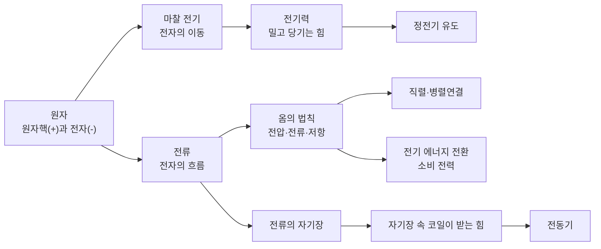

# 중2-7. 전기와 자기 — 보이지 않는 전자가 세상을 움직이는 방법
<!-- prev: m1-05, m2-04 -->
<!-- next: 2-6, 5-5, 5-6, phy-2, emq-1 -->

> [!NOTE]
> **성취기준**
> - **[9과14-01]** 마찰 전기, 정전기 유도 현상을 관찰하고, 이를 전기력과 원자 모형을 이용하여 설명할 수 있다.
> - **[9과14-02]** 전기 회로에서 전류를 모형으로 설명하고, 실험을 통해 저항, 전류, 전압 사이의 관계를 이끌어낼 수 있다.
> - **[9과14-03]** 저항의 직렬연결과 병렬연결의 특징을 비교하고, 일상생활에서 전기 에너지가 다양한 형태의 에너지로 전환됨을 소비 전력과 관련지어 설명할 수 있다.
> - **[9과14-04]** 자기장 안에 놓인 전류가 흐르는 코일이 받는 힘의 특성을 추리하고, 전동기 등 일상생활에서 활용한 예를 찾을 수 있다.

**학습 목표**

1. 마찰 전기와 정전기 유도 현상을 원자 모형(원자핵과 전자)과 전기력으로 설명할 수 있다.
2. 전류·전압·저항을 물의 흐름 모형으로 설명하고, 실험 결과로부터 전류가 전압에 비례하고 저항에 반비례함(옴의 법칙)을 이끌어 낼 수 있다.
3. 도체·부도체·반도체의 차이를 예를 들어 설명할 수 있다.
4. 저항의 직렬연결과 병렬연결의 특징을 비교하고, 가정의 전기 배선이 병렬연결인 까닭을 설명할 수 있다.
5. 전기 기구에서 전기 에너지가 빛·열·소리·운동 에너지로 전환됨을 소비 전력과 관련지어 설명할 수 있다.
6. 전류가 흐르는 코일 주위의 자기장과, 자기장 속 코일이 받는 힘으로 전동기의 원리를 설명할 수 있다.

**이 단원의 학습 사다리**

| 단계 | 무엇을 하나? |
|---|---|
| STEP 1. 이전 학습 다시 보기 | 초등학교 '자석의 이용', '전기의 이용', 중2 「물질의 구성」의 원자 모형을 다시 꺼낸다 |
| STEP 2. 기초 다지기 | 전하, 비례·반비례 그래프, 회로 기호라는 디딤돌을 놓는다 |
| STEP 3. 핵심 개념 | 정전기 → 전류·전압·저항 → 직렬·병렬과 전기 에너지 → 자기장과 전동기 |
| STEP 4. 오개념 바로잡기 | "전류는 전구에서 소모된다?" 같은 착각을 바로잡는다 |
| STEP 5. 다음 단계로 | 통합과학의 반도체·발전기, 물리학의 전기장·전자기 유도 |
| STEP 6. 생활·산업·진로 | 공기 청정기와 레이저 프린터, 전기 자동차, 에너지 효율 등급 |

---

## 🗺️ 단원 들어가기

겨울철 문손잡이를 잡을 때 "따끔!" 하는 경험, 스웨터를 벗을 때 머리카락이 곤두서는 경험을 해 본 적이 있을 것이다. 같은 겨울날, 집 안에서는 전기난로가 열을 내고, 냉장고는 쉬지 않고 돌아가고, 선풍기 대신 공기 청정기의 날개가 빙글빙글 돈다.

따끔한 정전기와 집 안의 전기 기구는 아주 달라 보인다. 그러나 둘 다 **전자**라는 아주 작은 입자가 주인공이다. 전자가 한쪽에 **쌓이면** 정전기가 되고, 전자가 도선을 따라 **흐르면** 전류가 된다. 그리고 흐르는 전류는 자석처럼 **자기장**을 만들어, 모터를 돌리는 힘이 된다. 이 단원은 "전자가 쌓인다 → 흐른다 → 자석과 힘을 주고받는다"는 이야기를 따라간다.

---

## STEP 1. 🔙 이전 학습 다시 보기

### 연계 개념표

| 이전 단원·성취기준 | 그때 배운 것 | 이 단원에서 확장되는 것 |
|---|---|---|
| 초등 3~4학년 '자석의 이용' | 자석에는 N극과 S극이 있고, 같은 극끼리 밀고 다른 극끼리 당긴다. 나침반 | 자석 주위의 **자기장**을 자기력선으로 나타내고, **전류도 자기장을 만든다**는 것을 배운다 |
| 초등 5~6학년 '전기의 이용' | 전지·전선·전구로 회로를 만든다. 전구의 직렬·병렬연결, 전자석 | 전류·전압·저항을 **수로 측정**하고, 직렬·병렬의 특징을 전압과 전류로 비교한다 |
| 중1 「힘의 작용」 [9과05-01] | 힘은 크기와 방향을 가지며 화살표로 나타낸다 | **전기력**과 **자기력**의 크기와 방향을 같은 방법으로 나타낸다 |
| 중2 「물질의 구성」 [9과11-02], [9과11-04] | 원자는 원자핵(양성자, 중성자)과 전자로 되어 있다. 전자를 잃으면 양이온, 얻으면 음이온 | 물체가 전자를 잃거나 얻어 **대전**되는 현상으로 정전기를 설명한다 |

### 준비 운동 (사전 진단)

**Q1.** 원자 안에서 (+)전하를 띠는 입자와 (−)전하를 띠는 입자는 각각 무엇인가?

**Q2.** 전구 2개를 연결할 때, 전구 하나를 빼도 나머지 전구가 계속 켜지는 연결 방법은 직렬과 병렬 중 무엇인가?

**Q3.** 막대자석의 N극을 다른 막대자석의 N극에 가까이 하면 어떻게 되는가?

**Q4.** 초등학교에서 만든 전자석의 세기를 더 세게 하려면 어떻게 해야 할까? 한 가지만 쓰시오.

정답 및 해설

**Q1.** (+)전하: 원자핵 속 **양성자**, (−)전하: **전자**. 중성자는 전하를 띠지 않는다.

**Q2. 병렬연결** — 병렬연결은 전류가 흐르는 길이 여러 갈래이므로, 한 길이 끊어져도 다른 길로 전류가 흐른다.

**Q3.** 서로 **밀어낸다.** 같은 극끼리는 미는 힘, 다른 극끼리는 당기는 힘이 작용한다.

**Q4.** 코일을 더 많이 감는다, 전지를 더 많이 직렬로 연결해 전류를 세게 한다 등. 이 단원의 ④에서 그 이유를 배운다.

---

## STEP 2. 🧱 기초 다지기

### ① 전하: 전기의 '종류'

물체가 띠는 전기를 **전하(electric charge)** 라고 한다. 전하에는 **양(+)전하**와 **음(−)전하** 두 종류가 있다.

- 원자는 원자핵의 (+)전하량과 전자들의 (−)전하량이 같아서 **전기적으로 중성**이다.
- 원자핵은 무겁고 단단히 묶여 있어 잘 움직이지 않는다. 물체 사이를 **옮겨 다니는 것은 전자**이다.
- 전하의 양을 **전하량**이라 하고, 단위는 C(쿨롬)이다.

> [!TIP]
> 💡 **비유** — 원자를 "(+) 사탕 3개와 (−) 사탕 3개를 가진 사람"이라고 하자. (−) 사탕 하나를 친구에게 주면 이 사람은 (+)가 하나 남고(양전하), 받은 친구는 (−)가 하나 많아진다(음전하). 사탕을 새로 만들거나 없앤 것이 아니라 **옮기기만** 했다.

### ② 비례와 반비례, 그리고 그래프

| 관계 | 뜻 | 그래프 | 이 단원의 예 |
|---|---|---|---|
| 비례 | 한 양이 2배, 3배가 되면 다른 양도 2배, 3배 | 원점을 지나는 직선 | 저항이 같을 때 전압과 전류 |
| 반비례 | 한 양이 2배, 3배가 되면 다른 양은 $\frac{1}{2}$, $\frac{1}{3}$ | 원점을 지나지 않는 곡선 | 전압이 같을 때 저항과 전류 |

그래프의 **기울기**는 "가로축이 1만큼 늘 때 세로축이 얼마나 느는가"이다. 가로축이 전압, 세로축이 전류인 그래프에서 기울기가 클수록 같은 전압에서 전류가 많이 흐르므로 **저항이 작다.**

### ③ 회로 기호

| 기호 이름 | 그리는 법(말로 설명) | 뜻 |
|---|---|---|
| 전지 | 긴 세로선(+)과 짧은 세로선(−) | 전압을 만들어 주는 장치 |
| 전구 | 원 안에 X 표시 | 전기 에너지를 빛으로 바꾼다 |
| 저항 | 지그재그선 또는 긴 직사각형 | 전류의 흐름을 방해한다 |
| 스위치 | 끊어진 선과 비스듬한 막대 | 회로를 열고 닫는다 |
| 전류계 | 원 안에 A | 전류를 측정한다. 회로에 **직렬**로 연결 |
| 전압계 | 원 안에 V | 전압을 측정한다. 측정할 부분에 **병렬**로 연결 |

<!-- fig:m2-07-circuit-symbols -->

---

## STEP 3. 📘 핵심 개념

### ① 마찰 전기와 정전기 유도 — 전자가 옮겨 가면 생기는 일

#### 마찰 전기

서로 다른 두 물체를 문지르면 한 물체에서 다른 물체로 **전자가 이동**한다.

- 전자를 **잃은** 물체 → (+)전하가 더 많아져 **양(+)전하**를 띤다.
- 전자를 **얻은** 물체 → (−)전하가 더 많아져 **음(−)전하**를 띤다.

이처럼 마찰로 생긴 전기를 **마찰 전기(triboelectricity)**, 물체가 전기를 띠는 것을 **대전(charging)**, 전기를 띤 물체를 **대전체**라고 한다. 전기가 흐르지 않고 한곳에 머물러 있기 때문에 **정전기(static electricity)** 라고도 한다.

<!-- fig:m2-07-friction -->

어느 물체가 전자를 잃기 쉬운지는 물질의 종류에 따라 다르며, 이를 순서대로 늘어놓은 것을 **대전열**이라고 한다.

| (+)로 대전되기 쉽다 ← | | | | → (−)로 대전되기 쉽다 |
|---|---|---|---|---|
| 털가죽 | 유리 | 명주(비단) | 고무 | 플라스틱(PVC 등) |

대전열에서 **멀리 떨어진** 두 물질을 문지를수록 전기가 잘 생긴다. 털가죽과 플라스틱 막대를 문지르면 털가죽은 (+)전하, 플라스틱은 (−)전하를 띤다. (대전열은 실험 조건에 따라 순서가 조금 달라질 수 있다.)

#### 전기력

전기를 띤 물체 사이에 작용하는 힘을 **전기력(electric force)** 이라 한다.

| 두 물체의 전하 | 작용하는 힘 | 생활 속 예 |
|---|---|---|
| 같은 종류 (+와 +, −와 −) | 서로 **밀어내는** 힘(척력) | 스웨터를 벗을 때 머리카락이 한 올 한 올 벌어진다 |
| 다른 종류 (+와 −) | 서로 **끌어당기는** 힘(인력) | 털가죽으로 문지른 플라스틱 막대에 그 털가죽을 가까이 하면 끌려간다, 벗은 스웨터와 속옷이 서로 달라붙는다 |

전기력은 두 물체의 **전하량이 클수록**, 두 물체 사이의 **거리가 가까울수록** 세다.

#### 정전기 유도

금속처럼 전자가 자유롭게 움직이는 물체에 대전체를 **가까이만** 해도(닿지 않아도) 금속 안의 전자가 이동한다.

- (−)대전체를 가까이 하면 → 금속 속 전자가 **밀려나** 먼 쪽으로 간다.
  → 가까운 쪽: (+)전하, 먼 쪽: (−)전하
- (+)대전체를 가까이 하면 → 금속 속 전자가 **끌려와** 가까운 쪽으로 온다.
  → 가까운 쪽: (−)전하, 먼 쪽: (+)전하

이처럼 대전체를 가까이 할 때 물체의 양 끝이 전기를 띠는 현상을 **정전기 유도(electrostatic induction)** 라고 한다. **가까운 쪽에는 대전체와 다른 종류, 먼 쪽에는 같은 종류의 전하**가 모인다. 그래서 대전체와 금속 사이에는 항상 **끌어당기는 힘**이 작용한다.

> [!TIP]
> 💡 **비유** — 운동장에 학생들(전자)이 고르게 퍼져 있는데, 한쪽 끝에 무서운 개((−)대전체)가 나타났다고 하자. 학생들은 반대쪽으로 몰려가고, 개 쪽은 텅 빈다. 학생은 운동장 밖으로 나가지 않았으니 운동장 전체 인원은 그대로이다. 정전기 유도에서도 금속 전체의 전하량은 그대로이고 **분포만 바뀐다.**

#### 검전기로 확인하기

**검전기**는 금속판, 금속 막대, 얇은 금속박 두 장으로 이루어져 있다. (−)대전체를 금속판에 가까이 하면 전자가 금속박 쪽으로 밀려 내려가 **두 금속박이 모두 (−)전하를 띠고 서로 밀어내어 벌어진다.** 대전체를 멀리 하면 전자가 다시 고르게 퍼져 금속박이 오므라든다.

<!-- fig:m2-07-electroscope -->

#### 예제 1 — 검전기 해석하기

(+)전하로 대전된 유리 막대를 대전되지 않은 검전기의 금속판에 가까이 하였다. (1) 금속판과 금속박은 각각 어떤 전하를 띠는가? (2) 금속박은 어떻게 되는가?

**풀이**
(1) (+)대전체가 전자를 끌어당기므로 전자가 금속판 쪽으로 올라온다. 금속판은 **(−)전하**, 전자가 빠져나간 금속박은 **(+)전하**를 띤다.
(2) 두 금속박이 모두 (+)전하를 띠므로 서로 밀어내어 **벌어진다.**

(−)대전체든 (+)대전체든 가까이 하면 금속박은 벌어진다. 검전기로는 물체가 **대전되었는지**, 그리고 얼마나 많이 대전되었는지(벌어지는 정도)를 알 수 있다.

#### 예제 2 — 마찰 전기 추론하기

털가죽으로 플라스틱 빨대 A를 문지른 뒤, 같은 방법으로 문지른 빨대 B를 A에 가까이 하였다. 또 털가죽을 A에 가까이 하였다. 각각 어떤 힘이 작용하는가?

**풀이** 대전열에서 털가죽은 (+), 플라스틱은 (−)로 대전되기 쉽다. A와 B는 모두 (−)전하를 띠므로 **서로 밀어낸다.** 털가죽은 (+), A는 (−)이므로 **서로 끌어당긴다.**

#### ✔ 바로 확인

1. (O/X) 두 물체를 문지르면 원자핵의 (+)전하가 다른 물체로 옮겨 간다.
2. 빈칸: 문질러서 전자를 잃은 물체는 (    )전하를 띤다.
3. (−)대전체를 금속 막대의 한쪽 끝에 가까이 하였다(닿지 않음). 막대의 가까운 쪽과 먼 쪽은 각각 어떤 전하를 띠는가?
4. 대전되지 않은 검전기의 금속판에 (+)대전체를 가까이 하면 금속박은? ① 오므라든다 ② 벌어진다 ③ 변화가 없다

정답

1. X — 옮겨 가는 것은 전자이다. 원자핵은 원자 안에 단단히 묶여 있다.
2. (+) — (+)전하가 (−)전하보다 많아진다.
3. 가까운 쪽 (+), 먼 쪽 (−) — 전자가 밀려나 먼 쪽으로 간다.
4. ② — 전자가 금속판 쪽으로 끌려가 두 금속박이 모두 (+)전하를 띠고 서로 밀어낸다.

### ② 전류, 전압, 저항 — 회로 속 전자의 흐름

#### 전류: 전하의 흐름

전지에 도선과 전구를 연결하면 도선 속 전자가 한 방향으로 움직인다. 이처럼 전하가 연속적으로 이동하는 것을 **전류(electric current)** 라 한다.

| 구분 | 방향 |
|---|---|
| 전류의 방향 | 전지의 (+)극 → 도선 → (−)극 (과학자들이 약속한 방향) |
| 전자의 이동 방향 | 전지의 (−)극 → 도선 → (+)극 (실제 전자가 움직이는 방향) |

전류의 방향은 전자가 발견되기 전에 정해진 약속이라서, 실제 전자의 이동 방향과 **반대**이다. 전류의 세기는 1초 동안 도선의 한 단면을 지나는 전하량으로 나타내며, 단위는 **A(암페어)** 이다. ($1\ \mathrm{A} = 1000\ \mathrm{mA}$)

- 전류가 흐르지 않을 때: 도선 속 전자들은 제멋대로 움직인다.
- 전류가 흐를 때: 전자들이 (−)극에서 (+)극 쪽으로 **일정한 방향으로** 이동한다.

#### 전압: 전류를 흐르게 하는 능력

**전압(voltage)** 은 회로에 전류를 흐르게 하는 능력이며, 단위는 **V(볼트)** 이다. 건전지 1개는 약 1.5 V, 우리나라 가정용 콘센트는 220 V이다.

#### 물의 흐름 모형

전기 회로는 눈에 보이지 않으므로, 눈에 보이는 **물의 흐름**에 빗대어 생각해 보자.

| 전기 회로 | 물의 흐름 모형 | 설명 |
|---|---|---|
| 전지 | 펌프 | 물을 높은 곳으로 끌어올려 흐를 수 있게 한다 |
| 전압 | 물의 높이 차 | 높이 차가 클수록 물이 세차게 흐른다 |
| 전류 | 물의 흐름(1초에 흐르는 물의 양) | 물레방아를 지나도 물의 양은 줄지 않는다 |
| 저항 | 좁은 관, 물레방아 | 물의 흐름을 방해한다 |
| 전구 | 물레방아 | 흐르는 물이 일을 한다 |
| 스위치 | 밸브 | 흐름을 열고 막는다 |

<!-- fig:m2-07-water-model -->

> [!IMPORTANT]
> 물레방아를 지난 물이 사라지지 않듯이, **전구를 지난 전류는 줄어들지 않는다.** 전구에서 소모되는 것은 전류가 아니라 **전기 에너지**이다. 펌프가 물을 끌어올리는 에너지가 물레방아를 돌리는 데 쓰이는 것과 같다.

#### 저항과 옴의 법칙

전류의 흐름을 방해하는 정도를 **저항(resistance)** 이라 하며, 단위는 **Ω(옴)** 이다. 도선 속 전자가 움직이다가 원자와 부딪히기 때문에 저항이 생긴다.

니크롬선에 걸어 주는 전압을 바꾸면서 전류를 측정하면 다음과 같은 결과를 얻는다.

| 전압 (V) | 1.5 | 3.0 | 4.5 | 6.0 |
|---|---|---|---|---|
| 니크롬선 A의 전류 (A) | 0.1 | 0.2 | 0.3 | 0.4 |
| 니크롬선 B의 전류 (A) | 0.05 | 0.10 | 0.15 | 0.20 |

- 같은 니크롬선에서는 전압이 2배, 3배가 되면 전류도 2배, 3배가 된다 → **전류는 전압에 비례**한다.
- 같은 전압에서 B의 전류가 A의 절반이다 → B의 저항이 A의 2배이다 → **전류는 저항에 반비례**한다.

이 관계를 **옴의 법칙(Ohm's law)** 이라 한다.

$$
I = \frac{V}{R} \qquad (V = IR)
$$

($I$: 전류(A), $V$: 전압(V), $R$: 저항(Ω)) 위 표에서 A의 저항은 $R = \dfrac{1.5}{0.1} = 15\ \Omega$, B의 저항은 $R = \dfrac{1.5}{0.05} = 30\ \Omega$이다.

#### 예제 3 — 옴의 법칙 계산

(1) 저항이 10 Ω인 전열선에 3 V의 전압을 걸면 흐르는 전류는?
(2) 어떤 전구에 6 V를 걸었더니 0.3 A가 흘렀다. 전구의 저항은?
(3) 저항 20 Ω인 니크롬선에 0.25 A가 흐르려면 전압을 얼마나 걸어야 하는가?

**풀이**
(1) $I = \dfrac{V}{R} = \dfrac{3}{10} = 0.3\ \mathrm{A}$
(2) $R = \dfrac{V}{I} = \dfrac{6}{0.3} = 20\ \Omega$
(3) $V = IR = 0.25 \times 20 = 5\ \mathrm{V}$

#### 물질에 따라 저항이 다르다 — 도체, 부도체, 반도체

같은 모양이라도 **물질의 종류**에 따라 저항이 다르다. 또 같은 물질이면 도선이 **길수록** 저항이 크고, **굵을수록** 저항이 작다. (좁고 긴 관일수록 물이 흐르기 어려운 것과 같다.)

| 구분 | 특징 | 예 | 쓰임 |
|---|---|---|---|
| **도체(conductor)** | 저항이 작아 전류가 잘 흐른다. 자유롭게 움직이는 전자가 많다 | 구리, 알루미늄, 은, 금 | 전선의 심, 전자 회로의 배선 |
| **부도체(insulator)** | 저항이 매우 커서 전류가 거의 흐르지 않는다 | 고무, 유리, 플라스틱, 나무 | 전선 피복, 플러그 손잡이, 전봇대의 애자 |
| **반도체(semiconductor)** | 도체와 부도체의 중간. 조건에 따라 전류가 흐르는 정도를 조절할 수 있다 | 규소(실리콘), 저마늄 | 컴퓨터 칩, 발광 다이오드(LED), 태양 전지 |

> [!NOTE]
> 전선은 구리(도체)를 고무나 플라스틱(부도체)으로 감싼 구조이다. **전류는 잘 흐르게, 사람은 감전되지 않게** 두 물질의 성질을 함께 이용한 것이다.

#### ✔ 바로 확인

1. 빈칸: 전류는 전지의 (    )극에서 나와 도선을 지나 (    )극으로 흐른다.
2. 저항이 5 Ω인 전열선에 2 V의 전압을 걸면 흐르는 전류는?
3. (O/X) 같은 물질로 된 도선이면 굵을수록 저항이 크다.
4. 물의 흐름 모형에서 펌프와 물의 높이 차는 전기 회로의 무엇에 해당하는가?

정답

1. (+), (−) — 전자는 반대로 (−)극에서 (+)극으로 움직인다.
2. 0.4 A — $I = \dfrac{V}{R} = \dfrac{2}{5} = 0.4\ \mathrm{A}$
3. X — 굵을수록 저항이 작고, 길수록 저항이 크다.
4. 펌프 – 전지, 물의 높이 차 – 전압

### ③ 직렬연결과 병렬연결, 전기 에너지의 전환

#### 직렬연결과 병렬연결

| 구분 | **직렬연결(series)** | **병렬연결(parallel)** |
|---|---|---|
| 연결 모양 | 저항을 한 줄로 이어서 연결. 전류가 흐르는 길이 하나 | 저항을 여러 갈래로 나누어 연결. 전류가 흐르는 길이 여러 개 |
| 전류 | 각 저항에 흐르는 전류가 **모두 같다** | 전체 전류가 갈래로 **나뉘어** 흐른다 |
| 전압 | 전체 전압이 각 저항에 **나뉘어** 걸린다 | 각 저항에 걸리는 전압이 **모두 같다**(전체 전압과 같다) |
| 저항을 더 연결하면 | 전체 저항이 **커져** 전체 전류가 줄어든다 | 전체 저항이 **작아져** 전체 전류가 늘어난다 |
| 하나가 끊어지면 | 회로 전체에 전류가 흐르지 않는다 | 나머지 갈래에는 계속 전류가 흐른다 |
| 생활 속 예 | 퓨즈와 전기 기구, 장식용 꼬마전구 일부, 건전지를 한 줄로 넣는 리모컨 | 가정의 전기 배선, 멀티탭, 건물의 전등 |

> [!TIP]
> 💡 **비유** — 직렬연결은 **한 줄로 된 좁은 산길**이다. 터널(저항)이 하나 늘면 길 전체가 더 막히고, 다리 하나가 무너지면 모두 갈 수 없다. 병렬연결은 **나란한 여러 개의 차선**이다. 차선이 늘면 전체적으로 더 많은 차가 지나가고, 한 차선이 공사 중이어도 다른 차선은 다닐 수 있다.

<!-- sim:ohm-circuit -->

#### 예제 4 — 같은 전구를 직렬과 병렬로 연결할 때

그림과 같이 똑같은 전구 2개를 3 V 전지에 (가) 직렬로, (나) 병렬로 연결하였다.
(1) 각 경우 전구 하나에 걸리는 전압은?
(2) 어느 연결에서 전구가 더 밝은가?
(3) 각 경우 전구 하나를 빼면 나머지 전구는 어떻게 되는가?

<!-- fig:m2-07-q-series-parallel -->

**풀이**
(1) (가) 직렬: 전체 전압이 똑같은 두 전구에 똑같이 나뉘므로 각각 $1.5\ \mathrm{V}$. (나) 병렬: 각 전구에 전체 전압이 그대로 걸리므로 각각 $3\ \mathrm{V}$.
(2) 같은 전구에 더 큰 전압이 걸리면 더 큰 전류가 흐르므로 (나) **병렬연결**의 전구가 더 밝다.
(3) (가) 길이 끊어지므로 나머지 전구도 **꺼진다.** (나) 다른 갈래는 그대로이므로 나머지 전구는 **계속 켜져 있다.**

#### 가정의 전기 배선은 왜 병렬연결일까?

1. 모든 전기 기구에 **같은 전압(220 V)** 이 걸려서, 각 기구가 설계된 대로 작동한다.
2. 한 기구를 끄거나 고장 나도 **다른 기구는 계속 쓸 수 있다.**

그런데 병렬로 기구를 많이 연결할수록 **전체 전류가 커진다.** 멀티탭 하나에 전기난로, 헤어드라이어, 전기 주전자를 한꺼번에 꽂으면 멀티탭과 전선에 큰 전류가 흘러 뜨거워지고, 심하면 **화재**가 날 수 있다. 그래서 멀티탭에는 '최대 허용 전력'이 적혀 있고, 차단기는 너무 큰 전류가 흐르면 회로를 끊는다.

#### 전기 에너지는 여러 형태로 바뀐다

전류가 흐르면서 전기 기구에 공급하는 에너지를 **전기 에너지(electric energy)** 라 한다. 전기 기구는 전기 에너지를 우리가 쓰고 싶은 다른 형태의 에너지로 **전환**한다.

| 전기 기구 | 전기 에너지가 주로 바뀌는 에너지 | 함께 생기는 에너지 |
|---|---|---|
| 전등(LED, 형광등) | 빛에너지 | 열에너지 |
| 전기난로, 전기다리미, 헤어드라이어의 열선 | 열에너지 | 빛에너지 |
| 선풍기, 세탁기, 엘리베이터 | 운동 에너지 | 열에너지, 소리 에너지 |
| 스피커, 이어폰 | 소리 에너지 | 열에너지 |
| 스마트폰 충전 | 화학 에너지(배터리에 저장) | 열에너지 |
| 텔레비전 | 빛에너지, 소리 에너지 | 열에너지 |

거의 모든 전기 기구에서 원하지 않는 **열에너지**가 함께 생긴다. 스마트폰을 충전하면 따뜻해지는 것도 그 때문이다.

#### 소비 전력: 1초 동안 쓰는 전기 에너지

전기 기구가 **1초 동안 사용하는 전기 에너지**를 **소비 전력(power consumption)** 이라 하며, 단위는 **W(와트)** 이다. 전기 기구에 붙은 '220 V – 1000 W' 같은 표시는 "220 V에 연결하면 1초에 1000 J의 전기 에너지를 다른 에너지로 바꾼다"는 뜻이다.

| 같은 시간 동안 사용할 때 | 소비 전력이 큰 기구 | 소비 전력이 작은 기구 |
|---|---|---|
| 쓰는 전기 에너지 | 많다 | 적다 |
| 예 | 전기난로, 에어컨, 전기밥솥 (열을 내거나 많이 움직이는 기구) | LED 전등, 스마트폰 충전기 |

> [!IMPORTANT]
> 소비 전력이 크다고 "좋은 기구"는 아니다. 같은 밝기의 빛을 낼 때 **LED 전구는 백열전구보다 소비 전력이 훨씬 작다.** 백열전구는 전기 에너지의 대부분을 빛이 아닌 열로 바꾸기 때문이다. 같은 일을 **더 적은 전기 에너지로** 하는 기구가 **효율이 높은** 기구이다.

#### 예제 5 — 에너지 전환과 효율 비교

밝기가 비슷한 백열전구와 LED 전구에 각각 손을 가까이 대 보았더니 백열전구가 훨씬 뜨거웠다. 두 전구의 소비 전력 표시는 각각 60 W, 8 W였다.
(1) 같은 시간 동안 켰을 때 전기 에너지를 더 많이 쓰는 전구는?
(2) 백열전구가 더 뜨거운 까닭을 에너지 전환으로 설명하시오.

**풀이**
(1) 소비 전력이 큰 **백열전구**가 1초마다 더 많은 전기 에너지를 쓴다.
(2) 두 전구가 내는 빛에너지는 비슷한데, 백열전구는 훨씬 많은 전기 에너지를 쓴다. 남는 에너지의 대부분이 **열에너지**로 바뀌기 때문에 백열전구가 뜨겁다. LED 전구가 효율이 더 높다.

#### ✔ 바로 확인

1. (O/X) 직렬연결에서는 각 저항에 흐르는 전류의 세기가 모두 같다.
2. 가정의 전기 배선은 직렬과 병렬 중 어느 연결인가? 그 까닭 하나를 쓰시오.
3. 빈칸: 전기 기구가 1초 동안 사용하는 전기 에너지를 (    )이라 하고, 단위는 W이다.
4. 전기난로에서 전기 에너지는 주로 어떤 에너지로 바뀌는가?

정답

1. O — 전류가 흐르는 길이 하나뿐이다.
2. 병렬 — 모든 기구에 같은 전압(220 V)이 걸리고, 한 기구를 꺼도 다른 기구를 쓸 수 있다.
3. 소비 전력
4. 열에너지

### ④ 전류와 자기장, 그리고 전동기

#### 자기장과 자기력선

자석 주위처럼 **자기력(magnetic force)** 이 작용하는 공간을 **자기장(magnetic field)** 이라 한다. 자기장의 방향은 그 자리에 놓은 **나침반 자침의 N극이 가리키는 방향**이다.

자기장을 눈에 보이게 나타낸 선을 **자기력선**이라 한다.
- 자석 밖에서 **N극에서 나와 S극으로** 들어간다.
- 자기력선이 **촘촘할수록** 자기장이 세다. (막대자석은 양 극 근처가 가장 세다)
- 자기력선은 서로 교차하거나 끊어지지 않는다.

막대자석 위에 투명한 판을 놓고 철가루를 뿌린 뒤 판을 톡톡 두드리면, 철가루가 자기력선 모양으로 늘어선다.

#### 전류가 흐르는 도선과 코일 주위의 자기장

1820년 무렵 외르스테드는 전류가 흐르는 도선 옆의 나침반 바늘이 움직이는 것을 발견했다. **전류는 자기장을 만든다.**

| 도선의 모양 | 자기장의 모양 | 방향 찾기 (오른손) |
|---|---|---|
| 곧은 도선 | 도선을 중심으로 한 **동심원** 모양 | 엄지손가락을 전류 방향으로 하고 도선을 감아쥐면, 네 손가락이 감기는 방향이 자기장 방향 |
| **코일(coil)** | 코일 안에서는 한 방향으로 곧게, 밖에서는 **막대자석과 비슷한** 모양 | 네 손가락을 전류가 흐르는 방향으로 코일을 감아쥐면, 엄지손가락이 가리키는 쪽이 코일 안 자기장 방향(N극 쪽) |

<!-- fig:m2-07-field-shapes -->

<!-- fig:m2-07-coil-field -->

코일을 이용한 실험으로 다음을 확인할 수 있다.

| 바꾸는 조건 | 코일 주위 자기장의 변화 |
|---|---|
| 전류를 세게 한다 | 자기장이 **세진다** (나침반 바늘이 더 확실하게 돌아간다, 철가루가 더 뚜렷하게 늘어선다) |
| 코일을 더 많이 감는다 | 자기장이 **세진다** |
| 코일 안에 철심을 넣는다 | 자기장이 크게 **세진다** → **전자석** |
| 전류의 방향을 반대로 한다 | 자기장의 방향이 **반대**가 된다 (N극과 S극이 바뀐다) |
| 전류를 끊는다 | 자기장이 **사라진다** |

> [!TIP]
> 💡 **비유** — 코일은 '스위치로 켜고 끌 수 있는 막대자석'이다. 보통 자석은 늘 자석이지만, 전자석은 전류를 흘릴 때만 자석이 되고 전류의 세기로 세기를, 전류의 방향으로 극을 바꿀 수 있다. 고철 처리장의 전자석 기중기가 고철을 들어 올렸다가 전류를 끊어 내려놓는 것도 이 성질을 이용한다.

아래는 실제 전자석 기중기가 쇠 막대를 들어 올리는 모습이다.

<!-- photo:m2-07-electromagnet-crane -->

#### 자기장 속에서 전류가 받는 힘

전류가 흐르는 도선은 자기장을 만드므로 작은 자석처럼 행동한다. 그래서 **자석의 자기장 안에 놓인 도선**은 자석과 서로 힘을 주고받는다.

| 바꾸는 조건 | 도선이 받는 힘의 변화 |
|---|---|
| 전류의 방향을 반대로 | 힘의 방향이 **반대** |
| 자석의 극을 바꾸어 자기장 방향을 반대로 | 힘의 방향이 **반대** |
| 전류를 세게 | 힘이 **세진다** |
| 더 센 자석을 쓴다 | 힘이 **세진다** |
| 도선을 자기장과 나란하게 놓는다 | 힘을 **받지 않는다** |

힘의 방향은 **전류의 방향과 자기장의 방향 모두에 수직**이다. 이 방향을 찾을 때 다음 방법을 쓸 수 있다.

> [!TIP]
> 💡 **오른손 방법** — 오른손을 펴서 **엄지손가락을 전류의 방향**, **나머지 네 손가락을 자기장의 방향(N → S)** 으로 맞춘다. 이때 **손바닥이 미는 방향**이 도선이 받는 힘의 방향이다.

<!-- fig:m2-07-force-wire -->

#### 예제 6 — 힘의 방향 추리하기

말굽자석의 N극이 위, S극이 아래에 있어 자기장이 위에서 아래로 향한다. 그 사이에 놓인 도선에 전류가 왼쪽에서 오른쪽으로 흐를 때, 도선은 뒤쪽(나에게서 멀어지는 쪽)으로 움직였다. 오른손 방법으로 이 결과를 확인하고, 다음 경우를 추리하시오.
(1) 전류의 방향만 반대로 하면? (2) 전류의 방향과 자석의 극을 모두 반대로 하면? (3) 전류를 세게 하면?

**풀이** 엄지를 오른쪽(전류), 네 손가락을 아래쪽(자기장)으로 맞추면 손바닥은 나에게서 멀어지는 쪽을 향하므로 결과와 일치한다.
(1) 힘의 방향이 반대 → 도선이 **앞쪽(나를 향하는 쪽)** 으로 움직인다.
(2) 두 번 반대가 되므로 원래대로 → **뒤쪽**으로 움직인다.
(3) 방향은 그대로 뒤쪽, 힘은 **더 세진다** → 더 크게 움직인다.

#### 전동기: 힘을 회전으로 바꾸기

**전동기(electric motor, 모터)** 는 자석 사이에 코일을 넣고 전류를 흘려, 코일이 받는 힘으로 **회전**하게 만든 장치이다.

1. 자석 사이에 놓인 사각형 코일의 **양쪽 변**에는 전류가 **서로 반대 방향**으로 흐른다.
2. 그래서 한쪽 변은 위로, 다른 쪽 변은 아래로 힘을 받아 코일이 **돈다.**
3. 그대로 두면 코일 면이 자기장에 수직인 위치를 지난 뒤에는 힘이 회전을 되돌리는 쪽으로 작용하여, 코일이 앞뒤로 흔들리다 멈춘다. 그래서 **정류자**와 **브러시**가 그 위치에서(반 바퀴마다) 코일에 흐르는 전류의 방향을 바꾸어 주어, 코일이 **같은 방향으로 계속 돈다.**

전동기는 **전기 에너지를 운동 에너지로** 바꾸는 장치이다. 전류를 세게 하거나, 센 자석을 쓰거나, 코일을 많이 감으면 더 힘차게 돈다.

<!-- sim:motor-3d -->

| 일상생활 속 전동기 | 쓰임 |
|---|---|
| 선풍기, 헤어드라이어, 공기 청정기 | 날개를 돌려 바람을 만든다 |
| 세탁기, 믹서 | 통이나 칼날을 회전시킨다 |
| 전기 자동차, 전기 자전거, 지하철 | 바퀴를 돌린다 |
| 드론 | 프로펠러를 돌려 떠오른다 |
| 스마트폰 진동 | 무게 중심이 한쪽으로 치우친 작은 추를 돌려 떨림을 만든다 |
| 스피커 (전동기는 아니지만 같은 원리) | 자석 옆 코일이 전류에 따라 앞뒤로 힘을 받아 진동판을 떨게 해 소리를 낸다 |

#### ✔ 바로 확인

1. 빈칸: 자기장의 방향은 그 자리에 놓은 나침반 자침의 (    )극이 가리키는 방향이다.
2. (O/X) 막대자석 밖에서 자기력선은 S극에서 나와 N극으로 들어간다.
3. 코일에 흐르는 전류의 방향을 반대로 하면 코일의 N극과 S극은 어떻게 되는가?
4. 전동기에서 반 바퀴마다 코일에 흐르는 전류의 방향을 바꾸어 주는 장치는?

정답

1. N
2. X — 자석 밖에서는 N극에서 나와 S극으로 들어간다.
3. 서로 바뀐다.
4. 정류자(와 브러시) — 그래서 코일이 한 방향으로 계속 돈다.

---

## STEP 4. ⚠️ 오개념 바로잡기

| 흔한 오개념 | 올바른 개념 | 왜 그럴까? |
|---|---|---|
| 마찰하면 (+)전하가 이동한다 | 이동하는 것은 **전자(−)** 이다 | 원자핵(+)은 원자 안에 단단히 묶여 있고, 바깥쪽 전자가 옮겨 간다 |
| 정전기 유도가 일어나면 금속이 새로 전기를 얻는다 | 금속 전체의 전하량은 그대로이고 **전자의 분포만 바뀐다** | 대전체에 닿지 않았으므로 전자가 들어오거나 나가지 않았다 |
| 전류는 전구를 지나면서 소모되어 줄어든다 | 직렬 회로의 어느 곳에서나 **전류의 세기는 같다** | 소모되는 것은 전류가 아니라 **전기 에너지**이다 (물레방아를 지난 물의 양은 그대로) |
| 전류의 방향과 전자의 이동 방향은 같다 | 전류는 (+)극 → (−)극, 전자는 (−)극 → (+)극으로 **반대**이다 | 전류의 방향은 전자를 발견하기 전에 약속으로 정해졌다 |
| 병렬로 연결하는 기구가 많아지면 전체 저항이 커진다 | 병렬연결에서는 길이 늘어나 전체 저항이 **작아지고** 전체 전류가 **커진다** | 그래서 멀티탭에 기구를 너무 많이 꽂으면 위험하다 |
| 소비 전력이 큰 기구가 성능이 좋은 기구이다 | 소비 전력은 1초에 **쓰는** 전기 에너지일 뿐, 효율과는 다르다 | 같은 밝기에서 LED 전구가 백열전구보다 소비 전력이 작지만 효율은 높다 |
| 전류가 흐르는 도선은 자기장 안에서 항상 힘을 받는다 | 도선이 자기장과 **나란하면** 힘을 받지 않는다 | 힘은 전류와 자기장 방향 모두에 수직으로 작용한다 |

---

## STEP 5. 🎓 다음 단계로 한 걸음 더

> [!CAUTION]
> 이 절은 **중학교 교육과정 범위 밖의 심화 내용**으로 평가 대상이 아니다. "이 개념이 고등학교에서 어디까지 이어지는가"를 맛보기로 보여 주기 위한 내용이다.

### 중3·고등학교와의 연결

| 학년·과목 | 단원 | 이어지는 내용 |
|---|---|---|
| 중3 | 「운동과 에너지」 | 일과 에너지, 역학적 에너지 전환 → 전기 에너지도 '일을 할 수 있는 능력'으로 이해 |
| 통합과학1 | 「물질의 전기적 성질과 소재」 | 도체·부도체·**반도체**를 전기적 성질로 구분하고, 신소재와 연결 |
| 통합과학2 | 「발전기와 전기 에너지」 | 자석과 코일로 **전기를 만드는** 전자기 유도, 발전소에서 가정까지 전력 수송 |
| 통합과학2 | 「에너지 효율과 신재생 에너지」 | 에너지 효율의 의미, 효율이 높은 기구를 쓰는 것과 기후변화 |
| 물리학 | 「전기와 자기」 | 전기장과 전위차, 저항의 연결과 소비 전력 계산, 자성체, 전자기 유도 |
| 전자기와 양자 | 「전자기적 상호작용」 | 전기장의 정량적 계산, 유전 분극, 로런츠 힘, 다이오드·트랜지스터 회로 |

### ① 소비 전력과 전기 요금 — 정량적으로 보기

고등학교 물리학에서는 소비 전력을 식으로 다룬다.

$$
P = VI \qquad (\text{소비 전력} = \text{전압} \times \text{전류})
$$

전기 에너지는 '소비 전력 × 사용 시간'이다. 전기 요금은 **kWh(킬로와트시)** 단위로 매기는데, $1\ \mathrm{kWh}$는 1000 W짜리 기구를 1시간 쓸 때의 전기 에너지이다. 예를 들어 1000 W 전기난로를 3시간 켜면 $1\ \mathrm{kW} \times 3\ \mathrm{h} = 3\ \mathrm{kWh}$를 쓴다. 지금 단원에서 정성적으로 다룬 "소비 전력이 크면 같은 시간에 더 많은 에너지를 쓴다"를 숫자로 계산하는 단계이다.

### ② 합성 저항

중학교에서는 "직렬로 연결할수록 전체 저항이 커지고, 병렬로 연결할수록 작아진다"는 경향만 다룬다. 고등학교에서는 이를 식으로 계산한다.

$$
\text{직렬: } R = R_1 + R_2, \qquad \text{병렬: } \frac{1}{R} = \frac{1}{R_1} + \frac{1}{R_2}
$$

### ③ 거꾸로 하면 발전기 — 전자기 유도

전동기는 "전류 + 자기장 → 힘(회전)"이다. 반대로 **코일을 자기장 속에서 돌리면 코일에 전류가 생긴다.** 이것이 **전자기 유도**이고, 이를 이용한 장치가 **발전기**이다. 실제로 전기 자동차는 브레이크를 밟을 때 바퀴에 연결된 전동기를 발전기처럼 써서 운동 에너지를 다시 전기 에너지로 바꿔 배터리를 충전한다. 통합과학2 「발전기와 전기 에너지」에서 자세히 배운다.

### ④ 부도체는 왜 대전체에 끌려올까? — 유전 분극

문지른 풍선은 종이 조각(부도체)도 끌어당긴다. 부도체에는 자유롭게 움직이는 전자가 거의 없지만, 각 분자 안에서 전자 구름이 살짝 한쪽으로 치우치는 **유전 분극**이 일어나 끌어당기는 힘이 생긴다. 금속의 정전기 유도와 비슷해 보이지만 원리가 조금 다르다. 진로 선택 과목 '전자기와 양자'에서 다룬다.

머리를 빗은 플라스틱 빗으로도 같은 현상을 볼 수 있다.

<!-- photo:m2-07-comb-paper-water -->

### 지금 vs 다음 단계

| 구분 | 중학교 2학년 (지금) | 고등학교 물리학·전자기와 양자 |
|---|---|---|
| 정전기 | 대전, 전기력의 방향, 정전기 유도 | 쿨롱 법칙, 전기장과 전기력선, 전위차, 유전 분극 |
| 회로 | 옴의 법칙, 직렬·병렬의 특징(정성적) | 합성 저항 계산, 소비 전력 $P = VI$, 축전기 |
| 물질 | 도체·부도체, 반도체 소개 | 에너지띠 구조, 다이오드·트랜지스터 |
| 자기 | 코일의 자기장(정성적), 전동기의 원리 | 자기장의 세기 계산, 로런츠 힘, 전자기 유도, 변압기 |

---

## STEP 6. 🏭 생활·산업·진로 연결

### 사례 1. 정전기를 이용하는 기술과 막는 기술

- **이용** 공기 청정기의 전기 집진 필터, 자동차 도장 공장의 정전 도장(대전된 페인트 입자가 반대 전하의 차체에 고르게 달라붙음), 레이저 프린터·복사기(대전된 드럼에 토너 가루가 붙어 글자가 됨)는 모두 **전기력**을 이용한다.
- **막기** 주유소의 정전기 방지 패드, 반도체 공장 작업자의 정전기 방지복, 전자 부품을 담는 정전기 방지 봉투는 정전기로 생기는 불꽃이나 부품 손상을 막는다.

### 사례 2. 반도체 산업

- **원리** 반도체는 조건에 따라 전류가 흐르는 정도를 조절할 수 있다. 수많은 작은 반도체 소자를 손톱만 한 칩에 모아 계산하고 기억한다.
- **어디에 쓰이나** 컴퓨터와 스마트폰의 처리 장치·메모리, LED 조명, 태양 전지, 자동차의 각종 제어 장치. 우리나라는 메모리 반도체 생산 분야에서 세계적으로 큰 비중을 차지하고 있다.

### 사례 3. 전기 자동차와 전동기

- **원리** 배터리의 화학 에너지 → 전기 에너지 → 전동기에서 운동 에너지로 바뀐다. 전동기는 자기장 속 코일이 받는 힘으로 바퀴를 돌린다.
- **연결** 전동기는 엘리베이터, 지하철, 로봇 팔, 드론 등 '움직이는 기계'의 대부분에 들어 있다. 전동기의 효율을 조금만 높여도 전체 전기 사용량을 크게 줄일 수 있다.

### 사례 4. 에너지소비효율등급과 현명한 전기 사용

- **원리** 우리나라에서는 냉장고, 에어컨, 세탁기 등에 **에너지소비효율등급**(1~5등급)을 표시하며, **1등급**이 같은 일을 할 때 전기 에너지를 가장 적게 쓴다.
- **실천** 효율이 높은 기구를 고르고, 쓰지 않는 기구의 플러그를 뽑고, 냉방 온도를 적절히 맞추는 것은 전기 요금을 줄일 뿐 아니라 발전에 쓰이는 화석 연료를 줄여 **기후변화 대응**에도 도움이 된다.

### 관련 진로와 학과

| 진로 | 하는 일 | 관련 학과 |
|---|---|---|
| 전기 기술자 | 건물 전기 배선 설계·시공, 전기 안전 점검 | 전기공학 |
| 반도체 엔지니어 | 반도체 소자 설계, 공정 개발 | 전자공학, 반도체공학, 재료공학 |
| 전기 자동차·모터 개발자 | 전동기, 배터리, 전력 제어 장치 개발 | 전기공학, 기계공학, 자동차공학 |
| 에너지 관리 전문가 | 건물·공장의 전기 사용 분석, 효율 개선 | 에너지공학, 전기공학 |

---

## 🔬 탐구 활동

### 활동 A. 저항, 전류, 전압 사이의 관계 탐구하기

**목표** 전압을 바꾸면서 전류를 측정하여 전압·전류·저항의 관계를 찾는다.

**준비물** 전원 장치(또는 1.5 V 건전지 4개와 전지 끼우개), 니크롬선 2종류(굵기가 다른 것), 전류계, 전압계, 집게 달린 전선, 스위치 (디지털 탐구 도구나 가상 회로 실험 프로그램으로 대신할 수 있다)

**과정**
1. 니크롬선 A, 전류계, 스위치를 전원에 **직렬로** 연결하고, 전압계는 니크롬선 A의 양 끝에 **병렬로** 연결한다.
2. 전압을 1.5 V, 3.0 V, 4.5 V, 6.0 V로 바꾸면서 전류를 측정한다. 측정할 때만 스위치를 닫는다.
3. 니크롬선 B로 바꾸어 같은 과정을 반복한다.
4. 가로축을 전압, 세로축을 전류로 하여 그래프를 그린다.

**결과 기록**

| 전압 (V) | 1.5 | 3.0 | 4.5 | 6.0 |
|---|---|---|---|---|
| 니크롬선 A의 전류 (A) | | | | |
| 니크롬선 B의 전류 (A) | | | | |
| A의 전압 ÷ 전류 | | | | |
| B의 전압 ÷ 전류 | | | | |

**생각해 보기**
1. 전압과 전류 사이에는 어떤 관계가 있는가? 그래프 모양으로 설명해 보자.
2. 두 니크롬선 중 그래프의 기울기가 더 큰 것은 어느 것이고, 저항은 어느 쪽이 더 큰가?
3. '전압 ÷ 전류' 값이 거의 일정하게 나오는 까닭은 무엇일까?

> [!WARNING]
> **안전 수칙** 니크롬선에 전류를 오래 흘리면 뜨거워지므로 측정할 때만 스위치를 닫는다. 전류계를 전원에 바로 연결하지 않는다(큰 전류가 흘러 전류계가 망가진다). 가정용 콘센트(220 V)로는 절대 실험하지 않는다.

### 활동 B. 전류가 흐르는 코일 주위의 자기장 관찰하기

**목표** 코일에 흐르는 전류의 세기와 방향에 따라 자기장의 세기와 방향이 어떻게 달라지는지 정성적으로 확인한다.

**준비물** 에나멜선을 감은 코일(감은 수가 다른 것 2개), 나침반 여러 개, 철가루, 투명한 아크릴판, 전원 장치, 가변 저항(또는 건전지 수 조절), 스위치, 스마트폰 자기장 센서 앱(선택)

**과정**
1. 코일을 아크릴판에 꽂고 코일 주위에 나침반 여러 개를 놓는다.
2. 전류를 흘리고 나침반 N극이 가리키는 방향을 기록한다.
3. 전류의 방향을 반대로 바꾸어 나침반의 변화를 관찰한다.
4. 전류를 세게 하거나 감은 수가 많은 코일로 바꾸어, 나침반 바늘이 얼마나 빨리·확실하게 돌아가는지 관찰한다. 스마트폰 자기장 센서로 코일 끝의 자기장 값을 비교해도 좋다.
5. 아크릴판에 철가루를 뿌리고 판을 가볍게 두드려 자기력선 모양을 관찰한다.

**결과 기록**

| 조건 | 코일 안 자기장의 방향 (나침반 N극) | 자기장의 세기 (약함/보통/강함) |
|---|---|---|
| 기본 | | |
| 전류 방향 반대 | | |
| 전류를 세게 | | |
| 감은 수가 많은 코일 | | |

**생각해 보기**
1. 철가루 모양은 막대자석 주위의 철가루 모양과 어떤 점이 비슷한가?
2. 오른손으로 코일을 감아쥐는 방법으로 예측한 N극 방향과 관찰 결과가 일치하는가?
3. 이 결과를 이용해 '세기와 극을 조절할 수 있는 자석'을 만드는 방법을 제안해 보자.

> [!WARNING]
> **안전 수칙** 코일에 전류를 오래 흘리면 뜨거워지므로 관찰할 때만 스위치를 닫는다. 철가루가 눈이나 입에 들어가지 않게 하고, 사용 후 자석에 붙지 않게 비닐로 감싸 정리한다. 자석을 전자 기기나 카드 가까이 두지 않는다.

---

## ✅ 개념 확인 문제

### 기본

**1.** 털가죽으로 플라스틱 막대를 문질렀더니 플라스틱 막대가 (−)전하를 띠었다. 이때 일어난 일로 옳은 것은?
① 털가죽의 양성자가 플라스틱으로 이동했다. ② 플라스틱의 양성자가 털가죽으로 이동했다. ③ 털가죽의 전자가 플라스틱으로 이동했다. ④ 플라스틱의 전자가 털가죽으로 이동했다.

정답 및 해설

**정답 ③**

이동하는 것은 전자이다. 플라스틱이 (−)전하를 띤 것은 전자를 **얻었기** 때문이고, 그 전자는 털가죽에서 왔다. 털가죽은 전자를 잃어 (+)전하를 띤다.

**2.** 저항이 15 Ω인 전열선에 4.5 V의 전압을 걸었다. 전열선에 흐르는 전류의 세기를 구하시오.

정답 및 해설

**정답** $0.3\ \mathrm{A}$

$I = \dfrac{V}{R} = \dfrac{4.5}{15} = 0.3\ \mathrm{A}$

**3.** 다음 중 병렬연결의 특징을 **모두** 고르시오.
ㄱ. 각 저항에 걸리는 전압이 같다. ㄴ. 각 저항에 흐르는 전류가 항상 같다. ㄷ. 저항 하나가 끊어져도 다른 저항에는 전류가 흐른다. ㄹ. 저항을 더 연결할수록 전체 전류가 줄어든다.

정답 및 해설

**정답 ㄱ, ㄷ**

ㄴ은 직렬연결의 특징이다(병렬에서는 저항이 다르면 전류도 다르다). ㄹ은 반대이다. 병렬로 연결할수록 전체 저항이 작아지고 전체 전류는 **커진다.**

**4.** 다음 전기 기구에서 전기 에너지가 주로 어떤 에너지로 전환되는지 쓰시오. (1) 전기다리미 (2) 선풍기 (3) 스피커

정답 및 해설

**정답** (1) 열에너지 (2) 운동 에너지 (3) 소리 에너지

세 기구 모두 원하지 않는 열에너지도 함께 생긴다.

**5.** 코일 주위의 자기장을 더 세게 하는 방법이 **아닌** 것은?
① 코일에 흐르는 전류를 세게 한다. ② 코일을 더 많이 감는다. ③ 코일 안에 철심을 넣는다. ④ 코일에 흐르는 전류의 방향을 반대로 한다.

정답 및 해설

**정답 ④**

전류의 방향을 반대로 하면 자기장의 **방향**이 반대가 될 뿐, 세기는 변하지 않는다.

### 응용

**6.** (−)전하로 대전된 플라스틱 막대를 대전되지 않은 금속 공 A에 가까이 하였다(닿지 않음). (1) A에서 막대와 가까운 쪽과 먼 쪽은 각각 어떤 전하를 띠는가? (2) 막대와 A 사이에는 어떤 힘이 작용하는가? (3) 이때 A 전체의 전하량은 어떻게 되는가?

정답 및 해설

**정답** (1) 가까운 쪽: (+)전하, 먼 쪽: (−)전하 (2) 끌어당기는 힘 (3) 변하지 않는다(0, 중성)

(−)막대가 전자를 밀어내므로 전자가 먼 쪽으로 이동한다. 가까운 쪽의 (+)와 막대의 (−) 사이의 인력이, 먼 쪽의 (−)와 막대 사이의 척력보다 거리가 가까워 더 세므로 전체적으로 끌어당긴다. 전자가 A 밖으로 나가거나 들어오지 않았으므로 전체 전하량은 그대로이다.

**7.** 그래프는 두 저항 A, B에 걸린 전압과 흐르는 전류의 관계를 나타낸 것이다. A는 3 V에서 0.3 A, B는 3 V에서 0.1 A가 흐르며, 둘 다 원점을 지나는 직선이다. (1) A와 B의 저항을 각각 구하시오. (2) B에 6 V를 걸면 흐르는 전류는?

<!-- fig:m2-07-q-vi-graph -->

정답 및 해설

**정답** (1) A: $10\ \Omega$, B: $30\ \Omega$ (2) $0.2\ \mathrm{A}$

(1) $R_A = 3 \div 0.3 = 10\ \Omega$, $R_B = 3 \div 0.1 = 30\ \Omega$. 기울기가 작은 B의 저항이 더 크다.
(2) $I = 6 \div 30 = 0.2\ \mathrm{A}$. 전압이 2배가 되었으므로 전류도 0.1 A의 2배이다.

**8.** 전동기에서 정류자가 없으면 코일은 어떻게 움직이는지 쓰고, 정류자의 역할을 설명하시오.

정답 및 해설

**정답** 정류자가 없으면 코일은 코일 면이 자기장에 수직인 위치를 지난 뒤 힘이 회전을 되돌리는 쪽으로 작용하여, 그 위치 근처에서 앞뒤로 흔들리다가 멈춘다. 정류자는 코일이 반 바퀴 돌 때마다 코일에 흐르는 **전류의 방향을 바꾸어**, 코일이 받는 힘이 계속 같은 회전 방향이 되게 한다.

### 융합·서술형

**9. [안전 연계]** 겨울철 한 가정에서 멀티탭 하나에 전기난로, 전기 주전자, 헤어드라이어를 동시에 꽂아 쓰다가 멀티탭이 뜨거워졌다. (1) 이런 일이 생기는 까닭을 병렬연결의 특징과 전기 에너지의 전환으로 설명하고, (2) 안전한 사용 방법을 두 가지 제안하시오.

정답 및 해설

**예시 답안**
(1) 멀티탭의 콘센트들은 서로 병렬로 연결되어 있다. 병렬로 기구를 많이 연결할수록 전체 저항이 작아져 멀티탭과 연결 전선에 흐르는 **전체 전류가 커진다.** 특히 열을 내는 기구는 소비 전력이 커서 큰 전류가 흐른다. 큰 전류가 흐르면 전선과 멀티탭에서도 전기 에너지가 **열에너지**로 많이 바뀌어 뜨거워지고, 심하면 피복이 녹아 화재가 날 수 있다.
(2) 소비 전력이 큰 기구는 멀티탭 대신 벽 콘센트에 따로 꽂는다, 멀티탭의 최대 허용 전력을 확인한다, 사용하지 않는 기구의 플러그는 뽑는다 등.

**채점 포인트** ① 병렬연결 → 전체 전류 증가 ② 전기 에너지가 열에너지로 전환 ③ 실천 가능한 방법 2가지

**10. [기술·환경 연계]** 전동기와 스피커는 모두 '자석 + 코일'로 이루어져 있다. (1) 두 장치에 공통으로 쓰인 원리를 설명하고, (2) 전동기는 회전하고 스피커는 앞뒤로 떨리는 까닭을 코일에 흐르는 전류와 관련지어 추리해 보시오.

정답 및 해설

**예시 답안**
(1) 두 장치 모두 **자기장 안에서 전류가 흐르는 코일이 힘을 받는** 원리를 이용해 전기 에너지를 운동 에너지로 바꾼다.
(2) 전동기는 정류자가 반 바퀴마다 전류 방향을 바꾸어 코일이 **한 방향으로 계속 회전**하게 만든다. 스피커에서는 소리 신호에 따라 코일에 흐르는 전류의 방향과 세기가 매우 빠르게 바뀐다. 전류 방향이 바뀔 때마다 힘의 방향이 바뀌므로 코일과 연결된 진동판이 **앞뒤로 떨리고**, 이 떨림이 공기를 진동시켜 소리가 된다(중2 「빛과 파동」의 소리의 발생과 연결).

### 실력 다지기

**11.** 같은 굵기의 니크롬선을 길이만 바꾸어 6 V 전원에 연결하고 전류를 측정하였다.

| 니크롬선의 길이 (cm) | 10 | 20 | 30 |
|---|---|---|---|
| 전류 (A) | 0.6 | 0.3 | 0.2 |

(1) 각 니크롬선의 저항을 구하시오. (2) 니크롬선의 길이와 저항 사이에는 어떤 관계가 있는가? (3) 같은 니크롬선 40 cm를 6 V에 연결하면 전류는 몇 A가 흐를지 예상하시오.

정답 및 해설

**정답** (1) 10 Ω, 20 Ω, 30 Ω (2) 길이에 비례한다 (3) 0.15 A

(1) $R = \dfrac{V}{I}$이므로 $\dfrac{6}{0.6} = 10\ \Omega$, $\dfrac{6}{0.3} = 20\ \Omega$, $\dfrac{6}{0.2} = 30\ \Omega$
(2) 길이가 2배, 3배가 되면 저항도 2배, 3배가 되므로 저항은 **길이에 비례**한다. 좁고 긴 관일수록 물이 흐르기 어려운 것과 같다.
(3) 40 cm이면 저항은 $40\ \Omega$이므로 $I = \dfrac{6}{40} = 0.15\ \mathrm{A}$

**12.** 대전열이 다음과 같다. (+)로 대전되기 쉽다 ← 털가죽, 유리, 명주, 고무, 플라스틱 → (−)로 대전되기 쉽다

유리 막대는 명주 헝겊으로, 고무풍선은 털가죽으로 문질렀다. (1) 유리 막대와 고무풍선은 각각 어떤 전하를 띠는가? (2) 유리 막대를 고무풍선에 가까이 하면 어떤 힘이 작용하는가? (3) '유리–명주'와 '털가죽–고무' 중 어느 쌍을 문지를 때 전기가 더 잘 생기겠는가? 까닭과 함께 쓰시오.

정답 및 해설

**정답** (1) 유리 막대 (+), 고무풍선 (−) (2) 끌어당기는 힘 (3) 털가죽–고무

(1) 유리는 명주보다 대전열의 (+) 쪽에 있으므로 전자를 잃어 (+)전하를 띤다. 고무는 털가죽보다 (−) 쪽에 있으므로 전자를 얻어 (−)전하를 띤다.
(2) 다른 종류의 전하이므로 서로 **끌어당긴다.**
(3) 대전열에서 털가죽과 고무는 사이에 두 물질(유리, 명주)이 있을 만큼 멀고, 유리와 명주는 바로 이웃이다. 대전열에서 **멀리 떨어진** 두 물질일수록 전기가 잘 생긴다.

**13.** 그림과 같이 전류가 흐르는 코일의 양 끝 A, B 바로 바깥에 나침반을 하나씩 놓았더니, A 쪽 나침반의 N극이 코일 쪽을 가리켰다. (1) 코일의 A 끝은 N극과 S극 중 무엇인가? (2) B 쪽 나침반의 N극은 코일 쪽과 코일에서 멀어지는 쪽 중 어느 쪽을 가리키는가? (3) 전류의 방향만 반대로 하면 두 나침반은 어떻게 되는가? (4) 나침반 방향은 그대로 두고 바늘이 더 확실하게 돌아가게 하려면 어떻게 해야 하는지 한 가지 쓰시오.

<!-- fig:m2-07-q-coil-compass -->

정답 및 해설

**정답** (1) S극 (2) 코일에서 멀어지는 쪽 (3) 두 나침반의 N극이 모두 반대쪽을 가리킨다 (4) 전류를 세게 한다(코일을 더 많이 감는다, 철심을 넣는다)

(1) 나침반 N극이 가리키는 쪽이 자기장의 방향이다. A 바깥에서 자기장이 코일 쪽으로 들어가므로, 자기력선이 들어가는 A 끝은 **S극**이다.
(2) 코일은 막대자석과 같으므로 반대쪽 끝 B는 N극이다. 자기력선은 N극에서 나오므로 B 쪽 나침반의 N극은 **코일에서 멀어지는 쪽**을 가리킨다.
(3) 전류 방향이 바뀌면 코일의 N극과 S극이 바뀌므로 두 나침반 모두 반대 방향을 가리킨다.
(4) 전류의 세기, 감은 수, 철심은 자기장의 세기만 바꾸고 방향은 바꾸지 않는다.

**14.** 간이 전동기를 만들어 돌렸더니 코일이 시계 방향으로 천천히 돌았다. (1) 코일을 더 빨리 돌게 하는 방법 두 가지를 쓰시오. (2) 코일을 시계 반대 방향으로 돌게 하는 방법 두 가지를 쓰시오. (3) 전류의 방향과 자석의 극을 **동시에** 반대로 바꾸면 코일은 어느 방향으로 도는가? 까닭과 함께 쓰시오.

정답 및 해설

**정답** (1) 전류를 세게 한다, 더 센 자석을 쓴다, 코일을 더 많이 감는다 중 두 가지 (2) 전류의 방향을 반대로 한다, 자석의 극을 바꾼다 (3) 시계 방향

(1) 코일이 받는 힘은 전류가 셀수록, 자석이 셀수록 세다. 코일을 많이 감으면 힘을 받는 도선이 많아진다.
(2) 코일이 받는 힘의 방향은 전류의 방향이나 자기장의 방향 중 **하나**만 바꾸어도 반대가 된다.
(3) 두 가지를 모두 바꾸면 힘의 방향이 두 번 반대가 되어 **원래대로** 돌아오므로, 코일은 처음처럼 시계 방향으로 돈다.

### 도전

**15.** 그림과 같이 절연된 받침대 위의 대전되지 않은 금속 공 A와 B를 서로 닿게 붙여 놓았다. (−)전하로 대전된 막대를 A 쪽에 가까이 한 채로(닿지 않음) A와 B를 떼어 놓은 뒤, 막대를 멀리 치웠다. (1) A와 B는 각각 어떤 전하를 띠는가? (2) 이제 A와 B를 가까이 하면 어떤 힘이 작용하는가? (3) A와 B의 전하량을 모두 더하면 얼마인가? (4) 만약 막대를 **먼저** 치운 다음에 A와 B를 떼어 놓았다면 결과는 어떻게 달라지는가?

<!-- fig:m2-07-q-induction-spheres -->

정답 및 해설

**정답** (1) A (+), B (−) (2) 끌어당기는 힘 (3) 0 (4) A와 B 모두 전기를 띠지 않는다

(1) 붙어 있는 A와 B는 하나의 금속처럼 행동한다. (−)막대가 전자를 밀어내므로 전자가 막대에서 먼 B 쪽으로 이동한다(**정전기 유도**). 이 상태에서 떼어 놓으면 전자가 돌아갈 길이 끊겨, 전자를 잃은 A는 (+), 전자가 남은 B는 (−)전하를 띤 채로 남는다.
(2) 다른 종류의 전하이므로 서로 끌어당긴다.
(3) 전자는 A에서 B로 옮겨 갔을 뿐 밖으로 나가거나 들어오지 않았으므로, A와 B의 전하량 합은 처음과 같은 **0**이다.
(4) 막대를 먼저 치우면 B 쪽으로 밀려났던 전자가 다시 고르게 퍼져 A와 B가 중성으로 돌아온다. 그 뒤에 떼어 놓으면 둘 다 전기를 띠지 않는다.

**채점 포인트** ① 전자가 B 쪽으로 이동함 ② 떼어 놓으면 전하 분포가 그대로 남음 ③ 전체 전하량 보존 ④ 순서를 바꾸면 중성으로 돌아감

**16.** 어느 집의 전기 배선을 실수로 모든 기구가 **직렬**로 이어지도록 공사했다고 가정하자(전원은 220 V). (1) 냉장고를 켠 채로 전등 스위치를 끄면 어떤 일이 생기는가? (2) 전등 하나에 걸리는 전압은 220 V와 비교하여 어떠한가? 그 결과 전등은 어떻게 되겠는가? (3) 이 집에 기구를 더 연결할수록 각 기구에 걸리는 전압과 회로 전체의 전류는 어떻게 변하는가? (4) 이 결과를 이용해 실제 가정의 배선이 병렬연결이어야 하는 까닭을 정리하시오.

정답 및 해설

**예시 답안**
(1) 직렬연결은 전류가 흐르는 길이 하나이므로, 전등 스위치를 끄면 회로 전체가 끊겨 **냉장고도 꺼진다.**
(2) 직렬연결에서는 전체 전압이 기구들에 **나뉘어** 걸리므로 전등에는 220 V보다 작은 전압이 걸린다. 설계된 전압보다 작은 전압이 걸리므로 전등이 **어둡게** 켜지거나 제대로 작동하지 않는다.
(3) 직렬로 기구를 더 연결하면 전체 저항이 **커져** 회로 전체의 전류가 **줄어들고**, 전체 전압을 더 많은 기구가 나누어 가지므로 각 기구에 걸리는 전압도 **작아진다.**
(4) 병렬연결이면 모든 기구에 같은 220 V가 걸려 설계대로 작동하고, 한 기구를 끄거나 고장 나도 다른 기구를 계속 쓸 수 있다.

**채점 포인트** ① 직렬: 한 곳이 끊기면 전체가 꺼짐 ② 전압이 나뉘어 각 기구의 전압이 작아짐 ③ 기구를 더하면 전체 저항 증가·전류 감소 ④ 병렬연결의 장점과 연결

---

## 📝 한눈에 정리

### 핵심 요약

- 두 물체를 문지르면 **전자**가 이동하여 전자를 잃은 쪽은 (+), 얻은 쪽은 (−)로 대전된다. 같은 전하끼리는 밀고, 다른 전하끼리는 당긴다.
- **정전기 유도**: 대전체를 금속에 가까이 하면 가까운 쪽에 다른 종류, 먼 쪽에 같은 종류의 전하가 모인다. 전체 전하량은 변하지 않는다.
- **전류**는 전하의 흐름이며, 전류의 방향((+)→(−))은 전자의 이동 방향과 반대이다. 전구를 지나도 전류는 줄지 않는다.
- **옴의 법칙** $I = \dfrac{V}{R}$: 전류는 전압에 비례하고 저항에 반비례한다. 물질에 따라 저항이 달라 도체·부도체·반도체로 나눈다.
- **직렬연결**은 전류가 같고 전압이 나뉜다. **병렬연결**은 전압이 같고 전류가 나뉜다. 가정의 배선은 병렬연결이다.
- 전기 기구는 전기 에너지를 빛·열·소리·운동 에너지로 전환한다. **소비 전력**(W)은 1초 동안 쓰는 전기 에너지이다.
- 전류가 흐르는 코일은 막대자석 같은 자기장을 만든다. 전류가 셀수록, 많이 감을수록 세고, 전류 방향이 바뀌면 극이 바뀐다.
- 자기장 속 코일은 힘을 받으며, 그 방향은 전류와 자기장의 방향에 따라 바뀐다. **전동기**는 이 힘으로 코일을 회전시킨다.

### 핵심 용어

| 용어 | 뜻 |
|---|---|
| 대전 | 물체가 전자를 잃거나 얻어 전기를 띠는 것 |
| 전기력 | 전기를 띤 물체 사이에 작용하는 힘 (같은 전하는 척력, 다른 전하는 인력) |
| 정전기 유도 | 대전체를 가까이 할 때 물체 안의 전자가 이동하여 양 끝이 전기를 띠는 현상 |
| 전류 | 전하의 흐름. 단위 A |
| 전압 | 전류를 흐르게 하는 능력. 단위 V |
| 저항 | 전류의 흐름을 방해하는 정도. 단위 Ω |
| 옴의 법칙 | 전류는 전압에 비례하고 저항에 반비례한다 ($V = IR$) |
| 반도체 | 도체와 부도체의 중간 성질을 가지며 전류의 흐름을 조절할 수 있는 물질 |
| 소비 전력 | 전기 기구가 1초 동안 사용하는 전기 에너지. 단위 W |
| 자기장 | 자기력이 작용하는 공간. 방향은 나침반 N극이 가리키는 방향 |
| 전자석 | 코일 안에 철심을 넣어 전류가 흐를 때만 자석이 되게 한 것 |
| 전동기 | 자기장 속 코일이 받는 힘으로 회전하여 전기 에너지를 운동 에너지로 바꾸는 장치 |

### 다음 단원으로

이 단원에서 "전류 + 자기장 → 힘"을 배웠다. 통합과학2 「발전기와 전기 에너지」에서는 이것을 거꾸로 하여 "운동 + 자기장 → 전류"로 전기를 **만드는** 방법을 배우고, 통합과학1 「물질의 전기적 성질과 소재」에서는 반도체가 어떻게 현대 기술의 중심이 되었는지 알아본다. 바로 다음 단원 「별과 우주」에서는 시선을 아주 멀리 돌려, 별빛의 **밝기와 색**에 담긴 정보로 별까지의 거리와 온도를 알아낸다.
