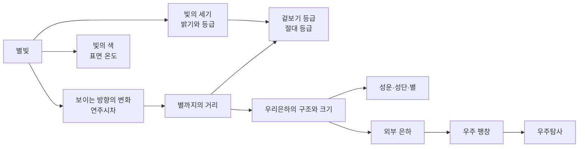

# 중2-8. 별과 우주 — 별빛 한 줄기에 담긴 거리, 밝기, 온도
<!-- prev: m1-07, m2-03 -->
<!-- next: 2-1, 5-4, earth-3, astro-1, astro-2, astro-3 -->

> [!NOTE]
> **성취기준**
> - **[9과15-01]** 연주시차를 이용하여 별까지의 거리를 구할 수 있고, 별의 등급과 밝기의 관계 및 표면 온도와 색의 관계를 설명할 수 있다.
> - **[9과15-02]** 우리은하의 구조와 크기를 이해하고, 성운과 성단의 특징을 비교할 수 있다.
> - **[9과15-03]** 모형을 이용하여 우주가 팽창하고 있음을 설명할 수 있다.
> - **[9과15-04]** 우주탐사의 의의와 인류에게 미치는 영향을 조사하여 과학의 유용성을 인식할 수 있다.

**학습 목표**

1. 연주시차의 뜻을 알고, 연주시차가 클수록 별이 가깝다는 관계로 별까지의 거리를 비교하고 구할 수 있다.
2. 별의 밝기가 거리에 따라 달라짐을 알고, 등급과 밝기의 관계, 겉보기 등급과 절대 등급의 차이를 설명할 수 있다.
3. 별의 색을 이용하여 별의 표면 온도를 비교할 수 있다.
4. 우리은하의 모양과 크기, 태양계의 위치를 설명하고, 성운과 성단의 종류와 특징을 비교할 수 있다.
5. 풍선 모형을 이용하여 우주가 팽창하고 있음을 설명할 수 있다.
6. 우주탐사의 역사와 성과를 조사하고, 우주탐사가 인류 생활에 미치는 영향을 설명할 수 있다.

**이 단원의 학습 사다리**

| 단계 | 무엇을 하나? |
|---|---|
| STEP 1. 이전 학습 다시 보기 | 초등학교 '밤하늘 관찰', 중1 「태양계」, 중2 「빛과 파동」을 다시 꺼낸다 |
| STEP 2. 기초 다지기 | 각도의 단위(도, 분, 초), 우주의 거리 단위, 빛의 세기와 거리라는 디딤돌을 놓는다 |
| STEP 3. 핵심 개념 | 연주시차 → 밝기와 등급 → 색과 온도 → 우리은하·성운·성단 → 우주 팽창 → 우주탐사 |
| STEP 4. 오개념 바로잡기 | "밝게 보이는 별이 진짜 밝은 별이다?" 같은 착각을 바로잡는다 |
| STEP 5. 다음 단계로 | 통합과학의 스펙트럼과 빅뱅, 지구과학·행성우주과학의 H-R도와 허블-르메트르 법칙 |
| STEP 6. 생활·산업·진로 | 인공위성 서비스, 우주 망원경, 우리나라의 발사체와 달 탐사 |

---

## 🗺️ 단원 들어가기

맑은 밤, 도시를 벗어나 하늘을 올려다보면 수많은 별이 반짝인다. 어떤 별은 밝고, 어떤 별은 희미하다. 어떤 별은 푸르스름하고, 어떤 별은 붉은빛이 돈다. 그런데 우리는 별에 한 번도 가 본 적이 없다. 태양을 빼면 가장 가까운 별까지도 빛의 속도로 4년이 넘게 걸린다.

그렇다면 천문학자들은 별까지의 **거리**를, 별의 **진짜 밝기**를, 별 표면의 **온도**를 어떻게 알아냈을까? 답은 모두 **별빛**에 있다. 지구가 태양 주위를 도는 동안 별이 보이는 방향이 아주 조금 바뀌는 것, 별빛의 세기, 별빛의 색깔. 이 단원에서는 이 세 가지 단서로 별을 알아내고, 별들이 모인 **우리은하**, 은하들이 서로 멀어지는 **팽창하는 우주**, 그리고 그 우주로 나아가는 인류의 **우주탐사**까지 살펴본다.

---

## STEP 1. 🔙 이전 학습 다시 보기

### 연계 개념표

| 이전 단원·성취기준 | 그때 배운 것 | 이 단원에서 확장되는 것 |
|---|---|---|
| 초등 3~4학년 '밤하늘 관찰' | 밤하늘의 별과 별자리, 북극성 찾기, 행성과 별의 차이 | 별의 **거리, 밝기, 색**을 과학적으로 측정하고 비교한다 |
| 중1 「태양계」 [9과07-01] | 태양, 행성, 왜소행성, 소행성, 위성, 혜성 | 태양도 수많은 별 중 하나이며, 태양계는 **우리은하**의 작은 일부이다 |
| 중1 「태양계」 [9과07-03] | 지구 공전에 의해 계절마다 보이는 별자리가 달라진다 | 지구 공전 때문에 가까운 별의 방향이 조금 달라지는 **연주시차**가 생긴다 |
| 중2 「빛과 파동」 [9과10-03] | 물체의 색은 물체가 반사하는 빛의 색이다. 빛의 합성 | 별은 스스로 빛을 내며, 별빛의 색은 별 표면의 **온도**를 알려 준다 |

### 준비 운동 (사전 진단)

**Q1.** 다음 중 스스로 빛을 내는 천체를 고르시오. ① 달 ② 금성 ③ 태양 ④ 핼리 혜성의 핵

**Q2.** 겨울철 저녁에는 오리온자리가 잘 보이고, 여름철 저녁에는 잘 보이지 않는다. 그 까닭은 지구의 자전과 공전 중 무엇 때문인가?

**Q3.** 한쪽 눈을 감고 팔을 뻗어 엄지손가락을 세운 뒤, 감은 눈을 바꾸어 보면 엄지손가락이 어떻게 보이는가?

**Q4.** 손전등에 가까이 있을 때와 멀리 있을 때, 손전등의 불빛은 어느 쪽이 더 밝게 보이는가?

정답 및 해설

**Q1. ③** 달, 행성, 혜성은 태양 빛을 반사하여 빛난다. 별(항성)인 태양만 스스로 빛을 낸다.

**Q2. 공전** — 지구가 태양 주위를 돌면서 밤에 향하는 우주 쪽이 바뀌기 때문이다. 이 단원의 연주시차도 지구의 **공전** 때문에 생긴다.

**Q3.** 엄지손가락이 배경에 대해 **옆으로 움직인 것처럼** 보인다. 관측하는 위치가 달라지면 물체의 방향이 다르게 보이는 이 현상이 **시차**이다.

**Q4.** 가까이 있을 때 더 밝다. 같은 광원이라도 **멀어질수록 어둡게** 보인다.

---

## STEP 2. 🧱 기초 다지기

### ① 아주 작은 각도: 도, 분, 초

별의 방향 변화는 매우 작아서 '도(°)'로는 나타내기 어렵다. 그래서 더 작은 단위를 쓴다.

$$
1^\circ = 60' \;(\text{분}), \qquad 1' = 60'' \;(\text{초}), \qquad 1^\circ = 3600''
$$

1″(1초)는 1°를 3600개로 나눈 것 중 하나이다. 약 4 km 떨어진 곳에 놓인 2 cm 크기의 물체가 보이는 정도의 아주 작은 각도이다.

> [!TIP]
> 💡 **비유** — 시계에서 1시간을 60분, 1분을 60초로 나누듯이, 각도도 1°를 60′, 1′를 60″로 나눈다. 이름도 같다. 다만 시간이 아니라 **각도의 분·초**라는 것을 기억하자.

### ② 우주의 거리 단위

우주는 너무 넓어서 km로 나타내면 숫자가 너무 커진다.

| 단위 | 뜻 | 크기 (어림) |
|---|---|---|
| **광년(light-year, ly)** | 빛이 1년 동안 가는 거리 | 약 9조 5천억 km |
| **파섹(parsec, pc)** | 연주시차가 1″인 별까지의 거리 | 약 3.26광년 (약 31조 km) |

빛은 1초에 약 30만 km를 간다. 빛이 태양에서 지구까지 오는 데는 약 8분 20초, 가장 가까운 별(프록시마 센타우리)에서 오는 데는 약 4.2년이 걸린다. 즉, 우리가 보는 별빛은 **과거에 출발한 빛**이다.

### ③ 빛의 세기는 거리에 따라 줄어든다

손전등 빛이 사방으로 퍼져 나간다고 생각해 보자. 거리가 2배가 되면 같은 빛이 가로·세로 각각 2배인 넓이, 즉 **4배의 넓이**에 퍼진다. 그래서 같은 넓이에 닿는 빛의 양은 $\frac{1}{4}$이 된다.

| 광원으로부터의 거리 | 1배 | 2배 | 3배 | 10배 |
|---|---|---|---|---|
| 빛이 퍼지는 넓이 | 1배 | 4배 | 9배 | 100배 |
| 같은 넓이에서 받는 빛의 세기(밝기) | 1 | $\frac{1}{4}$ | $\frac{1}{9}$ | $\frac{1}{100}$ |

<!-- fig:m2-08-light-spread -->

> [!TIP]
> 💡 **비유** — 같은 양의 버터를 작은 빵 한 조각에 바르면 두껍게, 큰 빵 네 조각에 바르면 얇게 발린다. 버터(빛)의 총량은 같지만, 넓게 퍼질수록 한 곳에 닿는 양이 줄어든다.

---

## STEP 3. 📘 핵심 개념

### ① 연주시차로 별까지의 거리 구하기

#### 시차와 연주시차

STEP 1의 Q3처럼 관측 위치가 달라질 때 물체의 방향이 달라져 보이는 각도를 **시차(parallax)** 라 한다. 엄지손가락을 눈에 가까이 할수록 시차가 크고, 멀리 할수록 시차가 작다.

지구는 태양 주위를 공전하므로 6개월마다 태양 반대편으로 옮겨 간다. 가까운 별을 6개월 간격으로 관측하면, 그 별은 멀리 있는 배경 별들에 대해 **위치가 조금 달라져 보인다.** 이때 두 관측 방향 사이 각도(시차)의 **절반**을 **연주시차(annual parallax)** 라 한다.

| 연주시차를 측정하는 순서 |
|---|
| 1. 어떤 가까운 별과 그 주변의 아주 먼 별들(배경)을 사진으로 찍는다 |
| 2. 6개월 뒤, 지구가 공전 궤도의 반대편에 있을 때 같은 하늘을 다시 찍는다 |
| 3. 두 사진을 겹쳐 가까운 별이 배경에 대해 움직인 각도(시차)를 잰다 |
| 4. 그 각도의 절반이 연주시차이다 |

> [!NOTE]
> 연주시차가 생긴다는 것은 **지구가 공전한다는 증거**이다. 지구가 움직이지 않는다면 별의 방향은 1년 내내 변하지 않을 것이다.

#### 연주시차와 거리의 관계

엄지손가락 실험에서 본 것처럼, **가까운 별일수록 연주시차가 크고, 먼 별일수록 연주시차가 작다.** 연주시차와 거리는 **반비례** 관계이다.

| 연주시차 | 1″ | 0.5″ | 0.2″ | 0.1″ | 0.01″ |
|---|---|---|---|---|---|
| 별까지의 거리 | 1 pc | 2 pc | 5 pc | 10 pc | 100 pc |

연주시차가 1″인 별까지의 거리를 1 pc으로 정했으므로, 연주시차가 $\frac{1}{2}$이 되면 거리는 2배, $\frac{1}{10}$이 되면 거리는 10배가 된다.

<!-- sim:parallax -->

#### 예제 1 — 연주시차로 거리 비교하기

별 A의 연주시차는 0.4″, 별 B의 연주시차는 0.1″이다.
(1) 더 가까운 별은? (2) B는 A보다 몇 배 멀리 있는가? (3) B까지의 거리는 몇 pc인가?

**풀이**
(1) 연주시차가 큰 **A**가 더 가깝다.
(2) B의 연주시차는 A의 $\frac{1}{4}$이므로, B는 A보다 **4배** 멀다.
(3) 연주시차가 1″의 $\frac{1}{10}$이므로 거리는 1 pc의 10배인 **10 pc**이다. (A는 2.5 pc)

#### 연주시차의 한계

가장 가까운 별 프록시마 센타우리의 연주시차도 약 0.77″로 1″보다 작다. 별이 멀어질수록 연주시차는 너무 작아져서 측정하기 어렵다. 그래서 연주시차로는 **비교적 가까운 별**까지의 거리만 구할 수 있다. 지구 대기의 흔들림이 없는 **우주 망원경**을 쓰면 훨씬 먼 별의 연주시차도 잴 수 있다.

### ② 별의 밝기와 등급

#### 등급: 밝기를 나타내는 숫자

약 2000여 년 전, 그리스의 천문학자 히파르코스는 맨눈으로 보이는 가장 밝은 별을 1등급, 가장 어두운 별을 6등급으로 정했다. 오늘날에는 밝기를 정밀하게 측정하여 다음과 같이 정리한다.

- **등급이 작을수록 밝은 별**이다. 1등급보다 밝으면 0등급, −1등급처럼 0이나 음수로 나타낸다.
- **1등급인 별은 6등급인 별보다 약 100배 밝다.** (5등급 차이 = 100배)
- **1등급 차이는 약 2.5배**의 밝기 차이이다. ($2.5^5 \approx 100$)

| 등급 차이 | 1 | 2 | 3 | 5 | 10 |
|---|---|---|---|---|---|
| 밝기 차이 (약) | 2.5배 | 6.3배 | 16배 | 100배 | 10000배 |

> [!TIP]
> 💡 **기억 요령** — 등급은 **달리기 순위**와 같다. 1등이 2등보다 빠르듯이 1등급이 2등급보다 밝다. 다만 별의 등급에는 '0등', '−1등'처럼 1등보다 더 앞선 순위도 있다.

#### 예제 2 — 등급과 밝기

(1) 2등급인 별과 7등급인 별의 밝기는 몇 배 차이가 나는가?
(2) −1등급인 시리우스는 1등급인 별보다 약 몇 배 밝은가?

**풀이**
(1) 등급 차이가 $7 - 2 = 5$이므로 2등급인 별이 약 **100배** 밝다.
(2) 등급 차이가 $1 - (-1) = 2$이므로 약 $2.5 \times 2.5 \approx 6.3$, 약 **6배** 밝다.

#### 겉보기 등급과 절대 등급

밤하늘에서 밝게 보이는 별이 정말 많은 빛을 내는 별일까? 아니다. 가까이 있는 촛불이 멀리 있는 가로등보다 밝아 보일 수 있듯이, 우리 눈에 보이는 밝기는 별이 내는 빛의 양과 **거리**에 함께 달려 있다. 그래서 등급을 두 가지로 나눈다.

| 구분 | **겉보기 등급(apparent magnitude)** | **절대 등급(absolute magnitude)** |
|---|---|---|
| 뜻 | 지구에서 **눈에 보이는 대로** 정한 등급 | 모든 별이 **10 pc 거리에 있다고 가정**했을 때의 등급 |
| 무엇을 알 수 있나? | 우리 하늘에서 얼마나 밝게 보이는가 | 별이 실제로 **얼마나 많은 빛을 내는가** |
| 거리의 영향 | 받는다 | 받지 않는다 (모두 같은 거리로 맞추었으므로) |

| 별 | 겉보기 등급 (약) | 절대 등급 (약) | 거리 (약) |
|---|---|---|---|
| 태양 | −26.7 | +4.8 | 지구에서 1억 5천만 km |
| 시리우스 | −1.5 | +1.4 | 2.6 pc |
| 직녀성(베가) | 0.0 | +0.6 | 7.7 pc |
| 북극성 | +2.0 | −3.6 | 약 130 pc |

태양은 겉보기 등급으로는 하늘에서 압도적으로 밝지만, 10 pc 거리로 옮기면 약 4.8등급으로 맨눈에 겨우 보이는 평범한 별이 된다. 반대로 북극성은 하늘에서 그다지 밝지 않지만, 실제로는 태양보다 훨씬 많은 빛을 내는 별이다.

#### 등급으로 거리 비교하기

| 겉보기 등급과 절대 등급의 비교 | 별까지의 거리 |
|---|---|
| 겉보기 등급 = 절대 등급 | 10 pc에 있다 |
| 겉보기 등급 < 절대 등급 (겉보기로 더 밝다) | 10 pc보다 **가깝다** |
| 겉보기 등급 > 절대 등급 (겉보기로 더 어둡다) | 10 pc보다 **멀다** |

'겉보기 등급 − 절대 등급' 값이 클수록 멀리 있는 별이다. 위 표에서 이 값은 시리우스 약 −2.9, 직녀성 약 −0.6, 북극성 약 +5.6이므로 북극성이 가장 멀다.

#### 예제 3 — 거리가 10배가 되면

절대 등급이 +3인 별이 실제로는 100 pc 거리에 있다. 이 별의 겉보기 등급을 추리하시오.

**풀이** 이 별을 10 pc에서 100 pc으로 옮기면 거리가 10배가 된다. STEP 2의 표에서 거리가 10배이면 밝기는 $\frac{1}{100}$이 되고, 밝기 $\frac{1}{100}$은 **5등급 차이**이다. 어두워지면 등급 숫자는 커지므로 겉보기 등급은 $3 + 5 = $ **+8등급**이다. 맨눈으로는 보이지 않는 별이다.

### ③ 별의 색과 표면 온도

#### 별의 색은 온도를 알려 준다

대장간에서 쇠를 달구면 처음에는 붉게, 더 뜨거워지면 노랗게, 아주 뜨거워지면 희게 빛난다. 이처럼 스스로 빛을 내는 뜨거운 물체는 **온도에 따라 빛의 색이 달라진다.** 별도 마찬가지이다.

| 별의 색 | 파란색 | 청백색 | 흰색 | 황백색 | 노란색 | 주황색 | 붉은색 |
|---|---|---|---|---|---|---|---|
| 표면 온도 순서 | 1 (가장 높다) | 2 | 3 | 4 | 5 | 6 | 7 (가장 낮다) |
| 예 | 맨눈으로 보이는 별 중에는 드물다 | 리겔, 스피카 | 시리우스, 직녀성 | 프로키온 | 태양 | 아크투루스 | 베텔게우스, 안타레스 |

> [!IMPORTANT]
> **파란색 별일수록 표면 온도가 높고, 붉은색 별일수록 표면 온도가 낮다.** 일상에서는 빨강을 '뜨거움', 파랑을 '차가움'으로 표시하지만(수도꼭지의 온수·냉수 표시), 별에서는 **반대**이다.

#### 예제 4 — 오리온자리의 두 별

겨울철 별자리 오리온자리에는 붉은색의 베텔게우스와 청백색의 리겔이 있다.
(1) 표면 온도가 더 높은 별은? (2) 태양(노란색)과 비교하면 각각 온도가 높은가, 낮은가?

**풀이**
(1) 청백색인 **리겔**의 표면 온도가 더 높다.
(2) 리겔은 태양보다 **높고**, 베텔게우스는 태양보다 **낮다.**

> [!TIP]
> 스마트폰 카메라로 별을 찍거나 쌍안경으로 보면 맨눈으로 볼 때보다 별의 색 차이가 더 잘 드러난다. 겨울철 오리온자리는 색 비교 관찰에 좋은 별자리이다.

### ④ 우리은하와 성운·성단

#### 은하와 우리은하

수많은 별과 성간 물질(가스와 티끌) 등이 모여 이룬 거대한 천체 집단을 **은하(galaxy)** 라 하고, 태양계가 속한 은하를 **우리은하(Milky Way Galaxy)** 라 한다. 우리은하 밖에 있는 은하는 **외부 은하**라고 부른다.

| 우리은하를 보는 방향 | 모양 |
|---|---|
| 위에서 본 모양 | 중심부에 막대 모양 구조가 있고, 그 끝에서 나선팔이 휘감겨 나온 **막대 나선 모양** |
| 옆에서 본 모양 | 중심부가 볼록한 **얇은 원반** 모양 |

| 우리은하의 크기와 구성 | 내용 |
|---|---|
| 지름 | 약 10만 광년 (약 30 kpc) |
| 별의 수 | 약 수천억 개 |
| 태양계의 위치 | 은하 중심에서 약 2만 6천~3만 광년 떨어진 **나선팔** 부근 (중심이 아니다) |
| 구조 | 중심부(팽대부), 별과 성간 물질이 많은 **원반**, 원반을 둥글게 감싼 **헤일로** |

<!-- sim:milky-way -->

#### 은하수: 안에서 본 우리은하

맑은 밤하늘에 희뿌연 띠처럼 보이는 **은하수**는 우리은하의 **원반**을 그 안쪽에서 바라본 모습이다. 원반 방향으로는 별이 많이 겹쳐 보이므로 띠가 된다.

- 우리나라에서는 **여름철**에 은하수가 더 넓고 밝게 보인다. 여름철 밤하늘의 궁수자리 방향에 **우리은하의 중심**이 있기 때문이다.
- 은하수 중간중간 검게 끊어진 부분은 별이 없어서가 아니라, 성간 티끌이 뒤쪽 별빛을 **가리기** 때문이다.

> [!TIP]
> 💡 **비유** — 우리은하는 커다란 **원반 모양 접시** 위에 쌀알(별)을 뿌려 놓은 것과 같다. 접시 위의 한 쌀알(태양)에서 둘러보면, 접시 면 방향으로는 쌀알이 띠처럼 촘촘히 보이고, 접시 위아래 방향으로는 듬성듬성 보인다. 접시의 중심 쪽을 바라볼 때 가장 촘촘하다.

#### 예제 5 — 은하수가 띠로 보이는 까닭

우리은하가 원반 모양이 아니라 공 모양이고 태양계가 그 중심에 있다면, 밤하늘의 별은 어떻게 보일지 추리하시오.

**풀이** 공 모양 은하의 중심에서는 어느 방향을 보아도 별이 비슷하게 많으므로, 띠 모양의 은하수는 보이지 않고 **온 하늘에 별이 고르게** 퍼져 보일 것이다. 실제로 은하수가 **띠 모양**이고 한쪽 방향(궁수자리)이 특히 밝다는 사실은 우리은하가 **원반 모양**이고 태양계가 **중심에서 벗어난 곳**에 있다는 증거가 된다.

#### 성운

**성운(nebula)** 은 성간 물질(가스와 티끌)이 많이 모여 구름처럼 보이는 천체이다.

| 종류 | 특징 | 색깔 | 예 |
|---|---|---|---|
| **방출 성운** | 가까운 뜨거운 별의 에너지를 받아 성운의 가스가 **스스로 빛을 낸다** | 주로 붉은색 | 오리온 대성운, 장미 성운 |
| **반사 성운** | 주변 별빛을 **반사**하여 밝게 보인다 | 주로 파란색 | 플레이아데스 성단 주변의 성운 |
| **암흑 성운** | 뒤에서 오는 별빛을 **가려** 어둡게 보인다 | 검은색 | 말머리 성운 |

성운은 별이 태어나는 곳이기도 하다. 성운 속 가스와 티끌이 중력으로 뭉치면 새로운 별이 만들어진다.

#### 성단

**성단(star cluster)** 은 같은 성운에서 비슷한 시기에 태어난 별들이 무리를 이룬 것이다.

| 구분 | **산개 성단(open cluster)** | **구상 성단(globular cluster)** |
|---|---|---|
| 모양 | 별들이 **듬성듬성** 흩어져 있다 | 별들이 **공 모양**으로 빽빽하게 모여 있다 |
| 별의 수 | 수십~수천 개 | 수만~수백만 개 |
| 별의 색과 온도 | 주로 **파란색**(표면 온도가 높은 별이 많다) | 주로 **붉은색**(표면 온도가 낮은 별이 많다) |
| 별의 나이 | 비교적 **젊다** | 매우 **늙었다** |
| 우리은하에서의 위치 | 주로 **원반(나선팔)** | 주로 **헤일로와 중심부** |
| 예 | 플레이아데스 성단(좀생이별), 히아데스 성단 | 헤르쿨레스자리 구상 성단(M13), 오메가 센타우리 |

> [!TIP]
> 💡 **비유** — 산개 성단은 **놀이터에 흩어져 노는 어린 아이들**, 구상 성단은 **강당에 빽빽이 모인 나이 든 어르신들**로 기억하자. 젊은 무리는 퍼져 있고 파랗고, 늙은 무리는 뭉쳐 있고 붉다.

### ⑤ 팽창하는 우주

#### 우주에는 은하가 아주 많다

우리은하 밖에도 수많은 외부 은하가 있다. 가장 가까운 큰 외부 은하인 **안드로메다은하**는 약 250만 광년 떨어져 있으며, 맨눈으로도 희미하게 보인다. 관측 가능한 우주에는 수천억 개 이상의 은하가 있는 것으로 추정된다.

#### 은하들은 서로 멀어지고 있다

20세기 초 천문학자들은 멀리 있는 외부 은하들을 관측하여 **대부분의 은하가 우리은하로부터 멀어지고 있다**는 것을 알아냈다. 그렇다면 우리은하가 우주의 중심이라서 모두가 우리에게서 도망가는 것일까? 그렇지 않다. **우주 공간 자체가 팽창**하여, 모든 은하 사이의 거리가 서로 멀어지고 있기 때문이다.

#### 풍선 모형으로 우주 팽창 이해하기

| 풍선 모형 | 실제 우주 |
|---|---|
| 풍선의 표면 | 우주 공간 |
| 풍선에 붙인 스티커 | 은하 |
| 풍선을 부는 것 | 우주가 팽창하는 것 |
| 스티커 사이의 거리가 멀어진다 | 은하 사이의 거리가 멀어진다 |
| 스티커 자체의 크기는 변하지 않는다 | 은하 자체는 커지지 않는다 (중력으로 묶여 있다) |
| 어느 스티커에서 보아도 다른 스티커가 멀어진다 | 어느 은하에서 보아도 다른 은하가 멀어진다 |
| 풍선 표면 위에는 '중심'이 되는 스티커가 없다 | 우주 팽창에는 **특별한 중심이 없다** |

> [!IMPORTANT]
> 우주 팽창은 은하들이 한 점에서 **폭탄 파편처럼 날아가는 것이 아니다.** 은하가 공간 속을 달려가는 것이 아니라, 은하들 사이의 **공간 자체가 늘어나는 것**이다. 풍선 표면 위 개미에게는 풍선 표면 위 어디에도 중심이 없다.

<!-- fig:m2-08-balloon -->

#### 예제 6 — 풍선 모형 해석하기

풍선에 스티커 A, B, C를 차례로 붙였다. 풍선이 작을 때 A–B 거리는 2 cm, B–C 거리는 2 cm였다. 풍선을 불어 크기가 2배가 되었더니 A–B 거리는 4 cm, B–C 거리는 4 cm가 되었다.
(1) B에서 보면 A와 C는 어떻게 되었는가?
(2) A에서 보면 B와 C는 어떻게 되었는가?
(3) 이 모형에서 우주의 '중심'은 어디인가?

**풀이**
(1) A와 C 모두 B에서 **멀어졌다**(2 cm → 4 cm).
(2) A에서 보아도 B는 2 cm → 4 cm, C는 4 cm → 8 cm로 **모두 멀어졌다.**
(3) 어느 스티커에서 보아도 다른 스티커가 멀어지므로 **특별한 중심이 없다.** 우리은하에서 다른 은하들이 멀어지는 것처럼 보이는 것도 우리가 중심이어서가 아니다.

#### 시간을 거꾸로 돌리면 — 대폭발 우주론

우주가 팽창하고 있다면, 시간을 거꾸로 돌리면 과거의 우주는 지금보다 **작고 뜨겁고 빽빽했을** 것이다. 이처럼 우주가 아주 작고 뜨거운 상태에서 팽창하기 시작하여 지금에 이르렀다는 이론을 **대폭발 우주론(빅뱅 우주론)** 이라 한다. 오늘날 우주의 나이는 약 138억 년으로 추정된다.

### ⑥ 우주탐사 — 인류가 우주로 나아가다

#### 우주탐사의 역사

| 시기 | 주요 사건 |
|---|---|
| 1957년 | 구소련이 최초의 인공위성 **스푸트니크 1호** 발사 |
| 1961년 | 구소련의 가가린이 최초로 유인 우주 비행 |
| 1969년 | 미국의 **아폴로 11호**가 인류 최초로 달에 착륙 |
| 1977년 | **보이저 1호·2호** 발사, 목성·토성 등 외행성 탐사. 보이저 1호는 지금도 태양계 바깥쪽으로 날아가며 신호를 보낸다 |
| 1990년 | **허블 우주 망원경** 발사, 먼 은하와 성운을 선명하게 관측 |
| 1998년~ | 여러 나라가 함께 **국제 우주 정거장(ISS)** 을 짓고 운영 |
| 2021년 | **제임스 웹 우주 망원경** 발사, 적외선으로 아주 먼 우주를 관측 |

| 우리나라의 우주탐사 | 내용 |
|---|---|
| 1992년 | 우리나라 최초의 인공위성 **우리별 1호** 발사 |
| 2022년 6월 | 우리 기술로 개발한 발사체 **누리호**가 위성을 궤도에 올리는 데 성공 |
| 2022년 8월 | 우리나라 최초의 달 탐사선 **다누리** 발사, 같은 해 12월 달 궤도 진입 |
| 2024년 | 우주항공 정책을 담당하는 **우주항공청** 개청 |

#### 우주탐사의 방법

| 방법 | 설명 | 예 |
|---|---|---|
| 지상 망원경 | 땅에서 우주를 관측. 크게 만들 수 있지만 대기의 영향을 받는다 | 보현산 천문대, 대형 전파 망원경 |
| 우주 망원경 | 대기 밖에서 관측해 선명하다. 대기가 막는 빛(적외선, X선 등)도 관측 | 허블, 제임스 웹 우주 망원경 |
| 인공위성 | 지구 주위를 돌며 지구를 관측하거나 통신·위치 정보를 제공 | 기상 위성, 통신 위성, 위성 항법 시스템 |
| 탐사선 | 다른 천체로 직접 날아가 가까이에서 관측하거나 착륙 | 보이저, 다누리, 화성 탐사 로버 |
| 유인 우주 비행 | 사람이 직접 우주에 가서 실험·관측 | 아폴로, 국제 우주 정거장 |

#### 우주탐사가 인류에게 미치는 영향

| 구분 | 내용 |
|---|---|
| 과학 지식의 확장 | 태양계 천체의 실제 모습, 별과 은하의 탄생, 우주의 나이와 팽창 등 우주에 대한 이해가 넓어졌다 |
| 생활의 편리 | 위성으로 날씨를 예보하고, 위성 방송·통신을 하며, 위성 항법으로 길을 찾는다 |
| 기술의 파급 | 우주 환경을 견디기 위해 개발한 기술이 생활 제품으로 퍼졌다. 충격을 흡수하는 메모리폼, 귀에 대는 적외선 체온계 등이 우주 기술과 관련 있는 것으로 알려져 있다 |
| 지구를 지키기 | 인공위성으로 산불, 홍수, 빙하 변화, 미세먼지 등 지구 환경을 감시한다. 지구에 다가오는 소행성도 관측한다 |
| 생각해 볼 문제 | 많은 비용이 든다. 고장 난 위성과 로켓 파편 같은 **우주 쓰레기**가 늘어나 다른 위성과 충돌할 위험이 커지고 있다 |

> [!NOTE]
> 우주탐사는 '먼 우주를 아는 것'에 그치지 않는다. 일기 예보, 내비게이션, 해외 방송 생중계처럼 우리가 매일 쓰는 서비스가 우주 기술 위에서 돌아간다. 과학 지식이 실제 생활을 바꾸는, **과학의 유용성**을 잘 보여 주는 분야이다.

---

## STEP 4. ⚠️ 오개념 바로잡기

| 흔한 오개념 | 올바른 개념 | 왜 그럴까? |
|---|---|---|
| 밝게 보이는 별일수록 실제로 많은 빛을 내는 별이다 | 겉보기 밝기는 별이 내는 빛과 **거리**에 함께 달려 있다. 실제 밝기는 **절대 등급**으로 비교한다 | 태양은 겉보기로 가장 밝지만 절대 등급으로는 평범한 별이다 |
| 등급의 숫자가 클수록 밝은 별이다 | 등급의 숫자가 **작을수록** 밝다. 0등급, 음수 등급도 있다 | 히파르코스가 가장 밝은 별을 '1등급'으로 정한 데서 시작되었다 |
| 붉은 별이 파란 별보다 뜨겁다 | **파란 별이 더 뜨겁다** | 일상의 '빨강 = 뜨거움' 표시와 반대이다. 달군 쇠도 더 뜨거워지면 붉은색 → 노란색 → 흰색으로 바뀐다 |
| 연주시차가 클수록 별이 멀다 | 연주시차가 클수록 별이 **가깝다** | 엄지손가락을 눈 가까이 둘수록 두 눈으로 번갈아 볼 때 더 많이 움직여 보인다 |
| 은하수는 우리은하와 다른, 하늘에 있는 구름 같은 천체이다 | 은하수는 **우리은하의 원반을 안에서 본 모습**이다 | 원반 방향으로 수많은 별이 겹쳐 보여 희뿌연 띠가 된다 |
| 태양계는 우리은하의 중심에 있다 | 태양계는 중심에서 약 3만 광년 가까이 떨어진 **나선팔 부근**에 있다 | 은하수가 한쪽 방향(궁수자리)으로 더 밝은 것이 그 증거이다 |
| 모든 은하가 우리은하에서 멀어지므로 우리은하가 우주의 중심이다 | 우주 팽창에는 **중심이 없다.** 어느 은하에서 보아도 다른 은하가 멀어진다 | 풍선 위 어느 스티커에서 보아도 다른 스티커가 멀어지는 것과 같다 |

---

## STEP 5. 🎓 다음 단계로 한 걸음 더

> [!CAUTION]
> 이 절은 **중학교 교육과정 범위 밖의 심화 내용**으로 평가 대상이 아니다. "이 개념이 고등학교에서 어디까지 이어지는가"를 맛보기로 보여 주기 위한 내용이다. 특히 적색 편이, 허블 법칙, 가속 팽창은 중학교에서 다루지 않는다.

### 고등학교와의 연결

| 과목 | 단원 | 이어지는 내용 |
|---|---|---|
| 통합과학1 | 「빛의 스펙트럼과 우주 초기 원소」 | 별빛을 **스펙트럼**으로 나누어 원소를 알아내고, 빅뱅 우주에서 수소와 헬륨이 만들어진 과정 |
| 통합과학2 | 「태양 에너지와 에너지 전환」 | 태양이 빛나는 원리인 **수소 핵융합**과 지구로 오는 태양 에너지 |
| 지구과학 | 「태양계 천체와 별과 우주의 진화」 | 별의 분광형과 흑체 복사, **H-R도**, 질량에 따른 별의 진화, 허블-르메트르 법칙 |
| 행성우주과학 | 「우주탐사와 행성계」 | 탐사선의 성과, 케플러 법칙, 외계 행성 탐사 |
| 행성우주과학 | 「태양과 별의 관측」 | 시차와 밝기로 거리를 재는 여러 방법, 쌍성으로 별의 질량 구하기 |
| 행성우주과학 | 「은하와 우주」 | 성단의 나이와 거리, 은하의 회전과 암흑 물질, 적색 편이 탐사와 우주 거대 구조 |

### ① 연주시차와 거리를 식으로

중학교에서는 표와 반비례 관계로만 거리를 구했다. 고등학교에서는 이를 식으로 쓴다.

$$
d\,(\mathrm{pc}) = \frac{1}{p\,('')}
$$

또 겉보기 등급 $m$, 절대 등급 $M$, 거리 $d$ 사이에는 $m - M = 5\log d - 5$ 라는 관계가 있어서, 연주시차를 측정하기 어려운 먼 별도 절대 등급을 알면 거리를 구할 수 있다. STEP 3의 예제 3에서 "거리 10배 → 5등급 어두워짐"으로 추리한 것이 바로 이 식의 한 경우이다.

### ② 별의 색에서 온도 숫자로 — 분광형과 빈 법칙

지구과학에서는 별을 표면 온도에 따라 **O, B, A, F, G, K, M** 형으로 분류한다(O형이 가장 뜨겁다). 태양은 G형으로 표면 온도가 약 5800 K이다. 또 뜨거운 물체가 가장 강하게 내는 빛의 파장은 온도에 반비례한다는 **빈 변위 법칙**으로 별의 색에서 온도를 계산한다. 가로축에 표면 온도(또는 분광형), 세로축에 절대 등급을 놓은 **H-R도**를 그리면 별의 일생을 한눈에 볼 수 있다.

### ③ 우주가 팽창한다는 증거 — 적색 편이와 허블-르메트르 법칙

멀어지는 은하에서 오는 빛은 스펙트럼선이 원래 위치보다 **붉은색(파장이 긴) 쪽으로 밀려** 관측된다. 이것을 **적색 편이**라 한다. 1920년대 르메트르와 허블은 **멀리 있는 은하일수록 더 빨리 멀어진다**는 관계를 밝혔다(허블-르메트르 법칙). 풍선 모형에서 A로부터 2 cm 떨어진 B는 2 cm, 4 cm 떨어진 C는 4 cm만큼 멀어진 것이 바로 이 관계를 보여 준다. 1990년대 말에는 먼 초신성 관측으로 우주의 팽창 속도가 점점 **빨라지고 있다**(가속 팽창)는 사실이 밝혀졌다.

### ④ 별은 어떻게 빛날까?

별은 중심부에서 수소 원자핵이 융합하여 헬륨이 되는 **핵융합 반응**으로 에너지를 낸다. 질량이 큰 별일수록 더 뜨겁고 밝게 타며, 일생이 짧다. 그래서 젊은 산개 성단에는 파랗고 뜨거운 별이 남아 있고, 늙은 구상 성단에는 질량이 큰 별은 이미 일생을 마치고 붉은 별들이 주로 남아 있다. STEP 3에서 배운 성단의 색 차이가 별의 **진화**와 연결된다.

### 지금 vs 다음 단계

| 구분 | 중학교 2학년 (지금) | 고등학교 지구과학·행성우주과학 |
|---|---|---|
| 별까지의 거리 | 연주시차와 거리의 반비례(표) | $d = 1/p$, 거리 지수, 변광성·초신성으로 먼 거리 측정 |
| 별의 밝기 | 등급, 겉보기·절대 등급의 비교 | 광도, 등급과 광도의 로그 관계 |
| 별의 온도 | 색으로 비교 | 분광형, 흑체 복사, 빈 법칙, H-R도 |
| 은하 | 우리은하의 모양, 성운·성단 | 허블의 은하 분류, 은하 회전 곡선과 암흑 물질 |
| 우주 | 풍선 모형으로 팽창 이해 | 적색 편이, 허블-르메트르 법칙, 우주 배경 복사, 가속 팽창과 암흑 에너지 |

---

## STEP 6. 🏭 생활·산업·진로 연결

### 사례 1. 인공위성이 만드는 일상

- **원리** 지구 주위를 도는 인공위성은 높은 곳에서 넓은 지역을 한꺼번에 내려다보고, 전파로 지상과 신호를 주고받는다.
- **어디에 쓰이나** 기상 위성의 구름 사진으로 태풍 진로를 예측하고, 위성 항법 시스템으로 스마트폰 지도와 내비게이션이 위치를 알며, 통신 위성으로 바다 건너 경기를 생중계한다. 우리나라도 천리안 위성(정지 궤도 기상·해양·환경 관측), 아리랑 위성(지구 관측) 등을 운영하고 있다.

### 사례 2. 우주 망원경과 빛을 모으는 기술

- **원리** 별과 은하의 정보는 모두 빛에 담겨 있다. 망원경은 빛을 많이 모을수록 어두운 천체를 볼 수 있고, 대기 밖에서는 흔들림 없이 선명하게 볼 수 있다.
- **연결** 아주 약한 빛을 잡아내는 영상 센서, 빛을 정밀하게 모으는 거울 가공 기술은 의료 영상, 스마트폰 카메라, 반도체 검사 장비 등 지상 산업에도 쓰인다.

### 사례 3. 발사체와 달 탐사

- **원리** 로켓은 연료를 태운 가스를 뒤로 내뿜는 힘으로 위성을 우주로 올린다. 누리호처럼 여러 단으로 나누어 다 쓴 단을 떼어 내며 무게를 줄인다.
- **연결** 다누리는 달 궤도를 돌며 달 표면을 촬영하고 자원 분포 등을 조사하고 있다. 이렇게 얻은 자료는 앞으로의 달 착륙 탐사 계획에 쓰인다.

### 관련 진로와 학과

| 진로 | 하는 일 | 관련 학과 |
|---|---|---|
| 천문학자 | 별·은하·우주를 관측하고 연구 | 천문학, 천문우주학, 물리학 |
| 항공우주 엔지니어 | 로켓, 인공위성, 탐사선 설계·제작 | 항공우주공학, 기계공학 |
| 위성 자료 분석가 | 위성 영상으로 날씨·환경·재해 분석 | 대기과학, 지구시스템과학, 컴퓨터공학 |
| 광학 엔지니어 | 망원경, 카메라 렌즈, 영상 센서 개발 | 광학공학, 전자공학, 물리학 |
| 과학관 해설사·천문대 연구원 | 천체 관측 안내, 과학 대중화 | 천문학, 과학교육 |

---

## 🔬 탐구 활동

### 활동 A. 광원으로부터의 거리에 따른 빛의 세기 실험하기

**목표** 광원으로부터 거리가 멀어질 때 빛의 세기가 어떻게 줄어드는지 측정하고, 이를 별의 밝기와 연결한다.

**준비물** 작은 전구나 LED 광원(사방으로 빛이 퍼지는 것), 조도 센서(디지털 탐구 도구 또는 스마트폰 조도 측정 앱), 줄자, 어두운 방, 검은 천

**과정**
1. 어두운 방에서 광원을 켜고, 광원에서 10 cm 떨어진 곳에 조도 센서를 광원 쪽으로 향하게 놓는다.
2. 거리를 10 cm, 20 cm, 30 cm, 40 cm로 바꾸며 빛의 세기(조도, 단위 lx)를 측정한다.
3. 각 거리에서 3번씩 측정해 평균을 구한다.
4. 10 cm일 때의 값을 1로 놓고, 다른 거리의 값을 비율로 나타낸다.

**결과 기록**

| 거리 (cm) | 10 | 20 | 30 | 40 |
|---|---|---|---|---|
| 측정값 평균 (lx) | | | | |
| 10 cm 값에 대한 비율 | 1 | | | |
| 예상 비율 | 1 | $\frac{1}{4}$ | $\frac{1}{9}$ | $\frac{1}{16}$ |

**생각해 보기**
1. 거리가 2배, 3배가 될 때 빛의 세기는 어떻게 변하였는가? 예상 비율과 비교해 보자.
2. 측정값이 예상과 다르다면 그 까닭은 무엇일까? (방의 다른 빛, 광원의 크기 등)
3. 같은 빛을 내는 두 별이 있는데 하나가 다른 하나보다 10배 멀다면, 밝기는 몇 배 차이 나고 등급은 몇 등급 차이 날까?

### 활동 B. 천체 관측 프로그램으로 우리은하 탐색하고 우주탐사 계획 세우기

**목표** 천체 관측 프로그램으로 우리은하를 구성하는 천체를 찾아 비교하고, 이를 바탕으로 우주탐사 계획을 세운다.

**과정**
1. 천체 관측 프로그램(무료 플라네타륨 프로그램이나 앱)에서 관측 장소를 우리 지역으로, 날짜를 여름철과 겨울철 밤으로 각각 설정한다.
2. 은하수 표시를 켜고, 여름철과 겨울철 은하수의 폭과 밝기를 비교한다. 궁수자리 방향을 찾아본다.
3. 다음 천체를 찾아 특징을 기록한다: 오리온 대성운, 말머리 성운, 플레이아데스 성단, 헤르쿨레스자리 구상 성단(M13), 안드로메다은하.
4. 모둠별로 탐사하고 싶은 천체를 하나 골라 '우주탐사 계획서'를 쓴다: 탐사 목표(알고 싶은 것), 탐사 방법(망원경·탐사선·유인 탐사 중 선택과 까닭), 예상되는 어려움, 인류에게 줄 수 있는 도움.

**결과 기록**

| 천체 | 종류 (성운/성단/은하) | 색·모양의 특징 | 우리은하 안에 있는가? |
|---|---|---|---|
| 오리온 대성운 | | | |
| 말머리 성운 | | | |
| 플레이아데스 성단 | | | |
| M13 | | | |
| 안드로메다은하 | | | |

**생각해 보기**
1. 여름철 은하수가 겨울철보다 더 넓고 밝게 보이는 까닭은 무엇인가?
2. 산개 성단과 구상 성단을 프로그램에서 확대해 보고, 모양과 색의 차이를 비교해 보자.
3. 우리 모둠의 탐사 계획은 과학 지식과 생활에 각각 어떤 도움을 줄 수 있을까?

> [!WARNING]
> **안전 수칙** 실제 밤하늘을 관측할 때는 보호자나 선생님과 함께 밝고 안전한 장소에서 한다. 망원경이나 쌍안경으로 **절대 태양을 보지 않는다**(눈을 크게 다칠 수 있다). 실험용 전구는 뜨거워질 수 있으므로 손으로 만지지 않는다.

---

## ✅ 개념 확인 문제

### 기본

**1.** 연주시차에 대한 설명으로 옳은 것을 **모두** 고르시오.
ㄱ. 지구의 공전 때문에 나타난다. ㄴ. 가까운 별일수록 연주시차가 크다. ㄷ. 연주시차가 1″인 별까지의 거리는 1광년이다.

정답 및 해설

**정답 ㄱ, ㄴ**

ㄷ. 연주시차가 1″인 별까지의 거리는 **1 pc**(약 3.26광년)이다.

**2.** 연주시차가 0.25″인 별까지의 거리는 몇 pc인가?

정답 및 해설

**정답** 4 pc

연주시차와 거리는 반비례한다. 연주시차가 1″의 $\frac{1}{4}$이므로 거리는 1 pc의 4배인 4 pc이다.

**3.** 3등급인 별과 8등급인 별 중 어느 별이 몇 배 더 밝게 보이는가?

정답 및 해설

**정답** 3등급인 별이 약 100배 밝다.

등급이 작을수록 밝고, 5등급 차이는 약 100배의 밝기 차이이다.

**4.** 다음 별을 표면 온도가 높은 것부터 순서대로 쓰시오. (가) 노란색 별 (나) 붉은색 별 (다) 청백색 별 (라) 흰색 별

정답 및 해설

**정답** (다) → (라) → (가) → (나)

파란색에 가까울수록 표면 온도가 높고, 붉은색에 가까울수록 낮다.

**5.** 산개 성단과 구상 성단을 비교한 것으로 옳은 것은?
① 산개 성단은 주로 헤일로에 분포한다. ② 구상 성단은 주로 젊고 파란 별로 이루어진다. ③ 산개 성단은 구상 성단보다 별의 수가 많다. ④ 구상 성단은 별들이 공 모양으로 빽빽하게 모여 있다.

정답 및 해설

**정답 ④**

① 산개 성단은 주로 **원반(나선팔)** 에 분포한다. ② 구상 성단은 주로 **늙고 붉은** 별로 이루어진다. ③ 구상 성단의 별 수(수만~수백만 개)가 산개 성단(수십~수천 개)보다 훨씬 많다.

### 응용

**6.** 표는 별 A~C의 겉보기 등급과 절대 등급이다.

| 별 | 겉보기 등급 | 절대 등급 |
|---|---|---|
| A | 1 | 1 |
| B | 4 | −1 |
| C | −2 | 3 |

(1) 지구에서 가장 밝게 보이는 별은? (2) 실제로 가장 많은 빛을 내는 별은? (3) 10 pc보다 멀리 있는 별은? (4) 가장 가까운 별은?

정답 및 해설

**정답** (1) C (2) B (3) B (4) C

(1) 겉보기 등급이 가장 작은 C(−2)가 가장 밝게 보인다.
(2) 절대 등급이 가장 작은 B(−1)가 실제로 가장 밝다.
(3) 겉보기 등급 > 절대 등급인 별은 B($4 > -1$)이다. A는 두 값이 같으므로 정확히 10 pc에 있다.
(4) '겉보기 등급 − 절대 등급' 값은 A: 0, B: +5, C: −5이다. 값이 가장 작은 C가 가장 가깝다.

**7.** 절대 등급이 +2인 별이 지구에서 100 pc 떨어져 있다. 이 별의 겉보기 등급을 구하고, 그 과정을 설명하시오.

정답 및 해설

**정답** +7등급

절대 등급은 10 pc에서의 등급이다. 100 pc은 10 pc의 10배 거리이므로 밝기는 $\frac{1}{10 \times 10} = \frac{1}{100}$이 되고, 이는 5등급 차이이다. 어두워지므로 $2 + 5 = 7$, 겉보기 등급은 +7등급이다.

**8.** 풍선에 스티커를 붙이고 풍선을 불면서 스티커 사이의 거리를 측정하는 실험을 하였다. 이 모형에서 (1) 스티커와 풍선 표면은 각각 무엇을 나타내는가? (2) 점을 그리는 대신 스티커를 붙인 까닭은 무엇인가? (3) 이 모형으로 알 수 있는 우주 팽창의 특징 두 가지를 쓰시오.

정답 및 해설

**정답**
(1) 스티커 – 은하, 풍선 표면 – 우주 공간
(2) 펜으로 그린 점은 풍선과 함께 커지지만 스티커는 크기가 변하지 않는다. 우주가 팽창해도 **은하 자체의 크기는 커지지 않음**을 나타내기 위해서이다.
(3) ① 은하들 사이의 거리가 서로 멀어진다. ② 어느 은하에서 보아도 다른 은하들이 멀어지므로 팽창의 **중심이 없다.**

### 융합·서술형

**9. [관측 증거 추론]** 어떤 학생이 "밤하늘의 은하수가 띠 모양으로 보이고 여름철에 특히 밝은 것은, 우리은하의 모양과 태양계의 위치에 대한 증거가 된다."라고 말했다. 이 말이 옳은 까닭을 우리은하의 구조와 연결하여 서술하시오.

정답 및 해설

**예시 답안**
우리은하는 얇은 **원반 모양**이므로, 원반 안에 있는 지구에서 원반 방향을 보면 수많은 별이 겹쳐 보여 하늘을 가로지르는 **띠**가 되고, 원반에 수직인 방향을 보면 별이 적게 보인다. 만약 우리은하가 공 모양이었다면 띠가 아니라 온 하늘에 고르게 별이 퍼져 보였을 것이다. 또 은하수가 여름철 궁수자리 방향에서 특히 넓고 밝은 것은 그쪽에 별이 많은 **은하 중심**이 있다는 뜻이며, 태양계가 은하 중심이 아닌 **가장자리 쪽(나선팔 부근)** 에 있다는 증거가 된다.

**채점 포인트** ① 원반 모양 → 띠 ② 한쪽 방향이 밝음 → 중심이 그쪽에 있음 ③ 태양계는 중심에서 벗어나 있음

**10. [과학과 사회 연계]** 우리나라는 누리호 발사와 다누리 달 탐사에 많은 비용을 들였다. "그 돈을 지구의 문제를 푸는 데 써야 한다."라는 의견에 대해, 우주탐사가 인류에게 미치는 긍정적 영향과 해결해야 할 문제를 각각 하나 이상 들어 자신의 의견을 서술하시오.

정답 및 해설

**예시 답안**
우주탐사는 지구의 문제를 푸는 데도 도움이 된다. 기상 위성은 태풍과 집중 호우를 미리 알려 재해 피해를 줄이고, 지구 관측 위성은 산불, 가뭄, 빙하 변화 같은 기후변화의 증거를 감시한다. 위성 항법과 통신처럼 우리가 매일 쓰는 서비스도 우주 기술 덕분이며, 우주용으로 개발된 기술이 생활 제품으로 퍼지기도 한다. 반면 비용이 크고, 우주 쓰레기가 늘어 다른 위성과 충돌할 위험이 커지는 문제가 있다. 따라서 나는 우주탐사를 계속하되, 국제 협력으로 비용을 나누고 사용이 끝난 위성을 처리하는 규칙을 함께 만들어야 한다고 생각한다.

**채점 포인트** ① 구체적인 긍정적 영향(과학 지식, 생활, 지구 환경 감시 등) ② 해결할 문제(비용, 우주 쓰레기 등) ③ 근거를 갖춘 자신의 의견

---

## 📝 한눈에 정리

### 핵심 요약

- **연주시차**는 지구 공전 때문에 6개월 간격으로 관측한 별의 시차의 절반이다. 연주시차와 별까지의 거리는 **반비례**하며, 연주시차 1″인 별까지의 거리가 1 pc이다.
- 별의 밝기는 거리가 2배가 되면 $\frac{1}{4}$, 10배가 되면 $\frac{1}{100}$이 된다.
- **등급**이 작을수록 밝은 별이며, 1등급 차이는 약 2.5배, 5등급 차이는 100배의 밝기 차이이다.
- **겉보기 등급**은 눈에 보이는 밝기, **절대 등급**은 10 pc 거리에 두었을 때의 밝기이다. 겉보기 등급 − 절대 등급이 클수록 먼 별이다.
- 별의 색이 **파란색일수록 표면 온도가 높고, 붉은색일수록 낮다.**
- **우리은하**는 지름 약 10만 광년의 막대 나선 은하(옆에서 보면 원반)이며, 태양계는 중심에서 벗어난 나선팔 부근에 있다. 은하수는 우리은하의 원반을 안에서 본 모습이다.
- 성운은 방출·반사·암흑 성운으로, 성단은 젊고 파란 별이 흩어진 **산개 성단**과 늙고 붉은 별이 공 모양으로 모인 **구상 성단**으로 나뉜다.
- 우주는 **팽창**하고 있으며, 풍선 모형처럼 모든 은하 사이의 거리가 멀어지고 팽창의 중심은 없다.
- **우주탐사**는 우주에 대한 지식을 넓히고, 위성 서비스와 기술 파급으로 생활을 바꾸며, 지구 환경을 감시하는 데 도움을 준다.

### 핵심 용어

| 용어 | 뜻 |
|---|---|
| 시차 | 관측 위치가 달라질 때 물체의 방향이 달라져 보이는 각도 |
| 연주시차 | 지구 공전 궤도의 양 끝에서 별을 볼 때 생기는 시차의 절반 |
| 파섹(pc) | 연주시차가 1″인 별까지의 거리 (약 3.26광년) |
| 광년 | 빛이 1년 동안 가는 거리 |
| 겉보기 등급 | 지구에서 눈에 보이는 밝기로 정한 등급 |
| 절대 등급 | 별을 10 pc 거리에 두었다고 가정했을 때의 등급 |
| 우리은하 | 태양계가 속한 막대 나선 모양의 은하 |
| 은하수 | 우리은하의 원반을 지구에서 본 희뿌연 띠 |
| 성운 | 성간 물질이 모여 구름처럼 보이는 천체 (방출·반사·암흑 성운) |
| 산개 성단·구상 성단 | 젊은 별이 흩어져 모인 무리 / 늙은 별이 공 모양으로 빽빽하게 모인 무리 |
| 우주 팽창 | 우주 공간이 늘어나 은하 사이의 거리가 멀어지는 현상 |
| 대폭발 우주론 | 우주가 아주 작고 뜨거운 상태에서 팽창하여 지금에 이르렀다는 이론 |

### 다음 단원으로

이 단원에서는 별빛의 **밝기와 색**만으로 별을 알아냈다. 통합과학1 「빛의 스펙트럼과 우주 초기 원소」에서는 별빛을 무지개처럼 펼친 **스펙트럼**에서 별을 이루는 원소까지 읽어 내고, 우주 초기에 원소가 어떻게 만들어졌는지 알아본다. 통합과학2 「태양 에너지와 에너지 전환」에서는 태양이 빛나는 원리인 핵융합을, 지구과학과 행성우주과학에서는 별의 일생과 팽창하는 우주의 역사를 더 깊이 탐구한다. 중3에서는 먼저 「화학 반응의 규칙성」으로 물질의 세계를 다시 깊이 들여다본다.
