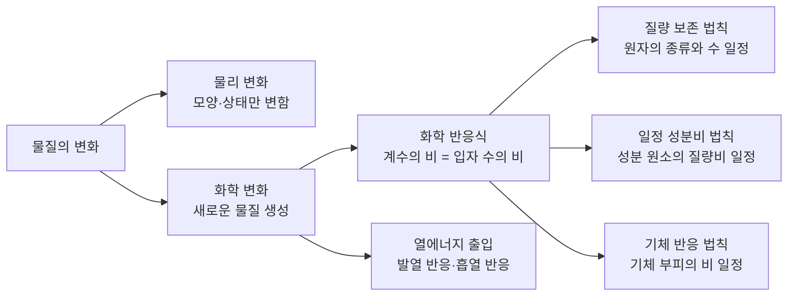

# 중3-1. 화학 반응의 규칙성 — 원자는 사라지지 않고 자리만 바꾼다
<!-- prev: m1-04, m1-06, m2-01, m2-04 -->
<!-- next: 4-3, 4-5, chem-1, matter-3 -->

> [!NOTE]
> **성취기준**
> - **[9과16-01]** 물리 변화와 화학 변화의 의미를 알고, 화학 변화에서 새로운 물질이 생성됨을 관찰할 수 있다.
> - **[9과16-02]** 간단한 화학 반응을 화학 반응식으로 표현하고, 화학 반응식에서 계수의 비를 입자 수의 비로 해석할 수 있다.
> - **[9과16-03]** 화학 반응에서 질량이 보존됨을 실험을 통해 추론할 수 있다.
> - **[9과16-04]** 화합물을 구성하는 성분 원소의 질량비가 일정함을 실험 자료를 해석하여 설명할 수 있다.
> - **[9과16-05]** 기체 반응에서 기체 부피 사이의 비가 일정함을 실험 자료를 해석하여 설명할 수 있다.
> - **[9과16-06]** 화학 반응에서 열에너지가 출입함을 알고, 생활 속 사례를 조사하여 발표할 수 있다.

**학습 목표**

1. 물리 변화와 화학 변화를 구별하고, 화학 변화에서 새로운 물질이 생기는 증거를 관찰하여 말할 수 있다.
2. 간단한 화학 반응을 화학 반응식으로 나타내고, 계수의 비를 입자 수의 비로 해석할 수 있다.
3. 화학 반응 전후에 원자의 종류와 수가 변하지 않아 질량이 보존됨을 실험으로 추론할 수 있다.
4. 실험 자료를 해석하여 화합물을 이루는 성분 원소의 질량비가 일정함을 설명할 수 있다.
5. 기체 반응 실험 자료에서 기체 부피 사이의 일정한 비를 찾고, 이를 분자 수의 비와 연결할 수 있다.
6. 화학 반응에서 열에너지가 방출되거나 흡수되는 생활 속 사례를 조사하여 발표할 수 있다.

**이 단원의 학습 사다리**

| 단계 | 무엇을 하나? |
|---|---|
| STEP 1. 이전 학습 다시 보기 | 초등 '물질의 연소', 중1 상태 변화·기체, 중2 원소·화학식을 다시 꺼낸다 |
| STEP 2. 기초 다지기 | 원자·분자 모형, 화학식 읽기, 비(比)와 비례식을 디딤돌로 놓는다 |
| STEP 3. 핵심 개념 | 물리 변화·화학 변화 → 화학 반응식 → 질량 보존 → 일정 성분비 → 기체 반응 → 열에너지 출입 |
| STEP 4. 오개념 바로잡기 | "타고 나면 질량이 사라진다?" 같은 착각을 바로잡는다 |
| STEP 5. 다음 단계로 | 통합과학의 산화·환원과 에너지 출입, 화학의 몰과 양적 관계, 엔탈피 |
| STEP 6. 생활·산업·진로 | 손난로·냉각 팩, 비료 공장, 화학 공정 설계, 관련 진로 |

---

## 🗺️ 단원 들어가기

캠프파이어에서 커다란 장작을 태우면 아침에는 한 줌의 재만 남는다. 장작의 질량은 어디로 사라졌을까? 반대로 반짝이던 철 못을 비 맞는 곳에 두면 붉은 녹이 슬면서 오히려 **무거워진다.** 하나는 가벼워지고 하나는 무거워졌는데, 과학자들은 두 경우 모두 "질량은 하나도 사라지거나 생기지 않았다"고 말한다. 어떻게 그럴 수 있을까?

또 하나의 질문. 물 분자는 언제나 $\mathrm{H_2O}$이다. 서울의 수돗물이든, 남극의 얼음이든, 화성에서 찾은 물이든 수소와 산소의 질량비는 언제나 같다. 왜 화합물은 '정해진 비율'로만 만들어질까?

이 단원에서는 이 모든 질문을 **"원자는 쪼개지지도, 새로 생기지도 않고 배열만 바뀐다"** 는 한 문장으로 풀어 본다.

---

## STEP 1. 🔙 이전 학습 다시 보기

### 연계 개념표

| 이전 단원·성취기준 | 그때 배운 것 | 이 단원에서 확장되는 것 |
|---|---|---|
| 초등 3~4학년 「물체와 물질」 | 물체는 여러 가지 물질로 만들어지고, 물질마다 성질이 다르다 | 물질이 다른 물질로 **바뀌는** 변화(화학 변화)를 구별한다 |
| 초등 5~6학년 「물질의 연소」 | 연소에는 탈 물질·산소·발화점 이상의 온도가 필요하고, 연소 후 물과 이산화 탄소가 생긴다 | 연소를 **화학 반응식**으로 쓰고, 연소 전후 질량을 비교한다 |
| 중1 「물질의 상태 변화」 [9과04-03], [9과04-04] | 상태 변화에서는 입자의 배열만 바뀌고, 열에너지를 흡수하거나 방출한다 | 상태 변화는 **물리 변화**, 화학 반응에서도 **열에너지가 출입**한다 |
| 중1 「기체의 성질」 [9과06-02], [9과06-03] | 기체의 부피는 압력과 온도에 따라 달라진다 | 기체 반응의 부피 비는 **같은 온도·압력**에서 비교해야 한다 |
| 중2 「물질의 특성」 [9과08-02] | 순물질은 성질이 일정하고, 혼합물은 성분 비율에 따라 성질이 달라진다 | 화합물(순물질)은 성분 원소의 **질량비가 일정**하다 |
| 중2 「물질의 구성」 [9과11-01], [9과11-04] | 원소와 화합물을 화학식으로 나타내고, 물질은 원자·분자·이온으로 존재한다 | 화학식을 이용해 **화학 반응식**을 쓰고, 반응을 원자의 재배열로 해석한다 |

### 준비 운동 (사전 진단)

**Q1.** 물이 끓어 수증기가 될 때 물 분자 자체가 수소와 산소로 쪼개진다. (O / X)

**Q2.** $\mathrm{CO_2}$ 분자 1개에 들어 있는 원자는 몇 종류, 모두 몇 개인가?

**Q3.** 초에 불을 붙이면 무엇이 새로 생기는가? 초등학교에서 배운 방법(석회수, 푸른색 염화 코발트 종이)을 떠올려 답해 보자.

정답 및 해설

**Q1. X** — 끓음은 상태 변화이다. 물 분자들 사이의 거리와 배열만 달라질 뿐, 물 분자는 그대로 $\mathrm{H_2O}$이다.

**Q2.** 2종류(탄소, 산소), 모두 3개(탄소 1개, 산소 2개)이다.

**Q3.** 물과 이산화 탄소가 생긴다. 이산화 탄소는 석회수를 뿌옇게 흐리게 하고, 물은 푸른색 염화 코발트 종이를 붉게 변화시킨다.

---

## STEP 2. 🧱 기초 다지기

### ① 원자와 분자를 '구슬'로 생각하기

중2에서 배운 것처럼 물질은 아주 작은 **원자(atom)** 로 이루어져 있고, 원자 몇 개가 결합하여 독립된 입자를 이룬 것을 **분자(molecule)** 라고 한다. 이 단원에서는 원자를 색깔 있는 구슬로 생각하면 편하다.

| 물질 | 화학식 | 구슬 모형으로 보면 |
|---|---|---|
| 수소 | $\mathrm{H_2}$ | 흰 구슬 2개가 붙은 한 덩어리 |
| 산소 | $\mathrm{O_2}$ | 빨간 구슬 2개가 붙은 한 덩어리 |
| 물 | $\mathrm{H_2O}$ | 빨간 구슬 1개에 흰 구슬 2개가 붙은 덩어리 |
| 이산화 탄소 | $\mathrm{CO_2}$ | 검은 구슬 1개 양옆에 빨간 구슬 2개 |
| 암모니아 | $\mathrm{NH_3}$ | 파란 구슬 1개에 흰 구슬 3개 |

> [!TIP]
> 💡 **비유** — 레고 블록을 떠올려 보자. 레고로 만든 자동차를 분해해서 로봇을 만들면 모양은 완전히 달라지지만, **블록의 종류와 개수는 그대로**이다. 화학 반응은 원자라는 블록을 떼었다 다시 붙이는 일이다.

### ② 화학식 읽기: 오른쪽 아래 숫자와 앞의 숫자

- 원소 기호 **오른쪽 아래 숫자**: 분자 1개 안에 그 원자가 몇 개 있는지. $\mathrm{H_2O}$ → H 2개, O 1개
- 화학식 **앞의 큰 숫자**: 그 분자가 몇 개인지. $2\mathrm{H_2O}$ → 물 분자 2개 (H는 모두 4개, O는 모두 2개)

| 표기 | 분자 수 | H 원자 수 | O 원자 수 |
|---|---|---|---|
| $\mathrm{H_2O}$ | 1 | 2 | 1 |
| $2\mathrm{H_2O}$ | 2 | 4 | 2 |
| $3\mathrm{O_2}$ | 3 | 0 | 6 |

### ③ 비(比)와 비례식

이 단원의 법칙은 모두 "**비가 일정하다**"는 내용이다. 비례식 $a : b = c : d$ 에서는 $a \times d = b \times c$ 이다.

예를 들어 구리와 산소가 $4 : 1$ 의 질량비로 결합한다면, 구리 12 g과 결합하는 산소의 질량 $x$는

$$
4 : 1 = 12 : x \quad\Rightarrow\quad 4x = 12 \quad\Rightarrow\quad x = 3\ \mathrm{g}
$$

> [!TIP]
> 💡 **요령** — 라면 1봉지에 물 500 mL가 필요하면 3봉지에는 1500 mL가 필요하다. '정해진 비율'을 지키는 요리법처럼, 화합물도 정해진 비율로만 만들어진다.

---

## STEP 3. 📘 핵심 개념

### ① 물리 변화와 화학 변화 — 새로운 물질이 생기는가?

**물리 변화(physical change)** 는 물질의 모양이나 상태만 바뀌고 물질의 고유한 성질은 변하지 않는 변화이다. 분자 자체는 그대로이고 분자의 배열이나 거리만 달라진다.

**화학 변화(chemical change)** 는 어떤 물질이 성질이 전혀 다른 **새로운 물질**로 바뀌는 변화이다. 이때 원자들이 결합을 끊고 새로운 짝을 지어 다른 분자를 만든다. 화학 변화가 일어나는 과정을 **화학 반응(chemical reaction)** 이라고 한다.

| 구분 | 물리 변화 | 화학 변화 |
|---|---|---|
| 새로운 물질 | 생기지 않는다 | 생긴다 |
| 물질의 성질 | 변하지 않는다 | 변한다 |
| 입자의 변화 | 분자의 배열·거리만 변한다 | 원자의 배열이 바뀌어 다른 분자가 생긴다 |
| 원자의 종류와 수 | 변하지 않는다 | 변하지 않는다 |
| 예 | 얼음이 녹음, 설탕이 물에 녹음, 유리컵이 깨짐, 종이 접기, 잉크 퍼짐(확산) | 종이가 탐, 철이 녹슮, 사과 단면이 갈색으로 변함, 우유가 상함, 김치가 시어짐 |

#### 화학 변화가 일어났다는 증거

화학 변화는 다음과 같은 현상으로 알아챌 수 있다.

| 증거 | 생활 속 예 |
|---|---|
| 빛과 열이 난다 | 가스레인지 불꽃, 폭죽 |
| 기체가 발생한다 | 베이킹파우더를 넣은 빵 반죽이 부풀어 오름, 발포 비타민을 물에 넣음 |
| 앙금(물에 잘 녹지 않는 고체)이 생긴다 | 석회수에 숨을 불어 넣으면 뿌옇게 흐려짐 |
| 색이 변한다 | 깎은 사과가 갈색으로 변함, 단풍(색소 변화) |
| 냄새나 맛이 변한다 | 우유가 상해 시큼한 냄새가 남 |

> [!WARNING]
> 증거는 '힌트'일 뿐 결정적인 기준은 아니다. 물이 끓을 때도 기포(기체)가 생기지만 이는 물리 변화이다. 최종 판단 기준은 언제나 **"성질이 다른 새로운 물질이 생겼는가?"** 이다.

#### 같은 물질, 다른 변화 — 양초의 예

| 장면 | 변화의 종류 | 이유 |
|---|---|---|
| 촛농이 녹아 흘러내린다 | 물리 변화 | 고체 → 액체로 상태만 변했다 |
| 흘러내린 촛농이 다시 굳는다 | 물리 변화 | 액체 → 고체로 상태만 변했다 |
| 심지 근처의 파라핀이 탄다 | 화학 변화 | 산소와 반응해 물과 이산화 탄소가 생겼다 |

#### 예제 1

다음 중 화학 변화를 모두 고르고, 그 이유를 쓰시오.
ㄱ. 드라이아이스의 크기가 점점 작아진다. ㄴ. 달걀을 삶으면 흰자가 하얗게 굳는다. ㄷ. 철 가루를 묻힌 손난로가 따뜻해진다. ㄹ. 물에 잉크를 떨어뜨리면 퍼져 나간다.

**풀이** ㄴ, ㄷ이 화학 변화이다. ㄴ은 흰자의 단백질이 열에 의해 성질이 다른 물질로 바뀌어 다시 투명해지지 않는다. ㄷ은 철이 산소와 반응해 산화 철이 생기면서 열이 난다. ㄱ은 고체가 기체로 되는 상태 변화(승화), ㄹ은 입자가 퍼지는 확산으로 물리 변화이다.

### ② 화학 반응식 — 반응을 기호로 쓰는 약속

화학 반응을 화학식과 기호를 사용하여 나타낸 식을 **화학 반응식(chemical equation)** 이라고 한다. 반응하는 물질을 **반응물(reactant)**, 새로 생기는 물질을 **생성물(product)** 이라고 한다.

$$
\underbrace{2\mathrm{H_2} + \mathrm{O_2}}_{\text{반응물}} \;\longrightarrow\; \underbrace{2\mathrm{H_2O}}_{\text{생성물}}
$$

#### 화학 반응식을 쓰는 3단계

| 단계 | 할 일 | 수소의 연소 예 |
|---|---|---|
| 1단계 | 반응물과 생성물을 말로 쓴다 | 수소 + 산소 → 물 |
| 2단계 | 화학식으로 바꾸고, 반응물은 왼쪽, 생성물은 오른쪽, 사이에 화살표 | $\mathrm{H_2 + O_2 \rightarrow H_2O}$ |
| 3단계 | 화살표 양쪽의 **원자의 종류와 수가 같아지도록** 화학식 앞에 계수를 붙인다(계수 1은 생략, 가장 간단한 정수비) | $\mathrm{2H_2 + O_2 \rightarrow 2H_2O}$ |

3단계에서 O 원자가 왼쪽 2개, 오른쪽 1개이므로 $\mathrm{H_2O}$ 앞에 2를 붙인다. 그러면 H가 오른쪽 4개가 되므로 $\mathrm{H_2}$ 앞에도 2를 붙인다.

> [!IMPORTANT]
> 계수를 맞출 때 **화학식의 오른쪽 아래 숫자를 바꾸면 안 된다.** $\mathrm{H_2O}$를 $\mathrm{H_2O_2}$로 고치면 물이 아니라 과산화 수소라는 전혀 다른 물질이 되어 버린다. 바꿀 수 있는 것은 분자의 **개수(계수)** 뿐이다.

#### 계수의 비 = 입자 수의 비

화학 반응식의 계수는 반응하거나 생성되는 **입자(분자)의 수의 비**를 나타낸다.

$$
2\mathrm{H_2} + \mathrm{O_2} \longrightarrow 2\mathrm{H_2O}
\qquad \text{분자 수의 비 } \;\; \mathrm{H_2} : \mathrm{O_2} : \mathrm{H_2O} = 2 : 1 : 2
$$

수소 분자 2개와 산소 분자 1개가 반응하면 물 분자 2개가 생긴다. 수소 분자 200개라면 산소 분자 100개와 반응하여 물 분자 200개가 생긴다.

| 반응 | 화학 반응식 | 분자 수의 비 |
|---|---|---|
| 메테인(도시가스 주성분)의 연소 | $\mathrm{CH_4 + 2O_2 \rightarrow CO_2 + 2H_2O}$ | $1 : 2 : 1 : 2$ |
| 암모니아 생성 | $\mathrm{N_2 + 3H_2 \rightarrow 2NH_3}$ | $1 : 3 : 2$ |
| 염화 수소 생성 | $\mathrm{H_2 + Cl_2 \rightarrow 2HCl}$ | $1 : 1 : 2$ |
| 마그네슘의 연소 | $\mathrm{2Mg + O_2 \rightarrow 2MgO}$ | $2 : 1 : 2$ (Mg는 원자, MgO는 입자 단위로 센다) |
| 과산화 수소의 분해 | $\mathrm{2H_2O_2 \rightarrow 2H_2O + O_2}$ | $2 : 2 : 1$ |

#### 예제 2

메테인의 연소 반응식 $\mathrm{CH_4 + 2O_2 \rightarrow CO_2 + 2H_2O}$ 에 대하여 답하시오.
(1) 반응 전후 H 원자 수와 O 원자 수가 같은지 확인하시오.
(2) 메테인 분자 30개가 모두 연소할 때 필요한 산소 분자 수와 생성되는 물 분자 수를 구하시오.

**풀이**
(1) H: 왼쪽 4개($\mathrm{CH_4}$), 오른쪽 $2 \times 2 = 4$개. O: 왼쪽 $2 \times 2 = 4$개, 오른쪽 $2 + 2 = 4$개. 모두 같다.
(2) 분자 수의 비 $\mathrm{CH_4} : \mathrm{O_2} : \mathrm{H_2O} = 1 : 2 : 2$ 이므로 산소 분자 60개, 물 분자 60개이다.

> [!TIP]
> 💡 **비유** — 화학 반응식은 '요리법'과 같다. "샌드위치 1개 = 빵 2장 + 햄 1장"이라면, 샌드위치 50개에는 빵 100장, 햄 50장이 필요하다. 계수는 재료를 '몇 개' 쓰는지 알려 주는 숫자이다.

### ③ 질량 보존 법칙 — 반응 전 질량 = 반응 후 질량

1770년대 프랑스의 과학자 **라부아지에(Lavoisier)** 는 밀폐된 용기에서 물질을 반응시키고 정밀하게 질량을 재어, 화학 반응 전후에 전체 질량이 변하지 않는다는 것을 밝혔다. 이것을 **질량 보존 법칙(law of conservation of mass)** 이라고 한다.

$$
\text{반응물의 전체 질량} = \text{생성물의 전체 질량}
$$

#### 왜 질량이 보존될까? — 원자의 관점

> [!IMPORTANT]
> 화학 반응이 일어날 때 물질을 구성하는 **원자의 배열만 변하고, 원자의 종류와 수는 변하지 않는다.** 원자 하나하나의 질량도 그대로이므로, 원자들의 질량을 모두 더한 전체 질량도 변하지 않는다.

수소의 연소를 구슬 모형으로 세어 보자.

| | 반응 전 ($\mathrm{2H_2 + O_2}$) | 반응 후 ($\mathrm{2H_2O}$) |
|---|---|---|
| H 원자 수 | 4 | 4 |
| O 원자 수 | 2 | 2 |
| 분자 수 | 3 | 2 |
| 전체 질량 | 같다 | 같다 |

분자 수는 3개에서 2개로 줄었지만 원자 수는 그대로이다. **질량을 결정하는 것은 분자 수가 아니라 원자의 종류와 수**이다.

<!-- sim:reaction-balance -->

#### 실험으로 확인하기 — 세 가지 반응

| 실험 | 반응 | 열린 용기에서 | 닫힌 용기에서 |
|---|---|---|---|
| 앙금 생성 반응 | 염화 나트륨 수용액 + 질산 은 수용액 → 염화 은(흰 앙금) + 질산 나트륨 수용액 | 질량 변화 없음 | 질량 변화 없음 |
| 기체 발생 반응 | 탄산 칼슘(달걀 껍데기·대리석) + 묽은 염산 → 염화 칼슘 + 물 + **이산화 탄소(기체)** | **감소** (기체가 빠져나감) | 질량 변화 없음 |
| 연소 반응 (강철솜) | 철 + 산소 → 산화 철 | **증가** (공기 중 산소가 결합) | 질량 변화 없음 |
| 연소 반응 (나무·종이) | 나무 + 산소 → 이산화 탄소 + 수증기 + 재 | **감소** (기체가 날아감) | 질량 변화 없음 |

앙금 생성 반응의 화학 반응식은 다음과 같다(↓는 앙금이 생겨 가라앉는다는 뜻이다).

$$
\mathrm{NaCl + AgNO_3 \rightarrow AgCl \downarrow + NaNO_3}
$$

> [!TIP]
> 💡 **생각의 핵심** — 열린 용기에서 질량이 '변한 것처럼' 보이는 것은 법칙이 깨진 것이 아니라 **저울 위에 올려놓지 않은 물질(공기 중 산소, 날아간 기체)** 이 반응에 참여했기 때문이다. 반응에 참여한 모든 물질을 저울 위에 올려놓으면(닫힌 용기) 질량은 언제나 보존된다.

<!-- fig:m3-01-open-closed -->

#### 예제 3

열린 비커에서 탄산 칼슘 10 g과 묽은 염산 100 g을 반응시켰더니, 반응이 끝난 뒤 비커 속 물질의 질량이 105.6 g이었다.
(1) 빠져나간 이산화 탄소의 질량은?
(2) 같은 실험을 뚜껑을 꼭 닫은 플라스틱 병에서 하면 반응 후 병 속 물질의 질량은 얼마로 측정되겠는가?

**풀이**
(1) 반응 전 질량 $10 + 100 = 110\ \mathrm{g}$. 줄어든 질량 $110 - 105.6 = 4.4\ \mathrm{g}$이 빠져나간 이산화 탄소의 질량이다.
(2) 기체가 빠져나가지 못하므로 110 g 그대로이다(병의 질량 제외).

#### 예제 4

마그네슘 리본 0.6 g을 공기 중에서 완전히 태웠더니 산화 마그네슘 1.0 g이 생겼다. 마그네슘과 반응한 산소의 질량은?

**풀이** 질량 보존 법칙에 의해 (마그네슘) + (산소) = (산화 마그네슘)이다. 산소의 질량 $= 1.0 - 0.6 = 0.4\ \mathrm{g}$. 연소 후 질량이 늘어난 것은 공기 중 산소가 결합했기 때문이다.

> [!WARNING]
> **실험 시 유의점 — 부력** 기체가 든 풍선이나 부풀어 오른 비닐봉지의 질량을 잴 때는 공기가 위로 떠받치는 힘(**부력**, 중1 「힘의 작용」)이 작용하여 저울의 눈금이 실제보다 작게 나올 수 있다. 예를 들어 닫힌 병 대신 풍선을 씌운 플라스크에서 기체가 발생하면 풍선이 부풀면서 부력이 커져 질량이 줄어든 것처럼 보일 수 있다. 질량 보존을 확인할 때는 **부피가 변하지 않는 단단한 닫힌 용기**를 쓰는 것이 좋다.

### ④ 일정 성분비 법칙 — 화합물은 정해진 비율로만 만들어진다

1799년 무렵 프랑스의 과학자 **프루스트(Proust)** 는 자연에서 얻은 탄산 구리와 실험실에서 만든 탄산 구리의 성분을 비교하여, 만든 방법과 관계없이 성분 원소의 질량비가 같다는 것을 밝혔다. 이처럼 **한 화합물을 구성하는 성분 원소 사이에는 항상 일정한 질량비가 성립한다.** 이를 **일정 성분비 법칙(law of definite proportions)** 이라고 한다.

#### 실험 자료 해석 — 구리의 연소

구리 가루를 공기 중에서 충분히 가열하면 붉은색 구리가 검은색 산화 구리(II)로 변한다($\mathrm{2Cu + O_2 \rightarrow 2CuO}$). 여러 모둠이 구리의 질량을 달리하여 얻은 자료이다.

| 모둠 | 구리의 질량(g) | 생성된 산화 구리(II)의 질량(g) | 결합한 산소의 질량(g) | 구리 : 산소 |
|---|---|---|---|---|
| 1 | 0.40 | 0.50 | 0.10 | $4 : 1$ |
| 2 | 0.80 | 1.00 | 0.20 | $4 : 1$ |
| 3 | 1.20 | 1.50 | 0.30 | $4 : 1$ |
| 4 | 1.60 | 2.00 | 0.40 | $4 : 1$ |

- 결합한 산소의 질량은 질량 보존 법칙으로 구한다: (산화 구리의 질량) − (구리의 질량)
- 구리의 질량을 가로축, 결합한 산소의 질량을 세로축에 그리면 **원점을 지나는 직선**이 된다. 즉, 결합하는 산소의 질량은 구리의 질량에 **비례**한다.
- 구리의 질량이 2배, 3배가 되면 산소도 2배, 3배가 결합하고, 비는 언제나 $4 : 1$ 이다.

<!-- fig:m3-01-copper-oxygen-graph -->

#### 여러 화합물의 성분 원소 질량비

| 화합물 | 화학식 | 성분 원소의 질량비 |
|---|---|---|
| 물 | $\mathrm{H_2O}$ | 수소 : 산소 = $1 : 8$ |
| 산화 구리(II) | $\mathrm{CuO}$ | 구리 : 산소 = $4 : 1$ |
| 산화 마그네슘 | $\mathrm{MgO}$ | 마그네슘 : 산소 = $3 : 2$ |
| 이산화 탄소 | $\mathrm{CO_2}$ | 탄소 : 산소 = $3 : 8$ |
| 암모니아 | $\mathrm{NH_3}$ | 질소 : 수소 = $14 : 3$ |

> [!IMPORTANT]
> 원자는 종류마다 질량이 정해져 있고, 화합물은 원자들이 **정해진 개수비**로 결합하여 만들어진다. 그래서 성분 원소의 질량비도 일정하다. 일정 성분비 법칙은 **화합물을 하나의 화학식(예: $\mathrm{H_2O}$)으로 일정하게 나타낼 수 있는 근거**이다.

#### 화합물과 혼합물의 차이

| 구분 | 화합물 (예: 물, 이산화 탄소) | 혼합물 (예: 설탕물, 공기) |
|---|---|---|
| 성분 비율 | 항상 일정하다 | 마음대로 바꿀 수 있다 |
| 성질 | 성분 원소와 전혀 다르다 (수소·산소는 기체, 물은 액체) | 성분 물질의 성질이 남아 있다 (설탕물은 달다) |
| 나타내는 방법 | 하나의 화학식 | 하나의 화학식으로 나타낼 수 없다 |

#### 예제 5 — 남는 물질 찾기

구리 8 g과 산소 3 g을 넣고 가열하여 한쪽이 모두 반응할 때까지 반응시켰다. (구리 : 산소 = $4 : 1$)
(1) 생성되는 산화 구리(II)의 질량은?
(2) 반응하지 않고 남는 물질과 그 질량은?

**풀이** 구리 8 g과 결합하는 산소는 $4 : 1 = 8 : x$ 에서 $x = 2\ \mathrm{g}$ 이다. 산소는 3 g이 있으므로 충분하다.
(1) 산화 구리(II) $= 8 + 2 = 10\ \mathrm{g}$
(2) 산소 $3 - 2 = 1\ \mathrm{g}$ 이 남는다.

> [!TIP]
> 💡 **비유** — 자전거 1대에 바퀴 2개, 몸체 1개가 필요하다. 바퀴 10개와 몸체 3개가 있으면 자전거는 3대만 만들 수 있고 바퀴 4개가 남는다. 화합물도 '정해진 조립 비율'이 있어서 한쪽이 남을 수 있다.

### ⑤ 기체 반응 법칙 — 기체의 부피도 간단한 정수비를 이룬다

1808년 무렵 프랑스의 과학자 **게이뤼삭(Gay-Lussac)** 은 기체끼리 반응하여 기체가 생성될 때, **같은 온도와 압력에서** 반응하는 기체와 생성되는 기체의 부피 사이에 간단한 정수비가 성립한다는 것을 발견하였다. 이를 **기체 반응 법칙(law of combining volumes)** 이라고 한다.

#### 실험 자료 해석 — 수소와 산소의 반응

같은 온도·압력에서 수소와 산소의 부피를 달리하여 반응시키고, 남은 기체를 조사한 결과이다(생성된 물은 수증기 상태로 유지되는 높은 온도에서 측정했다고 가정한다).

| 실험 | 수소(mL) | 산소(mL) | 남은 기체(mL) | 반응한 수소 : 산소 | 생성된 수증기(mL) |
|---|---|---|---|---|---|
| 1 | 20 | 10 | 없음 | $20 : 10 = 2 : 1$ | 20 |
| 2 | 40 | 10 | 수소 20 | $20 : 10 = 2 : 1$ | 20 |
| 3 | 40 | 30 | 산소 10 | $40 : 20 = 2 : 1$ | 40 |
| 4 | 60 | 30 | 없음 | $60 : 30 = 2 : 1$ | 60 |

넣어 준 양과 관계없이 **반응한 수소와 산소의 부피비는 항상 $2 : 1$**, 생성된 수증기까지 포함하면 $2 : 1 : 2$ 이다. 이것은 화학 반응식의 계수비와 같다.

$$
2\mathrm{H_2}(g) + \mathrm{O_2}(g) \longrightarrow 2\mathrm{H_2O}(g) \qquad \text{부피비 } 2 : 1 : 2
$$

#### 왜 부피비가 계수비와 같을까?

이탈리아의 과학자 **아보가드로(Avogadro)** 는 "**같은 온도와 압력에서 같은 부피의 기체 속에는 기체의 종류와 관계없이 같은 수의 분자가 들어 있다**"고 제안하였다. 이 생각에 따르면 기체의 부피비는 곧 **분자 수의 비**이고, 분자 수의 비는 화학 반응식의 **계수비**이다.

$$
\text{기체의 부피비} = \text{분자 수의 비} = \text{계수비} \quad (\text{같은 온도·압력})
$$

<!-- fig:m3-01-gas-volume-model -->

| 반응 | 화학 반응식 | 부피비 |
|---|---|---|
| 수증기 생성 | $\mathrm{2H_2 + O_2 \rightarrow 2H_2O}$ | $2 : 1 : 2$ |
| 염화 수소 생성 | $\mathrm{H_2 + Cl_2 \rightarrow 2HCl}$ | $1 : 1 : 2$ |
| 암모니아 생성 | $\mathrm{N_2 + 3H_2 \rightarrow 2NH_3}$ | $1 : 3 : 2$ |

> [!WARNING]
> 기체의 부피는 반응 전후에 **보존되지 않을 수 있다.** 수증기 생성 반응에서 반응 전 부피는 $2 + 1 = 3$, 반응 후는 2이다. 보존되는 것은 질량(원자의 종류와 수)이지 부피나 분자 수가 아니다.

> [!TIP]
> 💡 **비유** — 같은 크기의 상자에 같은 개수의 공을 넣는다고 생각하자. 공(분자)이 탁구공이든 배구공이든 상자 하나에 같은 개수가 들어간다고 약속하면, 상자 수(부피)만 세어도 공의 개수 비를 알 수 있다. 기체 분자 사이의 거리는 분자 크기보다 훨씬 커서 이런 일이 가능하다.

#### 예제 6

같은 온도와 압력에서 질소 기체 30 mL와 수소 기체 60 mL를 반응시켜 암모니아 기체를 만들었다($\mathrm{N_2 + 3H_2 \rightarrow 2NH_3}$). 반응이 완전히 일어났을 때
(1) 생성된 암모니아 기체의 부피는?
(2) 남은 기체의 종류와 부피는?

**풀이** 부피비 $\mathrm{N_2} : \mathrm{H_2} : \mathrm{NH_3} = 1 : 3 : 2$ 이다. 수소 60 mL와 반응하는 질소는 20 mL이므로 수소가 모두 반응한다.
(1) 암모니아 $= 60 \times \dfrac{2}{3} = 40\ \mathrm{mL}$
(2) 질소 $30 - 20 = 10\ \mathrm{mL}$ 가 남는다.

#### 세 가지 법칙 한 번에 비교하기

| 법칙 | 무엇이 일정한가? | 적용 범위 | 원자·분자로 본 이유 |
|---|---|---|---|
| 질량 보존 법칙 | 반응 전후 전체 질량 | 모든 화학 반응(물리 변화도 포함) | 원자의 종류와 수가 변하지 않는다 |
| 일정 성분비 법칙 | 한 화합물 속 성분 원소의 질량비 | 화합물 | 원자가 정해진 개수비로 결합한다 |
| 기체 반응 법칙 | 반응·생성 기체의 부피비 | 기체가 관여하는 반응(같은 온도·압력) | 같은 부피 속 분자 수가 같다 |

### ⑥ 화학 반응과 열에너지 출입

화학 반응이 일어날 때는 새로운 물질이 생길 뿐 아니라 **에너지가 출입**한다. 중1에서 상태 변화가 일어날 때 열에너지를 흡수하거나 방출한다고 배웠는데, 화학 반응에서도 마찬가지이다.

- **발열 반응(exothermic reaction)**: 반응이 일어날 때 열에너지를 **방출**하여 주변의 온도가 **높아지는** 반응
- **흡열 반응(endothermic reaction)**: 반응이 일어날 때 열에너지를 **흡수**하여 주변의 온도가 **낮아지는** 반응

| 구분 | 발열 반응 | 흡열 반응 |
|---|---|---|
| 열에너지 | 주변으로 방출 | 주변에서 흡수 |
| 주변 온도 | 높아진다 | 낮아진다 |
| 생활 속 예 | 연료의 연소, 손난로(철의 산화), 발열 도시락(산화 칼슘과 물의 반응), 산과 염기의 중화 반응, 세포 호흡 | 광합성, 베이킹소다(탄산수소 나트륨)를 가열하여 빵이 부풀 때의 분해, 탄산수소 나트륨과 시트르산(구연산)의 반응, 수산화 바륨과 염화 암모늄의 반응 |

#### 생활 속 사례 들여다보기

| 사례 | 일어나는 반응 | 어떻게 이용하나? |
|---|---|---|
| 손난로 | 철 가루가 공기 중 산소와 천천히 반응하여 산화 철이 된다 | 소금물·숯가루 등이 반응을 빠르게 도와 수 시간 동안 따뜻하다. 포장을 뜯기 전에는 산소가 없어 반응하지 않는다 |
| 발열 도시락·발열 컵라면 | 산화 칼슘(생석회)이 물과 반응하여 수산화 칼슘이 된다 | 불 없이 음식을 데운다 |
| 가스레인지·캠핑 버너 | 메테인·뷰테인이 산소와 반응한다 | 연소 열로 요리한다 |
| 즉석 냉찜질 팩 | 팩 속 물주머니를 터뜨리면 고체 물질이 물에 녹으면서 열을 흡수한다 | 운동 중 부상 부위를 차갑게 한다 |
| 빵·튀김 반죽 | 탄산수소 나트륨이 열을 흡수해 분해되며 이산화 탄소가 생긴다 | 반죽이 부풀어 폭신해진다 |
| 식물의 잎 | 광합성: 빛에너지를 흡수하여 포도당을 만든다 | 생태계의 에너지 출발점이다 |

> [!NOTE]
> 즉석 냉찜질 팩의 주된 원리는 질산 암모늄 같은 물질이 물에 **녹는 과정(용해)** 에서 열을 흡수하는 것이다. 용해는 엄밀히 말하면 새로운 물질이 생기는 화학 반응과는 구별되지만, 열을 흡수해 주변을 차갑게 한다는 점은 흡열 반응과 같다. 탐구 활동에서는 새로운 물질(이산화 탄소)이 실제로 생기는 **탄산수소 나트륨과 시트르산의 반응**을 이용한다.

#### 예제 7

다음 현상이 발열 반응인지 흡열 반응인지 구분하고, 주변 온도가 어떻게 변하는지 쓰시오.
(1) 겨울철 캠핑에서 숯불을 피운다. (2) 탄산수소 나트륨과 시트르산을 물에 넣고 섞었더니 비커 바깥이 차가워졌다. (3) 생석회 포장에 물을 부었더니 김이 났다.

**풀이** (1) 발열 반응, 주변 온도가 높아진다. (2) 흡열 반응, 주변 온도가 낮아진다. (3) 발열 반응, 주변 온도가 높아져 물이 수증기가 될 정도이다.

> [!TIP]
> 💡 **비유** — 발열 반응은 '용돈을 쓰는' 반응, 흡열 반응은 '용돈을 받는' 반응이다. 반응하는 물질이 에너지를 주변에 내주면(쓰면) 주변이 따뜻해지고, 주변에서 에너지를 가져오면(받으면) 주변이 차가워진다. 손으로 만졌을 때 따뜻하면 "물질이 내 손에 에너지를 주었다"는 뜻이다.

---

## STEP 4. ⚠️ 오개념 바로잡기

| 흔한 오개념 | 올바른 개념 | 왜 그럴까? |
|---|---|---|
| 나무가 타서 재만 남으면 질량이 사라진 것이다 | 질량은 보존된다. 생성된 이산화 탄소와 수증기가 공기 중으로 날아갔을 뿐이다 | 기체는 눈에 보이지 않고 저울 위에 남지 않아서 사라진 것처럼 보인다 |
| 철이 녹슬어 무거워지면 질량 보존 법칙에 어긋난다 | 공기 중의 **산소가 결합**했기 때문에 늘어난 것이다 | 반응물인 산소의 질량을 처음에 세지 않았기 때문이다 |
| 화학 반응 전후에 분자 수도 항상 같다 | 보존되는 것은 **원자의 종류와 수**이다. 분자 수는 달라질 수 있다 | $\mathrm{2H_2 + O_2 \rightarrow 2H_2O}$ 에서 분자는 3개 → 2개이다 |
| 계수의 비는 질량의 비와 같다 | 계수의 비는 **입자 수의 비**(기체는 부피비)이다 | 원자마다 질량이 다르므로 개수비와 질량비는 다르다 |
| 계수를 맞추려면 화학식의 작은 숫자를 바꿔도 된다 | 화학식은 바꿀 수 없고 **앞의 계수만** 바꾼다 | 작은 숫자를 바꾸면 다른 물질이 된다($\mathrm{H_2O}$ → $\mathrm{H_2O_2}$) |
| 기체 반응에서 반응 전 부피의 합과 반응 후 부피는 같다 | 부피는 보존되지 않을 수 있다 | 부피는 분자 수에 비례하는데, 분자 수가 달라질 수 있다 |
| 기포가 생기면 무조건 화학 변화이다 | 새로운 물질이 생겨야 화학 변화이다 | 물이 끓을 때의 기포는 수증기로 상태만 바뀐 것이다 |

---

## STEP 5. 🎓 다음 단계로 한 걸음 더

> [!CAUTION]
> 이 절은 **중학교 교육과정 범위 밖의 심화 내용**으로 평가 대상이 아니다. "지금 배운 개념이 고등학교에서 어디까지 이어지는가"를 맛보기로 보여 주기 위한 내용이다.

### 고등학교 과목과의 연결

| 과목·단원 | 이어지는 내용 |
|---|---|
| 통합과학2 「산화와 환원」 | 연소·녹슮·광합성을 **산소와 전자의 이동**으로 해석한다 |
| 통합과학2 「산과 염기, 중화 반응」 | 중화 반응을 $\mathrm{H^+}$ 와 $\mathrm{OH^-}$ 가 만나 물이 되는 반응으로 보고, 중화열을 다룬다 |
| 통합과학2 「물질 변화와 에너지 출입」 | 생활 속 발열·흡열 현상을 에너지의 흡수·방출과 이용으로 확장한다 |
| 화학 「화학의 언어」 | 입자 수를 세는 단위 **몰(mol)**, 화학 반응식으로 물질의 **양적 관계**를 계산한다 |
| 물질과 에너지 「물질의 세 가지 상태」 | 기체의 온도·압력·부피·몰수의 관계(이상 기체 방정식) |
| 물질과 에너지 「화학 변화의 자발성」 | 반응열을 **엔탈피**로 나타내고 열화학 반응식을 쓴다 |

### ① 원자를 '한 묶음'으로 세는 단위, 몰

연필은 12자루를 '1다스'로 센다. 원자와 분자는 너무 작아서 약 $6.02 \times 10^{23}$ 개를 한 묶음으로 세는데, 이 묶음을 **1몰(mol)** 이라고 한다. 고등학교 「화학의 언어」에서는 화학 반응식의 계수비를 **몰수의 비**로 읽는다.

$$
2\mathrm{H_2} + \mathrm{O_2} \longrightarrow 2\mathrm{H_2O} \qquad 2\ \mathrm{mol} : 1\ \mathrm{mol} : 2\ \mathrm{mol}
$$

몰을 쓰면 이 단원에서 따로따로 배운 세 법칙이 하나로 연결된다. 원자 1몰의 질량(H 약 1 g, O 약 16 g)을 이용하면 물에서 수소 : 산소 $= 2 \times 1 : 16 = 1 : 8$ 이라는 일정 성분비가 계산으로 나온다.

### ② 산화와 환원 — 산소와 전자를 주고받는 반응

이 단원에서 본 구리의 연소, 철의 녹슮, 손난로는 모두 물질이 산소를 얻는 **산화(oxidation)** 반응이다. 통합과학2에서는 산소를 잃는 **환원(reduction)** 이 항상 함께 일어난다는 것, 그리고 이를 **전자의 이동**으로 설명할 수 있다는 것을 배운다. 철광석에서 철을 얻는 제련도 이 원리이다.

### ③ 반응열을 숫자로 — 엔탈피

진로 선택 「화학 변화의 자발성」에서는 반응에서 출입하는 열을 **엔탈피 변화**($\Delta H$)로 나타낸다. 발열 반응은 $\Delta H < 0$, 흡열 반응은 $\Delta H > 0$ 이다. 또 반응이 저절로 일어나는 방향을 정하는 데에는 열뿐 아니라 '흩어지려는 경향(엔트로피)'도 중요하다는 것을 배운다. 냉찜질 팩처럼 열을 흡수하는데도 저절로 일어나는 현상이 그 예이다.

### 지금 vs 다음 단계

| 구분 | 중학교 3학년 (지금) | 고등학교 통합과학·화학 |
|---|---|---|
| 반응을 세는 단위 | 입자(분자) 수의 비 | **몰(mol)**, 질량·부피로 환산 |
| 질량 관계 | 질량 보존, 일정 성분비를 실험 자료로 확인 | 화학 반응식으로 생성물의 양을 **계산** |
| 기체 부피 | 같은 온도·압력에서 부피비 = 계수비 | 기체 1몰의 부피, 이상 기체 방정식 |
| 반응의 종류 | 연소, 앙금 생성, 기체 발생 | 산화·환원, 산·염기 중화 반응 |
| 열에너지 | 발열·흡열의 구분과 생활 사례 | 반응열, 엔탈피, 헤스 법칙 |

---

## STEP 6. 🏭 생활·산업·진로 연결

### 사례 1. 손난로와 냉찜질 팩 — 열 출입을 상품으로

- **원리** 손난로는 철의 산화(발열), 냉찜질 팩은 용해 과정의 열 흡수를 이용한다.
- **어디에 쓰이나** 겨울철 야외 활동, 운동 중 응급 처치, 신선 식품 배송용 보냉재. 제품 개발자는 **반응 속도**를 조절하여 몇 분 만에 뜨거워지는지, 몇 시간 동안 유지되는지를 설계한다.

### 사례 2. 질소 비료 공장 — 화학 반응식으로 만드는 식량

- **원리** $\mathrm{N_2 + 3H_2 \rightarrow 2NH_3}$. 공기 중의 질소와 수소를 높은 압력과 온도에서 반응시켜 암모니아를 만들고, 이를 원료로 비료를 만든다(20세기 초에 개발된 하버–보슈 공정).
- **어디에 쓰이나** 공장에서는 계수비(부피비 $1 : 3$)에 맞추어 원료 기체를 넣어야 원료를 낭비하지 않는다. 이 공정으로 만든 비료는 세계 인구를 먹여 살리는 데 큰 역할을 해 왔다. 한편 수소를 얻는 과정에서 많은 이산화 탄소가 나오는 문제를 줄이기 위한 연구도 진행되고 있다.

### 관련 진로와 학과

| 진로 | 하는 일 | 관련 학과 |
|---|---|---|
| 화학 공정 엔지니어 | 공장에서 반응물의 양·온도·압력을 설계하여 원하는 물질을 효율적으로 생산 | 화학공학과, 화공생명공학과 |
| 분석 화학자·품질 관리 연구원 | 물질의 성분과 비율을 분석하여 순도와 안전성 확인 | 화학과, 식품공학과, 약학과 |
| 신소재·제품 개발자 | 발열·냉각 제품, 배터리 소재 등 반응을 이용한 제품 개발 | 신소재공학과, 화학과 |
| 소방·안전 전문가 | 연소의 원리를 이해하여 화재 예방과 진압 | 소방안전학과, 안전공학과 |

---

## 🔬 탐구 활동

### 활동 A. 화학 반응 전후의 질량 변화 관찰하기 (모둠 활동)

**목표** 열린 용기와 닫힌 용기에서 화학 반응 전후의 질량을 비교하여 질량 보존 법칙을 추론한다.

**준비물** 전자저울(0.01 g 단위), 뚜껑이 있는 단단한 플라스틱 병 2개, 작은 시험관, 달걀 껍데기 조각(또는 대리석 조각), 묽은 염산, 염화 나트륨 수용액, 질산 은 수용액, 보안경, 실험용 장갑

**과정**
1. **앙금 생성 반응** 염화 나트륨 수용액이 든 비커와 질산 은 수용액이 든 시험관을 함께 저울에 올려 질량을 잰다. 두 용액을 섞은 뒤 빈 시험관도 함께 올려 다시 잰다.
2. **열린 용기** 플라스틱 병에 묽은 염산을 넣고, 달걀 껍데기 조각을 넣은 작은 시험관을 병 안에 세운다. 뚜껑을 닫지 않은 채 질량을 잰다. 병을 기울여 반응시키고, 반응이 끝나면 다시 질량을 잰다.
3. **닫힌 용기** 과정 2와 같이 준비하되 **뚜껑을 꼭 닫은 상태**에서 질량을 재고, 병을 기울여 반응시킨 뒤 질량을 잰다.
4. 모둠별 결과를 공유 플랫폼(온라인 공유 문서 등)에 올리고 다른 모둠의 자료와 비교한다.

**결과 기록**

| 실험 | 반응 전 질량(g) | 반응 후 질량(g) | 질량 변화(g) | 관찰한 현상 |
|---|---|---|---|---|
| 앙금 생성 | | | | |
| 기체 발생 (열린 병) | | | | |
| 기체 발생 (닫힌 병) | | | | |

**생각해 보기**
1. 열린 병에서 질량이 줄어든 까닭은 무엇일까? 줄어든 질량은 무엇의 질량일까?
2. 닫힌 병에서 질량이 변하지 않은 까닭을 원자의 종류와 수로 설명해 보자.
3. 닫힌 병 대신 풍선을 씌운 플라스크를 쓰면 결과가 어떻게 달라질 수 있을까? (부력)
4. 반응이 끝난 닫힌 병의 뚜껑을 열면 어떤 일이 일어나고, 질량은 어떻게 될까?

> [!WARNING]
> **안전 수칙** 보안경과 장갑을 반드시 착용한다. 묽은 염산이 피부에 묻으면 즉시 많은 양의 물로 씻는다. 질산 은 수용액은 피부에 닿으면 검게 변하므로 주의한다. 닫힌 병에서는 기체가 많이 생기지 않도록 재료를 적게 쓰고, 뚜껑은 천천히 연다. 남은 용액은 정해진 폐액 통에 버린다.

### 활동 B. 화학 반응을 이용한 간단한 냉각 장치 만들기

**목표** 흡열 반응을 이용하여 주변의 온도를 낮추는 냉각 장치를 설계하고 성능을 비교한다.

**준비물** 탄산수소 나트륨(베이킹소다), 시트르산(구연산), 물, 지퍼 백(크기가 다른 것 2개), 디지털 온도계(또는 온도 센서), 전자저울, 수건·스티로폼 등 단열 재료

**과정**
1. 작은 지퍼 백에 물 50 mL를 넣는다. 큰 지퍼 백에 탄산수소 나트륨과 시트르산을 일정량(예: 각각 10 g) 넣는다.
2. 큰 지퍼 백 속에 온도계를 고정하고 처음 온도를 기록한다.
3. 물을 큰 지퍼 백에 붓고 입구를 살짝 열어 둔 채(기체가 빠져나갈 수 있게) 흔든다. 30초마다 3분 동안 온도를 기록한다.
4. 모둠마다 재료의 양, 물의 양, 단열 재료 사용 여부 등 **조건 하나**를 바꾸어 비교한다.

**결과 기록**

| 시간(초) | 0 | 30 | 60 | 90 | 120 | 150 | 180 |
|---|---|---|---|---|---|---|---|
| 온도(°C) | | | | | | | |

**생각해 보기**
1. 반응 중 생긴 기포는 어떤 기체일까? 새로운 물질이 생겼다는 증거를 모두 쓰자.
2. 온도가 낮아진 까닭을 열에너지의 이동 방향으로 설명해 보자.
3. 더 오래, 더 차갑게 유지되는 냉각 장치를 만들려면 어떤 점을 개선해야 할까?

> [!WARNING]
> **안전 수칙** 기체가 발생하므로 지퍼 백을 완전히 밀봉하지 않는다. 가루가 눈에 들어가지 않도록 보안경을 쓴다. 실험에 쓴 재료는 먹지 않는다.

---

## ✅ 개념 확인 문제

### 기본

**1.** 다음 중 물리 변화가 **아닌** 것은?
① 유리창에 입김을 불면 뿌옇게 된다. ② 각설탕을 물에 넣으면 녹는다. ③ 은수저가 공기 중에서 검게 변한다. ④ 나무 막대를 칼로 깎는다.

정답 및 해설

**정답 ③**

은이 공기 중의 황 성분과 반응하여 검은색의 새로운 물질이 생긴 화학 변화이다. ①은 수증기의 응결(상태 변화), ②는 용해, ④는 모양 변화로 모두 물리 변화이다.

**2.** 다음 화학 반응식의 계수 ㄱ~ㄷ을 구하시오. (계수 1도 쓴다)
( ㄱ )$\mathrm{CH_4}$ + ( ㄴ )$\mathrm{O_2}$ → $\mathrm{CO_2}$ + ( ㄷ )$\mathrm{H_2O}$

정답 및 해설

**정답** ㄱ 1, ㄴ 2, ㄷ 2

C는 양쪽 1개로 맞다. H가 왼쪽 4개이므로 $\mathrm{H_2O}$는 2개(ㄷ = 2). 그러면 오른쪽 O는 $2 + 2 = 4$개이므로 $\mathrm{O_2}$는 2개(ㄴ = 2).

**3.** 마그네슘 3 g을 완전히 연소시켰더니 산화 마그네슘 5 g이 생겼다. 반응한 산소의 질량과, 마그네슘과 산소의 질량비를 구하시오.

정답 및 해설

**정답** 산소 2 g, 마그네슘 : 산소 $= 3 : 2$

질량 보존 법칙에 의해 산소 $= 5 - 3 = 2\ \mathrm{g}$ 이다.

**4.** 같은 온도와 압력에서 수소 기체 10 L가 염소 기체와 모두 반응하여 염화 수소 기체가 생성되었다($\mathrm{H_2 + Cl_2 \rightarrow 2HCl}$). 반응한 염소의 부피와 생성된 염화 수소의 부피를 구하시오.

정답 및 해설

**정답** 염소 10 L, 염화 수소 20 L

부피비가 $1 : 1 : 2$ 이므로 염소는 10 L, 염화 수소는 $10 \times 2 = 20\ \mathrm{L}$ 이다.

**5.** 다음 중 흡열 반응을 이용한 예를 고르시오.
① 손난로 ② 발열 도시락 ③ 식물의 광합성 ④ 가스레인지의 불꽃

정답 및 해설

**정답 ③**

광합성은 빛에너지를 흡수하여 포도당을 만드는 흡열 반응이다. 나머지는 열을 방출하는 발열 반응이다.

### 응용

**6.** 표는 구리 가루를 가열하여 산화 구리(II)를 만드는 실험 결과이다.

| 구리의 질량(g) | 2.0 | 4.0 | 6.0 |
|---|---|---|---|
| 산화 구리(II)의 질량(g) | 2.5 | 5.0 | (가) |

(1) (가)에 알맞은 값은? (2) 구리 10 g과 산소 4 g을 반응시킬 때 생성되는 산화 구리(II)의 질량과 남는 물질의 질량을 구하시오.

정답 및 해설

**정답** (1) 7.5 (2) 산화 구리(II) 12.5 g, 산소 1.5 g이 남는다.

(1) 결합한 산소는 $2.5 - 2.0 = 0.5\ \mathrm{g}$ 이므로 구리 : 산소 $= 2.0 : 0.5 = 4 : 1$ 이다. 구리 6.0 g에는 산소 1.5 g이 결합하므로 $6.0 + 1.5 = 7.5\ \mathrm{g}$.
(2) 구리 10 g과 결합하는 산소는 $10 \div 4 = 2.5\ \mathrm{g}$ 이다. 산소는 4 g 있으므로 충분하다. 산화 구리(II) $= 10 + 2.5 = 12.5\ \mathrm{g}$, 남는 산소 $= 4 - 2.5 = 1.5\ \mathrm{g}$.

**7.** 강철솜을 저울 위에 올려놓고 공기 중에서 태웠더니 저울의 눈금이 처음보다 커졌다. 한편 같은 질량의 종이를 같은 방법으로 태웠더니 눈금이 작아졌다. 두 결과가 모두 질량 보존 법칙에 어긋나지 않는 이유를 설명하시오.

정답 및 해설

**정답** 강철솜은 공기 중의 산소와 결합하여 고체인 산화 철이 되어 저울 위에 남으므로, 결합한 산소의 질량만큼 늘어난다. 종이는 연소하여 생긴 이산화 탄소와 수증기가 공기 중으로 날아가므로 그만큼 줄어든다. 두 경우 모두 반응에 참여한 공기 중 산소와 생성된 기체까지 포함하면 반응 전후 전체 질량은 같다.

**8.** 같은 온도와 압력에서 수소 기체와 산소 기체를 섞어 반응시켜 수증기를 만들었다. 수소 50 mL와 산소 40 mL를 넣었을 때, 반응 후 용기 속에 있는 기체의 종류와 부피를 모두 쓰시오. (수증기는 기체 상태로 유지된다.)

정답 및 해설

**정답** 수증기 50 mL, 산소 15 mL (합 65 mL)

부피비 $\mathrm{H_2} : \mathrm{O_2} : \mathrm{H_2O} = 2 : 1 : 2$ 이다. 수소 50 mL와 반응하는 산소는 25 mL이므로 수소가 모두 반응한다. 수증기 50 mL가 생기고, 산소 $40 - 25 = 15\ \mathrm{mL}$ 가 남는다. 반응 전 90 mL에서 반응 후 65 mL로 부피가 줄었다는 점에도 주목하자.

### 융합·서술형

**9. [역사·과학 연계]** 18세기에는 "물질이 탈 때 '플로지스톤'이라는 성분이 빠져나간다"는 생각이 널리 퍼져 있었다. 이 생각으로는 나무가 타면 가벼워지는 것을 설명할 수 있었다. 그러나 금속을 가열하면 오히려 무거워진다는 사실은 설명하기 어려웠다. 라부아지에는 어떤 방법으로 이 문제를 해결했을지 '닫힌 용기'와 '산소'라는 말을 넣어 서술하시오.

정답 및 해설

**예시 답안**
라부아지에는 금속을 **닫힌 용기** 안에서 가열하고 반응 전후 용기 전체의 질량을 정밀하게 재었다. 그 결과 전체 질량은 변하지 않았고, 금속이 무거워진 만큼 용기 속 공기(그중 **산소**)가 줄어든 것을 확인하였다. 즉, 연소는 무언가가 빠져나가는 현상이 아니라 물질이 산소와 결합하는 반응이며, 반응에 참여한 모든 물질을 포함하면 질량은 보존된다.

**채점 포인트** ① 닫힌 용기에서 전체 질량을 비교 ② 금속이 산소와 결합하여 무거워짐 ③ 전체 질량은 보존됨

**10. [산업·환경 연계]** 암모니아 공장에서 질소 기체 100 m³와 수소 기체 240 m³를 같은 온도·압력에서 반응기에 넣었다($\mathrm{N_2 + 3H_2 \rightarrow 2NH_3}$, 반응은 완전히 일어난다고 가정). (1) 생성되는 암모니아의 부피와 남는 기체의 종류·부피를 구하시오. (2) 공장 운영자의 입장에서 원료를 어떤 비율로 넣는 것이 좋은지 그 이유와 함께 쓰시오.

정답 및 해설

**정답** (1) 암모니아 160 m³, 질소 20 m³가 남는다. (2) 질소 : 수소 $= 1 : 3$ 의 부피비로 넣는 것이 좋다.

(1) 수소 240 m³와 반응하는 질소는 $240 \div 3 = 80\ \mathrm{m^3}$ 이므로 수소가 모두 반응한다. 암모니아는 $80 \times 2 = 160\ \mathrm{m^3}$, 남는 질소는 $100 - 80 = 20\ \mathrm{m^3}$.
(2) 계수비(부피비)에 맞추어 넣으면 남는 원료 없이 모두 반응하므로 원료 낭비가 없고, 남은 기체를 분리하는 데 드는 비용과 에너지도 줄일 수 있다.

---

## 📝 한눈에 정리

### 핵심 요약

- **물리 변화**는 모양·상태만 변하고, **화학 변화**는 성질이 다른 새로운 물질이 생긴다. 판단 기준은 '새로운 물질의 생성'이다.
- 화학 변화의 증거: 빛·열 발생, 기체 발생, 앙금 생성, 색·냄새 변화.
- **화학 반응식**은 반응물 → 생성물을 화학식으로 쓰고, 원자의 종류와 수가 같도록 **계수**를 맞춘 식이다.
- **계수의 비 = 입자(분자) 수의 비**이다. 계수의 비는 질량의 비가 아니다.
- **질량 보존 법칙**: 화학 반응에서 원자의 배열만 바뀌고 원자의 종류와 수는 변하지 않으므로 전체 질량이 보존된다.
- **일정 성분비 법칙**: 한 화합물을 이루는 성분 원소의 질량비는 일정하다(물 H : O = 1 : 8). 화합물을 화학식으로 나타낼 수 있는 근거이다.
- **기체 반응 법칙**: 같은 온도·압력에서 기체의 부피비는 간단한 정수비이며, 계수비와 같다.
- 화학 반응에서는 열에너지가 출입한다. **발열 반응**은 주변을 따뜻하게, **흡열 반응**은 주변을 차갑게 한다.

### 핵심 용어

| 용어 | 뜻 |
|---|---|
| 물리 변화 | 물질의 고유한 성질은 변하지 않고 모양이나 상태만 변하는 변화 |
| 화학 변화 | 성질이 다른 새로운 물질이 생기는 변화 |
| 화학 반응식 | 화학 반응을 화학식과 기호, 계수로 나타낸 식 |
| 반응물 / 생성물 | 반응하는 물질 / 반응으로 새로 생긴 물질 |
| 계수 | 화학식 앞의 숫자. 입자 수의 비를 나타낸다 |
| 질량 보존 법칙 | 화학 반응 전후 물질의 전체 질량은 같다 |
| 일정 성분비 법칙 | 한 화합물을 이루는 성분 원소 사이에는 일정한 질량비가 성립한다 |
| 기체 반응 법칙 | 같은 온도·압력에서 반응하거나 생성되는 기체의 부피 사이에 간단한 정수비가 성립한다 |
| 앙금 | 두 수용액을 섞을 때 생기는, 물에 잘 녹지 않는 고체 |
| 발열 반응 | 열에너지를 방출하여 주변 온도를 높이는 반응 |
| 흡열 반응 | 열에너지를 흡수하여 주변 온도를 낮추는 반응 |

### 다음 단원으로

이 단원에서 "원자는 사라지지 않고 배열만 바뀐다"는 관점으로 물질의 변화를 정리하였다. 다음 단원 「날씨와 기후변화」에서는 물질 대신 **지구의 대기**로 눈을 돌려, 공기와 수증기가 에너지를 주고받으며 바람과 구름, 비를 만드는 과정을 탐구한다. 수증기가 물방울로 응결할 때 열에너지를 방출하는 것처럼, 그곳에서도 '물질의 변화와 에너지 출입'은 계속 이어진다.
