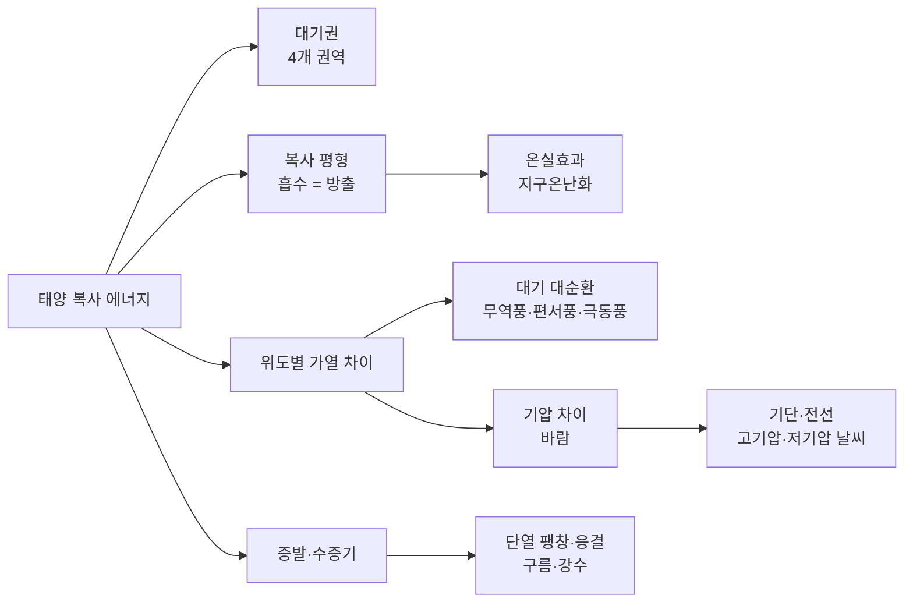

# 중3-2. 날씨와 기후변화 — 태양 에너지가 움직이는 공기와 물
<!-- prev: m1-03, m1-04, m1-06, m2-02 -->
<!-- next: m3-03, 3-1, 5-3, earth-1, esys-3 -->

> [!NOTE]
> **성취기준**
> - **[9과17-01]** 지구 대기권을 4개 권역으로 구분하며, 온실효과와 지구온난화를 복사 평형의 관점으로 설명할 수 있다.
> - **[9과17-02]** 대기 대순환에서 위도별 바람의 특성을 파악하고, 대기 대순환의 역할을 설명할 수 있다.
> - **[9과17-03]** 상대습도, 단열 팽창 및 응결 현상의 관계를 이해하고, 구름의 생성과 강수 과정을 설명할 수 있다.
> - **[9과17-04]** 기압, 기단, 전선의 개념을 이해하고, 일기도에서 저기압과 고기압의 분포에 따른 날씨를 해석할 수 있다.

**학습 목표**

1. 높이에 따른 기온 변화를 근거로 대기권을 4개 권역으로 구분하고 각 권역의 특징을 설명할 수 있다.
2. 복사 평형의 관점에서 온실효과와 지구온난화를 설명하고, 기후변화 자료의 경향성을 해석할 수 있다.
3. 대기 대순환에서 북반구의 위도별 바람(무역풍, 편서풍, 극동풍)을 알고, 대기 대순환이 에너지를 고르게 나누는 역할을 설명할 수 있다.
4. 포화 수증기량, 이슬점, 상대습도의 관계를 이해하고, 단열 팽창과 응결로 구름이 생기는 과정을 모형 실험으로 설명할 수 있다.
5. 빙정설과 병합설로 비와 눈이 내리는 과정을 간단히 설명할 수 있다.
6. 기압, 기단, 전선의 개념을 알고, 일기도에서 고기압과 저기압의 분포로 날씨를 해석할 수 있다.

**이 단원의 학습 사다리**

| 단계 | 무엇을 하나? |
|---|---|
| STEP 1. 이전 학습 다시 보기 | 초등 '날씨와 우리 생활', 중1 열·기체·상태 변화, 중2 지구계를 다시 꺼낸다 |
| STEP 2. 기초 다지기 | 복사, 공기의 팽창과 냉각, 응결과 열, 그래프 읽기를 디딤돌로 놓는다 |
| STEP 3. 핵심 개념 | 대기권 → 복사 평형·온실효과 → 대기 대순환 → 습도·구름·강수 → 기압·바람 → 기단·전선·일기도 |
| STEP 4. 오개념 바로잡기 | "온실효과는 나쁜 것이다?" 같은 착각을 바로잡는다 |
| STEP 5. 다음 단계로 | 통합과학의 지구온난화, 지구과학의 날씨 예측, 지구시스템과학의 대기 운동 |
| STEP 6. 생활·산업·진로 | 일기 예보, 기상 위성, 탄소 중립, 관련 진로 |

---

## 🗺️ 단원 들어가기

높은 산에 오르면 태양에 조금 더 가까워지는데도 오히려 더 춥다. 왜일까? 맑던 하늘에 갑자기 소나기구름이 솟아오르고, 일기 예보에서는 "찬 공기가 내려와 내일은 기온이 뚝 떨어지겠습니다."라고 말한다. 한편 뉴스에서는 해마다 "관측 이래 가장 더운 해"라는 소식이 들린다.

이 모든 현상의 뒤에는 **태양 에너지**가 있다. 태양 에너지가 지구에 고르지 않게 도달하면 공기가 움직이고(바람), 물이 증발했다가 다시 응결하며(구름과 비), 지구는 들어온 만큼 에너지를 내보내며 온도를 유지한다(복사 평형). 이 단원에서는 하늘에서 일어나는 일을 **에너지와 공기의 움직임**으로 이어서 이해해 본다.

---

## STEP 1. 🔙 이전 학습 다시 보기

### 연계 개념표

| 이전 단원·성취기준 | 그때 배운 것 | 이 단원에서 확장되는 것 |
|---|---|---|
| 초등 5~6학년 「날씨와 우리 생활」 | 습도, 이슬·안개·구름, 비와 눈, 고기압·저기압과 바람, 계절별 날씨 | 상대습도·이슬점으로 **수치화**하고, 기단·전선으로 날씨 변화를 해석한다 |
| 중1 「열」 [9과03-02] | 열은 전도·대류·복사로 이동한다 | 태양 복사와 지구 복사의 균형(**복사 평형**), 대기의 대류 |
| 중1 「열」 [9과03-03] | 물질마다 비열이 다르다(물은 잘 데워지지도 식지도 않는다) | 육지와 바다의 가열 차이 → 해륙풍, 계절풍 |
| 중1 「물질의 상태 변화」 [9과04-04] | 응결할 때 열에너지를 방출한다 | 구름이 만들어질 때 수증기가 응결하며 열을 내놓는다 |
| 중1 「기체의 성질」 [9과06-01], [9과06-03] | 기체의 압력, 온도가 높을수록 기체 부피가 커진다 | **기압**, 상승한 공기의 **단열 팽창**과 냉각 |
| 중2 「지권의 변화」 [9과09-01] | 지구계는 지권·수권·기권·생물권·외권으로 이루어진다 | 기권의 층상 구조와 기권–수권 사이의 물과 에너지 이동 |

### 준비 운동 (사전 진단)

**Q1.** 차가운 음료수 캔 표면에 물방울이 맺히는 까닭은?

**Q2.** 햇빛이 비치는 낮에 해변에서 바람은 주로 바다 → 육지, 육지 → 바다 중 어느 방향으로 불까?

**Q3.** 풍선을 높이 날려 보내면 점점 커지다가 터진다. 그 까닭은?

정답 및 해설

**Q1.** 캔 주변 공기가 차가워지면서 공기 중의 수증기가 물방울로 **응결**하기 때문이다. 캔 속 음료가 새어 나온 것이 아니다.

**Q2.** 바다 → 육지(해풍). 낮에는 육지가 바다보다 빨리 데워지기 때문이다. 이 단원 STEP 3 ⑧에서 기압과 관련지어 다시 설명한다.

**Q3.** 높이 올라갈수록 바깥 공기의 압력(기압)이 낮아져 풍선 속 기체가 팽창하기 때문이다.

---

## STEP 2. 🧱 기초 다지기

### ① 모든 물체는 복사 에너지를 내보낸다

**복사(radiation)** 는 물질의 도움 없이 열이 직접 전달되는 방식이다(중1 「열」). 온도가 있는 모든 물체는 복사 에너지를 내보낸다.

| 구분 | 태양 복사 | 지구 복사 |
|---|---|---|
| 내보내는 물체 | 표면 약 6000 °C의 태양 | 평균 약 15 °C의 지구 |
| 주된 형태 | 가시광선(눈에 보이는 빛) 중심 | 적외선(눈에 보이지 않는 열선) 중심 |

> [!TIP]
> 💡 **비유** — 열화상 카메라로 사람을 찍으면 몸이 밝게 보인다. 우리 몸도 적외선을 내보내기 때문이다. 지구도 우리 몸처럼 적외선을 우주로 내보낸다.

### ② 공기가 팽창하면 온도가 내려간다

자전거 타이어에 공기를 넣을 때 펌프가 따뜻해지고(압축 → 온도 상승), 차가운 탄산음료 병의 뚜껑을 따는 순간 병 입구에 하얀 김이 생긴다(병 속 기체가 갑자기 팽창 → 온도 하강 → 수증기 응결). 외부와 열을 주고받지 않고 공기가 팽창하면 공기의 온도가 내려간다. 이것을 **단열 팽창(adiabatic expansion)** 이라고 한다.

### ③ 응결하면 열이 나온다

수증기가 물방울로 응결할 때는 열에너지를 **방출**한다(중1). 사우나에서 수증기가 피부에 닿아 응결하면 뜨겁게 느껴지는 것도 이 때문이다. 구름이 만들어질 때도 이 열이 주변 공기를 데운다.

### ④ 그래프 읽기: 높이를 세로축에

대기 과학에서는 **높이를 세로축**, 기온을 가로축에 놓는 그래프를 자주 쓴다. 그래프 선이 왼쪽으로 기울어 올라가면 "높이 올라갈수록 기온이 낮아진다", 오른쪽으로 기울어 올라가면 "높이 올라갈수록 기온이 높아진다"는 뜻이다.

---

## STEP 3. 📘 핵심 개념

### ① 대기권의 구조 — 기온 변화로 나눈 4개의 층

지구를 둘러싼 공기층을 **대기권(atmosphere)** 이라고 한다. 대기는 질소(약 78 %)와 산소(약 21 %)가 대부분이고, 아르곤, 이산화 탄소, 수증기 등이 조금 들어 있다. 대기권은 **높이에 따른 기온 변화**를 기준으로 4개의 층으로 나눈다.

| 층 | 높이(대략) | 높이에 따른 기온 | 특징 |
|---|---|---|---|
| 열권 | 약 80 km 이상 | 높아진다 | 공기가 매우 희박하다. 낮과 밤의 기온 차가 매우 크다. **오로라**가 나타나고, 국제 우주 정거장이 이 높이를 돈다 |
| 중간권 | 약 50~80 km | 낮아진다 | 대류가 일어나지만 수증기가 거의 없어 기상 현상이 없다. 위쪽 끝은 대기권에서 가장 춥다(약 −90 °C). **유성**이 나타난다 |
| 성층권 | 약 11~50 km | 높아진다 | 약 20~30 km에 **오존층**이 있어 태양의 자외선을 흡수하여 데워진다. 공기가 안정하여 대류가 거의 없다 → 장거리 비행기 항로 |
| 대류권 | 지표~약 11 km | 낮아진다 | 지표가 데운 공기가 위로 올라가는 **대류**가 활발하다. 수증기가 있어 구름·비·눈 같은 **기상 현상**이 나타난다. 공기의 대부분(약 80 %)이 이곳에 있다 |

> [!IMPORTANT]
> 기온이 높이에 따라 **낮아지는 층**(대류권, 중간권)은 아래가 따뜻하고 위가 차가우므로 대류가 일어난다. 기온이 높이에 따라 **높아지는 층**(성층권)은 위가 따뜻하여 공기가 안정하다. 대류권에서 높이 올라갈수록 추운 것은 대류권의 공기가 주로 **태양 빛을 받아 데워진 지표**에서 열을 받기 때문이다.

<!-- fig:m3-02-atmosphere-layers -->

#### 예제 1

다음 설명에 해당하는 층을 쓰시오.
(1) 비행기가 흔들림 없이 날기 좋고, 자외선을 막아 생명체를 보호한다. (2) 태풍과 장마가 생긴다. (3) 오로라가 나타난다.

**풀이** (1) 성층권 (2) 대류권 (3) 열권

> [!TIP]
> 💡 **비유** — 난로가 놓인 방(대류권)에서는 난로 가까운 바닥이 따뜻하고 천장 쪽이 시원하다. 높은 산이 추운 것은 '난로(지표)'에서 멀어졌기 때문이지, 태양에서 멀어졌기 때문이 아니다.

#### ✔ 바로 확인

1. (O/X) 대기권은 높이에 따른 기온 변화를 기준으로 4개의 층으로 나눈다.
2. 오존층이 있어 자외선을 흡수하는 층은?
3. 구름·비·눈 같은 기상 현상이 나타나는 층을 고르시오. (대류권 / 성층권 / 중간권 / 열권)
4. 대류권에서 높이 올라갈수록 기온이 낮아지는 까닭을 한 문장으로 쓰시오.

정답

1. O
2. 성층권 — 오존층이 자외선을 흡수하여 위쪽이 데워진다.
3. 대류권 — 수증기가 있고 대류가 활발하다.
4. 대류권의 공기는 태양 빛을 받아 데워진 지표에서 열을 받으므로, 지표에서 멀어질수록 춥다.

### ② 복사 평형 — 받은 만큼 내보낸다

태양 에너지를 계속 받는데도 지구의 평균 기온은 계속 올라가지 않고 거의 일정하게 유지되어 왔다. 지구가 **흡수하는 태양 복사 에너지의 양과 우주로 방출하는 지구 복사 에너지의 양이 같기** 때문이다. 이런 상태를 **복사 평형(radiative equilibrium)** 이라고 한다.

$$
\text{흡수하는 복사 에너지} = \text{방출하는 복사 에너지} \;\Rightarrow\; \text{온도 일정}
$$

#### 지구에 들어오고 나가는 에너지 (태양 복사 = 100으로 볼 때)

| 과정 | 대략적인 양 |
|---|---|
| 지구에 들어오는 태양 복사 에너지 | 100 |
| 구름·대기·지표에서 반사되어 우주로 되돌아감 | 약 30 |
| 대기와 지표에 흡수됨 | 약 70 |
| 지구(대기 + 지표)가 우주로 방출하는 지구 복사 에너지 | 약 70 |

흡수(약 70)와 방출(약 70)이 같으므로 지구 전체의 평균 기온이 일정하게 유지된다.

#### 실험으로 보는 복사 평형

검게 칠한 알루미늄 컵에 온도계를 꽂고 전등을 비추면, 처음에는 온도가 올라가다가 어느 순간부터 **일정**해진다. 컵이 흡수하는 에너지와 방출하는 에너지가 같아졌기 때문이다. 전등을 더 가까이 하면 더 높은 온도에서 다시 일정해진다.

> [!TIP]
> 💡 **비유** — 바닥에 구멍이 난 욕조에 수도꼭지로 물을 받는다. 물이 차오를수록 구멍으로 빠지는 물도 많아져 결국 수면 높이가 일정해진다. 수도꼭지 = 흡수, 구멍 = 방출, 수면 높이 = 온도이다. 구멍을 일부 막으면(온실 기체 증가) 수면은 더 높은 곳에서 다시 일정해진다.

#### ✔ 바로 확인

1. (O/X) 복사 평형 상태의 지구는 태양 복사 에너지를 흡수하지 않는다.
2. 지구에 들어오는 태양 복사 에너지를 100이라 할 때 약 30이 반사된다. 지구가 흡수하는 양과 우주로 방출하는 지구 복사 에너지의 양은 각각 약 얼마인가?
3. 검게 칠한 컵에 전등을 비추면 온도가 오르다가 어느 순간부터 일정해진다. 그 까닭은?

정답

1. X — 흡수는 계속하며, 흡수하는 양과 방출하는 양이 같은 상태이다.
2. 흡수 약 70, 방출 약 70 — 복사 평형이므로 흡수한 만큼 방출한다.
3. 컵이 흡수하는 에너지와 방출하는 에너지가 같아졌기 때문이다.

### ③ 온실효과와 지구온난화

대기 중의 수증기, 이산화 탄소($\mathrm{CO_2}$), 메테인($\mathrm{CH_4}$), 산화 이질소($\mathrm{N_2O}$) 등은 태양 복사(가시광선)는 대부분 통과시키지만 지표가 방출하는 지구 복사(적외선)는 잘 흡수한다. 이 기체들을 **온실 기체(greenhouse gas)** 라고 한다. 온실 기체가 흡수한 에너지 일부를 다시 지표로 방출하여 지표를 더 따뜻하게 하는 현상을 **온실효과(greenhouse effect)** 라고 한다.

| 구분 | 대기가 없거나 온실 기체가 없다면 | 온실효과가 있는 실제 지구 |
|---|---|---|
| 지표 평균 기온 | 약 −18 °C로 계산된다 | 약 15 °C |
| 생명체 | 물이 대부분 얼어 지금 같은 생명체가 살기 어렵다 | 액체 물이 있어 생명체가 살기 알맞다 |

<!-- fig:m3-02-greenhouse -->

> [!IMPORTANT]
> 온실효과는 **원래 지구에 꼭 필요한 현상**이다. 문제는 인간 활동으로 온실 기체가 **너무 빠르게 늘어나** 온실효과가 강해지는 것이다. 지표가 방출한 에너지가 우주로 덜 빠져나가므로, 지구는 더 높은 온도에서 새로운 복사 평형을 이룬다. 이렇게 지구의 평균 기온이 올라가는 현상을 **지구온난화(global warming)** 라고 한다.

#### 자료로 보는 지구온난화

| 자료 | 경향 |
|---|---|
| 대기 중 이산화 탄소 농도 | 산업혁명 이전 약 280 ppm → 1958년 하와이 마우나로아 관측 시작 무렵 약 315 ppm → 2020년대 약 420 ppm 이상 |
| 지구 평균 기온 | 산업화 이전(1850~1900년)보다 약 1.1 °C 상승(2011~2020년 평균, IPCC 보고서) |
| 두 자료의 관계 | 이산화 탄소 농도가 증가하는 시기에 지구 평균 기온도 상승하는 경향이 함께 나타난다 |

이산화 탄소가 늘어난 주요 원인은 **화석 연료(석탄·석유·천연가스)의 사용**과 **숲의 파괴**이다. ppm은 '백만 분의 1'이라는 뜻으로, 420 ppm은 공기 분자 100만 개 중 약 420개가 이산화 탄소라는 뜻이다.

#### 지구온난화가 가져오는 변화 — 기후변화

| 변화 | 예 |
|---|---|
| 빙하와 해빙 감소 | 북극 바다얼음 면적 감소, 산악 빙하 후퇴 |
| 해수면 상승 | 바닷물의 열팽창과 육지 빙하가 녹은 물 → 해안 저지대 침수 위험 |
| 극한 기상 증가 | 폭염, 집중호우, 가뭄이 더 자주, 더 강하게 |
| 생태계 변화 | 우리나라에서 사과·인삼 등의 재배 가능 지역이 북쪽으로 이동, 아열대 작물 재배 증가 |

**대처 방안** 국가와 사회는 재생 에너지 확대, 에너지 효율 향상, 숲 보전 등으로 온실 기체 배출을 줄이고(**탄소 중립**), 개인은 대중교통 이용, 전기 절약, 음식물 쓰레기 줄이기 등을 실천할 수 있다.

#### 예제 2

어느 지역의 기온이 100년 동안 꾸준히 올랐다. 학생 A는 "이 지역이 흡수하는 에너지보다 방출하는 에너지가 계속 많았기 때문"이라고 말했다. A의 말을 바르게 고치시오.

**풀이** 기온이 오르는 동안에는 **흡수하는 에너지가 방출하는 에너지보다 많은** 상태이다. 온실 기체가 늘어 방출이 줄어들면, 지구는 온도가 올라가면서 방출량을 다시 늘려 더 높은 온도에서 새로운 복사 평형에 도달한다.

#### ✔ 바로 확인

1. 빈칸: 온실 기체는 태양 복사(가시광선)는 대부분 (    )시키고, 지구 복사(적외선)는 잘 (    )한다.
2. (O/X) 온실효과가 없다면 지표 평균 기온은 지금보다 높을 것이다.
3. 이산화 탄소 농도 420 ppm은 무슨 뜻인가?
4. 지구온난화로 해수면이 높아지는 까닭을 두 가지 쓰시오.

정답

1. 통과, 흡수
2. X — 온실효과가 없다면 약 −18 °C로 계산되어 지금(약 15 °C)보다 훨씬 춥다.
3. 공기 분자 100만 개 중 약 420개가 이산화 탄소라는 뜻이다.
4. 바닷물의 열팽창, 육지의 빙하가 녹은 물이 바다로 흘러듦.

### ④ 대기 대순환 — 지구 규모의 거대한 바람

#### 위도별로 받는 에너지가 다르다

적도 지방은 햇빛을 거의 수직으로 받고, 극지방은 비스듬히 받는다. 그래서 **저위도는 흡수하는 에너지가 방출하는 에너지보다 많고(에너지 과잉)**, **고위도는 방출이 흡수보다 많다(에너지 부족).** 그런데도 적도는 계속 뜨거워지지 않고 극은 계속 차가워지지 않는다. 남는 에너지를 대기와 해수가 **저위도에서 고위도로 운반**하기 때문이다. 이 중 지구 규모로 일어나는 대기의 순환을 **대기 대순환(general circulation of the atmosphere)** 이라고 한다.

> [!TIP]
> 💡 **비유** — 손전등을 벽에 수직으로 비추면 좁은 곳이 밝고, 비스듬히 비추면 넓게 퍼져 희미하다. 같은 에너지가 넓은 면적에 퍼지면 단위 면적당 받는 에너지가 적다. 극지방이 추운 이유이다.

#### 북반구의 3개 순환 세포와 지상의 바람

실제 지구에서 대기 대순환은 북반구와 남반구에 각각 3개의 순환 세포로 이루어진다. 다음은 **북반구** 기준이다.

| 위도 구간 | 순환 | 지상에서 부는 바람 | 바람의 특징 |
|---|---|---|---|
| 0°~30° | 해들리 순환 | **무역풍** | 북동쪽에서 적도 쪽으로 부는 바람(북동풍). 옛날 범선의 무역로에 이용되었다 |
| 30°~60° | 페렐 순환 | **편서풍** | 서쪽에서 동쪽으로 부는 바람(남서풍~서풍). 우리나라 날씨가 대체로 서쪽에서 동쪽으로 바뀌는 이유이다 |
| 60°~90° | 극순환 | **극동풍** | 극 쪽에서 저위도 쪽으로 부는 동풍 계열의 바람(북동풍) |

- 적도 부근(0°): 공기가 데워져 **상승** → 구름이 많고 비가 많다(열대 우림).
- 위도 30° 부근: 공기가 **하강** → 맑고 건조하다(사하라 사막 같은 큰 사막이 많다).
- 위도 60° 부근: 따뜻한 공기와 찬 공기가 만나 공기가 상승 → 구름과 비가 많다.

<!-- fig:m3-02-general-circulation -->

> [!NOTE]
> 바람이 남북 방향으로 곧게 불지 않고 동서 방향으로 비스듬히 부는 까닭은 지구가 자전하기 때문인데, 그 원리는 고등학교에서 배운다. 중학교에서는 **위도별 바람의 방향과 특징, 그리고 대기 대순환의 역할**에 집중한다.

#### 대기 대순환의 역할

1. 저위도의 남는 에너지를 고위도로 운반하여 **위도별 에너지 불균형을 줄인다.**
2. 위도별로 비가 많은 곳과 건조한 곳을 만들어 **기후대**를 형성한다.
3. 해양의 표층 해류를 일으키는 원동력이 된다(다음 단원 「수권과 해수의 순환」).

#### 예제 3

우리나라(위도 약 33°~43°)에 황사와 미세 먼지가 주로 중국 쪽에서 날아오는 까닭을 대기 대순환으로 설명하시오.

**풀이** 우리나라는 중위도에 있어 **편서풍** 지대에 속한다. 서쪽에서 동쪽으로 부는 편서풍을 타고 서쪽(중국·몽골)의 먼지가 우리나라로 이동한다.

#### ✔ 바로 확인

1. 북반구 지상의 바람을 위도 구간과 짝지으시오. (가) 0°~30° (나) 30°~60° (다) 60°~90° — 극동풍, 무역풍, 편서풍
2. (O/X) 위도 30° 부근은 공기가 상승하여 구름과 비가 많다.
3. 빈칸: 저위도는 흡수하는 에너지가 방출하는 에너지보다 (많고 / 적고), 대기 대순환은 남는 에너지를 (    ) 쪽으로 운반한다.

정답

1. (가) 무역풍 (나) 편서풍 (다) 극동풍
2. X — 위도 30° 부근은 공기가 하강하여 맑고 건조하다(큰 사막이 많다).
3. 많고, 고위도 — 그래서 위도별 에너지 불균형이 줄어든다.

### ⑤ 수증기와 상대습도

#### 포화 수증기량과 이슬점

공기가 수증기를 최대로 포함한 상태를 **포화 상태**라 하고, 이때 공기 1 kg에 들어 있는 수증기의 질량(g)을 **포화 수증기량(saturated water vapor amount)** 이라고 한다. 포화 수증기량은 **기온이 높을수록 많다.** (수증기가 낼 수 있는 최대 압력인 포화 수증기압도 같은 경향을 보인다.)

| 기온(°C) | 0 | 5 | 10 | 15 | 20 | 25 | 30 |
|---|---|---|---|---|---|---|---|
| 포화 수증기량(g/kg) | 3.8 | 5.4 | 7.6 | 10.6 | 14.7 | 20.0 | 27.1 |

수증기를 포함한 공기가 냉각되어 포화 상태가 되어 응결이 시작되는 온도를 **이슬점(dew point)** 이라고 한다. 이슬점은 공기 속에 **실제로 들어 있는 수증기량**에 따라 정해진다. 수증기가 많을수록 이슬점이 높다.

#### 상대습도

현재 기온의 포화 수증기량에 대한 실제 수증기량의 비율을 **상대습도(relative humidity)** 라고 한다. 일기 예보의 '습도'가 이것이다.

$$
\text{상대습도}(\%) = \frac{\text{현재 공기의 실제 수증기량}}{\text{현재 기온의 포화 수증기량}} \times 100
$$

| 경우 | 상대습도의 변화 | 생활 속 예 |
|---|---|---|
| 수증기량은 그대로, 기온만 오름 | 낮아진다 | 맑은 날 오후에 습도가 낮다 |
| 수증기량은 그대로, 기온만 내려감 | 높아진다 | 맑은 날 새벽에 습도가 높고 이슬·안개가 생긴다 |
| 기온은 그대로, 수증기량이 늘어남 | 높아진다 | 가습기를 켜거나 비가 내린다 |

<!-- fig:m3-02-saturation-curve -->

#### 예제 4

기온 20 °C인 공기 1 kg에 수증기 7.6 g이 들어 있다.
(1) 이 공기의 상대습도는 약 몇 %인가? (2) 이슬점은 몇 °C인가? (3) 이 공기를 5 °C까지 냉각하면 응결되는 물의 양은 몇 g인가?

**풀이**
(1) $\dfrac{7.6}{14.7} \times 100 \approx 52\ \%$
(2) 포화 수증기량이 7.6 g/kg인 온도이므로 10 °C이다.
(3) 5 °C의 포화 수증기량은 5.4 g/kg이므로 $7.6 - 5.4 = 2.2\ \mathrm{g}$ 이 응결한다.

> [!TIP]
> 💡 **비유** — 포화 수증기량은 '컵의 크기', 실제 수증기량은 '컵 속 물의 양', 상대습도는 '컵이 얼마나 찼는가'이다. 기온이 내려가면 컵이 작아지는 것과 같아서, 물의 양이 그대로여도 컵이 꽉 차다가(이슬점) 넘친다(응결).

#### ✔ 바로 확인

1. 빈칸: 포화 수증기량은 기온이 높을수록 (    ).
2. 기온 15 °C인 공기 1 kg에 수증기 10.6 g이 들어 있다. 상대습도와 이슬점은? (15 °C 포화 수증기량 10.6 g/kg)
3. (O/X) 공기 속 수증기량이 그대로일 때 기온이 내려가면 상대습도는 낮아진다.
4. 포화 수증기량 그래프의 공기 A(25 °C, 10.6 g/kg)를 10 °C까지 냉각하면 몇 g의 수증기가 응결하는가?

정답

1. 많다
2. 상대습도 100 %, 이슬점 15 °C — 이미 포화 상태이다.
3. X — 포화 수증기량이 줄어들므로 상대습도는 높아진다.
4. 3.0 g — $10.6 - 7.6 = 3.0\ \mathrm{g}$ (10 °C의 포화 수증기량 7.6 g/kg)

### ⑥ 단열 팽창과 구름의 생성

#### 공기가 올라가면 구름이 된다

**구름(cloud)** 은 수증기가 아니라 공기 중에 떠 있는 아주 작은 **물방울이나 얼음 알갱이(빙정)** 의 모임이다. 구름은 다음 과정을 거쳐 만들어진다.

공기 중의 먼지, 소금 알갱이 같은 작은 입자는 수증기가 달라붙어 물방울이 되도록 돕는다. 이를 **응결핵(condensation nucleus)** 이라고 한다.

<!-- sim:cloud-formation -->

#### 공기가 상승하는 네 가지 경우

| 경우 | 설명 | 예 |
|---|---|---|
| 지표면이 불균등하게 가열될 때 | 뜨거워진 지표 위의 공기가 떠오른다 | 여름 오후의 소나기구름 |
| 공기가 산을 타고 오를 때 | 바람이 산의 경사면을 따라 올라간다 | 산 정상 부근의 구름, 바람을 받는 쪽 산비탈의 비 |
| 찬 공기와 따뜻한 공기가 만날 때 | 가벼운 따뜻한 공기가 찬 공기 위로 올라간다 | 전선을 따라 생기는 구름(⑨) |
| 공기가 한곳으로 모여들 때 | 모여든 공기가 갈 곳이 위쪽뿐이다 | 저기압 중심의 구름(⑨) |

#### 모형 실험 — 페트병 속 구름

| 과정 | 병 속 변화 | 원리 |
|---|---|---|
| 페트병에 물을 조금 넣고 향 연기를 넣은 뒤 뚜껑에 압축 펌프를 끼운다 | 연기 입자가 들어간다 | 응결핵 역할 |
| 펌프를 여러 번 눌러 압축한다 | 병 속 온도가 조금 올라가고 맑다 | 단열 압축 → 기온 상승 |
| 뚜껑을 갑자기 연다 | 병 속이 **뿌옇게 흐려진다**, 온도가 내려간다 | 단열 팽창 → 기온 하강 → 응결 |
| 다시 압축한다 | 흐림이 사라진다 | 기온 상승 → 물방울 증발 |

온도 센서를 병 속에 넣으면 뚜껑을 여는 순간 온도가 뚝 떨어지는 것을 그래프로 확인할 수 있다.

#### 예제 5

산 아래에서 기온 25 °C, 이슬점 15 °C인 공기가 바람을 따라 산을 타고 올라간다. 공기가 올라가면서 어떤 과정을 거쳐 구름이 생기는지 '기압', '팽창', '이슬점'을 넣어 설명하시오.

**풀이** 공기가 올라가면 주변 **기압**이 낮아져 공기가 **팽창**하고, 단열 팽창으로 기온이 내려간다. 기온이 **이슬점**(15 °C)까지 내려가면 상대습도가 100 %가 되어 수증기가 응결하기 시작하고, 이 높이부터 구름이 생긴다.

#### ✔ 바로 확인

1. (O/X) 구름은 공기 중의 수증기가 모여 하얗게 보이는 것이다.
2. 빈칸: 공기 상승 → 주변 기압 감소 → (    ) → 기온 하강 → 이슬점 도달 → 응결 → 구름
3. 페트병 속 구름 실험에서 향 연기는 어떤 역할을 하는가?
4. 공기가 상승하는 경우를 두 가지 쓰시오.

정답

1. X — 구름은 작은 물방울이나 빙정의 모임이다. 수증기는 눈에 보이지 않는다.
2. 단열 팽창
3. 응결핵 — 수증기가 달라붙어 물방울이 되도록 돕는다.
4. 예: 지표면이 불균등하게 가열될 때, 공기가 산을 타고 오를 때, 찬 공기와 따뜻한 공기가 만날 때, 공기가 한곳으로 모여들 때 중 두 가지

### ⑦ 강수 과정 — 구름 방울이 비가 되기까지

구름을 이루는 물방울은 아주 작아서 공기 중에 떠 있다. 이 작은 방울이 무거워져 떨어질 만큼 커지는 과정을 설명하는 두 가지 생각이 있다.

| 구분 | 빙정설 | 병합설 |
|---|---|---|
| 주로 적용되는 곳 | **중위도·고위도** 지방 (우리나라 포함) | **열대** 지방 (저위도) |
| 구름의 온도 | 위쪽이 0 °C보다 낮은 **차가운 구름** | 0 °C보다 높은 **따뜻한 구름** |
| 구름 속 모습 | 얼음 알갱이(빙정)와 0 °C 이하에서도 얼지 않은 물방울(과냉각 물방울)이 섞여 있다 | 크기가 다양한 물방울만 있다 |
| 커지는 방법 | 물방울에서 증발한 수증기가 빙정에 달라붙어 빙정이 커진다 | 큰 물방울이 떨어지면서 작은 물방울과 **충돌하여 합쳐진다** |
| 내리는 것 | 커진 빙정이 그대로 떨어지면 **눈**, 떨어지다 녹으면 **비** | **비** |

> [!TIP]
> 💡 **비유** — 병합설은 '눈덩이 굴리기'와 같다. 큰 눈덩이가 굴러 내려가며 작은 눈을 붙여 점점 커지듯, 큰 물방울이 떨어지며 작은 물방울을 합쳐 커진다. 빙정설은 '인기 많은 친구'와 같다. 수증기가 물방울보다 빙정에 더 잘 달라붙어서 빙정만 쑥쑥 자란다.

#### ✔ 바로 확인

1. 우리나라처럼 중위도 지방의 강수를 주로 설명하는 생각은? (빙정설 / 병합설)
2. (O/X) 병합설은 0 °C보다 낮은 차가운 구름에서 주로 일어나는 강수를 설명한다.
3. 빙정설에서 커진 빙정이 떨어지다가 녹으면 (    ), 녹지 않고 떨어지면 (    )이/가 된다.

정답

1. 빙정설
2. X — 병합설은 0 °C보다 높은 따뜻한 구름(열대 지방)의 강수를 설명한다.
3. 비, 눈

### ⑧ 기압과 바람

#### 기압이란?

공기가 단위 넓이에 작용하는 압력을 **기압(atmospheric pressure)** 이라고 한다. 공기는 모든 방향으로 압력을 작용한다. 이탈리아의 과학자 **토리첼리**는 수은을 가득 채운 유리관을 수은 그릇에 거꾸로 세워, 수은 기둥이 약 76 cm 높이에서 멈추는 것을 보고 기압을 처음으로 측정하였다.

$$
1\ \text{기압} = \text{수은 기둥 76 cm의 압력} \approx 1013\ \mathrm{hPa}
$$

- hPa(헥토파스칼)은 일기도에서 쓰는 기압의 단위이다.
- 1기압은 물기둥으로는 약 10 m 높이의 압력과 같다.
- **높이 올라갈수록 기압이 낮아진다.** 위에 있는 공기의 양이 적어지기 때문이다. 높은 산에서 과자 봉지가 빵빵하게 부푸는 것이 그 예이다.

#### 바람은 왜 불까? — 기압 차이

지표면이 고르지 않게 가열되면 온도 차이가 생기고, 이것이 기압 차이를 만든다. **바람(wind)** 은 기압이 **높은 곳에서 낮은 곳으로** 공기가 이동하는 것이다. 기압 차이가 클수록 바람이 강하다.

| 바람 | 언제 | 가열 차이 | 바람의 방향 |
|---|---|---|---|
| 해풍 | 낮 | 육지가 바다보다 빨리 데워짐 → 육지 위 공기 상승 → 육지 쪽 기압이 낮아짐 | 바다 → 육지 |
| 육풍 | 밤 | 육지가 바다보다 빨리 식음 → 육지 쪽 기압이 높아짐 | 육지 → 바다 |
| 여름 계절풍 | 여름 | 대륙이 해양보다 뜨거움 | 해양 → 대륙 (우리나라는 남동풍~남서풍) |
| 겨울 계절풍 | 겨울 | 대륙이 해양보다 차가움 | 대륙 → 해양 (우리나라는 북서풍) |

육지가 바다보다 빨리 데워지고 빨리 식는 것은 물의 **비열**이 크기 때문이다(중1 「열」). 해륙풍은 하루 주기, 계절풍은 1년 주기의 같은 원리이다.

<!-- fig:m3-02-land-sea-breeze -->

> [!TIP]
> 💡 **비유** — 바람은 '사람이 붐비는 곳에서 한산한 곳으로 빠져나가는 흐름'과 같다. 공기 입자가 빽빽한 곳(고기압)에서 듬성듬성한 곳(저기압)으로 이동한다.

#### ✔ 바로 확인

1. 빈칸: 1기압은 수은 기둥 약 (    ) cm의 압력이며, 약 (    ) hPa이다.
2. (O/X) 높이 올라갈수록 기압이 높아진다.
3. 맑은 날 낮에 해안에서 부는 바람의 이름과 방향은?
4. 겨울철 우리나라에 부는 계절풍의 방향은?

정답

1. 76, 1013
2. X — 위에 있는 공기의 양이 적어지므로 기압이 낮아진다.
3. 해풍, 바다 → 육지 — 낮에는 육지가 빨리 데워져 육지 쪽 기압이 낮아진다.
4. 북서풍 — 겨울에는 대륙이 해양보다 차가워 대륙 쪽 기압이 높다.

### ⑨ 기단과 전선, 고기압과 저기압

#### 기단 — 성질이 비슷한 큰 공기 덩어리

넓은 대륙이나 바다 위에 공기가 오래 머물면, 그 지역의 온도와 습도를 닮은 거대한 공기 덩어리가 된다. 이를 **기단(air mass)** 이라고 한다. 대륙에서 생기면 건조하고, 바다에서 생기면 습하다. 고위도에서 생기면 차갑고, 저위도에서 생기면 따뜻하다.

| 기단 | 생긴 곳 | 성질 | 우리나라에 주는 영향 |
|---|---|---|---|
| 시베리아 기단 | 시베리아 대륙 | 한랭 건조 | **겨울**: 춥고 건조, 북서 계절풍, 한파 |
| 오호츠크해 기단 | 오호츠크해 | 한랭 다습 | **초여름**: 동해안 지역의 서늘한 날씨, 장마 전선 형성 |
| 북태평양 기단 | 북태평양 | 고온 다습 | **여름**: 무덥고 습한 날씨, 열대야 |
| 양쯔강 기단 | 중국 양쯔강 유역 | 온난 건조 | **봄·가을**: 이동성 고기압과 함께 맑고 건조한 날씨 |

<!-- fig:m3-02-air-masses -->

#### 전선 — 두 기단이 만나는 경계

성질이 다른 두 기단이 만나면 바로 섞이지 않고 경계면을 이룬다. 이 경계면을 **전선면**, 전선면이 지면과 만나는 선을 **전선(front)** 이라고 한다. 전선 부근에서는 따뜻한 공기가 상승하여 구름과 비가 생긴다.

| 구분 | 한랭 전선 | 온난 전선 |
|---|---|---|
| 만들어지는 방식 | 찬 공기가 따뜻한 공기 **밑으로 파고든다** | 따뜻한 공기가 찬 공기 **위로 타고 오른다** |
| 전선면의 기울기 | 급하다 | 완만하다 |
| 구름 | 위로 솟은 **적운형** 구름 | 옆으로 넓게 퍼진 **층운형** 구름 |
| 강수 | 전선 뒤쪽 **좁은 지역**에 **소나기**, 천둥·번개 | 전선 앞쪽 **넓은 지역**에 **지속적인 약한 비** |
| 이동 속도 | 빠르다 | 느리다 |
| 통과한 뒤 | 기온 하강, 기압 상승 | 기온 상승 |

- **정체 전선**: 두 기단의 세력이 비슷해 한곳에 오래 머무는 전선. 초여름 우리나라의 **장마 전선**이 대표적이다.
- **폐색 전선**: 빠른 한랭 전선이 느린 온난 전선을 따라잡아 겹쳐진 전선이다.

<!-- fig:m3-02-fronts -->

#### 고기압과 저기압

주변보다 기압이 높은 곳을 **고기압(high pressure)**, 주변보다 기압이 낮은 곳을 **저기압(low pressure)** 이라고 한다. 기압의 높고 낮음은 정해진 값이 아니라 **주변과 비교**하여 정한다.

| 구분 | 고기압 (H) | 저기압 (L) |
|---|---|---|
| 지상의 바람 (북반구) | 중심에서 **시계 방향**으로 불어 나간다 | 중심을 향해 **시계 반대 방향**으로 불어 들어온다 |
| 중심의 공기 | **하강** 기류 | **상승** 기류 |
| 날씨 | 공기가 내려오며 데워져 구름이 사라짐 → **맑음** | 공기가 올라가며 단열 팽창 → 구름 → **흐리거나 비** |

<!-- fig:m3-02-high-low -->

#### 일기도에서 날씨 읽기

**일기도(weather map)** 는 여러 지점에서 동시에 관측한 기압, 바람, 날씨 등을 지도에 나타낸 것이다. 기압이 같은 지점을 이은 선을 **등압선**이라고 한다.

| 일기도에서 보이는 것 | 해석 |
|---|---|
| H로 표시된 곳 | 고기압: 맑은 날씨 |
| L로 표시된 곳 | 저기압: 흐리거나 비 |
| 등압선 간격이 좁은 곳 | 기압 차가 커서 **바람이 강하다** |
| 삼각형(▲)이 붙은 선 | 한랭 전선. 삼각형이 향하는 쪽으로 이동한다 |
| 반원(●)이 붙은 선 | 온난 전선. 반원이 향하는 쪽으로 이동한다 |
| 우리나라 서쪽에 고기압, 동쪽에 저기압 (서고동저) | 겨울철: 시베리아 기단, 춥고 북서풍이 강하다 |
| 남쪽에 고기압, 북쪽에 저기압 (남고북저) | 여름철: 북태평양 기단, 무덥고 습하다 |

<!-- fig:m3-02-pressure-patterns -->

> [!NOTE]
> 우리나라는 편서풍 지대에 있으므로 일기도 속 고기압과 저기압은 대체로 **서쪽에서 동쪽으로** 이동한다. 그래서 중국 쪽의 날씨를 보면 우리나라의 다음 날 날씨를 짐작할 수 있다. 등압선을 직접 그리거나 일기 예보의 전 과정을 다루는 것은 이 단원의 범위가 아니다.

#### 예제 6

다음은 어느 겨울날 일기도에 대한 설명이다. "우리나라 서쪽 대륙에 1040 hPa의 고기압, 동쪽 바다에 990 hPa의 저기압이 있고, 우리나라 부근의 등압선 간격이 매우 좁다." 이날 우리나라의 날씨를 예상하시오.

**풀이** 서고동저형 기압 배치로 시베리아 기단의 영향을 받는다. 기압이 높은 서쪽에서 낮은 동쪽으로 **북서풍**이 불고, 등압선 간격이 좁아 **바람이 강하며**, 춥고 건조하다.

#### 예제 7

한랭 전선이 어느 도시를 통과하기 전과 후의 날씨 변화를 기온, 강수 측면에서 쓰시오.

**풀이** 통과할 때 적운형 구름에서 좁은 범위에 소나기가 내리고 천둥·번개가 칠 수 있다. 통과한 뒤에는 찬 공기의 영향으로 **기온이 내려간다.**

#### ✔ 바로 확인

1. 우리나라 주변 기단 지도에서 초여름 동해안 지역에 서늘한 날씨를 가져오는 기단의 이름과 성질은?
2. 넓은 지역에 지속적인 약한 비를 내리는 전선은? (한랭 전선 / 온난 전선)
3. (O/X) 고기압 중심에는 상승 기류가 생겨 날씨가 흐리다.
4. 빈칸: 일기도에서 등압선 간격이 좁은 곳은 바람이 (    ).

정답

1. 오호츠크해 기단, 한랭 다습 — 고위도의 바다에서 생겼기 때문이다.
2. 온난 전선 — 층운형 구름이 넓게 퍼진다.
3. X — 고기압 중심에는 하강 기류가 생겨 맑다.
4. 강하다 — 기압 차가 크기 때문이다.

---

## STEP 4. ⚠️ 오개념 바로잡기

| 흔한 오개념 | 올바른 개념 | 왜 그럴까? |
|---|---|---|
| 온실효과는 나쁜 현상이다 | 온실효과는 지구를 생명이 살기 알맞은 온도로 유지한다. 문제는 **온실효과의 강화**이다 | 온실효과가 없다면 지표 평균 기온은 약 −18 °C로 계산된다 |
| 오존층 파괴가 지구온난화의 주된 원인이다 | 지구온난화의 주된 원인은 **온실 기체 증가**이다. 오존층 파괴는 자외선 증가 문제이다 | 둘 다 대기 환경 문제라서 섞어 생각하기 쉽다 |
| 높은 산은 태양에서 멀어서 춥다 | 대류권은 **지표에서 데워지므로** 지표에서 멀어질수록 춥다 | 산 높이는 태양까지 거리(약 1억 5천만 km)에 비하면 아무것도 아니다 |
| 구름은 수증기가 모인 것이다 | 구름은 작은 **물방울과 빙정**의 모임이다 | 수증기는 눈에 보이지 않는 기체이다 |
| 상대습도가 같으면 공기 속 수증기량도 같다 | 기온이 다르면 포화 수증기량이 달라 실제 수증기량도 다르다 | 여름의 습도 60 %는 겨울의 습도 60 %보다 수증기가 훨씬 많다 |
| 바람은 저기압에서 고기압으로 분다 | 바람은 **고기압에서 저기압으로** 분다 | 공기는 빽빽한 곳에서 듬성한 곳으로 이동한다 |
| 고기압은 기압이 1013 hPa보다 높은 곳이다 | 고기압·저기압은 **주변과 비교**하여 정한다 | 1005 hPa라도 주변이 더 낮으면 고기압이다 |

---

## STEP 5. 🎓 다음 단계로 한 걸음 더

> [!CAUTION]
> 이 절은 **중학교 교육과정 범위 밖의 심화 내용**으로 평가 대상이 아니다. 대기 대순환의 바람이 휘는 원리(전향력), 단열 감률의 수치 등은 고등학교에서 본격적으로 배운다.

### 고등학교 과목과의 연결

| 과목·단원 | 이어지는 내용 |
|---|---|
| 통합과학1 「지구시스템의 구성과 상호작용」 | 기권·수권·지권 사이의 물질 순환과 에너지 흐름 |
| 통합과학2 「지구온난화와 기후변화」 | 온실효과 강화의 메커니즘, 엘니뇨·사막화의 영향과 대처 방안 |
| 지구과학 「대기와 해양의 상호작용」 | 온대 저기압 통과 시 날씨 변화(위성·레이더 영상), 태풍, 기후변화의 자연적·인위적 요인 |
| 지구시스템과학 「강수 과정과 대기의 운동」 | 온실 기체의 선택적 흡수, 지구 열수지, 단열 변화와 대기 안정도, 지균풍 |

### ① 바람은 왜 휘어질까? — 전향력

지구는 자전하고 있으므로, 지구 위에서 움직이는 물체는 북반구에서 진행 방향의 **오른쪽으로 휘는 것처럼** 보인다. 이 겉보기 힘을 **전향력(코리올리 효과)** 이라고 한다. 적도 쪽으로 불어 가는 바람이 오른쪽으로 휘어 북동풍(무역풍)이 되고, 고위도 쪽으로 불어 가는 바람이 오른쪽으로 휘어 편서풍이 된다. 고기압·저기압 주변 바람이 회전하는 방향도 이것으로 설명된다.

### ② 숫자로 보는 단열 변화

고등학교에서는 상승하는 공기의 기온 변화를 수치로 다룬다. 포화되지 않은 공기는 100 m 올라갈 때마다 약 1 °C씩, 포화된 공기는 약 0.5 °C씩 기온이 내려간다. 포화된 공기의 기온이 덜 내려가는 까닭은 STEP 2에서 본 **응결열**이 공기를 데우기 때문이다. 이를 이용하면 구름이 생기는 높이와 산을 넘은 바람이 뜨겁고 건조해지는 **푄 현상**을 계산할 수 있다.

### ③ 지구 열수지

고등학교에서는 이 단원의 '100 → 반사 30, 흡수 70' 수준을 넘어, 대기와 지표가 각각 얼마나 흡수·방출하고 대류·증발(숨은열)로 얼마를 전달하는지 **지구 전체 에너지 수지**를 해석한다.

### 지금 vs 다음 단계

| 구분 | 중학교 3학년 (지금) | 고등학교 지구과학·지구시스템과학 |
|---|---|---|
| 복사 평형 | 흡수 = 방출, 온실효과의 원리 | 지구 열수지, 온실 기체의 선택적 흡수 파장 |
| 대기 대순환 | 북반구 위도별 바람의 방향과 역할 | 전향력, 지균풍·경도풍, 편서풍 파동 |
| 구름 | 단열 팽창과 응결의 정성적 이해 | 단열 감률, 대기 안정도, 구름 생성 높이 계산 |
| 강수 | 빙정설·병합설의 간단한 비교 | 구름 물리, 인공 강우 원리 |
| 날씨 | 고기압·저기압, 전선의 날씨 해석 | 온대 저기압의 일생, 태풍, 위성·레이더 영상 분석 |

---

## STEP 6. 🏭 생활·산업·진로 연결

### 사례 1. 일기 예보 — 관측에서 예측까지

- **원리** 지상 관측소, 기상 레이더, 기상 위성, 라디오존데(풍선에 단 관측 장비)로 기압·기온·습도·바람을 관측하고, 기단·전선·고기압·저기압의 이동을 분석한다.
- **어디에 쓰이나** 우리나라 기상청은 슈퍼컴퓨터로 대기의 변화를 계산하는 수치 예보 모델을 운영한다. 항공·해운·농업·건설·유통업은 날씨 정보에 따라 운항 일정과 판매 계획을 세운다.

### 사례 2. 기상 위성과 레이더 영상

- **원리** 가시광선 영상은 구름의 두께를, 적외선 영상은 구름 꼭대기의 온도(높이)를 보여 준다. 레이더는 전파를 쏘아 빗방울에서 반사되어 돌아오는 신호로 비가 내리는 곳과 세기를 알아낸다.
- **어디에 쓰이나** 우리나라는 정지 궤도 기상 위성 '천리안' 위성으로 한반도 주변의 구름과 태풍을 계속 관측한다. 스마트폰 날씨 앱의 강수 레이더 화면도 이 자료를 활용한다.

### 사례 3. 탄소 중립과 기후변화 대응

- **원리** 온실 기체 배출을 줄이고 흡수를 늘려 순배출량을 0으로 만드는 것이 **탄소 중립**이다.
- **어디에 쓰이나** 태양광·풍력 발전, 전기차, 건물 단열, 숲 가꾸기, 이산화 탄소를 모아 저장하는 기술 등이 연구·활용되고 있다. 기업과 지방 자치 단체는 온실 기체 배출량을 측정하고 감축 목표를 세운다.

### 관련 진로와 학과

| 진로 | 하는 일 | 관련 학과 |
|---|---|---|
| 기상 예보관 | 관측 자료와 일기도를 분석하여 날씨를 예보 | 대기과학과, 지구과학교육과 |
| 기후변화 연구원 | 기후 자료 분석, 미래 기후 예측 모델 개발 | 대기과학과, 환경공학과, 지구환경과학과 |
| 기상 위성·레이더 개발자 | 위성 관측 장비와 자료 처리 기술 개발 | 전자공학과, 항공우주공학과, 대기과학과 |
| 탄소 중립 컨설턴트 | 기업·지역의 온실 기체 배출 측정과 감축 계획 수립 | 환경공학과, 에너지공학과 |

---

## 🔬 탐구 활동

### 활동 A. 디지털 탐구 도구를 이용하여 구름 생성 과정 실험하기

**목표** 단열 팽창에 의해 기온이 내려가고 수증기가 응결하여 구름이 생기는 과정을 온도 센서로 확인한다.

**준비물** 투명한 페트병(탄산음료용), 압축 펌프 마개, 디지털 온도 센서(스마트 기기 연결용), 미지근한 물, 향과 성냥(교사가 준비)

**과정**
1. 페트병 안을 미지근한 물로 헹구어 내부를 축축하게 하고, 온도 센서를 병 안에 넣는다.
2. 향 연기를 병 속에 조금 넣고 압축 펌프 마개를 닫는다.
3. 펌프를 20회 정도 눌러 압축하고, 병 속 온도와 모습을 기록한다.
4. 마개를 **갑자기** 열어 병 속 온도 변화와 모습을 관찰한다.
5. 향 연기를 넣지 않은 경우, 병 안이 마른 경우와 비교한다.

**결과 기록**

| 조건 | 압축 후 온도(°C) | 마개를 연 직후 온도(°C) | 병 속 모습 |
|---|---|---|---|
| 젖은 병 + 향 연기 | | | |
| 젖은 병, 향 연기 없음 | | | |
| 마른 병 + 향 연기 | | | |

**생각해 보기**
1. 마개를 열었을 때 온도가 내려간 까닭은 무엇일까?
2. 향 연기를 넣었을 때 구름이 더 잘 생긴 까닭은 무엇일까?
3. 실제 대기에서 '마개를 여는 것'과 같은 일은 어떤 상황에서 일어날까?

> [!WARNING]
> **안전 수칙** 향은 교사가 직접 다루고, 사용 후 물에 적셔 완전히 끈다. 압축 펌프를 지나치게 많이 눌러 병이 터지지 않게 하고, 마개를 열 때 병 입구를 얼굴 쪽으로 향하지 않는다.

### 활동 B. 기후변화 관련 자료 검색 및 분석하기

**목표** 온실 기체 농도 측정이 시작된 이후의 자료를 찾아 기후변화의 경향성과 관련성을 분석한다.

**과정**
1. 기상청 기후 정보 포털 등 공공 기관 누리집에서 대기 중 이산화 탄소 농도 자료와 지구(또는 우리나라) 평균 기온 자료를 찾는다.
2. 스프레드시트에 연도별 자료를 정리하고, 두 자료를 꺾은선 그래프로 그린다.
3. 10년 단위로 평균값을 구해 변화량을 비교한다.
4. 일기도, 레이더·위성 영상 등 실시간 자료를 보고, 최근의 폭염·집중호우 사례를 함께 조사한다.

**결과 기록**

| 기간 | 이산화 탄소 평균 농도(ppm) | 평균 기온(°C) | 10년 전 대비 변화 |
|---|---|---|---|
| 1980년대 | | | |
| 2000년대 | | | |
| 2020년대 | | | |

**생각해 보기**
1. 두 자료는 어떤 관련성을 보이는가? 그래프에서 근거를 찾아 말해 보자.
2. 한 해의 기온이 전해보다 낮았다면 지구온난화가 멈춘 것일까? 긴 기간의 '경향'을 보아야 하는 까닭을 토의해 보자.
3. 우리 학교와 가정에서 실천할 수 있는 온실 기체 감축 방법을 세 가지 정해 발표해 보자.

---

## ✅ 개념 확인 문제

### 기본

**1.** 대기권의 4개 층 중에서 높이 올라갈수록 기온이 높아지는 층을 **모두** 쓰고, 그 까닭을 하나씩 쓰시오.

정답 및 해설

**정답** 성층권, 열권

성층권은 오존층이 태양의 자외선을 흡수하여 위쪽이 데워지기 때문이고, 열권은 태양 에너지를 직접 받아 가열되기 때문이다.

**2.** 지구가 복사 평형 상태에 있다는 것의 뜻을 '흡수', '방출'이라는 말을 넣어 쓰시오.

정답 및 해설

**정답** 지구가 흡수하는 태양 복사 에너지의 양과 우주로 방출하는 지구 복사 에너지의 양이 같아서 지구의 평균 기온이 일정하게 유지되는 상태이다.

**3.** 북반구의 위도 30°~60° 사이에서 지상에 부는 바람의 이름과 방향을 쓰시오.

정답 및 해설

**정답** 편서풍, 서쪽에서 동쪽으로 분다.

**4.** 기온이 25 °C이고 공기 1 kg에 수증기 10.0 g이 들어 있을 때 상대습도를 구하시오. (25 °C의 포화 수증기량은 20.0 g/kg)

정답 및 해설

**정답** 50 %

$\dfrac{10.0}{20.0} \times 100 = 50\ \%$

**5.** 다음 중 저기압에 대한 설명으로 옳은 것을 **모두** 고르시오.
ㄱ. 중심에 상승 기류가 생긴다. ㄴ. 북반구에서 바람이 시계 방향으로 불어 나간다. ㄷ. 흐리거나 비가 오는 날씨가 많다.

정답 및 해설

**정답 ㄱ, ㄷ**

ㄴ은 고기압의 바람이다. 저기압에서는 바람이 시계 반대 방향으로 불어 들어온다.

### 응용

**6.** 기온 30 °C, 상대습도 약 56 %인 공기 1 kg이 있다. (포화 수증기량: 30 °C 27.1 g/kg, 15 °C 10.6 g/kg, 10 °C 7.6 g/kg)
(1) 이 공기 1 kg에 들어 있는 수증기량은 약 몇 g인가? (소수 첫째 자리까지)
(2) 이 공기의 이슬점은 대략 몇 °C인가? (3) 이 공기를 10 °C까지 냉각하면 약 몇 g의 수증기가 응결하는가?

정답 및 해설

**정답** (1) 약 15.2 g (2) 약 20 °C (3) 약 7.6 g

(1) $27.1 \times 0.56 \approx 15.2\ \mathrm{g}$
(2) 포화 수증기량이 약 15.2 g/kg인 온도는 20 °C(14.7 g/kg)와 25 °C(20.0 g/kg) 사이에서 20 °C에 가깝다. 따라서 이슬점은 약 20 °C이다.
(3) $15.2 - 7.6 = 7.6\ \mathrm{g}$

**7.** 맑은 날 하루 동안 기온은 새벽에 가장 낮고 오후 2~3시경 가장 높았으며, 공기 중 수증기량은 거의 일정하였다. 이날 상대습도는 언제 가장 높고 언제 가장 낮았을지 쓰고, 그 까닭을 설명하시오.

정답 및 해설

**정답** 새벽에 가장 높고, 오후 2~3시경 가장 낮다.

실제 수증기량은 일정한데, 기온이 낮은 새벽에는 포화 수증기량이 작아 상대습도가 높고, 기온이 높은 오후에는 포화 수증기량이 커서 상대습도가 낮다. 즉, 상대습도는 기온과 반대로 변한다.

**8.** 어느 지역을 전선이 통과한 뒤 기온이 갑자기 내려가고 바람이 북서풍으로 바뀌었다. 전선이 지나가는 동안 짧은 시간 소나기가 쏟아졌다. (1) 통과한 전선의 종류를 쓰고, (2) 이 전선에서 생기는 구름의 모양과 전선면의 기울기를 온난 전선과 비교하여 쓰시오.

정답 및 해설

**정답** (1) 한랭 전선 (2) 한랭 전선은 전선면의 기울기가 급하고 적운형 구름이 생긴다. 온난 전선은 기울기가 완만하고 층운형 구름이 생긴다.

통과 뒤 기온이 내려가고 좁은 범위에 소나기가 내린 것은 찬 공기가 따뜻한 공기 밑을 파고드는 한랭 전선의 특징이다.

### 융합·서술형

**9. [환경·사회 연계]** 학생 B는 "온실효과는 지구를 덥게 만드는 나쁜 현상이니 온실 기체를 대기에서 완전히 없애야 한다."라고 주장했다. B의 주장에서 옳지 않은 점을 복사 평형의 관점에서 설명하고, 우리가 실제로 해결해야 할 문제가 무엇인지 쓰시오.

정답 및 해설

**예시 답안**
온실 기체는 지표가 방출하는 적외선을 흡수했다가 일부를 다시 지표로 방출하여, 지구가 약 15 °C 정도에서 복사 평형을 이루도록 한다. 온실 기체가 전혀 없다면 지구는 약 −18 °C에서 복사 평형을 이루게 되어 생명체가 살기 어렵다. 따라서 온실효과 자체가 문제가 아니라, 화석 연료 사용 등으로 **온실 기체가 빠르게 늘어나 온실효과가 강화**되고, 지구가 더 높은 온도에서 복사 평형을 이루며 기후변화가 일어나는 것이 해결해야 할 문제이다.

**채점 포인트** ① 온실효과가 지구 온도를 생명이 살기 알맞게 유지함 ② 복사 평형 온도의 변화로 설명 ③ 문제는 온실효과의 강화임

**10. [지리·생활 연계]** 우리나라 동해안의 어느 산맥을 넘어가는 바람이 있다. 바람을 받는 쪽 산비탈에는 구름이 끼고 비가 내리는데, 산을 넘은 반대쪽은 맑은 경우가 많다. 바람을 받는 쪽에 구름과 비가 생기는 과정을 '단열 팽창', '이슬점', '응결', '병합설 또는 빙정설' 중 알맞은 말을 이용하여 단계별로 서술하시오.

정답 및 해설

**예시 답안**
① 바람이 산비탈을 따라 올라가면 주변 기압이 낮아져 공기가 **단열 팽창**한다. ② 단열 팽창으로 공기의 기온이 내려가 **이슬점**에 도달하면 상대습도가 100 %가 된다. ③ 수증기가 응결핵에 달라붙어 **응결**하면서 구름이 생긴다. ④ 우리나라는 중위도에 있으므로 주로 **빙정설**처럼 구름 속 빙정이 커져서 떨어지고, 떨어지는 도중 녹아 비가 된다. 산을 넘은 공기는 수증기를 많이 잃은 채 내려가면서 압축되어 기온이 올라가므로 맑은 경우가 많다.

**채점 포인트** ① 상승 → 단열 팽창 → 기온 하강 ② 이슬점 도달 → 응결 → 구름 ③ 중위도에 맞는 강수 과정 언급

### 실력 다지기

**11.** 공기 A는 기온 30 °C에 공기 1 kg당 수증기 14.7 g, 공기 B는 기온 10 °C에 공기 1 kg당 수증기 7.6 g을 포함하고 있다. (포화 수증기량: 10 °C 7.6 g/kg, 20 °C 14.7 g/kg, 30 °C 27.1 g/kg)
(1) A와 B의 상대습도를 각각 구하시오(정수로).
(2) 이슬점이 더 높은 공기는 어느 것인가? 그 까닭을 쓰시오.
(3) B를 수증기량은 그대로 둔 채 30 °C로 데우면 상대습도는 약 몇 %가 되는가?
(4) "상대습도가 높은 공기일수록 수증기가 더 많이 들어 있다."라는 말이 옳지 않은 까닭을 이 자료로 설명하시오.

정답 및 해설

**정답** (1) A 약 54 %, B 100 % (2) A (3) 약 28 % (4) 아래 해설

(1) A: $\dfrac{14.7}{27.1} \times 100 \approx 54\ \%$, B: $\dfrac{7.6}{7.6} \times 100 = 100\ \%$
(2) 이슬점은 실제 수증기량으로 정해진다. A의 수증기량 14.7 g은 20 °C의 포화 수증기량과 같으므로 이슬점은 20 °C, B는 10 °C이다. 수증기가 더 많은 A의 이슬점이 더 높다.
(3) $\dfrac{7.6}{27.1} \times 100 \approx 28\ \%$
(4) 상대습도는 B(100 %)가 A(약 54 %)보다 높지만, 실제 수증기량은 A(14.7 g)가 B(7.6 g)의 약 2배이다. 상대습도는 그 기온의 포화 수증기량에 대한 **비율**이므로, 기온이 다르면 상대습도만으로 수증기량을 비교할 수 없다.

**12.** 다음은 우리나라에 영향을 주는 세 기단의 성질이다. (가) 한랭 건조 (나) 고온 다습 (다) 한랭 다습
(1) (가)~(다)에 해당하는 기단의 이름과 주로 영향을 주는 계절을 각각 쓰시오.
(2) (다)가 차가우면서도 습한 까닭을 그 기단이 생긴 곳의 위치와 지표의 종류로 설명하시오.
(3) (가)의 영향을 받을 때 우리나라에 북서풍이 강하게 부는 까닭을 기압 배치와 관련지어 쓰시오.

정답 및 해설

**정답** (1) (가) 시베리아 기단, 겨울 (나) 북태평양 기단, 여름 (다) 오호츠크해 기단, 초여름 (2)·(3) 아래 해설

(2) 오호츠크해 기단은 **고위도**에 있는 **바다**(오호츠크해) 위에서 생긴다. 고위도이므로 차갑고, 바다 위이므로 수증기를 많이 포함하여 습하다.
(3) 겨울에는 서쪽 대륙에 시베리아 기단의 고기압, 동쪽 바다에 저기압이 놓이는 서고동저형 기압 배치가 된다. 바람은 기압이 높은 서쪽(북서쪽 대륙)에서 낮은 동쪽으로 불고, 우리나라 부근의 등압선 간격이 좁아 기압 차가 크므로 북서풍이 강하다.

**채점 포인트** ① 세 기단과 계절 ② 고위도 → 한랭, 바다 → 다습 ③ 서고동저, 고기압 → 저기압, 등압선 간격

**13.** 맑은 여름날 어느 해안 마을에서 바람을 관측하였더니 오후 2시에는 바다에서 육지 쪽으로, 새벽 4시에는 육지에서 바다 쪽으로 바람이 불었다.
(1) 오후 2시와 새벽 4시에 분 바람의 이름을 각각 쓰시오.
(2) 오후 2시에 기압이 더 높은 곳은 육지와 바다 중 어디인지 쓰고, 그렇게 되는 과정을 '비열', '상승'을 넣어 설명하시오.
(3) 하루 종일 두꺼운 구름이 끼어 햇빛이 약한 날에는 이런 바람이 약하게 나타난다. 그 까닭을 쓰시오.

정답 및 해설

**정답** (1) 오후 2시: 해풍, 새벽 4시: 육풍 (2) 바다 (3) 아래 해설

(2) 물은 **비열**이 커서 바다는 육지보다 천천히 데워진다. 낮에는 육지가 바다보다 빨리 데워져 육지 위의 공기가 **상승**하고 육지 쪽 기압이 낮아진다. 따라서 바다 쪽 기압이 더 높아 바다에서 육지로 바람이 분다.
(3) 해륙풍은 육지와 바다의 가열·냉각 차이로 생긴 기압 차이 때문에 분다. 햇빛이 약하면 낮에 육지가 덜 데워져 육지와 바다의 온도 차이, 곧 기압 차이가 작아지므로 바람이 약하다.

**채점 포인트** ① 해풍·육풍 구분 ② 비열 차이 → 육지 가열 → 상승 → 기압 낮음 ③ 가열 차이가 작으면 기압 차가 작아짐

**14.** 지구에 들어오는 태양 복사 에너지를 100이라 할 때, 지금은 약 30이 반사되고 약 70이 흡수된다. 그런데 극지방의 얼음과 눈이 많이 녹아 반사되는 양이 28로 줄어들었다고 하자(다른 조건은 같다고 가정한다).
(1) 지구가 흡수하는 태양 복사 에너지는 얼마가 되는가?
(2) 지구가 새로운 복사 평형에 이르렀을 때 우주로 방출하는 지구 복사 에너지는 얼마인가?
(3) 새로운 복사 평형에서 지구의 평균 기온은 처음보다 어떻게 되는지 쓰고, 그 까닭을 설명하시오.

정답 및 해설

**정답** (1) 72 (2) 72 (3) 높아진다.

(1) $100 - 28 = 72$
(2) 복사 평형에서는 흡수량과 방출량이 같으므로 72이다.
(3) 흡수량이 70에서 72로 늘면 처음에는 흡수가 방출보다 많아 기온이 올라간다. 기온이 오르면 지구가 방출하는 에너지도 늘어나, 방출량이 72가 되는 **더 높은 온도**에서 다시 복사 평형을 이룬다. (얼음이 녹으면 기온이 더 오르고, 기온이 오르면 얼음이 더 녹는 식으로 변화가 커질 수 있다.)

### 도전

**15.** 학생 C는 온실 기체의 효과를 알아보려고 투명한 페트병 두 개를 준비하여, 한 병에는 공기를, 다른 병에는 이산화 탄소를 채운 뒤 전등을 비추며 병 속 온도를 1분마다 기록하였다. 그 결과 두 병 모두 온도가 올라가다가 일정해졌는데, 이산화 탄소를 넣은 병이 더 높은 온도에서 일정해졌다.
(1) 이 실험에서 같게 유지해야 할 조건을 세 가지 쓰시오.
(2) 두 병의 온도가 결국 일정해진 까닭과, 이산화 탄소 병이 더 높은 온도에서 일정해진 까닭을 복사 평형의 관점에서 설명하시오.
(3) 이 실험 결과만으로 실제 지구의 지구온난화를 설명할 때의 한계를 한 가지 쓰시오.

정답 및 해설

**예시 답안**
(1) 병의 크기와 재질, 전등의 종류와 밝기, 전등과 병 사이의 거리, 처음 온도, 온도계의 위치, 측정 시간 중 세 가지
(2) 병은 전등의 에너지를 흡수하면서 동시에 에너지를 방출한다. 온도가 오를수록 방출량이 늘어 흡수량과 같아지면 온도가 일정해진다(복사 평형). 이산화 탄소는 병 안에서 방출되는 적외선을 더 잘 흡수하여 병 안에 에너지를 붙잡아 두므로, 방출량이 흡수량과 같아지려면 더 높은 온도에 이르러야 한다. 그래서 더 높은 온도에서 복사 평형을 이룬다.
(3) 예: 실제 대기 중 이산화 탄소는 약 420 ppm으로 아주 적은데 실험에서는 병을 이산화 탄소로 가득 채웠다. / 실제 지구에는 구름, 바다, 대기의 움직임 등 다른 요인이 함께 작용한다. / 페트병 실험에서는 병 속 공기가 바깥 공기와 섞이지 못해 데워지는 효과도 함께 나타난다.

**채점 포인트** ① 변인 통제 세 가지 ② 흡수 = 방출에 이르러 일정, 온실 기체 → 더 높은 평형 온도 ③ 실험과 실제의 차이

**16.** 바람이 산을 넘어가는 동안 공기 1 kg에 대해 관측한 결과이다. 산 아래 바람을 받는 쪽 A 지점의 공기는 기온 20 °C, 수증기량 10.6 g이었다. 이 공기가 산을 오르다 어느 높이에서 구름이 생기기 시작했고, 산꼭대기 B에서 기온은 10 °C였다. 산을 넘어 반대쪽 산 아래 C 지점에 내려왔을 때 기온은 25 °C였다. (구름 속 공기는 포화 상태이고, 응결한 물은 모두 비가 되어 바람받이 쪽에 내렸으며, 산을 내려가는 동안에는 구름이 생기지 않았다고 가정한다. 포화 수증기량: 10 °C 7.6, 15 °C 10.6, 20 °C 14.7, 25 °C 20.0 g/kg)
(1) 구름이 생기기 시작한 곳의 기온은 몇 °C인가?
(2) A에서 B까지 올라가는 동안 응결한 수증기는 몇 g인가?
(3) A와 C에서 공기의 상대습도를 각각 구하고(정수로), 산을 넘은 바람의 성질이 어떻게 달라졌는지 쓰시오.

정답 및 해설

**정답** (1) 15 °C (2) 3.0 g (3) A 약 72 %, C 38 %. 산을 넘은 바람은 더 따뜻하고 건조해졌다.

(1) 공기는 이슬점까지 냉각되어야 구름이 생긴다. 수증기량 10.6 g/kg인 공기의 이슬점은 포화 수증기량이 10.6 g/kg인 15 °C이다.
(2) B(10 °C)에서 포화 상태이므로 수증기량은 7.6 g이다. 응결한 양은 $10.6 - 7.6 = 3.0\ \mathrm{g}$ 이다.
(3) A: $\dfrac{10.6}{14.7} \times 100 \approx 72\ \%$. 산을 내려가는 동안 수증기량은 B의 7.6 g 그대로이므로 C: $\dfrac{7.6}{20.0} \times 100 = 38\ \%$ 이다. 바람받이 쪽에서 수증기를 비로 잃고, 내려오면서 압축되어 기온이 오르므로 산을 넘은 바람은 A보다 기온이 높고 상대습도가 훨씬 낮다.

**채점 포인트** ① 이슬점 = 구름 생성 시작 온도 ② 포화 수증기량 차이로 응결량 계산 ③ 수증기량 감소 + 기온 상승 → 상대습도 크게 감소

**17.** 초여름에는 북쪽의 오호츠크해 기단과 남쪽의 북태평양 기단이 우리나라 부근에서 만나, 두 기단의 세력이 비슷하여 한곳에 오래 머무는 전선이 생긴다.
(1) 이 전선의 종류와, 이 시기 우리나라에 나타나는 날씨 현상의 이름을 쓰시오.
(2) 7월 하순에 북태평양 기단의 세력이 강해지면 이 전선은 어느 쪽으로 이동하며, 우리나라의 날씨는 어떻게 변하는지 쓰시오.
(3) 어느 해 여름 내내 북태평양 기단이 약하고 오호츠크해 기단의 세력이 강하게 유지되었다면, 그해 여름 우리나라(특히 동해안 지역)의 날씨는 평년과 비교하여 어떠할지 예상하고 그 까닭을 쓰시오.

정답 및 해설

**정답** (1) 정체 전선, 장마 (2) 북쪽으로 이동하고, 장마가 끝나 무덥고 습한 날씨가 이어진다. (3) 평년보다 서늘하고 흐리거나 비가 오는 날이 많을 것이다.

(2) 북태평양 기단이 강해지면 두 기단의 경계(정체 전선)가 북쪽으로 밀려 올라가 우리나라를 벗어난다. 우리나라는 고온 다습한 북태평양 기단의 영향을 받아 본격적인 여름 날씨(무더위, 열대야)가 나타난다.
(3) 한랭 다습한 오호츠크해 기단의 영향이 계속되면 동해안 지역에 서늘한 날씨가 이어지고, 정체 전선이 우리나라 부근에 오래 머물러 흐리고 비가 오는 날이 많아진다.

**채점 포인트** ① 정체 전선·장마 ② 기단 세력 변화 → 전선 이동 방향 → 날씨 ③ 오호츠크해 기단의 성질(한랭 다습)로 날씨 예측

---

## 📝 한눈에 정리

### 핵심 요약

- 대기권은 높이에 따른 기온 변화로 **대류권 – 성층권 – 중간권 – 열권**으로 나눈다. 기상 현상은 대류권, 오존층은 성층권에 있다.
- **복사 평형**: 지구가 흡수하는 태양 복사 에너지 = 방출하는 지구 복사 에너지 → 평균 기온 일정.
- **온실효과**는 온실 기체가 지구 복사를 흡수·재방출하여 지표를 따뜻하게 하는 현상이고, 온실 기체가 늘어 온실효과가 강해지면 **지구온난화**가 일어난다.
- 저위도의 남는 에너지를 대기 대순환이 고위도로 운반한다. 북반구 지상의 바람은 **무역풍(0°~30°), 편서풍(30°~60°), 극동풍(60°~90°)** 이다.
- **상대습도** = 실제 수증기량 ÷ 현재 기온의 포화 수증기량 × 100. 공기가 냉각되어 **이슬점**에 이르면 응결이 시작된다.
- 공기 상승 → **단열 팽창** → 기온 하강 → 이슬점 도달 → 응결 → **구름**. 강수는 중·고위도는 **빙정설**, 열대는 **병합설**로 설명한다.
- 바람은 **기압이 높은 곳에서 낮은 곳으로** 분다. 지표의 차등 가열이 기압 차를 만든다(해륙풍, 계절풍).
- **한랭 전선**: 적운형, 좁은 소나기, 통과 후 기온 하강 / **온난 전선**: 층운형, 넓은 지속적 비, 통과 후 기온 상승.
- **고기압**은 하강 기류로 맑고, **저기압**은 상승 기류로 흐리거나 비가 온다.

### 핵심 용어

| 용어 | 뜻 |
|---|---|
| 대기권 | 지구를 둘러싼 공기층. 대류권·성층권·중간권·열권으로 나뉜다 |
| 복사 평형 | 흡수하는 복사 에너지와 방출하는 복사 에너지가 같아 온도가 일정한 상태 |
| 온실효과 | 온실 기체가 지구 복사를 흡수·재방출하여 지표 온도를 높이는 현상 |
| 지구온난화 | 온실효과 강화 등으로 지구의 평균 기온이 상승하는 현상 |
| 대기 대순환 | 위도별 에너지 불균형으로 생기는 지구 규모의 대기 순환 |
| 포화 수증기량 | 포화 상태의 공기 1 kg에 들어 있는 수증기의 질량(g) |
| 이슬점 | 공기가 냉각되어 포화 상태에 이르러 응결이 시작되는 온도 |
| 상대습도 | 현재 기온의 포화 수증기량에 대한 실제 수증기량의 비율(%) |
| 단열 팽창 | 외부와 열을 주고받지 않고 공기가 팽창하여 기온이 내려가는 현상 |
| 기압 | 공기가 단위 넓이에 작용하는 압력. 1기압 ≈ 1013 hPa |
| 기단 | 넓은 지역에 머물러 온도·습도가 비슷해진 큰 공기 덩어리 |
| 전선 | 성질이 다른 두 기단의 경계면이 지면과 만나는 선 |

### 다음 단원으로

대기는 태양 에너지를 받아 저위도에서 고위도로 에너지를 나르고, 바람을 일으킨다. 그런데 지구에서 에너지를 나르는 또 하나의 거대한 흐름이 있다. 다음 단원 「수권과 해수의 순환」에서는 이 단원에서 배운 **무역풍과 편서풍이 바닷물을 움직여** 해류를 만들고, 해류가 기후에 어떤 영향을 주는지 살펴본다.
