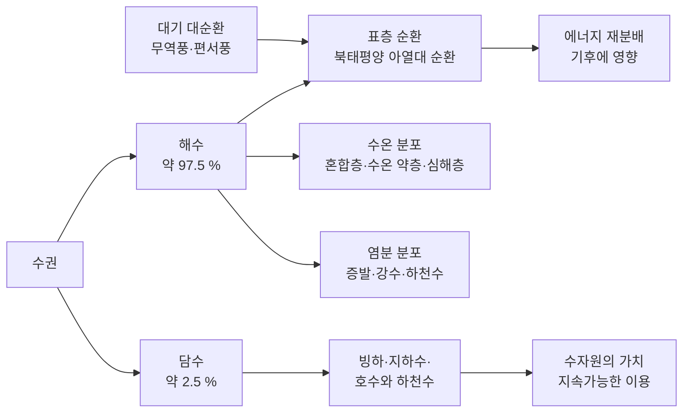

# 중3-3. 수권과 해수의 순환 — 지구를 감싼 물, 에너지를 나르는 바다
<!-- prev: m1-03, m2-01, m2-02, m3-02 -->
<!-- next: 3-1, 5-3, earth-1, esys-2 -->

> [!NOTE]
> **성취기준**
> - **[9과18-01]** 수권에서 해수, 담수, 빙하의 분포와 활용 사례를 조사하고, 자원으로서 물의 가치에 대해 토론할 수 있다.
> - **[9과18-02]** 해수의 수온과 염분의 분포 및 변화를 해석하여 해수의 특성을 설명할 수 있다.
> - **[9과18-03]** 대기 대순환과 해양 표층 순환과의 관계를 이해하고, 기후변화에 영향을 미치는 해류의 역할을 설명할 수 있다.

**학습 목표**

1. 수권을 이루는 해수, 빙하, 지하수, 호수·하천수의 분포 비율을 비교하고, 우리가 쓸 수 있는 물이 매우 적다는 것을 설명할 수 있다.
2. 지하수를 포함한 수자원의 활용 사례를 조사하고, 지속가능한 수자원 활용 방안에 대해 근거를 들어 토론할 수 있다.
3. 해수의 연직 수온 분포를 혼합층·수온 약층·심해층으로 구분하고, 우리나라 주변 해역의 계절별 연직 수온 분포를 해석할 수 있다.
4. 염분의 뜻을 알고, 염분에 영향을 주는 요인과 우리나라 주변 해역의 염분 변화를 설명할 수 있다.
5. 무역풍·편서풍과 북태평양 아열대 순환을 이루는 해류의 관계를 설명할 수 있다.
6. 해류가 저위도의 에너지를 고위도로 운반하여 기후에 영향을 준다는 것을 설명할 수 있다.

**이 단원의 학습 사다리**

| 단계 | 무엇을 하나? |
|---|---|
| STEP 1. 이전 학습 다시 보기 | 초등 '지구와 바다', 중1 열·비열, 중2 지구계·밀도, 중3 대기 대순환을 다시 꺼낸다 |
| STEP 2. 기초 다지기 | 백분율 읽기, 밀도와 층, 바람이 물을 미는 힘을 디딤돌로 놓는다 |
| STEP 3. 핵심 개념 | 수권의 분포 → 수자원과 지하수 → 해수의 수온 → 염분 → 표층 순환 → 해류와 기후 |
| STEP 4. 오개념 바로잡기 | "바다는 깊이 들어가도 수온이 같다?" 같은 착각을 바로잡는다 |
| STEP 5. 다음 단계로 | 우리나라 주변 해류, 심층 순환, 엘니뇨, 에크만 수송 |
| STEP 6. 생활·산업·진로 | 해수 담수화, 지하수 관리, 해양 관측, 관련 진로 |

---

## 🗺️ 단원 들어가기

우주에서 본 지구는 '푸른 행성'이다. 지구 표면의 약 70 %가 바다로 덮여 있기 때문이다. 그런데 이상한 일이 있다. 물이 이렇게 많은데도 세계 곳곳에서 마실 물이 부족하다는 소식이 들린다. 지구의 물은 어디에, 얼마나 있을까?

또 하나의 질문. 영국의 런던은 우리나라 서울보다 훨씬 북쪽(위도 약 51°)에 있지만 겨울 평균 기온은 서울보다 높다. 반대로 미국 서해안의 샌프란시스코는 여름에도 서늘하고 안개가 자주 낀다. 이런 차이를 만드는 숨은 주인공은 **바닷물의 흐름, 해류**이다.

이 단원에서는 지구의 물이 어떻게 분포하는지, 바닷물은 어떤 특성을 갖는지, 그리고 바람이 만든 해류가 어떻게 지구의 에너지를 나르는지 차례로 이어서 살펴본다.

---

## STEP 1. 🔙 이전 학습 다시 보기

### 연계 개념표

| 이전 단원·성취기준 | 그때 배운 것 | 이 단원에서 확장되는 것 |
|---|---|---|
| 초등 3~4학년 「지구와 바다」 | 지구 표면은 육지보다 바다가 넓고, 바닷물은 짜다 | 지구의 물을 해수·빙하·지하수 등으로 나누어 **비율**로 비교하고, 짠 정도를 **염분**으로 나타낸다 |
| 중1 「열」 [9과03-02] | 열은 전도·대류·복사로 이동한다 | 해수가 위아래로 섞이는지 여부로 **수온 약층**과 혼합층을 이해한다 |
| 중1 「열」 [9과03-03] | 물은 비열이 커서 잘 데워지지도 식지도 않는다 | 바다는 많은 열을 저장했다가 **해류**로 운반한다 |
| 중2 「물질의 특성」 [9과08-01] | 밀도가 작은 물질은 위에, 큰 물질은 아래에 놓인다 | 따뜻한 물은 위에, 차가운 물은 아래에 놓여 층을 이룬다 |
| 중2 「지권의 변화」 [9과09-01] | 지구계는 지권·수권·기권·생물권·외권으로 이루어진다 | 수권의 구성과 분포를 구체적으로 살펴본다 |
| 중3 「날씨와 기후변화」 [9과17-02] | 대기 대순환에서 북반구에 무역풍·편서풍·극동풍이 분다 | 무역풍·편서풍이 바닷물을 밀어 **표층 해류**를 만든다 |

### 준비 운동 (사전 진단)

**Q1.** 지구의 물 중 가장 많은 양을 차지하는 담수는 호수·하천수, 지하수, 빙하 중 무엇일까?

**Q2.** 여름에 바다에서 수영하다 발을 깊은 곳으로 뻗으면 물이 더 차갑게 느껴진다. 그 까닭은?

**Q3.** 북반구 중위도(30°~60°)에서 지상에 부는 바람의 이름과 방향은?

정답 및 해설

**Q1. 빙하** — 담수의 약 70 %가 남극과 그린란드 등의 빙하로 얼어 있다.

**Q2.** 햇빛은 바다의 표면을 주로 데우고, 따뜻한 물은 밀도가 작아 위에 머물기 때문이다. 깊은 곳에는 햇빛이 닿지 않아 물이 차갑다.

**Q3.** 편서풍, 서쪽에서 동쪽으로 분다(「날씨와 기후변화」).

---

## STEP 2. 🧱 기초 다지기

### ① 백분율과 '아주 작은 비율' 감 잡기

지구의 물을 1 L 페트병 하나라고 생각해 보자. 이 단원에서 다룰 비율을 부피로 바꾸면 다음과 같다.

| 구분 | 비율(약) | 1 L(1000 mL) 중 |
|---|---|---|
| 해수 | 97.5 % | 975 mL |
| 빙하 | 1.8 % | 18 mL (작은 숟가락 3~4개) |
| 지하수 | 0.8 % | 8 mL |
| 호수·하천수 등 | 0.01 % | 0.1 mL (물 몇 방울) |

(비율은 어림한 값이어서 모두 더하면 100 %와 조금 차이가 난다.)

> [!TIP]
> 💡 **비유** — 1 L 페트병 속 물 중 우리가 비교적 쉽게 이용하는 호수·하천수는 **스포이트로 떨어뜨린 물 몇 방울**에 불과하다.

### ② 밀도와 층 — 따뜻한 물은 위로

중2에서 배운 것처럼 밀도가 작은 물질은 위에, 밀도가 큰 물질은 아래에 놓인다. 물은 온도가 높을수록 밀도가 작아진다(4 °C 부근 이상에서). 그래서 햇빛으로 데워진 따뜻한 물은 위에 머물고, 차가운 물은 아래에 놓인다. 바닷물은 **염분이 높을수록** 밀도가 커진다.

> [!TIP]
> 💡 **비유** — 목욕탕 욕조에 뜨거운 물을 받으면 위쪽은 뜨겁고 아래쪽은 미지근하다. 손으로 휘저어 섞어야 온도가 고르게 된다. 바다에서 '손'의 역할을 하는 것이 **바람**이다.

### ③ 바람이 물을 민다

컵에 물을 담고 빨대로 물 표면을 한쪽으로 계속 불면 표면의 물이 바람 방향으로 흘러간다. 이처럼 **오랫동안 한 방향으로 부는 바람**은 바다 표면의 물을 끌고 가서 큰 흐름을 만든다. 이것이 표층 해류의 출발점이다.

### ④ 난류와 한류를 구분하는 기준

**해류(ocean current)** 는 일정한 방향으로 계속 흐르는 바닷물의 흐름이다. 해류는 출발한 곳에 따라 두 가지로 나눈다.

| 구분 | 난류 | 한류 |
|---|---|---|
| 출발하는 곳 | 저위도 | 고위도 |
| 흐르는 방향 | 고위도 쪽으로 | 저위도 쪽으로 |
| 성질 | 수온·염분이 비교적 높다 | 수온·염분이 비교적 낮다 |

---

## STEP 3. 📘 핵심 개념

### ① 수권의 구성과 분포

지구에 있는 모든 물을 **수권(hydrosphere)** 이라고 한다. 수권은 짠물인 **해수(seawater)** 와 짠맛이 거의 없는 **담수(fresh water)** 로 나눌 수 있고, 담수는 다시 빙하, 지하수, 호수와 하천수 등으로 나뉜다.

| 구분 | 비율(약) | 특징 |
|---|---|---|
| 해수 | 97.5 % | 수권의 대부분. 염분이 있어 그대로 마시거나 농사에 쓰기 어렵다 |
| 빙하 | 1.8 % | 담수 중 가장 많다. 대부분 남극과 그린란드에 얼어 있어 이용하기 어렵다 |
| 지하수 | 0.8 % | 땅속 지층이나 암석의 빈틈을 채우고 있는 물. 담수 중 두 번째로 많다 |
| 호수와 하천수 등 | 0.01 % | 가장 쉽게 이용할 수 있지만 양이 매우 적다 |

> [!IMPORTANT]
> 수권의 물 중 담수는 약 2.5 %뿐이고, 그중 대부분은 빙하이다. 사람이 비교적 쉽게 이용할 수 있는 **지하수와 호수·하천수는 수권 전체의 약 1 %도 되지 않는다.** 물은 많지만 '쓸 수 있는 물'은 아주 적다.

<!-- fig:m3-03-water-distribution -->

#### 수권의 물은 순환한다

수권의 물은 한곳에 머물러 있지 않다. 해수가 증발하여 수증기가 되고, 구름이 되어 비나 눈으로 내리며, 하천과 지하수를 따라 다시 바다로 돌아간다(「날씨와 기후변화」의 구름과 강수). 이 과정에서 물은 태양 에너지를 받아 순환하며, 바다의 짠물이 증발하여 담수로 바뀌는 셈이다.

#### 예제 1

지구 전체 물의 양을 10000이라고 할 때, 빙하·지하수·호수와 하천수의 양을 각각 구하고, 쉽게 이용할 수 있는 담수(지하수 + 호수·하천수)는 담수 전체(약 250)의 몇 %인지 구하시오. (비율은 위 표의 값을 쓴다.)

**풀이**
- 빙하 $= 10000 \times 0.018 = 180$, 지하수 $= 10000 \times 0.008 = 80$, 호수·하천수 $= 10000 \times 0.0001 = 1$
- 쉽게 이용할 수 있는 담수 $= 80 + 1 = 81$
- $\dfrac{81}{250} \times 100 \approx 32\ \%$

담수 중에서도 약 70 %가 빙하이고, 이용하기 쉬운 물은 약 3분의 1 정도이다.

### ② 자원으로서의 물 — 수자원과 지하수

사람이 생활이나 산업에 이용할 수 있는 물을 **수자원(water resources)** 이라고 한다. 수자원은 주로 하천수, 호수, 지하수에서 얻는다.

| 용도 | 활용 사례 |
|---|---|
| 농업용수 | 논과 밭에 물 대기, 가축 기르기. 세계적으로 가장 많은 물이 쓰인다 |
| 생활용수 | 마시는 물, 요리, 씻기, 청소 |
| 공업용수 | 반도체·철강·화학 공장의 세척과 냉각, 제품 원료 |
| 유지용수 | 하천의 생태계와 경관을 유지하기 위해 하천에 흘려보내는 물 |
| 그 밖의 활용 | 수력 발전, 해수를 이용한 양식·소금 생산, 빙하의 관광 자원 |

#### 지하수의 가치와 활용

**지하수(groundwater)** 는 빗물이 땅속으로 스며들어 지층이나 암석 틈을 채운 물이다.

| 지하수의 장점 | 주의할 점 |
|---|---|
| 하천수보다 양이 많고 넓은 지역에 분포한다 | 한번 오염되면 정화하기가 매우 어렵고 오래 걸린다 |
| 계절에 따른 수량과 수온 변화가 작다 | 너무 많이 뽑아 쓰면 땅이 내려앉는 **지반 침하**가 생길 수 있다 |
| 땅속을 지나며 걸러져 비교적 깨끗하다 | 해안 지역에서 과다하게 쓰면 **바닷물이 스며들어** 지하수가 짜진다 |
| 가뭄 때에도 이용할 수 있는 비상 수자원이다 | 다시 채워지는 속도가 느려 사용량 관리가 필요하다 |

지하수는 먹는 샘물, 농업용수, 섬 지역의 생활용수, 그리고 일정한 땅속 온도를 이용한 **지열 냉난방** 등에 쓰인다. 화산섬인 제주도는 빗물이 땅속으로 잘 스며드는 지질이어서 지하수가 중요한 수자원이다.

#### 우리나라의 물 사정

우리나라의 연평균 강수량은 세계 평균보다 많은 편이지만, 비가 **여름철(장마·태풍 시기)에 집중**되고, 산이 많고 하천이 짧아 빗물이 빠르게 바다로 흘러가 버린다. 또 인구 밀도가 높아 **한 사람이 쓸 수 있는 물의 양은 많지 않다.** 그래서 댐과 저수지를 만들어 물을 저장하고, 물을 아껴 쓰는 노력이 필요하다.

#### 지속가능한 수자원 활용 방안

| 방안 | 설명 |
|---|---|
| 빗물 이용 시설 | 건물 옥상의 빗물을 모아 화장실, 조경, 청소에 사용한다 |
| 중수도 | 한 번 사용한 물을 처리하여 마시는 물 이외의 용도로 다시 쓴다 |
| 해수 담수화 | 바닷물에서 염분을 걸러 담수를 만든다(에너지가 많이 든다) |
| 지하수 관리 | 지하수 사용량을 정해 두고, 오염원을 막고, 빗물이 땅속으로 잘 스며들도록 투수성 포장을 늘린다 |
| 물 절약 실천 | 절수형 수도꼭지·변기 사용, 양치 컵 사용, 샤워 시간 줄이기 |

> [!NOTE]
> **토론해 보기 — "우리 지역의 부족한 물, 무엇으로 채울까?"**
> 가뭄이 잦은 해안 도시에 ① 새 댐 건설 ② 해수 담수화 시설 ③ 지하수 개발 확대 ④ 빗물·중수도 의무화 중 하나를 제안해야 한다. 모둠별로 하나씩 맡아 **비용, 에너지, 환경 영향, 지속가능성**을 근거로 장단점을 조사하고 토론해 보자. 정답이 하나인 문제가 아니므로, 자료를 근거로 주장하는 것이 중요하다.

#### 예제 2

해안 마을에서 지하수를 너무 많이 뽑아 썼더니 우물물이 짜졌다. 그 까닭을 설명하고, 해결 방안을 한 가지 제시하시오.

**풀이** 지하수를 과다하게 뽑아 지하수의 수위가 낮아지면, 주변의 바닷물이 땅속으로 밀려 들어와 지하수와 섞이기 때문이다. 지하수 사용량을 줄이고 정해진 양만 쓰도록 관리하거나, 빗물 이용 시설을 함께 활용하는 방안이 있다.

### ③ 해수의 수온 — 깊이에 따라 층을 이룬다

#### 해수의 연직 수온 분포

해수는 주로 **태양 복사 에너지**로 표면이 데워진다. 그래서 깊이에 따른 수온 분포를 보면 세 개의 층으로 나눌 수 있다.

| 층 | 위치 | 수온 변화 | 특징 |
|---|---|---|---|
| **혼합층** | 표면 ~ 수십 m (지역·계절에 따라 다름) | 깊이에 관계없이 거의 **일정** | 태양 에너지로 데워지고, **바람**이 물을 섞어 수온이 고르다. 바람이 강할수록 두껍다 |
| **수온 약층** | 혼합층 아래 ~ 수백 m | 깊어질수록 **급격히 낮아진다** | 위에 따뜻하고 가벼운 물, 아래에 차갑고 무거운 물이 있어 매우 **안정**하다. 혼합층과 심해층 사이의 물질·에너지 교환을 막는다 |
| **심해층** | 수온 약층 아래 ~ 해저 | 매우 낮고 거의 **일정** | 태양 에너지가 도달하지 않아 계절 변화가 거의 없다 |

> [!TIP]
> 💡 **비유** — 수온 약층은 '이불'과 같다. 이불 위(혼합층)는 햇볕과 바람에 따라 온도가 바뀌지만, 이불 아래(심해층)는 그 변화를 거의 느끼지 못한다. 이불이 위아래를 갈라놓기 때문이다.

#### 우리나라 주변 해역의 계절별 연직 수온 분포

| 계절 | 표층 수온 | 혼합층 | 수온 약층 | 까닭 |
|---|---|---|---|---|
| **여름** | 높다 | **얇다** | **뚜렷하다** (표층과 깊은 곳의 수온 차가 크다) | 햇빛이 강해 표면이 많이 데워지고, 바람이 약해 섞이는 깊이가 얕다 |
| **겨울** | 낮다 | **두껍다** | 약해지거나 깊어진다 | 표면이 냉각되고, 강한 북서 계절풍이 물을 깊이까지 섞는다 |

해역마다 특징도 다르다.

| 해역 | 수심 | 계절별 연직 수온 분포의 특징 |
|---|---|---|
| 동해 | 깊다(깊은 곳은 2000 m 이상) | 혼합층·수온 약층·심해층이 모두 나타난다. 깊은 곳에는 1년 내내 매우 차가운 물이 있다. 여름에는 수온 약층이 얕은 곳에 뚜렷하게 생긴다 |
| 황해 | 얕다(평균 약 40~50 m) | **겨울**에는 강한 바람으로 바닥까지 섞여 표층부터 바닥까지 수온이 거의 같다. **여름**에는 표층만 따뜻해지고 바닥 근처에는 겨울에 식은 차가운 물이 남아 위아래 수온 차가 크다 |
| 남해 | 중간 | 따뜻한 해류의 영향으로 겨울에도 표층 수온이 동해·황해보다 높은 편이다 |

또 **표층 수온**은 여름에 높고 겨울에 낮으며, 수심이 얕고 대륙과 가까운 황해는 **연교차가 크다.** 같은 계절에는 대체로 남쪽 바다가 북쪽 바다보다 따뜻하다.

<!-- sim:seawater-profile -->

#### 예제 3

다음은 우리나라 어느 해역에서 같은 지점의 수온을 깊이별로 잰 결과이다.

| 깊이(m) | 0 | 10 | 20 | 30 | 50 | 100 | 200 |
|---|---|---|---|---|---|---|---|
| 8월 수온(°C) | 25 | 25 | 18 | 12 | 9 | 5 | 2 |
| 2월 수온(°C) | 10 | 10 | 10 | 10 | 10 | 5 | 2 |

(1) 8월과 2월의 혼합층 두께를 대략 비교하시오. (2) 수온 약층이 더 뚜렷한 달과 그 까닭을 쓰시오.

**풀이**
(1) 8월은 0~10 m 정도에서 수온이 일정하므로 혼합층이 약 10 m로 얇고, 2월은 0~50 m 정도까지 일정하므로 약 50 m로 두껍다. 2월에 강한 계절풍이 물을 깊이 섞기 때문이다.
(2) 8월이다. 10 m에서 50 m 사이에 수온이 25 °C에서 9 °C로 급격히 낮아진다. 여름에는 표층이 강하게 데워져 깊은 곳과의 수온 차가 크기 때문이다.

### ④ 해수의 염분

#### 염분이란?

바닷물에 녹아 있는 여러 가지 물질을 **염류(salts)** 라고 한다. 염류 중 가장 많은 것은 **염화 나트륨**(약 78 %)이고, 그다음은 **염화 마그네슘**(약 10 %)이다. 염화 나트륨은 짠맛, 염화 마그네슘은 쓴맛을 낸다.

해수 1 kg(1000 g)에 녹아 있는 염류의 총량을 g 수로 나타낸 것을 **염분(salinity)** 이라고 하며, 단위는 **psu**(실용 염분 단위)를 쓴다. 전 세계 바다의 평균 염분은 약 **35 psu**이다.

$$
\text{염분(psu)} = \frac{\text{염류의 질량(g)}}{\text{해수의 질량(kg)}}
$$

#### 염분에 영향을 주는 요인

| 요인 | 염분이 **높아지는** 경우 | 염분이 **낮아지는** 경우 |
|---|---|---|
| 증발량과 강수량 | 증발량이 강수량보다 많을 때 (물만 빠져나감) | 강수량이 증발량보다 많을 때 |
| 하천수 | — | 큰 강물이 흘러드는 연안 |
| 얼음 | 해수가 얼 때 (염류는 얼음에서 빠져나와 주변에 남음) | 빙하나 해빙이 녹을 때 |

- 위도 30° 부근(대기 대순환의 하강 지역)은 맑고 건조하여 증발량이 많으므로 염분이 높다.
- 적도 부근은 증발도 많지만 비가 매우 많이 내려 위도 30° 부근보다 염분이 낮다.

#### 염분비 일정 법칙

염분은 바다마다 다르지만, 해수에 녹아 있는 **각 염류 사이의 비율은 어느 바다에서나 거의 일정**하다. 이를 **염분비 일정 법칙**이라고 한다. 바닷물은 오랜 세월 동안 해류를 따라 끊임없이 섞여 왔기 때문이다. 증발이나 강수는 '물의 양'만 바꿀 뿐 염류끼리의 비율은 바꾸지 않는다.

> [!TIP]
> 💡 **비유** — 진하게 탄 코코아에 물을 더 부으면 맛은 연해지지만 '코코아 가루 : 설탕'의 비율은 그대로이다. 염분이 달라져도 염류끼리의 비율은 그대로인 것과 같다.

#### 우리나라 주변 해역의 염분

| 구분 | 특징 | 까닭 |
|---|---|---|
| 해역별 | 황해가 동해보다 염분이 낮은 편이다 | 황해로는 큰 강(중국의 큰 강, 우리나라 서해안 하천)의 물이 많이 흘러들고, 수심이 얕다 |
| 계절별 | **여름**에 염분이 낮고, **겨울**에 높은 편이다 | 여름에는 장마와 태풍으로 강수량이 많고 하천수 유입이 많다. 겨울에는 강수량이 적다 |
| 연안 | 강 하구 부근은 염분이 특히 낮다 | 하천수가 직접 섞인다 |

#### 예제 4

(1) 해수 2 kg을 증발시켰더니 염류 68 g이 남았다. 이 해수의 염분은?
(2) 염분이 35 psu인 해수 1 kg에 염화 마그네슘이 3.5 g 녹아 있다. 염분비 일정 법칙에 따르면, 염분이 28 psu인 해수 1 kg에 녹아 있는 염화 마그네슘은 몇 g인가?

**풀이**
(1) 해수 1 kg당 $68 \div 2 = 34\ \mathrm{g}$ 이므로 34 psu이다.
(2) 염류 사이의 비율이 일정하므로 $35 : 3.5 = 28 : x$, $x = \dfrac{3.5 \times 28}{35} = 2.8\ \mathrm{g}$ 이다.

#### 예제 5

여름철 장마가 끝난 직후, 우리나라 황해의 강 하구 부근에서 잰 표층 염분이 바깥 바다보다 크게 낮았다. 그 까닭을 두 가지 쓰시오.

**풀이** ① 장마로 강수량이 많아 바다 표면에 담수가 많이 더해졌다. ② 많은 비로 불어난 하천수가 하구를 통해 바다로 흘러들었다.

### ⑤ 대기 대순환과 해양 표층 순환

#### 바람이 만드는 해류

바다 표면 가까이에서 흐르는 해류를 **표층 해류**라고 한다. 표층 해류는 주로 **지속적으로 부는 바람**, 즉 대기 대순환의 바람에 의해 만들어진다. 바람이 바다 표면을 끌고 가면 물이 움직이고, 대륙에 막히면 방향을 바꾸어 큰 고리 모양의 순환을 이룬다. 이를 **표층 순환**이라고 한다.

#### 북태평양 아열대 순환

북태평양에서는 무역풍과 편서풍이 만든 해류가 대륙에 막혀 이어지면서, 저위도와 중위도에 걸쳐 **시계 방향**으로 도는 큰 순환이 만들어진다. 이를 **북태평양 아열대 순환**이라고 한다.

| 해류 | 위치 | 흐르는 방향 | 만드는 원인 | 성질 |
|---|---|---|---|---|
| **북적도 해류** | 적도 북쪽 (저위도) | 동 → 서 | **무역풍** | 저위도를 따라 흐르는 따뜻한 해류 |
| **쿠로시오 해류** | 북태평양 서쪽 가장자리 (아시아 대륙 쪽) | 남 → 북 | 북적도 해류가 대륙에 막혀 북쪽으로 흐른다 | **난류** |
| **북태평양 해류** | 중위도 | 서 → 동 | **편서풍** | 중위도를 따라 동쪽으로 흐른다 |
| **캘리포니아 해류** | 북태평양 동쪽 가장자리 (북아메리카 대륙 쪽) | 북 → 남 | 북태평양 해류가 대륙에 막혀 남쪽으로 흐른다 | **한류** |

> [!IMPORTANT]
> **바람의 방향 = 해류의 방향(대략)**. 저위도에서 동쪽에서 서쪽으로 부는 무역풍은 북적도 해류를, 중위도에서 서쪽에서 동쪽으로 부는 편서풍은 북태평양 해류를 만든다. 두 해류가 대륙에 막혀 남북으로 이어지면서 고리가 완성된다.

<!-- fig:m3-03-subtropical-gyre -->

> [!TIP]
> 💡 **비유** — 운동장 트랙에서 아래쪽 직선 구간(저위도)은 한 친구가 왼쪽으로, 위쪽 직선 구간(중위도)은 다른 친구가 오른쪽으로 공을 굴린다고 하자. 양 끝의 벽(대륙)에 부딪힌 공은 곡선 구간을 따라 반대쪽 직선으로 넘어간다. 결국 공은 트랙을 따라 한 방향으로 계속 돈다.

#### 예제 6

무역풍이 평소보다 약해지면 북적도 해류는 어떻게 될지 예상하시오.

**풀이** 북적도 해류는 무역풍에 의해 동쪽에서 서쪽으로 흐르므로, 무역풍이 약해지면 북적도 해류도 약해질 것이다. (이처럼 바람과 해류는 서로 연결되어 있으며, 무역풍의 세기 변화가 바다와 날씨를 바꾸는 현상은 고등학교에서 '엘니뇨'로 배운다.)

### ⑥ 해류의 역할 — 지구의 에너지를 나누는 컨베이어 벨트

「날씨와 기후변화」에서 저위도는 에너지가 남고 고위도는 에너지가 부족하다고 배웠다. 이 불균형을 줄이는 데 대기 대순환과 함께 **해류**가 큰 역할을 한다.

| 해류 | 하는 일 | 기후에 주는 영향 |
|---|---|---|
| **난류** (쿠로시오 해류 등) | 저위도의 따뜻한 물을 고위도로 운반한다 | 지나가는 지역의 기온을 높이고 습하게 한다 |
| **한류** (캘리포니아 해류 등) | 고위도의 차가운 물을 저위도로 운반한다 | 지나가는 지역의 기온을 낮추고, 공기를 아래에서 식혀 안개가 자주 생긴다 |

물은 비열이 커서 많은 열을 저장할 수 있다(중1 「열」). 그래서 해류는 엄청난 양의 에너지를 천천히, 멀리까지 운반한다.

#### 해류와 기후 사례

| 지역 | 영향을 주는 해류 | 나타나는 기후 |
|---|---|---|
| 일본 남동쪽 해안 | 쿠로시오 해류(난류) | 같은 위도의 다른 지역보다 따뜻하고 비가 많다 |
| 미국 캘리포니아 해안 | 캘리포니아 해류(한류) | 여름에도 서늘하고, 안개가 자주 끼며 비가 적다 |
| 서유럽(영국 등) | 대서양을 건너오는 난류와 편서풍 | 위도가 높은데도 겨울이 비교적 온화하다 |

#### 해류와 기후변화

- 바다는 지구온난화로 늘어난 에너지의 **대부분(약 90 %)** 을 흡수하여 저장하고 있다. 그 결과 해수의 온도가 오르고(**해수온 상승**), 물이 팽창하여 해수면이 높아진다.
- 바다는 인간이 배출한 이산화 탄소의 상당 부분(약 4분의 1)을 녹여 흡수하여 대기 중 이산화 탄소 증가를 늦춘다. 그러나 그만큼 바닷물이 산성 쪽으로 변하는 문제가 생긴다.
- 해류의 세기나 경로가 달라지면 에너지가 운반되는 방식이 바뀌어, 지역의 기온과 강수량, 어장의 위치가 달라진다. 우리나라 주변 바다에서도 표층 수온이 오르면서 잡히는 물고기의 종류가 바뀌고 있다(예: 따뜻한 바다의 어종 증가, 차가운 바다 어종 감소).

#### 예제 7

같은 위도에 있는 두 해안 도시 P와 Q가 있다. P 앞바다에는 저위도에서 고위도로 흐르는 해류가, Q 앞바다에는 고위도에서 저위도로 흐르는 해류가 흐른다. 겨울 평균 기온이 더 높을 것으로 예상되는 도시와 그 까닭을 쓰시오.

**풀이** P이다. P 앞바다의 해류는 저위도의 열에너지를 운반하는 **난류**이므로 주변 지역을 따뜻하게 한다. Q 앞바다의 해류는 **한류**이므로 주변을 차갑게 한다.

---

## STEP 4. ⚠️ 오개념 바로잡기

| 흔한 오개념 | 올바른 개념 | 왜 그럴까? |
|---|---|---|
| 지구에는 물이 많으니 물 부족은 걱정할 필요가 없다 | 쉽게 이용할 수 있는 담수는 수권의 **약 1 %도 되지 않는다** | 대부분이 짠 해수이거나 얼어 있는 빙하이다 |
| 지하수는 땅속에 고인 거대한 호수이고, 무한히 쓸 수 있다 | 지하수는 대부분 지층·암석의 **틈을 채운 물**이고, 다시 채워지는 데 오랜 시간이 걸린다 | 땅속이 보이지 않아 양을 쉽게 짐작하기 어렵다 |
| 바닷물은 깊이에 관계없이 수온이 같다 | 혼합층 – 수온 약층 – 심해층으로 깊이에 따라 수온이 달라진다 | 태양 에너지는 표면만 데우고, 바람이 섞는 깊이도 한정되어 있다 |
| 염분이 다르면 염류의 구성 비율도 다르다 | 염분은 달라도 **염류 사이의 비율은 거의 일정**하다 | 증발·강수는 물의 양만 바꾸고, 바닷물은 오랜 세월 섞여 왔다 |
| 해류는 바다 밑바닥에서 솟아나는 힘으로 흐른다 | 표층 해류는 주로 **지속적인 바람(대기 대순환)** 이 만든다 | 무역풍·편서풍의 방향과 해류의 방향이 대체로 일치한다 |
| 난류는 항상 뜨거운 물, 한류는 얼음처럼 차가운 물이다 | 난류·한류는 **주변 바다보다** 따뜻한지 차가운지로 구분한다 | 출발 위도와 흐르는 방향이 기준이다 |
| 바다는 기후변화와 관계가 없다 | 바다는 열과 이산화 탄소를 흡수하고 해류로 에너지를 운반하여 기후에 큰 영향을 준다 | 물의 큰 비열과 엄청난 양 때문이다 |

---

## STEP 5. 🎓 다음 단계로 한 걸음 더

> [!CAUTION]
> 이 절은 **중학교 교육과정 범위 밖의 심화 내용**으로 평가 대상이 아니다. 중학교에서는 표층 순환 중 **북태평양 아열대 순환을 이루는 해류만** 다룬다. 우리나라 주변 해류, 심층 순환, 해류가 흐르는 원리(에크만 수송, 지형류)는 고등학교에서 배운다.

### 고등학교 과목과의 연결

| 과목·단원 | 이어지는 내용 |
|---|---|
| 통합과학1 「지구시스템의 구성과 상호작용」 | 수권과 기권·지권 사이의 물질 순환과 에너지 흐름 |
| 통합과학2 「지구온난화와 기후변화」 | 엘니뇨, 해수면 상승 등 기후변화의 영향과 대처 방안 |
| 지구과학 「대기와 해양의 상호작용」 | 실측 자료로 해수의 온도·염분·밀도 분석, **심층 순환**, 용승·침강, 엘니뇨–남방진동 |
| 지구시스템과학 「해수의 운동」 | **에크만 수송**과 지형류, 해파, 해일, 조석 |

### ① 우리나라 주변의 해류

쿠로시오 해류의 일부는 갈라져 우리나라 쪽으로 들어온다. 이 난류는 황해로 들어가는 흐름과 동해로 들어가는 흐름(**동한 난류**) 등으로 나뉜다. 동해에서는 북쪽에서 내려오는 한류(**북한 한류**)가 동한 난류와 만나는데, 난류와 한류가 만나는 곳을 **조경 수역**이라고 한다. 조경 수역은 영양 물질과 플랑크톤이 풍부해 좋은 어장이 된다. 조경 수역의 위치는 여름에는 북쪽으로, 겨울에는 남쪽으로 이동한다.

### ② 심층 순환 — 밀도가 만드는 느린 흐름

극지방에서 해수가 차가워지고, 바닷물이 얼면서 염분이 높아지면 밀도가 커진 해수가 깊은 곳으로 가라앉는다. 이 물이 해저를 따라 천천히 이동하는 것이 **심층 순환**이다. 표층 순환과 심층 순환은 연결되어 지구 전체를 도는 거대한 순환을 이룬다. 지구온난화로 빙하가 녹아 극지방 해수의 염분이 낮아지면 침강이 약해져 이 순환이 느려질 수 있다는 연구가 있다.

### ③ 해류는 바람 방향 그대로 흐를까? — 에크만 수송

실제로는 지구 자전의 영향 때문에 바람에 끌려가는 표층 해수 전체는 북반구에서 바람 방향의 **오른쪽**으로 이동한다. 이를 **에크만 수송**이라 한다. 진로 선택 「해수의 운동」에서는 이를 이용해 아열대 순환의 가운데에 해수가 쌓이고, 그 결과 생긴 수압 차이로 해류(지형류)가 흐르는 원리를 배운다.

### 지금 vs 다음 단계

| 구분 | 중학교 3학년 (지금) | 고등학교 지구과학·지구시스템과학 |
|---|---|---|
| 수온·염분 | 연직 수온 분포, 염분의 요인 | 실측 자료로 수온–염분도 해석, 밀도 계산 |
| 해류 | 북태평양 아열대 순환의 4개 해류 | 전 세계 표층 순환, 우리나라 주변 해류, 심층 순환 |
| 해류의 원리 | 바람이 해수를 민다 | 에크만 수송, 지형류, 전향력 |
| 기후와의 관계 | 해류의 에너지 재분배 | 엘니뇨–남방진동, 용승·침강, 해양–대기 상호작용 |

---

## STEP 6. 🏭 생활·산업·진로 연결

### 사례 1. 해수 담수화 — 바닷물을 마시는 물로

- **원리** 바닷물에 높은 압력을 가해 물 분자만 통과하는 막(역삼투막)으로 걸러 내거나, 바닷물을 증발시킨 뒤 수증기를 응결시켜 담수를 얻는다.
- **어디에 쓰이나** 중동처럼 강수량이 적은 지역, 섬 지역, 배 안에서 물을 얻는 데 쓰인다. 많은 에너지가 들고, 걸러 내고 남은 진한 소금물을 처리하는 문제가 있어 효율을 높이는 연구가 이루어지고 있다.

### 사례 2. 지하수와 물 관리

- **원리** 지하수는 다시 채워지는 속도가 느리므로 사용량과 수위를 관측하며 관리해야 한다.
- **어디에 쓰이나** 국가와 지방 자치 단체는 관측정을 설치해 지하수의 수위와 수질을 계속 측정한다. 도시에서는 빗물이 땅으로 스며들도록 투수성 보도블록과 빗물 정원을 늘리고, 빗물을 모아 다시 쓰는 시설을 짓는다.

### 사례 3. 해양 관측과 수산업

- **원리** 해양 관측 부이, 관측선, 인공위성으로 수온·염분·해류를 측정한다.
- **어디에 쓰이나** 실시간 해양 정보는 어장 위치 예측, 양식장 고수온 피해 예방, 선박 항로 설정, 해양 사고 시 표류물 추적에 쓰인다. 장기 관측 자료는 바다의 기후변화를 확인하는 중요한 근거가 된다.

### 관련 진로와 학과

| 진로 | 하는 일 | 관련 학과 |
|---|---|---|
| 해양학자 | 해수의 성질과 해류를 관측·분석하고 기후와의 관계를 연구 | 해양학과, 지구환경과학과 |
| 수자원 엔지니어 | 댐·상하수도·지하수 시설의 설계와 관리 | 토목공학과, 환경공학과 |
| 수질 관리 연구원 | 하천·지하수·바닷물의 오염 조사와 정화 | 환경공학과, 화학과 |
| 수산·양식 전문가 | 수온·염분 정보를 활용한 어업·양식 관리 | 수산학과, 해양생명과학과 |

---

## 🔬 탐구 활동

### 활동 A. 디지털 탐구 도구를 이용하여 해수의 연직 수온 분포 실험하기 (모둠 활동)

**목표** 태양 에너지와 바람이 해수의 연직 수온 분포를 어떻게 만드는지 모형 실험으로 알아본다.

**준비물** 투명한 긴 수조(깊이 30 cm 이상), 물, 소금, 적외선등(또는 백열전구 스탠드), 소형 선풍기(또는 휴대용 팬), 디지털 온도 센서 4~5개, 자, 스탠드와 집게, 스마트 기기(자료 기록용)

**과정**
1. 수조에 물을 채우고, 온도 센서를 수면에서 0 cm, 2 cm, 5 cm, 10 cm, 20 cm 깊이에 고정한다.
2. 적외선등을 수면 위 약 30 cm에서 10분간 비추며 깊이별 온도를 1분마다 기록한다.
3. 적외선등을 켠 채로 선풍기를 수면에 약하게 5분, 강하게 5분 비추며 온도를 기록한다.
4. 모둠마다 조건(전등의 높이, 바람 세기, 물의 깊이 등) 하나를 바꾸어 실험하고, 결과를 공유하여 비교한다.

**결과 기록**

| 깊이(cm) | 처음 온도(°C) | 전등만 10분 후(°C) | 약한 바람 5분 후(°C) | 강한 바람 5분 후(°C) |
|---|---|---|---|---|
| 0 | | | | |
| 2 | | | | |
| 5 | | | | |
| 10 | | | | |
| 20 | | | | |

**생각해 보기**
1. 전등만 비추었을 때 깊이에 따른 온도 분포는 어떠했는가? 실제 바다의 어느 층과 비슷한가?
2. 바람을 불어 주었을 때 수온이 일정한 층의 두께는 어떻게 변했는가? 실제 바다의 여름과 겨울 중 어느 계절과 비슷한가?
3. 이 모형 실험과 실제 바다의 차이점은 무엇일까?

> [!WARNING]
> **안전 수칙** 적외선등은 매우 뜨거우므로 맨손으로 만지지 않고, 물이 튀지 않게 수조와 거리를 둔다. 전기 기구와 물을 함께 사용하므로 젖은 손으로 플러그를 만지지 않는다.

### 활동 B. 실시간 데이터를 활용하여 우리나라 주변 해양 정보 분석하기

**목표** 공공 기관이 제공하는 실시간 해양 관측 자료로 우리나라 주변 바다의 수온과 염분을 비교·분석한다.

**과정**
1. 해양 관련 공공 기관 누리집(해양 관측 정보 서비스)에서 동해·황해·남해의 관측 지점을 하나씩 고른다.
2. 같은 날짜의 표층 수온과 염분을 기록하고, 가능하면 여름(8월)과 겨울(2월)의 자료도 찾아 비교한다.
3. 결과를 표와 그래프로 정리하고, 차이가 나는 까닭을 이 단원에서 배운 요인으로 설명한다.

**결과 기록**

| 해역(관측 지점) | 8월 표층 수온(°C) | 2월 표층 수온(°C) | 8월 염분(psu) | 2월 염분(psu) |
|---|---|---|---|---|
| 동해 | | | | |
| 황해 | | | | |
| 남해 | | | | |

**생각해 보기**
1. 수온의 연교차가 가장 큰 해역은 어디이고, 그 까닭은 무엇일까?
2. 염분이 가장 낮은 해역과 계절은 언제이며, 어떤 요인 때문일까?
3. 최근 여름철 고수온이 양식업에 어떤 영향을 주는지 조사해 보자.

---

## ✅ 개념 확인 문제

### 기본

**1.** 수권을 이루는 물을 양이 많은 것부터 순서대로 쓰시오.
ㄱ. 지하수 ㄴ. 해수 ㄷ. 빙하 ㄹ. 호수와 하천수

정답 및 해설

**정답** ㄴ → ㄷ → ㄱ → ㄹ

해수(약 97.5 %) > 빙하(약 1.8 %) > 지하수(약 0.8 %) > 호수와 하천수(약 0.01 %) 순이다.

**2.** 지하수의 장점을 **두 가지** 쓰시오.

정답 및 해설

**정답 (예시)** ① 하천수보다 양이 많고 넓게 분포한다. ② 계절에 따른 수량·수온 변화가 작다. ③ 가뭄 때 비상 수자원으로 쓸 수 있다. 중 두 가지

**3.** 해수의 연직 수온 분포에서 깊어질수록 수온이 급격히 낮아지는 층의 이름과, 이 층이 매우 안정한 까닭을 쓰시오.

정답 및 해설

**정답** 수온 약층. 위쪽에 따뜻하고 밀도가 작은 물, 아래쪽에 차갑고 밀도가 큰 물이 있어 위아래 물이 잘 섞이지 않기 때문이다.

**4.** 해수 500 g에 염류가 17 g 녹아 있다. 이 해수의 염분을 구하시오.

정답 및 해설

**정답** 34 psu

해수 1 kg(1000 g)으로 환산하면 염류는 $17 \times 2 = 34\ \mathrm{g}$ 이므로 34 psu이다.

**5.** 북태평양 아열대 순환을 이루는 해류 중 무역풍에 의해 만들어지는 해류와 편서풍에 의해 만들어지는 해류를 각각 쓰시오.

정답 및 해설

**정답** 무역풍: 북적도 해류, 편서풍: 북태평양 해류

### 응용

**6.** 염분이 35 psu인 해수 1 kg에 염화 나트륨이 27.3 g 녹아 있다. 염분이 30 psu인 해수 2 kg에 녹아 있는 염화 나트륨의 질량은 몇 g인가?

정답 및 해설

**정답** 46.8 g

염분비 일정 법칙에 따라 30 psu 해수 1 kg 속 염화 나트륨은 $27.3 \times \dfrac{30}{35} = 23.4\ \mathrm{g}$ 이다. 해수가 2 kg이므로 $23.4 \times 2 = 46.8\ \mathrm{g}$ 이다.

**7.** 다음은 우리나라 황해의 어느 지점에서 2월과 8월에 깊이별 수온을 잰 결과를 설명한 것이다. "한 달에는 표층(0 m)부터 바닥(50 m)까지 수온이 약 6 °C로 거의 같았고, 다른 한 달에는 표층이 약 26 °C, 바닥이 약 9 °C였다." (1) 2월의 자료는 어느 쪽인가? (2) 그렇게 판단한 까닭을 혼합층과 관련지어 설명하시오.

정답 및 해설

**정답** (1) 표층부터 바닥까지 약 6 °C로 거의 같은 쪽

(2) 겨울에는 표층이 냉각되고 강한 북서 계절풍이 불어 해수가 바닥까지 섞이므로, 수심이 얕은 황해에서는 혼합층이 바닥까지 이어져 수온이 거의 같아진다. 여름에는 표층만 강하게 데워지고 바람이 약해 섞이지 않아, 바닥에는 차가운 물이 남아 위아래 수온 차가 크다.

**8.** 미국 캘리포니아 해안 지역은 같은 위도의 대륙 안쪽 지역보다 여름이 서늘하고 안개가 자주 낀다. 이 현상을 해류의 종류와 흐르는 방향을 들어 설명하시오.

정답 및 해설

**정답** 캘리포니아 해안에는 고위도에서 저위도로(북 → 남) 흐르는 **한류**인 캘리포니아 해류가 흐른다. 차가운 해수가 그 위의 공기를 식혀 기온이 낮아지고, 공기 속 수증기가 응결하여 안개가 자주 생긴다.

### 융합·서술형

**9. [사회·환경 연계]** 어느 섬 마을은 생활용수의 대부분을 지하수에 의존한다. 관광객이 늘어나면서 지하수 사용량이 크게 늘자, 해안 가까운 관정의 물이 점점 짜지고 있다. (1) 이런 현상이 생기는 까닭을 설명하고, (2) 이 마을을 위한 지속가능한 수자원 활용 방안을 두 가지 이상 제안하되, 각 방안의 한계도 함께 쓰시오.

정답 및 해설

**예시 답안**
(1) 지하수를 다시 채워지는 양보다 많이 뽑아 쓰면 지하수의 수위가 낮아지고, 해안 쪽의 바닷물이 땅속으로 밀려 들어와 지하수에 섞이기 때문이다.
(2) ① **지하수 사용량 관리**: 관정별 사용량을 정하고 수위를 관측한다. — 관광 수요가 많을 때 물이 부족할 수 있다. ② **빗물 이용 시설**: 숙박 시설 옥상의 빗물을 모아 화장실·청소에 쓴다. — 비가 적은 계절에는 효과가 작다. ③ **해수 담수화**: 바닷물을 담수로 만든다. — 많은 에너지와 비용이 들고, 진한 소금물 처리가 필요하다. ④ **중수도·절수 설비**: 사용한 물을 처리해 다시 쓰고, 절수형 설비를 설치한다. — 설치 비용이 든다.

**채점 포인트** ① 과다 사용 → 수위 하강 → 바닷물 침투 ② 방안 두 가지 이상 ③ 각 방안의 한계 제시

**10. [기후·지리 연계]** 지구에 대기 대순환과 해류가 없다면 적도 지방과 극지방의 기온은 지금과 비교하여 어떻게 달라질지 예상하고, 그 까닭을 '에너지 과잉', '에너지 부족', '난류'라는 말을 넣어 서술하시오.

정답 및 해설

**예시 답안**
저위도는 흡수하는 태양 복사 에너지가 방출하는 에너지보다 많은 **에너지 과잉** 지역이고, 고위도는 방출이 흡수보다 많은 **에너지 부족** 지역이다. 지금은 대기 대순환과 쿠로시오 해류 같은 **난류**가 저위도의 남는 에너지를 고위도로 운반하여 이 불균형을 줄이고 있다. 대기 대순환과 해류가 없다면 에너지가 운반되지 않으므로 **적도 지방은 지금보다 더 덥고, 극지방은 지금보다 더 추워져** 위도 간 기온 차이가 훨씬 커질 것이다.

**채점 포인트** ① 위도별 에너지 불균형 ② 대기와 해류(난류)의 에너지 운반 ③ 적도는 더 덥고 극은 더 추워짐

---

## 📝 한눈에 정리

### 핵심 요약

- 수권은 **해수(약 97.5 %)** 와 **담수(약 2.5 %)** 로 이루어지며, 담수는 빙하 > 지하수 > 호수·하천수 순으로 많다.
- 쉽게 이용할 수 있는 물(지하수, 호수·하천수)은 수권의 1 %도 되지 않으므로 물은 소중한 **자원**이다.
- **지하수**는 양이 많고 수량·수온이 안정한 중요한 수자원이지만, 과다 사용 시 지반 침하와 바닷물 침투가 생긴다. 빗물 이용, 중수도, 물 절약 등 **지속가능한 이용**이 필요하다.
- 해수의 연직 수온 분포는 **혼합층 – 수온 약층 – 심해층**이다. 우리나라 주변 바다는 여름에 혼합층이 얇고 수온 약층이 뚜렷하며, 겨울에 혼합층이 두꺼워진다.
- **염분**은 해수 1 kg 속 염류의 g 수(psu)이며, 증발·강수·하천수·결빙의 영향을 받는다. 염류 사이의 비율은 일정하다(**염분비 일정 법칙**).
- 표층 해류는 주로 **대기 대순환의 바람**이 만든다. 북태평양 아열대 순환: **북적도 해류(무역풍) → 쿠로시오 해류 → 북태평양 해류(편서풍) → 캘리포니아 해류**, 시계 방향.
- **난류**는 저위도의 열을 고위도로, **한류**는 고위도의 찬물을 저위도로 운반하여 지구의 에너지를 재분배하고 기후에 영향을 준다.

### 핵심 용어

| 용어 | 뜻 |
|---|---|
| 수권 | 지구에 있는 모든 물 |
| 담수 | 염분이 거의 없는 물. 빙하, 지하수, 호수·하천수 등 |
| 지하수 | 땅속 지층이나 암석의 빈틈을 채우고 있는 물 |
| 수자원 | 사람이 생활과 산업에 이용할 수 있는 물 |
| 혼합층 | 바람의 혼합 작용으로 깊이에 관계없이 수온이 거의 일정한 해수의 표층 |
| 수온 약층 | 깊어질수록 수온이 급격히 낮아지는 매우 안정한 층 |
| 심해층 | 수온 약층 아래, 수온이 낮고 거의 일정한 층 |
| 염분 | 해수 1 kg에 녹아 있는 염류의 총량(g). 단위 psu |
| 염분비 일정 법칙 | 염분은 달라도 염류 사이의 비율은 거의 일정하다는 법칙 |
| 해류 | 일정한 방향으로 계속 흐르는 바닷물의 흐름 |
| 난류 / 한류 | 저위도에서 고위도로 흐르는 따뜻한 해류 / 고위도에서 저위도로 흐르는 차가운 해류 |
| 북태평양 아열대 순환 | 북적도 해류, 쿠로시오 해류, 북태평양 해류, 캘리포니아 해류가 이루는 시계 방향의 순환 |

### 다음 단원으로

이 단원에서 지구의 물과 바다가 기권과 에너지를 주고받으며 기후를 만든다는 것을 알았다. 고등학교 통합과학1 「지구시스템의 구성과 상호작용」에서는 기권·수권·지권·생물권이 물질과 에너지를 주고받는 하나의 **시스템**으로 이 내용을 묶어 보고, 통합과학2 「지구온난화와 기후변화」에서는 바다와 대기가 함께 일으키는 엘니뇨 같은 현상으로 확장한다.
