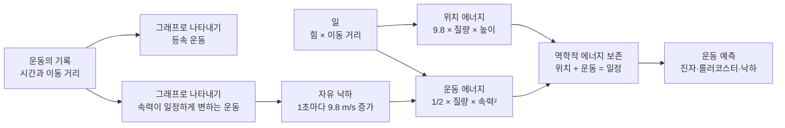

# 중3-4. 운동과 에너지 — 떨어지는 물체가 알려 주는 운동과 에너지의 규칙
<!-- prev: m1-05, m1-03 -->
<!-- next: 3-3, 3-4, 5-6, phy-1, mech-1 -->

> [!NOTE]
> **성취기준**
> - **[9과19-01]** 직선상에서 움직이는 물체의 운동을 그래프로 나타내고 해석할 수 있다.
> - **[9과19-02]** 자유 낙하하는 물체의 운동에서 시간에 따른 속력의 변화가 일정함을 분석할 수 있다.
> - **[9과19-03]** 일의 정의를 알고, 자유 낙하하는 물체의 운동에서 중력이 한 일을 위치 에너지와 운동 에너지로 표현할 수 있다.
> - **[9과19-04]** 물체의 운동에서 역학적 에너지의 전환과 보존을 이해하고, 이를 활용하여 일상생활 속 물체의 운동을 예측할 수 있다.

**학습 목표**

1. 등속 운동과 속력이 일정하게 증가하거나 감소하는 운동을 시간–이동 거리 그래프, 시간–속력 그래프로 나타내고 해석할 수 있다.
2. 자유 낙하하는 물체는 질량이나 종류에 상관없이 1초마다 속력이 9.8 m/s씩 일정하게 증가함을 자료로 분석할 수 있다.
3. 과학에서 말하는 일의 뜻을 알고, 일의 양을 '힘 × 힘의 방향으로 이동한 거리'로 계산할 수 있다.
4. 중력이 한 일이 운동 에너지로, 중력에 대해서 한 일이 위치 에너지로 전환됨을 설명하고 간단히 계산할 수 있다.
5. 역학적 에너지 보존 법칙을 이용하여 낙하하는 물체, 진자, 롤러코스터 등의 속력과 높이를 예측할 수 있다.

**이 단원의 학습 사다리**

| 단계 | 무엇을 하나? |
|---|---|
| STEP 1. 이전 학습 다시 보기 | 초등학교의 '속력', 중1의 '힘과 무게', '열'을 다시 꺼내 본다 |
| STEP 2. 기초 다지기 | 그래프 읽기(기울기·넓이), 비례 관계, 기준 정하기를 디딤돌로 놓는다 |
| STEP 3. 핵심 개념 | 운동 기록 → 등속 운동 → 속력이 변하는 운동 → 자유 낙하 → 일 → 위치·운동 에너지 → 역학적 에너지 보존 |
| STEP 4. 오개념 바로잡기 | "무거운 물체가 더 빨리 떨어진다?" 같은 착각을 바로잡는다 |
| STEP 5. 다음 단계로 | 가속도, 운동량, 탄성 위치 에너지, 에너지 효율로 이어지는 길을 맛본다 |
| STEP 6. 생활·산업·진로 | 롤러코스터, 양수 발전, 스포츠 영상 분석, 교통안전 |

---

## 🗺️ 단원 들어가기

놀이공원의 롤러코스터는 처음에 기계의 힘으로 가장 높은 곳까지 천천히 끌려 올라간다. 그 뒤로는 엔진도 없이 오르락내리락하며 레일 끝까지 달린다. 그런데 이상하게도, 롤러코스터의 두 번째 언덕은 언제나 첫 번째 언덕보다 **낮다.** 왜 두 번째 언덕을 더 높게 만들지 않을까?

또 하나의 질문. 높은 곳에서 볼링공과 축구공을 동시에 떨어뜨리면 어느 것이 먼저 땅에 닿을까? 많은 사람이 "무거운 볼링공"이라고 답하지만, 실제로 해 보면 거의 동시에 떨어진다. 1971년 아폴로 15호의 우주 비행사는 공기가 없는 달 표면에서 망치와 깃털을 동시에 떨어뜨려, 둘이 **똑같이** 떨어지는 장면을 보여 주었다.

이 단원에서는 '움직임을 그래프로 그리는 법'에서 출발해, 떨어지는 물체의 규칙을 찾고, 그 규칙을 **일**과 **에너지**라는 말로 바꾸어 롤러코스터의 비밀까지 풀어 본다.

---

## STEP 1. 🔙 이전 학습 다시 보기

### 연계 개념표

| 이전 단원·성취기준 | 그때 배운 것 | 이 단원에서 확장되는 것 |
|---|---|---|
| 초등학교 5∼6학년군 「물체의 운동」 | 속력 = 이동 거리 ÷ 걸린 시간, 단위 m/s·km/h, 빠르기 비교 | 속력이 **시간에 따라 어떻게 변하는지**를 그래프로 나타낸다 |
| 중1 「힘의 작용」 [9과05-02] | 중력은 지구 중심 방향, 질량 1 kg인 물체의 무게는 약 9.8 N | 무게(중력)가 물체를 떨어뜨리며 **일**을 한다 → 위치 에너지 $9.8mh$ |
| 중1 「힘의 작용」 [9과05-03] | 알짜힘이 0이 아니면 속력이나 운동 방향이 변한다 | 알짜힘이 0이면 **등속 운동**, 중력이 계속 작용하면 **속력이 일정하게 증가** |
| 중1 「힘의 작용」 [9과05-02] | 마찰력은 운동을 방해하는 방향으로 작용한다 | 마찰이 있으면 역학적 에너지가 줄어든다 |
| 중1 「열」 [9과03-01] | 온도는 입자 운동의 활발한 정도, 열은 이동하는 에너지 | 줄어든 역학적 에너지는 **열에너지**로 바뀐다 |

### 준비 운동 (사전 진단)

**Q1.** 300 m를 60초 동안 달린 학생의 평균 속력은 몇 m/s일까?

**Q2.** 질량이 2 kg인 물체의 무게는 약 몇 N일까? 이 물체를 달에 가져가면 질량과 무게 중 무엇이 변할까?

**Q3.** 손바닥을 빠르게 비비면 손이 따뜻해진다. 이때 무엇이 무엇으로 바뀐 것일까?

정답 및 해설

**Q1.** $300 \div 60 = 5\ \mathrm{m/s}$

**Q2.** 약 $19.6\ \mathrm{N}$ ($2 \times 9.8$). 달에서는 **무게**가 약 6분의 1로 줄고, **질량**은 변하지 않는다.

**Q3.** 손의 운동(움직임)이 마찰을 통해 **열**로 바뀌었다. 이 단원 끝에서 "역학적 에너지가 열에너지로 전환된다"라고 다시 정리한다.

---

## STEP 2. 🧱 기초 다지기

### ① 그래프의 기울기 — '얼마나 가파른가'

그래프에서 가로축이 1칸 갈 때 세로축이 얼마나 올라가는지를 **기울기**라고 한다.

$$
\text{기울기} = \frac{\text{세로축 값의 변화}}{\text{가로축 값의 변화}}
$$

- 시간–이동 거리 그래프의 기울기 = $\dfrac{\text{이동 거리}}{\text{시간}}$ = **속력**
- 시간–속력 그래프의 기울기 = $\dfrac{\text{속력 변화}}{\text{시간}}$ = **1초 동안의 속력 변화량**

### ② 그래프의 넓이 — '모두 합하면 얼마인가'

시간–속력 그래프에서 그래프 아래(가로축과 그래프 사이)의 넓이는 **이동 거리**이다.

- 속력 5 m/s로 4초 달리면: 직사각형 넓이 $5 \times 4 = 20\ \mathrm{m}$
- 속력이 0에서 8 m/s까지 일정하게 증가하는 4초 동안: 삼각형 넓이 $\dfrac{1}{2} \times 4 \times 8 = 16\ \mathrm{m}$

### ③ 비례 관계 — '몇 배가 되면 몇 배가 되나'

두 양 중 하나가 2배, 3배가 될 때 다른 하나도 2배, 3배가 되면 두 양은 **비례**한다. 이 단원에는 '제곱에 비례'하는 관계도 나온다. 한 양이 2배, 3배가 될 때 다른 양이 $2^2 = 4$배, $3^2 = 9$배가 되는 관계이다.

| 관계 | 1배 | 2배 | 3배 | 이 단원의 예 |
|---|---|---|---|---|
| 비례 | 1 | 2 | 3 | 등속 운동의 이동 거리와 시간, 위치 에너지와 높이 |
| 제곱에 비례 | 1 | 4 | 9 | 운동 에너지와 속력 |

### ④ 기준을 정하는 습관

"높이 3 m"라고 할 때 무엇을 기준으로 3 m일까? 바닥? 책상 위? 지하 주차장? 과학에서는 **기준(기준면)을 먼저 정하고** 높이를 잰다. 이 단원의 위치 에너지도 기준면에 따라 값이 달라진다. 그래서 문제를 풀 때는 항상 "어디를 높이 0으로 할까?"부터 정하자.

---

## STEP 3. 📘 핵심 개념

### ① 운동을 기록하는 방법 — 같은 시간 간격으로 위치 찍기 [9과19-01]

물체의 운동을 분석하려면 먼저 **시간에 따라 물체가 어디에 있는지**를 기록해야 한다.

| 기록 방법 | 어떻게 기록하나? | 특징 |
|---|---|---|
| 다중 섬광 사진 | 어두운 곳에서 일정한 시간 간격으로 빛을 깜빡이며 한 장에 여러 번 찍는다 | 물체 사이 간격이 넓을수록 빠르다 |
| 동영상 분석 | 스마트폰으로 촬영한 뒤 프레임마다 위치를 읽는다 | 1초에 30장이면 한 프레임 간격은 약 0.033초 |
| 운동 센서(초음파 센서) | 초음파를 쏘아 되돌아오는 시간으로 거리를 잰다 | 컴퓨터가 그래프를 바로 그려 준다 |
| 속력 측정기(광센서) | 물체가 빛을 가리는 시간을 잰다 | 특정 위치의 순간 속력을 알 수 있다 |

**다중 섬광 사진 읽는 법.** 0.1초 간격으로 찍었을 때 공 사이의 간격이 모두 30 cm로 같다면, 공은 0.1초마다 30 cm씩, 즉 1초에 3 m씩 움직인다. 간격이 점점 넓어지면 빨라지는 것이고, 점점 좁아지면 느려지는 것이다.

### ② 속력이 일정한 운동 — 등속 운동 [9과19-01]

속력과 운동 방향이 변하지 않는 운동을 **등속 운동(uniform motion)** 이라고 한다. 이 단원에서는 한 직선 위에서 일어나는 운동을 다룬다. 중1 「힘의 작용」에서 배운 것처럼, 물체에 작용하는 알짜힘이 0이면 운동 상태가 변하지 않으므로 등속 운동을 한다.

**생활 속 예**: 무빙워크 위에 가만히 서 있는 사람, 에스컬레이터, 공장의 컨베이어 벨트, 일정한 속력으로 달리는 고속 열차의 한 구간

#### 등속 운동의 기록과 그래프

자전거가 곧은 길을 일정하게 달리는 모습을 1초 간격으로 기록하였다.

| 시간(s) | 0 | 1 | 2 | 3 | 4 |
|---|---|---|---|---|---|
| 이동 거리(m) | 0 | 4 | 8 | 12 | 16 |
| 1초 동안 이동 거리(m) | — | 4 | 4 | 4 | 4 |

| 그래프 | 모양 | 무엇을 읽을 수 있나? |
|---|---|---|
| 시간–이동 거리 | 원점을 지나는 **기울어진 직선** | 기울기 = 속력 ($16 \div 4 = 4\ \mathrm{m/s}$) |
| 시간–속력 | 가로축과 나란한 **수평선** (높이 4 m/s) | 그래프 아래 넓이 = 이동 거리 |

- 시간–이동 거리 그래프에서 **기울기가 클수록 빠르다.** 두 물체를 한 그래프에 그리면 더 가파른 쪽이 더 빠른 물체이다.
- 등속 운동에서 이동 거리는 시간에 **비례**한다: 이동 거리 = 속력 × 시간

> [!IMPORTANT]
> 시간–이동 거리 그래프는 물체가 실제로 움직인 **길의 모양이 아니다.** 직선 도로를 달려도, 속력이 변하면 그래프는 곡선이 된다. 그래프는 '시간이 흐를 때 이동 거리가 어떻게 쌓이는지'를 보여 줄 뿐이다.

### ③ 속력이 일정하게 변하는 운동 — 시간–속력 그래프로 분석하기 [9과19-01]

정지해 있던 자동차가 출발하거나, 달리던 자전거가 브레이크를 잡을 때처럼 속력이 변하는 운동이 훨씬 많다. 이 중 **1초마다 같은 크기만큼 속력이 변하는 운동**을 살펴보자. 속력이 변할 때는 **시간–속력 그래프**를 그리면 운동을 쉽게 분석할 수 있다.

#### (1) 속력이 일정하게 증가하는 운동

정지해 있던 자동차가 출발하는 모습을 기록하였다.

| 시간(s) | 0 | 1 | 2 | 3 | 4 |
|---|---|---|---|---|---|
| 속력(m/s) | 0 | 2 | 4 | 6 | 8 |
| 1초 동안 속력 변화량(m/s) | — | 2 | 2 | 2 | 2 |
| 처음부터 이동 거리(m) | 0 | 1 | 4 | 9 | 16 |

| 그래프 | 모양 | 무엇을 읽을 수 있나? |
|---|---|---|
| 시간–속력 | 원점을 지나는 **기울어진 직선** | 기울기 = 1초 동안의 속력 변화량 (2 m/s) |
| 시간–이동 거리 | 점점 **가팔라지는 곡선** | 시간이 지날수록 같은 시간 동안 더 많이 간다 |

이동 거리는 시간–속력 그래프 아래 **삼각형 넓이**로 구한다. 4초 동안: $\dfrac{1}{2} \times 4 \times 8 = 16\ \mathrm{m}$

> [!TIP]
> 💡 시간–이동 거리 표를 다시 보자. 1초, 2초, 3초, 4초일 때 이동 거리가 1, 4, 9, 16 m이다. 시간이 2배가 되면 거리는 4배, 3배가 되면 9배이다. 속력이 일정하게 증가하는 운동에서 **이동 거리는 시간의 제곱에 비례**한다. 그래서 곡선이 점점 가팔라진다.

#### (2) 속력이 일정하게 감소하는 운동

10 m/s로 달리던 자전거가 브레이크를 잡아 5초 만에 멈추었다.

| 시간(s) | 0 | 1 | 2 | 3 | 4 | 5 |
|---|---|---|---|---|---|---|
| 속력(m/s) | 10 | 8 | 6 | 4 | 2 | 0 |

- 시간–속력 그래프는 **오른쪽 아래로 내려가는 직선**이다. 1초마다 속력이 2 m/s씩 줄어든다.
- 시간–이동 거리 그래프는 처음에는 가파르다가 점점 **완만해지는 곡선**이고, 멈춘 뒤에는 수평이 된다.
- 멈출 때까지 이동한 거리: 삼각형 넓이 $\dfrac{1}{2} \times 5 \times 10 = 25\ \mathrm{m}$

#### 세 가지 운동 한눈에 비교

| 운동 | 1초 동안 속력 변화 | 시간–속력 그래프 | 시간–이동 거리 그래프 | 생활 속 예 |
|---|---|---|---|---|
| 등속 운동 | 0 | 수평선 | 기울어진 직선 | 무빙워크, 에스컬레이터 |
| 속력이 일정하게 증가 | +일정 | 오른쪽 위로 올라가는 직선 | 점점 가팔라지는 곡선 | 출발하는 자동차, 떨어지는 공 |
| 속력이 일정하게 감소 | −일정 | 오른쪽 아래로 내려가는 직선 | 점점 완만해지는 곡선 | 브레이크를 잡은 자전거, 위로 던진 공 |

#### 예제 1 — 정지 거리 구하기

20 m/s로 달리던 자동차의 운전자가 위험을 발견하고 0.5초 뒤에 브레이크를 밟았다. 브레이크를 밟은 뒤 자동차는 속력이 일정하게 줄어 4초 만에 멈추었다.
(1) 시간–속력 그래프의 모양을 설명하시오. (2) 위험을 발견한 순간부터 멈출 때까지 이동한 거리는?

**풀이**
(1) 처음 0.5초 동안은 20 m/s의 수평선, 그 뒤 4초 동안은 20 m/s에서 0까지 내려가는 직선이다.
(2) 두 부분의 넓이를 더한다.
- 반응하는 동안(직사각형): $20 \times 0.5 = 10\ \mathrm{m}$
- 브레이크를 밟은 동안(삼각형): $\dfrac{1}{2} \times 4 \times 20 = 40\ \mathrm{m}$
- 합: $10 + 40 = 50\ \mathrm{m}$

운전자가 반응하는 짧은 순간에도 차는 10 m나 달린다. 운전 중 휴대 전화를 보면 반응이 늦어져 이 거리가 더 길어진다. (반응 시간은 다음 단원 「자극과 반응」에서 직접 재 본다.)

### ④ 자유 낙하 운동 — 1초마다 9.8 m/s씩 [9과19-02]

정지해 있던 물체가 **중력만 받으며** 떨어지는 운동을 **자유 낙하 운동(free fall)** 이라고 한다. 공기 저항을 무시할 수 있을 때 가능한 운동이다.

#### 자료로 규칙 찾기

쇠구슬을 떨어뜨리며 0.1초 간격으로 찍은 다중 섬광 사진을 분석하였다. (공기 저항을 무시할 수 있는 경우의 값)

| 시간(s) | 0 | 0.1 | 0.2 | 0.3 | 0.4 | 0.5 |
|---|---|---|---|---|---|---|
| 떨어진 거리(cm) | 0 | 4.9 | 19.6 | 44.1 | 78.4 | 122.5 |
| 0.1초 동안 떨어진 거리(cm) | — | 4.9 | 14.7 | 24.5 | 34.3 | 44.1 |
| 그 구간의 평균 속력(m/s) | — | 0.49 | 1.47 | 2.45 | 3.43 | 4.41 |

- 0.1초마다 구간의 평균 속력이 **0.98 m/s씩 일정하게 증가**한다. 따라서 1초마다 속력은 $0.98 \times 10 = 9.8\ \mathrm{m/s}$씩 증가한다.
- 0.1초 동안 떨어진 거리가 9.8 cm씩 일정하게 늘어나는 것도 속력이 일정하게 증가한다는 증거이다.

> [!IMPORTANT]
> **자유 낙하 운동의 규칙**: 물체의 종류나 질량에 상관없이, 자유 낙하하는 물체의 속력은 **1초마다 9.8 m/s씩 일정하게 증가**한다.
> 따라서 시간–속력 그래프는 원점을 지나고 기울기가 9.8인 직선이며, 떨어지기 시작한 지 $t$초 뒤의 속력은 $9.8 \times t$ (m/s)이다.

| 떨어진 시간(s) | 1 | 2 | 3 | 4 |
|---|---|---|---|---|
| 속력(m/s) | 9.8 | 19.6 | 29.4 | 39.2 |
| 떨어진 거리(m) = 삼각형 넓이 | 4.9 | 19.6 | 44.1 | 78.4 |

#### 왜 무거운 물체도 똑같이 떨어질까?

질량이 2배인 물체는 중력(무게)도 2배이다. 하지만 질량이 2배인 물체는 운동 상태를 바꾸기도 2배 어렵다. 힘이 2배, 움직이기 어려운 정도도 2배이므로 결국 **속력이 변하는 정도는 같다.**

공기 중에서 깃털이 늦게 떨어지는 까닭은 '가벼워서'가 아니라 '무게에 비해 **공기 저항**을 크게 받아서'이다. 같은 종이라도 구기면 공기 저항이 작아져 빨리 떨어지는 것이 그 증거이다.

#### 예제 2 — 다리 위에서 떨어뜨린 돌

다리 위에서 돌을 가만히 떨어뜨렸더니 2초 뒤에 물에 닿았다. (공기 저항 무시)
(1) 물에 닿는 순간 돌의 속력은? (2) 다리에서 물까지의 높이는?

**풀이**
(1) $9.8 \times 2 = 19.6\ \mathrm{m/s}$
(2) 시간–속력 그래프 아래 삼각형 넓이: $\dfrac{1}{2} \times 2 \times 19.6 = 19.6\ \mathrm{m}$

### ⑤ 과학에서 말하는 일 [9과19-03]

"오늘 일을 많이 했다"라고 할 때의 일과 과학의 일은 다르다. 과학에서 **일(work)** 은 물체에 힘을 작용하여 **힘의 방향으로 물체를 이동시켰을 때** 한 것이다.

$$
\text{일} = \text{힘} \times \text{힘의 방향으로 이동한 거리} \qquad W = F \times s
$$

- 일의 단위는 **J(줄)**. $1\ \mathrm{J}$은 $1\ \mathrm{N}$의 힘으로 물체를 힘의 방향으로 $1\ \mathrm{m}$ 이동시킬 때 한 일이다. ($1\ \mathrm{J} = 1\ \mathrm{N \cdot m}$)

#### 일을 했을까, 안 했을까?

| 상황 | 과학에서의 일 | 이유 |
|---|---|---|
| 수레를 20 N의 힘으로 밀어 5 m 이동시켰다 | 100 J | 힘의 방향으로 이동했다 |
| 무거운 바위를 온 힘으로 밀었지만 꿈쩍도 하지 않았다 | 0 | 이동 거리가 0이다 |
| 가방을 들고 복도를 수평으로 걸어갔다 | 0 (가방을 든 힘이 한 일) | 드는 힘(위쪽)과 이동 방향(수평)이 수직이다 |
| 역도 선수가 바벨을 머리 위로 들어 올렸다 | 일을 했다 | 들어 올리는 힘의 방향(위)으로 이동했다 |
| 들어 올린 바벨을 머리 위에서 3초간 버티고 있다 | 0 | 힘은 주지만 이동 거리가 0이다 |

> [!WARNING]
> 바벨을 들고 버티면 무척 힘들고 땀이 난다. 하지만 이것은 근육 세포가 계속 에너지를 쓰기 때문이고, **바벨에 해 준 일은 0**이다. '힘들다'와 '일을 했다'는 같은 말이 아니다.

#### 중력에 대해서 한 일 — 물체 들어 올리기

물체를 천천히 들어 올리려면 물체의 무게만큼의 힘을 위로 주어야 한다. 중1에서 배운 대로 질량 $m$(kg)인 물체의 무게는 $9.8 \times m$ (N)이므로, 높이 $h$까지 들어 올릴 때 **중력에 대해서 한 일 = 무게 × 높이 = $9.8 \times m \times h$** 이다.

### ⑥ 일과 에너지 — 위치 에너지와 운동 에너지 [9과19-03]

**에너지(energy)** 는 **일을 할 수 있는 능력**이다. 물체에 일을 해 주면 그만큼 물체의 에너지가 늘고, 물체가 다른 물체에 일을 하면 그만큼 에너지가 줄어든다. 그래서 에너지의 단위도 일과 같은 J이다.

> [!TIP]
> 💡 **비유** — 에너지를 '통장 잔고', 일을 '입금·출금'이라고 생각하자. 물체에 일을 해 주는 것은 입금, 물체가 일을 하는 것은 출금이다. 잔고와 입금액의 단위가 둘 다 '원'이듯, 에너지와 일의 단위도 둘 다 J이다.

#### (1) 위치 에너지 — 높은 곳에 있어서 가진 에너지

높은 곳에 있는 물체는 떨어지면서 다른 물체에 일을 할 수 있다. 공사장의 말뚝 박는 기계는 무거운 추를 높이 들어 올렸다가 떨어뜨려 말뚝을 땅에 박는다. 이처럼 **높은 곳에 있는 물체가 가진 에너지**를 **중력에 의한 위치 에너지(gravitational potential energy)** 라고 한다.

물체를 높이 $h$까지 들어 올리면 '중력에 대해서 한 일'만큼 위치 에너지가 저장된다.

$$
E_p = 9.8 \times m \times h \qquad (E_p: \mathrm{J},\ m: \mathrm{kg},\ h: \mathrm{m})
$$

- 위치 에너지는 **질량에 비례**하고, **높이에 비례**한다.
- 높이는 **기준면**에서 잰다. 기준면에서 위치 에너지는 0이다.

| 상황 | 기준면 | 위치 에너지 |
|---|---|---|
| 질량 2 kg인 화분이 바닥에서 3 m 높이의 베란다에 있다 | 바닥 | $9.8 \times 2 \times 3 = 58.8\ \mathrm{J}$ |
| 같은 화분, 베란다 바닥을 기준으로 할 때 | 베란다 바닥 | 0 |
| 질량 1 kg인 책이 0.8 m 높이의 책상 위에 있다 | 교실 바닥 | $9.8 \times 1 \times 0.8 = 7.84\ \mathrm{J}$ |

#### (2) 운동 에너지 — 움직이고 있어서 가진 에너지

굴러가는 볼링공은 핀을 쓰러뜨리고, 흐르는 물은 물레방아를 돌린다. **움직이는 물체가 가진 에너지**를 **운동 에너지(kinetic energy)** 라고 한다.

$$
E_k = \frac{1}{2} \times m \times v^2 \qquad (E_k: \mathrm{J},\ m: \mathrm{kg},\ v: \mathrm{m/s})
$$

- 운동 에너지는 **질량에 비례**하고, **속력의 제곱에 비례**한다.
- 속력이 2배가 되면 운동 에너지는 **4배**, 3배가 되면 **9배**가 된다.

> [!IMPORTANT]
> 자동차의 속력이 시속 50 km에서 시속 100 km로 2배가 되면, 운동 에너지는 **4배**가 된다. 브레이크로 이 에너지를 모두 없애야 멈출 수 있으므로, 같은 힘으로 브레이크를 잡을 때 멈출 때까지 미끄러지는 거리도 약 4배로 길어진다. 과속이 위험한 과학적 이유이다.

#### (3) 자유 낙하에서 중력이 한 일 = 운동 에너지

질량 $m$인 물체가 높이 $h$만큼 자유 낙하하면, 중력(무게 $9.8m$)이 물체를 아래로 $h$만큼 이동시키므로 **중력이 $9.8 \times m \times h$만큼 일을 한다.** 이 일만큼 물체의 위치 에너지가 줄고, 같은 양만큼 운동 에너지가 늘어난다.

| 구분 | 들어 올릴 때 | 떨어질 때 |
|---|---|---|
| 누가 일을 하나? | 사람이 **중력에 대해서** 일을 한다 | **중력이** 일을 한다 |
| 일의 양 | $9.8mh$ | $9.8mh$ |
| 무엇으로 전환되나? | **위치 에너지**로 저장 | **운동 에너지**로 전환 |

> [!NOTE]
> **왜 운동 에너지는 $\frac{1}{2}mv^2$일까?** — 자유 낙하 그래프로 확인해 보자.
> 정지 상태에서 $t$초 동안 떨어지면 속력은 $v = 9.8t$, 떨어진 거리는 삼각형 넓이 $h = \frac{1}{2} \times t \times v$이다.
> 중력이 한 일 $= 9.8m \times h = 9.8m \times \frac{1}{2}tv = \frac{1}{2}m \times (9.8t) \times v = \frac{1}{2}mv^2$
> 중력이 한 일이 정확히 $\frac{1}{2}mv^2$이 된다. 그래프의 넓이와 기울기만으로 운동 에너지 식을 얻은 것이다.

### ⑦ 역학적 에너지의 전환과 보존 [9과19-04]

위치 에너지와 운동 에너지를 합한 것을 **역학적 에너지(mechanical energy)** 라고 한다. **역학적 에너지 = 위치 에너지 + 운동 에너지**

#### (1) 역학적 에너지의 전환

| 운동 | 위치 에너지 | 운동 에너지 | 전환 |
|---|---|---|---|
| 떨어지는 물체 | 감소 | 증가 | 위치 → 운동 |
| 위로 던진 물체가 올라갈 때 | 증가 | 감소 | 운동 → 위치 |
| 롤러코스터가 언덕을 내려갈 때 | 감소 | 증가 | 위치 → 운동 |

#### (2) 역학적 에너지 보존 법칙

공기 저항이나 마찰이 없으면 위치 에너지가 줄어든 만큼 운동 에너지가 늘어나고, 운동 에너지가 줄어든 만큼 위치 에너지가 늘어난다. 따라서 **역학적 에너지는 항상 일정하게 보존된다.** 이것을 **역학적 에너지 보존 법칙**이라고 한다.

질량 2 kg인 공을 10 m 높이에서 가만히 떨어뜨릴 때(지면 기준, 공기 저항 무시):

| 높이(m) | 위치 에너지(J) | 운동 에너지(J) | 역학적 에너지(J) | 속력(m/s) |
|---|---|---|---|---|
| 10 | 196 | 0 | 196 | 0 |
| 7.5 | 147 | 49 | 196 | 7 |
| 5 | 98 | 98 | 196 | 약 9.9 |
| 2.5 | 49 | 147 | 196 | 약 12.1 |
| 0 | 0 | 196 | 196 | 14 |

- 표의 어느 줄에서나 위치 에너지 + 운동 에너지 = 196 J로 같다.
- 위치 에너지는 높이에 비례하여 일정하게 줄지만, 속력은 일정하게 늘지 않는다. 운동 에너지가 속력의 **제곱**에 비례하기 때문이다.

#### (3) 진자의 운동

실에 추를 매달아 흔드는 **진자**는 역학적 에너지 전환을 관찰하기 좋은 예이다.

| 위치 | 높이 | 속력 | 위치 에너지 | 운동 에너지 |
|---|---|---|---|---|
| 처음 놓은 곳 A (가장 높음) | 최대 | 0 | 최대 | 0 |
| 가장 낮은 곳 O | 최소 | 최대 | 최소 | 최대 |
| 반대편 끝 B | A와 같은 높이 | 0 | 최대 | 0 |

공기 저항과 마찰이 없다면 진자는 처음 놓은 높이와 **같은 높이까지** 올라가고, 영원히 같은 폭으로 흔들린다. 그네, 시계추, 바이킹 놀이 기구도 같은 원리이다.

### ⑧ 역학적 에너지 보존으로 운동 예측하기 [9과19-04]

역학적 에너지 보존 법칙을 이용하면 물체의 운동을 직접 재지 않고도 **높이에서 속력을, 속력에서 높이를** 예측할 수 있다.

$$
(\text{위치 에너지} + \text{운동 에너지})_{\text{처음}} = (\text{위치 에너지} + \text{운동 에너지})_{\text{나중}}
$$

#### 예제 3 — 진자의 가장 낮은 점에서의 속력

질량 0.5 kg인 진자의 추를 가장 낮은 점보다 0.1 m 높은 곳에서 가만히 놓았다. 추가 가장 낮은 점을 지날 때의 속력은? (가장 낮은 점을 기준면으로 하고, 공기 저항은 무시)

**풀이**
처음: 위치 에너지 $= 9.8 \times 0.5 \times 0.1 = 0.49\ \mathrm{J}$, 운동 에너지 $= 0$
가장 낮은 점: 위치 에너지 $= 0$, 운동 에너지 $= 0.49\ \mathrm{J}$ 이므로
$\frac{1}{2} \times 0.5 \times v^2 = 0.49 \;\Rightarrow\; v^2 = 1.96 \;\Rightarrow\; v = 1.4\ \mathrm{m/s}$

#### 예제 4 — 위로 던진 공은 어디까지 올라갈까?

질량 0.2 kg인 공을 지면에서 연직 위로 14 m/s의 속력으로 던졌다. 공이 올라가는 최고 높이는? (공기 저항 무시)

**풀이**
던질 때 운동 에너지 $= \frac{1}{2} \times 0.2 \times 14^2 = 19.6\ \mathrm{J}$
최고점에서 속력이 0이므로 이 에너지가 모두 위치 에너지가 된다.
$9.8 \times 0.2 \times h = 19.6 \;\Rightarrow\; h = 10\ \mathrm{m}$

> [!TIP]
> 💡 예제 4에서 질량 0.2가 양쪽에 모두 들어 있어 계산 중에 지워진다. 그래서 **공기 저항이 없으면 최고 높이는 질량과 상관없이 던진 속력만으로 정해진다.** 자유 낙하하는 속력이 질량과 상관없던 것과 같은 이야기이다.

#### 예제 5 — 롤러코스터 예측하기

마찰이 없는 레일에서 롤러코스터가 높이 20 m인 A점에서 거의 정지 상태로 출발한다. 레일에는 높이 10 m인 B점, 높이 0인 C점, 높이 22 m인 D점이 차례로 있다.
(1) B점에서의 속력은? (2) 롤러코스터는 D점을 넘을 수 있을까?

**풀이**
(1) A에서 B로 10 m 내려가는 동안 줄어든 위치 에너지가 운동 에너지가 된다. 질량을 $m$이라 하면
$9.8 \times m \times 10 = \frac{1}{2} \times m \times v^2 \;\Rightarrow\; v^2 = 196 \;\Rightarrow\; v = 14\ \mathrm{m/s}$
(2) 넘을 수 없다. D점에 가려면 위치 에너지가 처음보다 커야 하는데, 역학적 에너지는 처음의 위치 에너지($20\ \mathrm{m}$ 높이)보다 커질 수 없다. 출발점보다 높은 언덕은 넘지 못한다.

#### 마찰이 있으면 — 에너지는 사라지지 않고 모습을 바꾼다

실제로는 공기 저항과 마찰이 있어서 진자는 점점 덜 흔들리다 멈추고, 튀는 공은 점점 낮게 튄다. 이때 역학적 에너지가 줄어든다. 하지만 에너지가 **없어진 것이 아니라** 중1 「열」에서 배운 **열에너지**와 소리 에너지 등으로 바뀐 것이다.

| 현상 | 줄어든 역학적 에너지는 어디로? |
|---|---|
| 진자가 점점 덜 흔들린다 | 공기 저항·마찰 → 열에너지 |
| 튀는 공이 점점 낮게 튄다 | 공과 바닥의 변형 → 열에너지, 소리 에너지 |
| 자동차 브레이크 패드가 뜨거워진다 | 마찰 → 열에너지 |

> [!IMPORTANT]
> 롤러코스터의 두 번째 언덕이 첫 번째 언덕보다 낮은 이유가 여기에 있다. 달리는 동안 마찰과 공기 저항으로 역학적 에너지 일부가 열에너지와 소리 에너지로 바뀌므로, 두 번째 언덕은 출발점보다 충분히 낮아야 넘을 수 있다.

---

## STEP 4. ⚠️ 오개념 바로잡기

| 흔한 오개념 | 올바른 개념 | 왜 그럴까? |
|---|---|---|
| 무거운 물체가 가벼운 물체보다 빨리 떨어진다 | 공기 저항이 없으면 질량과 상관없이 **1초마다 9.8 m/s씩** 똑같이 빨라진다 | 무게가 2배이면 움직이기 어려운 정도도 2배이다. 일상에서 차이가 나는 것은 공기 저항 때문이다 |
| 시간–이동 거리 그래프의 곡선은 물체가 휘어진 길을 간 것이다 | 그래프는 **시간에 따른 이동 거리**를 나타낼 뿐, 길의 모양이 아니다 | 직선 도로에서 속력이 변해도 곡선이 된다 |
| 힘을 주면 항상 일을 한 것이다 | **힘의 방향으로 이동**해야 일을 한 것이다 | 벽을 밀거나 가방을 들고 수평으로 걸을 때 한 일은 0이다 |
| 운동 에너지는 속력에 비례한다 | 운동 에너지는 **속력의 제곱**에 비례한다 | 속력이 2배이면 운동 에너지는 4배이다 |
| 위치 에너지의 값은 하나로 정해져 있다 | 위치 에너지는 **기준면**에 따라 달라진다 | 높이를 어디서부터 재느냐에 따라 $h$가 달라진다. 단, 위치 에너지의 '변화량'은 기준면과 상관없다 |
| 위로 던진 공은 최고점에서 에너지가 0이다 | 최고점에서 **운동 에너지만 0**이고, 위치 에너지는 최대이다 | 역학적 에너지는 그대로이고 모습만 바뀌었다 |
| 마찰이 있으면 에너지가 사라진다 | 역학적 에너지는 줄지만 **열에너지 등으로 전환**되어 전체 에너지는 보존된다 | 미끄럼틀이나 브레이크가 뜨거워지는 것이 그 증거이다 |

---

## STEP 5. 🎓 다음 단계로 한 걸음 더

> [!CAUTION]
> 이 절은 **중학교 교육과정 범위 밖의 심화 내용**으로 평가 대상이 아니다. 이 단원에서 배운 개념이 통합과학과 선택과목에서 어떻게 이어지고 깊어지는지를 맛보기로 보여 주기 위한 내용이다.

### 다음 학년·과목과의 연결

| 이어지는 단원 | 이어지는 내용 |
|---|---|
| 통합과학1 「중력과 운동」 | 자유 낙하의 '1초마다 9.8 m/s'를 **중력 가속도**로 정리하고, 수평으로 던진 운동과 인공위성의 원운동까지 중력으로 설명한다 |
| 통합과학1 「운동량과 충격량」 | 관성, 운동량 $mv$, 충격량으로 에어백·헬멧 같은 안전장치를 설명한다 |
| 통합과학2 「에너지 효율과 신재생 에너지」 | 에너지가 전환될 때 총량은 보존되지만 일부가 열로 빠져나가 **효율**이 100%가 되지 못함을 다룬다 |
| 물리학 「힘과 에너지」 | 뉴턴 운동 법칙으로 등가속도 운동을 정량적으로 다루고, 일–운동 에너지 정리, 탄성 위치 에너지까지 역학적 에너지 보존을 넓힌다 |
| 역학과 에너지 「시공간과 운동」 | 포물선 운동, 원운동, 행성마다 다른 탈출 속도를 역학적 에너지 보존으로 다룬다 |

### ① '1초마다 속력 변화량'에 이름을 붙이면 — 가속도

고등학교에서는 1초 동안의 속도 변화량을 **가속도**라고 부르고, 속력이 일정하게 변하는 운동을 **등가속도 운동**이라고 한다. 자유 낙하의 '1초마다 9.8 m/s'는 **중력 가속도** $g = 9.8\ \mathrm{m/s^2}$이 된다. 또 이 단원의 '9.8 × 질량'은 고등학교에서 $mg$로 쓴다.

$$
E_p = mgh, \qquad v = gt, \qquad h = \frac{1}{2}gt^2
$$

또한 방향까지 생각한 **속도**를 쓰면, 위로 던진 공의 '속력이 일정하게 감소하는 운동'과 '떨어지는 운동'이 사실은 **하나의 등가속도 운동**이라는 것을 알게 된다.

### ② 일과 운동 에너지의 관계 — 일·운동 에너지 정리

물리학에서는 중력뿐 아니라 어떤 힘이든 물체에 한 **알짜힘의 일이 운동 에너지의 변화량과 같다**는 것을 배운다.

$$
W_{\text{알짜힘}} = \frac{1}{2}mv_{\text{나중}}^2 - \frac{1}{2}mv_{\text{처음}}^2
$$

이 단원에서 '중력이 한 일 = 운동 에너지'를 그래프로 확인한 것이 그 첫걸음이다.

### 지금 vs 다음 단계

| 구분 | 중학교 (이 단원) | 통합과학·물리학 | 역학과 에너지 |
|---|---|---|---|
| 운동의 표현 | 속력, 시간–속력 그래프 | 속도·가속도, 등가속도 운동 공식 | 2차원 포물선·원운동, 벡터 |
| 낙하 | 1초마다 9.8 m/s 증가 | 중력 가속도 $g$ | 거리에 따라 변하는 중력 |
| 일 | 힘 × 힘의 방향으로 이동한 거리 | 일·운동 에너지 정리 | 변하는 힘이 한 일 |
| 위치 에너지 | $9.8mh$ (기준면 근처) | $mgh$, 탄성 위치 에너지 $\frac{1}{2}kx^2$ | 만유인력에 의한 위치 에너지 |
| 에너지 보존 | 역학적 에너지 보존, 마찰 → 열 (정성) | 열을 포함한 에너지 총량 보존, 효율 | 탈출 속도, 행성 궤도 |

---

## STEP 6. 🏭 생활·산업·진로 연결

### 사례 1. 롤러코스터와 놀이 기구 설계

- **원리** 첫 언덕까지 체인으로 끌어올려 위치 에너지를 저장한 뒤, 그 에너지를 운동 에너지로 바꾸며 달린다. 마찰과 공기 저항으로 잃는 에너지를 계산해 뒤쪽 언덕을 점점 낮게 설계한다.
- **어디에 쓰이나** 놀이 기구 설계자는 각 지점의 속력을 역학적 에너지 보존으로 먼저 예측하고, 탑승자가 견딜 수 있는 범위인지 확인한다. 마지막 구간의 자석 브레이크는 남은 운동 에너지를 열로 바꾸어 차량을 안전하게 멈춘다.

### 사례 2. 양수 발전 — 물을 들어 올려 에너지를 저장하기

- **원리** 전기가 남는 시간에 아래 저수지의 물을 위 저수지로 퍼 올려 **위치 에너지**로 저장한다. 전기가 많이 필요한 시간에 물을 흘려보내 위치 에너지 → 운동 에너지 → 전기 에너지로 바꾼다.
- **어디에 쓰이나** 높은 곳에 물을 저장하는 '거대한 배터리' 역할을 한다. 우리나라에도 여러 곳에 양수 발전소가 있으며, 햇빛과 바람에 따라 발전량이 변하는 신재생 에너지를 보완하는 방법으로 주목받는다. (자세한 발전 원리는 통합과학2 「발전기와 전기 에너지」에서 배운다.)

### 사례 3. 교통안전 — 정지 거리와 운동 에너지

- **원리** 정지 거리 = 반응하는 동안 달린 거리(등속 운동) + 브레이크를 밟은 뒤 미끄러진 거리(속력이 감소하는 운동). 운동 에너지는 속력의 제곱에 비례하므로 속력이 조금만 높아져도 제동 거리가 크게 늘어난다.
- **어디에 쓰이나** 어린이 보호 구역의 제한 속도를 낮게 정하는 것, 빗길에서 감속하도록 하는 것 모두 이 원리에 근거한다.

### 관련 진로와 학과

| 진로 | 하는 일 | 관련 학과 |
|---|---|---|
| 기계·놀이 기구 설계 엔지니어 | 롤러코스터·엘리베이터 등의 운동과 안전 설계 | 기계공학과 |
| 에너지 엔지니어 | 양수 발전·수력 발전 등 에너지 저장·전환 시스템 설계 | 전기공학과, 에너지공학과 |
| 스포츠 과학자 | 영상·센서로 선수의 동작을 분석하고 훈련 방법 제안 | 체육학과, 스포츠과학과 |
| 교통 안전 연구원 | 정지 거리, 충돌 분석, 도로 안전 설계 | 교통공학과, 기계공학과 |

---

## 🔬 탐구 활동

### 활동 A. 여러 가지 물체의 자유 낙하 운동 분석하기

**목표** 여러 물체의 낙하 영상을 분석하여, 질량이나 종류에 상관없이 1초마다 속력 변화량이 일정함을 찾는다.

**준비물** 쇠구슬, 골프공, 탁구공, 고무공(크기·질량이 다른 것), 줄자, 스마트폰(슬로 모션 촬영), 영상 분석 앱 또는 컴퓨터, 검은색 배경 천

**과정**
1. 벽에 줄자를 세로로 붙이고 검은 천을 배경으로 둔다.
2. 약 1.5 m 높이에서 물체를 가만히 놓고, 줄자와 물체가 함께 보이도록 슬로 모션으로 촬영한다.
3. 영상 분석 앱에서 0.1초 간격으로 물체의 위치를 읽어 표에 기록한다.
4. 0.1초 동안 떨어진 거리로 구간의 평균 속력을 구하고, 시간–속력 그래프를 그린다.
5. 물체를 바꾸어 같은 과정을 반복한다.

**결과 기록**

| 시간 구간(s) | 0∼0.1 | 0.1∼0.2 | 0.2∼0.3 | 0.3∼0.4 | 0.4∼0.5 |
|---|---|---|---|---|---|
| 쇠구슬: 떨어진 거리(cm) | | | | | |
| 쇠구슬: 평균 속력(m/s) | | | | | |
| 탁구공: 평균 속력(m/s) | | | | | |

**생각해 보기**
1. 각 물체의 시간–속력 그래프 기울기를 구해 보자. 1초 동안의 속력 변화량은 약 얼마인가?
2. 탁구공의 그래프가 다른 물체와 조금 다르다면 그 까닭은 무엇일까?
3. 질량이 큰 물체와 작은 물체의 그래프를 비교하고, 자유 낙하 운동의 규칙을 한 문장으로 정리해 보자.

### 활동 B. 자유 낙하하는 물체의 역학적 에너지 보존 실험하기

**목표** 낙하하는 쇠구슬의 위치 에너지 감소량과 운동 에너지 증가량을 비교한다.

**준비물** 쇠구슬(질량을 미리 측정), 스탠드, 투명 관 또는 낙하 가이드, 속력 측정기(광센서) 또는 스마트폰 슬로 모션, 자

**과정**
1. 쇠구슬을 놓는 높이를 정하고, 그보다 0.2 m, 0.4 m, 0.6 m, 0.8 m 아래에 속력 측정기를 차례로 둔다.
2. 각 위치에서 쇠구슬의 속력을 3회 측정해 평균을 낸다.
3. 떨어진 높이로 위치 에너지 감소량($9.8 \times m \times$ 떨어진 높이)을, 측정한 속력으로 운동 에너지($\frac{1}{2}mv^2$)를 계산한다.

**결과 기록** (쇠구슬 질량: ______ kg)

| 떨어진 높이(m) | 측정한 속력(m/s) | 위치 에너지 감소량(J) | 운동 에너지 증가량(J) | 차이(J) |
|---|---|---|---|---|
| 0.2 | | | | |
| 0.4 | | | | |
| 0.6 | | | | |
| 0.8 | | | | |

**생각해 보기**
1. 위치 에너지 감소량과 운동 에너지 증가량은 거의 같은가? 차이가 있다면 그 원인은 무엇일까?
2. 떨어진 높이가 4배가 될 때 속력은 몇 배가 되었는가? 그 까닭을 운동 에너지 식으로 설명해 보자.

> [!WARNING]
> **안전 수칙** 쇠구슬이 바닥에 떨어져 튀거나 굴러가지 않도록 아래에 모래 상자나 두꺼운 수건을 둔다. 의자나 책상 위에 올라가 실험하지 않고, 높은 곳에서 떨어뜨릴 때는 아래에 사람이 없는지 확인한다. 스마트폰은 낙하 경로에서 떨어진 곳에 고정한다.

---

## ✅ 개념 확인 문제

### 기본

**1.** 정지해 있던 물체가 자유 낙하할 때, 떨어지기 시작한 지 3초 뒤의 속력은 몇 m/s인가? (공기 저항 무시)

정답 및 해설

**정답** $29.4\ \mathrm{m/s}$

자유 낙하하는 물체의 속력은 1초마다 9.8 m/s씩 증가하므로 $9.8 \times 3 = 29.4\ \mathrm{m/s}$이다.

**2.** 다음 중 과학에서 말하는 일을 한 경우를 고르시오.
① 무거운 벽을 힘껏 밀었으나 벽이 움직이지 않았다.
② 물이 든 양동이를 들고 수평으로 10 m 걸어갔다.
③ 책을 바닥에서 책상 위로 들어 올렸다.
④ 철봉에 매달려 30초 동안 버텼다.

정답 및 해설

**정답 ③**

③은 들어 올리는 힘의 방향(위)으로 책이 이동했으므로 일을 했다. ①, ④는 이동 거리가 0이고, ②는 드는 힘(위)과 이동 방향(수평)이 수직이므로 드는 힘이 한 일은 0이다.

**3.** 질량 3 kg인 물체가 지면으로부터 5 m 높이에 있다. 지면을 기준면으로 할 때 이 물체의 위치 에너지는?

정답 및 해설

**정답** $147\ \mathrm{J}$

$E_p = 9.8 \times 3 \times 5 = 147\ \mathrm{J}$

**4.** 질량이 같은 두 자동차 A, B가 있다. A는 10 m/s, B는 30 m/s로 달린다. B의 운동 에너지는 A의 몇 배인가?

정답 및 해설

**정답** 9배

운동 에너지는 속력의 제곱에 비례한다. 속력이 3배이므로 운동 에너지는 $3^2 = 9$배이다.

### 응용

**5.** 표는 직선 도로를 달리는 자동차의 속력을 1초 간격으로 기록한 것이다.

| 시간(s) | 0 | 1 | 2 | 3 | 4 | 5 | 6 |
|---|---|---|---|---|---|---|---|
| 속력(m/s) | 0 | 3 | 6 | 9 | 9 | 9 | 9 |

(1) 0∼3초 동안 1초마다 속력 변화량은? (2) 0∼6초 동안 이동한 거리는?

정답 및 해설

**정답** (1) $3\ \mathrm{m/s}$ (2) $40.5\ \mathrm{m}$

(1) 1초마다 3 m/s씩 증가한다.
(2) 시간–속력 그래프 아래 넓이를 구한다.
- 0∼3초(삼각형): $\frac{1}{2} \times 3 \times 9 = 13.5\ \mathrm{m}$
- 3∼6초(직사각형): $9 \times 3 = 27\ \mathrm{m}$
- 합: $13.5 + 27 = 40.5\ \mathrm{m}$

**6.** 질량 1 kg인 공 A와 질량 4 kg인 공 B를 같은 높이 19.6 m에서 동시에 가만히 떨어뜨렸다. 공기 저항을 무시할 때 옳은 것을 **모두** 고르시오.
ㄱ. A와 B는 동시에 지면에 닿는다.
ㄴ. 지면에 닿는 순간의 속력은 B가 A의 4배이다.
ㄷ. 지면에 닿는 순간의 운동 에너지는 B가 A의 4배이다.

정답 및 해설

**정답 ㄱ, ㄷ**

ㄱ. 자유 낙하에서 속력 변화는 질량과 상관없으므로 동시에 닿는다. (2초 뒤, $\frac{1}{2} \times 2 \times 19.6 = 19.6\ \mathrm{m}$)
ㄴ. 두 공 모두 $9.8 \times 2 = 19.6\ \mathrm{m/s}$로 속력이 같다. 틀렸다.
ㄷ. 속력이 같고 운동 에너지는 질량에 비례하므로 B가 4배이다. (A: $192.08\ \mathrm{J}$, B: $768.32\ \mathrm{J}$)

**7.** 마찰이 없는 미끄럼틀의 꼭대기(지면에서 높이 2.5 m)에서 질량 40 kg인 학생이 정지 상태로 출발하여 미끄러져 내려왔다. (지면 기준, 공기 저항 무시)
(1) 꼭대기에서 학생의 역학적 에너지는? (2) 지면에 도착할 때 학생의 속력은?

정답 및 해설

**정답** (1) $980\ \mathrm{J}$ (2) $7\ \mathrm{m/s}$

(1) 정지 상태이므로 운동 에너지는 0, 역학적 에너지 $= 9.8 \times 40 \times 2.5 = 980\ \mathrm{J}$
(2) 지면에서 위치 에너지가 0이므로 $\frac{1}{2} \times 40 \times v^2 = 980$, $v^2 = 49$, $v = 7\ \mathrm{m/s}$

### 융합·서술형

**8. [교통안전 연계]** 같은 자동차가 시속 30 km와 시속 60 km로 달리다가 같은 힘으로 브레이크를 밟아 멈춘다. "속력이 2배이니 브레이크를 밟은 뒤 미끄러지는 거리도 2배일 것이다."라는 주장을 운동 에너지와 일의 관계를 이용하여 평가하고, 어린이 보호 구역에서 속력을 제한하는 까닭을 서술하시오.

정답 및 해설

**예시 답안**
브레이크의 마찰력이 자동차에 하는 일(마찰력 × 미끄러진 거리)만큼 운동 에너지가 줄어들어 0이 되어야 자동차가 멈춘다. 속력이 2배이면 운동 에너지는 $2^2 = 4$배이고, 같은 힘으로 멈추려면 미끄러지는 거리가 약 **4배**가 되어야 한다. 따라서 '2배'라는 주장은 틀렸다. 속력이 조금만 높아져도 멈추는 거리가 크게 늘고, 부딪칠 때의 에너지도 크게 늘어나므로 어린이 보호 구역처럼 사람이 갑자기 나타날 수 있는 곳에서는 속력을 낮게 제한한다.

**채점 포인트** ① 운동 에너지가 속력의 제곱에 비례함 ② 브레이크가 한 일만큼 운동 에너지가 줄어듦 ③ 미끄러지는 거리 약 4배 ④ 속력 제한의 근거 제시

**9. [에너지·환경 연계]** 롤러코스터 설계자가 "마찰이 없다고 생각하고 두 번째 언덕을 첫 번째 언덕(출발점)과 같은 높이로 만들자."라고 제안했다. (1) 이 설계의 문제점을 역학적 에너지의 전환과 보존으로 설명하고, (2) 실제 롤러코스터에서 '사라진 것처럼 보이는' 역학적 에너지가 어디로 가는지 쓰시오.

정답 및 해설

**예시 답안**
(1) 마찰이 없다면 출발점과 같은 높이에서 속력이 0이 되어 겨우 꼭대기에 도달하지만 넘지는 못하고, 실제로는 마찰과 공기 저항 때문에 역학적 에너지가 줄어들어 같은 높이까지 올라가지도 못한다. 롤러코스터가 언덕 중간에서 멈추거나 뒤로 밀려 내려올 수 있으므로, 두 번째 언덕은 첫 번째 언덕보다 충분히 낮게 설계해야 한다.
(2) 레일과 바퀴의 마찰, 공기 저항으로 **열에너지**와 **소리 에너지**로 전환된다. 전체 에너지는 보존되지만 역학적 에너지는 줄어든다.

**채점 포인트** ① 최고 높이는 처음 역학적 에너지로 제한됨 ② 마찰로 역학적 에너지 감소 ③ 열·소리 에너지로 전환, 전체 에너지 보존

---

## 📝 한눈에 정리

### 핵심 요약

- **등속 운동**: 시간–이동 거리 그래프는 기울어진 직선(기울기 = 속력), 시간–속력 그래프는 수평선이다.
- **속력이 일정하게 변하는 운동**: 시간–속력 그래프는 기울어진 직선(기울기 = 1초 동안 속력 변화량), 그래프 아래 넓이 = 이동 거리이다.
- **자유 낙하**: 질량·종류에 상관없이 속력이 1초마다 9.8 m/s씩 일정하게 증가한다(공기 저항 무시).
- **일** = 힘 × 힘의 방향으로 이동한 거리, 단위 J. 이동 거리가 0이거나 힘과 이동 방향이 수직이면 일은 0이다.
- **위치 에너지** $E_p = 9.8mh$ (기준면에서 잰 높이에 비례), **운동 에너지** $E_k = \frac{1}{2}mv^2$ (속력의 제곱에 비례).
- 중력에 대해서 한 일은 위치 에너지로, 중력이 한 일은 운동 에너지로 전환된다.
- **역학적 에너지** = 위치 에너지 + 운동 에너지. 마찰과 공기 저항이 없으면 일정하게 보존된다.
- 보존 법칙으로 높이에서 속력을, 속력에서 높이를 예측할 수 있다. 마찰이 있으면 역학적 에너지 일부가 열에너지 등으로 전환된다.

### 핵심 용어

| 용어 | 뜻 |
|---|---|
| 속력 | 단위 시간 동안 이동한 거리. 이동 거리 ÷ 걸린 시간 |
| 등속 운동 | 속력과 운동 방향이 일정한 운동 |
| 시간–속력 그래프 | 시간에 따른 속력 변화를 나타낸 그래프. 기울기는 속력 변화량, 넓이는 이동 거리 |
| 자유 낙하 운동 | 정지 상태의 물체가 중력만 받아 떨어지는 운동 |
| 일 | 물체에 힘을 작용하여 힘의 방향으로 이동시킨 것. 힘 × 이동 거리 |
| J(줄) | 일과 에너지의 단위. 1 N의 힘으로 1 m 이동시킬 때 한 일 |
| 에너지 | 일을 할 수 있는 능력 |
| 위치 에너지 | 기준면보다 높은 곳에 있는 물체가 가진 에너지. $9.8mh$ |
| 운동 에너지 | 움직이는 물체가 가진 에너지. $\frac{1}{2}mv^2$ |
| 기준면 | 높이를 재는 기준. 이곳에서 위치 에너지는 0 |
| 역학적 에너지 | 위치 에너지와 운동 에너지의 합 |
| 역학적 에너지 보존 법칙 | 마찰·공기 저항이 없을 때 역학적 에너지가 일정하게 유지된다는 법칙 |

### 다음 단원으로

이 단원에서는 떨어지는 물체의 규칙을 그래프로 찾고, 그 운동을 일과 에너지로 바꾸어 설명했다. 예제 1에서 운전자가 위험을 보고 브레이크를 밟기까지 걸린 '반응 시간'이 정지 거리를 늘렸던 것을 기억하자. 다음 단원 「자극과 반응」에서는 눈이 위험을 보고 발이 브레이크를 밟기까지 우리 몸속에서 어떤 일이 일어나는지를 감각 기관과 신경계로 따라가 본다. 그리고 고등학교 통합과학1 「중력과 운동」에서는 자유 낙하의 규칙이 인공위성의 원운동까지 이어지는 것을 보게 된다.
