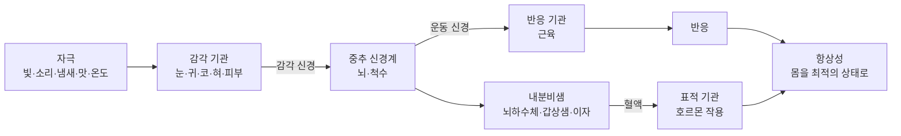

# 중3-5. 자극과 반응 — 느끼고, 판단하고, 움직이고, 조절하는 몸
<!-- prev: m2-06, m1-02, m2-03 -->
<!-- next: bio-2, 3-5, 6-3 -->

> [!NOTE]
> **성취기준**
> - **[9과20-01]** 감각기관의 구조와 기능을 이해하고, 실험을 통해 자극이 뇌로 전달되는 과정을 추론할 수 있다.
> - **[9과20-02]** 뉴런과 신경계의 구조와 기능을 이해하고, 자극에서 반응이 일어나기까지의 과정을 모형으로 설명할 수 있다.
> - **[9과20-03]** 우리 몸의 기능 조절에 호르몬이 관여함을 알고, 관련 자료를 조사하여 발표할 수 있다.

**학습 목표**

1. 눈, 귀, 코, 혀, 피부가 각각 어떤 자극을 받아들이는지 알고, 자극이 감각 세포에서 감각 신경을 거쳐 대뇌로 전달되는 과정을 설명할 수 있다.
2. 맹점 확인 실험 결과로부터 눈의 구조를 추론할 수 있다.
3. 뉴런의 구조와 종류, 중추 신경계와 말초 신경계의 구조와 기능을 설명할 수 있다.
4. 의식적 반응과 무조건 반사가 일어나는 경로를 모형으로 나타내고, 반응 속도의 차이를 실험 자료로 분석할 수 있다.
5. 성장호르몬, 인슐린, 글루카곤, 티록신의 기능을 알고, 신경계와 호르몬이 함께 몸을 일정한 상태로 유지함을 설명할 수 있다.

**이 단원의 학습 사다리**

| 단계 | 무엇을 하나? |
|---|---|
| STEP 1. 이전 학습 다시 보기 | 초등학교 '우리 몸', 중1 '세포와 기관계', 중2 '빛과 소리', '순환계'를 다시 꺼내 본다 |
| STEP 2. 기초 다지기 | 자극·반응·수용·전달이라는 낱말과 '정보 전달 시스템' 모형을 디딤돌로 놓는다 |
| STEP 3. 핵심 개념 | 감각 기관 → 뉴런 → 신경계 → 자극에서 반응까지 → 호르몬 → 항상성 |
| STEP 4. 오개념 바로잡기 | "보는 것은 눈이다?", "혀에는 맛 지도가 있다?" 같은 착각을 바로잡는다 |
| STEP 5. 다음 단계로 | 신경 신호의 전기적 정체, 시냅스, 되먹임 조절로 이어지는 길을 맛본다 |
| STEP 6. 생활·산업·진로 | 연속 혈당 측정기, 인공 와우, 감각을 흉내 내는 로봇 센서 |

---

## 🗺️ 단원 들어가기

날아오는 공을 보고 손을 뻗어 잡기까지 걸리는 시간은 1초도 되지 않는다. 그 짧은 순간에 눈은 빛을 받아들이고, 신호는 신경을 타고 뇌로 달려가고, 뇌는 "잡아!"라고 판단하고, 다시 신호가 팔의 근육으로 내려간다. 그런데 뜨거운 냄비에 손이 닿으면 '뜨겁다'고 느끼기도 전에 손이 먼저 움찔 떨어진다. 왜 이 반응은 뇌가 판단하기를 기다리지 않을까?

또 하나. 우리는 아침을 굶어도, 점심을 많이 먹어도, 한겨울에도, 한여름에도 혈액 속 포도당의 양과 체온이 거의 일정하게 유지된다. 누가 이 숫자들을 지켜보고 있는 것일까?

이 단원에서는 몸이 바깥 세계를 **느끼고**, **판단하고**, **반응하고**, 몸 안을 **조절하는** 두 가지 연락망, 즉 **신경계**와 **호르몬**을 따라가 본다.

---

## STEP 1. 🔙 이전 학습 다시 보기

### 연계 개념표

| 이전 단원·성취기준 | 그때 배운 것 | 이 단원에서 확장되는 것 |
|---|---|---|
| 초등학교 5∼6학년군 「우리 몸의 구조와 기능」 | 감각 기관이 자극을 받아들이고 신경계가 전달·판단·명령한다 | 감각 기관의 구조, 뉴런의 종류, 반응 경로를 자세히 따라간다 |
| 중1 「생물의 구성과 다양성」 [9과02-01] | 세포의 모양은 기능과 관련 있다(긴 가지를 가진 신경 세포) | 신경 세포(뉴런)의 가지돌기·축삭돌기가 신호 전달에 맞는 구조임을 안다 |
| 중1 「생물의 구성과 다양성」 [9과02-02] | 세포 → 조직 → 기관 → 기관계 → 개체 | **신경계**와 **내분비계**라는 두 기관계를 배운다 |
| 중2 「빛과 파동」 [9과10-01, 02] | 볼록 렌즈는 빛을 굴절시켜 모은다 | 눈의 **수정체**가 볼록 렌즈 역할을 하여 망막에 상을 맺는다 |
| 중2 「빛과 파동」 [9과10-04] | 소리는 매질의 진동으로 전달된다 | 귀의 **고막**과 **귓속뼈**가 소리의 진동을 전달한다 |
| 중2 「동물과 에너지」 [9과13-02, 05] | 혈액은 온몸을 돌며 물질을 운반한다. 세포호흡으로 에너지를 얻는다 | **호르몬**은 혈액을 타고 운반된다. 티록신은 세포호흡을 촉진한다 |

### 준비 운동 (사전 진단)

**Q1.** 다음 중 신경 세포의 특징으로 알맞은 것은?
① 모양이 둥글고 납작하다 ② 길게 뻗은 돌기가 있다 ③ 핵이 없다

**Q2.** 볼록 렌즈를 통과한 빛은 어떻게 될까?

**Q3.** 밥을 먹고 소장에서 흡수된 포도당은 어떤 경로로 온몸의 세포에 전달될까?

정답 및 해설

**Q1. ②** — 신경 세포는 길게 뻗은 돌기로 먼 곳까지 신호를 전달한다. ①은 적혈구, ③도 적혈구의 특징이다.

**Q2.** 굴절되어 한 점으로 모인다. 눈의 수정체도 이렇게 빛을 모은다.

**Q3.** 혈액에 실려 순환계를 따라 온몸의 세포로 운반된다. 이 단원의 **호르몬**도 같은 길로 이동한다.

---

## STEP 2. 🧱 기초 다지기

### ① 자극과 반응이라는 낱말

| 낱말 | 뜻 | 예 |
|---|---|---|
| **자극(stimulus)** | 생물이 받아들이는 몸 안팎의 변화 | 빛, 소리, 냄새, 온도, 압력, 혈당량의 변화 |
| **감각 기관** | 자극을 받아들이는 기관 | 눈, 귀, 코, 혀, 피부 |
| **감각 세포** | 감각 기관 안에서 실제로 자극을 받아들이는 세포 | 시각 세포, 청각 세포, 후각 세포, 맛세포 |
| **반응(response)** | 자극에 대해 생물이 나타내는 행동이나 변화 | 손을 뗀다, 눈을 깜빡인다, 땀이 난다 |
| **반응 기관** | 반응을 실제로 일으키는 기관 | 근육, 땀샘 |

### ② 몸은 '정보 전달 시스템'이다

자극에서 반응까지의 과정은 화재 경보 시스템과 아주 닮았다.

| 화재 경보 시스템 | 우리 몸 | 하는 일 |
|---|---|---|
| 연기 감지기 | 감각 기관(감각 세포) | 자극을 받아들인다 |
| 감지기에서 관리실로 가는 전선 | 감각 신경 | 신호를 중추로 보낸다 |
| 관리실(판단) | 뇌·척수(중추 신경계) | 신호를 해석하고 명령을 내린다 |
| 관리실에서 스프링클러로 가는 전선 | 운동 신경 | 명령을 반응 기관으로 보낸다 |
| 스프링클러 | 근육 | 반응을 일으킨다 |

> [!TIP]
> 💡 **비유** — 우리 몸에는 연락 방법이 두 가지 있다. **신경**은 정해진 사람에게 바로 거는 '전화'처럼 빠르고 정확하다. **호르몬**은 동네 전체에 붙이는 '공지문'처럼 혈액을 타고 퍼져 느리지만, 그 공지를 읽을 수 있는 곳(표적 기관)에 오래 영향을 준다.

### ③ 신호는 '전기 신호'로 전달된다

감각 세포는 빛, 소리, 화학 물질 같은 서로 다른 자극을 모두 **전기적인 신호**로 바꾸어 신경으로 보낸다. 뇌가 받는 것은 빛이나 소리 그 자체가 아니라 신호이며, 뇌는 **어느 신경에서 온 신호인지**로 '보았다', '들었다'를 구별한다.

---

## STEP 3. 📘 핵심 개념

### ① 감각 기관과 감각이 전달되는 길 [9과20-01]

우리 몸의 감각 기관은 각자 받아들이는 자극이 정해져 있다. 어느 감각 기관이든 자극이 뇌에 전달되는 길은 같은 틀을 따른다.

$$
\text{자극} \rightarrow \text{감각 기관(감각 세포)} \rightarrow \text{감각 신경} \rightarrow \text{대뇌(감각을 느낌)}
$$

| 감각 기관 | 받아들이는 자극 | 감각 세포(있는 곳) | 감각 |
|---|---|---|---|
| 눈 | 빛 | 시각 세포(망막) | 시각 |
| 귀 | 소리(공기의 진동) | 청각 세포(달팽이관) | 청각 |
| 귀 | 몸의 회전·기울어짐 | 반고리관·전정 기관의 감각 세포 | 평형 감각 |
| 코 | 기체 상태의 화학 물질 | 후각 세포(후각 상피) | 후각 |
| 혀 | 액체 상태의 화학 물질 | 맛세포(맛봉오리) | 미각 |
| 피부 | 압력, 접촉, 온도, 통증 | 감각점(압점·촉점·냉점·온점·통점) | 피부 감각 |

> [!IMPORTANT]
> **감각을 느끼는 곳은 대뇌이다.** 눈은 빛을 받아 신호로 바꿀 뿐이고, '보인다'고 느끼는 것은 대뇌이다. 그래서 눈이 건강해도 시각 신경이나 대뇌의 시각 영역이 다치면 볼 수 없다.

#### ✔ 바로 확인

1. 짝짓기: 눈, 귀, 코가 받아들이는 자극을 고르시오. (기체 상태의 화학 물질, 빛, 소리)
2. (O/X) 감각을 느끼는 곳은 감각 기관이다.
3. 빈칸: 자극 → 감각 기관(감각 세포) → (    ) → 대뇌

정답

1. 눈 – 빛, 귀 – 소리, 코 – 기체 상태의 화학 물질
2. X — 감각 기관은 자극을 받아들이고, 느끼는 곳은 대뇌이다.
3. 감각 신경

### ② 눈 — 빛을 받아들이는 감각 기관 [9과20-01]

눈은 카메라와 비슷한 구조로 빛을 모아 상을 맺는다. 구조는 간단히 알아 두고, **빛이 들어와 신호로 바뀌어 뇌로 가는 과정**에 집중하자.

| 구조 | 하는 일 | 카메라에 비유하면 |
|---|---|---|
| 각막 | 눈 앞쪽을 덮는 투명한 막. 빛이 처음 통과한다 | 렌즈 보호 유리 |
| 홍채 | 가운데 구멍인 **동공**의 크기를 조절하여 들어오는 빛의 양을 조절한다 | 조리개 |
| 수정체 | 볼록 렌즈 모양. 빛을 굴절시켜 망막에 상을 맺게 한다 | 렌즈 |
| 섬모체 | 수정체의 두께를 조절한다 | 초점 조절 장치 |
| 망막 | 상이 맺히는 곳. 시각 세포가 있다 | 이미지 센서(필름) |
| 시각 신경 | 시각 세포의 신호를 대뇌로 보낸다 | 데이터 전송선 |

**빛이 뇌까지 가는 길**

$$
\text{빛} \rightarrow \text{각막} \rightarrow \text{동공} \rightarrow \text{수정체} \rightarrow \text{망막(시각 세포)} \rightarrow \text{시각 신경} \rightarrow \text{대뇌}
$$

중2 「빛과 파동」에서 배운 볼록 렌즈처럼, 수정체는 빛을 굴절시켜 망막에 물체의 상을 맺는다. 이 상은 **위아래와 좌우가 뒤집힌** 모습이지만, 대뇌가 신호를 해석하여 바로 선 모습으로 느끼게 한다.

<!-- fig:m3-05-eye -->

#### 맹점과 황반

- **맹점**: 시각 신경이 모여 눈 밖으로 나가는 부분. **시각 세포가 없어서** 이곳에 상이 맺히면 물체가 보이지 않는다.
- **황반**: 망막 중 시각 세포가 가장 많이 모여 있는 부분. 물체를 똑바로 바라보면 상이 이곳에 맺혀 가장 또렷하게 보인다.

평소에 맹점을 느끼지 못하는 까닭은 두 눈의 맹점에 맺히는 부분이 서로 다르고, 대뇌가 빈 부분을 주변 정보로 채워 넣기 때문이다. 탐구 활동 A에서 맹점을 직접 찾아본다.

#### 밝기 조절과 거리 조절

| 상황 | 일어나는 변화 | 결과 |
|---|---|---|
| 밝은 곳으로 나갈 때 | 홍채가 늘어나 **동공이 작아진다** | 들어오는 빛의 양이 줄어든다 |
| 어두운 곳에 들어갈 때 | 홍채가 줄어들어 **동공이 커진다** | 들어오는 빛의 양이 늘어난다 |
| 가까운 곳을 볼 때 | 섬모체가 수축하여 **수정체가 두꺼워진다** | 빛을 더 많이 굴절시켜 가까운 물체의 상을 망막에 맺는다 |
| 먼 곳을 볼 때 | 섬모체가 이완하여 **수정체가 얇아진다** | 빛을 덜 굴절시켜 먼 물체의 상을 망막에 맺는다 |

<!-- fig:m3-05-eye-adjust -->

#### ✔ 바로 확인

1. 상이 맺히는 곳으로, 시각 세포가 있는 눈의 구조는?
2. (O/X) 맹점에 상이 맺히면 물체가 가장 또렷하게 보인다.
3. 빈칸: 빛 → 각막 → 동공 → (    ) → 망막
4. 밝은 곳으로 나가면 동공의 크기는 어떻게 되는가?

정답

1. 망막
2. X — 맹점에는 시각 세포가 없어 보이지 않는다. 가장 또렷한 곳은 황반이다.
3. 수정체 — 볼록 렌즈처럼 빛을 굴절시킨다.
4. 작아진다 — 홍채가 늘어나 들어오는 빛의 양을 줄인다.

### ③ 귀 — 소리와 평형을 느끼는 감각 기관 [9과20-01]

| 구조 | 하는 일 |
|---|---|
| 귓바퀴·외이도 | 소리를 모아 고막까지 보낸다 |
| 고막 | 소리에 의해 진동하는 얇은 막 |
| 귓속뼈 | 작은 뼈 3개. 고막의 진동을 크게 하여 달팽이관으로 전달한다 |
| 달팽이관 | 청각 세포가 있어 진동을 받아들인다 |
| 청각 신경 | 청각 세포의 신호를 대뇌로 보낸다 |
| 반고리관·전정 기관 | 반고리관은 몸의 **회전**을, 전정 기관은 몸의 **기울어짐**을 느낀다 |
| 귀인두관 | 목(인두)과 연결되어 고막 안팎의 공기 압력을 같게 맞춘다 |

**소리가 뇌까지 가는 길**

$$
\text{소리} \rightarrow \text{귓바퀴} \rightarrow \text{외이도} \rightarrow \text{고막} \rightarrow \text{귓속뼈} \rightarrow \text{달팽이관(청각 세포)} \rightarrow \text{청각 신경} \rightarrow \text{대뇌}
$$

중2 「빛과 파동」에서 소리는 공기 같은 매질의 진동으로 전달된다고 배웠다. 귀는 공기의 진동을 고막의 진동으로, 다시 귓속뼈의 진동으로 바꾸어 달팽이관까지 전달하는 '진동 전달 장치'이다.

<!-- fig:m3-05-ear -->

**생활 속 예**
- 비행기가 이착륙하거나 높은 산에 오를 때 귀가 먹먹해진다. 바깥 기압이 변해 고막 안팎의 압력이 달라졌기 때문이다. 침을 삼키거나 하품을 하면 귀인두관이 열려 압력이 맞춰지면서 먹먹함이 사라진다.
- 제자리에서 빙빙 돌다 멈추면 어지럽다. 반고리관 속 액체가 계속 움직여, 몸은 멈췄는데도 회전하고 있다는 신호가 뇌로 가기 때문이다.

#### ✔ 바로 확인

1. 청각 세포가 있는 귀의 구조는?
2. 제자리에서 빙빙 돌다 멈추면 어지러운 것과 가장 관계가 깊은 구조를 고르시오. (고막, 반고리관, 귓속뼈)
3. 비행기가 내려올 때 귀가 먹먹하다가 침을 삼키면 나아진다. 이때 열리는 관은?
4. 소리가 전달되는 순서대로 쓰시오. (고막, 달팽이관, 외이도, 귓속뼈)

정답

1. 달팽이관
2. 반고리관 — 몸의 회전을 느낀다.
3. 귀인두관 — 고막 안팎의 압력을 같게 맞춘다.
4. 외이도 → 고막 → 귓속뼈 → 달팽이관

### ④ 코와 혀 — 화학 물질을 느끼는 감각 기관 [9과20-01]

| 구분 | 코(후각) | 혀(미각) |
|---|---|---|
| 받아들이는 자극 | **기체** 상태의 화학 물질 | **액체**(물에 녹은) 상태의 화학 물질 |
| 감각 세포 | 콧속 윗부분 후각 상피의 **후각 세포** | 혀 표면 맛봉오리의 **맛세포** |
| 특징 | 매우 예민하지만 **쉽게 피로해져** 같은 냄새를 오래 맡으면 잘 느끼지 못한다 | 기본 맛은 단맛, 짠맛, 신맛, 쓴맛, 감칠맛이다 |
| 전달 경로 | 후각 세포 → 후각 신경 → 대뇌 | 맛세포 → 미각 신경 → 대뇌 |

**음식의 맛은 혀만으로 느끼지 않는다.** 감기에 걸려 코가 막히면 음식 맛을 잘 모르게 된다. 우리가 느끼는 음식의 풍미는 혀의 미각과 코의 후각, 그리고 음식의 온도와 씹는 느낌(피부 감각)이 대뇌에서 합쳐진 결과이다.

<!-- fig:m3-05-nose-tongue -->

> [!NOTE]
> 매운맛은 기본 맛이 아니다. 고추의 매운 성분은 맛세포가 아니라 **통증과 열을 느끼는 감각**을 자극한다. 그래서 매운 음식을 먹으면 혀가 '아프고 뜨겁게' 느껴진다.

#### ✔ 바로 확인

1. (O/X) 코는 액체 상태의 화학 물질을, 혀는 기체 상태의 화학 물질을 받아들인다.
2. 같은 냄새를 오래 맡으면 냄새를 잘 느끼지 못하는 까닭은?
3. (O/X) 매운맛은 다섯 가지 기본 맛 중 하나이다.

정답

1. X — 반대이다. 코는 기체, 혀는 물에 녹은(액체) 상태의 물질을 받아들인다.
2. 후각 세포가 쉽게 피로해지기 때문이다.
3. X — 매운 성분은 맛세포가 아니라 통증과 열을 느끼는 감각을 자극한다.

### ⑤ 피부 — 압력·온도·통증을 느끼는 감각 기관 [9과20-01]

피부에는 자극을 받아들이는 **감각점**이 퍼져 있다.

| 감각점 | 받아들이는 자극 | 특징 |
|---|---|---|
| 통점 | 통증(강한 압력, 상처 등) | 가장 많이 분포한다. 위험을 알리는 신호이기 때문이다 |
| 압점 | 누르는 힘 | 눌림을 느낀다 |
| 촉점 | 가벼운 접촉 | 스치는 느낌을 느낀다 |
| 냉점 | 피부 온도보다 낮은 온도 | 일반적으로 온점보다 많다 |
| 온점 | 피부 온도보다 높은 온도 | |

감각점은 몸의 부위마다 분포하는 정도가 다르다. 손끝, 입술, 혀끝처럼 감각점이 **촘촘한** 곳은 작은 차이도 예민하게 느끼고, 등이나 팔뚝처럼 **듬성한** 곳은 둔하다.

**실험으로 추론하기** — 이쑤시개 두 개를 붙잡고 간격을 바꾸어 가며 피부에 댄다. 두 점으로 느끼는 가장 짧은 간격은 손끝에서는 수 mm 정도이지만, 등에서는 수 cm나 된다. 이 결과로부터 "손끝에는 감각점이 촘촘하다"라고 추론할 수 있다. 점자를 손끝으로 읽는 것도 이 때문이다.

<!-- fig:m3-05-skin -->

> [!TIP]
> 💡 한 손은 찬물에, 다른 손은 따뜻한 물에 잠시 담갔다가 두 손을 미지근한 물에 함께 넣어 보자. 같은 물인데 한 손은 따뜻하고 다른 손은 차갑게 느껴진다. 피부는 온도 자체보다 **온도의 변화**를 느낀다.

#### ✔ 바로 확인

1. 피부의 감각점 중 가장 많이 분포하는 것은?
2. 이쑤시개 두 개로 실험할 때 손끝이 등보다 더 짧은 간격도 두 점으로 느끼는 까닭은?
3. 빈칸: 찬물과 따뜻한 물에 담갔던 두 손을 미지근한 물에 넣으면 다르게 느낀다. 피부는 온도 자체보다 온도의 (    )를 느낀다.

정답

1. 통점 — 위험을 알리는 신호이기 때문이다.
2. 손끝에 감각점이 더 촘촘하게 분포하기 때문이다.
3. 변화

### ⑥ 뉴런 — 신경계를 이루는 세포 [9과20-02]

신경계를 이루는 기본 단위는 신경 세포, 즉 **뉴런(neuron)** 이다.

| 구조 | 생김새 | 하는 일 |
|---|---|---|
| 신경 세포체 | 핵과 세포질이 있는 부분 | 뉴런의 생명 활동을 담당한다 |
| 가지돌기 | 신경 세포체에서 나뭇가지처럼 짧게 뻗은 돌기 | 다른 뉴런이나 감각 세포에서 신호를 **받아들인다** |
| 축삭돌기 | 신경 세포체에서 길게 뻗은 돌기 | 신호를 다른 뉴런이나 반응 기관으로 **전달한다** |

신호는 **가지돌기 → 신경 세포체 → 축삭돌기** 방향으로 전달된다. 한 뉴런의 축삭돌기 끝은 다음 뉴런의 가지돌기와 아주 좁은 틈을 두고 맞닿아 있어 신호가 다음 뉴런으로 넘어간다.

<!-- fig:m3-05-neuron -->

> [!TIP]
> 💡 **비유** — 뉴런은 '이어달리기 주자'와 같다. 가지돌기로 바통(신호)을 받고, 긴 축삭돌기를 따라 달려 다음 주자에게 넘긴다. 척수에서 발의 근육까지 뻗은 운동 뉴런의 축삭돌기는 길이가 1 m에 가까울 만큼 길다.

#### 뉴런의 종류

| 종류 | 위치 | 하는 일 |
|---|---|---|
| 감각 뉴런 | 감각 기관과 중추 신경계를 연결 | 감각 기관에서 받은 자극을 중추 신경계로 전달한다 |
| 연합 뉴런 | 뇌와 척수(중추 신경계) | 감각 뉴런의 신호를 받아 **판단**하고 운동 뉴런에 **명령**을 내린다 |
| 운동 뉴런 | 중추 신경계와 반응 기관을 연결 | 중추 신경계의 명령을 반응 기관(근육 등)으로 전달한다 |

$$
\text{감각 기관} \rightarrow \text{감각 뉴런} \rightarrow \text{연합 뉴런} \rightarrow \text{운동 뉴런} \rightarrow \text{반응 기관}
$$

#### ✔ 바로 확인

1. 뉴런에서 다른 뉴런이나 감각 세포의 신호를 받아들이는 돌기는?
2. 뇌와 척수를 이루며, 신호를 판단하고 명령을 내리는 뉴런을 고르시오. (감각 뉴런, 연합 뉴런, 운동 뉴런)
3. 빈칸: 감각 기관 → (    ) 뉴런 → 연합 뉴런 → (    ) 뉴런 → 반응 기관

정답

1. 가지돌기
2. 연합 뉴런
3. 감각, 운동

### ⑦ 신경계의 구조와 기능 [9과20-02]

사람의 신경계는 **중추 신경계**와 **말초 신경계**로 나뉜다.

| 구분 | 구성 | 하는 일 |
|---|---|---|
| 중추 신경계 | 뇌, 척수 (연합 뉴런으로 이루어짐) | 받은 정보를 종합하여 판단하고 명령을 내린다 |
| 말초 신경계 | 감각 신경, 운동 신경, 자율 신경 | 중추 신경계와 온몸을 연결한다 |

#### 뇌와 척수

| 부분 | 하는 일 | 생활 속 예 |
|---|---|---|
| 대뇌 | 감각을 느끼고, 기억·추리·판단·학습 같은 정신 활동을 한다. 의식적인 운동을 명령한다 | 시험 문제를 풀고, 친구 얼굴을 알아본다 |
| 소뇌 | 근육 운동을 조절하고 몸의 균형을 유지한다 | 자전거를 넘어지지 않고 탄다 |
| 간뇌 | 체온, 혈액 속 포도당의 양(혈당량) 등 몸의 상태를 일정하게 조절한다 | 더우면 땀이 나고 추우면 몸이 떨린다 |
| 중간뇌(중뇌) | 눈의 움직임과 동공의 크기를 조절한다 | 밝은 빛을 비추면 동공이 작아진다 |
| 연수 | 심장 박동, 호흡, 소화 운동을 조절한다. 기침·재채기·하품·침 분비 반사의 중추 | 잠잘 때도 숨을 쉬고 심장이 뛴다 |
| 척수 | 뇌와 몸의 각 부분 사이에서 신호가 오가는 통로. 무릎 반사, 회피 반사의 중추 | 뜨거운 것에 닿으면 손을 바로 뗀다 |

<!-- fig:m3-05-nervous-system -->

#### 말초 신경계

- **감각 신경**: 감각 기관의 신호를 중추 신경계로 전달한다.
- **운동 신경**: 중추 신경계의 명령을 근육으로 전달한다.
- **자율 신경**: 대뇌의 명령을 받지 않고 심장, 위, 소장 같은 내장 기관과 동공 등을 조절한다. 서로 반대로 작용하는 **교감 신경**과 **부교감 신경**이 있다.

| 기관 | 교감 신경 (긴장했을 때) | 부교감 신경 (편안할 때) |
|---|---|---|
| 심장 박동 | 빨라진다 | 느려진다 |
| 호흡 | 빨라진다 | 느려진다 |
| 동공 | 커진다 | 작아진다 |
| 소화 운동 | 억제된다 | 촉진된다 |

발표 차례를 기다리며 긴장하면 심장이 두근거리고 입이 마르며 속이 더부룩해지는 것은 교감 신경이 작용하기 때문이다.

#### ✔ 바로 확인

1. 중추 신경계를 이루는 두 가지는?
2. 짝짓기: 소뇌, 연수, 중간뇌가 하는 일을 고르시오. (심장 박동과 호흡 조절, 동공 크기 조절, 몸의 균형 유지)
3. (O/X) 자율 신경은 대뇌의 명령을 받아 심장 박동을 조절한다.
4. 발표 직전 긴장하여 교감 신경이 작용할 때 심장 박동은 어떻게 되는가?

정답

1. 뇌, 척수
2. 소뇌 – 몸의 균형 유지, 연수 – 심장 박동과 호흡 조절, 중간뇌 – 동공 크기 조절
3. X — 자율 신경은 대뇌의 명령을 받지 않는다.
4. 빨라진다 — 동공도 커지고 소화 운동은 억제된다.

### ⑧ 자극에서 반응까지 — 의식적 반응과 무조건 반사 [9과20-02]

#### (1) 의식적 반응 — 대뇌가 판단하는 반응

**대뇌의 판단**을 거쳐 일어나는 반응을 **의식적 반응**이라고 한다.

**예: 날아오는 공을 보고 손을 뻗어 잡는다**

$$
\text{눈} \rightarrow \text{시각 신경} \rightarrow \text{대뇌(판단)} \rightarrow \text{척수} \rightarrow \text{운동 신경} \rightarrow \text{팔 근육}
$$

#### (2) 무조건 반사 — 대뇌를 거치지 않는 빠른 반응

**대뇌의 판단을 거치지 않고** 척수, 연수, 중간뇌가 중추가 되어 무의식적으로 일어나는 반응을 **무조건 반사**라고 한다. 자극에서 반응까지의 경로가 짧아 **매우 빠르게** 일어나며, 위험한 상황에서 몸을 보호하는 데 중요하다.

**예: 뜨거운 냄비에 손이 닿으면 손을 바로 뗀다**

$$
\text{피부} \rightarrow \text{감각 신경} \rightarrow \text{척수} \rightarrow \text{운동 신경} \rightarrow \text{팔 근육}
$$

이때 척수는 손을 떼라는 명령을 내리는 동시에 신호를 대뇌로도 올려 보낸다. 그래서 손을 뗀 **뒤에** "앗, 뜨거워!" 하고 느낀다.

| 중추 | 무조건 반사의 예 |
|---|---|
| 척수 | 무릎 반사(무릎 아래를 치면 다리가 올라감), 뜨거운 것에 닿으면 손을 뗌, 압정을 밟으면 발을 듦 |
| 연수 | 기침, 재채기, 하품, 음식을 먹을 때 침이 나옴 |
| 중간뇌 | 밝은 빛을 비추면 동공이 작아짐(동공 반사) |

#### (3) 두 반응 비교하기

| 구분 | 의식적 반응 | 무조건 반사 |
|---|---|---|
| 판단하는 곳 | 대뇌 | 척수, 연수, 중간뇌 |
| 반응 경로 | 길다 | 짧다 |
| 반응 속도 | 상대적으로 느리다 | 빠르다 |
| 의지로 조절 | 할 수 있다 | 거의 할 수 없다 |
| 의미 | 상황을 판단해 알맞게 행동한다 | 위험으로부터 몸을 빠르게 보호한다 |

<!-- sim:reflex-arc -->

#### 예제 1 — 반응 경로 모형 만들기

다음 상황에서 자극이 전달되는 경로를 화살표로 나타내고, 의식적 반응인지 무조건 반사인지 쓰시오.
(1) 모기가 팔에 앉은 것을 보고 손으로 쫓았다.
(2) 장미 가시에 손가락이 찔리자 저절로 손을 움츠렸다.

**풀이**
(1) 눈 → 시각 신경 → 대뇌 → 척수 → 운동 신경 → 팔 근육: **의식적 반응**
(2) 피부 → 감각 신경 → 척수 → 운동 신경 → 팔 근육: **무조건 반사**. 대뇌를 거치지 않아 의도하지 않아도 저절로, 매우 빠르게 일어난다. 따끔하다는 느낌은 손을 움츠린 뒤에 대뇌에서 느낀다.

#### 예제 2 — 반응 시간을 자로 재기

친구가 30 cm 자의 위쪽 끝을 잡고, 나는 자의 0 눈금에 엄지와 검지를 벌려 대고 있다. 친구가 예고 없이 자를 놓으면 내가 최대한 빨리 잡는다. 자는 자유 낙하하므로 앞 단원 「운동과 에너지」에서 배운 대로 떨어진 거리로 시간을 알 수 있다.

| 반응 시간(s) | 0.10 | 0.15 | 0.20 | 0.24 |
|---|---|---|---|---|
| 자가 떨어진 거리(cm) | 4.9 | 11.0 | 19.6 | 28.2 |

자가 19.6 cm 떨어졌을 때 잡았다면 반응 시간은 약 0.2초이다. 이 반응은 '자가 떨어지는 것을 **보고**, 대뇌가 **판단**하여 손가락에 **명령**하는' 의식적 반응이다.

#### ✔ 바로 확인

1. (O/X) 무릎 반사의 중추는 대뇌이다.
2. 의식적 반응을 고르시오. (가) 재채기 (나) 친구가 부르는 소리를 듣고 뒤돌아보았다 (다) 밝은 빛에 동공이 작아졌다
3. 예제 2의 표에서 자가 11.0 cm 떨어졌을 때 잡았다면 반응 시간은?

정답

1. X — 척수이다.
2. (나) — 대뇌의 판단을 거친다. (가)는 연수, (다)는 중간뇌가 중추인 무조건 반사이다.
3. 0.15초 — 표에서 읽는다.

### ⑨ 호르몬 — 혈액을 타고 가는 화학 신호 [9과20-03]

**호르몬(hormone)** 은 **내분비샘**에서 만들어져 **혈액으로 분비**되고, 혈액을 따라 이동하다가 특정한 기관(**표적 기관**)에 작용하여 몸의 기능을 조절하는 물질이다.

**호르몬의 특징**
- 관(통로) 없이 혈액으로 직접 분비된다. (땀샘이나 소화샘처럼 관을 통해 분비하는 곳은 외분비샘이다.)
- 혈액을 따라 온몸을 돌지만 **표적 기관에만** 작용한다.
- **아주 적은 양**으로도 큰 효과를 낸다. 너무 적거나 많으면 몸에 이상이 생긴다(결핍증·과다증).

#### 대표적인 호르몬

| 호르몬 | 분비하는 곳 | 하는 일 | 너무 적으면 | 너무 많으면 |
|---|---|---|---|---|
| 성장호르몬 | 뇌하수체 | 뼈와 근육의 생장을 촉진한다 | 성장기에 키가 잘 자라지 않는다(소인증) | 성장기에 키가 지나치게 자란다(거인증) |
| 티록신 | 갑상샘 | 세포호흡을 촉진하여 물질대사를 활발하게 한다 | 쉽게 피로하고 추위를 많이 탄다(갑상샘 기능 저하증) | 심장 박동이 빨라지고 체중이 준다(갑상샘 기능 항진증) |
| 인슐린 | 이자 | 혈액 속 포도당의 양(혈당량)을 **낮춘다** | 혈당량이 높게 유지되어 오줌에 포도당이 섞여 나올 수 있다(당뇨병) | 혈당량이 지나치게 낮아진다(저혈당) |
| 글루카곤 | 이자 | 혈당량을 **높인다** | — | — |

<!-- fig:m3-05-endocrine -->

#### 신경과 호르몬 비교

| 구분 | 신경 | 호르몬 |
|---|---|---|
| 전달 방법 | 뉴런을 통한 전기 신호 | 혈액을 타고 이동하는 화학 물질 |
| 전달 속도 | 빠르다 | 상대적으로 느리다 |
| 작용 범위 | 연결된 곳에만 좁게 | 표적 기관이 있는 곳에 넓게 |
| 효과 지속 | 짧다 | 오래간다 |
| 예 | 공을 보고 잡기, 무릎 반사 | 키가 자람, 혈당량 조절 |

#### ✔ 바로 확인

1. 빈칸: 호르몬은 (    )에서 만들어져 관 없이 (    )으로 분비된다.
2. 짝짓기: 뇌하수체, 갑상샘, 이자에서 분비하는 호르몬을 고르시오. (티록신, 성장호르몬, 인슐린)
3. (O/X) 호르몬은 신경보다 전달 속도가 빠르지만 효과는 짧다.

정답

1. 내분비샘, 혈액
2. 뇌하수체 – 성장호르몬, 갑상샘 – 티록신, 이자 – 인슐린
3. X — 반대이다. 호르몬은 느리지만 효과가 오래간다.

### ⑩ 신경계와 호르몬이 함께 만드는 균형 — 항상성 [9과20-03]

몸 안팎의 환경이 변해도 체온, 혈당량 같은 몸의 상태를 일정하게 유지하려는 성질을 **항상성(homeostasis)** 이라고 한다. 항상성은 **신경계와 호르몬이 함께** 작용하여 유지된다. 덕분에 우리 몸의 세포는 늘 일하기 좋은 '최적의 상태'에 있을 수 있다.

#### (1) 혈당량 조절 — 인슐린과 글루카곤

| 상황 | 혈당량 | 분비되는 호르몬 | 일어나는 일 | 결과 |
|---|---|---|---|---|
| 식사 후 | 높아진다 | 이자에서 **인슐린** | 간에서 포도당을 글리코젠으로 바꾸어 저장하고, 몸의 세포가 포도당을 흡수한다 | 혈당량이 낮아진다 |
| 오래 굶거나 운동한 뒤 | 낮아진다 | 이자에서 **글루카곤** | 간에 저장된 글리코젠을 포도당으로 바꾸어 혈액으로 내보낸다 | 혈당량이 높아진다 |

> [!TIP]
> 💡 **비유** — 간은 포도당의 '저금통'이다. 인슐린은 남는 포도당을 글리코젠으로 바꿔 저금통에 **넣는** 일을, 글루카곤은 저금통에서 **꺼내** 쓰는 일을 시킨다. 두 호르몬이 서로 반대로 작용하여 혈당량이 일정한 범위를 벗어나지 않는다.

<!-- fig:m3-05-blood-glucose -->

#### (2) 체온 조절 — 신경과 티록신의 협동

체온의 변화는 **간뇌**가 감지하여 조절한다.

| 상황 | 신경에 의한 조절 | 호르몬에 의한 조절 | 결과 |
|---|---|---|---|
| 추울 때 | 피부 근처 혈관이 수축하여 열이 덜 빠져나간다. 근육이 떨려 열이 발생한다 | **티록신** 분비가 늘어 세포호흡이 촉진되고 열 발생이 늘어난다 | 체온이 내려가지 않는다 |
| 더울 때 | 피부 근처 혈관이 확장하고 땀 분비가 늘어 열을 내보낸다 | 티록신 분비가 줄어든다 | 체온이 올라가지 않는다 |

추운 날 몸이 덜덜 떨리고 피부에 '닭살'이 돋는 것, 더운 날 얼굴이 붉어지고 땀이 나는 것은 모두 항상성을 지키는 반응이다.

#### ✔ 바로 확인

1. 식사 뒤 혈당량이 높아지면 이자에서 분비되는 호르몬은?
2. 체온의 변화를 감지하여 조절하는 뇌의 부분은?
3. 추울 때 피부 근처 혈관은 어떻게 변하는가?
4. (O/X) 글루카곤은 간에 저장된 글리코젠을 포도당으로 바꾸어 혈당량을 높인다.

정답

1. 인슐린
2. 간뇌
3. 수축한다 — 몸 밖으로 빠져나가는 열을 줄인다.
4. O

---

## STEP 4. ⚠️ 오개념 바로잡기

| 흔한 오개념 | 올바른 개념 | 왜 그럴까? |
|---|---|---|
| 물체를 '보는' 것은 눈이다 | 눈은 빛을 받아 신호로 바꾸고, **보았다고 느끼는 것은 대뇌**이다 | 모든 감각은 감각 신경을 거쳐 대뇌에 도착해야 느껴진다 |
| 혀에는 부위마다 정해진 맛이 있다(맛 지도) | 맛세포는 혀 전체에 퍼져 있어 **어느 부위에서나** 여러 맛을 느낀다 | 부위에 따라 민감한 정도에 약간의 차이가 있을 뿐이다 |
| 무조건 반사도 대뇌가 명령한다 | 무조건 반사는 **척수·연수·중간뇌**가 중추이며 대뇌를 거치지 않는다 | 뜨거운 것에서 손을 뗀 뒤에야 뜨겁다고 느끼는 것이 그 증거이다 |
| 맹점은 눈에 생긴 병이다 | 맹점은 **누구에게나 있는** 시각 신경이 나가는 자리이다 | 그곳에는 시각 세포가 없을 뿐, 이상이 아니다 |
| 호르몬은 많을수록 좋다 | 호르몬은 **알맞은 양**이 있어야 하며, 많아도 적어도 이상이 생긴다 | 티록신이 너무 많으면 갑상샘 기능 항진증이 생긴다 |
| 호르몬은 몸 전체의 모든 세포에 작용한다 | 혈액을 따라 온몸을 돌지만 **표적 기관에만** 작용한다 | 그 호르몬을 받아들일 수 있는 세포만 반응한다 |

---

## STEP 5. 🎓 다음 단계로 한 걸음 더

> [!CAUTION]
> 이 절은 **중학교 교육과정 범위 밖의 심화 내용**으로 평가 대상이 아니다. 이 단원에서 배운 개념이 통합과학과 선택과목에서 어떻게 이어지고 깊어지는지를 맛보기로 보여 주기 위한 내용이다.

### 다음 학년·과목과의 연결

| 이어지는 단원 | 이어지는 내용 |
|---|---|
| 통합과학1 「생명 시스템과 물질대사」 | 세포막을 통한 물질 출입(선택적 투과)과 효소 — 신경 신호와 호르몬 작용의 바탕이 되는 세포 수준의 원리 |
| 통합과학2 「인공지능 로봇과 사물인터넷」 | 센서(감각 기관) → 처리 장치(뇌) → 작동기(근육)라는 같은 구조를 기계에서 만든다 |
| 생명과학 「항상성과 몸의 조절」 | 뉴런의 흥분 전도, 시냅스 전달과 약물의 영향, 대뇌 중심의 뇌 구조, 내분비계와 신경계의 통합적 항상성 조절 |

### ① '전기 신호'의 정체 — 이온이 만드는 흥분

생명과학에서는 뉴런 안팎에 서로 다른 이온($\mathrm{Na^+}$, $\mathrm{K^+}$)이 분포하여 세포막 안팎에 **전압 차(막전위)** 가 생기고, 자극을 받으면 이온이 순간적으로 드나들며 전압이 뒤집히는 **활동 전위**가 축삭돌기를 따라 퍼져 나간다는 것을 배운다. 이 단원의 '신호가 전달된다'의 실제 모습이다. 축삭돌기를 감싼 막(말이집)이 있으면 신호가 건너뛰듯 전달되어 훨씬 빨라진다.

### ② 뉴런 사이의 틈 — 시냅스와 약물

이 단원에서 '아주 좁은 틈'이라고 한 곳을 **시냅스**라고 한다. 신호가 축삭돌기 끝에 도착하면 **신경 전달 물질**이 틈으로 뿜어져 나와 다음 뉴런을 자극한다. 진통제, 마취제, 카페인, 일부 중독성 약물은 이 시냅스 전달을 방해하거나 강화하여 작용한다. 생명과학에서는 약물이 시냅스에 미치는 영향을 조사한다.

### ③ 스스로 조절하는 고리 — 되먹임(피드백)

티록신이 많아지면 뇌가 이를 감지하여 갑상샘에 '그만 만들라'는 신호를 줄인다. 결과가 원인을 다시 억제하는 이 방식을 **음성 되먹임(음성 피드백)** 이라고 한다. 또 인슐린과 글루카곤처럼 반대로 작용하여 균형을 맞추는 관계를 **길항 작용**이라고 한다. 생명과학에서는 간뇌, 뇌하수체, 갑상샘, 이자, 콩팥이 함께 만드는 항상성의 그물을 배운다.

### 지금 vs 다음 단계

| 구분 | 중학교 (이 단원) | 생명과학 「항상성과 몸의 조절」 |
|---|---|---|
| 신경 신호 | '전기 신호'로 전달된다 | 이온 이동에 의한 막전위 변화, 활동 전위, 도약 전도 |
| 뉴런 사이 | 좁은 틈을 두고 신호가 넘어간다 | 시냅스, 신경 전달 물질, 약물의 작용 |
| 뇌 | 대뇌·소뇌·간뇌·중간뇌·연수의 기능 | 대뇌 피질의 영역별 기능 중심 |
| 호르몬 | 성장호르몬·인슐린·글루카곤·티록신 | 여러 호르몬의 상호작용, 음성 되먹임, 길항 작용 |
| 항상성 | 혈당량·체온 조절의 큰 흐름 | 신경계와 내분비계의 통합 조절, 스마트 헬스케어 탐구 |

---

## STEP 6. 🏭 생활·산업·진로 연결

### 사례 1. 연속 혈당 측정기와 인슐린 펌프

- **원리** 인슐린이 부족하거나 잘 작용하지 않으면 혈당량이 조절되지 않는다. 피부에 붙이는 작은 센서가 혈당량 변화를 계속 측정해 스마트폰으로 보내고, 인슐린 펌프는 필요한 만큼 인슐린을 주입한다.
- **어디에 쓰이나** 당뇨병 환자의 혈당 관리. 센서(감지) → 판단 → 주입(반응)으로 이어지는 구조가 몸의 혈당 조절과 닮았다. 생명과학의 '스마트 헬스케어' 탐구로 이어진다.

### 사례 2. 인공 와우 — 달팽이관을 대신하는 장치

- **원리** 달팽이관의 청각 세포가 손상되어 소리를 듣지 못하는 경우, 귀 바깥의 장치가 소리를 받아 전기 신호로 바꾸고, 달팽이관 안에 넣은 전극이 **청각 신경을 직접 자극**한다.
- **어디에 쓰이나** 고도 난청 치료. "감각 기관이 신호를 만들고, 신경이 대뇌로 전달하고, 대뇌가 소리를 느낀다"는 이 단원의 내용이 그대로 기술이 되었다.

### 사례 3. 감각을 흉내 내는 로봇

- **원리** 로봇은 카메라(눈), 마이크(귀), 압력 센서(피부), 기체 센서(코)로 자극을 받아들이고, 처리 장치가 판단하여 모터(근육)를 움직인다. 위험할 때 즉시 멈추는 비상 정지 장치는 '판단을 건너뛰는' 무조건 반사와 닮았다.
- **어디에 쓰이나** 자율 주행 자동차, 수술 로봇, 물건을 부드럽게 집는 로봇 손. 통합과학2 「인공지능 로봇과 사물인터넷」에서 더 자세히 다룬다.

### 관련 진로와 학과

| 진로 | 하는 일 | 관련 학과 |
|---|---|---|
| 뇌과학자·신경과학 연구원 | 뇌와 신경의 작동 원리를 연구한다 | 생명과학과, 뇌인지과학과, 의학과 |
| 의사(안과·이비인후과·내분비내과 등) | 감각 기관, 호르몬 관련 질병을 진단하고 치료한다 | 의예과 |
| 의공학자 | 인공 와우, 혈당 측정기 같은 의료 기기를 개발한다 | 의공학과, 전자공학과 |
| 로봇·센서 엔지니어 | 사람의 감각을 흉내 내는 센서와 로봇을 만든다 | 기계공학과, 전자공학과 |

---

## 🔬 탐구 활동

### 활동 A. 맹점 확인 실험하기

**목표** 맹점을 직접 확인하고, 관찰 결과로부터 눈의 구조를 추론한다.

**준비물** 흰 종이 카드(가로 약 15 cm), 검은 펜, 자

**과정**
1. 카드 왼쪽에 '+' 표시를, 오른쪽으로 약 7∼8 cm 떨어진 곳에 지름 약 1 cm의 검은 점 '●'을 그린다.
2. 왼쪽 눈을 손으로 가리고, 카드를 팔을 뻗은 거리(눈앞 약 50 cm)에 든다.
3. 오른쪽 눈으로 '+'만 계속 바라보면서 카드를 천천히 눈 쪽으로 가까이 가져온다.
4. '●'이 사라지는 순간 카드와 눈 사이의 거리를 친구가 자로 잰다.
5. 카드를 더 가까이 가져와 '●'이 다시 보이는지 확인하고, 반대쪽 눈으로도 해 본다(카드를 거꾸로 돌려 들어 '●'이 '+'의 왼쪽에 오게 한다).

**결과 기록**

| 실험자 | 사용한 눈 | '●'이 사라진 거리(cm) | 다시 보인 거리(cm) |
|---|---|---|---|
| 1 | 오른쪽 | | |
| 1 | 왼쪽 | | |
| 2 | 오른쪽 | | |
| 2 | 왼쪽 | | |

**생각해 보기**
1. '●'이 사라진 순간, '●'의 상은 망막의 어느 부분에 맺혔을까? 그곳에는 무엇이 없을까?
2. 오른쪽 눈의 맹점은 눈의 중심(황반)보다 코 쪽에 있을까, 귀 쪽에 있을까? 실험에서 '●'이 '+'의 어느 쪽에 있었는지로 추론해 보자. (힌트: 망막의 상은 좌우가 뒤집힌다.)
3. 두 눈을 모두 뜨면 '●'이 사라지지 않는 까닭은 무엇일까?

### 활동 B. 무조건 반사와 의식적 반응 실험하기

**목표** 의식적 반응의 반응 시간을 측정하고, 무조건 반사와 속도를 비교한다.

**준비물** 30 cm 자, 기록지

**과정**
1. **의식적 반응**: STEP 3의 예제 2처럼 친구가 자를 놓으면 엄지와 검지로 잡는다. 잡은 위치의 눈금을 읽는다. 5회 반복한다.
2. 조건을 바꾸어 본다. 눈을 감고 친구가 "땅!" 하고 말하는 순간 잡기(소리 자극), 친구가 어깨를 톡 치는 순간 잡기(피부 자극).
3. **무조건 반사**: 의자에 앉아 다리를 꼬고 힘을 뺀다. 친구가 무릎뼈 바로 아래를 손날로 가볍게 친다. 다리가 올라가는 반응이 '자를 잡는 반응'보다 빠른지 느린지 관찰한다.
4. 무릎 반사가 일어날 때 의지로 다리를 멈출 수 있는지 시도해 본다.

**결과 기록** (떨어진 거리는 STEP 3 예제 2의 표를 이용해 반응 시간으로 바꾼다)

| 자극 | 1회 | 2회 | 3회 | 4회 | 5회 | 평균 반응 시간(s) |
|---|---|---|---|---|---|---|
| 빛(보고 잡기) | | | | | | |
| 소리(듣고 잡기) | | | | | | |
| 피부(느끼고 잡기) | | | | | | |

**생각해 보기**
1. 자를 잡는 반응의 경로를 '자극 → … → 반응'으로 나타내 보자.
2. 무릎 반사가 자를 잡는 반응보다 빠른 까닭을 반응 경로의 차이로 설명해 보자.
3. 반복할수록 반응 시간이 짧아졌는가? 그렇다면 그 까닭은 무엇일까?

> [!WARNING]
> **안전 수칙** 무릎을 칠 때는 손날로 가볍게 치고, 딱딱한 도구로 세게 치지 않는다. 자를 잡을 때 자 끝이 얼굴이나 눈에 닿지 않도록 자를 얼굴 앞이 아닌 가슴 앞에서 떨어뜨린다. 무릎이나 다리에 통증이 있는 사람은 무릎 반사 실험에 참여하지 않는다.

---

## ✅ 개념 확인 문제

### 기본

**1.** 감각 기관과 그 감각 기관에서 자극을 받아들이는 감각 세포를 옳게 짝 지은 것은?
① 눈 – 망막의 시각 세포 ② 귀 – 고막의 청각 세포 ③ 코 – 맛봉오리의 후각 세포 ④ 혀 – 반고리관의 맛세포

정답 및 해설

**정답 ①**

청각 세포는 고막이 아니라 **달팽이관**에 있다. 후각 세포는 콧속 후각 상피에, 맛세포는 혀의 맛봉오리에 있다. 반고리관은 회전을 느끼는 귀의 구조이다.

**2.** 어두운 영화관에 들어갔을 때 눈에서 일어나는 변화로 옳은 것은?
① 홍채가 늘어나 동공이 작아진다. ② 홍채가 줄어들어 동공이 커진다. ③ 섬모체가 수축하여 수정체가 두꺼워진다.

정답 및 해설

**정답 ②**

어두운 곳에서는 빛을 더 많이 받아들이기 위해 홍채가 줄어들어 동공이 커진다. ③은 가까운 곳을 볼 때 일어나는 변화이다.

**3.** 뉴런에서 신호가 전달되는 방향을 순서대로 쓰시오.
( 축삭돌기, 가지돌기, 신경 세포체 )

정답 및 해설

**정답** 가지돌기 → 신경 세포체 → 축삭돌기

가지돌기가 신호를 받아들이고, 축삭돌기가 다른 뉴런이나 반응 기관으로 신호를 전달한다.

**4.** 다음 기능을 담당하는 뇌의 부분을 쓰시오.
(1) 몸의 균형을 유지한다. (2) 심장 박동과 호흡을 조절한다. (3) 체온과 혈당량을 일정하게 조절한다.

정답 및 해설

**정답** (1) 소뇌 (2) 연수 (3) 간뇌

**5.** 호르몬과 분비 기관, 기능을 옳게 짝 지은 것을 **모두** 고르시오.
ㄱ. 티록신 – 갑상샘 – 세포호흡 촉진
ㄴ. 인슐린 – 이자 – 혈당량 증가
ㄷ. 성장호르몬 – 뇌하수체 – 뼈와 근육의 생장 촉진

정답 및 해설

**정답 ㄱ, ㄷ**

인슐린은 혈당량을 **낮춘다.** 혈당량을 높이는 호르몬은 글루카곤이다.

### 응용

**6.** 다음 반응 중 **무조건 반사**를 모두 고르고, 각각의 중추를 쓰시오.
ㄱ. 레몬을 먹을 때 침이 나왔다. ㄴ. 시험지를 받고 이름을 썼다. ㄷ. 압정을 밟고 발을 번쩍 들었다. ㄹ. 손전등을 눈에 비추자 동공이 작아졌다.

정답 및 해설

**정답** ㄱ(연수), ㄷ(척수), ㄹ(중간뇌)

ㄴ은 대뇌의 판단에 따른 의식적 반응이다. 음식을 먹을 때 침이 나오는 반사는 연수, 압정을 밟고 발을 드는 회피 반사는 척수, 동공 반사는 중간뇌가 중추이다.

**7.** 사고로 척수의 허리 부분이 손상된 사람이 있다. 이 사람의 발바닥을 바늘로 살짝 찔렀다.
(1) 이 사람은 찔린 것을 느낄 수 있을까? (2) 그렇게 생각한 까닭을 신호의 전달 경로로 설명하시오.

정답 및 해설

**정답** (1) 느끼지 못한다.

(2) 발바닥 피부의 자극은 감각 신경 → 척수 → 대뇌로 전달되어야 느낄 수 있다. 척수가 손상되면 신호가 대뇌까지 올라가지 못하므로 찔린 것을 느낄 수 없다. 척수는 뇌와 몸 사이에서 신호가 오가는 **통로**이기 때문이다.

**8.** 표는 건강한 사람 A와 인슐린이 거의 분비되지 않는 사람 B가 같은 양의 포도당을 마신 뒤 혈당량을 측정한 **가상의 자료**이다.

| 시간 | 마시기 전 | 30분 후 | 1시간 후 | 2시간 후 | 3시간 후 |
|---|---|---|---|---|---|
| A의 혈당량 | 보통 | 높음 | 조금 높음 | 보통 | 보통 |
| B의 혈당량 | 조금 높음 | 매우 높음 | 매우 높음 | 매우 높음 | 높음 |

(1) A의 혈당량이 1시간 이후 낮아진 까닭을 호르몬과 관련지어 설명하시오. (2) B에게서 나타날 수 있는 질병의 이름은?

정답 및 해설

**정답** (2) 당뇨병

(1) 혈당량이 높아지자 이자에서 **인슐린**이 분비되어, 간에서 포도당을 글리코젠으로 바꾸어 저장하고 몸의 세포가 포도당을 흡수하게 하였기 때문이다.
(2) B는 인슐린이 부족하여 높아진 혈당량이 잘 낮아지지 않는다. 혈당량이 높게 유지되어 오줌으로 포도당이 나올 수 있는 **당뇨병**이 나타날 수 있다.

**9.** 추운 겨울날 밖에 나갔을 때 우리 몸에서 체온을 유지하기 위해 일어나는 변화를 **신경에 의한 것** 1가지와 **호르몬에 의한 것** 1가지로 나누어 쓰시오.

정답 및 해설

**예시 답안**
- 신경: 피부 근처 혈관이 수축하여 몸 밖으로 빠져나가는 열이 줄어든다. (또는 근육이 떨려 열이 발생한다.)
- 호르몬: 갑상샘에서 **티록신** 분비가 늘어나 세포호흡이 촉진되어 열 발생이 늘어난다.

### 융합·서술형

**10. [교통안전·물리 연계]** 시속 72 km(초속 20 m)로 달리는 자동차의 운전자가 도로에 뛰어든 고양이를 보고 브레이크를 밟는다. 운전자의 반응 시간은 0.7초이다.
(1) 운전자가 고양이를 보고 브레이크를 밟기까지의 반응 경로를 '자극 → … → 반응'으로 쓰고, 의식적 반응인지 무조건 반사인지 쓰시오.
(2) 반응하는 동안 자동차가 이동한 거리를 구하시오.
(3) 운전 중 스마트폰을 보면 반응 시간이 길어진다. 이것이 왜 위험한지 (2)의 결과를 이용해 설명하시오.

정답 및 해설

**정답** (1) 눈 → 시각 신경 → 대뇌(판단) → 척수 → 운동 신경 → 다리 근육, **의식적 반응** (2) $14\ \mathrm{m}$

(2) 반응하는 동안 자동차는 같은 속력으로 달리므로 이동 거리 $= 20 \times 0.7 = 14\ \mathrm{m}$이다.
(3) 반응 시간이 길어지면 브레이크를 밟기 전에 자동차가 이동하는 거리가 그만큼 늘어난다. 예를 들어 반응 시간이 1.5초로 늘면 $20 \times 1.5 = 30\ \mathrm{m}$를 달린 뒤에야 브레이크를 밟게 되어 사고를 피하기 어렵다.

**채점 포인트** ① 대뇌를 거치는 경로와 의식적 반응 ② 이동 거리 = 속력 × 반응 시간 ③ 반응 시간 증가 → 정지 거리 증가

**11. [자료 조사·발표]** 다음은 호르몬 관련 질병에 대해 조사한 결과를 정리한 **가상의 자료**이다.

| 구분 | 20대 | 40대 | 60대 이상 |
|---|---|---|---|
| 당뇨병 환자 비율 | 낮음 | 중간 | 높음 |
| 갑상샘 기능 저하증 환자 수(여성 : 남성) | 약 4 : 1 | 약 4 : 1 | 약 3 : 1 |

(1) 이 자료에서 알 수 있는 사실을 두 가지 쓰시오. (2) 이 자료를 발표할 때, 실제 자료는 어디에서 찾을 수 있고 무엇에 주의해야 하는지 쓰시오. (3) 당뇨병 예방을 위해 학생이 실천할 수 있는 생활 습관을 한 가지 제안하시오.

정답 및 해설

**예시 답안**
(1) ① 당뇨병 환자 비율은 나이가 많을수록 높아진다. ② 갑상샘 기능 저하증은 모든 연령대에서 여성 환자가 남성보다 많다.
(2) 질병관리청, 국민건강보험공단 등 공공 기관이 공개하는 통계 자료를 찾는다. 자료의 출처와 조사 연도를 밝히고, 비율(%)인지 환자 수인지 구별하며, 자료에 나타난 차이를 원인으로 단정하지 않도록 주의한다.
(3) 단 음료와 간식을 줄이고 규칙적으로 운동하여 혈당량이 급격히 오르내리지 않게 하고, 알맞은 체중을 유지한다.

**채점 포인트** ① 연령·성별 경향을 자료에 근거해 서술 ② 신뢰할 수 있는 출처와 자료 해석 시 주의점 ③ 혈당 조절과 관련된 실천 방안

### 실력 다지기

**12.** 귀에 이상이 있는 두 사람이 있다. A는 고막이 찢어져 진동이 잘 전달되지 않고, B는 달팽이관의 청각 세포가 손상되었다(고막·귓속뼈·청각 신경·대뇌는 정상).
(1) 소리가 대뇌까지 전달되는 경로에서 A와 B는 각각 어디가 막혔는지 쓰시오. (2) 인공 와우(STEP 6 사례 2)가 꼭 필요한 사람은 누구인지 쓰고, 그 까닭을 신호가 만들어지는 곳과 관련지어 설명하시오.

정답 및 해설

**정답** (1) A: 외이도 → **고막** → 귓속뼈 사이(진동 전달), B: 달팽이관의 **청각 세포**가 신호를 만드는 단계 (2) B

(2) 소리의 진동은 달팽이관의 청각 세포에서 신호로 바뀐다. B는 진동이 달팽이관까지 와도 청각 세포가 신호를 만들지 못한다. 인공 와우는 소리를 전기 신호로 바꾸어 **청각 신경을 직접 자극**하므로, 청각 세포를 건너뛰어 신호를 대뇌로 보낼 수 있다. A는 진동을 전달하는 부분의 문제이므로 진동을 달팽이관에 전해 주면 청각 세포가 신호를 만들 수 있다.

**채점 포인트** ① 소리 전달 경로에서 막힌 곳을 각각 지목 ② 청각 세포가 신호를 만드는 곳임 ③ 인공 와우가 청각 신경을 직접 자극함

**13.** 신경이 손상된 두 환자의 무릎 아래를 쳐 보았다.

| 환자 | 다리가 올라가는가? (무릎 반사) | 무릎을 친 것을 느끼는가? |
|---|---|---|
| 가 | 올라간다 | 느끼지 못한다 |
| 나 | 올라가지 않는다 | 느낀다 |

가와 나에서 손상되었을 가능성이 가장 큰 곳을 다음에서 각각 고르고, 그렇게 판단한 근거를 쓰시오. (감각 신경, 운동 신경, 척수에서 대뇌로 신호가 올라가는 길)

정답 및 해설

**정답** 가: 척수에서 대뇌로 신호가 올라가는 길, 나: 운동 신경

- 가: 무릎 반사가 일어나므로 감각 신경 → 척수 → 운동 신경 → 근육은 정상이다. 그런데 느끼지 못하므로 신호가 척수에서 대뇌로 올라가는 길이 끊겼다.
- 나: 느낄 수 있으므로 감각 신경 → 척수 → 대뇌는 정상이다. 그런데 다리가 올라가지 않으므로 척수의 명령을 근육으로 보내는 운동 신경이 손상되었다.

**채점 포인트** ① 무릎 반사의 경로(감각 신경–척수–운동 신경) ② 느낌은 대뇌에 도착해야 생김 ③ 정상인 부분을 지워 손상 위치를 추론

**14.** 표는 두 상황에서 몸의 변화를 나타낸 것이다.

| 상황 | 심장 박동 | 동공 | 소화 운동 |
|---|---|---|---|
| (가) 100 m 달리기 출발선에 섰다 | ㉠ | 커진다 | ㉡ |
| (나) 점심을 먹고 쉬고 있다 | 느려진다 | ㉢ | 촉진된다 |

(1) ㉠∼㉢에 알맞은 말을 쓰시오. (2) (가)와 (나)에서 주로 작용하는 자율 신경을 각각 쓰시오. (3) (가)에서 심장 박동이 ㉠처럼 바뀌는 것이 달리기에 도움이 되는 까닭을 순환계와 관련지어 설명하시오.

정답 및 해설

**정답** (1) ㉠ 빨라진다 ㉡ 억제된다 ㉢ 작아진다 (2) (가) 교감 신경, (나) 부교감 신경

(3) 심장 박동이 빨라지면 혈액이 더 빨리 돌아, 근육 세포에 세포호흡에 필요한 산소와 영양소를 더 많이 운반한다. 그래서 근육이 더 많은 에너지를 얻어 힘차게 움직일 수 있다(중2 「동물과 에너지」 연계).

**채점 포인트** ① 교감·부교감 신경의 작용 구분 ② 산소·영양소 운반 증가 ③ 세포호흡으로 에너지를 얻음

**15.** 표는 건강한 사람이 아침을 먹은 뒤 몇 시간 동안 혈당량과 호르몬 X, Y의 양을 측정한 **가상의 자료**이다. 2시간 뒤부터 오래 운동하였다.

| 시간 | 식사 직후 | 1시간 후 | 2시간 후 | 3시간 후(운동 중) | 4시간 후(휴식) |
|---|---|---|---|---|---|
| 혈당량 | 보통 | 높음 | 보통 | 조금 낮음 | 보통 |
| 호르몬 X | 적음 | 많음 | 보통 | 적음 | 적음 |
| 호르몬 Y | 보통 | 적음 | 보통 | 많음 | 보통 |

(1) X와 Y는 각각 무엇인가? (2) 3시간 후 간에서 일어나는 일을 쓰시오. (3) X와 Y의 관계를 한 문장으로 쓰시오.

정답 및 해설

**정답** (1) X: 인슐린, Y: 글루카곤

(1) 혈당량이 높아진 1시간 후에 많아지는 X는 혈당량을 낮추는 인슐린, 혈당량이 낮아진 3시간 후에 많아지는 Y는 혈당량을 높이는 글루카곤이다.
(2) 글루카곤의 작용으로 간에 저장된 글리코젠이 포도당으로 바뀌어 혈액으로 나온다. 그래서 4시간 후 혈당량이 보통으로 돌아왔다.
(3) X와 Y는 혈당량에 서로 반대로 작용하여 혈당량이 일정한 범위를 벗어나지 않게 한다.

**채점 포인트** ① 혈당량 변화와 호르몬 양의 관계로 X, Y 판단 ② 글리코젠 → 포도당 ③ 반대로 작용하여 혈당량 유지

### 도전

**16.** 민수는 반응 시간을 재려고 다음과 같이 실험하였다.

> 친구가 30 cm 자의 위쪽 끝을 잡고 "하나, 둘, 셋!" 하고 센 뒤 '셋'에 맞추어 자를 놓았다. 민수는 엄지와 검지를 자의 **5 cm 눈금**에 대고 기다리다가 자를 잡았고, 잡은 곳의 눈금 **24.6 cm**를 떨어진 거리로 기록하였다. 5회 모두 같은 방법으로 하였다.

(1) 이 실험 방법에서 잘못된 점을 두 가지 찾고, 각각 결과에 어떤 영향을 주는지 쓰시오. (2) 민수가 이번에 자를 잡은 반응 시간은 약 몇 초인가? (예제 2의 표 이용) (3) 실험을 바르게 고쳐 쓰시오.

정답 및 해설

**정답** (2) 약 0.2초

(1) ① **신호를 세고 놓았다**: 민수가 '셋'을 듣고 놓는 순간을 미리 예측할 수 있어, 자가 떨어지는 것을 '보고' 반응한 시간이 아니게 된다. 반응 시간이 실제보다 짧게 나온다. ② **손가락을 5 cm 눈금에 대고 잡은 곳 눈금을 그대로 기록했다**: 실제로 떨어진 거리는 $24.6 - 5 = 19.6\ \mathrm{cm}$인데 24.6 cm로 기록했으므로, 반응 시간이 실제보다 길게 계산된다.
(2) 떨어진 거리는 19.6 cm이고, 예제 2의 표에서 19.6 cm는 0.20초이다.
(3) 친구는 예고 없이 아무 때나 자를 놓고, 민수는 손가락을 0 눈금에 맞추어 대고 자가 떨어지는 것을 보고 잡는다. 잡은 곳의 눈금(떨어진 거리)을 표에서 반응 시간으로 바꾸고, 여러 번 반복하여 평균을 낸다.

**채점 포인트** ① 예측 가능한 신호 → 반응 시간이 짧게 측정됨 ② 시작 눈금을 빼지 않음 → 길게 측정됨 ③ 실제 떨어진 거리 19.6 cm → 0.2초 ④ 예고 없이 놓기, 0 눈금에서 시작, 반복 측정

**17.** 갑상샘 기능 항진증인 사람은 먹는 양이 많은데도 체중이 줄고, 심장이 빨리 뛰며, 더위를 잘 타고 땀을 많이 흘린다.
(1) 이 세 가지 증상이 나타나는 까닭을 티록신의 기능과 관련지어 설명하시오. (2) 갑상샘 기능 저하증인 사람이 추운 겨울에 밖에 나가면 건강한 사람보다 체온을 유지하기 어려운 까닭을, 추울 때 체온을 유지하는 방법과 비교하여 설명하시오.

정답 및 해설

**예시 답안**
(1) 티록신이 너무 많아 세포호흡이 지나치게 촉진된다. ① 세포호흡으로 영양소를 많이 분해해 쓰므로 많이 먹어도 체중이 준다. ② 세포호흡에 필요한 산소와 영양소를 더 많이 운반해야 하므로 심장 박동이 빨라진다. ③ 세포호흡으로 열이 많이 발생하므로 더위를 타고, 늘어난 열을 내보내려고 땀이 많이 난다.
(2) 건강한 사람은 추울 때 피부 근처 혈관 수축, 근육 떨림(신경)과 함께 **티록신 분비를 늘려** 세포호흡과 열 발생을 늘린다. 저하증인 사람은 티록신이 부족해 이 호르몬에 의한 열 발생을 늘리지 못하므로 체온을 유지하기 어렵다(추위를 많이 탄다).

**채점 포인트** ① 티록신 → 세포호흡 촉진 ② 세 증상을 각각 영양소 분해·산소 운반·열 발생과 연결 ③ 추울 때 티록신에 의한 열 발생 증가가 어려움

**18.** 연속 혈당 측정기와 인슐린 펌프(STEP 6 사례 1)를 함께 쓰는 사람이 있다. 측정기는 혈당량을 재고, 프로그램이 판단하여, 펌프가 필요한 만큼 인슐린을 넣는다.
(1) 몸의 혈당량 조절에서 측정기, 프로그램, 펌프와 같은 역할을 하는 것을 각각 쓰시오. (2) 이 사람이 오래 운동하여 혈당량이 지나치게 낮아질 때, 이 장치가 할 수 있는 일과 할 수 없는 일을 쓰시오. (3) (2)에서 혈당량을 높이려면 어떻게 해야 하는지, 건강한 몸에서 일어나는 조절과 비교하여 제안하시오.

정답 및 해설

**예시 답안**
(1) 측정기·프로그램: 혈당량의 변화를 감지하고 판단하는 간뇌와 이자, 펌프: 인슐린을 혈액으로 분비하는 이자. (혈당량 변화 감지·판단 → 인슐린 분비라는 흐름이 같다.)
(2) 할 수 있는 일: 인슐린 주입을 줄이거나 멈추어 혈당량이 더 낮아지지 않게 한다. 할 수 없는 일: 이 장치는 인슐린만 넣으므로 혈당량을 **높일** 수 없다.
(3) 건강한 몸에서는 혈당량이 낮아지면 이자에서 **글루카곤**이 분비되어 간의 글리코젠을 포도당으로 바꾸어 혈당량을 높인다. 장치는 이 역할을 하지 못하므로, 혈당량이 낮아질 때는 운동을 멈추고 사탕이나 주스처럼 당분이 든 음식을 먹어 포도당을 보충해야 한다. 운동 전에 미리 간식을 먹거나 인슐린 양을 줄이도록 계획할 수도 있다.

**채점 포인트** ① 감지·판단·분비의 대응 ② 인슐린은 혈당량을 낮추기만 함 ③ 반대 작용(글루카곤)의 필요성 ④ 당분 섭취 등 알맞은 대처

---

## 📝 한눈에 정리

### 핵심 요약

- 자극은 **감각 기관(감각 세포) → 감각 신경 → 대뇌**로 전달되며, 감각을 느끼는 곳은 대뇌이다.
- 눈은 빛(망막의 시각 세포), 귀는 소리(달팽이관)와 회전·기울어짐(반고리관·전정 기관), 코는 기체 물질, 혀는 액체 물질, 피부는 압력·온도·통증을 받아들인다.
- **맹점**에는 시각 세포가 없어 상이 맺혀도 보이지 않는다. 홍채는 동공 크기를, 섬모체는 수정체 두께를 조절한다.
- **뉴런**은 신경 세포체·가지돌기·축삭돌기로 이루어지고, 감각 뉴런 → 연합 뉴런 → 운동 뉴런 순으로 신호가 전달된다.
- **중추 신경계**(뇌·척수)는 판단하고 명령하며, **말초 신경계**(감각·운동·자율 신경)는 중추와 온몸을 연결한다.
- **의식적 반응**은 대뇌의 판단을 거치고, **무조건 반사**는 척수·연수·중간뇌가 중추여서 빠르다.
- **호르몬**은 내분비샘에서 혈액으로 분비되어 표적 기관에 작용한다: 성장호르몬(뇌하수체), 티록신(갑상샘), 인슐린·글루카곤(이자).
- 신경계와 호르몬이 함께 혈당량과 체온을 일정하게 유지한다(**항상성**).

### 핵심 용어

| 용어 | 뜻 |
|---|---|
| 감각 기관 | 자극을 받아들이는 기관. 눈, 귀, 코, 혀, 피부 |
| 맹점 | 시각 신경이 나가는 곳. 시각 세포가 없어 상이 맺혀도 보이지 않는다 |
| 뉴런 | 신경계를 이루는 신경 세포. 신경 세포체, 가지돌기, 축삭돌기로 구성 |
| 연합 뉴런 | 뇌와 척수를 이루며 정보를 판단하고 명령을 내리는 뉴런 |
| 중추 신경계 | 뇌와 척수. 정보를 종합·판단하여 명령을 내린다 |
| 말초 신경계 | 중추 신경계와 온몸을 연결하는 신경. 감각 신경, 운동 신경, 자율 신경 |
| 자율 신경 | 대뇌의 명령 없이 내장 기관을 조절하는 신경. 교감 신경과 부교감 신경 |
| 의식적 반응 | 대뇌의 판단을 거쳐 일어나는 반응 |
| 무조건 반사 | 대뇌를 거치지 않고 척수·연수·중간뇌가 중추가 되어 일어나는 빠른 반응 |
| 호르몬 | 내분비샘에서 혈액으로 분비되어 표적 기관의 기능을 조절하는 물질 |
| 내분비샘 | 관 없이 호르몬을 혈액으로 직접 분비하는 기관. 뇌하수체, 갑상샘, 이자 등 |
| 항상성 | 몸 안팎의 환경이 변해도 몸의 상태를 일정하게 유지하려는 성질 |

### 다음 단원으로

이 단원에서는 한 사람의 몸이 신경과 호르몬으로 자극에 반응하고 스스로를 조절하는 모습을 살펴보았다. 성장호르몬이 키를 자라게 할 때, 몸속에서는 세포가 끊임없이 나뉘어 수를 늘린다. 다음 단원 「생식과 유전」에서는 세포가 어떻게 분열하고, 부모의 형질이 어떻게 자손에게 전해지는지를 탐구한다. 그리고 고등학교 생명과학 「항상성과 몸의 조절」에서는 이 단원의 '전기 신호'와 '틈'의 정체를 이온과 시냅스로 밝혀 본다.
