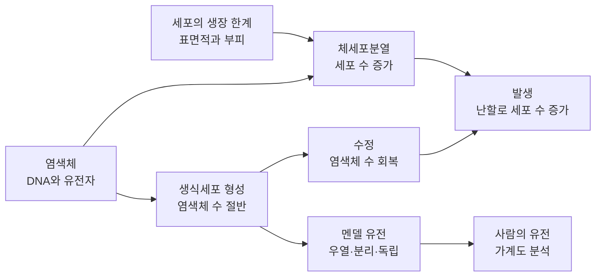

# 중3-6. 생식과 유전 — 세포가 나뉘고, 형질이 이어지는 규칙
<!-- prev: m1-02, m2-06 -->
<!-- next: 3-5, 3-6, 4-2, bio-3, gene-1, gene-2 -->

> [!NOTE]
> **성취기준**
> - **[9과21-01]** 개체의 생장에 세포분열이 필요한 이유를 세포의 표면적과 부피의 관계로 추론할 수 있다.
> - **[9과21-02]** 염색체와 유전자의 관계를 이해하고, 체세포분열과 생식세포 형성과정의 특징을 염색체 행동을 중심으로 해석할 수 있다.
> - **[9과21-03]** 수정란으로부터 개체가 발생하는 과정을 모형으로 표현할 수 있다.
> - **[9과21-04]** 멘델 유전 실험의 의의와 원리를 이해하고, 멘델 유전 원리가 적용되는 유전 현상을 조사하여 협력적으로 소통할 수 있다.
> - **[9과21-05]** 사람의 유전 형질과 유전 연구 방법을 알고, 가계도를 분석하여 사람의 유전 현상을 설명할 수 있다.

**학습 목표**

1. 세포가 커질수록 부피에 대한 표면적의 비가 작아진다는 것을 계산으로 확인하고, 생물이 세포 수를 늘려 생장하는 이유를 설명할 수 있다.
2. 염색체·DNA·유전자의 관계를 설명하고, 체세포분열과 생식세포 형성 과정을 염색체 수의 변화로 비교할 수 있다.
3. 수정란이 난할을 거쳐 세포 수를 늘려 가는 과정을 모형으로 나타낼 수 있다.
4. 멘델 실험의 의의를 알고, 우열·분리·독립의 원리로 자손의 형질 비율을 예측할 수 있다.
5. 사람의 유전을 연구하는 방법을 알고, 가계도를 분석하여 ABO식 혈액형과 적록 색맹의 유전을 설명할 수 있다.

**이 단원의 학습 사다리**

| 단계 | 무엇을 하나? |
|---|---|
| STEP 1. 이전 학습 다시 보기 | 초등학교 '생물의 한살이', 중1 세포와 변이, 중2 융털·폐포를 다시 꺼낸다 |
| STEP 2. 기초 다지기 | 표면적·부피 계산, 비율과 확률, '쌍'과 '짝'으로 생각하기 |
| STEP 3. 핵심 개념 | 세포분열의 필요성 → 염색체 → 두 가지 세포분열 → 발생 → 멘델 유전 → 사람의 유전 |
| STEP 4. 오개념 바로잡기 | "우성 형질이 더 흔하다?", "혀 말기는 멘델 유전?" 같은 착각을 바로잡는다 |
| STEP 5. 다음 단계로 | 통합과학 「유전자와 단백질」, 생명과학, 생물의 유전으로 이어지는 길 |
| STEP 6. 생활·산업·진로 | 품종 개량, 유전 상담, 재생 의학, 암 연구 |

---

## 🗺️ 단원 들어가기

코끼리의 세포는 생쥐의 세포보다 훨씬 클까? 놀랍게도 그렇지 않다. 코끼리와 생쥐의 몸을 이루는 세포 하나하나의 크기는 크게 다르지 않다. 코끼리가 큰 까닭은 **세포가 커서가 아니라 세포의 수가 많아서**이다. 그렇다면 왜 생물은 세포를 크게 키우지 않고 굳이 나누어서 수를 늘릴까?

또 하나의 질문이 있다. 부모님과 나는 얼굴이 닮았지만 똑같지는 않다. 형제자매끼리도 닮은 듯 다르다. 어떤 특징은 부모에게서 그대로 이어지고, 어떤 특징은 부모 어느 쪽에도 없다가 나타나기도 한다. 이 '닮음'과 '다름'에는 규칙이 있을까?

이 단원에서는 **세포가 나뉘는 방법**(세포분열)과 **형질이 자손에게 전해지는 규칙**(유전)을 하나의 이야기로 잇는다. 그 연결 고리는 세포 속 **염색체**이다.

---

## STEP 1. 🔙 이전 학습 다시 보기

### 연계 개념표

| 이전 단원·성취기준 | 그때 배운 것 | 이 단원에서 확장되는 것 |
|---|---|---|
| 초등 3~4학년 「생물의 한살이」 | 알 → 애벌레 → 번데기 → 어른벌레처럼 생물은 태어나 자라고 자손을 남긴다 | '자란다'는 것은 **세포 수가 늘어나는 것**이고, '자손을 남긴다'는 것은 **유전 정보를 물려주는 것**이다 |
| 초등 3~4학년 「동물의 생활」 | 동물은 생김새와 사는 곳에 따라 다양하다 | 같은 종 안에서도 형질이 다른 까닭을 **유전자**로 설명한다 |
| 중1 「생물의 구성과 다양성」 [9과02-01] | 세포는 생명 활동의 기본 단위이고, 핵에는 유전 물질이 있다 | 핵 속 유전 물질이 **염색체**의 형태로 나뉘어 전달된다 |
| 중1 「생물의 구성과 다양성」 [9과02-03] | 같은 종의 개체 사이에도 **변이**가 있고, 변이는 생물다양성의 바탕이다 | 생식세포 형성과 수정이 **변이를 만드는 원리**를 알아본다 |
| 중2 「동물과 에너지」 [9과13-01], [9과13-03] | 소장의 융털, 폐의 폐포는 표면적을 넓혀 물질 교환을 돕는다 | 세포 하나도 **표면적이 넉넉해야** 물질을 잘 주고받는다 |

### 준비 운동 (사전 진단)

**Q1.** 세포에서 유전 물질이 들어 있어 생명 활동을 조절하는 곳은?

**Q2.** 키가 큰 사람의 세포는 키가 작은 사람의 세포보다 크다. (O / X)

**Q3.** 같은 종의 개체 사이에 나타나는 생김새나 성질의 차이를 무엇이라고 하는가?

정답 및 해설

**Q1. 핵** — 핵 속에는 생명 활동에 필요한 정보, 즉 유전 물질이 들어 있다.

**Q2. X** — 같은 종류의 세포라면 크기는 비슷하다. 키 차이는 주로 **세포 수**의 차이이다.

**Q3. 변이** — 예를 들어 같은 고양이라도 털 색과 무늬가 개체마다 다르다.

---

## STEP 2. 🧱 기초 다지기

### ① 정육면체의 표면적과 부피

한 변의 길이가 $a$인 정육면체를 생각하자.

- **표면적**: 면이 6개이고 한 면의 넓이가 $a^2$이므로 $6a^2$
- **부피**: $a^3$
- **부피에 대한 표면적의 비**: $\dfrac{6a^2}{a^3} = \dfrac{6}{a}$

한 변의 길이가 2배가 되면 표면적은 4배, 부피는 8배가 된다. 부피가 표면적보다 **훨씬 빨리** 커진다는 점이 핵심이다.

> [!TIP]
> 💡 **비유** — 세포를 '교실', 세포막을 '교실 문'이라고 생각하자. 학생 수(부피)는 교실이 커질수록 빠르게 늘어나는데, 문(표면적)은 그만큼 늘지 않는다. 쉬는 시간에 모두 빠져나가기가 점점 어려워진다.

### ② 비와 확률

- 3:1은 "전체 4묶음 중 3묶음과 1묶음"이라는 뜻이다. 전체가 800이면 600과 200이다.
- 동전 한 개를 던져 앞면이 나올 확률은 $\frac{1}{2}$이다. 두 개를 던져 둘 다 앞면일 확률은 $\frac{1}{2}\times\frac{1}{2}=\frac{1}{4}$이다. **서로 영향을 주지 않는 두 사건이 함께 일어날 확률은 각 확률의 곱**이다.
- 확률은 '많이 했을 때의 비율'이다. 자녀가 4명이라고 해서 정확히 3:1로 나오는 것은 아니다.

### ③ '쌍'으로 생각하기

양말은 왼쪽·오른쪽이 한 켤레를 이룬다. 우리 몸의 세포에 있는 염색체도 **모양과 크기가 같은 것끼리 두 개씩 짝**을 이룬다. 하나는 어머니에게서, 하나는 아버지에게서 받은 것이다. 이 '짝'의 개념을 잡아 두면 세포분열과 유전이 모두 쉬워진다.

### ④ 용어 미리 보기

| 용어 | 한 줄 뜻 |
|---|---|
| **형질(trait)** | 생물이 가진 모양·성질 같은 특징 (예: 완두 씨의 모양) |
| **대립 형질** | 한 형질에서 서로 뚜렷이 구별되는 특징 (예: 둥근 씨 ↔ 주름진 씨) |
| **순종** | 여러 세대를 자가 수분해도 같은 형질만 나오는 개체 |
| **잡종** | 대립 형질이 다른 두 순종을 교배하여 얻은 개체 |

---

## STEP 3. 📘 핵심 개념

### ① 생물은 왜 세포분열로 자랄까? — 표면적과 부피

세포는 살아가려면 세포막을 통해 산소와 영양소를 받아들이고, 이산화 탄소와 노폐물을 내보내야 한다. 물질이 드나드는 통로는 **표면(세포막)** 이고, 물질이 필요한 곳은 **세포 안 전체(부피)** 이다.

| 한 변의 길이 | 표면적 ($6a^2$) | 부피 ($a^3$) | 부피에 대한 표면적의 비 |
|---|---|---|---|
| 1 | 6 | 1 | 6 |
| 2 | 24 | 8 | 3 |
| 3 | 54 | 27 | 2 |
| 4 | 96 | 64 | 1.5 |

세포가 커질수록 **부피에 대한 표면적의 비가 작아진다.** 즉, 세포 안의 '먹고 숨 쉬어야 할 양'에 비해 '드나드는 문'이 부족해진다. 또 세포 중심까지 물질이 퍼져 들어가는 거리도 멀어진다. 그래서 세포는 어느 정도 커지면 **둘로 나뉘어** 작은 세포 여러 개가 된다. 이것이 생물이 세포의 크기를 키우는 대신 **세포 수를 늘려 생장하는 이유**이다.

#### 예제 1

한 변이 4 cm인 정육면체 감자 조각 1개를, 한 변이 2 cm인 정육면체 8개로 잘랐다. 전체 부피와 전체 표면적은 각각 어떻게 변하는가?

**풀이**
- 자르기 전: 부피 $4^3 = 64\ \mathrm{cm^3}$, 표면적 $6\times4^2 = 96\ \mathrm{cm^2}$
- 자른 후: 부피 $8\times2^3 = 64\ \mathrm{cm^3}$, 표면적 $8\times(6\times2^2) = 192\ \mathrm{cm^2}$

전체 부피는 그대로인데 **표면적은 2배**가 되었다. 큰 세포 하나보다 작은 세포 여러 개가 물질을 주고받기에 유리하다. 감자를 잘게 썰면 빨리 익는 것도 같은 원리이다.

#### 예제 2 — 한천 조각 모형

페놀프탈레인 용액을 섞어 굳힌 한천을 한 변이 1 cm, 2 cm, 3 cm인 정육면체로 잘라 묽은 수산화 나트륨 용액에 담갔다. 일정 시간 뒤 모든 조각이 겉에서 안쪽으로 0.5 cm 깊이까지 붉게 물들었다. 각 조각에서 붉게 물든 부분은 전체 부피의 몇 %인가?

**풀이** 물들지 않은 부분은 각 변에서 양쪽으로 0.5 cm씩, 즉 1 cm씩 줄어든 정육면체이다.
- 1 cm: 안쪽 정육면체 한 변 0 → 물든 부분 **100 %**
- 2 cm: 안쪽 한 변 1 cm → 물들지 않은 부피 $1\ \mathrm{cm^3}$, 전체 $8\ \mathrm{cm^3}$ → 물든 부분 $\frac{7}{8}$ = **87.5 %**
- 3 cm: 안쪽 한 변 2 cm → 물들지 않은 부피 $8\ \mathrm{cm^3}$, 전체 $27\ \mathrm{cm^3}$ → 물든 부분 $\frac{19}{27}$ ≈ **70.4 %**

조각(세포)이 클수록 물질이 중심까지 닿지 못하는 부분이 많아진다.

<!-- fig:m3-06-agar-cubes -->

> [!TIP]
> 생물의 몸 곳곳에서 같은 아이디어를 만난다. 중2에서 배운 소장의 **융털**, 폐의 **폐포**, 식물의 **뿌리털**은 모두 표면적을 넓혀 물질 교환을 돕는 구조이다. 세포 수준에서는 '작게 나누기'가 같은 역할을 한다.

#### ✔ 바로 확인

1. (O/X) 세포가 커질수록 부피에 대한 표면적의 비도 커진다.
2. 한 변의 길이가 5인 정육면체의 부피에 대한 표면적의 비는 얼마인가?
3. 빈칸: 생물은 세포 하나의 크기를 키우는 대신 세포의 (    )를 늘려 생장한다.

정답

1. X — 작아진다. 한 변이 1에서 2가 되면 비는 6에서 3이 된다.
2. 1.2 — $\dfrac{6a^2}{a^3} = \dfrac{6}{a} = \dfrac{6}{5}$
3. 수 — 작은 세포 여러 개가 물질을 주고받기에 유리하다.

### ② 염색체·DNA·유전자의 관계

세포가 나뉠 때 가장 중요한 일은 **유전 정보를 빠짐없이 나누어 주는 것**이다. 평소 핵 속의 유전 물질은 가는 실처럼 풀어져 있지만, 세포가 분열할 때는 굵고 짧게 뭉쳐 막대 모양의 **염색체(chromosome)** 가 된다. 실을 실패에 감아 두면 옮기기 쉬운 것과 같다.

| 구분 | 설명 | 비유 |
|---|---|---|
| **DNA** | 유전 정보를 저장하는 물질. 두 가닥이 꼬인 긴 사슬 모양 | 아주 긴 글이 적힌 종이 띠 |
| **유전자(gene)** | DNA 중에서 특정 형질에 대한 정보를 가진 부분 | 종이 띠에 적힌 '문장' 하나 |
| **염색체** | DNA가 단백질과 함께 뭉쳐진 구조. 분열할 때 잘 보인다 | 종이 띠를 감아 묶은 '두루마리' |

즉, **염색체 안에 DNA가 있고, DNA의 일부 구간이 유전자**이다. 염색체 하나에는 수많은 유전자가 들어 있다.

<!-- fig:m3-06-chromosome-dna-gene -->

#### 상동 염색체와 대립유전자

- 체세포에는 모양과 크기가 같은 염색체가 2개씩 짝을 이룬다. 이 한 쌍을 **상동 염색체(homologous chromosomes)** 라고 한다. 하나는 어머니(난자)에게서, 하나는 아버지(정자)에게서 왔다.
- 상동 염색체의 같은 위치에는 같은 형질을 정하는 유전자가 있다. 이렇게 한 형질을 정하는 짝 유전자를 **대립유전자**라고 한다. (예: 씨 모양을 둥글게 하는 유전자와 주름지게 하는 유전자)
- 분열 중인 염색체는 두 가닥으로 보이는데, 이것은 분열 전에 DNA가 **복제**되어 똑같은 두 가닥(염색 분체)이 붙어 있기 때문이다.

#### 사람의 염색체

사람의 체세포에는 염색체가 **46개(23쌍)** 있다.

| 종류 | 수 | 특징 |
|---|---|---|
| **상염색체** | 22쌍(44개) | 남녀가 공통으로 가진다 |
| **성염색체** | 1쌍(2개) | 성별을 결정한다. 여자는 XX, 남자는 XY |

| 생물 | 체세포의 염색체 수 |
|---|---|
| 초파리 | 8 |
| 완두 | 14 |
| 양파 | 16 |
| 사람 | 46 |
| 침팬지 | 48 |

분열 중인 사람의 세포에서 염색체를 찍어 짝끼리 늘어놓으면 아래 사진과 같다.

<!-- photo:m3-06-human-karyotype -->

#### ✔ 바로 확인

1. 염색체, 유전자, DNA를 큰 것부터 차례로 쓰시오.
2. (O/X) 상동 염색체 한 쌍은 둘 다 어머니에게서 받은 것이다.
3. 사람 남자의 체세포에 있는 성염색체 두 개를 쓰시오.
4. 분열 중인 염색체가 두 가닥으로 보이는 까닭은 무엇인가?

정답

1. 염색체 > DNA > 유전자 — 염색체 안에 DNA가 있고, DNA의 일부 구간이 유전자이다.
2. X — 하나는 어머니에게서, 하나는 아버지에게서 받았다.
3. X, Y — 여자는 XX, 남자는 XY이다.
4. 분열 전에 DNA가 복제되어 똑같은 두 가닥(염색 분체)이 붙어 있기 때문이다.

### ③ 체세포분열 — 똑같은 세포를 늘리는 분열

**체세포분열(somatic cell division)** 은 몸을 이루는 세포가 둘로 나뉘는 과정이다. 생장(키가 자람), 재생(상처가 아묾), 단세포 생물의 번식에 쓰인다.

**과정 (염색체 행동 중심)**

| 시기 | 염색체에 일어나는 일 |
|---|---|
| 분열 전(간기) | 세포가 자라고, DNA가 **복제**되어 유전 물질이 2배가 된다 |
| 전기 | 실 같던 유전 물질이 뭉쳐 **염색체**가 나타나고, 핵막이 사라진다 |
| 중기 | 염색체가 세포 **가운데에 한 줄로** 늘어선다 (관찰하기 가장 좋다) |
| 후기 | 각 염색체의 두 가닥(염색 분체)이 갈라져 **양쪽 끝으로** 끌려간다 |
| 말기·세포질 분열 | 양쪽에 핵이 다시 생기고, 세포질이 나뉘어 **딸세포 2개**가 된다 |

실제로 분열하는 세포를 현미경으로 찍으면 각 시기의 염색체를 볼 수 있다.

<!-- photo:m3-06-mitosis-micrographs -->

세포질이 나뉘는 방식은 동물과 식물이 다르다. 동물 세포는 세포막이 바깥에서 안쪽으로 **잘록하게 조여** 나뉘고, 식물 세포는 단단한 세포벽 때문에 가운데에 **새 칸막이(세포판)** 가 생기며 나뉜다. 아래 모식도는 분열의 각 시기와 세포질이 나뉘는 방식을 단순하게 나타낸 것이다.

<!-- fig:m3-06-mitosis-stages -->

> [!IMPORTANT]
> **체세포분열의 의미** — 복제된 유전 물질을 정확히 반씩 나누므로 딸세포는 **모세포와 염색체 수와 유전 정보가 같다.** 사람의 체세포 46개 → 딸세포도 각각 46개.

> [!TIP]
> 💡 **비유** — 체세포분열은 '책 복사 후 나눠 주기'이다. 책(유전 정보)을 통째로 한 부 복사한 뒤, 원본과 복사본을 두 사람에게 한 부씩 나눠 준다. 두 사람은 같은 책을 갖는다.

식물에서 체세포분열이 활발한 곳은 뿌리 끝과 줄기 끝의 **생장점**, 줄기를 굵게 하는 **형성층**이다. 그래서 세포분열을 관찰할 때는 양파 뿌리 끝을 쓴다.

#### ✔ 바로 확인

1. 염색체가 세포 가운데에 한 줄로 늘어서는 시기는 언제인가?
2. (O/X) 체세포분열로 생긴 딸세포의 염색체 수는 모세포의 절반이다.
3. 짝짓기: (가) 동물 세포 (나) 식물 세포 — ㄱ. 가운데에 세포판이 생겨 나뉜다 ㄴ. 세포막이 바깥에서 안쪽으로 조여 나뉜다
4. 식물에서 체세포분열이 활발하게 일어나는 곳을 두 가지 쓰시오.

정답

1. 중기 — 그래서 염색체를 관찰하기 가장 좋다.
2. X — 모세포와 같다(사람 46 → 46).
3. (가) ㄴ, (나) ㄱ — 식물 세포는 단단한 세포벽 때문에 세포판으로 나뉜다.
4. 생장점(뿌리 끝·줄기 끝), 형성층

### ④ 생식세포 형성 — 염색체 수를 절반으로 줄이는 분열

정자와 난자 같은 **생식세포**를 만들 때는 특별한 분열이 일어난다. 이를 **감수 분열(meiosis, 생식세포 분열)** 이라고 한다.

**왜 절반으로 줄여야 할까?** 만약 정자와 난자가 각각 46개의 염색체를 가진다면, 수정란은 92개가 되고 다음 세대는 184개가 된다. 세대마다 염색체 수가 두 배로 늘어나 버린다. 생식세포의 염색체 수가 절반(23개)이어야 수정 후 46개로 **세대를 거듭해도 일정하게 유지**된다.

**과정 (염색체 행동 중심)**
1. 분열 전에 DNA가 한 번 **복제**된다.
2. **첫 번째 분열**: 상동 염색체끼리 짝을 지었다가 **서로 갈라져** 다른 세포로 간다. → 염색체 수가 **절반**이 된다.
3. **두 번째 분열**: 각 염색체의 두 가닥(염색 분체)이 갈라진다. → 염색체 수는 그대로이다.
4. 결과: 모세포 1개에서 염색체 수가 절반인 생식세포 **4개**가 생긴다.

| 비교 | 체세포분열 | 생식세포 형성(감수 분열) |
|---|---|---|
| 일어나는 곳 | 몸의 대부분 세포, 생장점·형성층 | 정소·난소(동물), 꽃밥·밑씨(식물) |
| 분열 횟수 | 1회 | 연속 2회 |
| 상동 염색체 짝짓기 | 없다 | 있다 (첫 번째 분열) |
| 딸세포 수 | 2개 | 4개 |
| 염색체 수 변화 | 변하지 않는다 (46 → 46) | 절반이 된다 (46 → 23) |
| 유전 정보 | 모세포와 같다 | 세포마다 조합이 다르다 |
| 의미 | 생장, 재생, 무성 생식 | 염색체 수 유지, **자손의 다양성** |

> [!TIP]
> 💡 **비유** — 감수 분열은 '양말 짝 나누기'이다. 23켤레의 양말(상동 염색체 23쌍)을 가진 사람이 각 켤레에서 **한 짝씩만** 골라 상자에 담는다. 켤레마다 왼쪽을 고를지 오른쪽을 고를지 정하므로 상자마다 담긴 양말 조합이 다르다. 사람은 이 방법으로 $2^{23}$, 즉 약 840만 가지의 서로 다른 조합의 생식세포를 만들 수 있다.

<!-- sim:cell-division -->

#### 예제 3

그림과 같이 초파리의 체세포에는 염색체가 8개 있다.

<!-- fig:m3-06-q-fly-chromosomes -->

(1) 초파리의 체세포가 체세포분열하여 생긴 딸세포 1개의 염색체 수는?
(2) 초파리의 정자 1개의 염색체 수는?
(3) 초파리 체세포에 있는 상동 염색체는 몇 쌍인가?

**풀이**
(1) 체세포분열은 염색체 수가 변하지 않으므로 **8개**
(2) 생식세포는 염색체 수가 절반이므로 **4개**
(3) 8개가 2개씩 짝을 이루므로 **4쌍**

#### ✔ 바로 확인

1. (O/X) 감수 분열에서는 분열이 연속 2회 일어나 딸세포 4개가 생긴다.
2. 상동 염색체가 서로 갈라지는 것은 첫 번째 분열과 두 번째 분열 중 언제인가?
3. 완두의 체세포에는 염색체가 14개 있다. 완두의 생식세포 1개에는 염색체가 몇 개 있는가?
4. 생식세포의 염색체 수가 체세포의 절반이어야 하는 까닭을 한 줄로 쓰시오.

정답

1. O
2. 첫 번째 분열 — 이때 염색체 수가 절반이 된다.
3. 7개 — 생식세포는 체세포 염색체 수의 절반이다.
4. 수정 뒤에도 염색체 수가 세대마다 일정하게 유지되도록 하기 위해서이다.

### ⑤ 수정란에서 개체로 — 수정과 난할

**수정(fertilization)** 은 정자의 핵과 난자의 핵이 합쳐지는 것이다. 사람의 경우 염색체 23개인 정자와 23개인 난자가 만나 46개(23쌍)인 **수정란**이 된다. 수정란은 새로운 개체의 첫 세포이다.

수정란은 곧바로 체세포분열을 되풀이하는데, 발생 초기의 이 빠른 체세포분열을 **난할(cleavage)** 이라고 한다.

| 난할의 특징 | 설명 |
|---|---|
| 세포 수 | 1 → 2 → 4 → 8 → 16 …으로 늘어난다. 분열 $n$번 후 $2^n$개 |
| 세포 하나의 크기 | 분열 사이에 세포가 거의 자라지 않으므로 **점점 작아진다** |
| 배아 전체의 크기 | 처음 수정란과 **거의 같다** |
| 염색체 수 | 모든 세포가 수정란과 **같다** (체세포분열이므로) |

> [!TIP]
> 💡 **비유** — 난할은 '피자 자르기'이다. 피자 한 판(수정란)을 2조각, 4조각, 8조각으로 계속 자르면 조각 수는 늘지만 조각 하나는 작아지고, 피자 한 판의 크기는 그대로이다. 다만 피자 조각과 달리 세포 하나하나는 **같은 유전 정보를 모두 가진 완전한 세포**이다.

사람의 경우 수정은 수란관에서 일어나고, 수정란은 난할을 하면서 자궁으로 이동한다. 난할 이후 개체가 되기까지의 과정은 STEP 5에서 맛보기로 살펴본다. 이 여정을 실제 기관의 모습에 가깝게 그리면 아래 그림과 같다.

<!-- photo:m3-06-fertilization-journey -->

아래 모식도는 난할에 따른 세포 수의 변화와 수정란이 가는 길을 단순하게 정리한 것이다.

<!-- fig:m3-06-fertilization-cleavage -->

#### 예제 4

수정란이 난할을 5번 했다.
(1) 세포는 몇 개가 되는가?
(2) 세포가 분열 사이에 자라지 않는다고 할 때, 세포 1개의 부피는 수정란의 몇 분의 1인가?
(3) 세포 수가 처음으로 100개를 넘으려면 난할을 최소 몇 번 해야 하는가?

**풀이**
(1) $2^5 = 32$개
(2) 전체 부피가 32개로 나뉘므로 $\frac{1}{32}$
(3) $2^6 = 64$, $2^7 = 128$이므로 **7번**

**모형으로 표현하기** 찰흙 한 덩어리를 수정란으로 정하고, 반으로 나누어 2개, 각각을 다시 반으로 나누어 4개, 8개로 만든 뒤 나눈 조각들을 모아 붙여 보자. 조각 수, 조각 하나의 크기, 모았을 때 전체 크기를 표로 기록하면 난할의 세 가지 특징을 한눈에 확인할 수 있다. 각 조각에 같은 색 구슬(염색체 모형)을 똑같은 개수씩 넣으면 '모든 세포의 염색체 수가 같다'는 점까지 나타낼 수 있다.

#### ✔ 바로 확인

1. 빈칸: 정자의 핵과 난자의 핵이 합쳐지는 것을 (    )이라고 한다.
2. (O/X) 난할이 거듭될수록 배아 전체의 크기가 크게 늘어난다.
3. 수정란이 난할을 3번 하면 세포는 몇 개가 되는가?
4. 사람에서 수정이 일어나는 곳은 어디인가?

정답

1. 수정
2. X — 세포 수는 늘지만 배아 전체의 크기는 수정란과 거의 같다.
3. 8개 — $2^3 = 8$
4. 수란관 — 수정란은 난할을 하면서 자궁으로 이동한다.

### ⑥ 멘델의 유전 실험 — 유전에도 규칙이 있다

**멘델(Mendel)** 은 오스트리아(지금의 체코 지역)의 수도원에서 완두를 수년간 교배하고, 그 결과를 1865년에 발표하였다. 당시에는 "부모의 특징이 물감처럼 섞여 자손에게 전해진다"는 생각이 널리 퍼져 있었다. 멘델은 형질을 정하는 **'입자'(지금의 유전자)** 가 섞이지 않고 그대로 전달된다는 것을 밝혔다. 그의 연구는 오랫동안 주목받지 못하다가 1900년에 여러 과학자에 의해 재발견되었다.

#### 멘델 실험의 의의 — 왜 성공했을까?

| 멘델이 한 일 | 과학적 의미 |
|---|---|
| 완두를 재료로 골랐다 | 기르기 쉽고, 한 세대가 짧고, 자손이 많으며, **대립 형질이 뚜렷하다** |
| 순종을 먼저 확보했다 | 실험 출발점을 분명히 했다 |
| 한 번에 한두 가지 형질만 추적했다 | 복잡한 현상을 단순하게 나누어 분석했다 |
| 수천 개의 자손을 세었다 | **수학(통계)** 을 이용해 규칙(비율)을 찾았다 |
| 가설을 세우고 새 교배로 확인했다 | 가설 → 예측 → 검증이라는 과학 탐구의 모범을 보였다 |

#### 표기 약속

- 우성 대립유전자는 대문자(R), 열성 대립유전자는 소문자(r)로 쓴다.
- 체세포는 대립유전자를 2개 가진다: RR, Rr, rr (**유전자형**)
- 겉으로 드러나는 형질: 둥근 씨, 주름진 씨 (**표현형**)
- 생식세포는 대립유전자를 1개만 가진다: R 또는 r

#### 원리 1 — 우열의 원리

순종의 둥근 씨(RR)와 순종의 주름진 씨(rr)를 교배하면, 잡종 1대(Rr)는 **모두 둥근 씨**이다. 대립 형질이 다른 순종끼리 교배했을 때 잡종 1대에서 나타나는 형질을 **우성**, 나타나지 않는 형질을 **열성**이라고 한다.

#### 원리 2 — 분리의 법칙

잡종 1대(Rr)를 자가 수분하면 잡종 2대에서 둥근 씨와 주름진 씨가 **약 3:1**로 나온다. 멘델의 실제 결과는 둥근 씨 5474개, 주름진 씨 1850개로 약 2.96:1이었다.

생식세포를 만들 때 **한 쌍의 대립유전자가 서로 분리되어 각각 다른 생식세포로 들어가기** 때문이다. 이것을 **분리의 법칙**이라고 한다. 이 규칙의 정체가 바로 ④에서 배운 '감수 분열 때 상동 염색체가 갈라지는 것'이다.

| 잡종 1대 생식세포 → | R (1/2) | r (1/2) |
|---|---|---|
| **R (1/2)** | RR 둥근 | Rr 둥근 |
| **r (1/2)** | Rr 둥근 | rr 주름진 |

유전자형 RR : Rr : rr = 1 : 2 : 1, 표현형 둥근 : 주름진 = 3 : 1. 이런 격자 표를 **퍼넷 사각형(Punnett square)** 이라고 한다. 위쪽과 왼쪽에 부모의 생식세포를 쓰고 칸마다 만나는 두 유전자를 적으며, 칸 4개의 확률은 같다.

#### 예제 5

잡종 1대 둥근 완두(Rr)를 자가 수분하여 잡종 2대 완두 800개를 얻었다.
(1) 둥근 완두와 주름진 완두는 각각 약 몇 개인가?
(2) 둥근 완두 중 유전자형이 RR인 것은 약 몇 개인가?

**풀이**
(1) 3 : 1이므로 둥근 $800\times\frac{3}{4} = 600$개, 주름진 $800\times\frac{1}{4} = 200$개
(2) RR은 전체의 $\frac{1}{4}$이므로 $800\times\frac{1}{4} = 200$개. 둥근 완두 600개 중 $\frac{1}{3}$이다.

#### 원리 3 — 독립의 법칙

두 쌍의 대립 형질을 함께 살펴보자. 순종의 둥글고 노란 완두(RRYY)와 순종의 주름지고 초록색인 완두(rryy)를 교배하면 잡종 1대(RrYy)는 모두 둥글고 노랗다. 잡종 1대를 자가 수분하면 잡종 2대에서

$$
\text{둥글고 노란색} : \text{둥글고 초록색} : \text{주름지고 노란색} : \text{주름지고 초록색} = 9 : 3 : 3 : 1
$$

로 나온다. 멘델의 실제 결과는 315 : 108 : 101 : 32였다. 모양만 보면 둥근 것(315 + 108 = 423)과 주름진 것(101 + 32 = 133)이 약 3:1, 색만 보아도 약 3:1이다. 즉 **모양 유전자와 색 유전자는 서로 영향을 주지 않고 따로따로 분리**된다. 이것을 **독립의 법칙**이라고 한다(두 유전자가 서로 다른 염색체에 있을 때 성립한다). 확률로 보면 둥글고 노란색일 확률은 $\frac{3}{4}\times\frac{3}{4} = \frac{9}{16}$이다.

<!-- fig:m3-06-segregation-chromosomes -->

<!-- sim:mendel-cross -->

#### 멘델 유전 원리가 적용되는 다른 현상 — 중간 유전

분꽃에서 붉은 꽃(RR)과 흰 꽃(WW)을 교배하면 잡종 1대는 **분홍색 꽃(RW)** 이 핀다. 두 대립유전자 사이에 우열 관계가 뚜렷하지 않기 때문이다. 이를 **중간 유전**이라고 한다. 잡종 1대끼리 교배하면 붉은 꽃 : 분홍 꽃 : 흰 꽃 = 1 : 2 : 1로 나온다. **우열의 원리는 맞지 않지만, 분리의 법칙은 그대로 성립**한다. 물감처럼 섞인 것이라면 잡종 2대에서 붉은 꽃과 흰 꽃이 다시 나타날 수 없다.

#### ✔ 바로 확인

1. 유전자형이 Rr인 완두가 만드는 생식세포의 종류와 그 비를 쓰시오.
2. 빈칸: '둥근 씨'처럼 겉으로 드러나는 형질은 (    ), 'Rr'처럼 대립유전자의 조합은 (    )이다.
3. (O/X) 순종의 둥근 완두와 순종의 주름진 완두를 교배한 잡종 1대에서 나타나는 둥근 씨가 우성이다.
4. 분꽃의 잡종 1대(RW)는 무슨 색 꽃이 피는가?

정답

1. R : r = 1 : 1 — 한 쌍의 대립유전자가 분리되어 각각 다른 생식세포로 들어간다.
2. 표현형, 유전자형
3. O
4. 분홍색 — 우열 관계가 뚜렷하지 않은 중간 유전이다.

### ⑦ 사람의 유전 — 가계도로 규칙을 찾는다

#### 사람의 유전을 연구하기 어려운 이유

| 어려움 | 이유 |
|---|---|
| 교배 실험을 할 수 없다 | 연구를 위해 사람의 결혼과 출산을 정할 수 없다 |
| 한 세대가 길다 | 완두는 한 해에 한 세대이지만 사람은 수십 년이 걸린다 |
| 자손의 수가 적다 | 통계적으로 비율을 확인하기 어렵다 |
| 형질이 복잡하다 | 많은 형질이 여러 유전자와 환경의 영향을 함께 받는다 |

#### 사람의 유전 연구 방법

| 방법 | 내용 | 예 |
|---|---|---|
| **가계도 조사** | 한 집안의 여러 세대에 걸친 형질을 그림으로 그려 유전 방식을 추론한다 | 적록 색맹, 혈액형 |
| **쌍둥이 연구** | 유전자가 같은 1란성 쌍둥이와 유전자가 다른 2란성 쌍둥이를 비교하여 유전과 환경의 영향을 구분한다 | 키, 질병에 걸리는 경향 |
| **집단 조사** | 많은 사람을 조사하여 형질이 나타나는 비율과 분포를 분석한다 | 지역별 혈액형 비율 |
| **염색체·DNA 분석** | 염색체의 수와 모양, 유전자를 직접 조사한다 | 염색체 이상 진단 |

#### 가계도 읽기

가계도에서 □는 남자, ○는 여자이다. 형질이 나타난 사람은 색칠(■, ●)하고, 가로선은 부부, 세로선 아래는 자녀이다.

> [!IMPORTANT]
> **가계도 분석의 두 가지 열쇠**
> - 형질이 **없는 부모**에게서 형질이 **있는 자녀**가 나왔다 → 그 형질은 **열성**이다. (부모가 열성 유전자를 숨기고 있었다)
> - 형질이 **있는 부모**에게서 형질이 **없는 자녀**가 나왔다 → 그 형질은 **우성**이다.

<!-- fig:m3-06-pedigree-reading -->

#### 단일 유전자로 정해지는 사람의 형질 예

| 형질 | 대립 형질 | 특징 |
|---|---|---|
| 귀지의 형태 | 젖은 귀지(우성) / 마른 귀지(열성) | 한 유전자로 정해진다고 밝혀졌다. 동아시아 사람에게는 마른 귀지가 많다 |
| ABO식 혈액형 | A형, B형, AB형, O형 | 대립유전자가 A, B, O 세 가지이다 |
| 적록 색맹 | 정상 / 적록 색맹(열성) | 유전자가 **X 염색체**에 있다 |

> [!WARNING]
> 혀 말기, 쌍꺼풀, 보조개 같은 형질은 한때 단순한 우열 유전의 예로 소개되었지만, 실제로는 **한 쌍의 대립유전자만으로 설명되지 않는다**는 연구가 많다. 키, 피부색처럼 **여러 유전자와 환경이 함께 영향을 주는 형질**도 많다. 사람의 유전을 조사할 때는 과학적으로 입증된 사례를 써야 한다.

#### ABO식 혈액형의 유전

- 대립유전자: A, B, O 세 가지. 한 사람은 이 중 2개를 가진다.
- A와 B는 O에 대해 **우성**이고, A와 B 사이에는 우열이 없어 함께 나타난다.

| 표현형 | 가능한 유전자형 |
|---|---|
| A형 | AA, AO |
| B형 | BB, BO |
| AB형 | AB |
| O형 | OO |

#### 예제 6

A형인 아버지와 B형인 어머니 사이에서 O형인 첫째가 태어났다.
(1) 아버지와 어머니의 유전자형은?
(2) 둘째가 태어날 때, 둘째가 AB형일 확률은?

**풀이**
(1) O형 자녀(OO)는 부모에게서 O를 하나씩 받았다. 따라서 아버지는 **AO**, 어머니는 **BO**이다.
(2) 아버지의 생식세포 A 또는 O (각 1/2), 어머니의 생식세포 B 또는 O (각 1/2)

| 아버지 → / 어머니 ↓ | A | O |
|---|---|---|
| **B** | AB | BO (B형) |
| **O** | AO (A형) | OO |

AB형일 확률은 $\frac{1}{2}\times\frac{1}{2} = \frac{1}{4}$. 이 부부의 자녀는 A, B, AB, O형이 모두 나올 수 있다.

#### 적록 색맹의 유전 — 성염색체에 있는 유전자

적록 색맹은 붉은색과 초록색을 잘 구별하지 못하는 형질이다. 이 유전자는 **X 염색체**에 있고 정상에 대해 **열성**이다. 정상 유전자를 $\mathrm{X^R}$, 색맹 유전자를 $\mathrm{X^r}$로 나타내자.

| 구분 | 정상 | 보인자 (정상이지만 색맹 유전자 보유) | 적록 색맹 |
|---|---|---|---|
| 여자 | $\mathrm{X^RX^R}$ | $\mathrm{X^RX^r}$ | $\mathrm{X^rX^r}$ |
| 남자 | $\mathrm{X^RY}$ | 없음 | $\mathrm{X^rY}$ |

남자는 X 염색체가 1개뿐이므로 색맹 유전자를 하나만 가져도 색맹이 된다. 여자는 두 X 염색체가 모두 색맹 유전자여야 색맹이 된다. 그래서 적록 색맹은 **여자보다 남자에게 훨씬 많이** 나타난다. 또 아들의 X 염색체는 **어머니에게서만** 온다.

#### 예제 7 — 가계도 분석

그림과 같이 정상인 아버지와 정상인 어머니 사이에서 적록 색맹인 아들이 태어났다.

<!-- fig:m3-06-q-colorblind-family -->

(1) 어머니의 유전자형은?
(2) 이 부부의 다음 아이가 아들일 때, 그 아들이 적록 색맹일 확률은?
(3) 이 부부에게서 적록 색맹인 딸이 태어날 수 있는가?

**풀이**
(1) 아들($\mathrm{X^rY}$)의 $\mathrm{X^r}$는 어머니에게서 왔고 어머니는 정상이므로 $\mathrm{X^RX^r}$(보인자)이다.
(2) 아들은 어머니에게서 $\mathrm{X^R}$ 또는 $\mathrm{X^r}$를 1/2씩 받으므로 **1/2**이다.
(3) 딸은 아버지에게서 반드시 $\mathrm{X^R}$를 받으므로 **적록 색맹이 될 수 없다.** (보인자일 확률은 1/2)

> [!NOTE]
> 가계도 분석 활동을 할 때는 학생 자신이나 가족의 질병, 가족 관계 같은 **개인 정보를 쓰지 않는다.** 교과서나 연구 자료의 가상 가계도를 사용한다.

#### ✔ 바로 확인

1. 사람의 유전을 연구하기 어려운 까닭이 **아닌** 것은? ㄱ. 한 세대가 길다 ㄴ. 자손의 수가 적다 ㄷ. 원하는 대로 교배 실험을 할 수 있다
2. 1란성 쌍둥이와 2란성 쌍둥이를 비교하여 유전과 환경의 영향을 구분하는 연구 방법은?
3. B형인 사람이 가질 수 있는 유전자형을 모두 쓰시오.
4. (O/X) 적록 색맹인 아들의 색맹 유전자는 아버지에게서 왔다.

정답

1. ㄷ — 사람은 교배 실험을 할 수 없다.
2. 쌍둥이 연구
3. BB, BO
4. X — 아들의 X 염색체는 어머니에게서만 온다. 아버지에게서는 Y 염색체를 받는다.

---

## STEP 4. ⚠️ 오개념 바로잡기

| 흔한 오개념 | 올바른 개념 | 왜 그럴까? |
|---|---|---|
| 몸이 큰 생물은 세포도 크다 | 몸이 큰 생물은 주로 **세포 수가 많다** | 세포가 너무 크면 부피에 대한 표면적의 비가 작아져 물질 교환이 어렵다 |
| 우성 형질은 열성 형질보다 흔하고 더 좋다 | 우성·열성은 잡종에서 **어느 형질이 드러나는가**일 뿐이다 | 흔한 정도는 집단에 그 유전자가 얼마나 많은지에 달려 있다. 마른 귀지는 열성이지만 동아시아에 흔하다 |
| 잡종 2대는 반드시 정확히 3:1로 나온다 | 3:1은 **많이 조사했을 때의 비율(확률)** 이다 | 멘델도 5474 : 1850처럼 3:1에 가까운 값을 얻었다. 자녀가 4명이면 비율이 얼마든지 달라질 수 있다 |
| 생식세포 분열도 염색체 수가 그대로이다 | 생식세포 형성 과정에서 염색체 수는 **절반**이 된다 | 그래야 수정 후 염색체 수가 세대마다 일정하게 유지된다 |
| 난할을 하면 배아가 점점 커진다 | 난할 동안 세포 수는 늘지만 **전체 크기는 거의 같다** | 분열 사이에 세포가 거의 자라지 않아 세포 하나가 점점 작아진다 |
| 혀 말기·쌍꺼풀은 멘델 유전의 대표 예이다 | 이런 형질은 **단일 유전자로 설명되지 않는** 경우가 많다 | 사람의 많은 형질은 여러 유전자와 환경이 함께 정한다 |
| 아들의 적록 색맹은 아버지에게서 물려받는다 | 아들의 X 염색체는 **어머니에게서** 온다 | 아버지는 아들에게 Y 염색체를 준다 |

---

## STEP 5. 🎓 다음 단계로 한 걸음 더

> [!CAUTION]
> 이 절은 **중학교 교육과정 범위 밖의 심화 내용**으로 평가 대상이 아니다. "이 개념이 앞으로 어디까지 이어지는가"를 맛보기로 보여 주기 위한 내용이다.

### 다음 학년·과목과의 연결

| 단계 | 단원 | 이어지는 내용 |
|---|---|---|
| 통합과학1 | 「생명 시스템과 물질대사」 | 세포막을 통한 물질 출입, 세포 안 화학 반응과 효소 |
| 통합과학1 | 「유전자와 단백질」 | DNA의 유전 정보가 전사·번역을 거쳐 단백질이 되는 과정 |
| 통합과학2 | 「진화와 생물다양성」 | 생식세포 형성과 수정이 만든 변이가 자연선택으로 이어지는 과정 |
| 생명과학 (일반 선택) | 「생명의 연속성과 다양성」 | 염색체 구조, 감수 1분열·2분열의 비교, 생식세포 형성의 중요성 |
| 생물의 유전 (진로 선택) | 「유전자와 유전물질」 | 상염색체 유전과 성염색체 유전, 다유전자 유전, 유전병, DNA 복제 |
| 생물의 유전 (진로 선택) | 「유전자의 발현」 | 발생 과정에서 유전자 발현 조절에 의한 세포 분화 |

### ① 감수 분열을 더 자세히 — 교차

생명과학에서는 감수 1분열 때 짝을 지은 상동 염색체가 일부분을 **서로 맞바꾸는 현상(교차)** 을 배운다. 그러면 같은 염색체에 있던 유전자들의 조합까지 새로 바뀐다. 양말 짝 고르기(약 840만 가지)에 교차가 더해지면, 한 부부에게서 태어날 수 있는 자녀의 유전자 조합은 사실상 셀 수 없이 많아진다. 이것이 형제자매가 닮았지만 다른 이유이고, 통합과학2 「진화와 생물다양성」에서 배울 **변이**의 원천이다.

### ② 난할 다음에는 무엇이 일어날까? — 세포 분화

난할로 세포 수가 늘어난 배아는 속이 빈 공 모양이 되었다가, 세포층이 안으로 접혀 들어가며 여러 층을 만든다. 사람의 경우 속이 빈 공 모양의 배아가 수정 후 약 일주일 무렵 자궁 안쪽 벽에 파묻히고(**착상**), 수정 후 약 38주가 지나면 아기가 태어난다. 이후 세포들은 신경, 근육, 혈액 세포처럼 서로 다른 모양과 기능을 갖게 되는데, 이를 **세포 분화**라고 한다. 놀랍게도 모든 세포는 수정란과 **같은 유전자**를 가지고 있다. 다른 점은 **어떤 유전자를 켜고 끄는가**이다. 이 '유전자 발현 조절'은 진로 선택 「유전자의 발현」의 핵심 주제이며, 아직 분화하지 않은 세포인 **줄기세포** 연구와 이어진다.

### 지금 vs 다음 단계

| 구분 | 중학교 (지금) | 고등학교 생명과학·생물의 유전 |
|---|---|---|
| 염색체 | 염색체 안에 DNA, DNA 일부가 유전자 | 염색체의 구조, 핵형 분석, 유전체 |
| 세포분열 | 염색체 수 변화와 의미 중심 | 감수 1·2분열 비교, 교차, DNA 양 변화 그래프 |
| 발생 | 난할의 특징 | 세포 분화와 유전자 발현 조절 |
| 유전 원리 | 우열·분리·독립, 중간 유전 | 복대립 유전, 연관과 교차, 다유전자 유전 |
| 사람의 유전 | ABO식 혈액형, 적록 색맹 가계도 | 상염색체·성염색체 유전 비교, 염색체·유전자 이상, 유전병 |

---

## STEP 6. 🏭 생활·산업·진로 연결

### 사례 1. 품종 개량 — 멘델 원리를 농업에

- **원리** 원하는 형질(병에 강함, 맛이 좋음, 수확량이 많음)을 가진 품종끼리 교배하고, 자손 중에서 원하는 형질이 함께 나타난 것을 골라 순종이 될 때까지 기른다. 분리·독립의 법칙으로 몇 세대 뒤에 어떤 비율로 원하는 개체가 나올지 미리 계산할 수 있다.
- **어디에 쓰이나** 벼·배추·고추 같은 작물, 과일, 가축의 새 품종 개발. 요즘에는 DNA 검사로 원하는 유전자를 가진 어린 개체를 미리 골라내 시간을 줄인다.

### 사례 2. 유전 상담과 유전자 검사

- **원리** 가계도와 유전자 검사로 어떤 유전 질환이 다음 세대에 나타날 가능성을 확률로 계산한다. 예제 7과 같은 분석이 실제로 쓰인다.
- **어디에 쓰이나** 병원의 유전 상담 클리닉, 신생아 선별 검사. 유전 정보는 매우 민감한 개인 정보이므로 엄격하게 보호해야 한다.

### 사례 3. 재생 의학과 암 연구 — 세포분열을 다스리다

- **원리** 상처가 아무는 것은 체세포분열 덕분이다. 정상 세포는 필요할 때만 분열하고 멈추는데, 이 조절이 고장 나 멈추지 않고 분열하면 덩어리(종양)가 생긴다. 많은 항암제가 빠르게 분열하는 세포를 공격하므로, 머리카락을 만드는 세포처럼 분열이 활발한 정상 세포도 영향을 받아 부작용이 생긴다.
- **어디에 쓰이나** 화상 환자를 위한 피부 세포 배양, 줄기세포를 이용한 조직 재생 연구, 항암제 개발.

### 관련 진로와 학과

| 진로 | 하는 일 | 관련 학과 |
|---|---|---|
| 육종 연구원 | 작물·가축의 새 품종 개발 | 농학, 원예학, 식물자원학, 동물자원학 |
| 유전 상담사·임상 유전 연구자 | 유전 질환 위험 분석과 상담 | 의학, 간호학, 생명과학 |
| 임상병리사 | 염색체·유전자 검사, 세포 분석 | 임상병리학 |
| 생명공학 연구원 | 줄기세포·세포 배양·유전자 연구 | 생명공학, 생명과학, 분자생물학 |
| 발생생물학자 | 수정란이 개체가 되는 과정 연구 | 생명과학, 수의학 |

---

## 🔬 탐구 활동

### 활동 A. 세포분열 관찰하기 — 양파 뿌리 끝

**목표** 양파 뿌리 끝에서 체세포분열 중인 세포를 찾아 염색체의 모양과 위치를 관찰한다.

**준비물** 물에 담가 뿌리를 낸 양파, 면도칼(교사용), 핀셋, 받침 유리, 덮개 유리, 해리용 묽은 염산, 아세트산카민 용액(염색액), 거름종이, 현미경

**과정**
1. 뿌리 끝을 약 1 cm 잘라 고정한다(세포의 활동을 멈추게 한다. 교사가 미리 준비할 수 있다).
2. 묽은 염산에 넣어 세포끼리 잘 떨어지도록 한다(해리).
3. 물로 씻은 뒤 받침 유리에 올려 끝부분 1~2 mm만 남기고, 아세트산카민 용액을 떨어뜨려 몇 분 동안 염색한다.
4. 덮개 유리를 덮고 거름종이를 올린 뒤 엄지로 지그시 눌러 세포를 한 층으로 펼친다.
5. 저배율에서 세포가 작고 촘촘한 부분(생장점)을 찾은 다음 고배율로 관찰한다.

고배율로 보면 아래 사진처럼 여러 시기의 세포가 한 시야에 함께 보인다.

<!-- photo:m3-06-onion-root-tip -->

**결과 기록**

| 관찰한 시기 | 염색체 모양·위치 | 시야 속 세포 수 |
|---|---|---|
| 분열하지 않는 세포 | | |
| 염색체가 나타난 세포 | | |
| 염색체가 가운데 모인 세포 | | |
| 염색체가 양쪽으로 갈라진 세포 | | |

**생각해 보기**
1. 시야 속에서 분열하지 않는 세포가 가장 많았는가? 그 까닭은 무엇일까?
2. 뿌리 끝이 아닌 뿌리 윗부분에서는 왜 분열하는 세포를 찾기 어려울까?

> [!WARNING]
> **안전 수칙** 면도칼은 교사가 다루거나 지도 아래 사용한다. 염산과 아세트산카민 용액은 피부와 옷에 묻지 않게 하고, 보안경과 장갑을 착용한다. 묻었을 때는 즉시 흐르는 물로 씻는다.

### 활동 B. 유전 현상 모의 활동하기 — 바둑돌 교배

**목표** 무작위로 생식세포를 고르는 모의 활동으로 분리의 법칙과 3:1 비율을 확인한다.

**준비물** 불투명한 주머니 2개, 검은 바둑돌(R) 20개, 흰 바둑돌(r) 20개

**과정**
1. 주머니마다 검은 돌 10개, 흰 돌 10개를 넣는다. 각 주머니는 잡종(Rr) 부모 한 명의 생식세포이다.
2. 두 주머니에서 눈을 감고 돌을 하나씩 꺼내 조합(RR, Rr, rr)을 기록한 뒤 다시 넣는다.
3. 40번 반복하고, 모둠 결과를 반 전체로 합친다.

| 구분 | RR | Rr | rr | 우성 : 열성 |
|---|---|---|---|---|
| 우리 모둠 (40회) | | | | |
| 반 전체 | | | | |

**생각해 보기**
1. 모둠 결과와 반 전체 결과 중 어느 쪽이 1:2:1(또는 3:1)에 더 가까운가? 그 까닭은?
2. 돌을 꺼낸 뒤 다시 넣는 이유는 무엇일까?
3. 조사한 내용(예: 분꽃의 중간 유전, ABO식 혈액형)을 모둠별로 발표 자료로 만들어 서로 설명해 보자.

---

## ✅ 개념 확인 문제

### 기본

**1.** 한 변이 1 cm인 정육면체와 한 변이 3 cm인 정육면체의 '부피에 대한 표면적의 비'를 각각 구하고, 이를 이용해 세포가 분열하는 이유를 한 문장으로 쓰시오.

정답 및 해설

**정답** 1 cm: 6, 3 cm: 2

1 cm: $6\div1 = 6$, 3 cm: $54\div27 = 2$. 세포가 커지면 부피에 대한 표면적의 비가 작아져 물질 교환이 어려워지므로, 세포는 일정 크기가 되면 분열한다.

**2.** 사람의 체세포 1개에 들어 있는 상염색체와 성염색체의 수를 각각 쓰고, 정자 1개의 염색체 수를 쓰시오.

정답 및 해설

**정답** 상염색체 44개(22쌍), 성염색체 2개(1쌍), 정자 23개

생식세포는 체세포 염색체 수의 절반이므로 정자에는 22개의 상염색체와 1개의 성염색체(X 또는 Y)가 있다.

**3.** 난할에 대한 설명으로 옳은 것을 **모두** 고르시오.
ㄱ. 체세포분열의 한 종류이다.
ㄴ. 난할이 거듭될수록 세포 하나의 크기가 커진다.
ㄷ. 난할로 생긴 세포의 염색체 수는 수정란과 같다.

정답 및 해설

**정답 ㄱ, ㄷ**

난할은 수정란의 빠른 체세포분열이다. 분열 사이에 세포가 거의 자라지 않으므로 세포 하나는 점점 작아진다(ㄴ 틀림).

**4.** 순종의 둥근 완두(RR)와 순종의 주름진 완두(rr)를 교배하여 얻은 잡종 1대의 유전자형과 표현형을 쓰시오.

정답 및 해설

**정답** 유전자형 Rr, 표현형 둥근 완두

RR은 R 생식세포만, rr은 r 생식세포만 만들므로 잡종 1대는 모두 Rr이고, R가 우성이므로 모두 둥근 완두이다.

### 응용

**5.** 표는 체세포분열과 생식세포 형성 과정을 비교한 것이다. (가)~(라)에 알맞은 말을 쓰시오.

| 구분 | 체세포분열 | 생식세포 형성 |
|---|---|---|
| 분열 횟수 | 1회 | (가) |
| 딸세포 수 | (나) | 4개 |
| 딸세포 염색체 수 (사람) | 46개 | (다) |
| 상동 염색체 분리 | 일어나지 않는다 | (라) |

정답 및 해설

**정답** (가) 2회 (나) 2개 (다) 23개 (라) 일어난다

생식세포 형성 과정의 첫 번째 분열에서 상동 염색체가 갈라져 염색체 수가 절반이 된다.

**6.** 둥글고 노란 완두(RrYy)를 자가 수분하여 완두 1600개를 얻었다. 주름지고 노란 완두는 이론상 몇 개인가? (두 유전자는 독립적으로 유전된다.)

정답 및 해설

**정답** 300개

주름질 확률 $\frac{1}{4}$, 노란색일 확률 $\frac{3}{4}$이므로 $\frac{1}{4}\times\frac{3}{4} = \frac{3}{16}$. $1600\times\frac{3}{16} = 300$개. (9 : 3 : 3 : 1 중 '3'에 해당한다.)

**7.** 분꽃의 분홍 꽃(RW)끼리 교배하여 꽃 200그루를 얻었다. 붉은 꽃, 분홍 꽃, 흰 꽃은 각각 이론상 몇 그루인가? 또 이 결과가 '부모의 형질이 물감처럼 섞인다'는 생각으로 설명되지 않는 이유를 쓰시오.

정답 및 해설

**정답** 붉은 꽃 50그루, 분홍 꽃 100그루, 흰 꽃 50그루

RR : RW : WW = 1 : 2 : 1이므로 $200\times\frac{1}{4} = 50$, $200\times\frac{2}{4} = 100$, $200\times\frac{1}{4} = 50$. 물감처럼 섞인다면 분홍끼리 교배한 자손은 모두 분홍이어야 한다. 붉은 꽃과 흰 꽃이 다시 나타난 것은 대립유전자가 섞이지 않고 그대로 분리되어 전달되었기 때문이다.

**8.** O형인 어머니와 AB형인 아버지 사이에서 태어날 수 있는 자녀의 혈액형을 모두 쓰고, 각각의 확률을 구하시오.

정답 및 해설

**정답** A형 1/2, B형 1/2

어머니(OO)는 O만, 아버지(AB)는 A 또는 B를 1/2씩 준다. 자녀는 AO(A형) 또는 BO(B형)이다. O형과 AB형 자녀는 나올 수 없다.

### 융합·서술형

**9. [가계도 분석]** 그림과 같이 어느 가상의 가계에서 정상인 부부 사이에 적록 색맹인 아들 1명과 정상인 딸 1명이 있다. 딸이 정상인 남자와 결혼하여 아들을 낳을 때, 그 아들이 적록 색맹일 확률을 풀이 과정과 함께 서술하시오.

<!-- fig:m3-06-q-colorblind-three-gen -->

정답 및 해설

**정답** 1/4

**풀이** 색맹인 아들이 있으므로 어머니는 보인자($\mathrm{X^RX^r}$), 아버지는 정상($\mathrm{X^RY}$)이다. 딸은 아버지에게서 $\mathrm{X^R}$, 어머니에게서 $\mathrm{X^R}$ 또는 $\mathrm{X^r}$를 받으므로 보인자일 확률이 1/2이다. 딸이 보인자일 때 그 아들이 색맹일 확률은 1/2이다. 따라서 $\frac{1}{2}\times\frac{1}{2} = \frac{1}{4}$이다.

**채점 포인트** ① 어머니가 보인자임을 추론 ② 딸이 보인자일 확률 1/2 ③ 두 확률을 곱함

**10. [생물학적 의미]** 만약 생식세포를 만들 때도 체세포분열이 일어난다면, 세대를 거듭할 때 사람의 염색체 수와 자손의 다양성에 어떤 문제가 생길지 서술하시오.

정답 및 해설

**예시 답안**
생식세포의 염색체 수가 46개가 되므로 수정란은 92개, 그다음 세대는 184개로 세대마다 염색체 수가 2배씩 늘어나 종의 염색체 수가 유지되지 않는다. 또 체세포분열은 모세포와 같은 유전 정보를 나누어 주므로 상동 염색체가 여러 조합으로 나뉘는 일이 없어, 생식세포마다 유전자 조합이 달라지는 효과가 사라지고 자손의 다양성이 줄어든다.

**채점 포인트** ① 염색체 수가 세대마다 2배가 됨 ② 생식세포 형성 과정이 유전자 조합을 다양하게 만든다는 점

### 실력 다지기

**11. [난할과 표면적]** 수정란이 난할을 거듭한다. 세포는 분열 사이에 자라지 않는다고 하자.
(1) 세포 1개의 부피가 처음으로 수정란 부피의 $\frac{1}{100}$보다 작아지는 것은 몇 번째 난할을 마쳤을 때인가?
(2) 난할이 거듭될수록 세포 1개의 '부피에 대한 표면적의 비'는 어떻게 변하는가? 그 까닭과 이것이 세포에 주는 이점을 쓰시오.

정답 및 해설

**정답** (1) 7번째 (2) 커진다. 세포가 작아지기 때문이며, 물질 교환에 유리하다.

(1) $n$번 난할하면 세포 1개의 부피는 수정란의 $\frac{1}{2^n}$이다. $2^6 = 64$이면 $\frac{1}{64}$로 아직 $\frac{1}{100}$보다 크고, $2^7 = 128$이면 $\frac{1}{128}$로 처음 작아진다.
(2) 정육면체로 생각하면 부피에 대한 표면적의 비는 $\frac{6}{a}$이므로, 한 변 $a$가 작아질수록 비가 커진다. 세포 하나의 부피에 비해 세포막(물질이 드나드는 면)이 넓어지므로 물질을 주고받기 쉬워진다.

**채점 포인트** ① $2^n$으로 세포 1개의 부피 계산 ② 세포가 작아지면 비가 커진다는 관계 ③ 물질 교환에 유리하다는 의미

**12. [염색체 수 추적]** 어떤 동물의 체세포에는 염색체가 12개 있다.
(1) 이 동물의 체세포에는 상동 염색체가 몇 쌍 있는가?
(2) 정소의 세포 1개가 생식세포를 형성하면 정자가 몇 개 생기고, 정자 1개에는 염색체가 몇 개 있는가?
(3) 이 동물의 수정란이 난할을 3번 했을 때, 배아의 모든 세포에 들어 있는 염색체 수를 모두 더하면 몇 개인가?
(4) 상동 염색체 쌍마다 어느 쪽이 생식세포로 들어갈지 따로 정해진다면, 이 동물은 염색체 조합이 서로 다른 생식세포를 몇 가지 만들 수 있는가?

정답 및 해설

**정답** (1) 6쌍 (2) 정자 4개, 염색체 6개 (3) 96개 (4) 64가지

(1) 12개가 2개씩 짝을 이루므로 6쌍이다.
(2) 생식세포 형성 과정에서는 연속 2회 분열하여 4개가 생기고, 염색체 수는 절반인 6개가 된다.
(3) 난할은 체세포분열이므로 세포마다 염색체가 12개이다. 3번 난할하면 세포가 $2^3 = 8$개이므로 $8\times12 = 96$개이다.
(4) 쌍마다 2가지 중 하나가 들어가므로 $2^6 = 64$가지이다. (사람은 23쌍이므로 $2^{23}$가지이다.)

**13. [유전자형 알아내기]** 둥근 완두 A의 유전자형이 RR인지 Rr인지 알아보려고, 그림과 같이 A를 주름진 완두(rr)와 교배하였다.

<!-- fig:m3-06-q-testcross -->

(1) A가 RR라면 자손의 표현형은 어떻게 나오는가?
(2) 실제로 자손 200개 중 주름진 완두가 약 100개였다. A의 유전자형은 무엇이며, 그렇게 판단한 까닭은?
(3) 둥근 완두끼리가 아니라 주름진 완두와 교배한 까닭은 무엇인가?

정답 및 해설

**정답** (1) 모두 둥근 완두 (2) Rr (3) 주름진 완두는 r만 주므로 자손의 표현형이 A가 준 대립유전자를 그대로 보여 주기 때문이다.

(1) RR × rr → 자손은 모두 Rr이므로 모두 둥글다.
(2) 주름진 자손(rr)이 나왔으므로 A도 r를 가지고 있어야 한다. Rr × rr에서 A는 R와 r를 $\frac{1}{2}$씩 주므로 둥근 : 주름진 = 1 : 1, 즉 약 100 : 100이 된다.
(3) rr는 열성 대립유전자 r만 주므로, 자손이 둥근지 주름졌는지는 A가 R를 주었는지 r를 주었는지에 따라서만 정해진다.

**채점 포인트** ① rr가 주는 생식세포는 r뿐임 ② 1 : 1 비율로 A가 Rr임을 추론

**14. [혈액형 추론]** AB형인 아버지와 A형인 어머니 사이에서 B형인 첫째가 태어났다.
(1) 어머니의 유전자형을 쓰고, 그렇게 판단한 까닭을 쓰시오.
(2) 둘째가 태어날 때 A형, B형, AB형, O형일 확률을 각각 구하시오.

정답 및 해설

**정답** (1) AO (2) A형 1/2, B형 1/4, AB형 1/4, O형 0

(1) 첫째(B형)는 B를 아버지에게서 받았다. 어머니에게서는 B 또는 O를 받아야 B형이 되는데, A형인 어머니는 B를 가질 수 없으므로 O를 주었다. 따라서 어머니는 AO이다.
(2)

| 아버지 → / 어머니 ↓ | A | B |
|---|---|---|
| **A** | AA (A형) | AB (AB형) |
| **O** | AO (A형) | BO (B형) |

네 칸의 확률은 각각 $\frac{1}{4}$이므로 A형 $\frac{2}{4} = \frac{1}{2}$, AB형 $\frac{1}{4}$, B형 $\frac{1}{4}$이다. 아버지가 O를 가지고 있지 않으므로 O형은 나올 수 없다.

### 도전

**15. [가계도 분석]** 그림은 어느 가상 가계에서 한 가지 형질이 나타난 모습이다. 이 형질은 한 쌍의 대립유전자(A, a)로 정해진다.

<!-- fig:m3-06-pedigree-challenge -->

(1) 이 형질은 우성인가, 열성인가? 가계도에서 근거를 찾아 쓰시오.
(2) 이 형질을 정하는 유전자가 적록 색맹처럼 X 염색체에 있다고 할 수 **없는** 까닭을 쓰시오.
(3) 4와 6의 유전자형을 각각 쓰고, 그렇게 판단한 까닭을 쓰시오.
(4) 4와 5 사이에서 아이가 한 명 더 태어날 때, 이 아이에게 형질이 나타날 확률은?

정답 및 해설

**정답** (1) 열성 (2) 아래 해설 (3) 4: Aa, 6: Aa (4) $\frac{1}{2}$

(1) 형질이 없는 1과 2 사이에서 형질이 있는 3이 태어났다. 부모가 숨기고 있던 대립유전자가 자녀에게 나타난 것이므로 이 형질은 열성이다(형질 있음 aa).
(2) X 염색체의 열성 유전자라면, 형질이 있는 딸 3은 두 X 염색체가 모두 $\mathrm{X^a}$이어야 하고 그중 하나는 아버지 1에게서 받는다. 그러면 X 염색체가 1개뿐인 아버지 1은 $\mathrm{X^aY}$로 형질이 나타나야 하는데, 1은 정상이므로 맞지 않는다. 따라서 이 유전자는 상염색체에 있다.
(3) 4는 정상이므로 A를 가진다. 그런데 딸 7(aa)은 아버지 4에게서 a를 받았으므로 4는 **Aa**이다. 6은 어머니 5(aa)에게서 반드시 a를 받았고, 정상이므로 A도 가진다. 따라서 6도 **Aa**이다.
(4) Aa × aa에서 아이는 아버지에게서 A 또는 a를 $\frac{1}{2}$씩 받고 어머니에게서는 a만 받는다. aa일 확률은 $\frac{1}{2}$이다.

**채점 포인트** ① 정상 부모 → 형질 있는 자녀로 열성 판단 ② 딸 3과 정상 아버지 1을 이용해 X 염색체 유전을 배제 ③ 자녀(7, 5)의 유전자형에서 4와 6의 유전자형을 거꾸로 추론 ④ 확률 계산

**16. [모의 활동 설계 바로잡기]** 어느 모둠이 독립의 법칙을 확인하려고, 둥글고 노란 잡종 1대(RrYy) 부모 한 명을 주머니 하나로 정하고 그 안에 R, r, Y, y라고 쓴 구슬을 10개씩 넣었다. 그리고 그림과 같이 주머니에서 구슬 2개를 꺼내 생식세포 하나로 정했다.

<!-- fig:m3-06-q-bead-bag -->

(1) 이 방법이 잘못된 까닭을 생식세포가 가지는 대립유전자로 설명하시오.
(2) 올바른 방법을 제안하시오.
(3) 올바른 방법으로 잡종 2대 100개를 만든 결과가 둥글고 노란 52, 둥글고 초록 21, 주름지고 노란 20, 주름지고 초록 7이었다. 이론값과 비교하고, 이론값에 더 가까운 결과를 얻으려면 어떻게 해야 하는지 쓰시오.

정답 및 해설

**정답** (1) 생식세포는 모양 대립유전자 하나(R 또는 r)와 색 대립유전자 하나(Y 또는 y)를 가져야 하는데, 이 방법으로는 RR, Rr, Yy처럼 한 쌍에서 두 개가 뽑힌 생식세포가 생길 수 있다. (2) 아래 해설 (3) 이론값 약 56 : 19 : 19 : 6과 비슷하다. 횟수를 늘린다.

(2) 부모 한 명마다 '모양 주머니'(R 10개, r 10개)와 '색 주머니'(Y 10개, y 10개)를 따로 만들어, 각 주머니에서 하나씩 꺼낸 두 구슬을 생식세포 하나로 정한다. 부모 두 명의 생식세포를 합쳐 자손의 유전자형을 기록하고, 꺼낸 구슬은 다시 넣는다.
(3) 9 : 3 : 3 : 1을 100개에 적용하면 $100\times\frac{9}{16} \approx 56$, $100\times\frac{3}{16} \approx 19$, $100\times\frac{3}{16} \approx 19$, $100\times\frac{1}{16} \approx 6$이다. 결과는 이론값 근처에 있다. 비율은 '많이 했을 때의 비율'이므로 반복 횟수를 늘리거나 여러 모둠의 결과를 합치면 이론값에 더 가까워진다.

**채점 포인트** ① 생식세포에는 쌍마다 대립유전자가 하나씩 들어간다는 점 ② 두 쌍을 따로 뽑는 설계 ③ 이론값 계산과 시행 횟수의 의미

**17. [두 형질을 함께]** 혈액형이 AO이고 적록 색맹이 아닌 남자와, 혈액형이 BO이고 적록 색맹 보인자인 여자가 있다. ABO식 혈액형 유전자는 상염색체에 있어, 성염색체에 있는 적록 색맹 유전자와 따로 전달된다.
(1) 이 부부의 아이가 'O형이면서 적록 색맹인 아들'일 확률을 구하시오.
(2) 이 부부의 딸이 적록 색맹일 확률을 구하고, 그 까닭을 쓰시오.

정답 및 해설

**정답** (1) $\frac{1}{16}$ (2) 0

(1) 혈액형: AO × BO에서 O형(OO)일 확률은 $\frac{1}{2}\times\frac{1}{2} = \frac{1}{4}$이다.
적록 색맹: $\mathrm{X^RY}\times\mathrm{X^RX^r}$에서 아이는 $\mathrm{X^RX^R}$, $\mathrm{X^RX^r}$, $\mathrm{X^RY}$, $\mathrm{X^rY}$가 각각 $\frac{1}{4}$이므로 '적록 색맹인 아들'일 확률은 $\frac{1}{4}$이다.
두 유전자는 따로 전달되므로 두 확률을 곱한다: $\frac{1}{4}\times\frac{1}{4} = \frac{1}{16}$
(2) 딸은 아버지에게서 반드시 $\mathrm{X^R}$를 받으므로 적록 색맹이 될 수 없다.

**채점 포인트** ① 혈액형 확률 ② 아들·딸을 구분한 적록 색맹 확률 ③ 독립적인 두 사건의 확률을 곱함

---

## 📝 한눈에 정리

### 핵심 요약

- 세포가 커지면 **부피에 대한 표면적의 비**가 작아져 물질 교환이 어려워지므로, 생물은 세포분열로 세포 수를 늘려 생장한다.
- **염색체** 안에 **DNA**가 있고, DNA의 일부 구간이 **유전자**이다. 체세포에는 상동 염색체가 쌍으로 있다(사람 46개 = 상염색체 22쌍 + 성염색체 1쌍).
- **체세포분열**: 1회 분열, 딸세포 2개, 염색체 수 그대로 → 생장·재생.
- **생식세포 형성**: 2회 연속 분열, 딸세포 4개, 상동 염색체가 분리되어 염색체 수 절반 → 염색체 수 유지, 자손의 다양성.
- 수정란은 **난할**로 세포 수를 늘린다. 세포 수 증가, 세포 하나는 작아짐, 전체 크기는 비슷.
- 멘델은 완두 실험과 통계로 **우열의 원리, 분리의 법칙(3:1), 독립의 법칙(9:3:3:1)** 을 밝혔다. 중간 유전에서도 분리의 법칙은 성립한다.
- 사람의 유전은 **가계도 조사, 쌍둥이 연구, 집단 조사, 염색체·DNA 분석**으로 연구한다.
- ABO식 혈액형은 대립유전자가 3가지이고, 적록 색맹은 X 염색체의 열성 유전자에 의해 남자에게 더 많이 나타난다.

### 핵심 용어

| 용어 | 뜻 |
|---|---|
| 염색체 | DNA가 단백질과 함께 뭉쳐진 구조. 세포가 분열할 때 막대 모양으로 보인다 |
| 유전자 | DNA 중 특정 형질의 정보를 가진 부분 |
| 상동 염색체 | 모양과 크기가 같아 쌍을 이루는 염색체. 부모에게서 하나씩 받는다 |
| 대립유전자 | 상동 염색체의 같은 위치에서 한 형질을 정하는 짝 유전자 |
| 체세포분열 | 염색체 수가 같은 딸세포 2개를 만드는 분열 |
| 감수 분열 | 염색체 수가 절반인 생식세포 4개를 만드는 분열 |
| 난할 | 수정란의 초기 체세포분열 |
| 우성·열성 | 순종끼리 교배한 잡종 1대에서 나타나는 형질·나타나지 않는 형질 |
| 분리의 법칙 | 생식세포를 만들 때 한 쌍의 대립유전자가 분리되어 각각 다른 생식세포로 들어간다 |
| 독립의 법칙 | 서로 다른 형질의 유전자는 서로 영향을 주지 않고 따로 분리된다 |
| 가계도 | 한 집안의 형질을 여러 세대에 걸쳐 나타낸 그림 |
| 보인자 | 열성 유전자를 가졌지만 형질이 나타나지 않는 사람 |

### 다음 단원으로

지금까지 생명이 세포분열과 유전으로 **세대를 이어 가는** 모습을 살펴보았다. 다음 단원 「재해·재난과 안전」에서는 시선을 사회로 넓혀, 감염병 확산·지진·태풍 같은 재해·재난을 과학적으로 분석하고 대비하는 방법을 탐구한다. 생명과 유전에 대한 이해는 고등학교 통합과학1 「유전자와 단백질」에서 'DNA가 어떻게 단백질을 만드는가'라는 질문으로 다시 이어진다.
