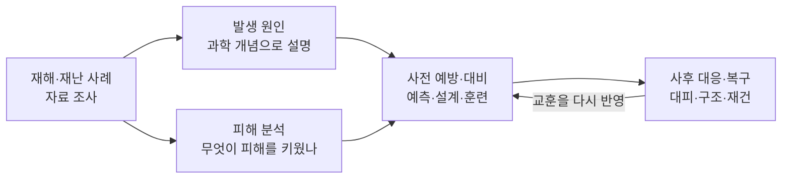

# 중3-7. 재해·재난과 안전 — 과학으로 위험을 읽고 대비하기
<!-- prev: m1-01, m2-02, m3-02, m3-04 -->
<!-- next: 3-2, 3-4, 6-1, 6-2, earth-1, astro-1 -->

> [!NOTE]
> **성취기준**
> - **[9과22-01]** 재해·재난 사례와 관련된 자료를 조사하고, 그 발생 원인과 피해에 대해 과학적으로 분석할 수 있다.
> - **[9과22-02]** 과학적 원리를 이용하여 재해·재난에 대한 대비 및 대처 방안을 세울 수 있다.

**학습 목표**

1. 재해·재난을 자연 재난과 사회 재난으로 나누고, 각각의 예를 들 수 있다.
2. 지진, 기상재해, 감염병 확산, 화학물질 유출, 운송 수단 사고의 발생 원인을 지금까지 배운 과학 개념으로 설명할 수 있다.
3. 피해의 크기를 키우는 요인을 자료(그래프·표·지도)에서 찾아 분석할 수 있다.
4. 사전 예방·대비와 사후 대응·복구를 모두 고려하여, 과학적 원리에 근거한 대비 및 대처 방안을 세울 수 있다.

**이 단원의 학습 사다리**

| 단계 | 무엇을 하나? |
|---|---|
| STEP 1. 이전 학습 다시 보기 | 판의 경계, 기압과 전선, 운동 에너지 등 이미 배운 개념을 '재난의 눈'으로 다시 본다 |
| STEP 2. 기초 다지기 | 재해·재난의 분류, 피해를 정하는 세 요소, 2배씩 늘어나는 수 |
| STEP 3. 핵심 개념 | 분석의 틀 → 지진·화산 → 기상재해 → 사회 재난 → 대비와 대처 |
| STEP 4. 오개념 바로잡기 | "지진이 나면 바로 밖으로 뛰어나간다?" 같은 착각을 바로잡는다 |
| STEP 5. 다음 단계로 | 판구조론, 충격량, 감염병 진단, 빅데이터, 태풍, 우주 위험 감시 |
| STEP 6. 생활·산업·진로 | 지진 조기 경보, 날씨 예보, 방재 공학, 역학 조사 |

---

## 🗺️ 단원 들어가기

2017년 11월 15일, 경상북도 포항에서 규모 5.4의 지진이 일어났다. 다음 날로 예정되어 있던 대학수학능력시험이 일주일 미뤄졌다. 그보다 1년 전인 2016년 9월에는 경주에서 규모 5.8의 지진이 일어났는데, 이는 우리나라에서 지진을 기계로 관측하기 시작한 이래 가장 큰 지진이었다. "우리나라는 지진 안전지대"라는 생각이 흔들린 순간이었다.

재해·재난은 지진처럼 자연에서 오기도 하고, 감염병 확산이나 화학물질 유출처럼 사람의 활동과 함께 오기도 한다. 그런데 같은 세기의 지진이라도 어떤 곳은 큰 피해를 입고 어떤 곳은 피해가 적다. 무엇이 그 차이를 만들까? 이 단원에서는 재해·재난을 **과학적으로 분석**하고, 과학의 원리로 **피해를 줄이는 방법**을 설계해 본다.

---

## STEP 1. 🔙 이전 학습 다시 보기

### 연계 개념표

| 이전 단원·성취기준 | 그때 배운 것 | 이 단원에서 확장되는 것 |
|---|---|---|
| 초등 3~4학년 「기후변화와 우리 생활」 | 기후변화로 폭염·가뭄·홍수가 잦아진다 | 기상재해의 원인을 대기의 과학으로 분석한다 |
| 초등 5~6학년 「자원과 에너지」 | 에너지와 자원을 아끼고 안전하게 써야 한다 | 화학물질·에너지 시설의 사고와 안전 관리 |
| 중1 「과학과 인류의 지속가능한 삶」 [9과01-01] | 문제 인식 → 가설 → 탐구 → 결론의 과학적 탐구 방법 | 재해·재난 자료를 조사하고 원인을 분석하는 데 탐구 방법을 쓴다 |
| 중2 「지권의 변화」 [9과09-05] | 지진과 화산은 **판의 경계**를 따라 많이 발생한다 | 지진·화산 피해가 어디서, 왜 큰지 분석한다 |
| 중3 「날씨와 기후변화」 [9과17-03], [9과17-04] | 수증기가 응결하며 구름과 비가 생긴다. 저기압·전선 주변에서 날씨가 궂다 | 태풍·집중호우의 에너지와 발생 조건을 설명한다 |
| 중3 「운동과 에너지」 [9과19-03] | 운동 에너지는 질량과 속력의 제곱에 비례한다 | 과속이 운송 수단 사고의 피해를 크게 키우는 이유 |

### 준비 운동 (사전 진단)

**Q1.** 지진과 화산 활동이 자주 일어나는 지역은 지도에서 어떤 모양으로 분포하는가?

**Q2.** 태풍은 고기압일까, 저기압일까?

**Q3.** 자동차의 속력이 2배가 되면 운동 에너지는 몇 배가 되는가?

정답 및 해설

**Q1.** 띠 모양으로 분포한다. 대부분 **판의 경계**와 일치한다. 예를 들어 태평양 가장자리를 따라 지진과 화산이 많은 '불의 고리'가 있다.

**Q2. 저기압** — 태풍은 중심 기압이 매우 낮은 열대 저기압이다. 중심으로 공기가 모여 상승하며 두꺼운 구름과 많은 비를 만든다.

**Q3. 4배** — 운동 에너지는 $\frac{1}{2}mv^2$이므로 속력의 제곱에 비례한다.

---

## STEP 2. 🧱 기초 다지기

### ① 재해와 재난, 그리고 두 갈래

- **재난(disaster)**: 사람의 생명·몸·재산과 사회에 피해를 주거나 줄 수 있는 것
- **재해**: 재난으로 생긴 피해

우리나라는 재난을 크게 두 갈래로 나눈다.

| 구분 | 뜻 | 예 |
|---|---|---|
| **자연 재난** | 자연 현상으로 생기는 재난 | 지진, 화산, 태풍, 호우, 폭염, 한파, 가뭄, 대설 |
| **사회 재난** | 사람의 활동이나 사회 시스템과 관련된 재난 | 감염병 확산, 화학물질 유출, 화재, 교통사고·운송 수단 사고 |

> [!NOTE]
> 둘의 경계가 늘 뚜렷한 것은 아니다. 폭우(자연)에 배수 시설 부족(사회)이 겹쳐 도시가 침수되는 것처럼, 실제 재난은 자연과 사회의 요인이 함께 작용하는 경우가 많다.

### ② 피해의 크기를 정하는 세 가지 요소

같은 지진이 사막 한가운데서 일어나면 피해가 거의 없지만, 큰 도시 밑에서 일어나면 피해가 크다. 피해의 크기는 다음 세 가지에 달려 있다.

| 요소 | 뜻 | 지진의 예 |
|---|---|---|
| **위험 요인의 세기** | 현상 자체가 얼마나 강한가 | 지진의 규모, 진원의 깊이 |
| **노출** | 그 현상이 닿는 곳에 얼마나 많은 사람·시설이 있는가 | 진앙 주변의 인구와 건물 수 |
| **취약성** | 피해를 견디는 힘이 얼마나 약한가 | 내진 설계가 안 된 건물, 대피 훈련 부족 |

> [!TIP]
> 💡 **비유** — 비가 와도(위험 요인) 밖에 나가지 않거나(노출 줄이기) 우산을 쓰면(취약성 줄이기) 젖지 않는다. 비는 막을 수 없어도 **젖는 정도는 줄일 수 있다.** 재난 대비의 핵심이 여기에 있다.

### ③ 2배씩 늘어나는 수

1이 2배씩 늘어나면 1, 2, 4, 8, 16, 32, 64, 128, 256, 512, 1024 …가 된다. 10번만 2배가 되어도 약 1000배가 된다. 처음에는 느려 보이다가 어느 순간 폭발적으로 커지는 이런 변화는 감염병 확산을 이해하는 데 꼭 필요하다.

### ④ 자료를 비교하는 습관

재난 정보는 누리망, 신문, 방송, 공공 기관 자료 등 여러 곳에서 얻을 수 있다. 한 가지 자료만 보면 편향된 결론을 내리기 쉽다. **출처가 분명한가, 언제 만든 자료인가, 다른 자료와 일치하는가**를 확인하는 습관을 들이자.

---

## STEP 3. 📘 핵심 개념

### ① 재해·재난을 과학적으로 분석하는 틀

재해·재난 사례를 조사할 때는 다음 네 질문을 차례로 던진다.

| 단계 | 질문 | 쓰는 과학 개념의 예 |
|---|---|---|
| 1. 현상 | 무슨 일이 언제, 어디서, 얼마나 크게 일어났나? | 규모, 강수량, 풍속, 확진자 수 |
| 2. 원인 | 왜 일어났나? 어떤 에너지와 물질이 관여했나? | 판의 운동, 수증기의 응결, 병원체의 전파, 기체의 확산 |
| 3. 피해 | 어떤 피해가 생겼나? 피해를 키운 요인은? | 건물 구조, 지형, 인구 밀도, 대처 시간 |
| 4. 교훈 | 무엇을 바꾸면 피해를 줄일 수 있나? | 내진 설계, 예보·경보, 방역, 안전거리 |

#### 예제 1 — 자료에서 피해 요인 찾기

다음은 가상의 두 도시 A, B에 같은 규모의 지진이 일어났을 때의 자료이다. 두 도시의 피해 차이를 '세 가지 요소'로 분석하시오.

| 구분 | 도시 A | 도시 B |
|---|---|---|
| 진앙까지 거리 | 20 km | 20 km |
| 인구 | 50만 명 | 50만 명 |
| 내진 설계 건물 비율 | 80 % | 20 % |
| 정기 대피 훈련 | 연 2회 | 없음 |
| 무너진 건물 수 | 적음 | 많음 |

**풀이** 위험 요인의 세기(규모, 거리)와 노출(인구)은 같다. 차이는 **취약성**이다. B는 내진 설계 건물이 적고 대피 훈련이 없어 피해가 커졌다. 따라서 B의 피해를 줄이려면 건물의 내진 보강과 대피 훈련이 필요하다.

### ② 지진과 화산 — 땅이 움직일 때

**발생 원인** 지구의 겉부분은 여러 개의 판으로 나뉘어 매우 느리게 움직인다. 판과 판이 부딪치거나 어긋나는 곳에는 암석에 힘이 쌓이고, 암석이 견디지 못하고 갑자기 끊어지며 에너지를 내놓는 것이 **지진(earthquake)** 이다. 판의 경계 부근에서는 마그마가 만들어져 **화산** 활동도 활발하다. 우리나라는 판의 경계에서 조금 떨어져 있어 큰 지진은 드물지만, 판 안쪽에 쌓인 힘으로 지진이 일어날 수 있다.

**규모와 진도는 다르다**

| 구분 | **규모(magnitude)** | **진도(intensity)** |
|---|---|---|
| 뜻 | 지진이 내놓은 **에너지의 크기** | 어떤 장소에서 사람이 느끼거나 물체가 **흔들린 정도** |
| 한 지진에 대해 | 값이 하나이다 | 장소마다 다르다 (진앙에서 멀수록 대체로 작다) |
| 비유 | 전구의 밝기(와트) | 내 자리에서 느끼는 밝기 |

규모가 1 커지면 지진의 에너지는 약 32배 커진다. 규모 5.8과 규모 4.8은 숫자로는 1 차이지만 에너지는 약 32배 차이이다.

**피해** 건물 붕괴, 땅 갈라짐, 산사태, 화재, 가스관·수도관 파손이 함께 일어난다. 2017년 포항 지진 때는 물을 머금은 모래 지반이 흔들리며 액체처럼 변하는 **액상화** 현상이 우리나라에서 처음으로 확인되었다. 바다 밑에서 큰 지진이 일어나면 **지진 해일(쓰나미)** 이 해안을 덮친다. 화산이 분출하면 용암 외에도 **화산재**가 넓게 퍼져 호흡기 질환, 항공기 운항 중단, 농작물 피해를 일으킨다.

> [!TIP]
> 💡 **생활 속 예** — 컵에 물을 담아 책상 위에서 흔들어 보자. 책상(땅)이 흔들리는 정도는 같아도, 컵이 넓고 낮으면 잘 안 넘어지고 좁고 높으면 쉽게 넘어진다. 건물의 모양과 구조가 지진 피해를 좌우하는 것과 같다.

### ③ 기상재해 — 대기가 움직일 때

| 재해 | 발생 원인 (과학 개념) | 주요 피해 |
|---|---|---|
| **태풍** | 따뜻한 열대 바다(약 27 ℃ 이상)에서 증발한 수증기가 응결하며 내놓는 열이 에너지원인 강한 저기압 | 강풍, 폭우, 해안의 폭풍 해일 |
| **집중호우** | 따뜻하고 습한 공기가 빠르게 상승하여 짧은 시간에 많은 비구름이 만들어진다 | 하천 범람, 도시 침수, 산사태 |
| **폭염** | 고기압이 오래 머물며 맑은 날씨와 강한 햇빛이 이어진다 | 열사병 등 온열 질환, 전력 부족, 가축 폐사 |
| **한파·대설** | 차갑고 건조한 대륙의 공기가 내려온다. 이 공기가 따뜻한 바다를 지나며 눈구름이 생기기도 한다 | 동상, 수도관 동파, 교통 마비 |
| **가뭄** | 오랫동안 비가 적게 내려 물이 부족해진다 | 식수·농업용수 부족, 산불 위험 증가 |

> [!IMPORTANT]
> 태풍의 에너지원은 **수증기의 응결열**이다. 중3 「날씨와 기후변화」에서 배운 것처럼, 수증기가 응결하여 물방울이 될 때 열을 내놓는다. 그래서 태풍은 따뜻한 바다 위에서 강해지고, 육지에 올라오거나 차가운 바다로 가면 수증기 공급이 줄어 약해진다. 지구온난화로 바닷물이 따뜻해지면 강한 태풍이 생길 가능성이 커진다는 연구가 많다.

#### 예제 2 — 집중호우의 물은 얼마나 될까?

넓이 $1\ \mathrm{km^2}$(가로 1 km, 세로 1 km)인 지역에 1시간 동안 50 mm의 비가 내렸다. 이 지역에 내린 빗물의 부피는 몇 $\mathrm{m^3}$인가? 물 $1\ \mathrm{m^3}$의 질량이 약 1톤이라면 빗물의 질량은 약 몇 톤인가?

**풀이** 단위를 m로 맞춘다. 50 mm = 0.05 m, $1\ \mathrm{km^2} = 1000\ \mathrm{m}\times1000\ \mathrm{m} = 1\,000\,000\ \mathrm{m^2}$
부피 $= 0.05\times1\,000\,000 = 50\,000\ \mathrm{m^3}$ → 질량 약 **5만 톤**

이 많은 물이 콘크리트·아스팔트로 덮인 도시에서는 땅으로 스며들지 못하고 한꺼번에 낮은 곳으로 몰린다. 그래서 도시는 **지하 공간과 낮은 도로**가 먼저 잠긴다.

### ④ 사회 재난 — 사람의 활동과 함께 오는 위험

#### 감염병 확산

**원인** 세균·바이러스 같은 **병원체**가 사람에서 사람으로 옮겨 가며 퍼진다. 전파 경로에는 기침·재채기의 **비말**, 오염된 손과 물건의 **접촉**, 오염된 물·음식, 모기 같은 **매개 동물** 등이 있다. 2020년 세계보건기구(WHO)가 코로나19의 세계적 대유행(팬데믹)을 선언한 것처럼, 교통이 발달한 오늘날에는 감염병이 매우 빠르게 국경을 넘는다.

#### 예제 3 — 감염병은 왜 갑자기 폭발할까?

감염자 1명이 평균 2명에게 병을 옮기고, 한 번 옮기는 데 5일이 걸린다고 하자(설명을 위해 가정한 값이다).
(1) 처음 감염자 1명에서 시작하여 30일 뒤에 새로 감염되는 사람은 몇 명인가?
(2) 마스크 착용과 손 씻기로 감염자 1명이 평균 1명에게만 옮기게 되면 30일 뒤 새 감염자는 몇 명인가?

**풀이**
(1) 30일 ÷ 5일 = 6번 전파된다. $2^6 = 64$명
(2) $1^6 = 1$명

1명이 옮기는 사람 수를 2에서 1로 줄였을 뿐인데, 30일 뒤의 차이는 64배이다. 이 수가 1보다 작아지면 감염병은 점점 줄어든다. 개인의 작은 실천이 모이면 큰 차이를 만드는 이유이다.

#### 화학물질 유출

**원인** 공장·저장 시설·운반 차량에서 유독한 화학물질이 새어 나온다. 2012년 경상북도 구미에서는 플루오린화 수소(불산)가 누출되어 주민과 농작물에 큰 피해가 생겼다.
**과학으로 보기** 새어 나온 기체는 **확산**하여 바람을 타고 퍼진다. 염소($\mathrm{Cl_2}$)처럼 공기보다 무거운 기체는 낮은 곳과 지하에 고이고, 공기보다 가벼운 기체는 위로 퍼진다. 그래서 유출된 물질의 종류를 알아야 올바른 대피 방향을 정할 수 있다.

#### 운송 수단 사고

**원인** 졸음·휴대 전화 사용 같은 부주의, 과속, 빙판길 같은 환경 요인, 차량 결함이 원인이 된다.
**과학으로 보기** 운전자가 위험을 보고 브레이크를 밟기까지 차는 그대로 달린다(**반응 거리**). 브레이크를 밟은 뒤에도 마찰력이 운동 에너지를 모두 없앨 때까지 미끄러진다(**제동 거리**). 운동 에너지는 속력의 제곱에 비례하므로 **속력이 2배가 되면 제동 거리는 약 4배**가 된다.

#### 예제 4 — 정지 거리

자동차가 20 m/s(72 km/h)로 달린다. 운전자의 반응 시간은 1초이고, 이 속력에서 제동 거리는 25 m이다.
(1) 정지 거리(반응 거리 + 제동 거리)는?
(2) 운전자가 휴대 전화를 보느라 반응 시간이 2초가 되면 정지 거리는?
(3) 반응 시간이 1초이고 속력이 40 m/s로 2배가 되면 정지 거리는? (제동 거리는 속력의 제곱에 비례한다.)

**풀이**
(1) 반응 거리 $20\times1 = 20$ m, 정지 거리 $20 + 25 = 45$ m
(2) 반응 거리 $20\times2 = 40$ m, 정지 거리 $40 + 25 = 65$ m
(3) 반응 거리 $40\times1 = 40$ m, 제동 거리 $25\times2^2 = 100$ m, 정지 거리 **140 m**

속력이 2배가 되면 정지 거리는 3배 넘게 늘어난다. 앞차와의 안전거리를 넉넉히 두어야 하는 과학적 이유이다.

### ⑤ 과학적 원리로 대비하고 대처하기

재난 관리는 일이 터진 뒤의 대처만이 아니다. **사전 예방·대비**와 **사후 대응·복구**가 하나의 고리를 이룬다.

| 단계 | 하는 일 | 예 |
|---|---|---|
| **예방** | 재난이 일어나지 않게 하거나 위험 요인을 줄인다 | 내진 설계 기준, 화학물질 저장 기준, 백신 접종 |
| **대비** | 재난이 일어날 때를 준비한다 | 예보·경보 시스템, 대피 훈련, 비상용품 준비 |
| **대응** | 재난이 일어났을 때 피해를 줄인다 | 대피, 구조, 방역 |
| **복구** | 피해를 회복하고 더 안전하게 다시 짓는다 | 시설 재건, 원인 조사, 기준 강화 |

#### 재난별 대비·대처와 과학 원리

| 재난 | 대비·대처 방안 | 과학적 원리 |
|---|---|---|
| 지진 | **내진**(튼튼하게 버티기), **제진**(흔들림을 흡수하는 장치), **면진**(땅과 건물 사이에 고무 받침 등을 넣어 흔들림 전달 줄이기) 설계 | 건물에 전달되는 힘과 진동을 줄인다 |
| 지진 | 흔들릴 때는 탁자 밑에서 머리 보호 → 흔들림이 멈추면 계단으로 넓은 곳에 대피 | 떨어지는 물체가 가장 큰 위험이다. 정전 시 승강기에 갇힐 수 있다 |
| 지진 해일 | 해안에서 강한 흔들림을 느끼면 즉시 높은 곳으로 대피 | 해일은 매우 빠르게 이동하며 해안에서 높아진다 |
| 태풍·호우 | 예보 확인, 창문을 창틀에 단단히 고정, 지하 공간·하천 주변 피하기 | 강풍의 압력, 물의 흐름은 낮은 곳으로 모인다 |
| 폭염 | 한낮 야외 활동 줄이기, 물 자주 마시기, 그늘에서 쉬기 | 땀의 증발로 체온을 낮추려면 물이 필요하다 |
| 감염병 | 손 씻기, 기침 예절, 마스크, 예방 접종, 아플 때 쉬기 | 전파 경로를 끊어 1명이 옮기는 사람 수를 줄인다 |
| 화학물질 유출 | 바람이 불어오는 쪽이나 바람 방향과 직각 방향으로 대피, 실내에서는 창문을 닫고 틈 막기 | 기체는 바람을 타고 확산한다. 무거운 기체는 낮은 곳에 고인다 |
| 운송 수단 사고 | 안전띠 착용, 규정 속도와 안전거리 지키기 | 관성, 운동 에너지는 속력의 제곱에 비례한다 |

#### 예제 5 — 지진 조기 경보의 원리

지진이 일어나면 빠르지만 흔들림이 약한 **P파**가 먼저 오고, 느리지만 흔들림이 강한 **S파**가 뒤에 온다. P파는 초속 6 km, S파는 초속 3 km로 퍼진다고 하자(계산을 위해 정한 값이다). 진원에서 60 km 떨어진 학교에 P파가 도착한 뒤 S파가 도착하기까지 몇 초의 여유가 있는가?

**풀이** P파 도착 $60\div6 = 10$초, S파 도착 $60\div3 = 20$초 → **10초**의 여유가 있다.

지진 조기 경보는 진원 가까운 관측소에서 P파를 먼저 잡아 강한 흔들림이 오기 전에 경보를 보낸다. 10초는 짧아 보이지만 책상 밑으로 몸을 숨기고, 열차를 감속하고, 가스 밸브를 잠그기에는 충분한 시간이다. 진원에서 멀수록 여유 시간이 길어진다.

> [!WARNING]
> 대비·대처 방안을 세울 때는 **근거를 확인**하자. 예를 들어 태풍이 올 때 유리창에 테이프를 X자로 붙이는 것은 유리가 깨지는 것을 막는 효과가 거의 없다고 알려져 있다. 창문이 흔들리지 않도록 창틀과 유리 사이를 단단히 고정하는 것이 더 중요하다.

---

## STEP 4. ⚠️ 오개념 바로잡기

| 흔한 오개념 | 올바른 개념 | 왜 그럴까? |
|---|---|---|
| 규모와 진도는 같은 말이다 | 규모는 지진의 **에너지**, 진도는 장소마다의 **흔들림 정도**이다 | 같은 지진이라도 진앙에서 가까운 곳과 먼 곳의 흔들림이 다르다 |
| 지진이 나면 바로 밖으로 뛰어나가야 한다 | 흔들리는 동안에는 **탁자 밑에서 몸을 보호**하고, 멈춘 뒤 대피한다 | 흔들릴 때 뛰어나가면 떨어지는 간판·유리에 다치기 쉽다 |
| 태풍의 눈에 들어가 바람이 멎으면 태풍이 끝난 것이다 | 눈이 지나가면 **반대 방향의 강풍**이 다시 분다 | 태풍의 눈은 중심의 바람이 약한 부분일 뿐, 주변은 여전히 강풍 지대이다 |
| 속력이 2배면 제동 거리도 2배이다 | 제동 거리는 약 **4배**가 된다 | 없애야 할 운동 에너지가 속력의 제곱에 비례한다 |
| 자연 재난은 어차피 막을 수 없으니 대비해도 소용없다 | 현상은 막지 못해도 **노출과 취약성을 줄여 피해는 줄일 수 있다** | 내진 설계, 예보, 대피 훈련이 피해를 크게 줄인 사례가 많다 |
| 감염병은 몸이 약한 사람만 조심하면 된다 | 증상이 약한 사람도 병원체를 **옮길 수 있다** | 1명이 옮기는 사람 수를 줄이려면 모두의 실천이 필요하다 |
| 우리나라는 지진 안전지대이다 | 우리나라에서도 **규모 5 이상의 지진**이 일어난 적이 있다 | 2016년 경주(규모 5.8), 2017년 포항(규모 5.4) 지진 |

---

## STEP 5. 🎓 다음 단계로 한 걸음 더

> [!CAUTION]
> 이 절은 **중학교 교육과정 범위 밖의 심화 내용**으로 평가 대상이 아니다. "이 개념이 앞으로 어디까지 이어지는가"를 맛보기로 보여 주기 위한 내용이다.

### 다음 학년·과목과의 연결

| 단계 | 단원 | 이어지는 내용 |
|---|---|---|
| 통합과학1 | 「판구조론과 지권의 변화」 | 판구조론으로 지진·화산을 해석하고, 화산 분출의 피해를 지구시스템 관점에서 분석 |
| 통합과학1 | 「운동량과 충격량」 | 충돌 시간을 늘려 충격을 줄이는 안전장치(에어백, 헬멧) |
| 통합과학2 | 「감염병과 과학의 유용성」 | 핵산과 단백질을 이용한 감염병 진단·추적 기술 |
| 통합과학2 | 「빅데이터와 과학기술사회」 | 기상 관측 등 대량의 데이터를 활용한 예측 |
| 지구과학 (일반 선택) | 「대기와 해양의 상호작용」 | 태풍의 발생·이동·소멸, 뇌우·집중호우 등 악기상 |
| 행성우주과학 (진로 선택) | 「우주탐사와 행성계」 | 태양 활동·소천체 충돌·우주 쓰레기 같은 우주 위험 감시 |

### ① 규모 눈금의 비밀 — 로그 눈금

규모는 1이 커질 때마다 에너지가 약 32배, 2가 커지면 약 $32\times32 \approx 1000$배가 되는 눈금이다. 이처럼 '곱하기'로 커지는 양을 '더하기' 눈금으로 나타내는 방법을 **로그 눈금**이라고 한다. 소리의 크기(데시벨), 용액의 산성도(pH)도 같은 방식이다. 고등학교 수학의 로그를 배우면 규모 공식을 직접 다룰 수 있다.

### ② 감염병 확산의 수학 — 재생산 수

예제 3의 '1명이 옮기는 사람 수'를 과학자들은 **재생산 수**라고 부른다. 이 값이 1보다 크면 확산, 1보다 작으면 감소한다. 모두가 면역이 없는 상태에서 재생산 수가 4인 감염병은, 인구의 약 $1 - \frac{1}{4} = 75\%$가 면역을 가지면 1명이 평균 1명 미만에게 옮기게 되어 확산이 멈춘다고 계산한다. 이것이 **집단 면역**의 기본 아이디어이다. 실제 연구에서는 컴퓨터 모형으로 감염 전·감염·회복 인구의 변화를 계산한다.

### ③ 태풍의 위험 반원

북반구에서 태풍이 북쪽으로 이동할 때, 진행 방향의 **오른쪽**은 태풍 자체의 바람 방향과 태풍의 이동 방향이 같아 바람이 더 강하다. 이를 **위험 반원**이라고 한다. 지구과학에서 일기도와 위성 영상을 이용해 태풍 진로에 따른 피해를 예측할 때 쓰인다.

### 지금 vs 다음 단계

| 구분 | 중학교 (지금) | 고등학교 통합과학·선택 과목 |
|---|---|---|
| 지진 | 판의 경계, 규모와 진도 구분 | 판구조론, 지진파와 지구 내부 구조 |
| 기상재해 | 태풍의 에너지원, 재해별 원인 | 태풍의 구조·진로 분석, 위험 반원, 악기상 예보 |
| 감염병 | 전파 경로와 차단 | 유전자 증폭을 이용한 진단, 역학 자료 분석 |
| 자료 분석 | 표·그래프 읽기, 여러 자료 비교 | 빅데이터 활용의 장점과 문제점, 시뮬레이션 |
| 안전 | 대비·대처 방안 세우기 | 충격량을 이용한 안전장치 설계, 과학기술과 윤리 |

---

## STEP 6. 🏭 생활·산업·진로 연결

### 사례 1. 지진 조기 경보와 재난 문자

- **원리** 예제 5처럼 P파와 S파의 속력 차이를 이용한다. 여러 관측소의 자료를 자동으로 분석해 규모와 위치를 빠르게 추정한다.
- **어디에 쓰이나** 우리나라는 기상청이 지진 조기 경보를 발표하고, 휴대 전화 긴급 재난 문자로 알린다. 고속 열차와 원자력 발전소는 경보를 받으면 자동으로 감속하거나 안전 조치를 한다.

### 사례 2. 날씨 예보와 슈퍼컴퓨터

- **원리** 지상·해양·위성·레이더에서 모은 엄청난 양의 관측 자료를 물리 법칙에 넣어 미래 대기의 상태를 계산한다(수치 예보).
- **어디에 쓰이나** 태풍 진로 예측, 호우·폭염 특보. 예보가 정확해질수록 대피할 시간을 더 일찍 확보할 수 있다.

### 사례 3. 방재 공학 — 도시를 안전하게 설계하기

- 내진·면진 건물, 빗물을 잠시 모아 두는 지하 저류 시설, 물이 스며드는 투수성 포장, 산사태를 막는 사방 시설 등은 모두 과학 원리로 **취약성을 줄이는** 공학이다.

### 사례 4. 감염병 역학 조사

- 감염자의 이동 경로와 접촉자를 조사하고, 병원체의 유전 정보를 분석해 어디서 퍼졌는지 추적한다. 통합과학2 「감염병과 과학의 유용성」에서 자세히 배운다.

### 관련 진로와 학과

| 진로 | 하는 일 | 관련 학과 |
|---|---|---|
| 기상 예보관·기상 연구원 | 기상 자료 분석, 예보·특보 발표 | 대기과학, 지구과학 |
| 지진 연구원 | 지진 관측, 조기 경보 시스템 개발 | 지구환경과학, 지질학, 지구물리학 |
| 방재 엔지니어 | 내진 설계, 홍수 방어 시설 설계 | 건축공학, 토목공학, 방재공학 |
| 역학 조사관 | 감염병 확산 경로 조사, 방역 대책 수립 | 의학, 간호학, 보건학 |
| 화학 안전 관리자 | 화학물질 저장·운송 관리, 사고 대응 | 화학공학, 화학, 환경공학 |
| 소방관·응급 구조사 | 재난 현장 구조, 응급 처치 | 소방학, 응급구조학 |

---

## 🔬 탐구 활동

### 활동 A. 빅데이터를 이용하여 재해·재난 사례 분석하기

**목표** 공공 기관이 공개한 대량의 재해 자료를 정리하여 발생 특징을 찾고, 그 원인을 과학적으로 설명한다.

**준비물** 컴퓨터 또는 태블릿, 스프레드시트 프로그램, 공공 자료(예: 기상청 날씨누리의 국내 지진 목록, 국민재난안전포털의 재난 통계)

**과정**
1. 모둠별로 재해 하나(지진, 태풍, 폭염, 감염병 등)를 고른다.
2. 공공 누리집에서 최근 여러 해의 자료를 내려받아 스프레드시트에 정리한다.
3. 연도별·월별·지역별로 발생 횟수나 피해 규모를 세어 그래프로 나타낸다.
4. 그래프에서 찾은 특징을 이 단원에서 배운 과학 개념으로 설명한다.
5. 다른 출처의 자료(신문 기사, 다른 기관 통계)와 비교해 결론이 같은지 확인한다.

**결과 기록**

| 분석 기준 | 찾은 특징 | 과학적 원인 | 확인한 다른 자료 |
|---|---|---|---|
| 연도별 | | | |
| 월(계절)별 | | | |
| 지역별 | | | |

**생각해 보기**
1. 지진 발생 횟수가 해마다 다르게 나타났다면, 실제 지진이 늘어난 것일까, 관측 장비가 늘어 작은 지진까지 잡힌 것일까? 어떻게 구별할 수 있을까?
2. 폭염 일수가 많았던 해와 온열 질환자 수 사이에는 어떤 관계가 있는가?

### 활동 B. 재해·재난의 피해를 줄이기 위한 홍보자료 제작하기

**목표** 과학적 근거에 기반한 대비·대처 방법을 다른 사람이 쉽게 이해하도록 홍보자료(카드 뉴스, 포스터, 짧은 영상)로 만든다.

**과정**
1. 대상(초등학생, 어르신, 우리 반 친구 등)과 재난 종류를 정한다.
2. **사전 예방·대비**와 **사후 대응**을 모두 넣어 핵심 행동 3~5가지를 고른다.
3. 각 행동마다 "왜 그렇게 해야 하는가?"를 과학 원리 한 문장으로 덧붙인다.
4. 모둠끼리 서로의 자료를 평가하고 고친다.

| 점검 항목 | 예 / 아니요 |
|---|---|
| 예방·대비와 대응을 모두 담았는가? | |
| 행동마다 과학적 근거를 밝혔는가? | |
| 자료의 출처를 밝혔는가? | |
| 대상에게 맞는 쉬운 말과 그림을 썼는가? | |

> [!WARNING]
> **유의 사항** 출처가 확인되지 않은 정보나 지나치게 공포를 주는 표현은 쓰지 않는다. 실제 피해자의 사진이나 개인 정보는 사용하지 않는다. 사실과 의견을 구분하여 쓴다.

---

## ✅ 개념 확인 문제

### 기본

**1.** 다음 재난을 자연 재난과 사회 재난으로 구분하시오.
ㄱ. 태풍 ㄴ. 감염병 확산 ㄷ. 지진 ㄹ. 화학물질 유출 ㅁ. 폭염

정답 및 해설

**정답** 자연 재난: ㄱ, ㄷ, ㅁ / 사회 재난: ㄴ, ㄹ

**2.** 태풍이 육지에 상륙하면 세력이 약해지는 이유를 태풍의 에너지원과 관련지어 쓰시오.

정답 및 해설

**정답** 태풍의 에너지원은 따뜻한 바다에서 증발한 수증기가 응결할 때 내놓는 열이다. 육지에서는 수증기 공급이 크게 줄어들어 에너지를 얻지 못하므로 약해진다.

**3.** 규모와 진도의 차이를 설명하시오.

정답 및 해설

**정답** 규모는 지진이 내놓은 에너지의 크기로 한 지진에 하나의 값을 가진다. 진도는 어떤 장소에서 느끼는 흔들림의 정도로, 같은 지진이라도 장소마다 다르다.

**4.** 재난 관리의 네 단계 중 '대비'에 해당하는 것을 **모두** 고르시오.
ㄱ. 대피 훈련 실시 ㄴ. 무너진 건물 다시 짓기 ㄷ. 지진 조기 경보 시스템 설치 ㄹ. 재난 현장에서 구조 활동

정답 및 해설

**정답 ㄱ, ㄷ**

ㄴ은 복구, ㄹ은 대응에 해당한다.

### 응용

**5.** 감염자 1명이 평균 3명에게 병을 옮기고, 한 번 옮기는 데 4일이 걸린다. 처음 1명에서 시작하여 12일 뒤에 새로 감염되는 사람은 몇 명인가? (설명을 위해 가정한 값이다.)

정답 및 해설

**정답** 27명

12일 ÷ 4일 = 3번 전파되므로 $3^3 = 27$명이다.

**6.** 자동차가 15 m/s로 달리다가 운전자가 위험을 보고 브레이크를 밟았다. 반응 시간은 1.2초, 제동 거리는 15 m이다. (1) 정지 거리를 구하고, (2) 속력이 30 m/s라면 정지 거리는 얼마인지 구하시오. (반응 시간은 같고, 제동 거리는 속력의 제곱에 비례한다.)

정답 및 해설

**정답** (1) 33 m (2) 96 m

(1) 반응 거리 $15\times1.2 = 18$ m, 정지 거리 $18 + 15 = 33$ m
(2) 반응 거리 $30\times1.2 = 36$ m, 제동 거리 $15\times2^2 = 60$ m, 정지 거리 $36 + 60 = 96$ m

**7.** P파가 초속 6 km, S파가 초속 3 km로 퍼진다고 할 때, 어느 도시에서 P파가 도착하고 20초 뒤에 S파가 도착했다. 이 도시는 진원에서 몇 km 떨어져 있는가?

정답 및 해설

**정답** 120 km

거리를 $d$라고 하면 $\frac{d}{3} - \frac{d}{6} = \frac{d}{6} = 20$이므로 $d = 120$ km이다. (확인: P파 20초, S파 40초)

### 융합·서술형

**8. [자료 분석]** 어느 도시는 최근 집중호우 때마다 지하 주차장과 반지하 주택이 침수되었다. 이 도시는 지난 수십 년 동안 논과 숲이 아스팔트 도로와 건물로 바뀌었다. 침수 피해가 커진 원인을 과학적으로 분석하고, 사전 예방·대비 방안과 사후 대처 방안을 각각 한 가지 이상 제안하시오.

정답 및 해설

**예시 답안**
원인: 아스팔트와 건물은 빗물이 땅으로 스며들지 못하게 하므로, 내린 비가 한꺼번에 지표를 따라 흘러 낮은 곳(지하 공간)으로 모인다. 따라서 같은 양의 비에도 침수가 쉽게 일어난다.
사전 예방·대비: 빗물을 잠시 모아 두는 저류 시설 설치, 투수성 포장 확대, 지하 공간 입구에 물막이판 설치, 호우 예보 시 지하 주차장 차량 이동 안내.
사후 대처: 물이 들어오기 시작하면 지하 공간에서 즉시 대피(물이 차면 수압 때문에 문을 열기 어렵다), 감전 위험이 있으므로 전기 차단.

**채점 포인트** ① 빗물이 스며들지 못하고 낮은 곳으로 모인다는 원인 분석 ② 예방·대비 방안 ③ 대처 방안과 그 근거

**9. [토의]** "우리나라는 판의 경계에서 떨어져 있으므로 학교 건물의 내진 보강은 필요 없다."라는 주장에 대해 근거를 들어 반박하시오.

정답 및 해설

**예시 답안**
우리나라가 판의 경계에서 떨어져 있어 큰 지진이 드문 것은 맞지만, 판 안쪽에도 힘이 쌓여 지진이 일어날 수 있다. 실제로 2016년 경주에서 규모 5.8, 2017년 포항에서 규모 5.4의 지진이 일어나 건물 피해가 생겼다. 지진의 피해는 위험 요인의 세기뿐 아니라 건물의 취약성에 크게 좌우되며, 학교는 많은 학생이 모이는(노출이 큰) 곳이자 재난 때 대피소로도 쓰이므로 내진 보강이 필요하다.

**채점 포인트** ① 판 내부에서도 지진이 발생함 ② 국내 지진 사례 ③ 취약성·노출 관점의 근거

---

## 📝 한눈에 정리

### 핵심 요약

- 재난은 **자연 재난**(지진, 화산, 태풍, 호우, 폭염 등)과 **사회 재난**(감염병 확산, 화학물질 유출, 운송 수단 사고 등)으로 나눈다.
- 피해의 크기는 **위험 요인의 세기, 노출, 취약성**에 달려 있다. 현상은 막지 못해도 노출과 취약성은 줄일 수 있다.
- 사례 분석은 **현상 → 원인 → 피해 → 교훈** 순서로 하고, 여러 출처의 자료를 비교한다.
- 지진은 판의 운동으로 쌓인 힘이 풀리며 일어난다. **규모**는 에너지, **진도**는 장소별 흔들림이다.
- 태풍의 에너지원은 **수증기의 응결열**이다. 집중호우는 도시의 지하 공간과 낮은 곳을 먼저 잠기게 한다.
- 감염병은 1명이 옮기는 사람 수가 1보다 크면 **기하급수적으로** 퍼진다. 전파 경로를 끊으면 이 수를 줄일 수 있다.
- 제동 거리는 속력의 제곱에 비례하므로 과속은 정지 거리를 크게 늘린다.
- 재난 관리는 **예방 → 대비 → 대응 → 복구**의 고리이며, 사후 대처뿐 아니라 사전 예방·대비가 중요하다.

### 핵심 용어

| 용어 | 뜻 |
|---|---|
| 자연 재난 | 지진, 태풍처럼 자연 현상으로 생기는 재난 |
| 사회 재난 | 감염병 확산, 화학물질 유출처럼 사람의 활동·사회 시스템과 관련된 재난 |
| 규모 | 지진이 내놓은 에너지의 크기 |
| 진도 | 어떤 장소에서 지진으로 흔들린 정도 |
| 액상화 | 물을 머금은 모래 지반이 흔들려 액체처럼 변하는 현상 |
| 응결열 | 수증기가 물로 응결할 때 내놓는 열. 태풍의 에너지원 |
| 병원체 | 감염병을 일으키는 세균, 바이러스 등 |
| 정지 거리 | 반응 거리와 제동 거리를 합한 거리 |
| 내진·제진·면진 | 지진에 버티기, 흔들림 흡수하기, 흔들림 전달 줄이기 설계 |
| 지진 조기 경보 | P파를 먼저 감지해 강한 흔들림이 오기 전에 알리는 시스템 |

### 다음 단원으로

재해·재난을 분석하고 대비하는 일에는 기상 예보관, 지진 연구원, 방재 엔지니어, 역학 조사관처럼 많은 과학 관련 직업이 함께한다. 다음 단원 「과학과 나의 미래」에서는 이런 과학 관련 직업과 미래 사회의 변화를 살펴보고, 나의 진로에 맞는 과학 학습 계획을 세워 본다.
