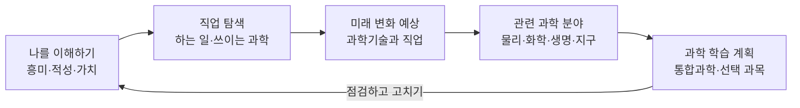
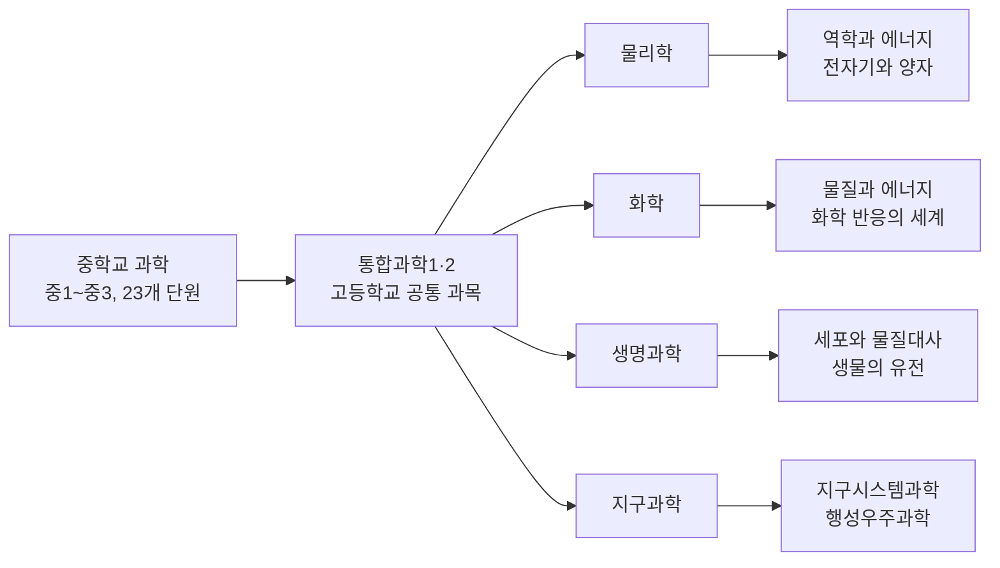

# 중3-8. 과학과 나의 미래 — 이 책의 지도를 펴고 나의 길을 그리기
<!-- prev: m1-01, m3-07 -->
<!-- next: 1-1, 6-2, 6-3, 6-4 -->

> [!NOTE]
> **성취기준**
> - **[9과23-01]** 과학과 관련된 직업의 종류와 하는 일을 조사하고, 과학기술의 발달로 생기는 미래 사회의 직업 변화를 예상할 수 있다.
> - **[9과23-02]** 자신의 진로와 관련 있는 과학 분야를 조사하고, 진로 선택을 위하여 필요한 과학 학습을 계획할 수 있다.

**학습 목표**

1. 과학과 관련된 직업을 여러 갈래로 나누고, 각 직업에서 하는 일과 쓰이는 과학 개념을 조사할 수 있다.
2. 과학기술의 발달로 사라지거나, 바뀌거나, 새로 생긴 직업의 사례를 들고 미래의 직업 변화를 예상할 수 있다.
3. 나의 흥미와 진로에 관련된 과학 분야를 찾을 수 있다.
4. 이 책의 과목·영역 구성을 이해하고, 고등학교까지 이어지는 나의 과학 학습 계획을 세울 수 있다.

**이 단원의 학습 사다리**

| 단계 | 무엇을 하나? |
|---|---|
| STEP 1. 이전 학습 다시 보기 | 중학교 3년 동안 배운 다섯 영역을 한눈에 정리한다 |
| STEP 2. 기초 다지기 | 과학·기술·공학의 차이, 과학의 네 분야, 진로 정보를 찾는 방법 |
| STEP 3. 핵심 개념 | 과학 관련 직업 → 직업의 변화 → 나의 분야 찾기 → 이 책의 지도 → 학습 계획 |
| STEP 4. 오개념 바로잡기 | "과학 직업은 과학자뿐?", "인공지능이 모든 직업을 없앤다?" |
| STEP 5. 다음 단계로 | 통합과학과 선택 과목, 대학 전공으로 이어지는 길 |
| STEP 6. 생활·산업·진로 | 과학이 숨어 있는 여러 직업 현장 |

---

## 🗺️ 단원 들어가기

10년 뒤 너는 어디에서 무엇을 하고 있을까? 지금 있는 직업 중 하나를 하고 있을 수도 있고, 아직 이름조차 없는 직업을 하고 있을 수도 있다. 20년 전에는 '스마트폰 앱 개발자'나 '유튜브 크리에이터'라는 직업이 거의 없었다. 반대로 한때 흔했던 '전화 교환원'은 이제 찾아보기 어렵다.

미래를 정확히 알 수는 없지만, 변화를 이끄는 힘이 **과학기술**이라는 것은 분명하다. 그래서 과학을 이해하는 사람은 변화를 더 잘 읽고 더 잘 준비할 수 있다. 이 단원에서는 과학과 관련된 직업을 조사하고, 이 책 「한 권으로 잇는 과학」의 지도를 펼쳐 **중학교에서 고등학교까지 이어지는 나만의 과학 학습 길**을 그려 본다.

---

## STEP 1. 🔙 이전 학습 다시 보기

### 연계 개념표

| 이전 단원·성취기준 | 그때 배운 것 | 이 단원에서 확장되는 것 |
|---|---|---|
| 중1 「과학과 인류의 지속가능한 삶」 [9과01-01] | 문제를 발견하고 탐구 계획을 세워 해결하는 과학적 탐구 방법 | 진로 문제도 '조사 → 분석 → 계획 → 점검'의 탐구 과정으로 풀어 본다 |
| 중1 「과학과 인류의 지속가능한 삶」 [9과01-02] | 인공지능 등 첨단 과학기술이 미래 사회를 바꾼다 | 첨단 과학기술이 **직업**을 어떻게 바꾸는지 예상한다 |
| 중3 「재해·재난과 안전」 [9과22-02] | 과학 원리로 재해·재난에 대비한다 | 기상 예보관, 방재 엔지니어 등 안전을 지키는 과학 직업 |
| 중1~중3의 모든 단원 | 운동과 에너지, 물질, 생명, 지구와 우주, 과학의 기초와 사회 | 각 영역이 어떤 직업과 고등학교 과목으로 이어지는지 연결한다 |

### 중학교 3년, 다섯 영역 한눈에 보기

| 영역 | 중1 | 중2 | 중3 |
|---|---|---|---|
| 운동과 에너지 | 「열」, 「힘의 작용」 | 「빛과 파동」, 「전기와 자기」 | 「운동과 에너지」 |
| 물질 | 「물질의 상태 변화」, 「기체의 성질」 | 「물질의 특성」, 「물질의 구성」 | 「화학 반응의 규칙성」 |
| 생명 | 「생물의 구성과 다양성」 | 「식물과 에너지」, 「동물과 에너지」 | 「자극과 반응」, 「생식과 유전」 |
| 지구와 우주 | 「태양계」 | 「지권의 변화」, 「별과 우주」 | 「날씨와 기후변화」, 「수권과 해수의 순환」 |
| 과학의 기초와 사회 | 「과학과 인류의 지속가능한 삶」 | — | 「재해·재난과 안전」, 「과학과 나의 미래」 |

### 준비 운동 (사전 진단)

**Q1.** 중학교 과학 단원 중 가장 재미있었던 단원과 가장 어려웠던 단원을 하나씩 쓰고, 그 까닭을 한 줄로 적어 보자. (정답 없음)

**Q2.** 다음 직업 중 일하면서 과학 지식을 **쓰지 않는** 직업은? ① 요리사 ② 소방관 ③ 운동선수 ④ 없다

**Q3.** 휴대 전화를 만드는 데 필요한 과학 분야를 두 가지 이상 써 보자.

정답 및 해설

**Q1.** 정답은 없다. 이 기록은 STEP 3의 '나의 과학 분야 찾기'에서 다시 쓴다.

**Q2. ④** — 요리사는 열과 화학 변화를, 소방관은 연소와 소화의 원리를, 운동선수는 힘과 에너지, 몸의 생리를 이용한다.

**Q3.** 예: 전기와 자기(회로, 스피커), 빛과 파동(화면, 카메라), 물질(배터리, 반도체 재료), 인공위성의 운동(위치 측정) 등

---

## STEP 2. 🧱 기초 다지기

### ① 과학, 기술, 공학은 어떻게 다를까?

| 구분 | 질문 | 예 |
|---|---|---|
| **과학(science)** | 자연은 **왜, 어떻게** 그렇게 되는가? | 빛이 렌즈를 지나면 왜 꺾일까? |
| **기술(technology)** | 그 지식을 **어떻게 쓸 수** 있는가? | 렌즈로 물체를 크게 보는 방법 |
| **공학(engineering)** | 정해진 조건에서 **가장 좋은 해결책**을 어떻게 설계하는가? | 작고 가벼우면서 선명한 스마트폰 카메라 설계 |

세 가지는 서로 밀어 주며 함께 발전한다. 과학이 원리를 밝히면 기술과 공학이 새 도구를 만들고, 새 도구(예: 전자 현미경, 우주 망원경)는 다시 과학의 새 발견을 이끈다.

> [!TIP]
> 💡 **비유** — 과학은 '요리의 원리를 아는 것'(왜 달걀은 열을 받으면 굳을까?), 기술은 '조리법'(달걀찜 만드는 법), 공학은 '식당 주방 설계'(한 시간에 달걀찜 200그릇을 맛있게 만드는 방법)이다.

### ② 과학의 네 분야와 이 책의 다섯 영역

자연을 탐구하는 대표적인 분야는 네 가지이다.

| 분야 | 주로 묻는 것 | 이 책의 영역 |
|---|---|---|
| **물리학** | 힘, 운동, 에너지, 전기, 빛은 어떻게 작용하는가? | 운동과 에너지 |
| **화학** | 물질은 무엇으로 이루어지고 어떻게 변하는가? | 물질 |
| **생명과학** | 생명은 어떻게 유지되고 이어지는가? | 생명 |
| **지구과학** | 지구와 우주는 어떻게 이루어지고 변하는가? | 지구와 우주 |

여기에 과학이 사회·기술·직업과 어떻게 연결되는지를 다루는 **과학의 기초와 사회** 영역이 더해져 이 책의 다섯 영역이 된다.

### ③ 직업 정보를 찾는 방법

| 방법 | 내용 | 주의할 점 |
|---|---|---|
| 공공 진로 정보 누리집 | 커리어넷 같은 공공 누리집에서 직업별 하는 일, 필요한 능력, 관련 학과를 찾는다 | 정보가 갱신된 날짜를 확인한다 |
| 직업인 인터뷰 | 가족·이웃·졸업생 등 실제 종사자에게 묻는다 | 한 사람의 경험이 전부는 아니다 |
| 책·기사·영상 | 직업 소개 도서, 신문 기사, 직업 체험 영상 | 광고나 과장된 표현을 가려낸다 |

---

## STEP 3. 📘 핵심 개념

### ① 과학과 관련된 직업의 종류와 하는 일

'과학 관련 직업'이라고 하면 흰 가운을 입은 연구원만 떠올리기 쉽다. 그러나 과학 지식은 훨씬 많은 직업에서 쓰인다.

| 갈래 | 직업의 예 | 하는 일 | 주로 쓰이는 과학 |
|---|---|---|---|
| 연구 | 물리학자, 화학자, 생명과학자, 천문학자 | 자연의 원리를 밝히는 실험과 관측 | 해당 분야 전체 |
| 기술·공학 | 반도체 엔지니어, 기계 엔지니어, 건축가, 로봇 엔지니어 | 제품·건물·장치의 설계와 제작 | 전기와 자기, 힘과 운동, 물질의 성질 |
| 의료·보건 | 의사, 간호사, 약사, 임상병리사, 방사선사 | 질병 진단·치료, 건강 관리 | 생명(자극과 반응, 동물과 에너지), 화학 |
| 환경·에너지 | 환경 연구원, 신재생 에너지 기술자, 기후 분석가 | 오염 측정, 에너지 시스템 설계, 기후 자료 분석 | 기후변화, 에너지 전환, 생태계 |
| 지구·안전 | 기상 예보관, 지진 연구원, 해양 연구원, 소방관 | 예보, 재난 대비, 구조 | 날씨, 지권의 변화, 해수의 순환, 연소 |
| 농업·식품 | 스마트팜 농업인, 육종 연구원, 식품 연구원 | 작물 재배 환경 관리, 품종 개발, 식품 개발 | 식물과 에너지, 생식과 유전, 화학 반응 |
| 정보·데이터 | 데이터 과학자, 인공지능 개발자 | 대량의 자료에서 규칙을 찾고 예측 모형을 만든다 | 과학적 탐구 방법, 통계, 정보 |
| 소통·교육·정책 | 과학 교사, 과학 기자, 과학관 해설사, 변리사, 과학 정책 연구원 | 과학을 가르치고, 알리고, 제도를 만든다 | 모든 영역 + 글쓰기·말하기 |

<!-- fig:m3-08-job-map -->

#### 예제 1 — 직업 속 과학 찾기

제빵사는 빵을 만들 때 반죽에 효모를 넣고 따뜻한 곳에 둔 뒤 오븐에 굽는다. 이 과정에 숨어 있는 과학을 이 책의 단원과 연결하시오.

**풀이**
- 효모는 균계에 속하는 살아 있는 생물이며, 반죽 속 당을 분해하여 에너지를 얻는 과정에서 이산화 탄소를 내놓는다 → 중1 「생물의 구성과 다양성」
- 이산화 탄소 기체가 반죽 속에서 부풀며, 오븐에서 온도가 높아지면 기체의 부피가 더 커진다 → 중1 「기체의 성질」
- 구울 때 겉면이 갈색으로 변하는 것은 새로운 물질이 생기는 화학 변화이다 → 중3 「화학 반응의 규칙성」
- 오븐 속 열이 반죽으로 전달된다 → 중1 「열」

한 가지 직업 속에 생명, 물질, 에너지 영역이 모두 들어 있다.

#### ✔ 바로 확인

1. 짝짓기: (가) 기상 예보관 (나) 반도체 엔지니어 (다) 임상병리사 — ㄱ. 의료·보건 ㄴ. 지구·안전 ㄷ. 기술·공학
2. (O/X) 과학 관련 직업은 실험실에서 연구하는 과학자뿐이다.
3. 예제 1에서 빵 반죽을 부풀게 하는 기체는 무엇이며, 무엇이 만들어 내는가?

정답

1. (가) ㄴ, (나) ㄷ, (다) ㄱ
2. X — 공학, 의료, 농업, 교육 등 매우 많은 직업에서 과학을 쓴다.
3. 이산화 탄소 — 효모가 당을 분해하여 에너지를 얻을 때 내놓는다.

### ② 과학기술의 발달과 직업의 변화

과학기술이 발달하면 직업은 세 가지 방식으로 변한다.

| 변화 | 과거·현재의 사례 | 이끈 과학기술 |
|---|---|---|
| **사라지거나 줄어든 직업** | 전화 교환원, 활자를 하나하나 골라 짜던 식자공, 버스 안내원 | 자동 전화 교환기, 컴퓨터 인쇄, 자동 요금 장치 |
| **하는 일이 바뀐 직업** | 농부(스마트팜으로 온도·습도를 원격 조절), 의사(인공지능의 영상 판독 도움), 기상 예보관(슈퍼컴퓨터 수치 예보 활용) | 사물인터넷, 인공지능, 빅데이터 |
| **새로 생긴 직업** | 앱 개발자, 데이터 과학자, 드론 조종사, 3D 프린팅 전문가, 유전 상담사 | 스마트폰, 빅데이터, 드론, 3D 프린팅, 유전체 분석 |

#### 미래의 직업 변화를 이끌 과학기술

| 변화의 힘 | 생겨나거나 커질 수 있는 일의 예 |
|---|---|
| 인공지능·로봇 | 인공지능 학습 자료 관리, 로봇 유지·보수, 인공지능 윤리 검토 |
| 생명공학 | 맞춤형 의료, 줄기세포 치료, 새 품종 개발 |
| 기후변화·에너지 전환 | 탄소 배출 측정·관리, 신재생 에너지 설비 설계, 기후 위험 분석 |
| 우주 개발 | 인공위성 자료 분석, 우주 쓰레기 감시, 우주 탐사선 설계 |
| 빅데이터·사물인터넷 | 도시 데이터 분석(교통·에너지), 재난 예측 시스템 운영 |

일반적으로 **규칙이 분명하고 반복적인 일**은 기계와 인공지능이 대신하기 쉽고, **공감과 소통, 새로운 상황에서의 판단과 창의성**이 필요한 일은 사람의 역할이 계속 크다. 다만 기술이 발전하면 이 경계도 움직인다.

> [!IMPORTANT]
> 미래 예측은 **틀릴 수 있다.** 그래서 특정 직업 이름을 외우기보다, 어떤 직업이든 필요한 힘인 **과학적으로 생각하는 능력, 자료를 해석하는 능력, 새로운 것을 배우는 능력, 다른 사람과 협력하는 능력**을 기르는 것이 중요하다.

#### 예제 2 — 자료로 직업 변화 읽기

다음은 어느 가상 도시의 두 직업 종사자 수 자료이다. 10년 동안 각각 몇 % 변했는지 구하고, 그 까닭을 과학기술과 관련지어 추론하시오.

| 직업 | 10년 전 | 현재 |
|---|---|---|
| 매표소 직원 | 500명 | 200명 |
| 드론 관련 기술자 | 40명 | 160명 |

**풀이**
- 매표소 직원: $\frac{200-500}{500}\times100 = -60\%$ → 60 % 감소
- 드론 관련 기술자: $\frac{160-40}{40}\times100 = 300\%$ → 300 % 증가(4배)

온라인 예매와 무인 발권기가 퍼지면서 매표 업무가 줄었고, 드론이 배송·촬영·농업·안전 점검에 쓰이면서 관련 기술자가 늘었다고 추론할 수 있다. (실제 원인을 확인하려면 다른 자료도 함께 조사해야 한다.)

#### ✔ 바로 확인

1. 다음 직업을 '사라지거나 줄어든 직업, 하는 일이 바뀐 직업, 새로 생긴 직업'으로 구분하시오. ㄱ. 전화 교환원 ㄴ. 드론 조종사 ㄷ. 스마트팜으로 일하는 농부
2. 인공지능과 기계가 대신하기 쉬운 일은 어떤 특징이 있는가?
3. 어떤 직업의 종사자가 200명에서 300명으로 늘었다. 증가율은 몇 %인가?

정답

1. ㄱ 사라지거나 줄어든 직업, ㄴ 새로 생긴 직업, ㄷ 하는 일이 바뀐 직업
2. 규칙이 분명하고 반복적인 일
3. 50 % — $\frac{300-200}{200}\times100 = 50$

### ③ 나의 진로와 관련 있는 과학 분야 찾기

흥미가 있는 분야에서 출발하여 관련 과학 분야를 찾아보자. 과학과 거리가 멀어 보이는 진로도 과학과 연결되어 있다.

| 관심 분야 | 관련 직업의 예 | 특히 관련 깊은 과학 분야 |
|---|---|---|
| 의료·건강 | 의사, 간호사, 물리 치료사 | 생명과학, 화학 |
| 게임·인공지능 | 게임 개발자, 인공지능 개발자 | 물리학(운동을 계산하는 물리 엔진), 과학의 기초와 사회 |
| 건축·도시 | 건축가, 토목 엔지니어 | 물리학(힘의 평형), 지구과학(지반·기상) |
| 요리·식품 | 요리사, 식품 연구원 | 화학, 생명과학 |
| 패션·뷰티 | 섬유 디자이너, 화장품 연구원 | 화학(섬유·색소·계면 활성제) |
| 예술·음악 | 음향 기술자, 문화재 보존 과학자 | 물리학(소리·빛), 화학(안료·재료) |
| 법·사회 | 과학 수사관, 변리사, 환경 정책가 | 생명과학(DNA 분석), 화학, 모든 영역 |
| 환경·기후 | 환경 공학자, 기후 분석가 | 지구과학, 화학, 생명과학 |

> [!TIP]
> 💡 STEP 1의 준비 운동 Q1에서 적은 '가장 재미있었던 단원'의 영역을 위 표의 오른쪽 열과 비교해 보자. 내 흥미와 맞닿은 과학 분야가 보일 것이다. 진로가 아직 없어도 괜찮다. **좋아하는 단원**에서 출발해도 된다.

#### ✔ 바로 확인

1. 화장품 연구원에게 특히 관련 깊은 과학 분야는 무엇인가?
2. (O/X) 진로를 아직 정하지 못했다면 나와 관련 있는 과학 분야를 찾을 수 없다.
3. 과학 수사관이 DNA를 분석할 때 주로 쓰는 과학 분야는?

정답

1. 화학 — 섬유·색소·계면 활성제 같은 물질을 다룬다.
2. X — 좋아하는 단원에서 출발하여 관련 분야를 찾을 수 있다.
3. 생명과학

### ④ 이 책의 지도 — 과목과 영역은 어떻게 이어질까?

「한 권으로 잇는 과학」은 중학교 1학년부터 고등학교 진로 선택 과목까지를 한 권으로 잇는다. 2022 개정 교육과정의 과학 과목은 다음 순서로 깊어진다.

| 단계 | 과목 | 이 책에서 다루는 영역(단원) |
|---|---|---|
| 중학교 | 과학 (중1~중3) | 운동과 에너지, 물질, 생명, 지구와 우주, 과학의 기초와 사회의 23개 단원 |
| 고등학교 공통 | 통합과학1 | 과학의 기초, 물질과 규칙성, 시스템과 상호작용 |
| 고등학교 공통 | 통합과학2 | 변화와 다양성, 환경과 에너지, 과학과 미래 사회 |
| 일반 선택 | 물리학 | 힘과 에너지, 전기와 자기, 빛과 물질 |
| 일반 선택 | 화학 | 화학의 언어, 물질의 구조와 성질, 화학 평형, 역동적인 화학 반응 |
| 일반 선택 | 생명과학 | 생명 시스템의 구성, 항상성과 몸의 조절, 생명의 연속성과 다양성 |
| 일반 선택 | 지구과학 | 대기와 해양의 상호작용, 지구의 역사와 한반도의 암석, 태양계 천체와 별과 우주의 진화 |
| 진로 선택 | 역학과 에너지 / 전자기와 양자 | 시공간과 운동, 열과 에너지, 탄성파와 소리 / 전자기적 상호작용, 빛과 정보 통신, 양자와 미시세계 |
| 진로 선택 | 물질과 에너지 / 화학 반응의 세계 | 물질의 세 가지 상태, 용액의 성질, 화학 변화의 자발성, 반응 속도 / 산·염기 평형, 산화·환원 반응, 탄소 화합물과 반응 |
| 진로 선택 | 세포와 물질대사 / 생물의 유전 | 세포, 물질대사와 에너지, 세포호흡과 광합성 / 유전자와 유전물질, 유전자의 발현, 생명공학기술 |
| 진로 선택 | 지구시스템과학 / 행성우주과학 | 지구 탄생과 생동하는 지구, 해수의 운동, 강수 과정과 대기의 운동 / 우주탐사와 행성계, 태양과 별의 관측, 은하와 우주 |

<!-- fig:m3-08-book-map -->

> [!NOTE]
> 고등학교 과학에는 이 밖에도 공통 과목인 **과학탐구실험1·2**, 융합 선택 과목인 **과학의 역사와 문화**, **기후변화와 환경생태**, **융합과학 탐구**가 있다. 이 책은 개념이 이어지는 흐름을 따라가기 위해 위의 과목들을 담았다. 어떤 과목이 몇 학년에 개설되는지는 학교마다 다를 수 있다.

#### 개념은 이렇게 이어진다 — 세 가지 '개념 줄기'

| 개념 줄기 | 중학교 | 통합과학 | 일반 선택 | 진로 선택 |
|---|---|---|---|---|
| 에너지 | 「열」 → 「운동과 에너지」 | 「태양 에너지와 에너지 전환」, 「에너지 효율과 신재생 에너지」 | 물리학 「힘과 에너지」 | 역학과 에너지 「열과 에너지」 |
| 유전 | 「생식과 유전」 | 「유전자와 단백질」 | 생명과학 「생명의 연속성과 다양성」 | 생물의 유전 「유전자와 유전물질」 |
| 고체 지구 | 「지권의 변화」 | 「판구조론과 지권의 변화」 | 지구과학 「지구의 역사와 한반도의 암석」 | 지구시스템과학 「지구 탄생과 생동하는 지구」 |

이 책의 모든 단원은 STEP 1에서 앞 단계를, STEP 5에서 다음 단계를 가리킨다. 궁금한 개념이 생기면 이 줄기를 따라 앞뒤 단원을 펼쳐 보자.

#### ✔ 바로 확인

1. 다음 과목 단계를 배우는 순서대로 쓰시오. 일반 선택, 중학교 과학, 진로 선택, 통합과학
2. 진로 선택 과목 '지구시스템과학'은 어느 일반 선택 과목에서 이어지는가?
3. '유전' 개념 줄기에서 중학교에 해당하는 단원은 무엇인가?

정답

1. 중학교 과학 → 통합과학 → 일반 선택 → 진로 선택
2. 지구과학
3. 「생식과 유전」

### ⑤ 진로 선택을 위한 과학 학습 계획 세우기

학습 계획은 다음 다섯 단계로 세운다.

| 단계 | 할 일 | 예 |
|---|---|---|
| 1. 나 이해하기 | **흥미**(무엇이 즐거운가), **적성**(무엇을 잘하는가), **가치**(일에서 무엇이 중요한가)를 적는다 | "생물 관찰을 좋아하고, 다른 사람을 돕고 싶다" |
| 2. 직업 탐색하기 | 관심 직업 2~3개의 하는 일과 필요한 과학을 조사한다 | 간호사, 수의사, 임상병리사 |
| 3. 관련 과학 분야 찾기 | 직업에 필요한 분야와 이 책의 단원을 연결한다 | 생명과학, 화학 → 「자극과 반응」, 「생식과 유전」 |
| 4. 과목·활동 계획하기 | 고등학교에서 들을 과목과 탐구·동아리 활동을 정한다 | 통합과학 → 생명과학·화학 → 세포와 물질대사 |
| 5. 점검하고 고치기 | 한 학기마다 계획을 돌아보고 바꾼다 | "실험보다 사람 만나는 일이 더 좋다는 걸 알았다" |

#### 예제 3 — 학습 계획 세워 보기

기상 예보관이 되고 싶은 학생이 있다. 이 학생에게 필요한 과학 분야와, 이 책에서 특히 주의 깊게 공부할 단원을 중학교·통합과학·선택 과목 순서로 제안하시오.

**풀이**
- 필요한 분야: 지구과학(대기와 해양), 물리학(열, 유체의 운동), 자료 분석(빅데이터)
- 중학교: 「날씨와 기후변화」, 「수권과 해수의 순환」, 「열」, 「재해·재난과 안전」
- 통합과학: 「지구시스템의 구성과 상호작용」, 「지구온난화와 기후변화」, 「빅데이터와 과학기술사회」
- 일반 선택: 지구과학 「대기와 해양의 상호작용」, 물리학 「힘과 에너지」
- 진로 선택: 지구시스템과학 「해수의 운동」, 「강수 과정과 대기의 운동」, 역학과 에너지 「열과 에너지」
- 활동: 학교 기상 관측 동아리, 공공 기상 자료를 이용한 탐구 보고서 쓰기

> [!WARNING]
> 대학의 학과마다 고등학교에서 공부하기를 권하는 과목이 다르고, 그 안내는 해마다 바뀔 수 있다. 계획을 세울 때는 **관심 대학·학과의 최신 안내 자료**를 직접 확인하자.

#### ✔ 바로 확인

1. 학습 계획 다섯 단계 중 흥미·적성·가치를 적는 단계는 무엇인가?
2. (O/X) 학습 계획은 한 번 세우면 끝까지 바꾸지 않는 것이 좋다.
3. 빈칸: 대학의 학과마다 권하는 과목이 해마다 바뀔 수 있으므로, 관심 대학·학과의 (    )를 직접 확인한다.

정답

1. 1단계 '나 이해하기'
2. X — 한 학기마다 점검하고 고치는 단계가 계획에 들어 있다.
3. 최신 안내 자료

---

## STEP 4. ⚠️ 오개념 바로잡기

| 흔한 오개념 | 올바른 개념 | 왜 그럴까? |
|---|---|---|
| 과학 관련 직업은 과학자와 연구원뿐이다 | 의료, 공학, 농업, 예술, 법, 교육 등 **매우 많은 직업**에서 과학을 쓴다 | 제빵사·소방관·운동선수의 일에도 과학 원리가 숨어 있다 |
| 인공지능이 모든 직업을 없앨 것이다 | 일부 업무는 대체되지만, **직업이 바뀌거나 새로 생기기도** 한다 | 과거에도 기술 변화로 사라진 직업만큼 새로운 직업이 생겨났다 |
| 과학을 좋아하지 않으면 과학 공부는 필요 없다 | 시민으로서 **과학적으로 판단하는 능력**은 누구에게나 필요하다 | 감염병, 기후변화, 재난 같은 사회 문제를 판단하려면 과학 소양이 필요하다 |
| 진로는 한 번 정하면 바꿀 수 없다 | 진로는 **경험에 따라 계속 다듬어 가는 것**이다 | 학습 계획은 점검하고 고치는 단계가 포함된 순환 과정이다 |
| 한 과목만 잘하면 그 분야 직업을 얻는다 | 대부분의 직업은 **여러 분야를 함께** 쓴다 | 의사는 생명과학뿐 아니라 화학·물리(영상 장비)도 쓴다 |

---

## STEP 5. 🎓 다음 단계로 한 걸음 더

> [!CAUTION]
> 이 절은 **중학교 교육과정 범위 밖의 심화 내용**으로 평가 대상이 아니다. "이 개념이 앞으로 어디까지 이어지는가"를 맛보기로 보여 주기 위한 내용이다.

### 다음 학년·과목과의 연결

| 단계 | 단원 | 이어지는 내용 |
|---|---|---|
| 통합과학1 | 「시간과 공간」 | 고등학교 과학의 출발점. 원자에서 우주까지의 규모와 측정 |
| 통합과학2 | 「빅데이터와 과학기술사회」 | 빅데이터가 과학기술사회에서 쓰이는 사례와 장점·문제점 |
| 통합과학2 | 「인공지능 로봇과 사물인터넷」 | 첨단 과학기술이 인간 삶에 주는 유용성과 한계 예측 |
| 통합과학2 | 「과학기술과 윤리」 | 과학 관련 사회적 쟁점과 과학 윤리 |
| 일반·진로 선택 | 물리학·화학·생명과학·지구과학과 진로 선택 8과목 | STEP 3 ④의 지도에 따라 관심 분야를 깊이 공부한다 |

### ① 대학의 전공 계열과 과학

| 대학 전공 계열 | 학과의 예 | 특히 관련 깊은 고등학교 과학 |
|---|---|---|
| 자연과학 | 물리학과, 화학과, 생명과학과, 지구과학 관련 학과 | 해당 분야의 일반 선택·진로 선택 과목 |
| 공학 | 기계·전기전자·화학공학·건축·컴퓨터공학 | 물리학, 화학, 역학과 에너지, 전자기와 양자 |
| 의약·보건 | 의학, 약학, 간호학, 수의학 | 생명과학, 화학, 세포와 물질대사, 생물의 유전 |
| 농생명·환경 | 농학, 식품공학, 환경공학 | 생명과학, 화학, 지구과학 |
| 융합 | 인지과학, 생명정보학, 과학기술정책 | 여러 과학 분야 + 정보·사회 |

### ② 융합이 새로운 분야를 만든다

**생명정보학**은 생명과학과 컴퓨터 과학이, **기후 과학**은 지구과학·물리학·화학·생명과학이, **신소재 공학**은 물리학과 화학이 만나 생긴 분야이다. 미래에는 한 분야의 지식뿐 아니라 **여러 분야를 연결하는 능력**이 더 중요해질 것이다. 이 책이 단원마다 '개념 연결'을 강조하는 이유이기도 하다.

### 지금 vs 다음 단계

| 구분 | 중학교 (지금) | 고등학교 |
|---|---|---|
| 과목 | 모든 학생이 같은 '과학'을 배운다 | 공통 과목 후 진로에 따라 과목을 고른다 |
| 내용 | 다섯 영역의 기본 개념 | 분야별로 깊어지고, 정량적 분석이 늘어난다 |
| 탐구 | 교사가 안내하는 탐구 활동 | 스스로 주제를 정하는 탐구와 보고서 |
| 진로 | 직업 탐색과 흥미 발견 | 과목 선택과 전공 탐색 |

---

## STEP 6. 🏭 생활·산업·진로 연결

### 사례 1. 스마트팜 — 농업과 과학기술이 만나다

- **원리** 센서로 온도·습도·빛·이산화 탄소 농도를 측정하고, 자동으로 창문·조명·물 공급을 조절한다. 중2 「식물과 에너지」에서 배운 '광합성에 영향을 주는 환경 요인'을 최적으로 맞추는 기술이다.
- **직업의 변화** 농부의 일이 '경험에 의존하는 일'에서 '자료를 분석하고 시스템을 관리하는 일'로 바뀌고 있다.

### 사례 2. 과학 커뮤니케이터 — 과학을 알리는 사람

- 과학관 해설사, 과학 기자, 과학 유튜버, 과학 도서 작가는 어려운 과학을 쉽게 풀어 시민에게 전한다. 감염병 유행이나 재난 상황에서 정확한 과학 정보를 전하는 일은 특히 중요하다.
- 필요한 능력: 정확한 과학 지식 + 글쓰기·말하기 + 자료의 출처를 확인하는 습관

### 사례 3. 과학 수사와 탄소 중립 — 과학이 넓히는 직업의 경계

- 범죄 현장의 혈흔·머리카락을 분석하는 과학 수사는 「생식과 유전」에서 배운 'DNA가 사람마다 다르다'는 사실을 바탕으로 한다.
- 기후변화에 대응하여 온실 기체 배출량을 측정·관리하고, 태양광·풍력 설비를 설계·관리하는 일이 늘어나고 있다.

### 관련 진로와 학과

| 진로 | 하는 일 | 관련 학과 |
|---|---|---|
| 스마트팜 전문가 | 재배 환경 자동 제어 시스템 운영 | 농학, 원예학, 바이오시스템공학 |
| 과학 커뮤니케이터 | 과학 정보를 시민에게 전달 | 과학 계열 학과, 언론정보학, 과학교육 |
| 과학 수사관 | 증거물의 화학·DNA 분석 | 화학, 생명과학, 법과학 |
| 데이터 과학자 | 대량의 자료 분석과 예측 모형 개발 | 통계학, 컴퓨터공학, 산업공학 |
| 신재생 에너지 기술자 | 발전 설비 설계·관리 | 전기공학, 에너지공학, 기계공학 |

---

## 🔬 탐구 활동

### 활동 A. 다양한 직업 속 과학 탐색하기

**목표** 과학과 관련 없어 보이는 직업까지 포함하여, 직업 속에서 쓰이는 과학 원리를 조사한다.

**과정**
1. 모둠별로 서로 다른 갈래의 직업 3개를 고른다. 그중 1개는 '과학과 관련 없어 보이는 직업'으로 한다(예: 미용사, 화가, 요리사).
2. 공공 진로 정보 누리집, 책, 직업인 인터뷰로 하는 일을 조사한다.
3. 그 일에 쓰이는 과학 원리를 찾아 이 책의 단원과 연결한다.
4. 모둠별로 발표하고, 가장 의외였던 '직업 속 과학'을 뽑는다.

**결과 기록**

| 직업 | 하는 일 | 쓰이는 과학 원리 | 연결되는 단원 | 정보 출처 |
|---|---|---|---|---|
| | | | | |
| | | | | |

> [!WARNING]
> **유의 사항** 직업인 인터뷰를 할 때는 미리 허락을 받고, 상대의 개인 정보(연락처, 소득 등)를 발표 자료에 넣지 않는다.

### 활동 B. 미래 사회에서 과학의 역할과 새로운 과학 직업 토의하기

**목표** 과학기술의 발달로 생길 수 있는 새로운 직업을 상상하고, 그 근거를 토의한다.

**과정**
1. STEP 3 ②의 '변화의 힘' 중 하나를 고른다.
2. 그 기술이 20년 뒤 어떤 문제를 해결하거나 새로 만들지 토의한다.
3. 그 상황에서 필요한 '새로운 직업'을 하나 만들어 **직업 카드**로 정리한다.

| 직업 카드 항목 | 내용 |
|---|---|
| 직업 이름 | |
| 하는 일 | |
| 필요한 과학 지식 (이 책의 단원) | |
| 이 직업이 생길 것이라고 생각한 근거 | |
| 생길 수 있는 윤리적 문제 | |

---

## ✅ 개념 확인 문제

### 기본

**1.** 과학, 기술, 공학의 차이를 '스마트폰 카메라'를 예로 들어 각각 한 문장으로 쓰시오.

정답 및 해설

**예시 답안** 과학: 빛이 렌즈를 지나며 꺾이는 원리를 밝힌다. 기술: 렌즈와 이미지 센서로 상을 맺고 기록하는 방법을 만든다. 공학: 작고 가벼운 스마트폰 안에 선명한 카메라를 넣도록 설계한다.

**2.** 과학기술의 발달로 생긴 직업의 변화 중 '새로 생긴 직업'의 예를 두 가지 쓰고, 각각을 이끈 과학기술을 쓰시오.

정답 및 해설

**예시 답안** 데이터 과학자 – 빅데이터, 드론 조종사 – 드론, 앱 개발자 – 스마트폰, 유전 상담사 – 유전체 분석 등

**3.** 이 책의 다섯 영역을 모두 쓰시오.

정답 및 해설

**정답** 운동과 에너지, 물질, 생명, 지구와 우주, 과학의 기초와 사회

**4.** 통합과학을 배운 뒤 '생물의 유전'을 깊이 공부하고 싶은 학생이 그 전에 배우면 좋은 일반 선택 과목은 무엇인가?

정답 및 해설

**정답** 생명과학

진로 선택 과목 '생물의 유전'은 일반 선택 과목 '생명과학'에서 배운 내용을 바탕으로 깊이 들어간다.

### 응용

**5.** 다음 업무 중 인공지능과 로봇이 대신하기 **어려운** 것을 고르고, 그 까닭을 쓰시오.
① 정해진 경로로 물건 운반하기 ② 같은 모양의 제품 불량 검사하기 ③ 갈등이 생긴 두 모둠의 의견을 듣고 조정하기 ④ 정해진 양식에 자료 입력하기

정답 및 해설

**정답 ③**

①, ②, ④는 규칙이 분명하고 반복적인 일이다. ③은 상대의 감정을 이해하고 상황에 맞게 판단하는 공감과 소통이 필요해 사람의 역할이 크다.

**6.** 어느 가상 지역의 '스마트팜 관리자'가 5년 전 25명에서 현재 100명이 되었다. 증가율(%)을 구하고, 이런 변화가 생긴 까닭을 과학기술과 관련지어 한 가지 추론하시오.

정답 및 해설

**정답** 300 % 증가

$\frac{100-25}{25}\times100 = 300\%$. 까닭의 예: 센서와 사물인터넷 기술이 발달하여 온도·습도·빛을 자동으로 조절하는 스마트팜이 늘었기 때문이다.

**7.** 문화재 보존 과학자는 오래된 그림과 유물이 훼손되지 않도록 보존·복원한다. 이 직업과 관련된 과학 분야를 두 가지 고르고, 어떻게 쓰이는지 설명하시오.

정답 및 해설

**예시 답안**
- 화학: 안료와 재료의 성분을 분석하고, 녹·곰팡이 같은 변질을 막는 물질을 고른다.
- 물리학: 빛(엑스선, 적외선 등)을 이용해 겉으로 보이지 않는 밑그림이나 내부 구조를 조사한다.
- (생명과학: 유물을 훼손하는 곰팡이·벌레를 연구한다. 지구과학: 석조 문화재의 암석과 풍화를 연구한다.)

### 융합·서술형

**8. [학습 계획]** 자신이 관심 있는 직업 하나를 정하고(정하지 못했다면 가장 재미있었던 과학 단원에서 출발한다), STEP 3 ⑤의 다섯 단계에 따라 고등학교까지의 과학 학습 계획을 세우시오.

정답 및 해설

**예시 답안 (게임 개발자)**
1. 나 이해하기: 게임을 좋아하고, 무언가를 만들고 문제를 푸는 것을 잘한다.
2. 직업 탐색: 게임 개발자는 게임 속 물체의 움직임과 화면을 프로그램으로 만든다.
3. 관련 분야: 물리학(물체의 운동, 충돌, 빛) → 「힘의 작용」, 「운동과 에너지」, 「빛과 파동」
4. 과목·활동: 통합과학(「중력과 운동」, 「운동량과 충격량」) → 물리학 → 역학과 에너지, 정보 동아리에서 간단한 물리 시뮬레이션 만들기
5. 점검: 학기마다 활동 기록을 보고 흥미가 그대로인지 확인한다.

**채점 포인트** ① 다섯 단계를 모두 포함 ② 직업과 과학 분야·단원의 연결이 타당함 ③ 점검 계획이 있음

**9. [토의]** "인공지능이 발달하면 과학을 배울 필요가 없어진다. 궁금한 것은 인공지능에게 물어보면 되기 때문이다."라는 주장에 대해 자신의 의견을 근거를 들어 서술하시오.

정답 및 해설

**예시 답안**
이 주장에 반대한다. 첫째, 인공지능의 답이 항상 옳은 것은 아니므로, 그 답이 과학적으로 타당한지 판단하려면 과학 지식과 과학적 사고가 필요하다. 둘째, 감염병·기후변화·재난처럼 사회가 결정해야 하는 문제에서 시민이 근거를 비교하고 판단하려면 과학 소양이 필요하다. 셋째, 새로운 질문을 떠올리고 탐구를 설계하는 일은 원리를 이해한 사람이 더 잘할 수 있다. 따라서 인공지능은 과학 학습을 돕는 도구이지, 과학 학습을 대신하는 것이 아니다.

**채점 포인트** ① 분명한 입장 ② 인공지능 답의 검증 필요성 ③ 시민으로서의 과학 소양 또는 창의적 탐구 능력 중 한 가지 이상

### 실력 다지기

**10. [그래프 해석]** 그림은 어느 가상 지역에서 5년마다 조사한 세 직업의 종사자 수이다.

<!-- fig:m3-08-job-trend -->

(1) 2005년부터 2025년까지 세 직업의 종사자 수는 각각 몇 % 변했는가?
(2) 세 직업의 수가 변하는 방식은 서로 어떻게 다른지 그래프의 모양으로 설명하시오.
(3) 은행 창구 직원이 줄어든 까닭을 과학기술과 관련지어 한 가지 추론하시오.

정답 및 해설

**정답** (1) 은행 창구 직원 62.5 % 감소, 간호사 40 % 증가, 데이터 분석가 1500 % 증가(16배)

(1) 은행 창구 직원: $\frac{450-1200}{1200}\times100 = -62.5\%$
간호사: $\frac{1120-800}{800}\times100 = 40\%$
데이터 분석가: $\frac{800-50}{50}\times100 = 1500\%$
(2) 은행 창구 직원은 계속 줄었다(처음 5년에는 100명, 그 뒤로는 5년마다 200~250명씩 줄어 그래프가 오른쪽 아래로 내려감). 간호사는 5년마다 80명씩 일정하게 늘었다(곧은 직선). 데이터 분석가는 5년마다 2배가 되어, 처음에는 천천히 늘다가 나중에 매우 빠르게 늘었다(위로 휘어 올라가는 곡선).
(3) 예: 인터넷·모바일 뱅킹과 자동화 기기가 퍼져 창구에서 처리하던 일이 줄었다. (실제 원인은 다른 자료로 확인해야 한다.)

**11. [직업 속 과학 연결]** 스마트팜 관리자가 하는 일 세 가지이다. 각각에 쓰이는 과학 원리를 쓰고, 이 책의 중학교 단원과 연결하시오.
(가) 온실 안의 이산화 탄소 농도와 빛의 양을 조절하여 작물이 잘 자라게 한다.
(나) 센서로 잰 온도·습도 자료를 보고, 습도가 너무 높아지기 전에 환기한다.
(다) 병에 강한 성질을 가진 품종의 씨앗을 골라 심는다.

정답 및 해설

**예시 답안**
(가) 식물은 빛에너지를 이용해 이산화 탄소와 물로 양분을 만든다(광합성) → 중2 「식물과 에너지」
(나) 공기 중 수증기의 양과 온도의 관계(습도) → 중3 「날씨와 기후변화」, 자료를 측정·분석하는 과학적 탐구 방법 → 중1 「과학과 인류의 지속가능한 삶」
(다) 부모의 형질이 유전자를 통해 자손에게 전달된다 → 중3 「생식과 유전」

**채점 포인트** ① 세 가지 일 각각에 알맞은 과학 원리 ② 관련 단원의 타당한 연결

**12. [직업 카드 평가하기]** 활동 B에서 한 학생이 다음 직업 카드를 만들었다.

| 직업 카드 항목 | 학생이 쓴 내용 |
|---|---|
| 직업 이름 | 우주 쓰레기 감시원 |
| 하는 일 | 지구 둘레를 도는 우주 쓰레기의 위치를 추적하여 인공위성과 부딪치지 않게 알린다 |
| 이 직업이 생길 것이라고 생각한 근거 | 영화에서 봤는데 멋있었다 |

(1) '근거' 항목의 문제점을 쓰시오.
(2) 이 단원에서 배운 내용을 이용하여 더 타당한 근거를 한 가지 쓰고, 이 직업에 필요한 과학 지식을 이 책의 영역과 연결하시오.

정답 및 해설

**예시 답안**
(1) 개인의 느낌과 영화는 사실을 확인한 자료가 아니므로, 직업이 생길 것이라는 예측의 근거가 될 수 없다.
(2) 근거: 우주 개발이 활발해지면서 인공위성 자료 분석, 우주 쓰레기 감시 같은 일이 커질 것으로 예상된다(STEP 3 ②의 '미래의 직업 변화를 이끌 과학기술'). 인공위성이 늘수록 부딪칠 위험이 커지므로 감시가 필요하다. 필요한 지식: 물체의 운동과 힘(운동과 에너지), 지구 둘레의 공간과 천체(지구와 우주), 위치 자료 분석(과학의 기초와 사회).

**채점 포인트** ① 근거가 사실·자료에 기반해야 한다는 점 ② 과학기술의 발달과 연결한 근거 ③ 필요한 과학 영역의 연결

### 도전

**13. [그래프로 미래 예측하기]** 문항 10의 자료를 다시 보자.
(1) 2025년 이후에도 간호사는 5년마다 80명씩, 데이터 분석가는 5년마다 2배씩 같은 방식으로 늘어난다고 가정하면, 2035년의 종사자 수는 각각 몇 명인가?
(2) 데이터 분석가에 대한 (1)의 예측이 실제와 다를 수 있는 까닭을 두 가지 쓰시오.
(3) 이런 예측을 더 믿을 만하게 만들려면 어떻게 해야 하는지 쓰시오.

정답 및 해설

**정답** (1) 간호사 1280명, 데이터 분석가 3200명

(1) 2035년은 2025년에서 5년씩 두 번 지난 때이다. 간호사: $1120 + 80\times2 = 1280$명. 데이터 분석가: $800\times2\times2 = 3200$명.

<!-- fig:m3-08-q-job-forecast -->

(2) 예: ① 2배씩 늘어나는 변화는 영원히 계속될 수 없다. 지역의 인구와 일자리 수에는 한계가 있다. ② 인공지능이 자료 분석의 일부를 대신하면 필요한 사람 수가 줄 수 있다. ③ 새로운 기술이 나타나 직업의 이름이나 하는 일이 바뀔 수 있다.
(3) 예: 한 지역 자료만 보지 말고 다른 지역·국가의 자료와 비교한다. 공공 기관의 전망 자료 등 여러 출처를 함께 본다. 새 자료가 나오면 예측을 다시 고친다.

**채점 포인트** ① 두 가지 변화 방식으로 정확히 계산 ② 같은 추세가 계속된다는 가정의 한계를 근거로 설명 ③ 여러 자료 비교·갱신의 필요성

**14. [학습 계획 바로잡기]** 신재생 에너지 기술자가 되고 싶은 학생이 다음과 같이 학습 계획을 세웠다.

| 단계 | 학생이 쓴 내용 |
|---|---|
| 직업 탐색하기 | 신재생 에너지 기술자는 태양광·풍력 발전 설비를 설계하고 관리한다 |
| 관련 과학 분야 찾기 | 생명과학 |
| 과목·활동 계획하기 | 통합과학 → 생명과학 → 세포와 물질대사 |

(1) 이 계획에서 STEP 3 ⑤의 다섯 단계 가운데 빠진 단계를 모두 쓰시오.
(2) '관련 과학 분야 찾기'가 알맞지 않은 까닭을 쓰고, 알맞은 분야를 쓰시오.
(3) 이 책의 단원을 이용하여 중학교 → 통합과학 → 선택 과목 순서로 고친 계획을 제안하시오.

정답 및 해설

**예시 답안**
(1) '나 이해하기'와 '점검하고 고치기'가 빠졌다.
(2) 발전 설비는 에너지 전환과 전기를 다루므로 생명과학보다 **물리학**이 중심이고, 태양 전지 같은 재료는 **화학**, 날씨와 바람·햇빛 자료는 **지구과학**과 관련된다.
(3) 중학교: 「전기와 자기」, 「운동과 에너지」, 「날씨와 기후변화」 → 통합과학: 「태양 에너지와 에너지 전환」, 「에너지 효율과 신재생 에너지」 → 일반 선택: 물리학(「힘과 에너지」, 「전기와 자기」) → 진로 선택: 역학과 에너지(「열과 에너지」), 전자기와 양자(「전자기적 상호작용」). 한 학기마다 흥미와 계획을 점검한다.

**채점 포인트** ① 빠진 두 단계 ② 직업이 하는 일과 과학 분야의 연결 ③ 단계 순서에 맞는 단원·과목 제안과 점검 계획

---

## 📝 한눈에 정리

### 핵심 요약

- 과학은 '왜'를 묻고, 기술은 '어떻게 쓸지'를, 공학은 '가장 좋은 해결책'을 설계한다.
- 과학 지식은 연구직뿐 아니라 공학, 의료, 농업, 환경, 예술, 법, 교육 등 **많은 직업**에서 쓰인다.
- 과학기술이 발달하면 직업은 **사라지거나, 하는 일이 바뀌거나, 새로 생긴다.**
- 규칙적·반복적인 일은 자동화되기 쉽고, 공감·소통·창의적 판단이 필요한 일은 사람의 역할이 크다.
- 미래 예측은 불확실하므로 과학적 사고, 자료 해석, 배우는 능력, 협력하는 능력이 중요하다.
- 이 책은 **중학교 과학 → 통합과학1·2 → 일반 선택 4과목 → 진로 선택 8과목**으로 이어지며, 다섯 영역의 개념 줄기를 따라간다.
- 과학 학습 계획은 **나 이해하기 → 직업 탐색 → 관련 분야 찾기 → 과목·활동 계획 → 점검하고 고치기**의 순환으로 세운다.

### 핵심 용어

| 용어 | 뜻 |
|---|---|
| 과학 | 자연 현상의 원리를 탐구하여 밝히는 활동과 그 지식 |
| 기술 | 과학 지식을 실제로 쓰는 방법 |
| 공학 | 주어진 조건에서 최선의 해결책을 설계하고 만드는 활동 |
| 흥미 | 어떤 일에 관심이 가고 즐거움을 느끼는 마음 |
| 적성 | 어떤 일을 잘할 수 있는 소질 |
| 자동화 | 사람이 하던 일을 기계나 프로그램이 스스로 하게 하는 것 |
| 통합과학 | 고등학교 공통 과목. 과학의 여러 분야를 통합적으로 다룬다 |
| 일반 선택 과목 | 물리학, 화학, 생명과학, 지구과학처럼 분야의 기본 개념을 다루는 선택 과목 |
| 진로 선택 과목 | 역학과 에너지, 생물의 유전처럼 분야를 깊이 다루는 선택 과목 |
| 융합 | 여러 분야의 지식을 연결하여 새로운 지식이나 분야를 만드는 것 |

### 다음 단원으로

이것으로 중학교 과학의 여정이 끝났다. 다음은 고등학교 통합과학1의 첫 단원 「시간과 공간」이다. 원자처럼 작은 세계부터 우주처럼 큰 세계까지, 자연을 '시간과 공간'이라는 하나의 눈으로 기술하는 방법에서 고등학교 과학을 시작한다. 이 단원에서 세운 학습 계획을 책갈피 삼아, 개념 줄기를 따라 한 단계씩 올라가 보자.
