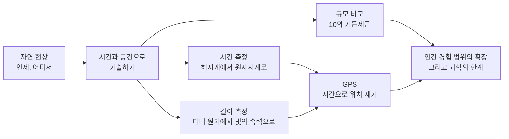
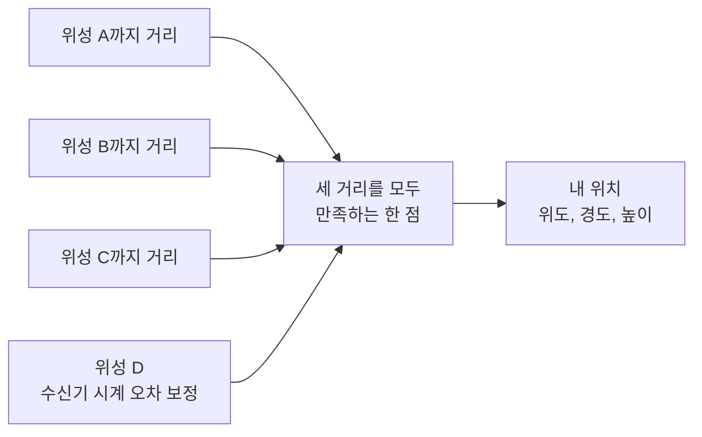

# 1-1. 시간과 공간 — 원자에서 우주까지, 찰나에서 영겁까지

> [!NOTE]
> **성취기준 [10통과1-01-01]** 자연을 시간과 공간에서 기술할 수 있음을 알고, 길이와 시간 측정의 현대적 방법과 다양한 규모의 측정 사례를 조사할 수 있다.

**학습 목표**

1. 모든 자연 현상은 '언제(시간)'와 '어디서(공간)'를 정하면 기술할 수 있음을 사례로 설명할 수 있다.
2. 10의 거듭제곱을 이용하여 원자에서 우주까지, 찰나에서 우주의 나이까지 다양한 규모를 비교할 수 있다.
3. 원자시계, 빛의 속력을 이용한 길이 측정, 레이저 거리 측정, GPS 등 시간과 길이를 재는 현대적 방법을 조사하여 설명할 수 있다.
4. 측정 기술이 인간의 경험 범위를 어떻게 넓혀 왔는지, 그리고 과학에도 한계가 있음을 사례로 말할 수 있다.

**이 단원의 학습 사다리**

| 단계 | 무엇을 하나? |
|---|---|
| STEP 1. 중학교 다시 보기 | 세포·원자의 크기, 별까지의 거리, 우리은하의 크기를 다시 꺼내 본다 |
| STEP 2. 기초 다지기 | 과학적 표기법(10의 거듭제곱)과 '거리 = 속력 × 시간'을 디딤돌로 놓는다 |
| STEP 3. 핵심 개념 | 시공간으로 기술하기 → 규모 비교 → 시간 재기 → 길이 재기 → 경험의 확장과 한계 |
| STEP 4. 오개념 바로잡기 | "1미터는 쇠막대 길이로 정한다?" 같은 착각을 바로잡는다 |
| STEP 5. 선택과목·대학 | 상대성 이론과 GPS, 시공간의 휘어짐, 플랑크 규모 |
| STEP 6. 산업·진로 | 위성 항법, 라이다(LiDAR)와 자율주행, 국가 표준시, 반도체 미세 공정 |

---

## 🗺️ 단원 들어가기

여러분이 알고 있는 **가장 짧은 시간**은 무엇인가? 눈 깜빡하는 순간(약 0.1~0.4초)? 100 m 달리기에서 1위와 2위를 가르는 0.01초? 과학자들은 0.01초보다도 1경(京, $10^{16}$) 배 짧은 **아토초($10^{-18}$초)** 단위로 일어나는 전자의 움직임을 관찰하고, 이 연구로 2023년 노벨 물리학상을 받았다.

반대로 **가장 긴 시간**은? 할머니의 할머니 시절, 공룡이 살던 시대, 지구가 태어난 46억 년 전, 그리고 우주가 시작된 약 138억 년 전. **가장 작은 것**과 **가장 큰 것**도 마찬가지다. 원자는 머리카락 굵기의 100만분의 1 정도이고, 우리은하는 빛의 속력으로도 가로지르는 데 약 10만 년이 걸린다.

이렇게 엄청나게 다른 크기를 사람은 어떻게 '재고', 어떻게 '비교'할까? 이 단원은 그 질문에서 출발한다. 과학의 무대는 **시간과 공간**이고, 과학의 첫걸음은 그 무대를 **재는 것**이다.

---

## STEP 1. 🔙 중학교 다시 보기

### 연계 개념표

| 중학교 성취기준 | 중학교에서 배운 것 | 고등학교에서 확장되는 것 |
|---|---|---|
| [9과02-01] | 세포는 생명 활동의 기본 단위이며 현미경으로 관찰한다 | 세포(약 $10^{-5}$ m)를 원자·바이러스·사람과 한 줄에 놓고 **규모**로 비교한다 |
| [9과11-02] | 원자는 양성자, 중성자, 전자로 구성된다 | 원자(약 $10^{-10}$ m)와 원자핵(약 $10^{-15}$ m)의 크기 차이를 10의 거듭제곱으로 표현한다 |
| [9과15-01] | 연주시차를 이용하여 별까지의 거리를 구한다 | 별까지의 거리처럼 '직접 잴 수 없는 길이'를 재는 현대적 방법을 조사한다 |
| [9과15-02] | 우리은하의 구조와 크기(지름 약 10만 광년) | 광년을 미터로 바꾸어 원자와 같은 표기법으로 비교한다 |
| [9과19-01] | 직선 운동을 그래프로 나타내고 속력 = 이동 거리 ÷ 걸린 시간 | 빛의 속력을 알면 **시간을 재서 거리를 구할 수 있다**(레이저 거리 측정, GPS) |

### 준비 운동 (사전 진단)

**Q1.** 다음을 크기가 작은 것부터 순서대로 나열하시오.
ㄱ. 사람의 적혈구 ㄴ. 원자 ㄷ. 개미 ㄹ. 바이러스

**Q2.** 1광년은 '시간'의 단위인가, '길이'의 단위인가?

**Q3.** 자동차가 일정한 속력 20 m/s로 5초 동안 달렸다. 이동한 거리는?

**Q4.** 밤하늘에서 보이는 별빛은 '지금 이 순간'의 별의 모습일까?

정답 및 해설

**Q1. ㄴ → ㄹ → ㄱ → ㄷ** — 원자(약 0.1 nm) < 바이러스(약 100 nm) < 적혈구(약 7~8 μm) < 개미(수 mm).

**Q2. 길이** — 빛이 1년 동안 이동하는 **거리**이다. 이름에 '년'이 들어 있어 시간 단위로 착각하기 쉽다.

**Q3.** $20\ \mathrm{m/s} \times 5\ \mathrm{s} = 100\ \mathrm{m}$

**Q4. 아니다** — 빛이 별에서 지구까지 오는 데 시간이 걸리므로, 우리는 별의 **과거 모습**을 본다. 멀리 볼수록 더 먼 과거를 보는 셈이다.

---

## STEP 2. 🧱 기초 다지기

### ① 과학적 표기법: 0을 세지 말고 지수를 세자

원자의 지름은 약 0.000 000 000 1 m이고, 지구에서 태양까지의 거리는 약 150 000 000 000 m이다. 0을 하나하나 세다가는 실수하기 쉽다. 그래서 과학에서는 다음과 같이 쓴다.

$$
a \times 10^{n} \qquad (1 \le a < 10,\ n\text{은 정수})
$$

| 보통 표기 | 과학적 표기법 | 읽는 법 |
|---|---|---|
| 150 000 000 000 m | $1.5 \times 10^{11}$ m | 1.5 곱하기 10의 11제곱 미터 |
| 0.000 000 000 1 m | $1 \times 10^{-10}$ m | 1 곱하기 10의 마이너스 10제곱 미터 |
| 0.003 s | $3 \times 10^{-3}$ s | 3 곱하기 10의 마이너스 3제곱 초 |

- 10의 지수가 **양수**이면 큰 수, **음수**이면 1보다 작은 수이다.
- $10^{0} = 1$이다.

> [!TIP]
> 💡 **비유** — 지수는 '확대·축소 버튼을 몇 번 눌렀는가'와 같다. 지수가 1 커질 때마다 10배 확대, 1 작아질 때마다 10배 축소이다. $10^{-10}$ m인 원자를 사람 크기($10^{0}$ m)까지 보려면 '10배 확대' 버튼을 10번 눌러야 한다.

### ② 지수 계산의 두 가지 규칙

규모를 비교할 때는 '몇 배인가'를 자주 묻는다. 이때 다음 두 규칙만 있으면 된다.

$$
10^{a} \times 10^{b} = 10^{a+b}, \qquad \frac{10^{a}}{10^{b}} = 10^{a-b}
$$

- 머리카락 굵기($10^{-4}$ m) ÷ 원자 지름($10^{-10}$ m) $= 10^{-4-(-10)} = 10^{6}$ → 100만 배

### ③ 크기의 차수: '대충 몇 자리 수인가'

과학자들은 정확한 값보다 먼저 **크기의 차수(order of magnitude)**, 즉 '10의 몇 제곱 정도인가'를 묻는다. 예를 들어 사람의 키 1.7 m와 기린의 키 5 m는 정확한 값은 다르지만 둘 다 '$10^{0}$ m 차수'에 속한다. 반면 사람과 개미는 차수가 3단계(1000배) 차이 난다.

> [!IMPORTANT]
> 규모가 엄청나게 다른 대상을 한 그림에 나타낼 때는 눈금 한 칸이 '10배'를 뜻하도록 그린다. 이렇게 그리면 원자부터 우주까지를 공책 한 줄에 나란히 놓을 수 있다. 이 단원의 크기 사다리 표가 바로 그런 방식이다.

### ④ 거리 = 속력 × 시간

중학교에서 속력 = 이동 거리 ÷ 걸린 시간을 배웠다. 이 식을 거꾸로 쓰면

$$
\text{거리} = \text{속력} \times \text{시간}
$$

이다. **속력을 정확히 알고 있다면, 시간만 재도 거리를 알 수 있다.** 빛의 속력은 진공에서 정확히 초속 299 792 458 m(약 $3 \times 10^{8}$ m/s)이다. 이 한 줄이 현대 길이 측정 기술 대부분의 출발점이다.

---

## STEP 3. 📘 핵심 개념

### 1-1-① 자연은 시간과 공간을 배경으로 기술된다

뉴스에서 지진 소식을 전할 때 꼭 들어가는 정보를 떠올려 보자. "○월 ○일 ○시 ○분 ○초, 위도 ○도·경도 ○도, 깊이 ○ km에서 규모 ○의 지진이 발생했다." 지진이라는 사건을 **시각(언제)** 과 **위치(어디서)** 로 정해 주어야 비로소 다른 사람과 정확히 정보를 나눌 수 있다.

| 사건 | 시간 정보 | 공간 정보 |
|---|---|---|
| 지진 발생 | 발생 시각(초 단위까지) | 위도, 경도, 깊이 |
| 태풍 예보 | 몇 시간 뒤 | 중심 위치(위도, 경도), 이동 경로 |
| 100 m 달리기 기록 | 9.58초(세계 기록) | 직선 100 m 트랙 |
| 내비게이션 안내 | 도착 예정 시각 | 현재 위치, 남은 거리 |
| 일식 예보 | 시작·최대·종료 시각 | 관측 가능한 지역 |

이처럼 **자연에서 일어나는 모든 사건은 '언제'와 '어디서'를 정하면 기술할 수 있다.** 과학의 다른 모든 양(속력, 가속도, 밀도 등)도 시간과 공간에 대한 측정에서 출발한다. 그래서 시간과 공간은 자연이라는 연극이 펼쳐지는 **무대**에 비유된다.

> [!TIP]
> 💡 **비유** — 친구와 약속을 잡을 때 "토요일 오후 2시, 학교 정문"처럼 **시간 하나 + 장소 하나**를 정한다. 장소는 지도 위의 가로·세로(2차원)로 충분하지만, 건물 몇 층인지까지 정하려면 높이까지 3개의 수가 필요하다. 공간 3개 + 시간 1개, 모두 4개의 수로 하나의 사건이 정해진다.

### 1-1-② 10의 거듭제곱으로 보는 미시세계와 거시세계

#### 공간의 사다리: 원자핵에서 관측 가능한 우주까지

| 대상 | 크기(대략) | 과학적 표기법(m, 대략) | 무엇으로 보거나 재나? |
|---|---|---|---|
| 양성자, 원자핵 | 약 0.000 000 000 000 001 m | $1 \times 10^{-15}$ | 입자 가속기 충돌 실험 |
| 원자 | 약 0.1 nm | $1 \times 10^{-10}$ | 주사 터널링 현미경, 전자 현미경 |
| DNA 이중 나선의 폭 | 약 2 nm | $2 \times 10^{-9}$ | X선 회절, 전자 현미경 |
| 바이러스 | 약 100 nm | $1 \times 10^{-7}$ | 전자 현미경 |
| 세균 | 약 1~2 μm | $1 \times 10^{-6}$ | 광학 현미경 |
| 적혈구 | 약 7~8 μm | $8 \times 10^{-6}$ | 광학 현미경 |
| 머리카락 굵기 | 약 0.1 mm | $1 \times 10^{-4}$ | 맨눈으로 겨우 보임 |
| 사람의 키 | 약 1.7 m | $1.7 \times 10^{0}$ | 줄자 |
| 에베레스트산 높이 | 약 8.8 km | $8.8 \times 10^{3}$ | 위성 측량, GPS |
| 지구의 지름 | 약 12 700 km | $1.3 \times 10^{7}$ | 위성 측지 |
| 지구–달 거리 | 약 38만 km | $3.8 \times 10^{8}$ | 레이저 반사 측정 |
| 지구–태양 거리(1 AU) | 약 1억 5천만 km | $1.5 \times 10^{11}$ | 레이더, 행성 관측 |
| 가장 가까운 별(프록시마 센타우리) | 약 4.2광년 | $4.0 \times 10^{16}$ | 연주시차 |
| 우리은하의 지름 | 약 10만 광년 | $9.5 \times 10^{20}$ | 별의 분포 관측 |
| 안드로메다 은하까지 | 약 250만 광년 | $2.4 \times 10^{22}$ | 변광성 등 밝기 비교 |
| 관측 가능한 우주의 지름 | 약 930억 광년 | $8.8 \times 10^{26}$ | 우주 배경 복사, 은하 관측 |

표의 위아래 끝을 비교하면 원자핵에서 관측 가능한 우주까지 크기의 차수로 약 **42단계**(약 $10^{42}$배)의 차이가 난다. 사람($10^{0}$ m)은 이 사다리의 아래쪽 끝(원자핵)과 위쪽 끝(우주) 사이 어디쯤에 서 있다.

> [!TIP]
> 💡 **비유** — 원자핵을 지름 1 cm인 구슬로 키우면, 원자 전체는 지름이 약 1 km인 거대한 공이 된다($10^{-15}$ → $10^{-10}$은 $10^{5}$배). 원자의 대부분은 텅 빈 공간이다.

#### 예제 1 — 몇 배 차이인가?

(1) 세균(약 $1 \times 10^{-6}$ m)은 바이러스(약 $1 \times 10^{-7}$ m)의 몇 배인가?
(2) 우리은하의 지름 약 10만 광년을 미터로 나타내시오. (1광년 ≒ $9.5 \times 10^{15}$ m)

**풀이**
(1) $\dfrac{10^{-6}}{10^{-7}} = 10^{1} = 10$배
(2) $1 \times 10^{5} \times 9.5 \times 10^{15} = 9.5 \times 10^{20} \approx 10^{21}\ \mathrm{m}$

#### 시간의 사다리: 아토초에서 우주의 나이까지

| 사건·현상 | 시간(대략) | 과학적 표기법(s, 대략) |
|---|---|---|
| 실험실에서 만드는 가장 짧은 빛 펄스(아토초 펄스) | 수십~수백 아토초 | $10^{-17}$ ~ $10^{-16}$ |
| 세슘 원자 진동 1회(원자시계의 '똑딱') | 약 0.000 000 000 11 s | $1.1 \times 10^{-10}$ |
| 빛이 30 cm를 가는 시간 | 약 1 ns | $1 \times 10^{-9}$ |
| 컴퓨터 중앙처리장치(CPU) 클록 1회 | 약 0.3 ns(3 GHz일 때) | $3.3 \times 10^{-10}$ |
| 빛이 달에 다녀오는 시간 | 약 2.6 s | $2.6 \times 10^{0}$ |
| 햇빛이 지구에 오는 시간 | 약 8분 20초 | $5.0 \times 10^{2}$ |
| 하루 | 86 400 s | $8.64 \times 10^{4}$ |
| 1년 | 약 3150만 s | $3.2 \times 10^{7}$ |
| 사람의 일생(80년) | 약 25억 s | $2.5 \times 10^{9}$ |
| 문자로 기록된 역사 | 약 5000년 | $1.6 \times 10^{11}$ |
| 공룡 멸종 이후 | 약 6600만 년 | $2.1 \times 10^{15}$ |
| 지구의 나이 | 약 46억 년 | $1.5 \times 10^{17}$ |
| 우주의 나이 | 약 138억 년 | $4.4 \times 10^{17}$ |

#### 우주 달력: 138억 년을 1년으로 줄이면

우주의 나이 138억 년을 1년(1월 1일 0시 ~ 12월 31일 자정)으로 줄이면, 달력의 1초는 실제 약 440년에 해당한다.

| 사건 | 우주 달력 날짜(대략) |
|---|---|
| 빅뱅 | 1월 1일 0시 |
| 지구 탄생(약 46억 년 전) | 9월 1일 무렵 |
| 공룡 멸종(약 6600만 년 전) | 12월 30일 아침 |
| 현생 인류 등장(약 30만 년 전) | 12월 31일 밤 11시 48분 무렵 |
| 문자로 기록된 역사 시작(약 5000년 전) | 12월 31일 밤 11시 59분 49초 무렵 |

인류의 기록된 역사 전체가 **우주 달력의 마지막 11초 남짓**에 불과하다. 시간의 규모를 실감하게 하는 대표적인 방법이다.

#### 예제 2 — 우주 달력 계산

우주 달력에서 1초는 실제로 약 몇 년인가? (1년 ≒ $3.15 \times 10^{7}$ s)

**풀이** $\dfrac{1.38 \times 10^{10}\ \text{년}}{3.15 \times 10^{7}\ \text{s}} \approx 4.4 \times 10^{2}$년 → 약 440년

### 1-1-③ 시간을 재는 현대적 방법 — 해시계에서 원자시계로

시간을 재는 원리는 예나 지금이나 같다. **규칙적으로 반복되는 현상을 찾아 그 횟수를 센다.** 바뀐 것은 '무엇이 반복되는가'와 '얼마나 일정한가'이다.

| 시대 | 시계 | 반복되는 현상 | 정밀도(대략) |
|---|---|---|---|
| 고대~조선 | 해시계(앙부일구), 물시계(자격루, 1434년) | 해의 움직임, 일정하게 흐르는 물 | 하루에 수 분~수십 분 |
| 17세기~ | 진자시계 | 진자의 왕복 운동 | 초기에는 하루에 수십 초, 개량 후 수 초 이내 |
| 20세기 | 수정(쿼츠) 시계 | 수정 결정의 진동(손목시계는 1초에 32 768번) | 일반 손목시계는 한 달에 수 초~수십 초 |
| 1950년대~ | 세슘 원자시계 | 세슘-133 원자가 흡수·방출하는 전자기파의 진동 | 국가 표준용은 수천만~수억 년에 1초 이내 |
| 현재 연구 중 | 광시계(광격자 시계 등) | 원자가 흡수·방출하는 빛의 진동 | 우주의 나이 동안 1초 이내 수준 |

> [!NOTE]
> 조선 세종 때 장영실 등이 만든 **자격루**는 물이 일정하게 흘러드는 것을 이용해 정해진 시각에 인형이 종·북·징을 쳐서 시각을 자동으로 알렸다. '자동 시보 장치'라는 점에서 당대 첨단 기술이었다.

#### 원자시계: 원자는 모두 똑같은 '진자'다

진자시계는 진자의 길이가 온도에 따라 늘어나면 느려지고, 수정 시계도 온도나 제작 상태에 따라 조금씩 다르다. 그러나 **같은 종류의 원자는 우주 어디에서나 똑같다.** 세슘-133 원자가 특정한 전자기파를 흡수하는 진동수는 어느 실험실에서 재도 같다. 그래서 1967년부터 **1초**는 다음과 같이 정의되었다.

> 1초는 세슘-133 원자가 특정한 전자기파를 **9 192 631 770번** 진동하는 데 걸리는 시간이다.

우리나라의 국가 표준시는 대전에 있는 **한국표준과학연구원**이 원자시계로 만들어 유지하며, 인터넷·방송 등을 통해 시각 정보를 제공한다. 스마트폰 시계가 저절로 정확한 시각을 맞추는 것도 결국 이러한 표준시에 연결되어 있기 때문이다.

> [!TIP]
> 💡 **비유** — 진자시계가 '사람마다 보폭이 다른 걸음'으로 거리를 재는 것이라면, 원자시계는 '전 세계 어디서나 똑같은 자'로 재는 것과 같다. 기준이 되는 대상 자체가 바뀌지 않으니 누가 어디서 재도 같은 1초를 얻는다.

#### 왜 그렇게까지 정밀해야 할까?

- **통신망**: 휴대 전화 기지국들은 서로 시각을 아주 정밀하게 맞추어야 신호가 엉키지 않는다.
- **금융**: 주식 거래는 주문 순서를 정하기 위해 거래 시각을 매우 짧은 단위까지 기록한다.
- **전력망**: 넓은 지역의 발전소와 송전망이 같은 박자로 움직이도록 시각을 맞춘다.
- **위성 항법(GPS)**: 1-1-④에서 보듯 **시간 오차가 곧 위치 오차**가 된다.

### 1-1-④ 길이를 재는 현대적 방법 — 쇠막대에서 빛의 속력으로

#### 미터의 역사: '지구'에서 '빛'으로

| 시기 | 1 m의 기준 | 문제점 |
|---|---|---|
| 18세기 말 프랑스 | 북극에서 적도까지 거리의 1000만분의 1 | 지구를 다시 잴 때마다 값이 달라질 수 있다 |
| 1889년~ | 국제 미터 원기(백금·이리듐 합금 막대)의 두 눈금 사이 거리 | 막대가 하나뿐이고 온도·손상·마모의 영향을 받는다 |
| 1960년~ | 크립톤-86 원자가 내는 빛의 파장 | 더 정밀한 측정 요구를 따라가기 어려워졌다 |
| 1983년~ 현재 | **빛이 진공에서 1/299 792 458초 동안 이동한 거리** | 빛의 속력은 자연의 상수이므로 변하지 않는다 |

1983년 이후로는 **빛의 속력을 정확히 299 792 458 m/s로 '정해 놓고'**, 시간(초)을 재서 길이를 정의한다. 원자시계로 초를 매우 정밀하게 잴 수 있으므로, 길이도 그만큼 정밀하게 잴 수 있게 되었다. 시간과 공간의 측정이 하나로 묶인 셈이다.

#### 고대의 놀라운 측정: 에라토스테네스

약 2200여 년 전 그리스의 에라토스테네스는 하짓날 정오에 시에네에서는 해가 우물 바닥까지 비추는데, 북쪽의 알렉산드리아에서는 막대 그림자가 생겨 햇빛이 약 7.2°(원의 50분의 1) 기울어진다는 것을 이용했다. 두 도시 사이 거리에 50을 곱해 지구 둘레를 구했고, 그 값은 오늘날 값(약 4만 km)과 크게 다르지 않았던 것으로 평가된다. **직접 잴 수 없는 크기를 '잴 수 있는 것'으로 바꾸어 계산하는 것**, 이것이 측정의 핵심 아이디어이다.

#### 레이저로 거리 재기: 빛을 쏘고 돌아오는 시간을 잰다

레이저 빛을 물체에 쏘고 반사되어 돌아오는 시간 $t$를 재면, 빛은 같은 거리를 왕복했으므로

$$
d = \frac{c \times t}{2}
$$

이다. 이 원리는 공사 현장의 **레이저 거리 측정기**, 자율주행차의 **라이다(LiDAR)**, 그리고 **지구–달 거리 측정**에 모두 쓰인다.

> [!NOTE]
> 1969년 아폴로 11호를 시작으로 달 표면에 놓인 **반사경**에 지구에서 레이저를 쏘아, 지금도 지구–달 거리를 밀리미터 수준까지 측정한다. 이 측정으로 **달이 1년에 약 3.8 cm씩 지구에서 멀어지고 있다**는 사실도 알아냈다.

#### 예제 3 — 달까지의 거리

지구에서 쏜 레이저가 달의 반사경에 반사되어 돌아오는 데 2.56초가 걸렸다. 지구–달 거리는? (빛의 속력 $c = 3.0 \times 10^{8}$ m/s)

**풀이**
$d = \dfrac{c\,t}{2} = \dfrac{3.0 \times 10^{8} \times 2.56}{2} = 3.84 \times 10^{8}\ \mathrm{m}$ (약 38만 4천 km)

#### GPS: 시간을 재서 내 위치를 안다

**GPS(위성 항법 시스템)** 위성은 지상 약 2만 km 높이에서 지구를 돌며, 원자시계로 잰 정확한 시각과 자신의 위치를 담은 신호를 계속 보낸다. 스마트폰은 신호가 '보낸 시각'과 '받은 시각'의 차이로 **신호가 날아온 시간**을 알아내고, 여기에 빛의 속력을 곱해 위성까지의 거리를 구한다.

- 위성 하나까지의 거리만 알면 '그 위성을 중심으로 하는 구의 표면 어딘가'까지만 안다.
- 세 위성까지의 거리를 알면 세 구면이 만나는 점으로 위치가 좁혀진다.
- 스마트폰의 시계는 원자시계가 아니라서 오차가 있으므로, **네 번째 위성**을 이용해 이 시계 오차까지 함께 계산한다.

#### 예제 4 — 시간 오차는 곧 위치 오차

GPS 수신기가 위성 신호의 도착 시각을 1 μs($10^{-6}$ s)만큼 잘못 재면, 위성까지의 거리는 얼마나 틀어지는가? ($c = 3 \times 10^{8}$ m/s)

**풀이** $\Delta d = c \times \Delta t = 3 \times 10^{8} \times 10^{-6} = 300\ \mathrm{m}$

100만분의 1초의 오차가 300 m의 위치 오차가 된다. GPS 위성에 원자시계를 싣는 이유이다.

#### 더 작게, 더 정밀하게: 빛의 간섭으로 재기

빛을 둘로 나누었다가 다시 합치면 두 빛이 지나온 길이의 차이에 따라 밝고 어두운 무늬가 생긴다. 이를 이용하는 장치를 **간섭계(interferometer)** 라 한다. 반도체 공장에서는 간섭계로 나노미터 수준의 위치를 맞추고, 2015년에는 팔 길이 4 km인 거대한 간섭계(LIGO)가 블랙홀 충돌에서 온 **중력파**를 처음으로 검출했다. 이때 잰 길이 변화는 **양성자 지름보다도 훨씬 작은** 정도였다.

### 1-1-⑤ 인간 경험 범위의 확장과 과학의 한계

#### 감각의 한계를 넘어선 측정

| 감각·능력 | 맨몸의 범위(대략) | 측정 기술로 넓힌 범위 |
|---|---|---|
| 보기(작은 것) | 약 0.1 mm(머리카락 굵기) | 광학 현미경 약 0.2 μm → 전자 현미경·주사 터널링 현미경으로 원자 |
| 보기(먼 것) | 맨눈으로 보이는 안드로메다 은하(약 250만 광년) | 우주 망원경으로 100억 광년이 넘는 거리의 은하 |
| 보기(빛의 종류) | 가시광선뿐 | 전파, 적외선, 자외선, X선 망원경 |
| 시간 감각 | 약 0.1초 정도의 차이를 겨우 구별 | 원자시계, 아토초 펄스 |
| 듣기 | 약 20 Hz ~ 20 000 Hz | 지진계, 초음파 장치, 중력파 검출기 |

망원경, 현미경, 시계는 모두 **인간의 감각을 연장한 도구**이다. 갈릴레이가 망원경으로 목성의 위성을 발견했을 때, 2019년 국제 공동 연구진(한국천문연구원 연구진 포함)이 전 세계 전파 망원경을 연결해 블랙홀의 그림자를 처음 촬영했을 때, 인류가 '경험할 수 있는 세계'는 한 단계씩 넓어졌다.

#### 그래도 과학에는 한계가 있다

- **관측 가능한 범위의 한계**: 빛의 속력은 유한하고 우주의 나이도 유한하므로, 빛이 아직 우리에게 도달하지 못한 곳은 볼 수 없다. 이것이 '관측 가능한 우주'라는 말에 '관측 가능한'이 붙은 이유이다.
- **측정에는 언제나 오차가 있다**: 아무리 정밀한 시계와 자도 '완벽한' 값은 주지 못한다. 과학은 오차를 줄이고, 오차가 얼마인지를 정직하게 밝히는 활동이다(1-3단원).
- **아직 모르는 영역**: 우주를 이루는 물질과 에너지의 대부분은 정체를 모른다(암흑 물질, 암흑 에너지). 원자핵보다 훨씬 작은 규모에서 시간과 공간이 어떤 모습인지도 아직 밝혀지지 않았다.

> [!IMPORTANT]
> 과학의 한계를 인정하는 것은 과학의 약점이 아니라 **과학의 정직함**이다. "어디까지 알고, 어디부터 모르는가"를 분명히 할 때 다음 탐구가 시작된다.

---

## STEP 4. ⚠️ 오개념 바로잡기

| 흔한 오개념 | 올바른 개념 | 왜 그럴까? |
|---|---|---|
| 광년은 시간의 단위이다 | 광년은 빛이 1년 동안 가는 **거리**, 즉 길이의 단위이다 | 이름에 '년'이 들어 있어 시간으로 착각하기 쉽다 |
| 1 m는 프랑스에 보관된 쇠막대의 길이로 정한다 | 1983년부터 1 m는 **빛이 1/299 792 458초 동안 가는 거리**로 정한다 | 막대는 변형·손상될 수 있지만 빛의 속력은 변하지 않는 자연의 상수이다 |
| 별을 보면 그 별의 지금 모습을 보는 것이다 | 별빛이 오는 데 걸린 시간만큼 **과거의 모습**을 본다 | 빛의 속력은 매우 빠르지만 유한하다 |
| GPS 위성이 스마트폰의 위치를 추적해서 알려 준다 | 위성은 **시각과 위치 신호를 보내기만** 하고, 위치 계산은 **수신기(스마트폰)** 가 한다 | 수신기가 여러 위성 신호의 도착 시간 차이로 거리를 계산한다 |
| 원자는 아주 작으니 10배쯤 확대하면 보인다 | 원자는 머리카락 굵기의 약 **100만분의 1**이다 | 규모의 차이는 '몇 배'가 아니라 '10의 몇 제곱'으로 생각해야 실감이 난다 |
| 과학이 발전하면 모든 것을 완벽하게 잴 수 있다 | 측정에는 항상 오차가 있고, 관측할 수 없는 영역도 있다 | 과학은 한계를 인정하고 그 범위를 조금씩 넓혀 가는 활동이다 |

---

## STEP 5. 🎓 선택과목·대학으로 한 걸음 더

> [!CAUTION]
> 이 절은 **통합과학 교육과정 범위 밖의 심화 내용**으로 평가 대상이 아니다. "이 개념이 앞으로 어디까지 이어지는가"를 맛보기로 보여 주기 위한 내용이다.

### 고2·3 선택과목과의 연결

| 과목 | 이어지는 내용 |
|---|---|
| 물리학 | 빛의 속력이 모든 관성계에서 같다는 원리 → 시간 팽창, 길이 수축 [12물리03-06] |
| 역학과 에너지 | 등가 원리와 시공간의 휘어짐, 블랙홀과 **중력 시간 지연** [12역학01-06] |
| 행성우주과학 | 별의 시차와 밝기를 이용하여 거리를 측정하는 다양한 방법 비교 [12행우02-02] |
| 지구과학 | 외부은하와 우주의 팽창, 허블–르메트르 법칙 [12지구03-05] |

### ① 움직이는 시계는 느리게 간다 — 특수 상대성 이론

아인슈타인은 "빛의 속력은 누가 재도 같다"는 원리에서 출발해, 빠르게 움직이는 물체의 시간은 정지한 관찰자가 볼 때 **느리게 흐른다**는 결론을 얻었다.

$$
\Delta t = \frac{\Delta t_0}{\sqrt{1 - v^2/c^2}}
$$

($\Delta t_0$: 움직이는 시계가 잰 시간, $\Delta t$: 정지한 관찰자가 잰 시간) 일상의 속력에서는 $v \ll c$라 차이를 느낄 수 없지만, 원자시계로는 이 차이를 직접 잴 수 있다.

### ② GPS는 상대성 이론 없이는 작동하지 않는다

GPS 위성의 시계에는 두 가지 효과가 동시에 작용한다.

| 효과 | 원인 | 하루 동안의 차이(대략) |
|---|---|---|
| 특수 상대성 효과 | 위성이 빠르게(약 3.9 km/s) 움직인다 | 약 7 μs 느려짐 |
| 일반 상대성 효과 | 위성이 있는 곳은 지표보다 중력이 약하다 | 약 45 μs 빨라짐 |
| 합계 | | 약 **38 μs 빨라짐** |

38 μs × (3 × 10⁸ m/s) ≈ 11 km. 보정하지 않으면 **하루에 약 10 km씩 위치 오차가 쌓인다.** 그래서 GPS 위성의 시계는 발사 전부터 이 효과를 고려해 조정된다. 우주와 시공간에 대한 이론이 스마트폰 지도 앱 속에서 매일 검증되고 있는 셈이다.

### ③ 가장 작은 길이와 시간? — 플랑크 규모

대학 물리학에서는 중력, 양자, 빛의 속력을 나타내는 상수를 조합해 **플랑크 길이(약 $1.6 \times 10^{-35}$ m)** 와 **플랑크 시간(약 $5.4 \times 10^{-44}$ s)** 을 만든다. 이 규모에서는 현재의 물리 이론으로 시공간을 설명할 수 없을 것으로 예상되며, 이를 다루는 이론(양자 중력)은 아직 완성되지 않았다. STEP 3의 '과학의 한계'가 바로 이 지점이다.

### 고등학교 vs 대학교

| 구분 | 고등학교 통합과학 | 대학교 물리학·천문학·측지학 |
|---|---|---|
| 시간과 공간 | 사건을 기술하는 무대, 규모 비교 | 4차원 시공간, 좌표 변환(로렌츠 변환), 휘어진 시공간 |
| 길이 측정 | 레이저 왕복 시간, GPS의 원리 | 간섭계 설계, 위성 궤도 결정, 측지 좌표계 |
| 시간 측정 | 원자시계의 아이디어 | 원자의 에너지 준위, 레이저 냉각, 광시계 |
| 규모 | 10의 거듭제곱으로 비교 | 차원 분석, 규모에 따라 달라지는 물리 법칙 |
| 관련 전공 | — | 물리학, 천문우주학, 측지·공간정보공학, 항공우주공학, 전자공학 |

---

## STEP 6. 🏭 산업 현장과 진로 연결

### 사례 1. 위성 항법 — 시간을 파는 산업

- **원리** 원자시계를 실은 위성들이 시각 신호를 보내고, 수신기가 도착 시간 차이로 위치를 계산한다(1-1-④).
- **어디에 쓰이나** 스마트폰 지도·배달 앱, 항공기·선박 항법, 농기계 자율 주행, 측량, 그리고 통신망·전력망·금융 거래의 **시각 동기화**.
- **핵심 숫자** 시각 오차 1 μs → 거리 오차 약 300 m. 그래서 '정확한 시간'이 곧 '정확한 위치'이다.
- **우리나라** 미국의 GPS 외에도 여러 나라가 독자적인 위성 항법 시스템을 운영하거나 개발하고 있으며, 우리나라도 **한국형 위성항법시스템(KPS)** 개발을 추진하고 있다.

### 사례 2. 라이다(LiDAR)와 자율주행·디지털 트윈

- **원리** 레이저 펄스를 1초에 수십만 번 이상 쏘고 각각의 왕복 시간을 재어 주변을 점들의 3차원 지도(점 구름)로 만든다. 원리는 예제 3의 달 거리 측정과 같다.
- **어디에 쓰이나** 자율주행차·로봇의 장애물 인식, 건물과 도시를 컴퓨터 속에 똑같이 재현하는 디지털 트윈, 산림·지형 측량, 문화재의 3차원 기록.
- **핵심 숫자** 빛은 1 ns에 약 30 cm를 가므로, 거리를 센티미터 수준으로 재려면 **10억분의 1초보다 짧은 시간 차이**를 구별해야 한다.

### 사례 3. 국가 표준시와 정밀 시각

- **원리** 한국표준과학연구원이 원자시계로 국가 표준시를 만들고, 세계 여러 나라의 표준 기관이 서로 비교하여 **협정 세계시(UTC)** 를 함께 유지한다.
- **어디에 쓰이나** 방송 시보, 이동 통신 기지국, 증권 거래 시각 기록, 전력망 운영.
- **요즘 현장** 세슘 원자시계보다 정밀한 **광시계** 연구가 세계적으로 활발하며, 앞으로 1초의 정의를 광시계 기준으로 바꾸는 방안이 국제적으로 논의되고 있다.

### 사례 4. 반도체 미세 공정 — 나노미터의 세계

- **원리** 오늘날 반도체 칩 속 회로의 일부 구조는 수 nm~수십 nm 수준이다. 원자 수십 개 크기에 해당하는 규모이다.
- **어디에 쓰이나** 공정 장비는 웨이퍼의 위치를 **나노미터 수준**으로 맞추어야 하며, 이때 레이저 간섭계와 같은 정밀 길이 측정 기술이 쓰인다.
- **핵심 아이디어** 미시세계의 크기를 정확히 '재고 다룰 수 있는' 능력이 곧 첨단 산업의 경쟁력이다.

### 관련 진로와 학과

| 진로 | 하는 일 | 관련 학과 |
|---|---|---|
| 측정 과학자(표준 연구원) | 원자시계·길이 표준 개발과 유지, 국제 비교 | 물리학, 전자공학, 기계공학 |
| 위성 항법·측량 엔지니어 | 위성 신호 처리, 정밀 위치 결정, 지도 제작 | 측지·공간정보공학, 항공우주공학, 전자공학 |
| 천문학자 | 우주 거리 측정, 망원경 관측과 자료 분석 | 천문우주학, 물리학 |
| 자율주행 센서 엔지니어 | 라이다·카메라 자료 처리, 3차원 지도 제작 | 전자공학, 기계공학, 컴퓨터공학 |
| 반도체 공정·계측 엔지니어 | 나노미터 수준의 패턴 측정과 검사 | 신소재공학, 물리학, 전자공학 |

---

## 🔬 탐구 활동 — 미시세계와 거시세계의 물체의 크기에 따른 차이점 분석하기

### 활동 A. 10의 거듭제곱 크기 사다리 만들기 (모둠 활동)

**목표** 미시세계와 거시세계의 다양한 대상을 조사하여 10의 거듭제곱 눈금 위에 배치하고, 규모에 따라 무엇이 달라지는지 분석한다.

**준비물** 긴 종이 띠(약 2.5 m), 자, 색연필, 포스트잇, 인터넷 검색이 가능한 스마트 기기

**과정**
1. 종이 띠에 5 cm 간격으로 눈금 43개를 긋고, 왼쪽 끝부터 $10^{-15}$ m, $10^{-14}$ m, …, $10^{27}$ m라고 적는다(한 칸 = 10배, 전체 약 2.1 m).
2. 모둠별로 서로 다른 대상을 최소 12개 조사한다. 미시(원자, 바이러스, 세포 …), 일상(개미, 사람, 건물 …), 거시(산, 지구, 은하 …)에서 골고루 고른다.
3. 각 대상의 크기를 과학적 표기법으로 나타내고, 지수에 해당하는 칸에 포스트잇을 붙인다.
4. 각 대상을 '무엇으로 보거나 재는가'(맨눈, 현미경, 망원경, 위성 등)를 포스트잇 아래에 적는다.
5. 같은 방식으로 '시간 사다리'도 만들어 본다(선택).

**결과 기록**

| 대상 | 크기 | 과학적 표기법(m) | 관찰·측정 도구 | 미시 / 일상 / 거시 |
|---|---|---|---|---|
| 예) 적혈구 | 약 8 μm | $8 \times 10^{-6}$ | 광학 현미경 | 미시 |
| | | | | |
| | | | | |
| | | | | |

**생각해 보기**
1. 맨눈으로 직접 볼 수 있는 범위는 사다리에서 몇 칸 정도인가? 전체 칸 수와 비교해 보자.
2. 미시세계를 관찰하는 도구와 거시세계를 관찰하는 도구의 공통점은 무엇일까? (힌트: 대부분 '빛'이나 '전자기파'를 이용한다.)
3. 사다리의 양 끝 너머에는 무엇이 있을까? 우리가 아직 잴 수 없는 영역에 대해 모둠의 생각을 정리해 보자.

### 활동 B. 스마트폰 스톱워치로 '반응 시간' 재기 — 시간 측정의 한계 체험

1. 짝이 스톱워치를 시작하고, 내가 화면을 보지 않은 채 짝의 신호("지금!")에 맞추어 멈추는 실험을 10회 반복한다.
2. 이번에는 내가 직접 시작하고 '정확히 5초'라고 생각될 때 멈추는 실험을 10회 반복한다.
3. 결과의 평균과 가장 큰 값–가장 작은 값의 차이를 구한다.
4. 사람의 손으로 재는 시간 측정이 몇 초 수준까지 믿을 만한지 토의하고, 육상 경기에서 전자 계측 장치를 쓰는 이유를 설명해 본다.

---

## ✅ 개념 확인 문제

### 기본

**1.** 다음을 과학적 표기법으로 나타내시오.
(1) 지구–태양 거리 150 000 000 000 m
(2) 바이러스의 크기 0.000 000 1 m

정답 및 해설

**정답** (1) $1.5 \times 10^{11}$ m (2) $1 \times 10^{-7}$ m

(1) 소수점을 왼쪽으로 11자리 옮겼다. (2) 소수점을 오른쪽으로 7자리 옮겼다.

**2.** 다음 중 크기의 차수가 가장 큰 것과 가장 작은 것을 고르시오.
ㄱ. 원자 ㄴ. 지구의 지름 ㄷ. 적혈구 ㄹ. 우리은하의 지름 ㅁ. 원자핵

정답 및 해설

**정답** 가장 큰 것: ㄹ, 가장 작은 것: ㅁ

원자핵(약 $10^{-15}$ m) < 원자(약 $10^{-10}$ m) < 적혈구(약 $10^{-5}$ m) < 지구의 지름(약 $10^{7}$ m) < 우리은하의 지름(약 $10^{21}$ m)

**3.** 현재 1 m는 무엇을 기준으로 정의하는가? 쇠막대(미터 원기)를 기준으로 하던 방식에서 바꾼 까닭과 함께 쓰시오.

정답 및 해설

**정답** 빛이 진공에서 1/299 792 458초 동안 이동한 거리

미터 원기는 하나뿐인 인공물이라 온도 변화, 손상, 마모의 영향을 받을 수 있고 다른 나라에서 직접 비교하기도 어렵다. 빛의 속력은 언제 어디서나 같은 자연의 상수이므로, 시간을 정밀하게 잴 수 있으면 누구나 같은 1 m를 재현할 수 있다.

**4.** 빈칸에 알맞은 말을 쓰시오.
"시계는 규칙적으로 ( ㄱ )되는 현상의 횟수를 세어 시간을 잰다. 현재 1초는 ( ㄴ )-133 원자와 관련된 전자기파가 9 192 631 770번 진동하는 시간으로 정의한다."

정답 및 해설

**정답** ㄱ: 반복, ㄴ: 세슘

### 응용

**5.** 레이저 거리 측정기로 건물 벽을 겨누었더니 빛이 반사되어 돌아오는 데 $2 \times 10^{-7}$초가 걸렸다. 측정기에서 벽까지의 거리는? ($c = 3 \times 10^{8}$ m/s)

정답 및 해설

**정답** 30 m

$d = \dfrac{c\,t}{2} = \dfrac{3 \times 10^{8} \times 2 \times 10^{-7}}{2} = 30\ \mathrm{m}$

빛이 '왕복'한 시간이므로 반드시 2로 나누어야 한다. 2로 나누지 않으면 60 m라는 틀린 답이 나온다.

**6.** 우주 달력(우주의 나이 138억 년을 1년으로 줄인 달력)에 대한 설명으로 옳은 것을 **모두** 고르시오.
ㄱ. 지구는 우주 달력의 상반기(1~6월)에 탄생했다.
ㄴ. 공룡이 멸종한 사건은 12월에 일어났다.
ㄷ. 인류의 기록된 역사는 우주 달력의 마지막 1분 안에 들어간다.

정답 및 해설

**정답 ㄴ, ㄷ**

ㄱ. 지구의 나이(약 46억 년)는 우주 나이의 약 3분의 1이므로, 연말에서 약 4개월 전인 9월 초에 해당한다. 틀렸다.
ㄴ. 약 6600만 년 전은 연말에서 약 1.7일 전, 즉 12월 30일 아침이다.
ㄷ. 약 5000년은 우주 달력에서 약 11초에 해당한다.

**7.** GPS 수신기에 대한 설명으로 옳지 **않은** 것은?
① 위성은 정확한 시각 정보가 담긴 신호를 보낸다.
② 수신기는 신호가 날아오는 데 걸린 시간으로 위성까지의 거리를 구한다.
③ 위성 하나까지의 거리만 알면 수신기의 위치를 하나로 정할 수 있다.
④ 수신기의 시계 오차를 보정하기 위해 보통 네 개 이상의 위성 신호를 이용한다.

정답 및 해설

**정답 ③**

위성 하나까지의 거리만 알면 '그 위성을 중심으로 하는 구면 위의 어딘가'라는 것만 알 수 있다. 세 위성까지의 거리가 있어야 공간의 한 점으로 좁혀지고, 수신기 시계 오차까지 보정하려면 네 번째 위성이 필요하다.

### 융합·서술형

**8. [산업 연계]** 자율주행차의 라이다는 레이저가 물체에 반사되어 돌아오는 시간으로 거리를 잰다. 거리를 1.5 cm 차이까지 구별하려면 시간 차이를 얼마까지 구별해야 하는지 구하고, 이것이 '정밀한 시간 측정'과 어떤 관계가 있는지 서술하시오. ($c = 3 \times 10^{8}$ m/s)

정답 및 해설

**예시 답안**
거리가 1.5 cm 달라지면 빛의 왕복 거리는 3 cm 달라진다. 따라서 구별해야 하는 시간 차이는
$\Delta t = \dfrac{0.03\ \mathrm{m}}{3 \times 10^{8}\ \mathrm{m/s}} = 1 \times 10^{-10}\ \mathrm{s}$ (0.1 ns)이다.
빛은 매우 빠르므로 거리를 정밀하게 재려면 **10억분의 1초보다 짧은 시간 차이**를 구별해야 한다. 즉 길이 측정의 정밀도는 시간 측정의 정밀도에 달려 있으며, 이것이 현대에 길이를 빛의 속력과 시간으로 정의하는 이유와도 연결된다.

**채점 포인트** ① 왕복 거리 고려(2배) ② $\Delta t = \Delta d / c$ 계산 ③ 시간 측정 정밀도와 길이 측정 정밀도의 관계 서술

**9. [과학의 한계 연계]** 어떤 학생이 "망원경 성능만 계속 좋아지면, 언젠가는 우주의 모든 곳을 다 볼 수 있다."라고 주장했다. 이 주장의 문제점을 '빛의 속력'과 '우주의 나이'를 이용하여 서술하고, 과학의 한계를 인정하는 것이 왜 중요한지 덧붙이시오.

정답 및 해설

**예시 답안**
우리가 천체를 보는 것은 그 천체에서 출발한 빛이 지구에 도착했기 때문이다. 빛의 속력은 유한하고 우주의 나이도 약 138억 년으로 유한하므로, 빛이 출발했더라도 아직 지구에 도달하지 못한 영역은 망원경 성능과 상관없이 볼 수 없다. 따라서 우리가 볼 수 있는 범위는 '관측 가능한 우주'로 한정된다.
과학의 한계를 인정하면 어디까지가 확인된 지식이고 어디부터가 추측인지 구분할 수 있어, 근거 없는 주장을 피하고 새로운 탐구 질문을 세울 수 있다.

**채점 포인트** ① 빛이 도달해야 볼 수 있음 ② 빛의 속력과 우주의 나이가 유한함 ③ 한계 인정의 의의

---

## 📝 한눈에 정리

### 핵심 요약

- 자연의 모든 사건은 **시간(언제)** 과 **공간(어디서)** 으로 기술할 수 있다. 공간 3개 + 시간 1개의 수로 사건 하나가 정해진다.
- 원자핵(약 $10^{-15}$ m)에서 관측 가능한 우주(약 $10^{27}$ m)까지, 아토초에서 우주의 나이(약 $4.4 \times 10^{17}$ s)까지 자연은 엄청난 **규모**의 폭을 가지며, 이를 **10의 거듭제곱**으로 비교한다.
- 시계는 **규칙적인 반복**을 센다. 해시계·물시계 → 진자 → 수정 → **원자시계**(1초 = 세슘-133 관련 진동 9 192 631 770번)로 발전했다.
- 1983년부터 1 m는 **빛이 1/299 792 458초 동안 가는 거리**이다. 길이 측정은 시간 측정에 기대고 있다.
- **레이저 거리 측정**과 **GPS**는 '거리 = 빛의 속력 × 시간'을 이용한다. 시간 오차 1 μs는 약 300 m의 거리 오차가 된다.
- 측정 기술은 인간의 경험 범위를 넓혀 왔지만, 관측 가능한 우주의 경계·측정 오차·미지의 영역 등 **과학의 한계**도 분명히 존재한다.

### 핵심 용어

| 용어 | 뜻 |
|---|---|
| 규모(scale) | 대상의 크기나 시간의 길이가 어느 정도 범위에 있는지를 나타내는 것 |
| 과학적 표기법 | 수를 $a \times 10^{n}$ ($1 \le a < 10$) 꼴로 나타내는 방법 |
| 크기의 차수 | 어떤 양이 대략 10의 몇 제곱 정도인지를 나타낸 것 |
| 광년 | 빛이 1년 동안 이동하는 거리(약 $9.5 \times 10^{15}$ m) |
| 원자시계 | 원자가 흡수·방출하는 전자기파의 일정한 진동을 이용한 매우 정밀한 시계 |
| 레이저 거리 측정 | 레이저 빛의 왕복 시간을 재어 거리를 구하는 방법 |
| GPS(위성 항법 시스템) | 여러 위성의 시각 신호가 도착하는 시간으로 위치를 계산하는 체계 |
| 관측 가능한 우주 | 우주가 시작된 뒤 빛이 지구에 도달할 수 있었던 범위의 우주 |

### 다음 단원으로

지금까지 자연이라는 무대의 **시간과 공간**을 어떻게 재는지 살펴보았다. 그런데 과학이 다루는 양은 시간과 길이만이 아니다. 다음 단원에서는 질량, 전류, 온도처럼 자연을 기술하는 데 꼭 필요한 **기본량**과, 전 세계가 함께 쓰는 **단위**가 어떻게 자연의 상수 위에 세워졌는지 알아본다.
