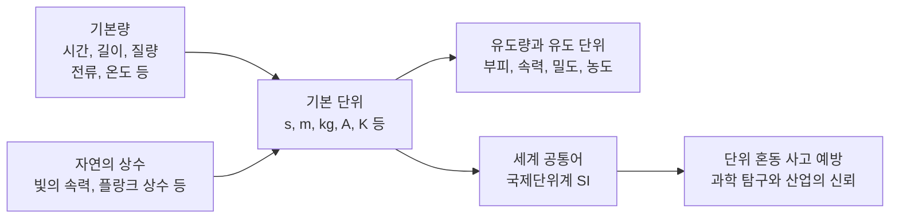
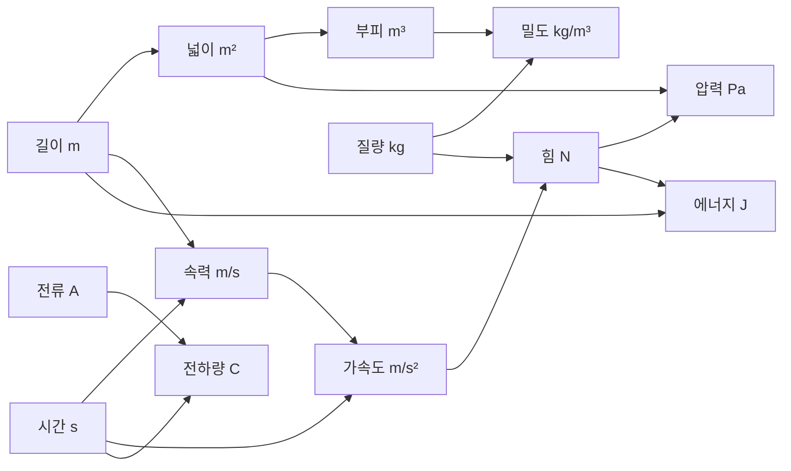
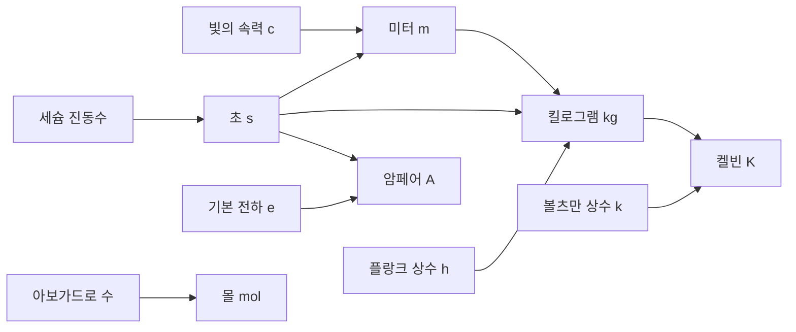

# 1-2. 기본량과 단위 — 자연의 상수 위에 세운 세계 공통어

> [!NOTE]
> **성취기준 [10통과1-01-02]** 과학 탐구에서 중요한 기본량의 의미를 알고, 자연 현상을 기술하는 데 단위가 가지는 의미와 적용사례를 설명할 수 있다.

**학습 목표**

1. 시간, 길이, 질량, 전류, 온도 등 과학의 기본량이 무엇인지 알고, 국제단위계(SI)의 7개 기본 단위를 말할 수 있다.
2. 부피, 속력, 밀도, 농도 등 여러 과학 개념이 기본량으로부터 만들어짐(유도됨)을 예를 들어 설명할 수 있다.
3. 2019년 국제단위계 재정의에서 기본 단위를 자연의 상수로 정한 까닭을 설명할 수 있다.
4. 단위 혼동으로 일어난 사고 사례를 분석하여, 자연 현상을 기술할 때 단위가 가지는 의미를 설명할 수 있다.

**이 단원의 학습 사다리**

| 단계 | 무엇을 하나? |
|---|---|
| STEP 1. 중학교 다시 보기 | 속력, 질량과 무게, 온도, 전류, 밀도를 다시 꺼내 본다 |
| STEP 2. 기초 다지기 | '양 = 수 × 단위', 단위 환산, 접두어를 디딤돌로 놓는다 |
| STEP 3. 핵심 개념 | 기본량 → 유도량 → 단위의 역사와 2019년 재정의 → 단위 혼동 사고 |
| STEP 4. 오개념 바로잡기 | "2019년에 1 kg의 값이 바뀌었다?" 같은 착각을 바로잡는다 |
| STEP 5. 선택과목·대학 | 차원 분석, 몰, 플랑크 상수와 키블 저울 |
| STEP 6. 산업·진로 | 항공우주, 제약·의료, 반도체·통신에서의 단위 |

---

## 🗺️ 단원 들어가기

1999년 9월, 9개월 넘게 우주를 날아간 미국의 화성 탐사선 **화성 기후 궤도선(Mars Climate Orbiter)** 이 화성에 도착하자마자 연락이 끊겼다. 원인은 고장 난 부품도, 우주의 돌발 사고도 아니었다. 한쪽 팀은 **파운드(야드파운드법)** 단위로, 다른 팀은 **뉴턴(미터법)** 단위로 계산하고 있었던 것이다.

"3"이라는 숫자는 3 m일 수도, 3 km일 수도, 3 kg일 수도 있다. **단위가 없는 숫자는 아무 의미가 없다.** 그래서 전 세계 과학자와 기술자는 하나의 '공통어'인 **국제단위계(SI)** 를 쓴다. 그리고 2019년, 이 공통어는 역사상 가장 큰 변화를 맞았다. 단위의 기준을 금속 덩어리 같은 '물건'이 아닌 **자연의 상수**로 바꾼 것이다.

---

## STEP 1. 🔙 중학교 다시 보기

### 연계 개념표

| 중학교 성취기준 | 중학교에서 배운 것 | 고등학교에서 확장되는 것 |
|---|---|---|
| [9과19-01] | 속력 = 이동 거리 ÷ 걸린 시간 (m/s) | 속력은 **길이와 시간**이라는 두 기본량에서 만들어진 **유도량**이다 |
| [9과05-02] | 질량과 무게를 구별한다 | 질량(kg)은 기본량, 무게(N)는 힘으로서 유도량이다 |
| [9과03-01] | 온도는 입자 운동의 활발한 정도이다 | 온도의 SI 기본 단위는 **켈빈(K)** 이며, 섭씨온도와의 관계를 안다 |
| [9과14-02] | 전류, 전압, 저항 사이의 관계 | 전류(A)는 기본량이고, 전압·저항·전하량은 유도량이다 |
| [9과08-01] | 밀도, 용해도 등 물질의 특성 | 밀도 = 질량 ÷ 부피처럼 물질의 특성도 기본량으로부터 만들어진다 |
| [9과06-01] | 압력의 의미 | 압력 = 힘 ÷ 넓이 → 단위 Pa(= N/m²)도 기본 단위의 조합이다 |

### 준비 운동 (사전 진단)

**Q1.** 질량 60 kg인 사람이 달에 가면 질량과 무게는 각각 어떻게 될까?

**Q2.** 1 L는 몇 cm³인가?

**Q3.** 밀도의 단위로 알맞은 것을 모두 고르시오.
ㄱ. g/cm³ ㄴ. kg/m³ ㄷ. m/s ㄹ. g·cm³

**Q4.** 물이 끓는 온도는 섭씨로 약 100 °C이다. 미국 일기 예보에서 "오늘 최고 기온 100도"라고 하면 물이 끓을 만큼 더운 날일까?

정답 및 해설

**Q1.** 질량은 60 kg 그대로이고, 무게는 지구에서의 약 6분의 1로 줄어든다. 질량은 물체의 고유한 양이고, 무게는 중력의 크기이기 때문이다.

**Q2.** 1000 cm³ (1 L = 1000 mL, 1 mL = 1 cm³)

**Q3. ㄱ, ㄴ** — 밀도 = 질량 ÷ 부피이므로 '질량 단위 / 부피 단위' 꼴이다.

**Q4. 아니다** — 미국은 일상에서 **화씨온도(°F)** 를 쓴다. 100 °F는 약 38 °C로 매우 더운 날이지만 물이 끓을 온도는 아니다. 같은 '100'이라도 단위가 다르면 전혀 다른 뜻이다.

---

## STEP 2. 🧱 기초 다지기

### ① 물리량 = 수 × 단위

과학에서 측정하는 양(**물리량**)은 항상 **수와 단위의 곱**이다.

$$
\text{물리량} = \text{수} \times \text{단위} \qquad \text{예: } 1.7\ \mathrm{m} = 1.7 \times (1\ \mathrm{m})
$$

'1.7 m'는 "1 m라는 기준의 1.7배"라는 뜻이다. 즉 **단위는 비교의 기준**이고, 수는 그 기준의 몇 배인지를 나타낸다.

> [!TIP]
> 💡 **비유** — 단위는 '화폐 단위'와 같다. "100을 주세요"라고 하면 100원인지 100달러인지 알 수 없다. 숫자만 맞고 단위가 다르면 값이 1000배 넘게 달라질 수 있다.

### ② 단위도 계산된다

단위는 수처럼 곱하고 나눌 수 있다.

- 넓이: $3\ \mathrm{m} \times 2\ \mathrm{m} = 6\ \mathrm{m^2}$
- 속력: $100\ \mathrm{m} \div 20\ \mathrm{s} = 5\ \mathrm{m/s}$
- 같은 단위끼리 나누면 단위가 사라진다: $\dfrac{30\ \mathrm{g}}{150\ \mathrm{g}} = 0.2$ (단위 없음)

### ③ 단위 환산: '1'을 곱하는 기술

$1\ \mathrm{km} = 1000\ \mathrm{m}$이므로 $\dfrac{1000\ \mathrm{m}}{1\ \mathrm{km}} = 1$이다. 어떤 양에 1을 곱해도 값은 변하지 않으므로, 이런 분수(**환산 인자**)를 곱하면 단위만 바꿀 수 있다.

#### 예제 1 — 시속을 초속으로

고속도로에서 시속 72 km(72 km/h)로 달리는 자동차의 속력을 m/s로 나타내시오.

**풀이**

$$
72\ \frac{\mathrm{km}}{\mathrm{h}} \times \frac{1000\ \mathrm{m}}{1\ \mathrm{km}} \times \frac{1\ \mathrm{h}}{3600\ \mathrm{s}} = \frac{72000}{3600}\ \mathrm{m/s} = 20\ \mathrm{m/s}
$$

> [!TIP]
> km/h를 m/s로 바꿀 때는 **3.6으로 나누면** 된다($1000 \div 3600 = 1/3.6$). 72 ÷ 3.6 = 20.

### ④ SI 접두어: 10의 거듭제곱에 이름 붙이기

1-1단원에서 배운 10의 거듭제곱에는 이름(접두어)이 붙어 있다.

| 접두어 | 기호 | 배수 | 생활 속 예 |
|---|---|---|---|
| 기가(giga) | G | $10^{9}$ | 5G 통신 주파수 3.5 GHz, 저장 용량 GB |
| 메가(mega) | M | $10^{6}$ | 발전소 출력 MW, 사진 화소 수 '1200만(12 M) 화소' |
| 킬로(kilo) | k | $10^{3}$ | km, kg, kcal |
| 센티(centi) | c | $10^{-2}$ | cm |
| 밀리(milli) | m | $10^{-3}$ | mm, mL, mg |
| 마이크로(micro) | μ | $10^{-6}$ | 초미세먼지 농도 μg/m³, 세포 크기 μm |
| 나노(nano) | n | $10^{-9}$ | 반도체 공정 nm, 빛의 파장 nm |

> [!NOTE]
> 측정 기술과 데이터의 양이 폭발적으로 늘면서, 2022년 국제도량형총회는 $10^{27}$(론나, R), $10^{30}$(퀘타, Q), $10^{-27}$(론토, r), $10^{-30}$(퀙토, q)라는 새 접두어를 추가했다. 지구의 질량은 약 6 Rg(론나그램, $6 \times 10^{27}$ g)으로 쓸 수 있다.

---

## STEP 3. 📘 핵심 개념

### 1-2-① 기본량: 자연을 기술하는 최소한의 재료

자연 현상을 기술하는 양은 수없이 많지만, 모두 서로 독립적인 몇 가지 양을 조합해 만들 수 있다. 이렇게 다른 양들을 만드는 데 기초가 되는 양을 **기본량(base quantity)** 이라 하고, 그 단위를 **기본 단위(base unit)** 라 한다.

국제단위계(SI)는 다음 **7개의 기본량**을 정한다. 이 중 시간, 길이, 질량, 전류, 온도는 초등학교와 중학교에서 이미 다뤄 온 양이다.

| 기본량 | 단위 이름 | 기호 | 생활 속에서 만나는 곳 |
|---|---|---|---|
| **시간** | 초 | s | 스톱워치, 100 m 달리기 기록 |
| **길이** | 미터 | m | 키, 거리, 신발 치수(mm) |
| **질량** | 킬로그램 | kg | 몸무게를 재는 체중계(실제로는 질량을 표시), 식품 포장 |
| **전류** | 암페어 | A | 휴대 전화 충전기에 적힌 출력 전류 |
| **온도** | 켈빈 | K | 체온, 기온(일상에서는 섭씨온도 °C를 함께 씀) |
| 물질의 양 | 몰 | mol | 화학 반응에 참여하는 입자 수(고등학교 '화학'에서 자세히) |
| 광도 | 칸델라 | cd | 조명·자동차 전조등의 밝기 |

> [!IMPORTANT]
> 기본량을 '어떤 양으로 몇 개' 정할지는 자연이 정해 준 것이 아니라 **사람들이 편리하게 쓰기 위해 국제적으로 약속한 것**이다. 중요한 점은 이 7개만 있으면 과학에서 쓰는 거의 모든 양을 표현할 수 있다는 것이다.

#### 온도의 두 얼굴: 섭씨온도와 절대 온도

일상에서는 섭씨온도(°C)를 쓰지만 SI 기본 단위는 **켈빈(K)** 이다. 켈빈 눈금은 입자 운동이 가장 약해지는 이론적 한계인 **절대 영도(−273.15 °C)** 를 0으로 잡는다.

$$
T(\mathrm{K}) = t(^{\circ}\mathrm{C}) + 273.15
$$

- 눈금 한 칸의 크기는 같다. 온도가 1 °C 오르면 1 K 오른다.
- 켈빈에는 음수가 없다.

#### 예제 2 — 체온을 켈빈으로

체온 36.5 °C를 켈빈으로 나타내고, 체온이 38.0 °C로 올랐을 때 온도 변화를 켈빈으로 나타내시오.

**풀이**
- $T = 36.5 + 273.15 = 309.65\ \mathrm{K}$
- 온도 변화: $38.0 - 36.5 = 1.5\ ^{\circ}\mathrm{C}$ → 눈금 크기가 같으므로 **1.5 K**

### 1-2-② 유도량: 기본량을 조합해 만든 양

부피, 속력, 밀도, 농도처럼 기본량을 곱하거나 나누어 만든 양을 **유도량(derived quantity)** 이라 하고, 그 단위를 **유도 단위**라 한다. 초·중·고등학교에서 배우는 과학 개념 대부분이 유도량이다.

| 유도량 | 만드는 방법 | 단위(기본 단위로 쓰면) | 배운 곳 |
|---|---|---|---|
| 넓이 | 길이 × 길이 | m² | 초등 수학 |
| 부피 | 길이 × 길이 × 길이 | m³ (1 L = 0.001 m³) | 초등·중학교 |
| 속력 | 길이 ÷ 시간 | m/s | 중학교 운동 |
| 가속도 | 속력 변화 ÷ 시간 | m/s² | 통합과학 3단원 |
| 밀도 | 질량 ÷ 부피 | kg/m³ (또는 g/cm³) | 중학교 물질의 특성 |
| 농도(질량 백분율) | 용질의 질량 ÷ 용액의 질량 × 100 | % (단위 없는 비율) | 중학교 |
| 힘 | 질량 × 가속도 | N = kg·m/s² | 통합과학 3단원 |
| 압력 | 힘 ÷ 넓이 | Pa = N/m² | 중학교 기체 |
| 에너지(일) | 힘 × 거리 | J = N·m | 중학교 운동과 에너지 |
| 전하량 | 전류 × 시간 | C = A·s | 중학교 전기 |
| 진동수 | 1 ÷ 시간(1초당 반복 횟수) | Hz = 1/s | 중학교 소리 |

#### 예제 3 — 밀도로 금속 알아맞히기

어떤 금속 조각의 질량이 54 g이고, 물이 든 눈금실린더에 넣었더니 물의 높이가 20 mL 올라갔다.
(1) 이 금속의 밀도를 g/cm³로 구하시오.
(2) 이 값을 kg/m³로 나타내시오.

**풀이**
(1) 부피 = 20 mL = 20 cm³, 밀도 $= \dfrac{54\ \mathrm{g}}{20\ \mathrm{cm^3}} = 2.7\ \mathrm{g/cm^3}$ (알루미늄의 밀도와 같다)
(2) $2.7\ \dfrac{\mathrm{g}}{\mathrm{cm^3}} \times \dfrac{1\ \mathrm{kg}}{1000\ \mathrm{g}} \times \dfrac{1\,000\,000\ \mathrm{cm^3}}{1\ \mathrm{m^3}} = 2700\ \mathrm{kg/m^3}$

> [!TIP]
> $1\ \mathrm{m^3} = (100\ \mathrm{cm})^3 = 1\,000\,000\ \mathrm{cm^3}$이다. 길이가 100배이면 부피는 $100^3$배라는 점을 놓치기 쉽다. g/cm³ 값에 **1000을 곱하면** kg/m³ 값이 된다.

#### 예제 4 — 농도도 기본량에서 나온다

설탕 30 g을 물 120 g에 모두 녹였다. 이 설탕물의 질량 백분율 농도는?

**풀이** 용액의 질량 = 30 + 120 = 150 g
농도 $= \dfrac{30\ \mathrm{g}}{150\ \mathrm{g}} \times 100 = 20\ \%$

질량 ÷ 질량이므로 단위가 사라지고 '비율'만 남는다. 반면 초미세먼지 농도는 **공기 1 m³ 속 먼지의 질량**이므로 μg/m³처럼 질량 ÷ 부피의 단위를 쓴다. 같은 '농도'라는 이름이라도 **무엇을 무엇으로 나누었는지**를 단위가 알려 준다.

### 1-2-③ 단위의 역사와 2019년 국제단위계 재정의

#### 몸에서 지구로, 지구에서 상수로

| 시기 | 단위의 기준 | 문제점 |
|---|---|---|
| 고대~근대 | 사람의 몸(손 한 뼘, 팔 길이, 발 길이), 곡식 낟알 | 사람·지역·시대마다 달랐다 |
| 18세기 말 | **미터법**: 지구 크기, 물의 질량을 기준으로 | 기준을 다시 재기 어렵다 |
| 1875년 | **미터 협약**: 여러 나라가 국제적으로 단위를 통일하기로 약속 | — |
| 1889년~ | 국제 미터 원기, **국제 킬로그램 원기**(금속 원기둥) | 물건은 변하거나 손상될 수 있다 |
| 1960년 | **국제단위계(SI)** 라는 이름 확정 | — |
| **2019년 5월 20일** | **7개 기본 단위 모두를 자연의 상수로 정의** | — |

5월 20일은 미터 협약이 맺어진 날로, '세계 측정의 날'이다. 2019년 재정의도 이날부터 시행되었다.

#### 국제 킬로그램 원기의 고민

1889년부터 2019년까지 1 kg은 프랑스 파리 근교의 국제도량형국(BIPM)에 보관된 **백금·이리듐 합금 원기둥**의 질량이었다. 그런데 이 원기와 각국에 나누어 준 복제품의 질량을 수십 년마다 비교해 보니, 100년 정도 사이에 서로 **약 50 μg(마이크로그램)** 안팎의 차이가 생긴 것으로 나타났다. 문제는 **어느 쪽이 변했는지 알 수 없다**는 점이었다. 원기 자체가 '정의상 정확히 1 kg'이기 때문이다.

> [!TIP]
> 💡 **비유** — 반 전체가 '반장의 30 cm 자'만 기준으로 삼는다고 하자. 그 자가 조금 휘어도 정의상 그것이 30 cm이므로 아무도 틀렸다고 말할 수 없다. 2019년 재정의는 기준을 **'반장의 자'에서 '누구나 언제든 확인할 수 있는 자연의 규칙'** 으로 바꾼 것이다.

#### 2019년 재정의: 7개의 정의 상수

2019년부터 SI는 다음 7개 상수의 값을 **정확히 이 값으로 '고정'** 하고, 이로부터 기본 단위를 정한다.

| 정의 상수 | 기호 | 고정된 값 | 주로 정하는 단위 |
|---|---|---|---|
| 세슘-133 원자의 바닥상태 초미세 전이 진동수 | $\Delta\nu_{\mathrm{Cs}}$ | 9 192 631 770 Hz | 초(s) |
| 진공에서 빛의 속력 | $c$ | 299 792 458 m/s | 미터(m) |
| 플랑크 상수 | $h$ | $6.626\,070\,15 \times 10^{-34}$ J·s | 킬로그램(kg) |
| 기본 전하 | $e$ | $1.602\,176\,634 \times 10^{-19}$ C | 암페어(A) |
| 볼츠만 상수 | $k$ | $1.380\,649 \times 10^{-23}$ J/K | 켈빈(K) |
| 아보가드로 수 | $N_{\mathrm{A}}$ | $6.022\,140\,76 \times 10^{23}$ /mol | 몰(mol) |
| 540 × 10¹² Hz 단색광의 광효율 | $K_{\mathrm{cd}}$ | 683 lm/W | 칸델라(cd) |

- 이 값들은 이제 측정해서 얻는 값이 아니라 **정의로 정한 값**이므로 오차가 없다.
- 기본 단위들은 서로 사슬처럼 연결되어 있다. 예를 들어 미터는 빛의 속력과 '초'로, 킬로그램은 플랑크 상수와 '미터·초'로 정해진다.

> [!IMPORTANT]
> 재정의 전과 후에 **1 kg, 1 m, 1 s의 크기는 사실상 같다.** 새 정의는 옛 기준과 최대한 같은 크기가 되도록 상수의 값을 정했다. 바뀐 것은 '크기'가 아니라 **'무엇을 기준으로 삼는가'** 이다. 덕분에 이제는 원기를 보관한 곳에 가지 않아도, 기술만 갖추면 **어느 나라 어느 실험실에서나** 같은 단위를 직접 구현할 수 있다.

### 1-2-④ 단위가 가지는 의미 — 단위 혼동이 부른 사고

#### 사례 1. 화성 기후 궤도선 손실 (1999년)

| 항목 | 내용 |
|---|---|
| 임무 | 화성 궤도를 돌며 화성의 기후와 대기를 관측하는 미국 항공우주국(NASA)의 탐사선. 1998년 12월 발사 |
| 무슨 일이? | 1999년 9월 23일, 화성 궤도 진입 과정에서 연락이 끊기고 탐사선을 잃었다 |
| 원인 | 탐사선 제작을 맡은 업체의 지상 소프트웨어는 추력기 분사 효과를 **파운드힘·초(lbf·s, 야드파운드법)** 로 계산해 넘겼는데, 항법팀 소프트웨어는 이 값을 **뉴턴·초(N·s, 미터법)** 로 받아들였다 |
| 결과 | 1 lbf·s는 약 4.45 N·s이므로 분사 효과가 실제보다 **약 4.45분의 1로 작게** 계산되었다. 작은 오차가 9개월 넘게 쌓여 탐사선은 계획보다 훨씬 낮은 고도(약 57 km)로 화성에 접근했고, 대기에 부딪혀 파괴되었거나 궤도를 벗어난 것으로 추정된다 |
| 교훈 | 기술 문서에는 SI 단위를 쓰기로 약속되어 있었지만 지켜지지 않았고, 이를 걸러 내는 검증 과정도 제대로 작동하지 않았다 |

#### 예제 5 — 4.45배의 함정

지상 소프트웨어가 추력기 분사 효과를 '10'으로 넘겨주었다. 이 값이 lbf·s 단위였다면 실제 값은 몇 N·s인가? 항법팀이 이를 10 N·s로 받아들였다면 실제의 몇 %만 반영한 셈인가? (1 lbf·s ≒ 4.45 N·s)

**풀이**
- 실제 값: $10 \times 4.45 = 44.5\ \mathrm{N\cdot s}$
- 반영 비율: $\dfrac{10}{44.5} \times 100 \approx 22\ \%$

실제 효과의 약 22 %만 계산에 넣은 셈이다. 숫자는 같았지만 **단위가 달라 값의 의미가 완전히 달라졌다.**

#### 사례 2. 연료가 바닥난 여객기 (1983년, 캐나다)

1983년 캐나다의 한 여객기는 연료 게이지 고장으로 연료량을 사람이 직접 계산해야 했다. 당시 캐나다는 야드파운드법에서 미터법으로 바꾸는 중이었는데, 연료의 부피를 질량으로 바꿀 때 **킬로그램 대신 파운드 기준의 환산 값**을 쓰는 바람에 필요한 양의 절반 정도만 연료를 채웠다. 여객기는 비행 중 연료가 바닥나 엔진이 모두 멈췄고, 조종사들이 기체를 활공시켜 옛 공군 비행장에 비상 착륙했다. 다행히 사망자는 없었다.

#### 사례 3. 생활 속의 단위 혼동

| 상황 | 혼동 | 생길 수 있는 문제 |
|---|---|---|
| 약 먹기 | mg과 μg(1000배 차이), 찻숟가락과 큰숟가락 | 약을 너무 많이 또는 적게 먹는다 |
| 해외여행 날씨 | °F와 °C | 옷차림을 잘못 준비한다 |
| 요리 레시피 | 컵의 크기(나라마다 다름), g과 mL | 맛과 식감이 크게 달라진다 |
| 자동차 타이어 | psi와 kPa(1 psi ≒ 6.9 kPa) | 공기압을 잘못 맞추면 안전이 위협받는다 |

> [!WARNING]
> 단위는 숫자의 '꼬리표'가 아니다. **단위가 빠지거나 바뀌면 같은 숫자라도 전혀 다른 양**이 된다. 과학 탐구에서는 측정값을 기록할 때, 계산할 때, 결과를 발표할 때 **항상 단위를 함께 쓰는 습관**을 들여야 한다.

---

## STEP 4. ⚠️ 오개념 바로잡기

| 흔한 오개념 | 올바른 개념 | 왜 그럴까? |
|---|---|---|
| 질량과 무게는 같은 양이다 | 질량(kg)은 물체의 고유한 양(기본량), 무게(N)는 물체에 작용하는 중력(유도량)이다 | 일상에서 "몸무게 60 kg"처럼 섞어 쓰기 때문이다 |
| 2019년 재정의로 1 kg의 크기가 바뀌었다 | 1 kg의 크기는 사실상 그대로이고, **기준(정의 방법)** 만 원기에서 플랑크 상수로 바뀌었다 | 새 정의는 옛 기준과 같은 크기가 되도록 상수 값을 정했다 |
| 단위는 숫자 뒤에 붙는 장식이다 | 물리량 = 수 × 단위. 단위가 비교의 **기준**이다 | 화성 기후 궤도선처럼 단위를 잘못 읽으면 값 자체가 달라진다 |
| 0 °C는 '온도가 없는' 상태이다 | 0 °C = 273.15 K이며, 가장 낮은 온도는 **절대 영도(0 K = −273.15 °C)** 이다 | 섭씨 눈금은 물이 어는 온도를 0으로 잡았을 뿐이다 |
| 섭씨 1도의 변화와 1 K의 변화는 크기가 다르다 | 두 눈금의 **한 칸 크기는 같다**. 시작점(0의 위치)만 다르다 | 온도 '값'과 온도 '변화량'을 구분해야 한다 |
| 물 1 L는 언제나 정확히 1 kg이다 | 물의 밀도는 온도에 따라 조금씩 달라서 **약 1 kg**이다 | 밀도는 질량 ÷ 부피이고, 부피가 온도에 따라 변하기 때문이다 |

---

## STEP 5. 🎓 선택과목·대학으로 한 걸음 더

> [!CAUTION]
> 이 절은 **통합과학 교육과정 범위 밖의 심화 내용**으로 평가 대상이 아니다. "이 개념이 앞으로 어디까지 이어지는가"를 맛보기로 보여 주기 위한 내용이다.

### 고2·3 선택과목과의 연결

| 과목 | 이어지는 내용 |
|---|---|
| 화학 | 다양한 단위를 **몰**로 환산하여 물질의 양을 표현 [12화학01-02] |
| 물리학 | 뉴턴 운동 법칙과 힘·에너지의 단위, 전하·전류·전압의 관계 |
| 전자기와 양자 | 빛의 에너지와 진동수의 관계(광전 효과), 플랑크 상수가 등장하는 현상 |
| 융합과학 탐구 | 데이터의 수집·분석에서 단위와 측정값을 다루는 방법 |

### ① 차원 분석: 식이 맞는지 단위로 검사하기

대학 물리학과 공학에서는 모든 양을 길이 [L], 질량 [M], 시간 [T] 등의 **차원**으로 나타내고, 식의 양쪽 차원이 같은지 확인한다.

| 양 | 차원 |
|---|---|
| 속력 | [L][T]⁻¹ |
| 힘 | [M][L][T]⁻² |
| 에너지 | [M][L]²[T]⁻² |

예를 들어 누군가 "운동 에너지 $= mv$"라고 썼다면, 왼쪽은 [M][L]²[T]⁻², 오른쪽은 [M][L][T]⁻¹이므로 **차원이 달라 틀린 식**임을 바로 알 수 있다. 화성 기후 궤도선 같은 사고를 막기 위해 요즘은 프로그래밍 언어에도 단위를 자동으로 검사하는 기능을 넣기도 한다.

### ② 플랑크 상수로 킬로그램을 어떻게 재나? — 키블 저울

빛의 에너지는 진동수에 비례한다($E = hf$). 플랑크 상수 $h$의 단위 J·s는 기본 단위로 쓰면 $\mathrm{kg\cdot m^2/s}$이다. 즉 $h$의 값을 고정하고 미터와 초를 알면 **킬로그램이 정해진다.**

이를 실제로 구현하는 장치 중 하나가 **키블 저울(Kibble balance)** 이다. 물체에 작용하는 중력을 전자기력으로 정확히 맞서게 한 뒤, 역학적 일률과 전기적 일률을 비교한다.

$$
mgv = UI
$$

($U$: 전압, $I$: 전류) 전압과 전류는 플랑크 상수와 기본 전하가 들어가는 양자 효과를 이용해 매우 정밀하게 잴 수 있으므로, 결국 질량을 플랑크 상수로 잴 수 있게 된다. 또 다른 방법은 순도가 매우 높은 규소 공 속의 **원자 수를 세어** 질량을 정하는 것이다.

### ③ 아보가드로 수와 몰

1몰은 정확히 $6.022\,140\,76 \times 10^{23}$개의 입자이다. '12개 = 1다스'처럼 엄청나게 많은 원자·분자를 묶어 세는 단위이다. 고등학교 '화학'에서는 질량(g), 기체 부피(L), 입자 수를 몰로 서로 바꾸는 계산을 배운다.

### 고등학교 vs 대학교

| 구분 | 고등학교 통합과학 | 대학교 물리학·화학·공학 |
|---|---|---|
| 기본량 | 7개 기본량의 의미, 일상 사례 | 정의 상수와 단위의 구현 방법(실현 기술) |
| 유도량 | 속력, 밀도, 농도 등을 기본량으로 표현 | 차원 분석, 무차원수(레이놀즈 수 등)로 현상 비교 |
| 재정의 | 상수 기반으로 바꾼 까닭 | 양자 전기 표준, 키블 저울, 원자 세기 |
| 단위 사고 | 사례 분석과 교훈 | 소프트웨어 단위 검증, 시스템 공학의 인터페이스 관리 |
| 관련 전공 | — | 물리학, 화학, 계측공학, 기계·항공우주공학, 컴퓨터공학 |

---

## STEP 6. 🏭 산업 현장과 진로 연결

### 사례 1. 항공우주 — 단위 하나가 임무를 좌우한다

- **원리** 우주 탐사선은 여러 기관과 업체가 나누어 설계한다. 부품과 소프트웨어가 서로 데이터를 주고받는 '연결부(인터페이스)'에서 단위가 하나라도 어긋나면 화성 기후 궤도선처럼 임무 전체를 잃을 수 있다.
- **어디에 쓰이나** 설계 문서에 단위를 명시하고, 소프트웨어가 단위를 자동으로 확인하며, 독립된 팀이 계산을 다시 검증한다.
- **현장의 현실** 국제 항공에서는 지금도 고도를 피트(ft), 속력을 노트(kn)로 쓰는 경우가 많다. 그래서 조종사와 관제사는 **단위를 반드시 함께 말하고 확인하는 절차**를 지킨다.

### 사례 2. 제약·의료 — mg과 μg의 1000배 차이

- **원리** 약의 효과와 독성은 양에 따라 크게 달라진다. mg과 μg은 1000배 차이이므로 단위 혼동은 곧 1000배 과다·과소 투여이다.
- **어디에 쓰이나** 약 포장과 처방전의 단위 표기 규칙, 주사 펌프의 단위 설정 확인, 정밀 저울의 정기적인 교정.
- **알아 둘 점** 혈압은 지금도 mmHg(수은주 밀리미터)라는 비SI 단위를 널리 쓴다. 의료 현장에서는 오랜 관행 단위와 SI 단위가 함께 쓰여 특히 주의가 필요하다.

### 사례 3. 반도체·통신 — 접두어가 곧 기술 수준

- 반도체 회로 선폭은 **나노미터(nm)**, 칩의 동작 속도는 **기가헤르츠(GHz)**, 저장 용량은 **기가바이트·테라바이트**로 나타낸다.
- 5G 이동 통신에는 3.5 GHz 대역 등의 전파가 쓰인다. $3.5\ \mathrm{GHz} = 3.5 \times 10^{9}\ \mathrm{Hz}$, 즉 1초에 35억 번 진동하는 전파이다.
- 접두어를 정확히 읽는 것은 첨단 산업의 언어를 이해하는 첫걸음이다.

### 사례 4. 국가 측정 표준 — 단위를 '만드는' 곳

- 우리나라에서는 **한국표준과학연구원**이 7개 기본 단위를 비롯한 국가 측정 표준을 확립·유지하고, 이를 산업 현장의 측정기까지 전달한다.
- 2019년 재정의 이후 각국의 표준 기관은 정의 상수를 이용해 단위를 직접 구현하고, 그 결과를 국제적으로 비교하여 서로의 측정을 신뢰할 수 있게 한다(자세한 내용은 1-3단원).

### 관련 진로와 학과

| 진로 | 하는 일 | 관련 학과 |
|---|---|---|
| 측정 표준 연구원 | 기본 단위 구현 장치 개발, 국제 비교 | 물리학, 화학, 전자공학 |
| 항공우주 시스템 엔지니어 | 탐사선·항공기 설계, 인터페이스와 단위 관리 | 항공우주공학, 기계공학 |
| 약사·임상 연구원 | 투약량 계산, 의약품 품질 관리 | 약학, 간호학, 의학 |
| 품질·계측 엔지니어 | 공장 측정 장비 교정, 제품 규격 관리 | 산업공학, 기계공학, 계측공학 |
| 소프트웨어 엔지니어 | 과학·공학 계산 프로그램 개발, 단위 검증 기능 설계 | 컴퓨터공학, 소프트웨어학 |

---

## 🔬 탐구 활동 — 스마트 기기를 활용하여 여러 가지 기본량을 측정하고 분석하기

### 활동 A. 스마트 기기로 기본량을 재고 유도량 만들기 (모둠 활동)

**목표** 스마트 기기와 간단한 측정 도구로 시간, 길이, 질량, 온도 등의 기본량을 측정하고, 이를 조합해 속력과 밀도 같은 유도량을 계산한다.

**준비물** 스마트폰(스톱워치, 측정 앱, 과학 실험 앱 등), 줄자, 전자저울, 디지털 온도계, 눈금실린더, 물, 작은 금속·플라스틱 조각

**과정**
1. **시간·길이 → 속력**: 복도에 줄자로 10 m 구간을 표시한다. 한 학생이 평소 걸음으로 걷고, 다른 학생이 스톱워치로 10 m를 지나는 시간을 잰다. 3회 반복한다.
2. **길이 비교**: 같은 책상의 가로 길이를 줄자와 스마트폰의 거리 측정(증강 현실 측정) 앱으로 각각 재어 비교한다.
3. **질량·부피 → 밀도**: 전자저울로 조각의 질량을 재고, 눈금실린더에 넣어 부피를 구한 뒤 밀도를 계산한다.
4. **온도**: 디지털 온도계로 교실과 복도의 기온을 재고 °C와 K로 함께 기록한다.
5. 각 측정값에 **반드시 단위를 붙여** 표에 기록한다.

**결과 기록**

| 측정한 양 | 기본량 / 유도량 | 측정값(단위 포함) | 사용한 도구 | 계산식 |
|---|---|---|---|---|
| 10 m를 걷는 시간 | 기본량(시간) | | 스톱워치 | — |
| 걷는 속력 | 유도량 | | — | 거리 ÷ 시간 |
| 책상 가로 길이 | 기본량(길이) | 줄자: / 앱: | 줄자, 측정 앱 | — |
| 조각의 질량 | 기본량(질량) | | 전자저울 | — |
| 조각의 밀도 | 유도량 | | — | 질량 ÷ 부피 |
| 교실 기온 | 기본량(온도) | °C / K | 디지털 온도계 | K = °C + 273.15 |

**생각해 보기**
1. 걷는 속력을 m/s와 km/h로 각각 나타내 보자. 어느 단위가 더 실감 나는가?
2. 줄자와 측정 앱의 결과가 다르다면 그 이유는 무엇일까? 어느 쪽을 더 믿을 수 있는지 근거를 들어 말해 보자(1-3단원의 '측정 표준'과 연결된다).
3. 측정한 양 중 '기본량'과 '유도량'을 구분하고, 유도량이 어떤 기본량으로 만들어졌는지 화살표로 그려 보자.

> [!WARNING]
> **안전 수칙** 복도에서 걸음 속력을 잴 때는 다른 학생과 부딪히지 않도록 통행이 적은 시간에 하고, 뛰지 않는다. 눈금실린더는 유리 제품이므로 깨지지 않게 조심한다.

### 활동 B. 생활 속 단위 수집하기

1. 집이나 학교에서 단위가 적힌 물건 10가지를 찾아 사진을 찍는다(예: 생수병, 과자 봉지, 충전기, 전구 포장, 약 상자, 타이어 옆면).
2. 각 단위를 '기본 단위 / 유도 단위 / SI가 아닌 단위'로 분류한다.
3. SI가 아닌 단위(예: kcal, psi, inch)는 SI 단위로 환산해 보고, 왜 아직도 그 단위가 쓰이는지 토의한다.

---

## ✅ 개념 확인 문제

### 기본

**1.** 다음 기본량과 SI 기본 단위를 바르게 연결하시오.
(1) 시간 (2) 질량 (3) 전류 (4) 온도 (5) 길이
ㄱ. K ㄴ. kg ㄷ. m ㄹ. s ㅁ. A

정답 및 해설

**정답** (1)–ㄹ, (2)–ㄴ, (3)–ㅁ, (4)–ㄱ, (5)–ㄷ

기본 단위 중 질량의 단위만 이름에 접두어 '킬로'가 붙어 있다는 점에 주의하자.

**2.** 다음 중 **유도량**을 모두 고르시오.
ㄱ. 부피 ㄴ. 시간 ㄷ. 속력 ㄹ. 전류 ㅁ. 밀도 ㅂ. 압력

정답 및 해설

**정답 ㄱ, ㄷ, ㅁ, ㅂ**

부피 = 길이³, 속력 = 길이 ÷ 시간, 밀도 = 질량 ÷ 부피, 압력 = 힘 ÷ 넓이로 기본량을 조합해 만든다. 시간과 전류는 기본량이다.

**3.** 시속 108 km로 달리는 KTX 열차의 속력은 몇 m/s인가?

정답 및 해설

**정답** 30 m/s

$108\ \mathrm{km/h} = \dfrac{108 \times 1000\ \mathrm{m}}{3600\ \mathrm{s}} = 30\ \mathrm{m/s}$ (또는 108 ÷ 3.6 = 30)

**4.** 2019년 국제단위계 재정의에서 킬로그램의 정의에 쓰인 상수와, 그 전까지 킬로그램의 기준이었던 것을 각각 쓰시오.

정답 및 해설

**정답** 플랑크 상수($h$) / 국제 킬로그램 원기(백금·이리듐 합금 원기둥)

### 응용

**5.** 질량 158 g인 금속 조각을 물 50.0 mL가 든 눈금실린더에 넣었더니 눈금이 70.0 mL가 되었다. (1) 금속의 밀도를 g/cm³로 구하고, (2) kg/m³로 나타내시오.

정답 및 해설

**정답** (1) 7.9 g/cm³ (2) 7900 kg/m³

(1) 부피 = 70.0 − 50.0 = 20.0 mL = 20.0 cm³, 밀도 = 158 ÷ 20.0 = 7.9 g/cm³ (철의 밀도에 가깝다)
(2) 1 g/cm³ = 1000 kg/m³이므로 7.9 × 1000 = 7900 kg/m³

**6.** 소금 25 g을 물에 녹여 소금물 200 g을 만들었다. (1) 질량 백분율 농도를 구하고, (2) 이 농도가 왜 '단위 없는 비율'이 되는지 설명하시오.

정답 및 해설

**정답** (1) 12.5 % (2) 질량을 질량으로 나누었기 때문이다.

(1) $\dfrac{25\ \mathrm{g}}{200\ \mathrm{g}} \times 100 = 12.5\ \%$
(2) 분자와 분모의 단위(g)가 같아 약분되므로 단위가 사라지고 비율만 남는다. 반면 초미세먼지 농도(μg/m³)처럼 질량을 부피로 나누면 단위가 남는다.

**7.** 온도에 대한 설명으로 옳은 것을 **모두** 고르시오.
ㄱ. 20 °C는 293.15 K이다.
ㄴ. 물의 온도가 20 °C에서 30 °C로 올랐다면 온도 변화는 283.15 K이다.
ㄷ. 켈빈 온도에는 음수가 없다.

정답 및 해설

**정답 ㄱ, ㄷ**

ㄱ. 20 + 273.15 = 293.15 K
ㄴ. 섭씨와 켈빈은 눈금 한 칸의 크기가 같으므로 온도 **변화**는 10 °C = **10 K**이다. 틀렸다.
ㄷ. 켈빈 눈금의 0은 가장 낮은 온도인 절대 영도이므로 음수가 없다.

### 융합·서술형

**8. [산업 연계]** 화성 기후 궤도선 손실 사고의 원인을 '단위가 가지는 의미'와 관련지어 서술하고, 우주 탐사선을 개발하는 회사에서 같은 사고를 막기 위해 할 수 있는 방법을 두 가지 제시하시오.

정답 및 해설

**예시 답안**
지상 소프트웨어는 추력기 분사 효과를 야드파운드법 단위(lbf·s)로 넘겼는데, 항법 소프트웨어는 같은 숫자를 미터법 단위(N·s)로 해석했다. 물리량은 '수 × 단위'이므로 숫자가 같아도 단위가 다르면 다른 양이다. 1 lbf·s ≒ 4.45 N·s이므로 분사 효과가 실제보다 작게 계산되었고, 이 오차가 쌓여 탐사선이 계획보다 훨씬 낮은 고도로 화성에 접근해 잃게 되었다.
예방 방법: ① 모든 설계 문서와 데이터 파일에 **SI 단위를 쓰고 단위를 명시**한다. ② 데이터를 주고받을 때 소프트웨어가 **단위를 자동으로 확인**하게 하거나, 독립된 팀이 계산 결과를 다시 검증한다.

**채점 포인트** ① 두 팀이 서로 다른 단위를 사용함 ② 같은 숫자가 다른 양을 뜻하게 됨 ③ 구체적이고 실행 가능한 예방책 두 가지

**9. [대학 연계]** 2019년 이전에는 국제 킬로그램 원기가 1 kg의 기준이었다. 기준을 '물건'에서 '플랑크 상수'로 바꾼 까닭을 두 가지 이상 서술하시오.

정답 및 해설

**예시 답안**
① 원기는 하나뿐인 물건이라 표면 오염, 손상, 세척 등으로 질량이 변할 수 있다. 실제로 원기와 복제품 사이에 미세한 질량 차이가 생겼지만, 원기가 정의상 정확히 1 kg이므로 어느 쪽이 변했는지 알 수 없었다.
② 플랑크 상수 같은 자연의 상수는 시간과 장소에 관계없이 변하지 않는다. 값을 고정해 두면 키블 저울 같은 장치를 갖춘 **어느 나라의 실험실에서나** 1 kg을 직접 구현할 수 있다.
③ 원기를 프랑스까지 가져가 비교하지 않아도 되며, 아주 작은 질량이나 아주 큰 질량에서도 같은 원리로 정밀하게 측정할 수 있다.

**채점 포인트** ① 물건 기준의 불안정성 ② 상수의 불변성 ③ 누구나 어디서나 재현할 수 있음

---

## 📝 한눈에 정리

### 핵심 요약

- **물리량 = 수 × 단위.** 단위는 비교의 기준이며, 단위가 없으면 숫자는 의미가 없다.
- 다른 양을 만드는 바탕이 되는 양을 **기본량**이라 한다. SI는 시간(s), 길이(m), 질량(kg), 전류(A), 온도(K), 물질의 양(mol), 광도(cd)의 **7개 기본 단위**를 쓴다.
- 부피, 속력, 밀도, 농도, 힘, 압력, 에너지 등은 기본량을 곱하거나 나누어 만든 **유도량**이다.
- 온도: $T(\mathrm{K}) = t(^{\circ}\mathrm{C}) + 273.15$. 눈금 한 칸의 크기는 같다.
- **2019년 5월 20일**부터 7개 기본 단위는 모두 **정의 상수**(세슘 진동수, 빛의 속력, 플랑크 상수, 기본 전하, 볼츠만 상수, 아보가드로 수, 광효율)로 정해진다. 단위의 크기는 그대로이고 기준만 바뀌었다.
- 화성 기후 궤도선 손실(1999년)처럼 **단위 혼동은 큰 사고**로 이어질 수 있으므로, 단위를 명시하고 확인하는 습관이 중요하다.

### 핵심 용어

| 용어 | 뜻 |
|---|---|
| 물리량 | 측정할 수 있는 양. 수와 단위의 곱으로 나타낸다 |
| 기본량 | 다른 물리량을 만드는 바탕이 되는 서로 독립적인 양 |
| 유도량 | 기본량을 곱하거나 나누어 만든 양(부피, 속력, 밀도 등) |
| 국제단위계(SI) | 전 세계가 함께 쓰기로 약속한 단위 체계 |
| 접두어 | 10의 거듭제곱을 나타내는 단위 앞의 말(k, M, m, μ, n 등) |
| 절대 온도(켈빈) | 절대 영도를 0으로 하는 온도 눈금. 단위 K |
| 정의 상수 | 2019년부터 값을 고정하여 SI 단위를 정하는 7개의 자연 상수 |
| 국제 킬로그램 원기 | 1889~2019년 1 kg의 기준이었던 백금·이리듐 합금 원기둥 |

### 다음 단원으로

단위를 아무리 잘 정해도, 실제로 재는 일에는 언제나 **오차**가 따르고, 때로는 정확히 잴 수 없어 **어림**해야 할 때도 있다. 다음 단원에서는 측정값을 얼마나 믿을 수 있는지 판단하는 방법과, 모두가 같은 기준으로 재도록 하는 **측정 표준**이 우리 생활과 산업에서 왜 필요한지 알아본다.
