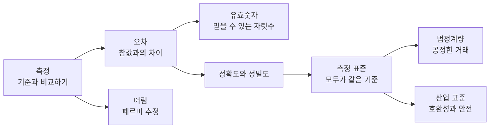
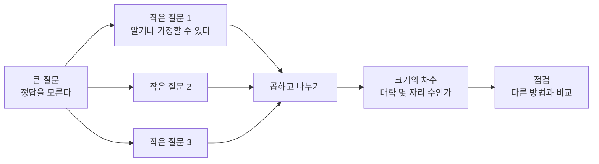
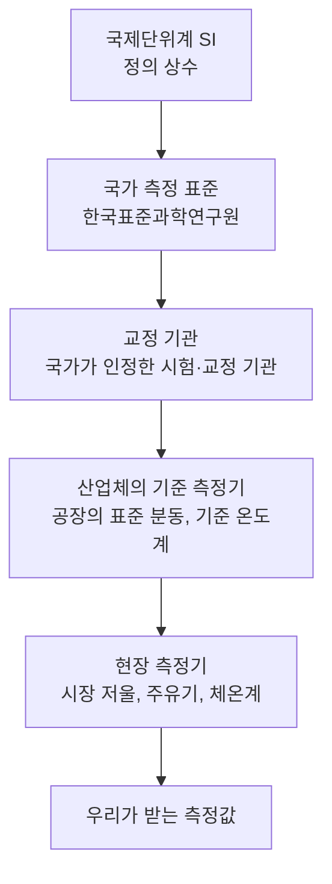

# 1-3. 측정과 어림, 측정 표준 — 믿을 수 있는 숫자를 만드는 약속

> [!NOTE]
> **성취기준 [10통과1-01-03]** 과학 탐구에서 측정과 어림의 의미를 알고, 일상생활의 여러 가지 상황에서 측정 표준의 유용성과 필요성을 논증할 수 있다.

**학습 목표**

1. 모든 측정값에는 오차가 있음을 알고, 측정 도구의 눈금을 고려하여 의미 있는 자릿수(유효숫자)까지 측정값을 기록할 수 있다.
2. 정확도와 정밀도를 구별하고, 반복 측정과 평균으로 측정의 신뢰도를 높이는 방법을 설명할 수 있다.
3. 직접 재기 어려운 양을 합리적인 가정으로 어림(페르미 추정)할 수 있다.
4. 일상생활과 산업의 여러 상황에서 측정 표준이 왜 유용하고 필요한지 근거와 사례를 들어 논증할 수 있다.

**이 단원의 학습 사다리**

| 단계 | 무엇을 하나? |
|---|---|
| STEP 1. 중학교 다시 보기 | 탐구 과정에서의 측정, 밀도 측정, 자유 낙하 자료 분석을 다시 꺼내 본다 |
| STEP 2. 기초 다지기 | 눈금 읽기, 평균, 백분율 오차를 디딤돌로 놓는다 |
| STEP 3. 핵심 개념 | 오차 → 유효숫자 → 정확도와 정밀도 → 어림 → 측정 표준의 유용성과 필요성 |
| STEP 4. 오개념 바로잡기 | "디지털 측정기는 오차가 없다?" 같은 착각을 바로잡는다 |
| STEP 5. 선택과목·대학 | 표준편차, 측정 불확도, 품질 관리 |
| STEP 6. 산업·진로 | 반도체 계측, 법정계량, 국제 무역과 표준, 의료·식품 |

---

## 🗺️ 단원 들어가기

정육점 저울로 잰 고기 1 kg과 우리 집 저울로 잰 고기 1 kg은 정말 같을까? 주유소에서 '20 L'를 넣었을 때, 내 차에는 정말 20 L가 들어갔을까? 해외에서 산 충전기를 우리나라 콘센트에 꽂아도 괜찮을까?

우리는 매일 측정값을 믿고 돈을 내고, 약을 먹고, 제품을 쓴다. 그런데 그 믿음은 어디서 오는 걸까? 답은 **측정 표준**에 있다. 모두가 같은 기준으로 재도록 연결된 보이지 않는 체계 덕분에, 서로 다른 장소에서 서로 다른 도구로 잰 값을 믿고 비교할 수 있다.

한편 과학자들은 때로 정확히 재지 않고 **어림**하기도 한다. "지구에 사는 개미는 모두 몇 마리일까?" 같은 질문에 정확한 답은 없지만, 합리적으로 어림하면 '대략 몇 자리 수'인지는 알 수 있다. 이 단원에서는 **정밀하게 재는 힘**과 **대담하게 어림하는 힘**을 함께 기른다.

---

## STEP 1. 🔙 중학교 다시 보기

### 연계 개념표

| 중학교 성취기준 | 중학교에서 배운 것 | 고등학교에서 확장되는 것 |
|---|---|---|
| [9과01-01] | 과학적 탐구 방법을 이해하고 탐구를 수행한다 | 탐구에서 측정값의 **오차**와 **신뢰도**를 따지는 방법을 익힌다 |
| [9과08-01] | 실험을 통해 밀도, 녹는점, 끓는점 등을 측정한다 | 같은 물질을 여러 번 재면 값이 조금씩 다른 이유와 평균의 의미를 안다 |
| [9과19-02] | 자유 낙하에서 속력 변화량이 약 9.8 m/s로 일정함을 자료로 분석한다 | 실험값이 9.8과 조금 다를 때 그 차이를 **오차**로 해석한다 |
| [9과14-02] | 실험으로 전류, 전압, 저항의 관계를 이끌어 낸다 | 측정 도구(전류계, 전압계)의 눈금과 영점이 결과에 미치는 영향을 안다 |
| [9과03-01] | 온도가 다른 두 물체가 열평형에 도달하는 과정 | 온도계마다 값이 다를 때 어떤 온도계를 믿을지 판단한다(교정) |

### 준비 운동 (사전 진단)

**Q1.** 최소 눈금이 1 mm인 자로 연필의 길이를 재었더니 끝이 12.3 cm와 12.4 cm 눈금 사이의 거의 가운데에 있었다. 길이를 어떻게 기록하면 좋을까?

**Q2.** 세 학생이 같은 책상의 가로 길이를 재었더니 120.2 cm, 120.5 cm, 119.9 cm가 나왔다. 값이 서로 다른 까닭을 두 가지 쓰시오.

**Q3.** 다음 중 정확히 세기보다 '어림'하는 것이 알맞은 질문은?
ㄱ. 우리 반 학생 수 ㄴ. 학교 운동장에 깔린 모래알의 수 ㄷ. 내 필통 속 연필의 수

**Q4.** 시장 저울에 붙어 있는 '검정' 스티커는 무엇을 뜻할까?

정답 및 해설

**Q1.** 약 12.35 cm — 최소 눈금(1 mm = 0.1 cm)의 10분의 1까지 **눈으로 어림해** 읽는다. 마지막 자리 5는 어림한 값이다.

**Q2.** 예: 자를 대는 위치(시작점)가 조금씩 달랐다. 눈금을 읽는 눈의 위치가 달랐다. 자가 휘거나 기울어졌다. 각자 사용한 자가 달랐다. 등

**Q3. ㄴ** — 모래알은 너무 많아 하나하나 셀 수 없다. 대신 '한 줌의 모래알 수'와 '운동장 모래의 양'으로 어림할 수 있다.

**Q4.** 그 저울이 국가가 정한 기준에 맞게 정확한지 **검사를 받아 통과했다**는 뜻이다. 거래에 쓰는 저울은 이런 검사를 받아야 한다(STEP 3에서 자세히).

---

## STEP 2. 🧱 기초 다지기

### ① 측정은 '기준과 비교하기'이다

1-2단원에서 물리량 = 수 × 단위라고 했다. **측정(measurement)** 이란 어떤 양이 기준(단위)의 몇 배인지 알아내는 일이다. 키를 잰다는 것은 '1 m라는 기준의 몇 배인가'를 줄자와 비교하는 것이다. 따라서 **기준 자체가 정확해야** 측정도 정확할 수 있다. 이 생각이 STEP 3의 '측정 표준'으로 이어진다.

### ② 눈금 읽기: 최소 눈금의 10분의 1까지

아날로그 눈금(자, 눈금실린더, 온도계)은 **최소 눈금의 10분의 1까지 눈으로 어림**해서 읽는 것이 원칙이다.

| 도구 | 최소 눈금 | 읽는 예 | 마지막 자리 |
|---|---|---|---|
| 학교용 자 | 1 mm | 34.6 mm | 0.6 mm는 어림 |
| 눈금실린더(100 mL) | 1 mL | 52.5 mL | 0.5 mL는 어림 |
| 알코올 온도계 | 1 °C | 23.4 °C | 0.4 °C는 어림 |

> [!TIP]
> 💡 **비유** — 시계에 분침만 있어도 "3시 20분과 21분 사이의 절반쯤"이라고 말할 수 있다. 눈금 사이를 '어림'하는 것은 대충 하는 것이 아니라 **도구가 주는 정보를 끝까지 활용하는 것**이다.

> [!IMPORTANT]
> 눈금실린더의 액체 표면은 가운데가 오목하게 휘어 있다. 눈높이를 액면과 같게 맞추고 **오목한 면의 가장 아랫부분**을 읽는다. 위나 아래에서 비스듬히 보면 값이 달라진다.

### ③ 평균: 여러 번 잰 값을 하나로 대표하기

$$
\text{평균} = \frac{\text{측정값의 합}}{\text{측정 횟수}}
$$

예: 0.21 s, 0.24 s, 0.19 s, 0.22 s, 0.24 s → 합 1.10 s → 평균 $1.10 \div 5 = 0.22$ s

### ④ 백분율 오차: 얼마나 빗나갔나

참값(또는 널리 인정받는 값)을 알 때, 측정값이 얼마나 벗어났는지를 비율로 나타낸다.

$$
\text{백분율 오차} = \frac{|\text{측정값} - \text{참값}|}{\text{참값}} \times 100\ (\%)
$$

예: 자유 낙하 실험에서 속력 변화량을 9.5 m/s로 얻었다면 $\dfrac{|9.5 - 9.8|}{9.8} \times 100 \approx 3.1\ \%$

---

## STEP 3. 📘 핵심 개념

### 1-3-① 측정에는 언제나 오차가 있다

아무리 좋은 도구로 조심해서 재도 측정값은 참값과 완전히 같을 수 없다. 측정값과 참값의 차이를 **오차(error)** 라 한다. 사실 참값 자체를 완벽히 알 수는 없으므로, 과학자들은 **"측정값이 어느 범위 안에 있다고 얼마나 믿을 수 있는가"** 를 따진다.

| 오차의 종류 | 특징 | 예 | 줄이는 방법 |
|---|---|---|---|
| **계통 오차** | 측정값이 **한쪽으로 일정하게** 치우친다 | 영점이 0.5 kg 맞지 않는 체중계, 늘어난 줄자 | 영점 조정, **교정**(표준과 비교해 바로잡기) |
| **우연 오차** | 측정할 때마다 **들쑥날쑥** 달라진다 | 스톱워치를 누르는 반응 시간, 바람·진동 | **여러 번 측정해 평균** 내기 |
| 실수 | 사람의 착오로 생긴다 | 눈금을 잘못 읽음, 단위를 잘못 씀 | 확인 절차, 다른 사람이 다시 확인 |

> [!TIP]
> 💡 **비유** — 계통 오차는 '5분 빠른 시계'와 같다. 아무리 여러 번 봐도 늘 5분 빠르다. 평균을 내도 사라지지 않으므로 **정확한 시계(표준)와 맞추어야** 고칠 수 있다. 우연 오차는 '손이 떨려 사진이 흔들리는 것'과 같아서, 여러 장 찍어 평균을 내면 줄어든다.

#### 예제 1 — 영점이 어긋난 저울

아무것도 올리지 않았는데 0.3 kg을 가리키는 체중계로 몸무게를 쟀더니 58.7 kg이 나왔다. 실제 질량은? 이 체중계로 5번 재서 평균을 내면 오차가 사라질까?

**풀이**
- 실제 질량 ≒ 58.7 − 0.3 = 58.4 kg
- 영점 오차는 **매번 같은 방향, 같은 크기**로 더해지는 계통 오차이므로 평균을 내도 사라지지 않는다. 영점을 조정해야 한다.

### 1-3-② 유효숫자: 믿을 수 있는 자릿수까지만

계산기에 길이 12.3 cm와 4.5 cm를 곱하면 55.35라는 숫자가 나온다. 그런데 이 넓이를 '55.35 cm²'라고 써도 될까?

측정값에서 **확실한 숫자와 어림한 마지막 한 자리**까지를 **유효숫자(significant figures)** 라 한다. 유효숫자의 개수는 측정이 얼마나 정밀했는지를 알려 준다.

| 측정값 | 유효숫자 개수 | 설명 |
|---|---|---|
| 12.35 cm | 4개 | 1, 2, 3은 확실, 5는 어림 |
| 0.0072 kg | 2개 | 앞의 0들은 자릿수를 나타낼 뿐이다(7.2 g과 같은 정보) |
| 2.50 m | 3개 | 끝의 0은 "0.01 m 자리까지 재었다"는 뜻이므로 의미가 있다 |
| $3.0 \times 10^{8}$ m/s | 2개 | 과학적 표기법을 쓰면 유효숫자가 분명해진다 |

#### 계산 결과는 '가장 덜 정밀한 값'을 따른다

- **곱하기·나누기**: 결과의 유효숫자 개수를 **유효숫자가 가장 적은 값**에 맞춘다.
  $12.3\ \mathrm{cm} \times 4.5\ \mathrm{cm} = 55.35 \rightarrow$ **55 cm²** (4.5가 2개이므로 2개)
- **더하기·빼기**: 결과의 소수점 아래 자릿수를 **소수점 아래 자릿수가 가장 적은 값**에 맞춘다.
  $12.3\ \mathrm{cm} + 4.56\ \mathrm{cm} = 16.86 \rightarrow$ **16.9 cm**

> [!IMPORTANT]
> 유효숫자 규칙의 핵심은 외우는 것이 아니라 **감각**이다. "1 mm 눈금 자로 쟀는데 계산 결과를 0.0001 mm까지 쓰는 것은 거짓 정밀함"이라는 생각을 갖는 것이 중요하다. 계산기가 보여 주는 숫자를 모두 믿지 말자.

#### 예제 2 — 자동차의 평균 속력

자동차가 152 km를 1.9시간 동안 달렸다. 평균 속력을 알맞은 유효숫자로 나타내시오.

**풀이** $152 \div 1.9 = 80.0\cdots$ → 1.9가 유효숫자 2개이므로 **80 km/h**(유효숫자 2개, $8.0 \times 10^{1}$ km/h)

### 1-3-③ 정확도와 정밀도

일상에서는 비슷하게 쓰지만 과학에서는 두 말을 구별한다.

- **정확도(accuracy)**: 측정값(평균)이 **참값에 얼마나 가까운가**
- **정밀도(precision)**: 여러 번 잰 측정값들이 **서로 얼마나 가까운가**(얼마나 덜 흩어지는가)

| 과녁 위 화살 모습 | 정확도 | 정밀도 | 주된 원인 |
|---|---|---|---|
| 한가운데에 모여 있다 | 높다 | 높다 | 좋은 도구, 좋은 방법 |
| 한가운데에서 벗어난 한 곳에 모여 있다 | 낮다 | 높다 | **계통 오차**(영점·교정 문제) |
| 한가운데 주위에 넓게 흩어져 있다 | 평균은 높다 | 낮다 | **우연 오차** |
| 엉뚱한 곳에 넓게 흩어져 있다 | 낮다 | 낮다 | 둘 다 |

#### 예제 3 — 두 저울 비교

정확히 52.00 g인 표준 분동을 저울 A와 B로 각각 세 번 재었다.

| 저울 | 1회 | 2회 | 3회 | 평균 |
|---|---|---|---|---|
| A | 50.2 g | 50.1 g | 50.3 g | 50.2 g |
| B | 51.0 g | 53.1 g | 52.0 g | 52.0 g |

(1) 정밀도가 높은 저울과 정확도가 높은 저울을 각각 고르시오.
(2) 저울 A를 쓸모 있게 만들려면 어떻게 해야 할까?

**풀이**
(1) A는 세 값이 0.2 g 범위 안에 모여 **정밀도가 높다**. B는 평균이 참값과 같아 **정확도가 높지만** 값이 2.1 g 범위로 흩어져 정밀도는 낮다.
(2) A는 값이 늘 약 1.8 g 작게 나오는 계통 오차가 있다. **표준 분동으로 교정**하면 정확하면서도 정밀한 저울이 된다. 정밀한 저울은 교정만 하면 되지만, 흩어지는 저울은 교정으로 고치기 어렵다.

> [!TIP]
> 💡 **비유** — 매번 똑같이 2분 늦는 친구(정밀하지만 부정확)와, 어떤 날은 10분 일찍, 어떤 날은 10분 늦는 친구(평균은 맞지만 부정밀) 중 약속 시간을 맞추기 쉬운 쪽은? 2분 늦는 친구에게는 "2분 일찍 출발해"라고 **보정**해 주면 된다.

### 1-3-④ 어림: 대담하지만 합리적으로

#### 어림이란

**어림(estimation)** 은 정확히 재기 어렵거나, 정확한 값이 필요 없을 때 **합리적인 가정과 간단한 계산으로 대략의 크기를 알아내는 것**이다. 과학자들은 실험을 하기 전에 결과가 대략 어느 정도일지 어림해 보고, 측정값이 터무니없지 않은지 점검한다.

| 상황 | 어림의 쓸모 |
|---|---|
| 실험 전 | 어떤 측정 도구(자? 줄자? 레이저?)가 필요한지 정한다 |
| 실험 후 | 계산 결과가 터무니없는 값(단위 실수 등)이 아닌지 점검한다 |
| 계획 세우기 | 행사에 필요한 의자·물·음식의 양을 대략 정한다 |
| 직접 잴 수 없을 때 | 지구에 있는 나무의 수, 사람이 평생 쉬는 숨의 횟수 등 |

#### 페르미 추정: 큰 문제를 작은 문제로 쪼개기

물리학자 엔리코 페르미는 "시카고에는 피아노 조율사가 몇 명 있을까?" 같은 질문을 학생들에게 던지곤 했다. 이처럼 정답을 모르는 질문을 **알 수 있거나 합리적으로 가정할 수 있는 작은 질문들로 쪼개** 곱해 나가는 방법을 **페르미 추정(Fermi estimation)** 이라 한다.

#### 예제 4 — 사람은 평생 몇 번 숨을 쉴까?

**풀이** (가정을 분명히 밝히는 것이 핵심이다.)
- 가정 1: 1분에 약 15번 숨을 쉰다(직접 세어 확인할 수 있다).
- 가정 2: 평균 수명을 약 80년으로 잡는다.
- 1년 = 60분 × 24시간 × 365일 ≒ 525 600분
- $15 \times 525\,600 \times 80 \approx 6.3 \times 10^{8}$

약 **6억 번**, 크기의 차수로는 $10^{8}$~$10^{9}$ 번 정도이다. 운동이나 잠에 따라 숨 쉬는 횟수가 달라지므로 정확한 값은 아니지만, '수천만 번'도 '수백억 번'도 아니라는 것은 자신 있게 말할 수 있다.

#### 예제 5 — 우리 학교 급식에 1년 동안 쓰이는 쌀

**풀이**
- 가정 1: 급식을 먹는 학생과 교직원은 약 600명이다.
- 가정 2: 한 사람의 밥 한 공기에 쌀(익히기 전) 약 100 g이 든다.
- 가정 3: 1년 동안 급식을 하는 날은 약 190일이다(우리나라 학교의 수업일수는 190일 이상).
- $600 \times 0.1\ \mathrm{kg} \times 190 = 11\,400\ \mathrm{kg} \approx 1 \times 10^{4}\ \mathrm{kg}$

약 **10톤**이다. 학교 영양사 선생님께 실제 양을 여쭈어 보고 어림값과 비교하면, 어떤 가정이 빗나갔는지 찾아볼 수 있다.

> [!WARNING]
> 페르미 추정의 답은 '정답'이 아니라 **'가정에 따른 어림값'** 이다. 그래서 결과와 함께 **어떤 가정을 했는지 반드시 밝혀야** 다른 사람이 그 근거를 검토할 수 있다. 근거를 밝히지 않은 어림은 '찍기'와 다르지 않다.

### 1-3-⑤ 측정 표준: 모두가 같은 기준으로 재기 위한 약속

#### 측정 표준이란

**측정 표준(measurement standard)** 이란 어떤 양의 단위를 정확히 구현하여, 다른 측정기의 기준이 되도록 하는 것이다. 1-2단원에서 단위를 '정의'했다면, 측정 표준은 그 단위를 **실제로 만들어 사회 곳곳의 측정기까지 전달**하는 체계이다.

우리나라에서는 **한국표준과학연구원(KRISS)** 이 국가 측정 표준을 확립하고 유지한다. 이 국가 표준이 어떻게 우리 동네 저울까지 이어질까?

- **교정(calibration)**: 측정기의 값을 더 정확한 표준과 비교하여, 얼마나 차이 나는지 확인하고 바로잡는 일이다.
- **측정 소급성(traceability)**: 어떤 측정값이 끊어지지 않는 교정의 사슬을 따라 **국가 표준과 국제단위계까지 거슬러 올라갈 수 있는 성질**이다. 소급성이 있어야 "이 저울의 1 kg은 국제적으로 인정되는 1 kg과 같다"고 말할 수 있다.

> [!TIP]
> 💡 **비유** — 측정 소급성은 '족보'와 같다. 시장 저울의 1 kg → 공장의 표준 분동 → 교정 기관의 분동 → 국가 표준 → 국제단위계로 '조상'을 거슬러 올라갈 수 있어야, 그 1 kg을 믿을 수 있다. 족보가 중간에 끊긴 저울은 아무리 비싸도 믿을 근거가 없다.

#### 쓰임 1. 공정한 거래 — 법정계량

돈이 오가는 거래에서 측정이 틀리면 누군가는 손해를 본다. 그래서 국가는 법(「계량에 관한 법률」)으로 거래나 증명에 쓰는 측정기를 관리하는데, 이를 **법정계량(legal metrology)** 이라 한다.

| 생활 속 측정기 | 측정 표준이 하는 일 |
|---|---|
| 시장·마트 저울 | 정해진 기준에 맞는지 검사를 받고 통과 표시를 붙인다 |
| 주유소 주유기 | 표시된 양과 실제로 나오는 양이 허용 범위 안에서 맞는지 정기적으로 검사한다 |
| 가정의 전기·수도·가스 계량기 | 사용량만큼 요금을 내도록 정확성을 검사한다 |
| 택시 요금 미터기 | 거리와 시간에 따라 요금이 정확히 올라가는지 검사한다 |

> [!NOTE]
> 우리나라는 2007년 7월부터 상거래에서 '평', '돈' 같은 비법정 단위 대신 **법정 단위(m², g 등)** 를 쓰도록 했다. 그래서 아파트 넓이는 '○○평'이 아니라 '○○ m²'로, 금은 '한 돈'이 아니라 '3.75 g'으로 표시한다. 같은 이름의 단위라도 지역·관습에 따라 해석이 달라질 수 있는 문제를 막기 위해서이다.

#### 쓰임 2. 호환성과 안전 — 산업 표준

측정 표준과 함께 크기·모양·성능의 기준을 정한 **산업 표준**이 있으면, 서로 다른 회사·나라에서 만든 제품끼리 맞물려 쓸 수 있다(**호환성**). 우리나라에는 **한국산업표준(KS)** 이, 국제적으로는 **국제표준화기구(ISO)** 등의 국제 표준이 있다.

| 표준의 예 | 정해진 내용 | 표준이 주는 이익 |
|---|---|---|
| A4 용지 | 210 mm × 297 mm, 가로세로 비 1 : √2 | 반으로 접어도 같은 비율 → 복사기·프린터·서류철이 어디서나 맞는다 |
| 볼트와 너트 | 지름과 나사산 간격 | 다른 회사 부품끼리도 조립할 수 있다 |
| 철도 궤간 | 우리나라 표준 궤간 1435 mm | 열차가 같은 선로를 달릴 수 있다 |
| 화물 컨테이너 | 국제 규격 크기(20피트, 40피트 등) | 배·기차·트럭이 같은 상자를 그대로 옮겨 실어 물류비가 크게 줄었다 |
| 충전 단자 | USB-C 등 | 유럽연합은 2024년 말부터 휴대 전화 등에 USB-C 충전 단자를 의무화했다 |
| 신발 치수 | 우리나라는 발 길이를 mm로 표시 | 어느 가게에서 사도 크기가 같다 |

#### 표준이 없을 때 생긴 일: 1904년 볼티모어 대화재

1904년 미국 볼티모어에서 큰불이 났을 때, 이웃 도시들에서 소방대가 달려왔다. 그러나 **도시마다 소화전과 소방 호스 연결부의 규격이 달라** 많은 소방대가 호스를 연결하지 못했다. 불은 하루 넘게 이어져 1500채가 넘는 건물을 태웠다. 이 사건 뒤로 미국에서는 소방 호스 연결부의 규격을 통일하려는 노력이 본격화되었다. **표준은 편리함을 넘어 생명과 안전의 문제**이다.

#### 측정 표준의 유용성과 필요성을 논증하기

**논증(argumentation)** 이란 주장을 **근거**와 **사례**로 뒷받침하고, 예상되는 **반론**에 답하는 것이다.

| 논증 요소 | 예: "측정 표준은 우리 생활에 꼭 필요하다" |
|---|---|
| 주장 | 국가가 측정 표준을 확립하고 측정기를 관리해야 한다 |
| 근거 1 (공정성) | 측정값이 기준에 연결되어 있어야 거래에서 아무도 손해 보지 않는다 |
| 근거 2 (안전) | 의료 기기, 소방 장비, 자동차 부품의 측정이 틀리면 생명이 위험하다 |
| 근거 3 (효율·호환) | 같은 기준으로 만들어야 부품이 맞고, 나라 사이의 무역도 원활하다 |
| 사례 | 주유기 검사, 볼티모어 대화재, 화성 기후 궤도선(1-2단원), A4 용지 |
| 예상 반론 | "검사와 관리에 비용이 너무 많이 든다" |
| 반론에 대한 답 | 측정이 틀려 생기는 손해·사고 비용과 신뢰를 잃는 비용이 훨씬 크다. 또 표준 덕분에 각자 따로 맞춰 보는 비용이 줄어든다 |

---

## STEP 4. ⚠️ 오개념 바로잡기

| 흔한 오개념 | 올바른 개념 | 왜 그럴까? |
|---|---|---|
| 조심해서 재면 오차를 0으로 만들 수 있다 | 모든 측정에는 오차가 있다. **줄일 수는 있지만 없앨 수는 없다** | 도구의 눈금, 환경, 측정하는 사람의 한계가 항상 있다 |
| 디지털 측정기는 숫자가 딱 나오니 오차가 없다 | 디지털 측정기도 **마지막 자리에 오차**가 있고, **교정**이 필요하다 | 숫자가 또렷하게 보일 뿐, 영점이 어긋나거나 성능이 떨어질 수 있다 |
| 정확도와 정밀도는 같은 말이다 | 정확도는 **참값과 가까운 정도**, 정밀도는 **측정값끼리 가까운 정도**이다 | 늘 같은 값이 나와도(정밀) 그 값이 틀릴(부정확) 수 있다 |
| 여러 번 재서 평균을 내면 모든 오차가 사라진다 | 평균은 **우연 오차**를 줄이지만 **계통 오차**는 줄이지 못한다 | 계통 오차는 매번 같은 방향으로 치우치기 때문이다. 교정이 필요하다 |
| 계산기에 나온 자릿수를 다 쓰는 것이 더 정확하다 | 결과는 **가장 덜 정밀한 측정값의 유효숫자**에 맞춘다 | 측정하지 않은 자릿수를 쓰는 것은 '거짓 정밀함'이다 |
| 어림은 대충 찍는 것이다 | 어림은 **근거 있는 가정**과 계산으로 크기의 차수를 구하는 방법이다 | 가정을 밝히면 다른 사람이 검토하고 개선할 수 있다 |

---

## STEP 5. 🎓 선택과목·대학으로 한 걸음 더

> [!CAUTION]
> 이 절은 **통합과학 교육과정 범위 밖의 심화 내용**으로 평가 대상이 아니다. "이 개념이 앞으로 어디까지 이어지는가"를 맛보기로 보여 주기 위한 내용이다.

### 고2·3 선택과목과의 연결

| 과목 | 이어지는 내용 |
|---|---|
| 융합과학 탐구 | 데이터의 타당성·신뢰성 평가 [12융탐02-03], **평균·표준편차**로 데이터의 특성 파악 [12융탐02-05] |
| 물리학·화학 등 | 실험 데이터 분석과 오차 해석 |
| 확률과 통계(수학) | 평균, 분산, 표준편차, 정규분포 |

### ① 표준편차: '흩어진 정도'를 숫자로

STEP 3의 정밀도를 숫자로 나타낸 것이 **표준편차(standard deviation)** 이다.

$$
s = \sqrt{\frac{\sum_{i=1}^{n}(x_i - \bar{x})^2}{n-1}}
$$

($x_i$: 각 측정값, $\bar{x}$: 평균, $n$: 측정 횟수) 측정값이 정규분포를 따른다면 측정값의 약 68 %가 '평균 ± 표준편차' 안에 들어온다. 또 평균값 자체의 흩어짐은 $s/\sqrt{n}$으로 줄어든다. 측정 횟수를 4배로 늘리면 평균의 흩어짐이 절반이 되는 셈이다.

### ② 측정 불확도: '얼마나 믿을 수 있는가'를 함께 쓰기

전문적인 측정 결과는 값과 함께 **불확도(uncertainty)** 를 쓴다.

$$
g = (9.80 \pm 0.05)\ \mathrm{m/s^2}
$$

"참값이 9.75~9.85 사이에 있다고 상당히 믿을 수 있다"는 뜻이다. 대학 실험 과목에서는 여러 측정값으로 계산한 결과의 불확도를 구하는 **불확도 전파** 방법을 배운다. 예를 들어 곱이나 나눗셈으로 얻은 양의 상대 불확도는 대략 각 측정값의 상대 불확도를 합쳐서(정확히는 제곱합의 제곱근으로) 구한다.

### ③ 품질 관리: 측정이 곧 품질이다

공장에서는 제품의 치수·무게 등을 계속 측정하여 평균과 표준편차가 허용 범위를 벗어나는지 감시한다(통계적 공정 관리). 대표적인 품질 경영 기법인 '6시그마'는 불량률을 100만 개당 3.4개 수준으로 낮추는 것을 목표로 한다.

### 고등학교 vs 대학교

| 구분 | 고등학교 통합과학 | 대학교 실험·통계·계측공학 |
|---|---|---|
| 오차 | 계통 오차와 우연 오차의 구별 | 오차의 통계적 모델, 정규분포 |
| 신뢰도 | 평균, 측정값의 범위, 정확도·정밀도 | 표준편차, 표준 불확도, 불확도 전파 |
| 유효숫자 | 계산 결과 자릿수 맞추기 감각 | 불확도로 유효 자릿수 결정 |
| 표준 | 측정 표준의 필요성 논증 | 소급성 설계, 교정 절차, 국제 상호 인정 |
| 관련 전공 | — | 물리학, 계측공학, 산업공학, 통계학, 품질경영 |

---

## STEP 6. 🏭 산업 현장과 진로 연결

### 사례 1. 반도체 공장 — "잴 수 없으면 만들 수 없다"

- **원리** 나노미터 수준의 회로를 만들려면 그보다 더 정밀하게 **잴 수 있어야** 한다. 공정마다 선폭, 막 두께, 위치 정렬을 측정 장비로 확인한다.
- **측정 표준의 역할** 측정 장비가 서로 다른 값을 내면 공장마다, 장비마다 결과가 달라진다. 그래서 장비를 **표준 시료로 정기적으로 교정**하고, 측정값의 소급성을 관리한다.
- **핵심 아이디어** 반도체·디스플레이·배터리처럼 정밀한 산업일수록 측정 기술이 곧 생산성과 수율(불량 없는 제품의 비율)을 좌우한다.

### 사례 2. 법정계량 — 보이지 않는 공정 거래 지킴이

- **원리** 거래·증명용 계량기는 사용 전 검사와 정기 검사를 받아야 한다.
- **어디에 쓰이나** 저울, 주유기, 전기·수도·가스 계량기, 택시 미터기 등.
- **핵심 숫자** 가정에서 쓰는 전기·수도·가스 요금은 모두 계량기 숫자로 정해진다. 이 숫자를 모두가 믿을 수 있는 것은 측정 표준과 검사 제도 덕분이다.

### 사례 3. 국제 무역과 표준 — 한 번 측정해 세계에서 통한다

- **원리** 각국의 국가 표준 기관은 서로의 측정 능력을 비교·평가하고, 일정한 조건을 갖추면 서로의 교정 결과를 인정하기로 약속했다(국제 상호 인정 협정).
- **어디에 쓰이나** 우리나라 기업이 국내에서 교정·시험한 결과를 해외에서도 인정받으면, 같은 시험을 나라마다 다시 하지 않아도 된다.
- **핵심 아이디어** 측정 표준은 기술일 뿐 아니라 **무역의 신뢰를 만드는 사회적 기반**이다.

### 사례 4. 의료와 식품 — 숫자가 건강을 지킨다

- 체온계·혈압계·혈당 측정기, 병원의 방사선 치료 장비는 정확한 측정이 곧 정확한 진단과 치료이다. 그래서 정기적인 교정과 검사를 받는다.
- 식품 포장의 내용량과 영양 성분 표시도 측정에 기반하며, 표시와 실제가 크게 다르지 않도록 관리된다.

### 관련 진로와 학과

| 진로 | 하는 일 | 관련 학과 |
|---|---|---|
| 측정·교정 엔지니어 | 측정 장비 교정, 소급성 관리, 측정 불확도 평가 | 계측공학, 물리학, 전자공학 |
| 반도체 계측 엔지니어 | 나노 공정의 치수·두께 측정, 검사 장비 운영 | 물리학, 신소재공학, 전자공학 |
| 품질 관리 전문가 | 통계적 공정 관리, 불량 분석 | 산업공학, 통계학, 기계공학 |
| 표준 전문가 | 국가·국제 표준 개발, 표준화 협상 | 공학 전반, 경영·법학과 연계 |
| 계량 검사 공무원 | 법정 계량기 검사와 관리 | 공학 전반 |

---

## 🔬 탐구 활동 — 일상생활에서 측정 표준이 활용되는 사례 탐색하기

### 활동 A. 우리 동네 '측정 표준 지도' 만들기 (모둠 활동)

**목표** 일상생활 속 측정 표준의 활용 사례를 직접 찾아보고, 측정 표준의 유용성과 필요성을 논증하는 발표를 한다.

**준비물** 스마트폰(사진 촬영·검색), 활동지, 전지 또는 디지털 발표 도구

**과정**
1. 모둠별로 탐색 영역을 하나 고른다. (가) 시장·마트, (나) 집 안(계량기, 가전제품 라벨), (다) 학교(체중계, 실험 도구, 급식실 저울), (라) 교통(주유소, 택시, 도로 표지판)
2. 각 영역에서 측정 표준이나 산업 표준이 활용되는 사례를 5개 이상 찾아 사진을 찍는다. (예: 저울의 검사 표시, 계량기의 숫자판, 제품의 KS 표시, A4 용지 포장의 규격 표시)
3. 각 사례가 표준이 없으면 어떤 문제가 생길지 상상하여 적는다.
4. 찾은 사례를 지도나 그림 위에 배치하여 '측정 표준 지도'를 완성한다.
5. STEP 3의 논증 표 형식(주장–근거–사례–반론–답)에 맞추어 3분 발표를 준비한다.

**결과 기록**

| 사례 | 장소 | 관련 표준(측정 표준 / 법정계량 / 산업 표준) | 표준이 없다면 생길 문제 |
|---|---|---|---|
| 예) 마트 저울 | 마트 정육 코너 | 법정계량 | 고기 값이 저울마다 달라져 손님이 손해를 볼 수 있다 |
| | | | |
| | | | |
| | | | |

**생각해 보기**
1. 찾은 사례 중 '안전'과 관련된 것과 '공정한 거래'와 관련된 것을 나누어 보자.
2. 표준이 아직 정해지지 않았거나 나라마다 달라서 불편했던 경험이 있는가? (예: 해외 전기 플러그, 의류 치수)
3. "측정 표준을 관리하는 데 드는 세금이 아깝다"는 주장에 대해 모둠의 반론을 근거와 함께 써 보자.

> [!WARNING]
> **안전 수칙** 가게나 시설에서 사진을 찍을 때는 먼저 허락을 받고, 다른 사람의 얼굴이나 개인 정보가 찍히지 않도록 한다. 주유소에서는 차량 이동에 주의한다.

### 활동 B. A4 용지로 정확도와 정밀도 체험하기

A4 용지의 긴 변은 표준으로 **297 mm**로 정해져 있다. 이 '알려진 값'을 이용해 측정 도구를 비교해 보자.

1. 학교용 자, 줄자, 스마트폰 거리 측정(증강 현실 측정) 앱으로 A4 용지 긴 변을 각각 5번씩 잰다(여러 사람이 돌아가며 잰다).
2. 도구별로 평균과 '가장 큰 값 − 가장 작은 값'을 구한다.
3. 도구별 평균과 297 mm의 차이(정확도), 값의 흩어짐(정밀도)을 비교한다.
4. 계통 오차가 의심되는 도구가 있다면 그 원인을 추리해 본다.

| 도구 | 1회 | 2회 | 3회 | 4회 | 5회 | 평균 | 최댓값 − 최솟값 | 297 mm와의 차이 |
|---|---|---|---|---|---|---|---|---|
| 학교용 자 | | | | | | | | |
| 줄자 | | | | | | | | |
| 측정 앱 | | | | | | | | |

---

## ✅ 개념 확인 문제

### 기본

**1.** 최소 눈금이 1 mL인 눈금실린더로 물의 부피를 읽었더니 액면이 36 mL와 37 mL 사이의 약 10분의 4 지점에 있었다. 측정값을 쓰고, 유효숫자의 개수를 쓰시오.

정답 및 해설

**정답** 36.4 mL, 유효숫자 3개

최소 눈금의 10분의 1까지 어림하여 읽는다. 3과 6은 확실한 숫자이고, 4는 어림한 숫자이다.

**2.** 다음 오차를 계통 오차와 우연 오차로 구분하시오.
(1) 늘어난 줄자로 길이를 재어 항상 실제보다 짧게 측정되었다.
(2) 스톱워치를 누르는 순간이 매번 조금씩 달라 시간이 들쑥날쑥하게 측정되었다.
(3) 영점이 맞지 않은 전자저울로 질량을 재었다.

정답 및 해설

**정답** (1) 계통 오차 (2) 우연 오차 (3) 계통 오차

(1)과 (3)은 측정값이 한쪽으로 일정하게 치우치므로 계통 오차이다. (2)는 측정할 때마다 무작위로 달라지므로 우연 오차이다.

**3.** 측정값 $0.00450$ kg의 유효숫자는 몇 개인가?

정답 및 해설

**정답** 3개

앞의 0 세 개(0.00)는 자릿수를 나타낼 뿐 유효숫자가 아니다. 4, 5와 끝의 0이 유효숫자이다. 과학적 표기법으로 $4.50 \times 10^{-3}$ kg으로 쓰면 분명해진다.

**4.** 빈칸에 알맞은 말을 쓰시오.
"측정기의 값을 더 정확한 표준과 비교하여 바로잡는 일을 ( ㄱ )(이)라 하고, 측정값이 끊어지지 않는 교정의 사슬을 통해 국가 표준까지 이어지는 성질을 측정 ( ㄴ )(이)라 한다. 우리나라의 국가 측정 표준은 ( ㄷ )에서 확립·유지한다."

정답 및 해설

**정답** ㄱ: 교정, ㄴ: 소급성, ㄷ: 한국표준과학연구원

### 응용

**5.** 직사각형 판의 가로를 2.5 cm, 세로를 3.17 cm로 측정했다. 판의 넓이를 알맞은 유효숫자로 나타내시오.

정답 및 해설

**정답** 7.9 cm²

$2.5 \times 3.17 = 7.925$ → 곱셈에서는 유효숫자가 가장 적은 값(2.5, 2개)에 맞추므로 **7.9 cm²**이다.

**6.** 참값이 100.0 °C인 끓는 물(1기압)의 온도를 온도계 P와 Q로 각각 네 번 측정했다.
P: 98.1, 98.0, 98.2, 98.1 (°C)
Q: 101.5, 98.4, 100.9, 99.2 (°C)
옳은 설명을 **모두** 고르시오.
ㄱ. P는 Q보다 정밀도가 높다.
ㄴ. Q의 평균은 P의 평균보다 참값에 가깝다.
ㄷ. P를 여러 번 더 측정하여 평균을 내면 참값 100.0 °C에 가까워진다.

정답 및 해설

**정답 ㄱ, ㄴ**

P의 평균: $(98.1 + 98.0 + 98.2 + 98.1) \div 4 = 98.1$ °C, 흩어진 범위 0.2 °C
Q의 평균: $(101.5 + 98.4 + 100.9 + 99.2) \div 4 = 400.0 \div 4 = 100.0$ °C, 흩어진 범위 3.1 °C
ㄱ. P의 값이 훨씬 덜 흩어져 있으므로 옳다.
ㄴ. Q의 평균(100.0 °C)이 참값과 같으므로 옳다.
ㄷ. P는 약 1.9 °C 낮게 치우친 **계통 오차**가 있으므로 평균을 내도 98.1 °C 근처에 머문다. 교정이 필요하다. 틀렸다.

**7.** 페르미 추정으로 '사람의 심장이 평생 뛰는 횟수'를 어림하시오. 사용한 가정을 모두 밝히고, 결과를 크기의 차수로 나타내시오.

정답 및 해설

**예시 답안**
- 가정 1: 심장은 1분에 약 70번 뛴다.
- 가정 2: 수명은 약 80년이다.
- 1년 ≒ 525 600분
- $70 \times 525\,600 \times 80 \approx 2.9 \times 10^{9}$

약 **30억 번**, 크기의 차수는 약 $10^{9}$이다. 가정한 값(심박수 60~100회, 수명 등)이 달라도 결과는 $10^{9}$ 정도로, 차수는 크게 변하지 않는다는 점이 페르미 추정의 장점이다.

**채점 포인트** ① 가정을 명시함 ② 단위 환산(분 → 년)이 맞음 ③ 크기의 차수로 결론

### 융합·서술형

**8. [산업 연계]** 어떤 사람이 "주유소마다 주유기를 정기적으로 검사하는 것은 세금 낭비이다. 주유소 주인이 알아서 잘 관리할 것이다."라고 주장했다. 이 주장에 대한 반론을 측정 표준의 유용성과 필요성을 들어 논증하시오. (주장–근거–사례를 포함할 것)

정답 및 해설

**예시 답안**
(주장) 주유기는 국가가 정한 기준에 따라 정기적으로 검사해야 한다.
(근거 1: 공정성) 주유기의 표시와 실제 양이 다르면 소비자는 그 차이를 스스로 확인할 방법이 없다. 국가 측정 표준에 소급되는 검사가 있어야 판매자와 소비자 모두 측정값을 믿고 거래할 수 있다.
(근거 2: 계통 오차) 주유기는 오래 쓰면 부품 마모 등으로 한쪽으로 치우친 계통 오차가 생길 수 있는데, 이는 같은 주유기로 여러 번 재 보아서는 발견할 수 없고 **표준과 비교하는 교정·검사**로만 확인할 수 있다.
(사례) 시장 저울, 전기·수도 계량기도 같은 이유로 검사한다. 많은 사람이 매일 거래하므로 작은 오차도 사회 전체로 보면 큰 손해가 된다.
(반론에 대한 답) 검사 비용보다 측정에 대한 신뢰가 무너졌을 때의 사회적 비용이 훨씬 크다.

**채점 포인트** ① 공정한 거래(신뢰) ② 계통 오차는 표준과의 비교로만 발견된다는 점 ③ 구체적 사례 ④ 반론에 대한 대응

**9. [대학 연계]** 두 연구실이 같은 금속 막대의 길이를 측정하여 다음과 같이 발표했다.
연구실 A: $(250.12 \pm 0.03)$ mm, 연구실 B: $(250.30 \pm 0.04)$ mm
(1) 두 결과가 서로 일치한다고 볼 수 있는지 '오차 범위'를 이용해 판단하시오.
(2) 두 연구실의 결과가 왜 다를 수 있는지, 이를 확인하려면 무엇을 해야 하는지 측정 표준과 관련지어 서술하시오.

정답 및 해설

**예시 답안**
(1) A의 범위는 250.09~250.15 mm, B의 범위는 250.26~250.34 mm로 **겹치지 않는다.** 따라서 두 결과는 오차 범위 안에서 일치한다고 보기 어렵다.
(2) 두 연구실 중 적어도 한 곳의 측정에 **계통 오차**가 있을 수 있다. 예를 들어 측정기의 교정 상태가 다르거나, 측정할 때의 온도가 달라 막대가 늘어나거나 줄어들었을 수 있다. 이를 확인하려면 두 연구실의 측정기를 **같은 국가 표준(또는 표준 시료)으로 교정**했는지, 즉 측정 소급성이 확보되었는지 확인하고, 같은 조건(온도 등)에서 다시 측정하여 비교해야 한다.

**채점 포인트** ① 범위가 겹치는지로 판단 ② 계통 오차 가능성(교정, 온도 등) ③ 표준 교정·소급성 확인 제안

---

## 📝 한눈에 정리

### 핵심 요약

- **측정**은 어떤 양을 기준(단위)과 비교하는 일이며, 모든 측정값에는 **오차**가 있다.
- **계통 오차**는 한쪽으로 치우쳐 **교정**으로 바로잡고, **우연 오차**는 들쑥날쑥하여 **반복 측정과 평균**으로 줄인다.
- **유효숫자**는 확실한 숫자 + 어림한 마지막 한 자리이다. 계산 결과는 가장 덜 정밀한 값에 맞춘다.
- **정확도**는 참값에 가까운 정도, **정밀도**는 측정값끼리 가까운 정도이다.
- **어림(페르미 추정)** 은 큰 문제를 가정할 수 있는 작은 문제로 쪼개 크기의 차수를 구하는 방법이며, 가정을 반드시 밝힌다.
- **측정 표준**과 **측정 소급성**은 시장 저울의 1 kg이 국제단위계의 1 kg과 같음을 보장한다. 한국표준과학연구원이 국가 측정 표준을 유지한다.
- 측정 표준은 **공정한 거래(법정계량)**, **호환성과 안전(산업 표준)**, **무역의 신뢰**를 위해 꼭 필요하다.

### 핵심 용어

| 용어 | 뜻 |
|---|---|
| 오차 | 측정값과 참값의 차이 |
| 계통 오차 / 우연 오차 | 한쪽으로 일정하게 치우치는 오차 / 측정할 때마다 무작위로 달라지는 오차 |
| 유효숫자 | 측정값에서 확실한 숫자와 어림한 마지막 한 자리까지의 숫자 |
| 정확도 / 정밀도 | 참값에 가까운 정도 / 반복한 측정값들이 서로 가까운 정도 |
| 페르미 추정 | 합리적인 가정과 간단한 계산으로 대략의 크기를 어림하는 방법 |
| 측정 표준 | 단위를 정확히 구현하여 다른 측정의 기준이 되게 하는 것 |
| 교정 | 측정기의 값을 더 정확한 표준과 비교하여 바로잡는 일 |
| 측정 소급성 | 측정값이 교정의 사슬을 따라 국가 표준·국제단위계까지 이어지는 성질 |
| 법정계량 | 거래·증명에 쓰는 측정기를 법으로 관리하는 제도 |

### 다음 단원으로

지금까지 자연을 정확히 **재고**, 그 값을 **믿을 수 있게** 만드는 방법을 살펴보았다. 그런데 오늘날 측정값의 대부분은 사람이 눈금을 읽는 대신 센서와 컴퓨터가 **디지털 정보**로 바꾸어 기록하고 전송한다. 다음 단원에서는 자연의 변화가 어떻게 **신호**가 되고 **정보**가 되는지, 그리고 아날로그 신호를 디지털로 바꾸는 기술이 현대 문명을 어떻게 바꾸었는지 알아본다.
