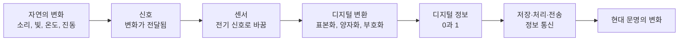
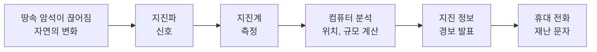
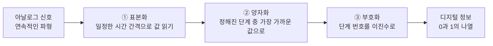

# 1-4. 정보와 신호: 아날로그에서 디지털로 — 0과 1로 세상을 옮기다

> [!NOTE]
> **성취기준 [10통과1-01-04]** 자연에서 일어나는 다양한 변화를 측정⋅분석하여 정보를 산출함을 알고, 이러한 정보를 디지털로 변환하는 기술을 정보 통신에 활용하여 현대 문명에 미친 영향을 인식한다.

**학습 목표**

1. 자연의 변화가 전달될 때 신호가 되고, 이 신호를 측정·분석할 때 정보가 됨을 사례로 설명할 수 있다.
2. 아날로그 신호와 디지털 신호를 구별하고, 센서를 통해 다양한 신호가 전기 신호로 바뀌어 디지털 정보가 되는 과정을 설명할 수 있다.
3. 표본화·양자화·부호화의 의미를 알고, 이진수를 이용해 정보를 나타낼 수 있다.
4. 디지털 정보 통신 기술이 현대 문명에 미친 긍정적·부정적 영향을 사례로 토의할 수 있다.

**이 단원의 학습 사다리**

| 단계 | 무엇을 하나? |
|---|---|
| STEP 1. 중학교 다시 보기 | 소리의 파형, 화면의 빛의 합성, 자극이 뇌로 전달되는 과정을 다시 꺼내 본다 |
| STEP 2. 기초 다지기 | 시간–값 그래프, '연속'과 '띄엄띄엄', 이진수와 비트를 디딤돌로 놓는다 |
| STEP 3. 핵심 개념 | 신호와 정보 → 아날로그와 디지털 → 디지털 변환 → 디지털로 표현하기 → 정보 통신과 현대 문명 |
| STEP 4. 오개념 바로잡기 | "디지털은 원래 신호와 완벽히 똑같다?" 같은 착각을 바로잡는다 |
| STEP 5. 선택과목·대학 | 표본화 정리, 정보량과 비트, 오류 검출 |
| STEP 6. 산업·진로 | 이동 통신과 광통신, 재난 경보, 디지털 헬스케어, 메모리 반도체 |

---

## 🗺️ 단원 들어가기

조선 시대, 남쪽 바닷가에 적의 배가 나타나면 그 소식은 어떻게 한양까지 전해졌을까? 산꼭대기마다 설치된 **봉수대**에서 횃불(낮에는 연기)을 올려 다음 봉수대로 이어 전했다. 평상시에는 1개, 적이 나타나면 2개, 국경에 가까이 오면 3개, 국경을 넘으면 4개, 싸움이 벌어지면 5개. 불의 **개수**라는 단순한 약속으로 '적이 어디까지 왔는가'라는 정보를 수백 km 밖까지 전한 것이다.

오늘날 여러분의 스마트폰은 1초에 수억 개의 0과 1을 주고받는다. 친구의 목소리, 사진 속 노을빛, 지진계가 기록한 땅의 떨림이 모두 0과 1로 바뀌어 빛의 속력으로 지구 반대편까지 날아간다. 봉수대의 횃불과 스마트폰의 0과 1 사이에는 놀랍게도 **같은 아이디어**가 숨어 있다. 연속적으로 변하는 세상을 **몇 개의 정해진 기호**로 바꾸어 전하는 것, 바로 **디지털**이다.

---

## STEP 1. 🔙 중학교 다시 보기

### 연계 개념표

| 중학교 성취기준 | 중학교에서 배운 것 | 고등학교에서 확장되는 것 |
|---|---|---|
| [9과10-04] | 소리는 파동이며 진폭, 진동수, 파형으로 나타낸다 | 소리의 파형(아날로그 신호)을 일정한 간격으로 재어 **디지털 정보**로 바꾼다 |
| [9과10-03] | 영상 장치는 빛의 삼원색을 합성하여 다양한 색을 표현한다 | 화면의 각 점(화소)의 빨강·초록·파랑 밝기를 **숫자(비트)** 로 저장한다 |
| [9과20-01] | 감각기관이 받아들인 자극이 뇌로 전달된다 | 자연의 변화(자극)가 전달되면 **신호**, 이를 해석하면 **정보**가 된다 |
| [9과14-02] | 전기 회로의 전류와 전압 | 센서는 다양한 신호를 **전기 신호(전압·전류의 변화)** 로 바꾼다 |
| [9과01-02] | 과학의 발전이 인류 문명에 미친 영향, 인공지능 등 첨단 과학기술 | 디지털 정보 통신 기술이 현대 문명에 미친 영향을 분석한다 |

### 준비 운동 (사전 진단)

**Q1.** 소리의 크기와 높낮이는 각각 파동의 어떤 특성과 관계있는가?

**Q2.** 스마트폰 화면을 돋보기로 확대하면 무엇이 보일까?

**Q3.** 다음 중 '시계 바늘이 움직이는 시계'와 '숫자가 바뀌는 시계' 가운데 시간을 연속적으로 보여 주는 것은?

**Q4.** 다음 중 어떤 정보를 '전달'하는 예를 모두 고르시오.
ㄱ. 신호등의 빨간불 ㄴ. 천둥소리 ㄷ. 밤하늘의 별빛 ㄹ. 친구의 손짓

정답 및 해설

**Q1.** 크기는 **진폭**, 높낮이는 **진동수**와 관계있다. 진폭이 클수록 큰 소리, 진동수가 클수록 높은 소리이다.

**Q2.** 빨강·초록·파랑의 아주 작은 점들(화소)이 규칙적으로 늘어선 모습이 보인다. 화면은 작은 점들의 밝기를 조절해 그림을 만든다.

**Q3.** 바늘이 움직이는 시계 — 바늘은 끊김 없이 연속적으로 움직인다(아날로그). 숫자 시계는 1분 또는 1초 단위로 띄엄띄엄 바뀐다(디지털).

**Q4. 모두** — 신호등은 사람이 약속한 신호이고, 천둥소리는 번개가 쳤다는 것을, 별빛은 별의 온도와 성분을, 손짓은 친구의 뜻을 전한다. 자연의 변화도, 사람의 약속도 모두 신호가 될 수 있다.

---

## STEP 2. 🧱 기초 다지기

### ① 변화를 그래프로: 시간–값 그래프

중학교에서 소리를 마이크와 컴퓨터로 관찰하면 가로축이 시간, 세로축이 진폭인 **파형**이 나왔다. 기온 변화, 심장 박동, 지진의 떨림도 모두 **시간에 따라 변하는 값**으로 그래프에 나타낼 수 있다. 이 단원에서 '신호'를 다룰 때는 늘 이 시간–값 그래프를 떠올리자.

### ② '연속'과 '띄엄띄엄'

| 구분 | 뜻 | 예 |
|---|---|---|
| **연속적(continuous)** | 어떤 두 값 사이에도 무수히 많은 값이 있다 | 미끄럼틀의 높이, 수은 온도계의 기둥 높이 |
| **띄엄띄엄(이산적, discrete)** | 정해진 몇 개의 값만 가진다 | 계단의 높이, 주사위 눈, 봉수의 횃불 개수 |

> [!TIP]
> 💡 **비유** — 미끄럼틀(연속)에서는 어느 높이에서든 멈출 수 있지만, 계단(띄엄띄엄)에서는 정해진 칸에만 설 수 있다. 계단의 칸을 아주 촘촘하게 만들면 미끄럼틀과 거의 비슷해진다. 이것이 디지털 변환의 핵심 아이디어이다.

### ③ 이진수: 0과 1만으로 수 세기

우리가 쓰는 **십진수**는 0~9의 10개 숫자를 쓰고, 자릿값이 1, 10, 100, …처럼 **10배씩** 커진다. **이진수(binary number)** 는 0과 1의 2개 숫자만 쓰고, 자릿값이 1, 2, 4, 8, 16, …처럼 **2배씩** 커진다.

| 자릿값 | 8 | 4 | 2 | 1 | 십진수 |
|---|---|---|---|---|---|
| 이진수 0101 | 0 | 1 | 0 | 1 | 4 + 1 = 5 |
| 이진수 1101 | 1 | 1 | 0 | 1 | 8 + 4 + 1 = 13 |
| 이진수 1111 | 1 | 1 | 1 | 1 | 8 + 4 + 2 + 1 = 15 |

#### 예제 1 — 이진수 바꾸기

(1) 이진수 $101101_{(2)}$을 십진수로 나타내시오.
(2) 십진수 13을 이진수로 나타내시오.

**풀이**
(1) 자릿값 32, 16, 8, 4, 2, 1 → $32 + 8 + 4 + 1 = 45$
(2) 13 = 8 + 4 + 1 → 8의 자리 1, 4의 자리 1, 2의 자리 0, 1의 자리 1 → $1101_{(2)}$

### ④ 비트와 바이트: 정보의 단위

- **비트(bit)**: 0 또는 1 하나. 정보의 가장 작은 단위이다.
- **바이트(byte)**: 8비트를 묶은 것. 1 B = 8 bit.
- $n$비트로 만들 수 있는 서로 다른 경우의 수는 $2^{n}$가지이다.

| 비트 수 | 경우의 수 | 쓰임의 예 |
|---|---|---|
| 1비트 | $2^{1} = 2$ | 켜짐/꺼짐, 예/아니요 |
| 3비트 | $2^{3} = 8$ | 8단계로 나눈 값 |
| 8비트 | $2^{8} = 256$ | 영어 알파벳·숫자 한 글자, 한 색의 밝기 256단계 |
| 16비트 | $2^{16} = 65\,536$ | 음악 CD 소리 크기 단계 |
| 24비트 | $2^{24} = 16\,777\,216$ | 화면 한 점의 색(빨강·초록·파랑 각 8비트) |

> [!NOTE]
> 1-2단원의 SI 접두어는 데이터 양에도 쓰인다. 국제 표준에서 1 kB = 1000 B, 1 MB = $10^{6}$ B, 1 GB = $10^{9}$ B이다. 컴퓨터에서 흔히 쓰는 1024($2^{10}$)배 단위는 구별하여 KiB(키비바이트)라고 쓰기도 한다.

---

## STEP 3. 📘 핵심 개념

### 1-4-① 자연의 변화 → 신호 → 정보

번개가 치면 공기가 갑자기 팽창하며 떨린다(자연의 변화). 이 떨림이 공기를 통해 퍼져 우리 귀에 도달하면 **천둥소리**라는 **신호**가 된다. 번개가 보인 뒤 천둥소리가 들리기까지 몇 초가 걸렸는지 **재고 분석하면**, "번개가 약 몇 km 떨어진 곳에서 쳤다"는 **정보**를 얻는다(소리는 공기 중에서 1초에 약 340 m를 간다).

- **신호(signal)**: 자연계의 변화가 공간을 거쳐 **전달될 때** 그 변화를 신호라 한다.
- **정보(information)**: 신호를 **측정하고 분석하여** 얻은, 의미 있는 내용을 정보라 한다.

| 자연의 변화 | 전달되는 신호 | 측정·분석 | 얻는 정보 |
|---|---|---|---|
| 번개 | 천둥소리 | 빛과 소리의 도착 시간 차 | 번개까지의 거리 |
| 땅속 암석이 끊어짐 | 지진파 | 여러 곳의 지진계 기록 비교 | 지진의 발생 위치·규모 → 경보 |
| 별 표면의 뜨거운 기체 | 별빛 | 빛을 색깔(파장)별로 나누어 분석 | 별의 온도, 구성 원소(2단원) |
| 심장의 박동 | 몸 표면의 미세한 전기 변화 | 심전도 기록 | 심장 질환의 단서 |
| 대기의 움직임 | 기온·기압·바람의 변화 | 관측소·위성 자료 분석 | 일기 예보, 태풍 경로 |

> [!IMPORTANT]
> 신호는 그 자체로 정보가 아니다. 같은 천둥소리도 시간을 재고 분석하지 않으면 그냥 '큰 소리'일 뿐이다. **측정과 분석**을 거쳐야 신호가 정보가 된다. 앞의 1-1~1-3단원에서 배운 시간·길이 측정, 단위, 오차가 모두 여기에 쓰인다.

#### 센서: 신호를 전기 신호로 바꾸는 문

사람은 눈·귀·피부 같은 감각기관으로 신호를 받아들이고, 신경을 통해 뇌로 전달한다. 기계에서 감각기관의 역할을 하는 것이 **센서(sensor)** 이다. 센서는 빛, 소리, 온도, 압력, 움직임 같은 다양한 신호를 **전기 신호(전압이나 전류의 변화)** 로 바꾼다. 전기 신호로 바뀌어야 컴퓨터가 측정하고 처리할 수 있다.

| 스마트폰 속 센서 | 받아들이는 신호 | 쓰임 |
|---|---|---|
| 마이크 | 소리(공기의 떨림) | 통화, 녹음, 음성 인식 |
| 카메라 | 빛 | 사진, 영상, 얼굴 인식 |
| 가속도 센서 | 움직임의 변화 | 화면 회전, 걸음 수 세기 |
| 자이로 센서 | 회전 | 게임, 손떨림 보정 |
| 조도 센서 | 주변의 밝기 | 화면 밝기 자동 조절 |
| 기압 센서 | 공기의 압력 | 높이 변화(층수) 추정 |
| 위성 항법 수신기 | 위성의 전파 신호 | 위치 확인(1-1단원 GPS) |

> [!NOTE]
> 센서가 '어떻게' 신호를 전기 신호로 바꾸는지(작동 원리)는 이 과목에서 다루지 않는다. 여기서는 **"센서가 다양한 신호를 전기 신호로 바꾼다"** 는 역할에 집중한다.

### 1-4-② 아날로그와 디지털

센서에서 나온 전기 신호는 처음에는 자연의 변화를 그대로 따라 **연속적으로** 변한다. 이처럼 연속적으로 변하는 값으로 나타낸 신호를 **아날로그 신호(analog signal)** 라 한다. 반면 정해진 몇 개의 값(흔히 0과 1)만으로 띄엄띄엄 나타낸 신호를 **디지털 신호(digital signal)** 라 한다.

| 구분 | 아날로그 | 디지털 |
|---|---|---|
| 값의 모양 | 연속적(미끄럼틀) | 띄엄띄엄(계단) |
| 예 | 바늘 시계, 수은 온도계, LP 레코드, 사람의 목소리 | 숫자 시계, 디지털 온도계, 음원 파일, 봉수의 횃불 개수 |
| 잡음(노이즈) | 잡음이 섞이면 원래 신호와 구별하기 어렵다 | 0인지 1인지만 구별하면 되므로 잡음에 강하다 |
| 복사·전송 | 복사하거나 멀리 보낼수록 품질이 떨어진다 | 여러 번 복사·전송해도 품질이 거의 그대로이다 |
| 저장·처리 | 저장 매체가 낡으면 품질이 떨어진다 | 컴퓨터로 저장·검색·편집·압축·암호화가 쉽다 |
| 한계 | 자연의 변화를 그대로 담는다 | 변환할 때 아주 작은 차이는 버려진다 |

<!-- fig:1-4-analog-digital -->

#### 왜 디지털은 잡음에 강할까?

먼 곳으로 신호를 보내면 도중에 신호가 약해지고 잡음이 섞인다. 아날로그 신호는 잡음이 섞인 모양 자체가 '새로운 신호'처럼 보여 원래 모양을 되살릴 수 없다. 하지만 디지털 신호는 받는 쪽에서 **"이 값은 0에 가까운가, 1에 가까운가?"** 만 판단하면 되므로, 잡음이 조금 섞여도 원래의 0과 1을 깨끗하게 **되살려(재생)** 다시 보낼 수 있다.

<!-- fig:1-4-noise-regeneration -->

> [!TIP]
> 💡 **비유** — 아날로그 전달은 '귓속말 이어 전하기 게임'과 같다. 사람을 거칠수록 말이 조금씩 변해 끝에서는 엉뚱한 말이 된다. 디지털 전달은 '손가락으로 숫자 1~5만 보여 주며 이어 전하기'와 같다. 손가락이 조금 구부러져 있어도 몇 개인지는 정확히 알 수 있으니, 끝까지 같은 숫자가 전해진다. 조선의 봉수도 횃불 '개수'를 전했기 때문에 먼 곳까지 정확하게 전달될 수 있었다.

### 1-4-③ 아날로그 신호를 디지털로 바꾸기 — 표본화, 양자화, 부호화

아날로그 신호를 디지털 정보로 바꾸는 과정은 크게 세 단계로 이루어진다.

| 단계 | 하는 일 | 비유 |
|---|---|---|
| **표본화(sampling)** | 연속적인 신호를 **일정한 시간 간격**으로 끊어 그 순간의 값을 읽는다 | 동영상을 1초에 몇 장의 사진으로 찍기 |
| **양자화(quantization)** | 읽은 값을 **정해진 몇 단계** 중 가장 가까운 단계로 맞춘다 | 키를 '1 cm 단위'로 반올림하기 |
| **부호화(encoding)** | 각 단계의 번호를 **0과 1(이진수)** 로 바꾼다 | 단계 번호를 이진수 암호로 적기 |

#### 예제 2 — 하루 기온을 디지털로

어느 날 기온을 4시간마다 표본화했더니 다음과 같았다. 0~40 °C를 **3비트(8단계)** 로 양자화하여 부호화하시오. (한 단계 = 40 ÷ 8 = 5 °C, 0단계는 0 이상 5 미만, 1단계는 5 이상 10 미만, …, 7단계는 35 이상 40 이하로 정한다.)

| 시각 | 0시 | 4시 | 8시 | 12시 | 16시 | 20시 |
|---|---|---|---|---|---|---|
| 기온(°C) | 12.4 | 9.8 | 14.1 | 23.0 | 26.7 | 18.2 |

**풀이** 각 단계는 5 °C 폭의 구간 하나를 대표하므로, 측정값이 들어 있는 구간의 단계 번호로 맞춘다.

| 시각 | 기온(°C) | 양자화 단계 | 부호(3비트) |
|---|---|---|---|
| 0시 | 12.4 | 2 (10~15) | 010 |
| 4시 | 9.8 | 1 (5~10) | 001 |
| 8시 | 14.1 | 2 (10~15) | 010 |
| 12시 | 23.0 | 4 (20~25) | 100 |
| 16시 | 26.7 | 5 (25~30) | 101 |
| 20시 | 18.2 | 3 (15~20) | 011 |

하루의 기온이 `010 001 010 100 101 011`, 즉 18비트의 디지털 정보가 되었다. 그런데 12.4 °C와 14.1 °C가 같은 부호(010)가 되었다. **양자화 과정에서 5 °C보다 작은 차이는 버려진 것**이다. 또 4시간 사이에 기온이 잠깐 크게 변했더라도 표본화하지 않은 순간이므로 기록되지 않는다.

#### 더 정확하게 바꾸려면?

| 방법 | 효과 | 대가 |
|---|---|---|
| **표본화를 더 촘촘하게**(1초에 더 많이 읽기) | 빠르게 변하는 신호도 놓치지 않는다 | 데이터 양이 늘어난다 |
| **양자화 단계를 더 잘게**(비트 수 늘리기) | 작은 차이도 구별한다 | 데이터 양이 늘어난다 |

예제 2에서 3비트 대신 8비트(256단계)를 쓰면 한 단계가 $40 \div 256 \approx 0.16$ °C가 되어 훨씬 세밀하게 기록할 수 있다. 그러나 같은 시간 동안 데이터 양은 $8/3$배(약 2.7배)로 늘어난다. 디지털 변환은 언제나 **정확도와 데이터 양 사이의 균형**을 정하는 일이다.

<!-- sim:sampling -->

#### 예제 3 — 음악 CD는 어떻게 소리를 담았을까?

음악 CD는 소리를 1초에 44 100번 표본화하고, 한 번에 16비트로 양자화하며, 왼쪽·오른쪽 두 채널(스테레오)을 기록한다. 1분 동안의 음악은 몇 비트이며, 약 몇 MB인가?

**풀이**
- 1초: $44\,100 \times 16 \times 2 = 1\,411\,200$ 비트
- 1분: $1\,411\,200 \times 60 = 84\,672\,000$ 비트
- 바이트로: $84\,672\,000 \div 8 = 10\,584\,000$ B ≒ **약 10.6 MB**

> [!NOTE]
> 왜 하필 1초에 44 100번일까? 사람이 들을 수 있는 가장 높은 소리는 약 20 000 Hz이다. 빠르게 진동하는 소리를 놓치지 않으려면 그 진동수의 **2배보다 조금 더 촘촘하게** 표본화해야 하기 때문이다(STEP 5). 반대로 통화 음성은 1초에 8000번 정도만 표본화해도 알아들을 수 있어, 데이터 양을 크게 줄인다.

### 1-4-④ 세상의 모든 것을 0과 1로 — 문자, 그림, 소리

#### 문자

글자마다 번호를 정해 두고 그 번호를 이진수로 저장한다. 예를 들어 널리 쓰이는 문자 부호 체계에서 영어 대문자 'A'는 65번이며, 8비트로 `01000001`이다. 한글처럼 글자 수가 많은 문자는 더 많은 비트를 써서 나타낸다.

#### 그림과 영상

중학교에서 배운 것처럼 화면의 한 점(**화소, pixel**)은 빨강·초록·파랑 빛의 밝기를 합성하여 색을 만든다. 각 색의 밝기를 8비트(256단계)로 나타내면 한 화소는 24비트(3바이트)가 되고, $256^{3} = 16\,777\,216$가지 색을 표현할 수 있다.

#### 예제 4 — 사진 한 장의 데이터 양

가로 4000개, 세로 3000개 화소로 이루어진 사진(1200만 화소)을 화소당 3바이트로 압축 없이 저장하면 몇 MB인가?

**풀이** $4000 \times 3000 \times 3 = 36\,000\,000$ B = **36 MB**

실제 스마트폰 사진 파일은 이보다 훨씬 작다. 사람이 잘 알아채지 못하는 정보를 줄이는 **압축** 기술 덕분이다. 압축도 디지털 정보이기에 가능한 처리이다.

#### 예제 5 — 몇 비트가 필요할까?

어떤 센서 값을 100단계 이상으로 구별하여 기록하려면 최소 몇 비트가 필요한가?

**풀이** $2^{6} = 64 < 100 \le 2^{7} = 128$이므로 **7비트**

### 1-4-⑤ 디지털 정보 통신과 현대 문명

#### 정보를 전하는 방법의 변화

| 시대 | 방법 | 특징 |
|---|---|---|
| 조선 시대 | 봉수(횃불·연기), 파발(말을 탄 전령) | 봉수는 횃불 개수로 정보를 전한 디지털 방식의 원형 |
| 1840년대 | 전신(모스 부호) | 점(짧은 신호)과 선(긴 신호)으로 글자를 전송. 전기로 먼 곳까지 즉시 전달 |
| 1870년대 | 전화 | 목소리를 아날로그 전기 신호로 바꾸어 전송 |
| 20세기 | 라디오, 텔레비전 | 전파로 소리와 영상을 동시에 많은 사람에게 전달 |
| 20세기 후반~ | 인터넷, 이동 통신, 광통신 | 모든 정보를 디지털로 바꾸어 전 세계로 주고받음 |

우리나라는 2012년 말 지상파 아날로그 텔레비전 방송을 끝내고 디지털 방송으로 완전히 바꾸었다. 같은 전파 대역으로 더 선명한 영상과 더 많은 채널을 보낼 수 있기 때문이다.

#### 빛과 전파로 0과 1을 나르다

- **광통신**: 머리카락처럼 가는 유리 섬유(**광섬유**) 속으로 레이저 빛을 깜빡여 0과 1을 보낸다. 빛은 섬유 안에서 반사를 거듭하며 멀리까지 전달된다. 대륙과 대륙 사이의 인터넷 데이터 대부분은 바다 밑에 깔린 **해저 광케이블**을 통해 오간다.
- **무선 통신**: 이동 통신, 와이파이, 위성 통신은 전파에 0과 1을 실어 보낸다.
- **통신의 한계**: 신호도 빛의 속력보다 빠를 수는 없다. 화성까지는 거리에 따라 전파가 가는 데만 약 3분에서 20분 넘게 걸리므로, 화성 탐사 로봇은 지구의 실시간 조종 없이 스스로 판단하는 기능이 필요하다.

#### 현대 문명에 미친 영향

| 분야 | 긍정적 변화 | 함께 생각할 문제 |
|---|---|---|
| 생활·소통 | 언제 어디서나 영상 통화, 메시지, 정보 검색 | 디지털 기기 과의존, 가짜 뉴스의 빠른 확산 |
| 안전 | 지진 조기 경보, 긴급 재난 문자, 위치 기반 구조 | 경보 오류나 통신 장애 시의 혼란 |
| 의료 | 의료 영상 공유, 원격 진료, 착용형 기기로 건강 관찰 | 민감한 건강 정보의 유출 위험 |
| 과학 | 대량의 관측 데이터 분석(천문, 기후, 유전체) | 데이터 품질과 해석의 신뢰성 |
| 경제·산업 | 전자 상거래, 디지털 금융, 스마트 공장 | 일자리 변화, 디지털 격차(정보 접근의 불평등) |
| 환경 | 종이·이동 감소 | 데이터 센터의 전력 소비, 전자 폐기물 증가 |

> [!IMPORTANT]
> 디지털 정보 통신은 거리와 시간의 벽을 크게 낮추어 현대 문명의 모습을 바꾸었다. 동시에 개인 정보 보호, 디지털 격차, 에너지 소비 같은 새로운 과제도 만들었다. 과학기술의 영향은 **이익과 위험을 함께 따져 보는 태도**로 바라보아야 한다. 이 주제는 통합과학2의 '과학과 미래 사회' 영역에서 더 깊이 다룬다.

---

## STEP 4. ⚠️ 오개념 바로잡기

| 흔한 오개념 | 올바른 개념 | 왜 그럴까? |
|---|---|---|
| 신호와 정보는 같은 것이다 | 신호는 **전달되는 변화**이고, 정보는 신호를 **측정·분석해 얻은 의미 있는 내용**이다 | 천둥소리(신호)를 재고 분석해야 번개까지의 거리(정보)를 안다 |
| 디지털은 전자 기기나 컴퓨터를 뜻한다 | 디지털은 정보를 **정해진 몇 개의 값(띄엄띄엄한 값)** 으로 나타내는 방식이다 | 조선의 봉수도 횃불 개수라는 디지털 방식으로 정보를 전했다 |
| 디지털로 바꾼 소리는 원래 소리와 완벽히 같다 | 표본화와 양자화에서 **아주 작은 차이는 버려진다**. 다만 사람이 느끼기 어려운 수준으로 정할 뿐이다 | 표본 사이의 변화와 양자화 단계보다 작은 차이는 기록되지 않는다 |
| 표본화 횟수와 비트 수는 많을수록 무조건 좋다 | 정확해지는 만큼 **데이터 양이 늘어** 저장·전송 부담이 커진다 | 목적에 맞게 정확도와 데이터 양의 균형을 정한다(통화 음성 vs 음악) |
| 아날로그는 낡아서 쓸모없다 | 자연의 신호와 센서가 처음 만드는 전기 신호는 **아날로그**이고, 스피커가 내는 소리도 결국 아날로그이다 | 디지털은 아날로그 세계를 다루기 위한 **중간 단계**이다 |
| 1 kB는 항상 1024 B이다 | 국제 표준(SI 접두어)에서 1 kB = **1000 B**이고, 1024 B는 1 KiB로 구별한다 | 컴퓨터가 2의 거듭제곱을 쓰다 보니 관습적으로 섞여 쓰였다 |

---

## STEP 5. 🎓 선택과목·대학으로 한 걸음 더

> [!CAUTION]
> 이 절은 **통합과학 교육과정 범위 밖의 심화 내용**으로 평가 대상이 아니다. "이 개념이 앞으로 어디까지 이어지는가"를 맛보기로 보여 주기 위한 내용이다.

### 고2·3 선택과목과의 연결

| 과목 | 이어지는 내용 |
|---|---|
| 물리학 | 전자기 유도가 센서·무선 통신 등에 적용되어 현대 문명에 미친 영향 [12물리02-06] |
| 전자기와 양자 | 편광을 활용한 디지털 정보 기술 [12전자02-03], 광전 효과와 디지털 영상 정보·광센서 [12전자02-04], 레이저와 디지털 광통신 [12전자02-05], 양자 암호 통신 [12전자03-02] |
| 융합과학 탐구 | 과학 탐구에서 데이터의 종류와 가치 [12융탐01-03], 디지털 탐구 도구 활용 [12융탐01-04] |
| 정보(정보 교과) | 이진수와 자료의 표현, 알고리즘, 프로그래밍 |

### ① 표본화 정리: 얼마나 자주 재야 할까?

통신 이론에서는 다음 사실이 증명되어 있다(**표본화 정리**, 나이퀴스트–섀넌 정리).

$$
f_{\text{표본화}} > 2 f_{\text{최대}}
$$

신호에 들어 있는 가장 높은 진동수의 **2배보다 자주** 표본화하면, 표본들로부터 원래의 아날로그 신호를 이론적으로 되살릴 수 있다. 이보다 드물게 표본화하면 빠른 진동이 엉뚱한 느린 진동처럼 보이는 **에일리어싱(aliasing)** 이 생긴다. 동영상에서 빠르게 도는 자동차 바퀴가 천천히 거꾸로 도는 것처럼 보이는 현상이 그 예이다.

### ② 정보량은 비트로 잰다

1948년 섀넌은 정보의 양을 수학적으로 정의하여 **정보 이론**을 세웠다. 똑같이 가능한 $N$가지 경우 중 하나를 알려 주는 정보의 양은

$$
\text{정보량} = \log_2 N \ \text{비트}
$$

이다. 예를 들어 동전 던지기 결과(2가지)는 1비트, 주사위 결과(6가지)는 $\log_2 6 \approx 2.58$비트이다. 대학에서는 이를 바탕으로 데이터 압축의 한계와, 잡음이 있는 통신로로 보낼 수 있는 최대 정보량을 배운다.

### ③ 오류를 스스로 찾아내는 부호

디지털 통신에서는 잡음 때문에 0이 1로 바뀌는 오류가 생길 수 있다. 가장 간단한 대책은 **패리티 비트**이다. 예를 들어 '1의 개수가 늘 짝수가 되도록' 끝에 비트 하나를 덧붙이기로 약속한다.

| 보낼 데이터 | 1의 개수 | 패리티 비트 | 실제로 보내는 비트 |
|---|---|---|---|
| 1011001 | 4개(짝수) | 0 | 10110010 |
| 1101000 | 3개(홀수) | 1 | 11010001 |

받는 쪽에서 1의 개수가 홀수라면 "도중에 오류가 생겼다"는 것을 알 수 있다. 대학의 '부호 이론'에서는 오류를 찾을 뿐 아니라 **스스로 고치는** 부호를 배우며, 이런 기술이 QR 코드, 저장 장치, 우주 탐사선 통신에 쓰인다.

### 고등학교 vs 대학교

| 구분 | 고등학교 통합과학 | 대학교 전자공학·컴퓨터공학·통신공학 |
|---|---|---|
| 신호 | 자연의 변화가 전달된 것, 시간–값 그래프 | 신호를 수학 함수로 다룸, 진동수 성분으로 분해(푸리에 해석) |
| 디지털 변환 | 표본화·양자화·부호화의 개념 | 표본화 정리, 양자화 잡음, 변환 회로 설계 |
| 정보 | 비트와 바이트, 데이터 양 계산 | 정보 이론, 압축 알고리즘, 오류 정정 부호 |
| 통신 | 광통신·무선 통신의 활용과 영향 | 변조 방식, 통신망 설계, 암호 기술 |
| 관련 전공 | — | 전자공학, 정보통신공학, 컴퓨터공학, 소프트웨어학, 데이터과학 |

---

## STEP 6. 🏭 산업 현장과 진로 연결

### 사례 1. 이동 통신과 광통신 — 0과 1의 고속도로

- **원리** 목소리·영상·문자를 모두 디지털로 바꾸어 전파(이동 통신)나 빛(광섬유)에 실어 보낸다. 디지털이므로 중간에서 신호를 되살려 다시 보내며 품질을 유지한다.
- **어디에 쓰이나** 스마트폰, 인터넷, 방송, 금융 거래, 자율주행차와 원격 의료의 실시간 통신.
- **핵심 숫자** 5G 이동 통신에는 3.5 GHz 대역 등이 쓰인다. 대륙 사이의 데이터 대부분은 해저 광케이블로 오간다.

### 사례 2. 재난 경보 — 신호가 생명을 지키는 정보가 되기까지

- **원리** 전국의 지진계가 지진파 신호를 측정 → 디지털 데이터로 바꾸어 실시간 전송 → 컴퓨터가 자동으로 위치·규모 분석 → 경보 발표 → 휴대 전화 재난 문자.
- **어디에 쓰이나** 기상청은 일정 규모 이상의 지진이 관측되면 자동 분석으로 지진 조기 경보를 발표한다. 전파는 지진파보다 훨씬 빠르므로, 진앙에서 떨어진 지역에서는 강한 흔들림이 오기 전에 경보를 받을 수 있다.
- **핵심 아이디어** '신호 → 측정 → 디지털 변환 → 분석 → 정보 → 전송'의 모든 단계가 빨라야 경보가 의미를 가진다.

### 사례 3. 디지털 헬스케어

- **원리** 심전도, 맥박, 혈중 산소 같은 몸의 신호를 착용형 기기가 측정하여 디지털 정보로 바꾸고, 스마트폰과 병원으로 전송한다.
- **어디에 쓰이나** 만성 질환자의 원격 관찰, 의료 영상(X선, CT, MRI)의 디지털 저장과 공유.
- **함께 생각할 점** 건강 정보는 매우 민감한 개인 정보이므로 암호화와 접근 관리가 필수이다.

### 사례 4. 메모리 반도체 — 0과 1을 담는 그릇

- **원리** 디지털 정보는 결국 어딘가에 0과 1로 저장되어야 한다. 메모리 반도체는 아주 작은 칸마다 0 또는 1을 저장하며, 손톱만 한 칩 하나에 수천억 개 이상의 비트를 담는다.
- **우리나라** 우리나라는 메모리 반도체 생산에서 세계적인 위치에 있으며, 데이터 센터·스마트폰·인공지능 산업의 성장과 함께 그 중요성이 더 커지고 있다.

### 관련 진로와 학과

| 진로 | 하는 일 | 관련 학과 |
|---|---|---|
| 통신 엔지니어 | 이동 통신·광통신망 설계와 운영 | 전자공학, 정보통신공학 |
| 신호 처리·음향 엔지니어 | 소리·영상의 디지털 변환, 압축, 잡음 제거 | 전자공학, 음향공학, 컴퓨터공학 |
| 데이터 과학자 | 측정 데이터에서 의미 있는 정보 찾기 | 통계학, 컴퓨터공학, 데이터과학 |
| 의료기기 엔지니어 | 생체 신호 측정·전송 기기 개발 | 의공학, 전자공학 |
| 정보 보안 전문가 | 디지털 정보의 암호화, 해킹 방어 | 정보보호학, 컴퓨터공학 |
| 반도체 설계·공정 엔지니어 | 메모리·센서 칩 설계와 생산 | 전자공학, 신소재공학, 물리학 |

---

## 🔬 탐구 활동 — 스마트 기기를 활용하여 신호를 측정하고 디지털 정보로 분석하기

> 교육과정 탐구 활동 '스마트 기기를 활용하여 여러 가지 기본량을 측정하고 분석하기'를 신호와 정보의 관점으로 확장한 활동이다.

### 활동 A. 스마트폰으로 소리 신호를 디지털로 들여다보기 (모둠 활동)

**목표** 스마트폰으로 소리 신호를 측정하여 디지털 데이터로 기록하고, 표본화와 데이터 양의 관계를 분석한다.

**준비물** 스마트폰(과학 실험 앱 또는 녹음 앱), 소리굽쇠나 악기(또는 온라인 음 발생기), 이어폰

**과정**
1. 과학 실험 앱의 소리(파형) 측정 기능을 켜고, 소리굽쇠나 악기 소리를 측정한다.
2. 파형을 최대로 확대하여 **매끄러운 곡선이 사실은 점(표본)들을 이은 것**임을 확인하고, 일정 시간 동안 점의 개수를 세어 대략적인 표본화 빈도를 추정한다.
3. 같은 소리를 크게·작게, 높게·낮게 바꾸어 측정하고 파형의 진폭과 진동수가 어떻게 달라지는지 기록한다.
4. 녹음 앱에서 설정(음질)을 바꿀 수 있다면, 같은 10초 소리를 '낮은 음질'과 '높은 음질'로 각각 녹음하여 파일 크기를 비교하고 들어 본다.
5. 가능하면 가속도 센서로 책상 두드리기의 진동도 측정하여, 소리 이외의 신호도 같은 방식(시간–값 데이터)으로 기록됨을 확인한다.

**결과 기록**

| 측정 조건 | 관찰한 파형의 특징 | 추정한 표본화 빈도 | 파일 크기 | 들었을 때의 느낌 |
|---|---|---|---|---|
| 높은 음, 큰 소리 | | | | |
| 낮은 음, 작은 소리 | | | | |
| 낮은 음질 녹음(10초) | | | | |
| 높은 음질 녹음(10초) | | | | |

**생각해 보기**
1. 높은 음질 녹음의 파일이 더 큰 이유를 '표본화'와 '양자화'로 설명해 보자.
2. 통화 음성과 음악 녹음에 서로 다른 표본화 빈도를 쓰는 까닭은 무엇일까?
3. 측정한 소리 데이터에서 '신호'와 '정보'는 각각 무엇인지 구분해 보자.

> [!WARNING]
> **안전 수칙** 소리를 측정하거나 들을 때 이어폰 음량을 너무 크게 하지 않는다. 큰 소리를 오래 들으면 청력이 손상될 수 있다.

### 활동 B. 종이 위의 아날로그–디지털 변환 놀이 (짝 활동)

1. 교사가 나누어 준 '하루 기온 곡선'(매끄러운 아날로그 그래프)을 보고, 4시간 간격으로 값을 읽는다(표본화).
2. 0~40 °C를 2비트(4단계)와 3비트(8단계)로 각각 양자화하고 이진수로 부호화한다.
3. 0과 1의 나열만 짝에게 전달한다. 짝은 이것만 보고 그래프를 다시 그린다(복원).
4. 원래 곡선과 복원한 그래프를 겹쳐 비교한다. 이번에는 1시간 간격으로 표본화하여 다시 해 본다.
5. '표본화 간격'과 '비트 수'가 복원 결과와 데이터 양(비트 수)에 어떤 영향을 주는지 표로 정리한다.

| 표본화 간격 | 비트 수 | 전체 데이터 양(비트) | 복원 그래프와 원래 곡선의 차이 |
|---|---|---|---|
| 4시간 | 2비트 | | |
| 4시간 | 3비트 | | |
| 1시간 | 3비트 | | |

---

## ✅ 개념 확인 문제

### 기본

**1.** 다음을 아날로그 방식과 디지털 방식으로 구분하시오.
ㄱ. 수은 온도계 ㄴ. 숫자로 표시되는 체중계 ㄷ. LP 레코드 ㄹ. 스마트폰 음원 파일 ㅁ. 조선의 봉수

정답 및 해설

**정답** 아날로그: ㄱ, ㄷ / 디지털: ㄴ, ㄹ, ㅁ

수은 기둥의 높이와 레코드 홈의 모양은 연속적으로 변한다. 숫자 표시, 음원 파일, 봉수의 횃불 개수는 정해진 몇 개의 값만으로 정보를 나타낸다.

**2.** (1) 이진수 $11010_{(2)}$를 십진수로, (2) 십진수 37을 이진수로 나타내시오.

정답 및 해설

**정답** (1) 26 (2) $100101_{(2)}$

(1) 자릿값 16, 8, 4, 2, 1 → $16 + 8 + 2 = 26$
(2) 37 = 32 + 4 + 1 → 32의 자리 1, 16의 자리 0, 8의 자리 0, 4의 자리 1, 2의 자리 0, 1의 자리 1 → $100101_{(2)}$

**3.** 아날로그 신호를 디지털 정보로 바꾸는 과정을 순서대로 나열하시오.
ㄱ. 읽은 값을 정해진 단계 중 가장 가까운 값으로 맞춘다.
ㄴ. 각 단계의 번호를 0과 1로 나타낸다.
ㄷ. 일정한 시간 간격으로 신호의 값을 읽는다.

정답 및 해설

**정답** ㄷ → ㄱ → ㄴ

표본화(ㄷ) → 양자화(ㄱ) → 부호화(ㄴ)의 순서이다.

**4.** 5비트로 나타낼 수 있는 서로 다른 값은 모두 몇 가지인가? 또 1바이트는 몇 비트인가?

정답 및 해설

**정답** 32가지, 8비트

$2^{5} = 32$

### 응용

**5.** 0~100 °C 범위의 온도를 측정하는 장치가 있다. (1) 이 범위를 4비트로 양자화하면 한 단계는 몇 °C인가? (2) 한 단계를 0.5 °C 이하로 만들려면 최소 몇 비트가 필요한가?

정답 및 해설

**정답** (1) 6.25 °C (2) 8비트

(1) 4비트 = $2^{4} = 16$단계 → $100 \div 16 = 6.25$ °C
(2) 한 단계가 0.5 °C 이하이려면 $100 \div 0.5 = 200$단계 이상이 필요하다. $2^{7} = 128 < 200 \le 2^{8} = 256$이므로 **8비트**이다(이때 한 단계 ≒ 0.39 °C).

**6.** 어떤 녹음 장치가 소리를 1초에 48 000번 표본화하고, 한 번에 16비트로 양자화하여 한 채널(모노)로 녹음한다. 10초 동안 녹음한 데이터의 양은 몇 바이트인가? (압축은 하지 않는다.)

정답 및 해설

**정답** 960 000 B (0.96 MB)

$48\,000 \times 16 \times 1 \times 10 = 7\,680\,000$ 비트 → $7\,680\,000 \div 8 = 960\,000$ B

**7.** 디지털 신호에 대한 설명으로 옳은 것을 **모두** 고르시오.
ㄱ. 전송 도중 잡음이 조금 섞여도 0과 1을 구별하여 원래 신호를 되살릴 수 있다.
ㄴ. 아날로그 신호를 디지털로 바꾸면 원래 신호의 모든 정보가 빠짐없이 보존된다.
ㄷ. 표본화 빈도를 높이면 더 정확해지지만 데이터 양이 늘어난다.

정답 및 해설

**정답 ㄱ, ㄷ**

ㄴ. 표본과 표본 사이의 변화, 양자화 단계보다 작은 차이는 버려지므로 모든 정보가 보존되는 것은 아니다. 틀렸다.

### 융합·서술형

**8. [산업 연계]** 지진 조기 경보 시스템에서 '지진파'가 '휴대 전화의 재난 문자'가 되기까지의 과정을 **신호, 센서, 디지털 변환, 정보, 정보 통신**이라는 말을 모두 사용하여 서술하고, 이 과정에서 디지털 방식이 유리한 점을 한 가지 쓰시오.

정답 및 해설

**예시 답안**
땅속 암석이 끊어지는 자연의 변화가 지진파라는 **신호**로 전달된다. 지진계의 **센서**가 이 땅의 떨림을 전기 신호로 바꾸고, 이를 표본화·양자화·부호화하는 **디지털 변환**을 거쳐 0과 1의 데이터로 만든다. 여러 지진계의 데이터를 컴퓨터가 분석하여 지진의 위치와 규모라는 **정보**를 산출하고, 이 정보가 **정보 통신**망을 통해 휴대 전화에 재난 문자로 전달된다.
디지털 방식의 유리한 점: 먼 거리를 전송해도 잡음에 강해 데이터가 정확하게 전달되며, 컴퓨터가 많은 관측소의 데이터를 빠르게 자동 분석할 수 있다.

**채점 포인트** ① 다섯 용어를 올바른 순서와 의미로 사용 ② 측정·분석을 거쳐 정보가 됨을 서술 ③ 디지털의 장점(잡음에 강함, 자동 처리 등)

**9. [대학·사회 연계]** 착용형 심전도 기기가 심장의 전기 신호를 1초에 250번 표본화하고, 한 번에 12비트로 양자화하여 기록한다(한 채널, 압축 없음).
(1) 하루(86 400초) 동안의 데이터 양을 MB 단위로 구하시오. (1 MB = $10^{6}$ B)
(2) 이 기술이 의료에 주는 이익과, 사회적으로 함께 고려해야 할 문제를 각각 한 가지씩 서술하시오.

정답 및 해설

**정답** (1) 약 32.4 MB

(1) $250 \times 12 \times 86\,400 = 259\,200\,000$ 비트 → $\div 8 = 32\,400\,000$ B = **32.4 MB**

**예시 답안** (2)
- 이익: 병원에 가지 않아도 일상생활 중의 심장 신호를 오랫동안 기록·전송할 수 있어, 가끔씩만 나타나는 이상 증상을 발견하거나 원격으로 환자를 관찰할 수 있다.
- 함께 고려할 문제: 심장 신호 같은 건강 정보는 매우 민감한 개인 정보이므로, 저장·전송할 때 유출되지 않도록 암호화와 접근 관리가 필요하다. 또 이런 기기를 쓰기 어려운 사람과의 디지털 격차 문제도 고려해야 한다.

**채점 포인트** ① 계산(비트 → 바이트 → MB) ② 구체적인 이익 ③ 개인 정보·격차 등 사회적 문제

---

## 📝 한눈에 정리

### 핵심 요약

- 자연의 변화가 전달되면 **신호**가 되고, 신호를 **측정·분석**하면 **정보**가 된다.
- **센서**는 빛, 소리, 온도, 움직임 등의 다양한 신호를 **전기 신호**로 바꾼다(작동 원리는 다루지 않는다).
- **아날로그 신호**는 연속적인 값, **디지털 신호**는 정해진 몇 개의 값(0과 1)으로 정보를 나타낸다. 디지털은 잡음에 강하고 복사·저장·처리가 쉽다.
- 아날로그 → 디지털 변환: **표본화**(일정 간격으로 읽기) → **양자화**(정해진 단계로 맞추기) → **부호화**(이진수로 바꾸기).
- $n$비트는 $2^{n}$가지 값을 나타낸다. 표본화를 촘촘히, 비트를 많이 할수록 정확하지만 **데이터 양**이 늘어난다.
- 디지털 정보 통신(광통신, 이동 통신, 인터넷)은 현대 문명을 크게 바꾸었으며, 개인 정보·디지털 격차·에너지 소비 같은 과제도 함께 가져왔다.

### 핵심 용어

| 용어 | 뜻 |
|---|---|
| 신호 | 자연계의 변화가 공간을 거쳐 전달되는 것 |
| 정보 | 신호를 측정·분석하여 얻은 의미 있는 내용 |
| 센서 | 다양한 신호를 전기 신호로 바꾸는 장치 |
| 아날로그 신호 | 연속적으로 변하는 값으로 나타낸 신호 |
| 디지털 신호 | 정해진 몇 개의 값(주로 0과 1)으로 띄엄띄엄 나타낸 신호 |
| 표본화 | 연속적인 신호를 일정한 시간 간격으로 끊어 값을 읽는 과정 |
| 양자화 | 읽은 값을 정해진 단계 중 가장 가까운 값으로 맞추는 과정 |
| 부호화 | 양자화한 단계 번호를 0과 1의 이진수로 바꾸는 과정 |
| 비트 / 바이트 | 0 또는 1 하나(정보의 최소 단위) / 8비트 |

### 다음 단원으로

이 단원에서 자연의 변화가 신호가 되고, 신호를 측정·분석하면 정보가 된다는 것을 배웠다. 인류가 받는 신호 가운데 가장 멀리서 오는 것은 **별빛**이다. 다음 단원에서는 우주에서 온 빛을 색깔별로 나눈 **스펙트럼**이라는 신호를 분석하여, 우주 초기에 만들어진 원소와 천체를 이루는 물질이라는 정보를 알아내는 방법을 탐구한다.
