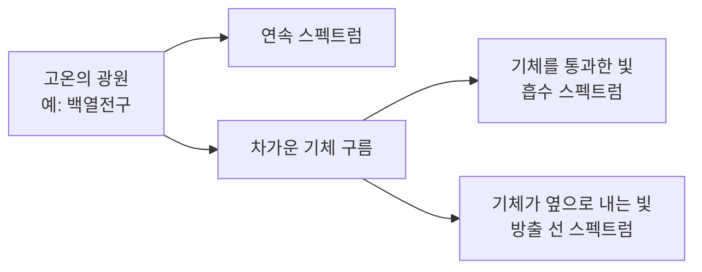
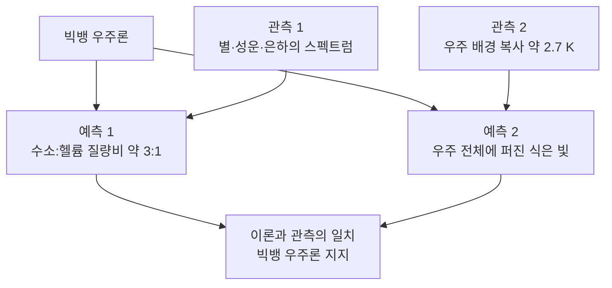

# 2-1. 빛의 스펙트럼과 우주 초기 원소 — 빛으로 읽는 우주의 성분표

> [!NOTE]
> **성취기준 [10통과1-02-01]** 천체에서 방출되는 빛의 스펙트럼을 분석하여 우주 초기에 형성된 원소와 천체의 구성 물질을 추론할 수 있다.

**학습 목표**

1. 연속 스펙트럼, 선 스펙트럼(방출 스펙트럼), 흡수 스펙트럼을 구분하고 각각이 생기는 조건을 설명할 수 있다.
2. 분광기로 수소의 선 스펙트럼을 관찰하고, 원소마다 고유한 선 스펙트럼을 이용해 원소를 확인할 수 있음을 설명할 수 있다.
3. 빅뱅 우주론에 따라 우주 초기에 수소와 헬륨이 만들어진 과정을 설명하고, 수소와 헬륨의 질량비가 약 3:1이 되는 까닭을 계산으로 보일 수 있다.
4. 별과 우주의 스펙트럼 자료를 분석하여 천체의 구성 원소를 추론하고, 수소와 헬륨이 현재 우주의 주요 구성 원소임을 파악할 수 있다.

**이 단원의 학습 사다리**

| 단계 | 무엇을 하나? |
|---|---|
| STEP 1. 중학교 다시 보기 | 빛의 색, 파동, 원자의 구조, 우주 팽창을 다시 꺼내 본다 |
| STEP 2. 기초 다지기 | 파장과 나노미터, 빛의 분해, 원자와 원자핵, 질량비와 개수비를 디딤돌로 놓는다 |
| STEP 3. 핵심 개념 | 스펙트럼의 종류 → 원소의 지문 → 수소 선 스펙트럼 → 빅뱅과 우주 초기 원소 → 천체의 성분 추론 |
| STEP 4. 오개념 바로잡기 | "흡수선은 빛이 전혀 없는 곳?", "3:1은 개수 비?" 같은 착각을 바로잡는다 |
| STEP 5. 선택과목·대학 | 원자의 에너지 준위, 별의 온도와 빛, 적색 편이와 허블 법칙 |
| STEP 6. 산업·진로 | 천문 분광 관측, 원소 분석 장비, 반도체 공정 감시, 환경 위성 |

---

## 🗺️ 단원 들어가기

1835년, 프랑스의 철학자 콩트는 "별이 무엇으로 이루어져 있는지는 인류가 영원히 알 수 없을 것"이라고 썼다. 별까지 가서 돌멩이 하나 가져올 수 없으니 그럴듯한 말이었다. 그런데 불과 수십 년 뒤, 과학자들은 태양에 수소·나트륨·철이 있다는 것을 알아냈고, 심지어 지구에서는 아직 발견되지 않은 새 원소까지 태양에서 먼저 찾아냈다. 그 원소의 이름이 그리스어로 '태양'을 뜻하는 **헬륨(helium)** 이다.

과학자들이 손에 쥔 것은 별에서 온 **빛 한 줄기**뿐이었다. 빛을 무지개처럼 펼친 띠, 곧 **스펙트럼** 속에 원소마다 다른 '바코드'가 숨어 있었던 것이다. 이 단원에서는 빛의 바코드를 읽는 법을 배우고, 그 바코드로 **우주가 처음 생겨났을 때 어떤 원소가 만들어졌는지**까지 추론해 본다.

---

## STEP 1. 🔙 중학교 다시 보기

### 연계 개념표

| 중학교 성취기준 | 중학교에서 배운 것 | 고등학교에서 확장되는 것 |
|---|---|---|
| [9과10-03] | 물체의 색은 반사되는 빛의 색으로 결정된다. 빛의 삼원색을 합성하면 여러 색을 만든다 | 반대로 **백색광을 색깔별로 분해**하여 스펙트럼을 얻는다 |
| [9과10-04] | 파동은 진폭, 진동수, 파장으로 나타낸다 | 빛도 파동이며, **파장에 따라 색이 다르다.** 스펙트럼은 '파장별 빛의 세기' 그래프이다 |
| [9과11-02] | 원자는 양성자, 중성자, 전자로 이루어지며 양성자 수가 원소의 종류를 정한다 | 수소 원자핵(양성자 1개), 헬륨 원자핵(양성자 2개 + 중성자 2개)이 **우주 초기에 만들어진 과정** |
| [9과15-01] | 별의 표면 온도는 별의 색으로 비교할 수 있다 | 별의 색은 **연속 스펙트럼**에서 어느 색이 강한지로 정해진다 |
| [9과15-03] | 모형(풍선 등)을 이용하여 우주가 팽창하고 있음을 설명한다 | 팽창을 거꾸로 돌려 **빅뱅 우주론**과 우주 초기 원소의 생성을 설명한다 |
| [9과07-02] | 태양의 표면과 대기에서 일어나는 현상(흑점, 홍염, 코로나 등) | 태양 대기를 지나온 빛의 **흡수 스펙트럼**으로 태양의 구성 원소를 알아낸다 |

### 준비 운동 (사전 진단)

**Q1.** 햇빛을 프리즘에 통과시키면 여러 색의 띠가 나타난다. 이것은 프리즘이 햇빛에 색을 '칠한' 것이다. (O / X)

**Q2.** 빨간빛과 보랏빛 중 파장이 더 긴 것은?

**Q3.** 원자가 전기적으로 중성인 까닭을 양성자와 전자의 수로 설명하시오.

**Q4.** 풍선 위에 점을 찍고 풍선을 불면 점 사이의 거리는 어떻게 변하는가? 이 모형은 우주의 어떤 모습을 나타내는가?

정답 및 해설

**Q1. X** — 햇빛(백색광)에는 처음부터 여러 색의 빛이 섞여 있다. 프리즘은 색마다 꺾이는 정도가 달라서 섞여 있던 빛을 **나누어 보여 줄 뿐**이다.

**Q2. 빨간빛** — 가시광선 중 빨간빛은 파장이 가장 길고, 보랏빛은 가장 짧다.

**Q3.** 원자 속 양성자(+) 수와 전자(−) 수가 같아서 전하의 합이 0이기 때문이다.

**Q4.** 모든 점 사이의 거리가 멀어진다. 우주가 팽창하면서 은하들 사이의 거리가 멀어지는 모습을 나타낸다. 어느 점에서 보아도 다른 점들이 멀어지므로 '우주의 중심'은 따로 없다.

---

## STEP 2. 🧱 기초 다지기

### ① 빛은 파동이다 — 파장과 나노미터

중학교에서 소리를 파동으로 배웠듯이, 빛도 파동이다. 파동에서 마루와 마루 사이의 거리를 **파장(wavelength)** 이라고 한다. 빛의 파장은 매우 짧아서 **나노미터(nm)** 단위를 쓴다.

$$
1\ \mathrm{nm} = 10^{-9}\ \mathrm{m} = \frac{1}{1\,000\,000\,000}\ \mathrm{m}
$$

- 사람 눈에 보이는 빛, 곧 **가시광선**의 파장은 약 400~700 nm이다.
- 파장이 짧은 쪽부터 보라 → 파랑 → 초록 → 노랑 → 주황 → 빨강 순이다.
- 가시광선보다 파장이 짧은 빛은 자외선, 긴 빛은 적외선이다. 눈에는 보이지 않지만 장비로는 관측할 수 있다.

| 색 | 대략적인 파장 범위(nm) |
|---|---|
| 보라 | 약 400~450 |
| 파랑 | 약 450~495 |
| 초록 | 약 495~570 |
| 노랑 | 약 570~590 |
| 주황 | 약 590~620 |
| 빨강 | 약 620~700 |

(색의 경계는 사람마다, 자료마다 조금씩 다르다.)

> [!TIP]
> 💡 **비유** — 머리카락 굵기가 약 0.1 mm = 100 000 nm이다. 빨간빛의 파장(약 650 nm)은 머리카락 굵기의 약 150분의 1에 불과하다.

### ② 빛을 펼쳐 보는 도구 — 프리즘과 회절 격자

**스펙트럼(spectrum)** 은 빛을 파장(색)에 따라 나누어 늘어놓은 띠이다. 빛을 나누는 방법은 두 가지가 대표적이다.

| 도구 | 원리(정성적) | 예 |
|---|---|---|
| 프리즘 | 색(파장)마다 꺾이는 정도가 달라 빛이 나뉜다 | 무지개(물방울이 프리즘 역할) |
| 회절 격자 | 아주 촘촘한 홈에서 빛이 퍼지고 겹치며 색이 나뉜다 | CD·DVD 뒷면에 비친 무지갯빛 |

빛을 스펙트럼으로 나누어 관찰하는 장치를 **분광기(spectroscope)** 라 한다. 학교에서는 회절 격자 필름과 종이 상자로 간단한 분광기를 직접 만들 수 있다.

### ③ 원자, 원자핵, 그리고 '전자를 잃은 원자'

- **원자** = 원자핵(양성자 + 중성자) + 전자
- **원자핵**은 원자의 중심에 있으며 원자 질량의 거의 전부를 차지한다.
- 양성자와 중성자의 질량은 거의 같고, 전자는 그보다 약 2000분의 1 정도로 매우 가볍다.

| 원소 | 원자핵의 구성 | 원자의 전자 수 |
|---|---|---|
| 수소(H) | 양성자 1개 | 1개 |
| 헬륨(He) | 양성자 2개 + 중성자 2개 | 2개 |

온도가 아주 높으면 원자는 전자를 붙잡지 못하고, 원자핵과 전자가 따로따로 흩어져 돌아다닌다. 우주 초기에는 우주 전체가 이런 뜨거운 상태였다는 것이 이 단원의 중요한 장면이 된다.

### ④ 질량비와 개수비는 다르다 — 수학 도구

수소 원자핵 12개와 헬륨 원자핵 1개가 있다고 하자. 양성자와 중성자의 질량을 각각 1로 어림하면

- **개수비** 수소 : 헬륨 = 12 : 1
- **질량비** 수소 : 헬륨 = (12 × 1) : (1 × 4) = 12 : 4 = **3 : 1**

같은 물질 모임이라도 '몇 개인가'로 비교하느냐, '얼마나 무거운가'로 비교하느냐에 따라 비가 달라진다. 헬륨 원자핵 하나는 수소 원자핵보다 약 4배 무겁기 때문이다.

> [!TIP]
> 💡 **비유** — 교실에 탁구공 12개와 볼링공 1개가 있다. 개수로는 탁구공이 압도적이지만, 무게로 따지면 볼링공 하나가 훨씬 무겁다. 우주의 원소를 비교할 때도 '개수'인지 '질량'인지 꼭 확인해야 한다.

### ⑤ 우주의 시간 규모

| 사건 | 시점 |
|---|---|
| 빅뱅(우주의 시작) | 약 138억 년 전 |
| 태양계와 지구의 탄생 | 약 46억 년 전 |
| 인류(호모 사피엔스)의 등장 | 수십만 년 전 |

우주의 나이를 1년(달력 한 장)으로 줄이면, 지구는 9월 초에 태어나고 인류(호모 사피엔스)의 역사는 12월 31일 밤 마지막 10분 남짓에 해당한다.

---

## STEP 3. 📘 핵심 개념

### 2-1-① 스펙트럼의 세 가지 얼굴 — 연속, 선, 흡수

빛을 분광기로 나누어 보면 광원에 따라 전혀 다른 모습이 나타난다.

| 종류 | 모양 | 생기는 조건 | 예 |
|---|---|---|---|
| **연속 스펙트럼**(continuous spectrum) | 빨강부터 보라까지 끊김 없이 이어진 띠 | 고온의 고체·액체, 또는 밀도가 큰 고온의 기체가 빛을 낼 때 | 백열전구, 달군 쇠, 태양의 표면(광구) |
| **선 스펙트럼**(방출 스펙트럼, emission spectrum) | 어두운 바탕에 특정 위치에만 밝은 선 몇 개 | 밀도가 낮은 고온의 기체가 빛을 낼 때 | 수소·네온 방전관, 불꽃 반응, 성운 |
| **흡수 스펙트럼**(absorption spectrum) | 연속 스펙트럼 위에 특정 위치에만 검은 선 | 연속 스펙트럼의 빛이 온도가 더 낮은 기체를 지나올 때 | 태양 빛, 대부분의 별빛 |

**핵심 규칙** — 같은 기체라면, **흡수 스펙트럼의 검은 선 위치와 방출 스펙트럼의 밝은 선 위치가 같다.** 기체는 자기가 내놓을 수 있는 바로 그 파장의 빛만 골라서 흡수하기 때문이다. 이 규칙은 1859년 무렵 독일의 키르히호프와 분젠이 실험으로 정리하였다.

> [!TIP]
> 💡 **비유** — 어떤 합창단원이 '도', '미', '솔' 음만 낼 수 있다고 하자. 이 단원은 피아노 소리를 들을 때에도 '도', '미', '솔'에만 반응하여 따라 울린다. 낼 수 있는 음과 받아들이는 음이 같은 것처럼, 기체가 방출하는 빛의 파장과 흡수하는 빛의 파장은 같다.

#### 예제 1

다음 세 광원의 스펙트럼은 각각 어떤 종류인가?
(1) 전기 난로의 빨갛게 달아오른 열선
(2) 네온사인
(3) 백열전구 빛을 나트륨 증기가 든 유리관에 통과시킨 빛

**풀이**
(1) 고온의 고체 → **연속 스펙트럼**
(2) 밀도가 낮은 고온의 기체(네온) → **선 스펙트럼(방출)**
(3) 연속 스펙트럼의 빛이 기체를 통과 → **흡수 스펙트럼.** 나트륨의 방출선이 있던 노란색 위치(약 589 nm)에 검은 선이 나타난다.

### 2-1-② 원소의 지문 — 선 스펙트럼으로 원소를 찾는다

원소마다 선 스펙트럼에 나타나는 **선의 개수, 위치(파장), 세기가 다르다.** 사람마다 지문이 다른 것처럼, 원소마다 고유한 선 스펙트럼을 가진다. 그래서 선 스펙트럼을 보면 **어떤 원소가 들어 있는지** 알 수 있다.

| 원소 | 가시광선 영역의 대표적인 선(약, nm) | 눈에 보이는 느낌 |
|---|---|---|
| 수소(H) | 656(빨강), 486(청록), 434(파랑-보라), 410(보라) | 분홍빛을 띤 보라색 |
| 헬륨(He) | 588(노랑)을 비롯한 여러 선 | 연한 분홍-주황색 |
| 나트륨(Na) | 589 부근의 노란 선 두 줄(매우 가까이 붙어 있음) | 진한 노란색 |
| 네온(Ne) | 빨강·주황 영역에 많은 선 | 붉은 주황색 |

(실제 원소들은 이보다 훨씬 많은 선을 가진다. 표에는 대표적인 것만 실었다.)

**불꽃 반응과의 관계** — 중학교 실험 등에서 볼 수 있는 불꽃 반응(나트륨은 노란색, 리튬은 빨간색, 구리는 청록색)은 사실 여러 선의 빛이 섞여 보이는 색이다. 리튬과 스트론튬처럼 **불꽃색이 비슷한 빨간색이라도 분광기로 보면 선의 위치가 달라** 구별할 수 있다. 분광기는 '색'보다 훨씬 정밀한 원소 감별 도구이다.

#### 스펙트럼이 바꾼 원소의 역사

| 시기 | 사건 |
|---|---|
| 1814년 | 프라운호퍼가 태양 스펙트럼에서 수백 개의 검은 선(흡수선)을 기록하였다 |
| 1859~1861년 | 키르히호프와 분젠이 원소마다 고유한 선 스펙트럼이 있음을 밝히고, 이를 이용해 새 원소 세슘과 루비듐을 발견하였다 |
| 1868년 | 일식 때 태양 대기의 스펙트럼에서 알려진 원소와 맞지 않는 노란 선(약 588 nm)이 발견되었고, 이 선의 주인공에 '헬륨'이라는 이름이 붙었다 |
| 1895년 | 지구의 광물에서 헬륨이 분리되어 존재가 확인되었다 |

> [!IMPORTANT]
> 헬륨은 **지구보다 태양에서 먼저 발견된 원소**이다. 스펙트럼 분석만으로 우주 저편 천체의 성분을 알아낼 수 있다는 것을 보여 준 대표적인 사건이다.

#### 예제 2 — 미지의 기체 찾기

어떤 기체 방전관의 선 스펙트럼에서 밝은 선이 약 656 nm, 486 nm, 434 nm, 410 nm에 나타났다. 위의 표를 이용하여 이 기체를 추론하시오. 또 이 방전관 앞에 나트륨 증기를 조금 섞어 넣는다면 스펙트럼에 어떤 변화가 생길지 예상하시오.

**풀이**
네 선의 위치가 수소의 선과 일치하므로 **수소**이다. 나트륨이 섞이면 수소의 네 선은 그대로 남고, 약 589 nm에 나트륨의 노란 선이 **추가로** 나타난다. 이처럼 여러 원소가 섞여 있으면 **각 원소의 선이 겹쳐서** 함께 나타나므로, 선을 하나씩 대조하여 성분을 모두 찾아낼 수 있다.

### 2-1-③ 분광기로 수소의 선 스펙트럼 관찰하기

수소는 원자 번호 1번, 가장 단순한 원소이다. 수소 기체를 넣은 유리관(수소 방전관)에 높은 전압을 걸면 기체가 빛을 내는데, 이 빛을 분광기로 보면 다음과 같다.

| 관찰 대상 | 맨눈으로 본 색 | 분광기로 본 모습 |
|---|---|---|
| 백열전구 | 노르스름한 흰색 | 빨강~보라가 끊김 없이 이어진 띠(연속) |
| 수소 방전관 | 분홍빛 보라색 | 검은 바탕에 빨강·청록·파랑·보라의 **선 4개** |
| 형광등(참고) | 흰색 | 연속적인 배경 위에 몇 개의 밝은 선(형광등 속 수은의 선) |

수소 방전관의 분홍빛은 빨간 선(656 nm)과 청록·보라 선의 빛이 섞여 보이는 색이다. 분광기는 이 섞인 빛을 **파장별로 풀어서** 보여 준다.

#### 왜 원소마다 정해진 선만 나타날까? (맛보기)

원자 속 전자는 아무 에너지나 가질 수 없고, **원소마다 정해진 몇 가지 에너지 값만** 가질 수 있다. 전자가 높은 에너지 상태에서 낮은 상태로 옮겨 갈 때, 그 차이에 해당하는 빛만 나온다. 에너지 값의 배치가 원소마다 다르므로 선의 위치도 원소마다 다르다. 이 내용은 통합과학의 범위를 넘는 맛보기로 평가 대상이 아니며, STEP 5와 고2·3 선택과목에서 자세히 다룬다.

> [!TIP]
> 💡 **비유** — 계단에서 공이 굴러떨어질 때, 공은 계단 사이 '공중'에 멈출 수 없고 계단 높이만큼씩만 떨어진다. 원자 속 전자의 에너지도 계단처럼 띄엄띄엄 정해져 있어서, 떨어지는 '높이 차'에 해당하는 빛만 나온다. 원소마다 계단 높이가 다르니 나오는 빛도 다르다.

#### 수소 선 스펙트럼이 우주에서 중요한 이유

지구 실험실의 수소 방전관과 **똑같은 위치의 선**이 태양, 다른 별, 성운, 멀리 있는 은하의 스펙트럼에서도 발견된다. 특히 성운에서 나오는 붉은빛의 상당 부분은 수소의 656 nm 선이다.

- 같은 원소는 우주 어디에서나 같은 선 스펙트럼을 가진다 → **우주 어디에서나 같은 물리 법칙이 성립한다.**
- 우주 곳곳에서 수소의 선이 가장 흔하고 강하게 나타난다 → **수소는 우주에서 가장 흔한 원소이다.**

### 2-1-④ 빅뱅 우주론 — 우주 초기에 수소와 헬륨이 만들어지다

중학교에서 우주가 팽창하고 있다는 것을 배웠다. 팽창하는 우주를 영화처럼 **거꾸로 돌리면** 과거로 갈수록 우주는 더 작고, 더 뜨겁고, 더 밀도가 높았을 것이다. 이렇게 **우주가 아주 뜨겁고 밀도가 높은 한 상태에서 시작해 팽창하며 식어 왔다**는 이론을 **빅뱅 우주론(Big Bang cosmology)** 이라 한다. 우주의 나이는 약 138억 년으로 알려져 있다.

#### 우주 초기의 원소 생성 시간표

| 순서 | 대략적인 시점 | 일어난 일 |
|---|---|---|
| ① | 빅뱅 직후 | 매우 뜨거운 우주에 기본 입자(쿼크, 전자 등)와 빛이 가득했다 |
| ② | 약 1초 이내 | 우주가 식으며 쿼크가 모여 **양성자와 중성자**가 만들어졌다. 양성자 하나가 곧 수소 원자핵이다 |
| ③ | 약 3분 무렵부터 짧은 기간 | 양성자 2개와 중성자 2개가 결합하여 **헬륨 원자핵**이 만들어졌다 |
| ④ | 약 38만 년 | 우주의 온도가 약 3000 K까지 내려가자 원자핵이 전자를 붙잡아 **수소 원자, 헬륨 원자**가 만들어졌다. 이때부터 빛이 자유롭게 우주를 지나가게 되었다 |
| ⑤ | 수억 년 이후 | 수소와 헬륨 기체가 중력으로 뭉쳐 첫 별과 은하가 태어났다(→ 2-2 단원) |

> [!NOTE]
> 시점은 모두 '약'이 붙는 어림값이다. 중요한 것은 **순서**이다. 입자가 먼저, 원자핵이 다음, 원자는 한참 뒤에 만들어졌다.

#### 왜 우주 초기에는 수소와 헬륨만 만들어졌을까?

원자핵끼리 합쳐지려면(**핵융합**) 아주 높은 온도와 밀도가 필요하다. 그런데 우주는 빠르게 팽창하며 식었기 때문에, 원자핵이 합쳐질 수 있을 만큼 뜨거웠던 시간은 **몇 분 정도**에 불과했다. 그 짧은 시간 동안 헬륨까지는 만들어졌지만, 그보다 무거운 원소는 거의 만들어지지 못했다(리튬이 아주 조금 만들어졌다). 탄소, 산소, 철처럼 더 무거운 원소는 훗날 **별 속**에서 만들어진다. 이것이 다음 단원의 주제이다.

#### 수소와 헬륨의 질량비가 약 3:1이 되는 까닭

헬륨 원자핵이 만들어지던 무렵, 우주에는 **양성자 약 7개당 중성자 약 1개**가 있었다고 계산된다. 이때 남아 있던 중성자는 거의 모두 헬륨 원자핵 속으로 들어갔다.

#### 예제 3 — 3:1을 직접 계산하기

양성자와 중성자의 개수비가 7 : 1이고, 중성자가 모두 헬륨 원자핵(양성자 2개 + 중성자 2개)이 되었다고 하자. (양성자와 중성자의 질량은 같다고 본다.)
(1) 수소 원자핵과 헬륨 원자핵의 개수비를 구하시오.
(2) 수소와 헬륨의 질량비를 구하시오.

**풀이**
양성자 14개, 중성자 2개(합 16개)로 생각하자.
- 중성자 2개 + 양성자 2개 → 헬륨 원자핵 **1개**
- 남은 양성자 14 − 2 = 12개 → 수소 원자핵 **12개**

(1) 개수비 수소 : 헬륨 = **12 : 1**
(2) 질량비 수소 : 헬륨 = 12 : 4 = **3 : 1** (헬륨 원자핵 1개의 질량은 입자 4개분)

즉 우주 초기 물질의 질량 중 약 75%가 수소, 약 25%가 헬륨이었다.

> [!TIP]
> 💡 **비유** — 남학생 14명, 여학생 2명이 '남 2 + 여 2' 짝으로만 4인조를 만든다면 4인조는 1팀밖에 못 만들고 남학생 12명은 혼자 남는다. 여학생 수(중성자 수)가 4인조(헬륨) 개수를 정한다.

### 2-1-⑤ 별과 우주의 스펙트럼으로 구성 물질을 추론하다

#### 태양의 흡수 스펙트럼 읽기

태양의 표면(광구)은 연속 스펙트럼의 빛을 내고, 이 빛이 태양의 대기를 지나오면서 대기 속 원소들이 자기 고유의 파장을 흡수한다. 그래서 태양 스펙트럼에는 수많은 검은 흡수선이 나타난다.

| 태양 스펙트럼의 흡수선 위치(약, nm) | 실험실 방출선과 대조한 결과 |
|---|---|
| 656, 486, 434, 410 | 수소 |
| 589 부근의 두 줄 | 나트륨 |
| 393, 397 | 칼슘 |
| 527 부근을 비롯한 여러 선 | 철 |
| 517 부근 | 마그네슘 |

**분석 방법** — ① 실험실에서 각 원소의 방출 선 스펙트럼을 측정해 둔다. ② 천체의 흡수(또는 방출) 스펙트럼과 **선의 위치**를 하나씩 대조한다. ③ 위치가 일치하는 선들이 있으면 그 원소가 천체에 있다고 판단한다. ④ 선의 세기를 분석하면(온도 등의 영향을 함께 고려해야 한다) 원소의 양도 어림할 수 있다.

#### 예제 4 — 별 스펙트럼 분석

다음은 실험실에서 얻은 원소 A, B, C의 방출선 위치와 어떤 별의 흡수선 위치를 나타낸 것이다.

| 대상 | 선의 위치(nm) |
|---|---|
| 원소 A | 410, 434, 486, 656 |
| 원소 B | 589.0, 589.6 |
| 원소 C | 447, 502, 588, 668 |
| 별 X(흡수선) | 410, 434, 447, 486, 502, 588, 656, 668 |

별 X에 들어 있는 원소를 모두 고르고, 그 근거를 쓰시오.

**풀이**
- 원소 A의 선 4개가 별 X에 **모두** 있다 → A 있음
- 원소 C의 선 4개가 별 X에 **모두** 있다 → C 있음
- 원소 B의 선(589.0, 589.6)이 별 X에 없다 → B는 확인되지 않음

따라서 별 X에는 **A와 C**가 있다. (실제로 A는 수소, C는 헬륨의 선을 단순화한 것이다. 헬륨의 흡수선은 표면 온도가 높은 별에서 잘 나타난다.)

> [!WARNING]
> 선이 **하나만** 겹친다고 그 원소가 있다고 단정하면 안 된다. 서로 다른 원소의 선이 우연히 비슷한 위치에 있을 수 있기 때문이다. 그 원소의 **여러 선이 함께** 나타나는지 확인해야 한다.

#### 우주 전체의 스펙트럼이 알려 주는 것

천문학자들은 수많은 별, 성운, 은하의 스펙트럼을 분석하여 다음과 같은 결론을 얻었다.

| 관측 사실 | 해석 |
|---|---|
| 우주 어디에서나 수소의 선이 가장 흔하고 강하다 | 수소가 우주에서 가장 많은 원소이다 |
| 오래된 별이나 무거운 원소가 적은 성운에서도 헬륨이 질량의 약 4분의 1을 차지한다 | 헬륨의 대부분은 별이 아니라 **우주 초기**에 만들어졌다 |
| 현재 우주 물질의 질량은 수소 약 74%, 헬륨 약 24%, 나머지 모든 원소를 합해 약 2% | 우주 초기에 만들어진 **수소와 헬륨이 지금도 우주의 주요 구성 원소**이다 |

빅뱅 우주론이 계산으로 **예측**한 질량비(약 3:1)와, 스펙트럼으로 **관측**한 질량비가 잘 맞는다. 이론의 예측이 관측으로 확인된 것이므로, 이 일치는 빅뱅 우주론을 지지하는 중요한 증거가 된다.

> [!NOTE]
> **또 하나의 증거, 우주 배경 복사** — 약 38만 년 무렵 원자가 만들어지며 우주를 자유롭게 지나가기 시작한 빛은, 우주가 팽창하는 동안 식어서 지금은 약 2.7 K에 해당하는 전파(마이크로파)로 하늘의 모든 방향에서 거의 고르게 들어온다. 1965년에 우연히 발견된 이 **우주 배경 복사**도 빅뱅 우주론의 강력한 증거이다.

---

## STEP 4. ⚠️ 오개념 바로잡기

| 흔한 오개념 | 올바른 개념 | 왜 그럴까? |
|---|---|---|
| 흡수 스펙트럼의 검은 선은 빛이 **전혀 없는** 곳이다 | 검은 선은 주변보다 빛이 **훨씬 약한** 곳이다 | 기체가 흡수한 빛은 여러 방향으로 다시 방출되어 관측자 쪽으로 오는 양이 줄어들 뿐이다 |
| 수소와 헬륨의 3:1은 **원자 개수**의 비이다 | 3:1은 **질량비**이고, 개수비는 약 12:1이다 | 헬륨 원자핵 하나는 수소 원자핵보다 약 4배 무겁다 |
| 별 스펙트럼에 철의 선이 보이면 그 별은 주로 철로 되어 있다 | 선이 보이면 그 원소가 **있다는 것**만 알 수 있다 | 양은 선의 세기와 온도 등을 함께 분석해야 알 수 있다. 태양도 대부분은 수소와 헬륨이다 |
| 빅뱅은 빈 공간의 한 점에서 일어난 폭발이다 | 빅뱅은 **공간 자체**가 뜨겁고 조밀한 상태에서 팽창하기 시작한 것이다 | 풍선 표면의 모든 점이 서로 멀어지듯, 우주에는 특별한 중심이 없다 |
| 우주 초기에 지금 있는 모든 원소가 만들어졌다 | 우주 초기에는 **수소와 헬륨**(그리고 극소량의 리튬)만 만들어졌다 | 핵융합이 가능할 만큼 뜨거웠던 시간이 몇 분에 불과했다. 무거운 원소는 별에서 만들어졌다 |
| 같은 원소라도 흡수선과 방출선은 위치가 다르다 | 같은 원소의 흡수선과 방출선은 **같은 위치**에 나타난다 | 원소는 자기가 낼 수 있는 파장의 빛만 골라 흡수한다 |
| 불꽃색이 같으면 같은 원소이다 | 불꽃색이 비슷해도 **선 스펙트럼**은 다를 수 있다 | 리튬과 스트론튬은 둘 다 빨간 불꽃이지만 선의 위치가 다르다 |

---

## STEP 5. 🎓 선택과목·대학으로 한 걸음 더

> [!CAUTION]
> 이 절은 **통합과학 교육과정 범위 밖의 심화 내용**으로 평가 대상이 아니다. "이 개념이 앞으로 어디까지 이어지는가"를 맛보기로 보여 주기 위한 내용이다.

### 고2·3 선택과목과의 연결

| 과목 | 이어지는 내용 |
|---|---|
| 물리학 | 빛과 물질 — 빛의 이중성, 원자의 에너지 준위와 선 스펙트럼 |
| 전자기와 양자 | 양자와 미시세계 — 양자 현상, 원자 속 전자의 상태 |
| 지구과학 | 별과 우주의 진화 — 별의 스펙트럼과 분류, 우주의 팽창 |
| 행성우주과학 | 태양과 별의 관측, 은하와 우주 — 분광 관측으로 천체의 물리량 구하기 |

### ① 왜 선 스펙트럼인가 — 에너지 준위와 광자

빛은 파동이면서 동시에 **광자(photon)** 라는 에너지 덩어리로도 행동한다. 광자 하나의 에너지는 파장에 반비례한다.

$$
E = \frac{hc}{\lambda} \qquad (h:\ \text{플랑크 상수},\ c:\ \text{빛의 속력},\ \lambda:\ \text{파장})
$$

보어의 원자 모형에서 수소 원자의 전자는 다음과 같은 에너지만 가질 수 있다.

$$
E_n = -\frac{13.6}{n^2}\ \mathrm{eV} \qquad (n = 1, 2, 3, \cdots)
$$

전자가 $n=3$에서 $n=2$로 옮겨 갈 때 나오는 빛의 에너지와 파장을 계산해 보자. (편리한 관계 $\lambda(\mathrm{nm}) \approx \dfrac{1240}{E(\mathrm{eV})}$를 쓴다.)

$$
\Delta E = 13.6\left(\frac{1}{2^2} - \frac{1}{3^2}\right) = 13.6 \times \frac{5}{36} \approx 1.89\ \mathrm{eV}
\quad\Rightarrow\quad
\lambda \approx \frac{1240}{1.89} \approx 656\ \mathrm{nm}
$$

STEP 3에서 본 수소의 빨간 선(656 nm)이 정확히 계산된다. $n=4, 5, 6 \to 2$로 옮겨 가면 486, 434, 410 nm 선이 나온다. 이 네 선을 묶어 **발머 계열**이라 한다. 대학의 **양자역학**에서는 슈뢰딩거 방정식으로 이 에너지 값을 처음부터 유도한다.

### ② 별의 색과 연속 스펙트럼 — 빈의 법칙

뜨거운 물체가 내는 연속 스펙트럼은 온도가 높을수록 세기가 가장 센 파장 $\lambda_{\max}$가 짧아진다.

$$
\lambda_{\max} T \approx 2.9 \times 10^{-3}\ \mathrm{m\cdot K}
$$

태양 표면 온도를 약 5800 K로 놓으면 $\lambda_{\max} \approx 2.9\times10^{-3} / 5800 = 5.0\times10^{-7}\ \mathrm{m} = 500\ \mathrm{nm}$로, 가시광선 한가운데이다. 표면 온도가 높은 별은 파랗게, 낮은 별은 붉게 보이는 까닭(중학교 [9과15-01])을 정량적으로 설명하는 식이다.

### ③ 적색 편이와 허블 법칙

멀어지는 광원에서 온 빛은 파장이 길어져(빨간 쪽으로 밀려) 관측된다. 이를 **적색 편이(redshift)** 라 한다. 먼 은하의 스펙트럼에서 수소 선들이 실험실 위치보다 **모두 함께 빨간 쪽으로 밀려** 있다는 것이 관측되었고, 멀리 있는 은하일수록 더 빠르게 멀어진다는 **허블 법칙**이 얻어졌다.

$$
v = H_0\, d \qquad (v:\ \text{후퇴 속도},\ d:\ \text{거리},\ H_0:\ \text{허블 상수})
$$

스펙트럼의 '선 위치'는 원소를 알려 줄 뿐 아니라, 선이 **얼마나 밀렸는지**로 천체의 운동까지 알려 준다. 중학교에서 모형으로 배운 우주 팽창의 실제 관측 근거가 바로 이것이다.

### 고등학교 vs 대학교

| 구분 | 고등학교 통합과학 | 대학교(일반물리학·천체물리학·분석화학) |
|---|---|---|
| 스펙트럼 | 연속·선·흡수 스펙트럼의 구분과 조건 | 복사 전달 이론, 선의 세기와 모양으로 온도·밀도·압력 계산 |
| 선이 생기는 이유 | "원소마다 고유하다"는 사실 | 양자역학의 에너지 준위, 전이 확률 |
| 우주 초기 원소 | 수소·헬륨 질량비 약 3:1을 개수 세기로 확인 | 빅뱅 핵합성 계산(온도·팽창 속도·반응률의 연립) |
| 분석 기술 | 분광기로 선 위치 대조 | 분광 분석 기기(원자 방출·흡수 분광법), 정량 분석 |
| 관련 전공 | — | 천문우주학, 물리학, 화학, 분석화학, 광학공학 |

---

## STEP 6. 🏭 산업 현장과 진로 연결

### 사례 1. 천문 분광 관측 — 대형 망원경과 우주 망원경

- **원리** 망원경으로 모은 별빛을 분광기로 나누어, 흡수선의 위치로 원소를, 선이 밀린 정도로 천체의 운동을 알아낸다. 빛을 많이 모을수록 어둡고 먼 천체의 스펙트럼을 얻을 수 있어 망원경은 점점 커진다.
- **우리나라** 한국천문연구원은 경북 영천의 **보현산천문대**에서 지름 1.8 m 망원경과 고분산 분광기로 별을 관측한다. 또 지름 약 25 m급 **거대 마젤란 망원경(GMT)** 건설 국제 협력에 참여하고 있으며, 2025년 발사된 미국 항공우주국(NASA)의 전천 적외선 분광 탐사 망원경 **스피어엑스(SPHEREx)** 개발에도 참여하였다.
- **우주 망원경** 제임스 웹 우주 망원경(2021년 발사)은 적외선 분광기로 먼 은하와 외계 행성 대기의 성분을 분석한다.

### 사례 2. 원소 분석 장비 — 물과 식품 속 중금속 찾기

- **원리** 시료를 아주 높은 온도로 가열하면 원소들이 각자 고유한 선 스펙트럼의 빛을 낸다(**원자 방출 분광법**). 반대로 특정 원소의 빛을 시료에 비추어 얼마나 흡수되는지 재는 방법도 있다(**원자 흡수 분광법**). 2-1-①의 방출·흡수 원리를 그대로 쓴 것이다.
- **어디에 쓰이나** 수돗물·하천수의 납·카드뮴 검사, 식품의 중금속 검사, 토양 오염 조사, 금속 소재의 성분 검사 등. 선의 **위치**로 어떤 원소인지, 선의 **세기**로 얼마나 들어 있는지 알아낸다.
- **핵심** 아주 적은 양의 원소까지 검출할 수 있어서 환경·식품 안전 기준을 지키는 데 필수적인 장비이다.

### 사례 3. 반도체 공정 — 빛으로 공정을 감시한다

- **원리** 반도체 칩을 만들 때 기체를 플라스마(원자와 전자가 분리될 만큼 에너지를 받은 기체) 상태로 만들어 웨이퍼 표면을 깎아 내는 **식각 공정**을 한다. 플라스마는 그 속에 있는 원소에 따라 고유한 선 스펙트럼의 빛을 낸다.
- **어디에 쓰이나** 공정 장비에 분광기를 달아 플라스마 빛을 실시간으로 분석한다(**광학 발광 분광**). 깎아 내던 층이 다 없어지고 아래층이 드러나면 빛 속 원소의 선이 바뀌므로, 이 순간을 잡아 식각을 멈춘다(**식각 종료점 검출**).
- **핵심** 나노미터 수준의 정밀한 공정에서 '언제 멈출지'를 빛의 바코드로 판단한다. 공정 가스의 오염이나 장비 이상을 감시하는 데에도 분광 분석이 쓰인다.

### 사례 4. 환경 위성 — 하늘에서 대기 오염 물질을 읽는다

- **원리** 지표에서 반사되어 대기를 통과한 햇빛에는 대기 속 기체들이 흡수한 흔적(흡수 스펙트럼)이 남는다.
- **우리나라** 2020년 발사된 **천리안위성 2B호**에는 환경 탑재체(GEMS)가 실려, 정지 궤도에서 한반도와 아시아 지역의 이산화 질소, 오존 등 대기 오염 물질을 분광 관측한다.
- **핵심** 별의 성분을 알아낸 방법이 그대로 지구 대기 감시에 쓰인다.

### 관련 진로와 학과

| 진로 | 하는 일 | 관련 학과 |
|---|---|---|
| 천문학자·천체물리학자 | 분광 관측으로 별·은하의 성분과 진화 연구 | 천문우주학, 물리학 |
| 분석화학자·시험 분석 연구원 | 분광 장비로 환경·식품·소재 성분 분석 | 화학, 화학공학, 환경공학 |
| 반도체 공정·장비 엔지니어 | 식각·증착 공정 개발, 공정 감시 장비 운영 | 전자공학, 재료공학, 화학공학, 물리학 |
| 광학 엔지니어 | 분광기·망원경·센서 광학계 설계 | 광학공학, 물리학, 전자공학 |
| 원격 탐사·위성 연구원 | 위성 분광 자료로 대기·환경 감시 | 대기과학, 지구환경과학, 항공우주공학 |

---

## 🔬 탐구 활동 — 분광기로 다양한 물질의 스펙트럼 관찰·비교하기

### 활동 A. 간이 분광기 만들어 여러 광원 관찰하기 (모둠 활동)

**목표** 간이 분광기를 만들어 여러 광원의 스펙트럼을 관찰하고 연속 스펙트럼과 선 스펙트럼을 구별한다.

**준비물** 회절 격자 필름(또는 못 쓰는 CD·DVD 조각), 검은 종이 상자(또는 종이컵), 커터칼, 검은 테이프, 스마트폰(촬영용), 백열전구(또는 할로겐 전구), LED 손전등, 형광등

**과정**
1. 상자 한쪽 끝에 폭 1 mm 정도의 가는 틈(슬릿)을 내고, 반대쪽에 회절 격자 필름을 붙여 들여다보는 창을 만든다.
2. 슬릿을 광원 쪽으로 향하게 하고 들여다보며, 스펙트럼이 가장 선명하게 보이도록 각도를 조절한다.
3. 각 광원의 스펙트럼을 스마트폰으로 촬영하고 아래 표에 기록한다.

**결과 기록**

| 광원 | 맨눈으로 본 색 | 스펙트럼 모양(그림) | 연속 / 선 / 혼합 |
|---|---|---|---|
| 백열전구 | | | |
| LED 손전등 | | | |
| 형광등 | | | |

### 활동 B. 수소 방전관과 원소 방전관 관찰하기 (교사 시범 + 관찰)

1. 교사가 스펙트럼관 전원 장치에 수소 방전관을 끼우고 전원을 켠다.
2. 학생은 분광기(또는 간이 분광기)로 수소 방전관을 관찰하고, 보이는 선의 색과 대략적인 위치(눈금이 있는 분광기는 파장 값)를 기록한다.
3. 헬륨, 네온 방전관으로 바꾸어 같은 방법으로 관찰한다.

| 방전관 | 맨눈으로 본 색 | 관찰한 선의 색(파장) | 선의 개수 |
|---|---|---|---|
| 수소 | | | |
| 헬륨 | | | |
| 네온 | | | |

### 활동 C. 우주 스펙트럼 자료와 비교하기

1. 교사가 제공하는 태양 스펙트럼 사진(또는 천문 자료 사이트의 별 스펙트럼)에서 흡수선의 위치를 읽는다.
2. 활동 B에서 기록한 수소의 선 위치와 비교하여, 일치하는 흡수선을 찾아 표시한다.
3. 여러 별과 성운의 스펙트럼 자료에서 수소 선이 공통으로 나타나는지 확인한다.

**생각해 보기**
1. 백열전구와 형광등은 모두 흰빛으로 보이는데, 스펙트럼은 왜 다를까?
2. 실험실의 수소 방전관과 태양의 스펙트럼에서 같은 위치에 선이 나타난다는 것은 무엇을 뜻하는가?
3. 우주의 거의 모든 천체 스펙트럼에서 수소 선이 발견된다는 사실과 빅뱅 우주론을 연결하여 설명해 보자.

> [!WARNING]
> **안전 수칙** ① 분광기로 **태양을 절대 직접 보지 않는다.** 시력을 잃을 수 있다. 태양 스펙트럼은 흰 종이에 반사된 햇빛이나 사진 자료로 관찰한다. ② 방전관 전원 장치에는 수천 볼트의 높은 전압이 걸리므로 학생은 만지지 않고, 사용 후 방전관이 뜨거우니 식은 뒤에 다룬다. ③ 커터칼은 칼날을 몸 바깥쪽으로 향하게 하여 사용한다.

---

## ✅ 개념 확인 문제

### 기본

**1.** 다음 중 **연속 스펙트럼**이 나타나는 광원은?
① 네온사인 ② 수소 방전관 ③ 백열전구의 필라멘트 ④ 나트륨 증기를 통과한 백열전구 빛

정답 및 해설

**정답 ③**

고온의 고체인 필라멘트는 연속 스펙트럼을 낸다. ①, ②는 밀도가 낮은 고온 기체이므로 선(방출) 스펙트럼, ④는 연속 스펙트럼의 빛이 기체를 통과했으므로 흡수 스펙트럼이다.

**2.** 빈칸에 알맞은 말을 쓰시오.
"원소마다 선 스펙트럼의 선의 ( ㄱ )와/과 개수가 다르므로, 선 스펙트럼은 원소의 ( ㄴ )처럼 쓰인다. 같은 원소의 흡수선과 방출선은 ( ㄷ ) 위치에 나타난다."

정답 및 해설

**정답** ㄱ: 위치(파장), ㄴ: 지문(바코드), ㄷ: 같은

**3.** 빅뱅 우주론에 따라 다음 사건을 일어난 순서대로 나열하시오.
ㄱ. 수소 원자와 헬륨 원자가 만들어졌다.
ㄴ. 양성자와 중성자가 만들어졌다.
ㄷ. 헬륨 원자핵이 만들어졌다.
ㄹ. 첫 별과 은하가 만들어졌다.

정답 및 해설

**정답** ㄴ → ㄷ → ㄱ → ㄹ

양성자·중성자(약 1초 이내) → 헬륨 원자핵(약 3분 무렵) → 원자(약 38만 년) → 별과 은하(수억 년 이후) 순이다. 원자핵이 먼저, 원자는 우주가 충분히 식은 뒤에 만들어졌다.

**4.** 현재 우주에서 질량 기준으로 가장 많은 원소 두 가지를 쓰고, 이 두 원소가 주로 언제 만들어졌는지 쓰시오.

정답 및 해설

**정답** 수소, 헬륨 / 우주 초기(빅뱅 직후)

수소는 질량의 약 74%, 헬륨은 약 24%를 차지하며, 대부분 빅뱅 직후 우주 초기에 만들어졌다.

### 응용

**5.** 우주 초기 헬륨 원자핵이 만들어지던 무렵 양성자와 중성자의 개수비가 7 : 1이었다고 하자. 양성자 56개와 중성자 8개가 있고, 중성자가 모두 헬륨 원자핵이 되었다면 (1) 헬륨 원자핵과 수소 원자핵은 각각 몇 개인가? (2) 수소와 헬륨의 질량비는? (양성자와 중성자의 질량은 같다고 본다.)

정답 및 해설

**정답** (1) 헬륨 원자핵 4개, 수소 원자핵 48개 (2) 3 : 1

(1) 헬륨 원자핵 하나에 중성자 2개가 필요하므로 $8 \div 2 = 4$개. 이때 양성자도 $4 \times 2 = 8$개가 쓰이므로 남은 양성자(수소 원자핵)는 $56 - 8 = 48$개이다.
(2) 수소 질량 : 헬륨 질량 $= 48 \times 1 : 4 \times 4 = 48 : 16 = 3 : 1$

예제 3과 입자 수만 다를 뿐 비율은 같다.

**6.** 다음은 원소 P, Q, R의 방출선 위치와 어떤 별 S의 흡수선 위치이다.

| 대상 | 선의 위치(nm) |
|---|---|
| 원소 P | 393, 397 |
| 원소 Q | 589.0, 589.6 |
| 원소 R | 410, 434, 486, 656 |
| 별 S(흡수선) | 393, 397, 410, 434, 486, 656 |

옳은 설명을 **모두** 고르시오.
ㄱ. 별 S에는 원소 P와 R이 있다.
ㄴ. 별 S에는 원소 Q가 있다.
ㄷ. 별 S의 스펙트럼은 별의 표면에서 나온 연속 스펙트럼의 빛이 별의 대기를 지나며 만들어진 것이다.

정답 및 해설

**정답 ㄱ, ㄷ**

ㄱ. P의 선 2개, R의 선 4개가 모두 별 S의 흡수선에 있다.
ㄴ. Q의 선(589.0, 589.6)이 별 S에 없으므로 Q는 확인되지 않는다.
ㄷ. 흡수 스펙트럼은 연속 스펙트럼의 빛이 상대적으로 차가운 기체(별의 대기)를 지날 때 생긴다.

**7.** 같은 수소 기체를 이용하여 (가) 수소 방전관의 빛을 직접 본 스펙트럼과 (나) 백열전구 빛을 차가운 수소 기체에 통과시킨 스펙트럼을 얻었다. 두 스펙트럼의 모습을 비교하여 공통점과 차이점을 서술하시오.

정답 및 해설

**예시 답안**
(가)는 어두운 바탕에 밝은 선이 나타나는 방출 스펙트럼, (나)는 무지개 띠 위에 검은 선이 나타나는 흡수 스펙트럼이다(차이점). 그러나 (가)의 밝은 선과 (나)의 검은 선은 **같은 위치**(약 656, 486, 434, 410 nm)에 나타난다(공통점). 수소는 자신이 방출할 수 있는 파장의 빛만 골라 흡수하기 때문이다.

### 융합·서술형

**8. [산업 연계]** 한 지역의 하천에서 물고기가 떼죽음을 당해, 환경 연구원이 하천수에 중금속이 녹아 있는지 조사하려 한다. 원자 방출 분광 분석 장비를 이용하여 (1) 어떤 중금속이 들어 있는지 판단하는 방법과 (2) 얼마나 들어 있는지 어림하는 방법을, 이 단원에서 배운 스펙트럼의 원리를 이용하여 서술하시오.

정답 및 해설

**예시 답안**
(1) 하천수 시료를 아주 높은 온도로 가열하면 시료 속 원소들이 각자 고유한 선 스펙트럼의 빛을 낸다. 이 빛을 분광하여 얻은 **선의 위치(파장)** 를 납, 카드뮴 등 각 원소의 표준 선 스펙트럼과 대조하여, 여러 선이 함께 일치하는 원소가 시료에 들어 있다고 판단한다.
(2) 원소가 많이 들어 있을수록 그 원소의 선이 **더 밝게(세게)** 나타난다. 농도를 알고 있는 표준 용액의 선 세기와 비교하면 시료 속 중금속의 양을 어림할 수 있다.

**채점 포인트** ① 원소마다 고유한 선 스펙트럼 ② 선의 위치로 종류 판단 ③ 선의 세기로 양 어림

**9. [대학·천문 연계]** 어떤 천문학자가 "빅뱅 우주론이 옳다면, 아주 오래전에 태어나 무거운 원소가 거의 없는 별에서도 헬륨이 질량의 약 4분의 1을 차지해야 한다."라고 말했다. (1) 이 예측의 근거를 우주 초기 원소 생성 과정으로 설명하고, (2) 실제로 이를 확인하는 방법을 쓰시오.

정답 및 해설

**예시 답안**
(1) 빅뱅 우주론에 따르면 우주 초기 약 3분 무렵, 양성자 약 7개당 중성자 약 1개의 비율에서 중성자가 거의 모두 헬륨 원자핵이 되어 수소와 헬륨의 질량비가 약 3:1이 되었다. 무거운 원소는 별에서 나중에 만들어지므로, 무거운 원소가 거의 없는 오래된 별은 우주 초기의 성분을 거의 그대로 가지고 있어야 한다. 따라서 이런 별도 헬륨이 질량의 약 25%를 차지해야 한다.
(2) 이런 별이나 성운의 빛을 분광기로 분석하여 수소와 헬륨의 선을 확인하고, 선의 세기를 분석해 두 원소의 양을 비교한다. 실제 관측에서 헬륨이 질량의 약 4분의 1을 차지하는 것으로 나타나 예측과 일치한다.

**채점 포인트** ① 우주 초기 수소·헬륨 생성과 질량비 약 3:1 ② 무거운 원소는 나중에 별에서 생성 ③ 분광 관측으로 확인

---

## 📝 한눈에 정리

### 핵심 요약

- 스펙트럼은 빛을 파장별로 나눈 띠이다. **연속 스펙트럼**(고온의 고체·고밀도 기체), **선(방출) 스펙트럼**(고온의 저밀도 기체), **흡수 스펙트럼**(연속 스펙트럼의 빛이 차가운 기체 통과)이 있다.
- 원소마다 선 스펙트럼이 고유하므로 선의 **위치**로 원소를 확인할 수 있다. 같은 원소의 흡수선과 방출선은 같은 위치에 나타난다.
- 분광기로 본 수소의 선 스펙트럼에는 가시광선 영역에 약 656, 486, 434, 410 nm의 선이 있으며, 같은 선이 우주 곳곳에서 관측된다.
- **빅뱅 우주론** — 약 138억 년 전 뜨겁고 조밀한 상태에서 팽창하며 식어 왔다. 양성자·중성자 → 헬륨 원자핵(약 3분 무렵) → 원자(약 38만 년) 순으로 만들어졌다.
- 우주 초기에는 **수소와 헬륨**만 만들어졌고, 양성자 : 중성자 ≈ 7 : 1에서 수소 : 헬륨의 **질량비가 약 3 : 1**이 된다(개수비 약 12 : 1).
- 별·성운·은하의 스펙트럼 분석 결과, 수소와 헬륨이 현재 우주의 주요 구성 원소이며 이는 빅뱅 우주론의 예측과 일치한다.

### 핵심 용어

| 용어 | 뜻 |
|---|---|
| 스펙트럼 | 빛을 파장(색)에 따라 나누어 늘어놓은 띠 |
| 분광기 | 빛을 스펙트럼으로 나누어 관찰하는 장치 |
| 연속 스펙트럼 | 모든 색이 끊김 없이 이어진 스펙트럼 |
| 선(방출) 스펙트럼 | 특정 파장에서만 밝은 선이 나타나는 스펙트럼 |
| 흡수 스펙트럼 | 연속 스펙트럼 위에 특정 파장의 검은 선이 나타나는 스펙트럼 |
| 빅뱅 우주론 | 우주가 뜨겁고 조밀한 상태에서 팽창하며 식어 왔다는 이론 |
| 우주 배경 복사 | 우주 초기의 빛이 식어 현재 모든 방향에서 들어오는 약 2.7 K의 복사 |

### 다음 단원으로

우주 초기에 만들어진 원소는 수소와 헬륨뿐이었다. 그렇다면 우리 몸의 탄소와 산소, 지구 중심의 철, 반지의 금은 어디에서 왔을까? 다음 단원에서는 수소와 헬륨이 뭉쳐 태어난 **별**이 거대한 '원소 공장'이 되어 무거운 원소를 만들고, 그 원소들이 태양계와 지구, 그리고 생명체의 재료가 되는 과정을 따라가 본다.
