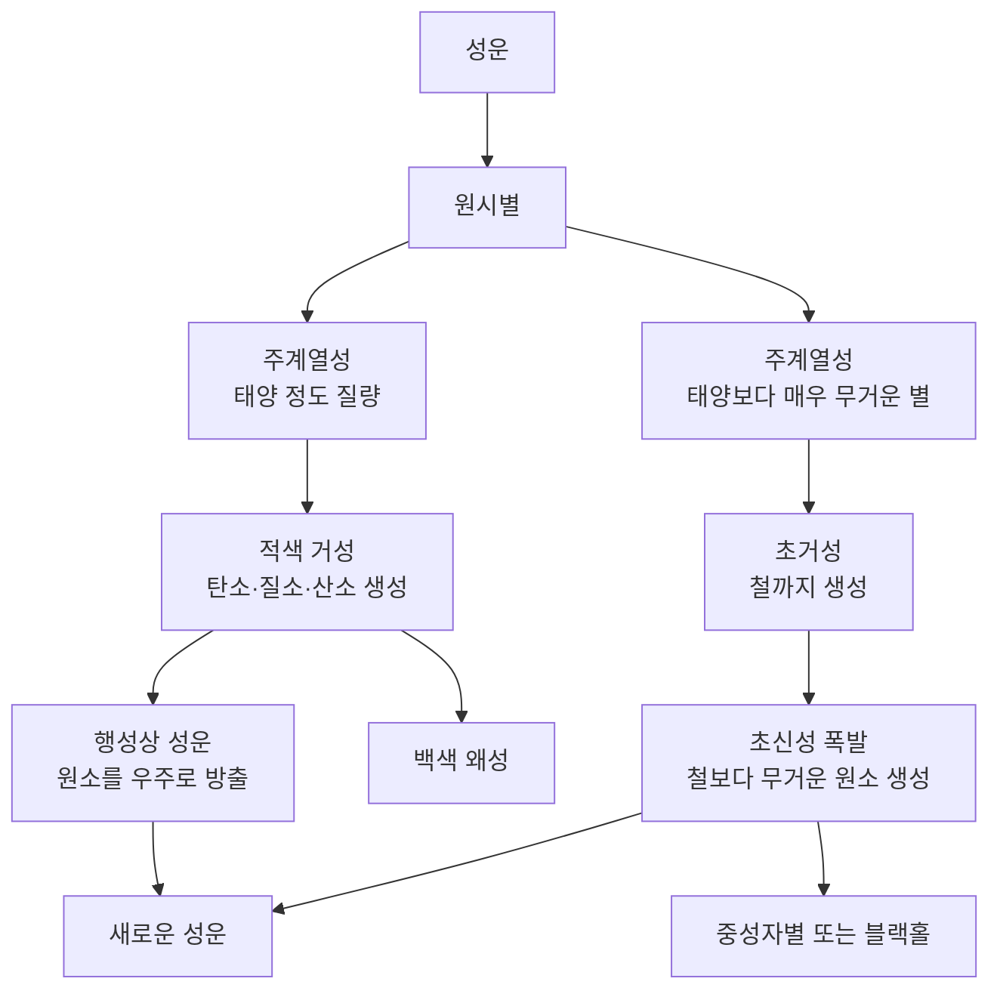
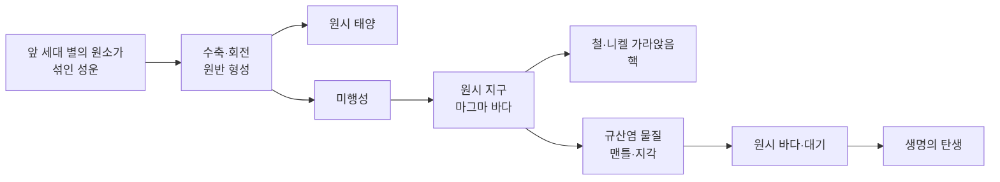

# 2-2. 별의 진화와 원소의 생성 — 우리는 별의 먼지로 만들어졌다

> [!NOTE]
> **성취기준 [10통과1-02-02]** 우주 초기의 원소들로부터 태양계의 재료이면서 생명체를 구성하는 원소들이 형성되는 과정을 통해 지구와 생명의 역사가 우주 역사의 일부분임을 해석할 수 있다.

**학습 목표**

1. 별이 성운에서 탄생하여 중심부의 수소 핵융합으로 빛을 낸다는 것을 설명할 수 있다.
2. 별의 진화 과정에서 별 내부의 핵융합으로 탄소, 질소, 산소가 만들어지는 과정을 정성적으로 설명할 수 있다.
3. 질량이 큰 별의 중심부에서 철까지 만들어지고, 초신성 폭발로 철보다 무거운 원소가 만들어져 우주로 퍼져 나감을 설명할 수 있다.
4. 태양계와 지구의 형성 과정, 지구와 생명체를 구성하는 원소의 기원을 연결하여 지구와 생명의 역사가 우주 역사의 일부분임을 해석할 수 있다.

**이 단원의 학습 사다리**

| 단계 | 무엇을 하나? |
|---|---|
| STEP 1. 중학교 다시 보기 | 성운, 별의 색과 밝기, 태양계, 원자의 구조를 다시 꺼내 본다 |
| STEP 2. 기초 다지기 | 화학 반응과 핵반응의 차이, 중력 수축, 핵융합의 조건, 원자 번호 덧셈을 디딤돌로 놓는다 |
| STEP 3. 핵심 개념 | 별의 탄생 → 탄소·질소·산소 → 초신성과 무거운 원소 → 태양계와 지구 → 별의 먼지인 우리 |
| STEP 4. 오개념 바로잡기 | "별은 불타고 있다?", "태양도 초신성이 된다?" 같은 착각을 바로잡는다 |
| STEP 5. 선택과목·대학 | 질량–에너지 관계, 원자핵의 안정성, 중성자 포획과 중성자별 충돌 |
| STEP 6. 산업·진로 | 핵융합 에너지, 중이온 가속기, 달·소행성 탐사, 원소의 출생지와 산업 |

---

## 🗺️ 단원 들어가기

앞 단원에서 우주 초기에 만들어진 원소는 **수소와 헬륨**뿐이라고 배웠다. 그런데 지금 이 글을 읽고 있는 여러분의 몸을 생각해 보자. 뼈 속의 칼슘, 피 속의 철, 몸무게의 절반이 넘는 산소, 모든 유기물의 뼈대인 탄소……. 이 원소들은 우주가 처음 생겨날 때에는 거의 없었다.

그렇다면 이 원소들은 언제, 어디에서 만들어졌을까? 답은 밤하늘에 있다. 별은 단순히 반짝이는 점이 아니라, 수소와 헬륨을 재료로 더 무거운 원소를 만들어 내는 **우주의 원소 공장**이다. 별이 일생을 마칠 때 그 원소들을 우주에 흩뿌리고, 흩어진 원소들이 다시 모여 태양과 지구, 그리고 우리가 되었다. 천문학자 칼 세이건은 이를 두고 "우리는 별의 물질로 만들어졌다."라고 말했다.

---

## STEP 1. 🔙 중학교 다시 보기

### 연계 개념표

| 중학교 성취기준 | 중학교에서 배운 것 | 고등학교에서 확장되는 것 |
|---|---|---|
| [9과15-02] | 우리은하의 구조, 성운과 성단의 특징 | 성운은 **별이 태어나는 곳**이자 **별이 죽으며 남긴 잔해**이기도 하다 |
| [9과15-01] | 별의 표면 온도와 색, 별의 밝기(등급) | 별이 진화하면 크기·색·밝기가 변한다(예: 붉고 거대한 적색 거성) |
| [9과07-02] | 태양의 표면과 대기에서 일어나는 현상 | 태양이 빛나는 에너지원은 **중심부의 수소 핵융합**이다 |
| [9과07-01] | 태양계 구성 천체, 지구형 행성과 목성형 행성 | 태양계가 성운에서 만들어질 때 **두 종류의 행성이 생긴 까닭** |
| [9과09-01] | 지구계의 구성 요소, 지권의 층상 구조 | 원시 지구에서 무거운 철이 가라앉아 핵이 되며 층상 구조가 생겼다 |
| [9과11-02] | 원자는 양성자·중성자·전자로 이루어지고 양성자 수가 원소를 정한다 | 원자핵이 합쳐져 **양성자 수가 바뀌면 새로운 원소**가 된다 |
| [9과16-03] | 화학 반응에서는 원자의 배열만 바뀌고 원자의 종류와 수는 변하지 않는다 | 핵반응에서는 **원자핵 자체가 바뀌어** 원자의 종류가 달라진다 |

### 준비 운동 (사전 진단)

**Q1.** 성운은 무엇으로 이루어져 있는가? 성운과 성단 중 별이 '태어나는 곳'으로 알맞은 것은?

**Q2.** 산소 원자의 양성자 수는 8이다. 양성자가 6개인 원자가 무엇이 되려면 양성자가 몇 개 더 있어야 하는가?

**Q3.** 탄소가 산소와 반응하여 이산화 탄소가 될 때, 탄소 원자가 다른 원자로 바뀌는가? (예 / 아니요)

**Q4.** 지구형 행성과 목성형 행성의 차이를 질량, 밀도, 주요 구성 물질로 비교하시오.

정답 및 해설

**Q1.** 성운은 우주 공간의 **기체와 티끌**이 모여 구름처럼 보이는 천체이다. 별은 성운에서 태어난다. 성단은 이미 태어난 별들의 무리이다.

**Q2.** 산소가 되려면 양성자가 **2개** 더 있어야 한다. 양성자 수 6은 탄소, 8은 산소이다.

**Q3. 아니요** — 화학 반응에서는 원자의 배열만 바뀌고 탄소 원자는 탄소 원자로 남는다.

**Q4.** 지구형 행성은 질량이 작고 밀도가 크며 주로 암석과 금속으로 이루어져 있다. 목성형 행성은 질량이 크고 밀도가 작으며 주로 수소·헬륨 같은 기체로 이루어져 있다.

---

## STEP 2. 🧱 기초 다지기

### ① 화학 반응과 핵반응은 다르다

| 구분 | 화학 반응 | 핵반응(핵융합) |
|---|---|---|
| 무엇이 바뀌나? | 원자의 **배열**(누구와 결합하나) | 원자핵 **그 자체** |
| 원소의 종류 | 변하지 않는다 | **바뀐다** |
| 관여하는 부분 | 원자의 바깥쪽 전자 | 원자 중심의 원자핵 |
| 예 | 연소, 광합성, 철이 녹스는 반응 | 별 내부에서 수소가 헬륨이 되는 반응 |
| 에너지 규모 | 상대적으로 작다 | 같은 질량당 화학 반응보다 훨씬 크다 |

> [!TIP]
> 💡 **비유** — 화학 반응은 레고 블록을 떼었다 붙였다 하며 **모양을 바꾸는** 것이고, 핵반응은 블록 두 개를 녹여 **새로운 블록 하나를 만드는** 것이다.

### ② 뭉치면 뜨거워진다 — 중력 수축

자전거 바퀴에 바람을 넣을 때 펌프 끝이 뜨거워지는 것을 느껴 본 적이 있을 것이다. 기체를 세게 눌러 압축하면 온도가 올라간다. 우주에서는 **중력**이 이 역할을 한다. 거대한 기체 구름이 자신의 중력으로 수축하면 중심부의 밀도와 온도가 점점 높아진다.

### ③ 원자핵이 합쳐지려면 — 핵융합의 조건

원자핵은 모두 (+) 전하를 띤다. 중학교에서 배웠듯이 같은 종류의 전하는 서로 밀어낸다. 그래서 원자핵끼리 합쳐지게 하려면

- 원자핵들이 **매우 빠르게** 움직여 서로 밀어내는 힘을 이기고 가까이 다가가야 한다 → **초고온**(약 1000만 K 이상) 필요
- 원자핵들이 자주 부딪쳐야 한다 → **높은 밀도** 필요

이 조건이 자연에서 갖추어지는 곳이 바로 **별의 중심부**이다.

### ④ 질량이 아주 조금 줄고, 그만큼 에너지가 나온다

수소 원자핵 4개가 합쳐져 헬륨 원자핵 1개가 되면, 반응 후의 질량이 반응 전보다 **아주 조금 줄어든다.** 이 사라진 질량이 엄청난 에너지로 바뀌어 별이 빛나게 된다. 통합과학에서는 "핵융합에서 질량이 조금 줄어들고 그만큼 에너지가 방출된다"는 정도로 이해하면 충분하다.

### ⑤ 원자 번호 덧셈 — 핵융합을 셈으로 따라가기

원자 번호는 양성자 수이다. 원자핵이 합쳐지면 양성자 수가 더해지므로, 원자 번호를 더해 보면 어떤 원소가 생기는지 어림할 수 있다.

| 원소 | 원자 번호(양성자 수) | 원소 | 원자 번호 |
|---|---|---|---|
| 수소(H) | 1 | 마그네슘(Mg) | 12 |
| 헬륨(He) | 2 | 규소(Si) | 14 |
| 탄소(C) | 6 | 황(S) | 16 |
| 질소(N) | 7 | 칼슘(Ca) | 20 |
| 산소(O) | 8 | 철(Fe) | 26 |
| 네온(Ne) | 10 | 금(Au) | 79 |

예를 들어 헬륨(2) 원자핵 3개가 합쳐지면 2 + 2 + 2 = 6 → **탄소**가 된다.

---

## STEP 3. 📘 핵심 개념

### 2-2-① 별의 탄생 — 성운에서 주계열성까지

우주 초기에 만들어진 수소와 헬륨 기체는 우주 곳곳에서 거대한 구름, 곧 **성운(nebula)** 을 이루었다. 성운 속에서 밀도가 조금 더 높은 부분은 중력으로 기체를 끌어당겨 점점 수축한다.

| 단계 | 일어나는 일 |
|---|---|
| ① 성운의 수축 | 밀도가 높은 부분이 중력으로 수축하며 중심부의 온도가 올라간다 |
| ② 원시별 | 수축하면서 뜨거워진 기체 덩어리가 빛을 내기 시작한다. 아직 핵융합은 일어나지 않는다 |
| ③ 주계열성 | 중심부 온도가 약 1000만 K를 넘으면 **수소 핵융합**이 시작되어 스스로 에너지를 만든다 |

**주계열성(main sequence star)** 은 중심부에서 수소 원자핵이 융합하여 헬륨 원자핵이 되며 빛을 내는 별이다. 별은 일생의 대부분을 주계열성으로 보낸다. 이때 별을 안쪽으로 짓누르는 **중력**과, 핵융합으로 뜨거워진 기체가 바깥으로 밀어내는 **압력**이 균형을 이루어 별은 크기를 일정하게 유지한다.

> [!TIP]
> 💡 **비유** — 주계열성은 '풍선 속 뜨거운 공기'와 '바깥에서 꽉 쥔 손'이 팽팽하게 버티는 상태와 같다. 손(중력)이 세게 쥐면 공기가 더 뜨거워져(핵융합 활발) 다시 밀어내고, 공기가 너무 팽창하면 식어서 손에 밀려 들어간다.

#### 우리 태양은 지금 어디쯤?

| 항목 | 태양의 값(어림값) |
|---|---|
| 현재 단계 | 주계열성 |
| 중심부 온도 | 약 1500만 K |
| 나이 | 약 46억 년 |
| 주계열성으로 머무는 기간 | 약 100억 년 |

태양은 중심부에서 매초 엄청난 양의 수소를 헬륨으로 바꾸며 빛을 내고 있고, 주계열성 단계의 절반 정도를 지났다.

#### 예제 1

수소 핵융합에서는 수소 원자핵 4개가 여러 단계를 거쳐 헬륨 원자핵 1개가 된다. 이 반응에서 (1) 원소의 종류는 바뀌는가? (2) 반응 전후의 질량은 어떻게 되는가? (3) 이 반응이 태양 중심부에서만 일어나고 태양 표면에서는 일어나지 않는 까닭은?

**풀이**
(1) 수소가 헬륨으로 **바뀐다.** 원자핵 자체가 변하는 핵반응이기 때문이다.
(2) 반응 후 질량이 반응 전보다 **조금 줄어들고**, 줄어든 질량만큼 에너지가 방출된다.
(3) 핵융합에는 초고온과 높은 밀도가 필요한데, 이 조건은 중력으로 강하게 압축된 **중심부**에서만 갖추어진다. 태양 표면의 온도는 약 6000 K로 핵융합이 일어나기에는 너무 낮다.

### 2-2-② 별 속 원소 공장 — 탄소, 질소, 산소의 생성

#### 적색 거성이 되다

주계열성 중심부의 수소가 바닥나면 핵융합이 약해져 중력을 버티지 못한 중심부가 수축하며 더 뜨거워진다. 이 열 때문에 별의 바깥층은 크게 부풀어 오르고 표면 온도는 낮아져 붉게 보인다. 이것이 **적색 거성(red giant)** 이다. 태양도 약 50억 년 뒤에는 적색 거성이 될 것으로 예상된다.

#### 헬륨이 탄소와 산소가 되다

적색 거성의 중심부 온도가 약 1억 K에 이르면, 수소 핵융합으로 쌓여 있던 헬륨이 다시 핵융합을 시작한다.

| 핵융합 | 원자 번호로 따라가기 | 생성되는 원소 |
|---|---|---|
| 헬륨 원자핵 3개 → | 2 + 2 + 2 = 6 | **탄소** |
| 탄소 원자핵 + 헬륨 원자핵 → | 6 + 2 = 8 | **산소** |

이렇게 해서 별의 중심부에는 탄소와 산소가 쌓인다. 생명체의 뼈대가 되는 탄소, 우리가 숨 쉬는 산소가 이렇게 별 속에서 처음 만들어졌다.

#### 질소는 어떻게 만들어질까?

탄소와 산소를 가진 별에서는 수소 핵융합이 조금 다른 길로도 일어난다. 탄소·질소·산소 원자핵이 반응을 돕는 중간 단계로 참여하면서 수소가 헬륨으로 바뀌는데, 이 과정을 거치며 **질소**가 쌓인다. 질소는 이렇게 별 내부에서 만들어져, 별이 바깥층을 우주로 날려 보낼 때 함께 퍼져 나간다.

> [!IMPORTANT]
> 통합과학에서는 "별의 진화 과정에서 별 내부의 핵융합으로 **탄소, 질소, 산소**가 만들어진다"는 것을 **정성적으로** 이해하면 된다. 반응의 세부 단계를 외울 필요는 없다.

#### 태양 정도 질량의 별이 맞는 최후

태양과 질량이 비슷한 별은 탄소와 산소까지 만든 뒤 더 이상 핵융합을 이어 가지 못한다.

- **바깥층** → 천천히 우주로 흩어지며 고리나 껍질 모양의 **행성상 성운**이 된다. 이때 별이 만든 탄소, 질소, 산소 등이 우주로 돌아간다.
- **중심부** → 지구만 한 크기로 작고 단단하게 뭉쳐 **백색 왜성**이 되어 천천히 식어 간다.

> [!TIP]
> 💡 **비유** — 별의 일생은 '재료를 받아 제품을 만들고, 마지막에 창고 문을 열어 제품을 내보내는 공장'과 같다. 행성상 성운은 공장이 문을 닫으며 제품(탄소, 질소, 산소)을 우주로 내보내는 장면이다.

#### 예제 2 — 원자 번호로 핵융합 따라가기

다음 핵융합으로 만들어지는 원소를 STEP 2의 표에서 찾으시오.
(1) 산소 원자핵 + 헬륨 원자핵
(2) 탄소 원자핵 2개

**풀이**
(1) 8 + 2 = 10 → **네온(Ne)**
(2) 6 + 6 = 12 → **마그네슘(Mg)**

이처럼 별 속에서는 가벼운 원자핵이 합쳐져 점점 원자 번호가 큰 원소가 만들어진다. 다만 이런 반응이 실제로 일어나려면 점점 더 높은 온도가 필요하다. 원자 번호가 클수록 원자핵의 (+) 전하가 커서 서로 더 세게 밀어내기 때문이다.

### 2-2-③ 무거운 별의 최후 — 철, 그리고 초신성 폭발

#### 양파처럼 층을 이룬 별

질량이 태양보다 훨씬 큰 별(대략 태양 질량의 8~10배 이상)은 중력이 매우 강해 중심부가 더 뜨거워진다. 그래서 탄소와 산소에서 멈추지 않고 네온, 마그네슘, 규소, 황 등을 거쳐 **철**까지 차례로 만들어 낸다. 핵융합이 끝난 재료는 바깥 껍질에 남으므로, 별의 내부는 **양파처럼 층을 이룬다.**

| 위치 | 주로 있는 원소 |
|---|---|
| 가장 바깥 | 수소 |
| ↓ | 헬륨 |
| ↓ | 탄소, 산소 |
| ↓ | 네온, 마그네슘, 산소 |
| ↓ | 규소, 황 |
| 중심 | **철** |

#### 왜 철에서 멈출까?

**철의 원자핵은 매우 안정하다.** 철보다 가벼운 원자핵들은 합쳐질 때 에너지를 내놓지만, 철 원자핵은 다른 원자핵과 합쳐져도 에너지를 얻을 수 없다. 그래서 중심부에 철이 쌓이면 별은 더 이상 핵융합으로 에너지를 만들지 못한다.

#### 초신성 폭발

에너지 공급이 끊긴 중심부는 자신의 엄청난 중력을 버티지 못하고 **순식간에 붕괴**한다. 이어 별의 바깥층이 엄청난 에너지와 함께 우주로 폭발적으로 날아가는데, 이것이 **초신성(supernova) 폭발**이다. 초신성은 한동안 은하 하나에 맞먹을 만큼 밝게 빛난다.

| 초신성 폭발의 결과 | 내용 |
|---|---|
| 무거운 원소의 생성 | 폭발 과정의 엄청난 에너지와 많은 중성자 속에서 **철보다 무거운 원소**(금, 은, 납, 우라늄 등)가 만들어진다 |
| 원소의 방출 | 별이 일생 동안 만든 탄소, 산소, 규소, 철 등과 폭발로 만든 무거운 원소가 우주 공간으로 흩어진다 |
| 남는 천체 | 중심부는 매우 밀도가 큰 **중성자별**이나 **블랙홀**로 남는다 |
| 새 별의 씨앗 | 폭발의 충격파가 주변 성운을 압축하여 새로운 별의 탄생을 도울 수 있다 |

> [!NOTE]
> **역사 속 초신성** — 1054년에 나타난 초신성은 동아시아 기록에 남아 있으며, 그 잔해가 지금의 게성운이다. 또 『조선왕조실록』에는 1604년에 나타난 초신성(케플러 초신성)을 여러 달에 걸쳐 관측한 기록이 남아 있어, 오늘날 천문학 연구에도 활용된다.

#### 예제 3 — 원소의 출생지 찾기

다음 원소들이 주로 만들어진 곳을 (가) 우주 초기, (나) 별 내부의 핵융합, (다) 초신성 폭발 중에서 고르시오.
수소, 탄소, 산소, 철, 금, 우라늄

**풀이**
- 수소 → (가) 우주 초기
- 탄소, 산소 → (나) 별 내부의 핵융합
- 철 → (나) 질량이 큰 별 중심부의 핵융합에서 만들어지고, 초신성 폭발로 우주에 퍼진다
- 금, 우라늄 → (다) 철보다 무거운 원소이므로 초신성 폭발

### 2-2-④ 태양계와 지구의 탄생 — 별의 잔해가 모이다

여러 세대의 별이 태어나고 죽기를 되풀이하는 동안, 우주 공간의 성운에는 수소와 헬륨 외에도 별들이 만든 탄소, 산소, 규소, 철 같은 원소가 조금씩 쌓여 갔다. 약 46억 년 전, 이런 성운 가운데 하나가 수축하여 태양계가 만들어졌다.

| 순서 | 일어난 일 |
|---|---|
| ① 성운의 수축과 회전 | 앞 세대 별들의 원소가 섞인 성운이 중력으로 수축하며 점점 빠르게 회전하고 납작한 원반 모양이 되었다 |
| ② 원시 태양 | 질량의 대부분이 모인 중심부가 뜨거워져 원시 태양이 되었고, 이후 수소 핵융합을 시작해 태양이 되었다 |
| ③ 미행성 | 원반 속의 티끌이 서로 달라붙어 작은 덩어리인 **미행성**이 되었다 |
| ④ 원시 행성 | 미행성들이 충돌·합체하며 점점 커져 행성이 되었다 |

#### 지구형 행성과 목성형 행성이 나뉜 까닭

| 위치 | 원반의 온도 | 뭉칠 수 있었던 물질 | 결과 |
|---|---|---|---|
| 태양 가까이 | 높다 | 녹는점이 높은 **암석(규소·산소·마그네슘)과 금속(철·니켈)** | 작고 밀도가 큰 **지구형 행성** |
| 태양에서 멀리 | 낮다 | 암석·금속에 더해 **얼음**까지 뭉쳐 큰 핵을 만들고, 주변의 **수소·헬륨 기체**를 많이 끌어당김 | 크고 밀도가 작은 **목성형 행성** |

#### 원시 지구의 층상 구조

미행성이 계속 충돌하면서 생긴 열로 원시 지구의 표면은 녹아 **마그마 바다**를 이루었다. 이때 밀도가 큰 **철과 니켈**은 중심으로 가라앉아 **핵**이 되고, 상대적으로 가벼운 규소·산소·마그네슘 등의 물질은 바깥쪽에서 **맨틀과 지각**이 되었다. 이후 지구가 식으면서 원시 바다와 대기가 만들어졌고, 원시 바다에서 생명이 탄생한 것으로 여겨진다.

### 2-2-⑤ 우리는 별의 먼지 — 지구와 생명체 구성 원소의 기원

우주, 지구, 사람 몸을 이루는 원소를 질량 비율로 비교해 보자.

| 순위 | 우주 | 지구 전체 | 지각 | 사람 몸 |
|---|---|---|---|---|
| 1 | 수소 약 74% | 철 약 32% | 산소 약 47% | 산소 약 65% |
| 2 | 헬륨 약 24% | 산소 약 30% | 규소 약 28% | 탄소 약 18% |
| 3 | 산소 약 1% | 규소 약 15% | 알루미늄 약 8% | 수소 약 10% |
| 4 | 탄소 약 0.5% | 마그네슘 약 14% | 철 약 5% | 질소 약 3% |
| 5 | (그 밖의 원소를 모두 합해 약 0.5%) | (나머지) | 칼슘 약 4% | 칼슘 약 1.5% |

(값은 자료에 따라 조금씩 다르며, 경향을 보기 위한 어림값이다.)

#### 표에서 읽어 낼 수 있는 것

1. **우주**는 우주 초기에 만들어진 수소와 헬륨이 거의 전부이다.
2. **지구**에는 수소와 헬륨이 적다. 가벼운 기체는 뜨거운 태양 가까이에서 뭉치지 못하고 날아갔고, 원시 지구의 중력으로 붙잡아 두기 어려웠기 때문이다. 대신 별에서 만들어진 철, 산소, 규소, 마그네슘이 대부분이다.
3. **사람 몸**은 산소, 탄소, 수소, 질소가 대부분이다. 몸무게의 약 60%가 물(수소 + 산소)이고, 단백질·탄수화물·지방 등이 탄소를 뼈대로 하기 때문이다.

#### 내 몸을 이루는 원소의 출생지

| 사람 몸의 원소 | 주로 만들어진 곳 | 몸에서 하는 일(예) |
|---|---|---|
| 수소 | 우주 초기(빅뱅 직후) | 물, 모든 유기물의 구성 |
| 탄소 | 별 내부의 헬륨 핵융합 | 모든 유기물의 뼈대 |
| 질소 | 별 내부의 핵융합 | 단백질, 유전 물질(DNA) |
| 산소 | 별 내부의 헬륨 핵융합 | 물, 세포 호흡 |
| 칼슘, 인 | 질량이 큰 별의 내부와 초신성 폭발 | 뼈와 이 |
| 철 | 질량이 큰 별의 중심부와 초신성 폭발 | 혈액 속 산소 운반 |
| 아이오딘 | 철보다 무거운 원소 — 초신성 폭발 등 | 갑상샘 호르몬 |

> [!IMPORTANT]
> 우리 몸의 수소는 약 138억 년 전 우주 초기에, 탄소·질소·산소는 별 속에서, 철과 아이오딘은 무거운 별의 최후에 만들어졌다. **지구와 생명의 역사는 우주 역사의 일부분**이며, 우리는 말 그대로 별이 남긴 원소로 만들어진 '별의 먼지'이다.

#### 예제 4 — 자료 해석

지구 전체에는 수소가 매우 적은데, 사람 몸에는 질량의 약 10%가 수소이다. 이 차이를 어떻게 설명할 수 있는가? 또 지구와 사람 몸 모두에 **헬륨**이 거의 없는 까닭은 무엇인가?

**풀이**
사람 몸에는 물과 유기물이 많은데, 이들은 모두 수소를 포함한다. 생명체는 지구에 있는 수소를 물과 유기물의 형태로 모아 몸을 만든 것이다. 수소 원자는 가볍지만 몸속 원자 수로는 가장 많다.
헬륨은 다른 원소와 거의 결합하지 않아 화합물을 만들지 않는다. 그래서 원시 지구가 만들어질 때 고체에 섞여 들어가지 못하고 기체로 날아갔으며, 생명체의 몸을 이루는 물질에도 들어가지 않는다. (헬륨이 결합하지 않는 까닭은 다음 단원 2-3에서 배운다.)

---

## STEP 4. ⚠️ 오개념 바로잡기

| 흔한 오개념 | 올바른 개념 | 왜 그럴까? |
|---|---|---|
| 별은 장작처럼 **불타고** 있다 | 별은 중심부의 **핵융합**으로 빛을 낸다 | 연소는 산소가 필요한 화학 반응이다. 별의 에너지는 원자핵이 합쳐지며 줄어든 질량에서 나온다 |
| 태양도 언젠가 초신성 폭발을 한다 | 태양 정도 질량의 별은 적색 거성 → **행성상 성운과 백색 왜성**으로 일생을 마친다 | 초신성 폭발은 태양보다 훨씬 무거운 별의 최후이다 |
| 모든 원소는 빅뱅 때 만들어졌다 | 우주 초기에는 **수소와 헬륨**만 만들어졌다 | 탄소부터 철까지는 별 내부에서, 철보다 무거운 원소는 초신성 폭발 등에서 만들어졌다 |
| 별은 핵융합으로 우라늄까지 계속 만들며 에너지를 낸다 | 별 중심부의 핵융합은 **철**에서 멈춘다 | 철 원자핵은 매우 안정하여 더 합쳐져도 에너지를 얻을 수 없다 |
| 핵융합도 화학 반응처럼 원소의 종류가 그대로이다 | 핵융합에서는 원자핵이 바뀌어 **새로운 원소**가 생긴다 | 양성자 수(원자 번호)가 바뀌기 때문이다 |
| 사람 몸에 가장 많은 원소는 탄소이다 | 질량으로는 **산소**가 가장 많다(약 65%) | 몸무게의 약 60%가 물이고, 물 질량의 대부분이 산소이다 |
| 지구의 원소는 지구에서 만들어졌다 | 지구의 원소는 **앞 세대의 별들**이 만든 것이 모인 것이다 | 지구에는 핵융합이 일어날 만한 온도와 밀도가 없다 |

---

## STEP 5. 🎓 선택과목·대학으로 한 걸음 더

> [!CAUTION]
> 이 절은 **통합과학 교육과정 범위 밖의 심화 내용**으로 평가 대상이 아니다. "이 개념이 앞으로 어디까지 이어지는가"를 맛보기로 보여 주기 위한 내용이다.

### 고2·3 선택과목과의 연결

| 과목 | 이어지는 내용 |
|---|---|
| 지구과학 | 별과 우주의 진화 — 별의 물리량, H-R도, 별의 진화와 내부 구조 |
| 행성우주과학 | 태양과 별의 관측, 우주탐사와 행성계 — 별의 관측과 행성계의 형성 |
| 지구시스템과학 | 지구 탄생과 생동하는 지구 — 원시 지구의 형성과 분화 |

### ① 질량–에너지 관계: $E = mc^2$

아인슈타인의 특수 상대성 이론에 따르면 질량은 에너지로 바뀔 수 있다.

$$
E = \Delta m\, c^2 \qquad (c \approx 3\times10^{8}\ \mathrm{m/s})
$$

수소 원자핵 4개가 헬륨 원자핵 1개가 될 때 질량은 약 0.7% 줄어든다. 수소 1 kg이 모두 헬륨이 된다면

$$
E = 0.007\ \mathrm{kg} \times (3\times10^{8}\ \mathrm{m/s})^2 = 6.3\times10^{14}\ \mathrm{J}
$$

이는 같은 질량의 석탄을 태울 때 나오는 에너지(약 $3\times10^{7}\ \mathrm{J}$)의 약 2천만 배에 이른다. 별이 수십억 년 동안 빛날 수 있는 까닭이다.

### ② 원자핵의 안정성과 '철의 벽'

원자핵을 이루는 양성자·중성자 하나당 묶여 있는 에너지(**핵자당 결합 에너지**)를 원자 번호에 따라 그리면, 철 부근에서 가장 크다. 철보다 가벼운 원자핵은 **합쳐질 때**(핵융합), 철보다 훨씬 무거운 원자핵은 **쪼개질 때**(핵분열) 에너지가 나온다. 원자력 발전이 우라늄의 핵분열을, 별과 핵융합 연구가 수소의 핵융합을 이용하는 것은 모두 이 곡선으로 설명된다.

### ③ 철보다 무거운 원소는 어떻게? — 중성자 포획

중성자는 전하가 없어 원자핵에 밀려나지 않고 쉽게 들어간다. 원자핵이 중성자를 흡수한 뒤 그 안에서 중성자가 양성자로 바뀌면 원자 번호가 1 커진다. 이 과정이 되풀이되며 무거운 원소가 만들어진다.

| 과정 | 특징 | 일어나는 곳 |
|---|---|---|
| 느린 중성자 포획(s-과정) | 중성자를 천천히 하나씩 흡수 | 일생 후반부의 적색 거성 |
| 빠른 중성자 포획(r-과정) | 짧은 시간에 중성자를 대량으로 흡수 | 초신성 폭발, **중성자별 충돌** |

2017년에는 두 중성자별이 충돌하며 낸 **중력파**와 빛이 함께 관측되었고, 그 빛의 스펙트럼에서 무거운 원소가 대량으로 만들어진 흔적이 확인되었다. 오늘날 천문학자들은 금과 같은 무거운 원소의 상당 부분이 초신성뿐 아니라 중성자별 충돌에서도 만들어졌다고 본다. 과학 지식은 새로운 관측에 따라 계속 다듬어진다.

### ④ 질량이 클수록 짧고 굵게 산다

질량이 큰 별은 중심부가 훨씬 뜨거워 핵융합이 매우 빠르게 일어난다. 그래서 연료가 많아도 수명은 오히려 짧다. 태양은 주계열성으로 약 100억 년을 머물지만, 태양 질량의 10배쯤 되는 별은 수천만 년 정도에 불과하다. 대학 '천체물리학'에서는 별 내부의 압력·온도·밀도 분포를 미분 방정식으로 풀어 이런 진화를 계산한다.

### 고등학교 vs 대학교

| 구분 | 고등학교 통합과학 | 대학교(천체물리학·핵물리학·지구화학) |
|---|---|---|
| 핵융합 | 탄소·질소·산소 생성을 정성적으로 | 반응 단계별 반응률, $E=mc^2$로 에너지 계산 |
| 무거운 원소 | 초신성 폭발로 생성 | s-과정·r-과정, 중성자별 충돌, 원소 존재비 곡선 |
| 별의 진화 | 질량에 따른 두 갈래의 일생 | 항성 구조 방정식, 컴퓨터 시뮬레이션 |
| 태양계 형성 | 성운 → 원반 → 미행성 → 행성 | 원시 행성 원반의 물리, 운석의 동위 원소로 나이 측정 |
| 관련 전공 | — | 천문우주학, 물리학, 원자핵공학, 지구환경과학, 행성과학 |

---

## STEP 6. 🏭 산업 현장과 진로 연결

### 사례 1. 핵융합 에너지 — 땅 위에 작은 태양을 만들다

- **원리** 태양이 빛나는 원리인 핵융합을 발전에 이용하려는 연구이다. 지구에서는 태양 중심부만큼 밀도를 높일 수 없으므로, 대신 온도를 1억 ℃ 이상으로 훨씬 높여 수소의 한 종류(중수소, 삼중수소)를 융합시킨다.
- **어떻게 가두나** 이렇게 뜨거운 플라스마는 어떤 그릇에도 담을 수 없으므로, 강한 자기장으로 공중에 띄워 도넛 모양의 장치 안에 가둔다.
- **우리나라** 한국핵융합에너지연구원의 초전도 핵융합 연구 장치 **KSTAR**는 1억 ℃가 넘는 초고온 플라스마를 수십 초 동안 유지하는 실험에 성공하였다. 우리나라는 프랑스에 건설 중인 **국제핵융합실험로(ITER)** 공동 개발에도 참여하고 있다.
- **핵심** 연료를 바닷물 등에서 얻을 수 있고 온실가스를 거의 내뿜지 않아 미래 에너지 후보로 연구되고 있지만, 상용화까지는 아직 해결할 과제가 많다.

### 사례 2. 핵물리와 중이온 가속기 — 별 속 원소 공장을 실험실에서

- **원리** 별과 초신성 속에서 무거운 원소가 만들어지는 과정에는, 지구에서는 금방 사라지는 불안정한 원자핵이 많이 관여한다. 가속기로 원자핵을 아주 빠르게 가속해 충돌시키면 이런 원자핵을 만들어 연구할 수 있다.
- **우리나라** 기초과학연구원(IBS)이 대전에 구축한 중이온 가속기 **라온(RAON)** 은 희귀한 원자핵을 만들어 원소의 기원, 원자핵의 구조 등을 연구하는 데 쓰인다.
- **확장** 가속기 기술은 암 치료(중입자·양성자 치료), 신소재 분석, 반도체 소자의 방사선 내성 시험 등 의료·산업 분야로도 이어진다.

### 사례 3. 달·소행성 탐사 — 태양계의 재료를 직접 분석하다

- **원리** 소행성과 달에는 약 46억 년 전 태양계가 만들어질 때의 물질이 비교적 잘 남아 있다. 이를 분석하면 태양계의 재료가 무엇이었는지 알 수 있다.
- **우리나라** 2022년 발사된 우리나라 최초의 달 궤도선 **다누리**에는 한국지질자원연구원이 개발한 **감마선 분광기**가 실려, 달 표면에서 나오는 감마선의 스펙트럼으로 달 표면의 원소 분포를 조사한다. 앞 단원의 '스펙트럼으로 원소 알아내기'가 우주 자원 탐사에 쓰이는 사례이다.
- **세계** 일본의 하야부사2와 미국의 오시리스-렉스는 소행성 표면의 시료를 지구로 가져왔고, 그 속에서 생명체 구성 물질과 관련된 유기물이 검출되어 생명 재료의 기원 연구에 쓰이고 있다.

### 사례 4. 원소의 출생지와 오늘의 산업

우리가 산업에서 쓰는 원소도 모두 우주 어딘가에서 태어났다.

| 원소 | 출생지 | 산업에서의 쓰임 |
|---|---|---|
| 헬륨 | 주로 우주 초기 | 반도체 공정, MRI 장비의 초전도 자석 냉각 |
| 탄소 | 별 내부 | 강철, 탄소 섬유, 2차전지 음극재(흑연) |
| 규소 | 질량이 큰 별 내부 | 반도체 웨이퍼, 태양 전지 |
| 철 | 질량이 큰 별의 중심부, 초신성 | 건축·자동차·조선 산업의 강철 |
| 금 | 초신성 폭발, 중성자별 충돌 | 반도체 패키지와 전자 부품의 연결 소재 |
| 우라늄 | 초신성 폭발, 중성자별 충돌 | 원자력 발전 연료 |

> [!TIP]
> 금과 우라늄처럼 철보다 무거운 원소는 매우 드문 사건에서만 만들어지므로 우주 전체에서도 양이 적다. 희귀한 원소가 비싸고, 재활용(도시 광산)이 중요한 까닭 가운데 하나이다.

### 관련 진로와 학과

| 진로 | 하는 일 | 관련 학과 |
|---|---|---|
| 천체물리학자 | 별의 진화와 원소 생성 연구, 관측·시뮬레이션 | 천문우주학, 물리학 |
| 핵융합·원자력 연구원 | 핵융합 장치 운전, 플라스마 연구, 원자로 설계 | 원자핵공학, 물리학, 전기공학 |
| 가속기 과학자·의학물리학자 | 가속기 운영, 희귀 원자핵 연구, 방사선 치료 | 물리학, 원자핵공학, 의학물리학 |
| 행성과학자·우주 자원 연구원 | 탐사선 관측 자료와 시료로 행성·소행성 성분 분석 | 지구환경과학, 천문우주학, 항공우주공학 |
| 지구화학자 | 암석·운석의 원소 분석으로 지구 형성 연구 | 지질학, 지구환경과학, 화학 |

---

## 🔬 탐구 활동 — 지구와 생명체의 구성 성분 비교하여 우주와 지구 역사를 통한 유래 탐구하기

### 활동 A. 우주·지구·생명체의 원소 비교 그래프 만들기 (모둠 활동)

**목표** 우주, 지각, 사람 몸의 구성 원소를 비교하여 공통점과 차이점을 찾고, 원소의 기원을 우주의 역사와 연결하여 설명한다.

**준비물** STEP 3의 원소 비율 표(또는 교사가 제공하는 자료), 모눈종이나 스프레드시트 프로그램, 색연필

**과정**
1. 우주, 지각, 사람 몸에서 질량 비율이 큰 원소 5가지를 각각 막대그래프(또는 원그래프)로 나타낸다.
2. 세 그래프에 **공통으로 등장하는 원소**와 **한 곳에만 많은 원소**를 찾아 표시한다.
3. 각 원소가 주로 만들어진 곳(우주 초기 / 별 내부 / 초신성 폭발)을 색으로 구분하여 칠한다.

**결과 기록**

| 원소 | 우주 | 지각 | 사람 몸 | 주로 만들어진 곳 |
|---|---|---|---|---|
| 수소 | | | | |
| 헬륨 | | | | |
| 탄소 | | | | |
| 산소 | | | | |
| 규소 | | | | |
| 철 | | | | |

### 활동 B. '원소의 출생지 주기율표' 만들기

1. 원자 번호 1~30번까지의 원소가 적힌 빈 주기율표를 준비한다.
2. 교과서와 신뢰할 수 있는 과학 기관 자료를 조사하여, 각 원소가 주로 만들어진 곳에 따라 색을 칠한다. (예: 우주 초기 — 노랑, 질량이 작은 별 — 초록, 질량이 큰 별과 초신성 — 빨강)
3. 사람 몸을 이루는 주요 원소(산소, 탄소, 수소, 질소, 칼슘, 인)에 별표를 붙인다.

**생각해 보기**
1. 지각과 사람 몸에 공통으로 가장 많은 원소는 무엇인가? 이 원소는 어디에서 만들어졌는가?
2. 우주에는 수소와 헬륨이 대부분인데, 지구에는 왜 적을까?
3. 사람 몸을 이루는 원소 가운데 우주 초기에 만들어진 것과 별에서 만들어진 것을 구분하고, "지구와 생명의 역사는 우주 역사의 일부분이다."라는 문장의 뜻을 자신의 말로 설명해 보자.

> [!NOTE]
> 원소의 기원은 지금도 연구가 진행 중이다. 자료를 조사할 때는 출처(공공 연구 기관, 대학, 학술 자료)를 확인하고, 자료마다 수치가 조금씩 다를 수 있음을 기록해 두자.

---

## ✅ 개념 확인 문제

### 기본

**1.** 별이 스스로 빛을 내는 에너지원으로 옳은 것은?
① 중심부에서 일어나는 연소 반응 ② 중심부에서 일어나는 핵융합 반응 ③ 표면에서 일어나는 핵분열 반응 ④ 주변 행성에서 반사된 빛

정답 및 해설

**정답 ②**

별은 초고온·고밀도의 중심부에서 원자핵이 합쳐지는 핵융합으로 에너지를 만든다. 연소는 산소가 필요한 화학 반응이며, 별의 에너지원이 아니다.

**2.** 다음 별의 진화 과정에서 빈칸에 알맞은 말을 쓰시오.
"성운 → 원시별 → ( ㄱ ) → 적색 거성 → 행성상 성운 + ( ㄴ )"
(단, 태양 정도의 질량을 가진 별이다.)

정답 및 해설

**정답** ㄱ: 주계열성, ㄴ: 백색 왜성

**3.** 헬륨 원자핵 3개가 융합하여 만들어지는 원소의 이름과 원자 번호를 쓰시오.

정답 및 해설

**정답** 탄소, 원자 번호 6

헬륨의 원자 번호(양성자 수)는 2이므로 2 + 2 + 2 = 6 → 탄소이다.

**4.** 철보다 무거운 원소인 금과 우라늄이 만들어지는 대표적인 과정을 쓰시오.

정답 및 해설

**정답** 초신성 폭발

질량이 큰 별은 중심부에서 철까지만 핵융합으로 만들 수 있다. 철보다 무거운 원소는 초신성 폭발 과정의 엄청난 에너지와 많은 중성자 속에서 만들어진다.

### 응용

**5.** 질량이 태양의 약 20배인 별의 내부 구조에 대한 설명으로 옳은 것을 **모두** 고르시오.
ㄱ. 중심으로 갈수록 원자 번호가 큰 원소가 주로 분포한다.
ㄴ. 중심부의 철은 계속 핵융합하여 우라늄까지 만든다.
ㄷ. 중심부에 철이 쌓이면 에너지 공급이 끊겨 결국 중심부가 붕괴한다.

정답 및 해설

**정답 ㄱ, ㄷ**

ㄱ. 바깥부터 수소 → 헬륨 → 탄소·산소 → … → 철 순으로 양파 같은 층을 이룬다.
ㄴ. 철 원자핵은 매우 안정하여 핵융합으로 에너지를 얻을 수 없으므로 중심부의 핵융합은 철에서 멈춘다.
ㄷ. 에너지 공급이 끊긴 중심부는 중력을 버티지 못하고 붕괴하며, 이어 초신성 폭발이 일어난다.

**6.** 다음은 지각과 사람 몸을 이루는 원소의 질량 비율 상위 4개이다.

| 순위 | 지각 | 사람 몸 |
|---|---|---|
| 1 | 산소 | 산소 |
| 2 | 규소 | 탄소 |
| 3 | 알루미늄 | 수소 |
| 4 | 철 | 질소 |

(1) 두 자료에 공통으로 1위인 원소가 처음 만들어진 곳을 쓰시오. (2) 사람 몸에서 2~4위인 원소 가운데 우주 초기에 만들어진 원소를 쓰시오. (3) 이 자료를 근거로 "생명의 역사는 우주 역사의 일부분이다."를 한 문장으로 설명하시오.

정답 및 해설

**정답**
(1) 별 내부(헬륨 핵융합)
(2) 수소
(3) 예시: 지구의 암석과 사람의 몸을 이루는 원소는 우주 초기에 만들어진 수소와 별 속에서 만들어진 산소·탄소·질소 등으로 이루어져 있으므로, 생명체의 재료는 우주가 진화해 온 역사 속에서 만들어진 것이다.

**7.** 태양계 형성 과정에서 태양에 가까운 곳에는 지구형 행성이, 먼 곳에는 목성형 행성이 만들어진 까닭을 원반의 온도와 연결하여 설명하시오.

정답 및 해설

**예시 답안**
태양 가까이는 온도가 높아 녹는점이 높은 암석과 금속만 고체로 뭉칠 수 있었다. 그래서 작고 밀도가 큰 지구형 행성이 만들어졌다. 태양에서 먼 곳은 온도가 낮아 얼음까지 고체로 뭉쳐 큰 핵을 만들 수 있었고, 이 핵이 주변의 수소·헬륨 기체를 많이 끌어당겨 크고 밀도가 작은 목성형 행성이 되었다.

### 융합·서술형

**8. [산업 연계]** 한 학생이 "핵융합 발전은 태양과 똑같은 방법으로 에너지를 만든다."라고 말했다. 이 말에서 **같은 점**과 **다른 점**을 각각 하나 이상 찾아 서술하시오.

정답 및 해설

**예시 답안**
같은 점: 가벼운 원자핵(수소 종류)이 합쳐져 더 무거운 원자핵(헬륨)이 되면서, 반응 후 줄어든 질량만큼 에너지가 나온다는 원리가 같다.
다른 점: 태양은 거대한 중력으로 중심부를 압축하여 높은 밀도와 약 1500만 K의 온도를 만든다. 지구의 핵융합 장치는 그런 중력이 없으므로 밀도가 낮은 대신 온도를 1억 ℃ 이상으로 더 높이고, 뜨거운 플라스마를 강한 자기장으로 가둔다. 또 사용하는 연료도 중수소와 삼중수소처럼 반응이 잘 일어나는 수소의 종류이다.

**채점 포인트** ① 핵융합으로 질량이 줄며 에너지 발생(같은 점) ② 중력 대신 자기장·더 높은 온도(다른 점)

**9. [대학·우주 연계]** 어떤 별의 스펙트럼을 분석했더니 수소와 헬륨의 선은 강하지만 탄소, 산소, 철 등 무거운 원소의 선은 태양보다 훨씬 약했다. 반대로 태양의 스펙트럼에서는 무거운 원소의 선이 비교적 뚜렷하다. (1) 두 별 중 어느 쪽이 더 이른 시기에 태어났다고 볼 수 있는지 쓰고, (2) 그렇게 판단한 근거를 별의 진화와 원소의 순환으로 설명하시오.

정답 및 해설

**예시 답안**
(1) 무거운 원소가 적은 별이 더 이른 시기에 태어났다고 볼 수 있다.
(2) 우주 초기에는 수소와 헬륨만 있었다. 무거운 원소는 별 내부의 핵융합과 초신성 폭발로 만들어져 우주에 흩어지고, 이 원소가 섞인 성운에서 다음 세대의 별이 태어난다. 별의 탄생과 죽음이 되풀이될수록 성운 속 무거운 원소는 늘어난다. 따라서 무거운 원소가 거의 없는 별은 그런 원소가 쌓이기 전 이른 시기에 태어났고, 태양은 여러 세대의 별이 만든 원소가 섞인 성운에서 비교적 나중에 태어난 별이다.

**채점 포인트** ① 우주 초기 원소는 수소·헬륨 ② 별의 진화로 무거운 원소 생성·방출 ③ 세대가 거듭될수록 무거운 원소 증가

---

## 📝 한눈에 정리

### 핵심 요약

- 별은 성운이 중력으로 수축하여 태어나며, 중심부 온도가 약 1000만 K를 넘으면 **수소 핵융합**을 시작해 **주계열성**이 된다.
- 핵융합에서는 원자핵이 바뀌어 새로운 원소가 생기고, 줄어든 질량만큼 에너지가 나온다.
- 주계열성 이후 **적색 거성** 단계에서 헬륨 핵융합으로 **탄소·산소**가 만들어지고, 별 내부의 핵융합 과정에서 **질소**도 만들어진다.
- 질량이 큰 별은 중심부에서 **철**까지 만들고, 이어지는 **초신성 폭발**로 **철보다 무거운 원소**가 만들어져 우주로 퍼진다.
- 약 46억 년 전, 앞 세대 별들의 원소가 섞인 성운이 수축하여 태양과 행성이 만들어졌고, 원시 지구에서 철이 가라앉아 핵, 규산염 물질이 맨틀·지각이 되었다.
- 우리 몸의 수소는 우주 초기에, 탄소·질소·산소·칼슘·철 등은 별에서 만들어졌다. **지구와 생명의 역사는 우주 역사의 일부분**이다.

### 핵심 용어

| 용어 | 뜻 |
|---|---|
| 성운 | 우주 공간의 기체와 티끌이 모인 구름 모양의 천체. 별이 태어나는 곳 |
| 핵융합 | 가벼운 원자핵이 합쳐져 더 무거운 원자핵이 되는 반응. 질량이 조금 줄며 에너지 방출 |
| 주계열성 | 중심부의 수소 핵융합으로 빛을 내는 별. 별은 일생의 대부분을 이 단계로 보낸다 |
| 적색 거성 | 중심부의 수소가 바닥난 뒤 바깥층이 크게 부풀어 붉게 보이는 별 |
| 행성상 성운 | 태양 정도 질량의 별이 일생 마지막에 바깥층을 우주로 날려 보내 생긴 성운 |
| 백색 왜성 | 태양 정도 질량의 별이 남긴 작고 밀도가 큰 중심부 |
| 초신성 폭발 | 질량이 큰 별이 일생 마지막에 중심부가 붕괴하며 일으키는 거대한 폭발 |
| 미행성 | 원시 태양계 원반에서 티끌이 뭉쳐 생긴 작은 천체. 행성의 재료 |

### 다음 단원으로

별은 우주에 100가지가 넘는 원소를 만들어 놓았다. 그런데 이 원소들을 원자 번호 순서로 늘어놓으면 놀랍게도 **비슷한 성질이 일정한 간격으로 되풀이**된다. 다음 단원에서는 이 규칙성을 담은 **주기율표**를 들여다보고, 원자 속 전자의 배치로 그 규칙성을 설명한 뒤, 헬륨처럼 결합하지 않는 원소와 달리 산소·탄소·수소 같은 원소들이 **왜 서로 결합하려 하는지** 그 이유를 밝혀 본다.
