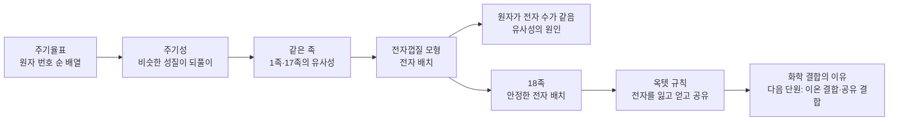
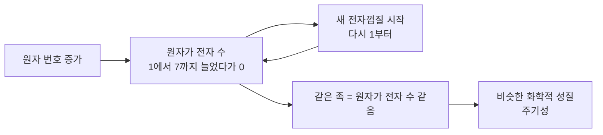
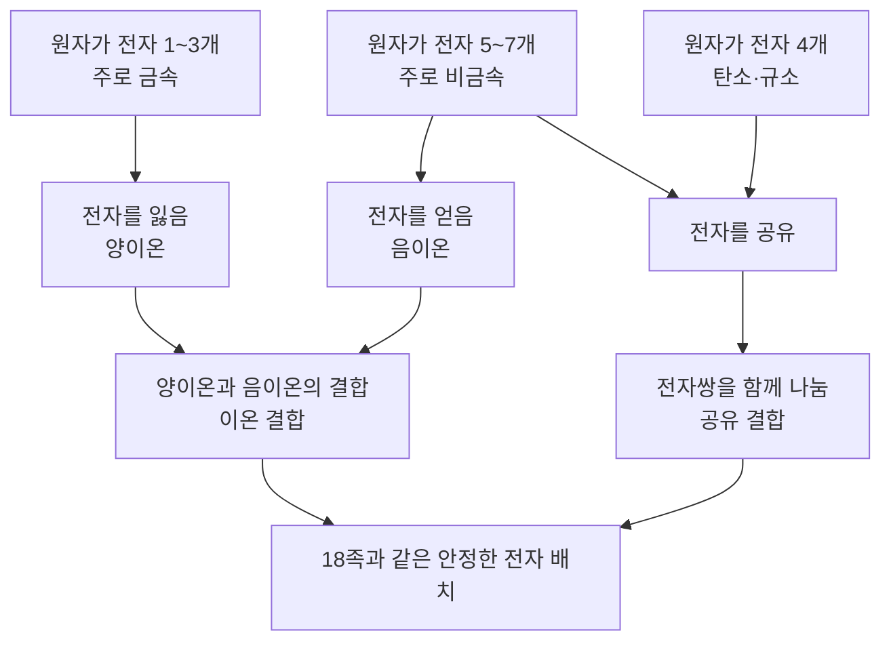

# 2-3. 원소의 주기성과 화학 결합의 이유 — 원자들이 '여덟 개'를 원하는 까닭

> [!NOTE]
> **성취기준 [10통과1-02-03]** 세상을 구성하는 원소들의 성질이 주기성을 나타내는 현상을 통해 자연의 규칙성을 도출하고, 지구와 생명체를 구성하는 주요 원소들이 결합을 형성하는 이유를 해석할 수 있다.

**학습 목표**

1. 주기율표의 주기와 족을 알고, 원자 번호 순으로 배열한 원소의 성질이 주기적으로 되풀이됨을 설명할 수 있다.
2. 1족 원소(알칼리 금속)와 17족 원소(할로젠)의 성질을 비교하여 같은 족 원소가 비슷한 화학적 성질을 가짐을 설명할 수 있다.
3. 전자껍질 모형으로 원자 번호 1~20번 원소의 전자 배치를 나타내고, 원자가 전자 수와 족의 관계를 설명할 수 있다.
4. 18족 원소의 안정한 전자 배치와 비교하여, 지구와 생명체를 구성하는 주요 원소들이 화학 결합을 형성하는 이유를 설명할 수 있다.

**이 단원의 학습 사다리**

| 단계 | 무엇을 하나? |
|---|---|
| STEP 1. 중학교 다시 보기 | 원소와 원자, 주기율표, 이온을 다시 꺼내 본다 |
| STEP 2. 기초 다지기 | 원자 번호와 전자 수, 전기력, 금속과 비금속, 주기율표 읽는 법을 디딤돌로 놓는다 |
| STEP 3. 핵심 개념 | 주기율표와 주기성 → 1족 → 17족 → 전자껍질과 전자 배치 → 18족과 결합의 이유 |
| STEP 4. 오개념 바로잡기 | "Na⁺는 네온이 된 것?", "18족의 원자가 전자는 8개?" 같은 착각을 바로잡는다 |
| STEP 5. 선택과목·대학 | 오비탈과 전자 배치, 이온화 에너지, 옥텟 규칙의 한계 |
| STEP 6. 산업·진로 | 2차전지의 리튬, 소독과 반도체 식각의 할로젠, 공정 가스로 쓰이는 18족 |

---

## 🗺️ 단원 들어가기

여러분의 주머니 속 스마트폰 배터리에는 **리튬**이, 수영장 물을 소독하는 약품에는 **염소**가, 반도체 공장의 레이저에는 **아르곤**과 **네온**이 쓰인다. 리튬은 물에 닿으면 수소 기체를 내며 반응하는 금속이고, 염소는 자극적인 냄새가 나는 기체이며, 아르곤은 거의 아무것과도 반응하지 않는 기체이다. 성질이 이렇게 제각각인 원소들 사이에도 규칙이 있을까?

1869년 러시아의 화학자 멘델레예프는 당시 알려진 60여 가지 원소를 카드에 적어 늘어놓다가 **비슷한 성질이 일정한 간격으로 되풀이된다**는 사실을 발견하였다. 그는 빈칸을 남겨 두고 "아직 발견되지 않은 원소가 여기에 들어갈 것"이라고 예언했고, 그 예언은 몇 년 뒤 실제로 들어맞았다. 이 단원에서는 이 놀라운 규칙성의 정체가 원자 속 **전자의 배치**에 있다는 것을 밝히고, 원자들이 서로 결합하는 이유까지 해석해 본다.

---

## STEP 1. 🔙 중학교 다시 보기

### 연계 개념표

| 중학교 성취기준 | 중학교에서 배운 것 | 고등학교에서 확장되는 것 |
|---|---|---|
| [9과11-01] | 원소와 화합물의 정의, 화학식 표현 | 원소들이 **왜** 화합물을 만드는가 |
| [9과11-02] | 원자는 양성자·중성자·전자로 이루어지며 양성자 수에 따라 원소가 달라진다 | 전자가 원자핵 둘레의 **전자껍질**에 규칙적으로 배치된다 |
| [9과11-03] | 원소는 양성자 수에 따라 주기율표에 배치되며, 1족의 물과의 반응성, 18족의 안정성처럼 성질이 비슷한 원소가 있다 | 비슷한 성질이 **왜 되풀이되는지**(주기성)를 전자 배치로 설명한다 |
| [9과11-04] | 원자가 전자를 잃으면 양이온, 얻으면 음이온이 된다 | 나트륨은 왜 +1, 염소는 왜 −1 이온이 되는지 **18족과 비교**하여 설명한다 |
| [9과14-01] | 원자 모형, (+) 전하와 (−) 전하 사이의 전기력 | 원자핵(+)이 전자(−)를 붙잡는 힘으로 원소의 반응성을 해석한다 |
| [9과16-01] | 화학 변화에서는 새로운 물질이 생성된다 | 화학 변화는 원자들이 **전자를 주고받거나 함께 나누며** 결합을 바꾸는 과정이다 |

### 준비 운동 (사전 진단)

**Q1.** 산소 원자는 양성자가 8개이다. 전기적으로 중성인 산소 원자의 전자 수는?

**Q2.** 주기율표에서 같은 세로줄을 무엇이라 하고, 같은 가로줄을 무엇이라 하는가?

**Q3.** 나트륨 원자가 전자 1개를 잃으면 어떤 이온이 되는가? 이온식으로 쓰시오.

**Q4.** 헬륨, 네온, 아르곤의 공통점을 한 가지 쓰시오.

정답 및 해설

**Q1. 8개** — 중성 원자는 양성자 수와 전자 수가 같다.

**Q2.** 세로줄은 **족**, 가로줄은 **주기**이다.

**Q3.** 나트륨 이온, $\mathrm{Na^+}$ — 전자(−)를 1개 잃었으므로 (+) 전하가 1만큼 많아진다.

**Q4.** 모두 18족 원소로, 다른 물질과 거의 반응하지 않는 **안정한** 기체이다. (색깔이 없는 기체라는 것도 공통점이다.)

---

## STEP 2. 🧱 기초 다지기

### ① 원자 번호 = 양성자 수 = 중성 원자의 전자 수

$$
\text{원자 번호} = \text{양성자 수} = \text{(중성 원자의) 전자 수}
$$

원소의 정체는 **양성자 수**가 정한다. 반면 원소가 다른 원소와 **어떻게 반응하는지**는 주로 **전자**, 그중에서도 가장 바깥쪽 전자가 정한다. 이 단원의 열쇠는 이 두 문장이다.

### ② 원자핵은 전자를 전기력으로 붙잡는다

원자핵(+)과 전자(−)는 서로 끌어당긴다. 중학교에서 배운 전기력이다. 두 전하 사이의 전기력은 **가까울수록 세다.** 그러므로 원자핵에서 멀리 떨어진 바깥쪽 전자는 상대적으로 약하게 붙잡혀 있다.

> [!TIP]
> 💡 **비유** — 자석에 클립을 여러 겹으로 붙였다고 하자. 자석 바로 옆 클립은 단단히 붙어 있지만, 가장 바깥 클립은 살짝만 건드려도 떨어진다. 원자의 가장 바깥 전자도 이와 비슷하다.

### ③ 금속과 비금속

| 구분 | 금속 | 비금속 |
|---|---|---|
| 겉모습 | 특유의 광택 | 광택이 없는 경우가 많다 |
| 전기·열 | 잘 통한다 | 대부분 잘 통하지 않는다 |
| 상태(실온) | 대부분 고체(수은은 액체) | 기체·액체·고체 다양 |
| 이온이 될 때 | 전자를 잃고 **양이온**이 되기 쉽다 | 전자를 얻어 **음이온**이 되기 쉽다 |
| 주기율표 위치 | 왼쪽과 가운데 | 오른쪽 위(수소는 예외로 왼쪽 위) |

### ④ 주기율표 읽는 법

- **주기(period)** 가로줄. 1주기부터 7주기까지 있다.
- **족(group)** 세로줄. 1족부터 18족까지 있다.
- 원자 번호 1~20번 원소는 이 단원에서 자주 쓰이므로 기호와 이름을 익혀 두자.

| 주기 | 1족 | 2족 | 13족 | 14족 | 15족 | 16족 | 17족 | 18족 |
|---|---|---|---|---|---|---|---|---|
| 1 | H 수소 | | | | | | | He 헬륨 |
| 2 | Li 리튬 | Be 베릴륨 | B 붕소 | C 탄소 | N 질소 | O 산소 | F 플루오린 | Ne 네온 |
| 3 | Na 나트륨 | Mg 마그네슘 | Al 알루미늄 | Si 규소 | P 인 | S 황 | Cl 염소 | Ar 아르곤 |
| 4 | K 칼륨 | Ca 칼슘 | | | | | | |

(3~12족은 4주기부터 나타나므로 이 표에서는 생략하였다.)

### ⑤ 이온을 나타내는 법

원소 기호의 오른쪽 위에 잃거나 얻은 전자 수와 전하의 부호를 쓴다.

| 이온 | 만들어지는 과정 | 이름 |
|---|---|---|
| $\mathrm{Na^+}$ | 나트륨 원자가 전자 1개를 잃음 | 나트륨 이온 |
| $\mathrm{Mg^{2+}}$ | 마그네슘 원자가 전자 2개를 잃음 | 마그네슘 이온 |
| $\mathrm{Cl^-}$ | 염소 원자가 전자 1개를 얻음 | 염화 이온 |
| $\mathrm{O^{2-}}$ | 산소 원자가 전자 2개를 얻음 | 산화 이온 |

---

## STEP 3. 📘 핵심 개념

### 2-3-① 주기율표 — 자연이 숨겨 둔 규칙을 찾다

#### 주기율표의 역사

| 시기 | 과학자 | 한 일 |
|---|---|---|
| 1829년 | 되베라이너 | 성질이 비슷한 원소가 세 개씩 짝을 이룬다는 것을 발견(예: 리튬·나트륨·칼륨, 염소·브로민·아이오딘) |
| 1869년 | 멘델레예프 | 원소를 **원자량** 순으로 배열하면 비슷한 성질이 주기적으로 나타남을 발견. 빈칸을 남기고 미발견 원소의 성질을 예언 |
| 1913년 | 모즐리 | 원자의 X선 연구로 원자핵의 양성자 수(**원자 번호**)를 밝힘. 이후 주기율표는 원자 번호 순으로 배열 |

#### 멘델레예프의 예언은 맞았을까?

멘델레예프는 규소 아래 빈칸에 들어갈 원소를 '에카규소'라 부르고 그 성질을 예언하였다. 1886년 발견된 저마늄(게르마늄, Ge)은 그 예언과 매우 잘 맞았다.

| 성질 | 에카규소(예언, 1871년) | 저마늄(실제) |
|---|---|---|
| 원자량 | 약 72 | 약 72.6 |
| 밀도 | 약 5.5 g/cm³ | 약 5.3 g/cm³ |
| 색 | 회색 금속성 | 회백색 |

규칙성을 찾아내면 아직 보지 못한 것까지 **예측**할 수 있다. 이것이 과학에서 규칙성을 찾는 이유이다.

#### 주기율과 주기성

원소를 **원자 번호 순서**로 늘어놓으면 성질이 비슷한 원소가 일정한 간격을 두고 되풀이되어 나타난다. 이를 **주기율(periodic law)** 이라 하고, 이렇게 성질이 주기적으로 되풀이되는 성질을 **주기성(periodicity)** 이라 한다. 주기율에 따라 성질이 비슷한 원소가 같은 세로줄(족)에 오도록 배열한 표가 **주기율표(periodic table)** 이다.

| 원자 번호 | 2 | 3 | … | 10 | 11 | … | 18 | 19 |
|---|---|---|---|---|---|---|---|---|
| 원소 | He | Li | … | Ne | Na | … | Ar | K |
| 성질 | 안정한 기체 | 반응성 큰 금속 | … | 안정한 기체 | 반응성 큰 금속 | … | 안정한 기체 | 반응성 큰 금속 |

안정한 기체 바로 다음에는 언제나 반응성이 큰 금속이 온다. 마치 달력에서 일요일 다음에 늘 월요일이 오는 것과 같다.

> [!TIP]
> 💡 **비유** — 주기율표는 '원소의 달력'이다. 날짜(원자 번호)가 하나씩 늘어나다가 한 주(주기)가 끝나면 다음 줄로 넘어가고, 같은 요일(족)끼리는 비슷한 일정(성질)을 가진다.

<!-- fig:2-3-periodic-families -->

### 2-3-② 1족 원소 — 물과 격렬하게 반응하는 알칼리 금속

1족 원소 가운데 수소를 제외한 리튬(Li), 나트륨(Na), 칼륨(K), 루비듐(Rb), 세슘(Cs) 등을 **알칼리 금속(alkali metal)** 이라 한다.

| 성질 | 리튬(Li) | 나트륨(Na) | 칼륨(K) |
|---|---|---|---|
| 주기 | 2 | 3 | 4 |
| 겉모습 | 은백색 광택, 칼로 잘릴 만큼 무르다 | 은백색 광택, 칼로 쉽게 잘린다 | 은백색 광택, 매우 무르다 |
| 밀도(g/cm³, 약) | 0.53 | 0.97 | 0.86 |
| 녹는점(℃, 약) | 181 | 98 | 63 |
| 물과의 반응 | 수소 기체를 내며 반응 | 더 격렬하게 반응 | 매우 격렬, 불꽃이 일기도 함 |
| 불꽃 반응 색 | 빨간색 | 노란색 | 보라색 |

#### 1족 원소의 공통된 성질

1. **물과 반응하여 수소 기체를 발생**시키고, 반응 후의 수용액은 **염기성**을 띤다(페놀프탈레인 용액을 넣으면 붉게 변한다).

$$
2\mathrm{Na} + 2\mathrm{H_2O} \longrightarrow 2\mathrm{NaOH} + \mathrm{H_2}
$$

2. **공기 중의 산소와 쉽게 반응**하여 자른 단면의 광택이 금방 사라진다. 그래서 **석유나 파라핀유 속에 보관**하여 공기와 물을 차단한다.
3. 모두 밀도가 작은 가벼운 금속이며 칼로 자를 수 있을 만큼 무르다.
4. 반응할 때 모두 **+1의 양이온**($\mathrm{Li^+}$, $\mathrm{Na^+}$, $\mathrm{K^+}$)이 된다.
5. **주기율표의 아래쪽에 있을수록 반응성이 크다**(Li < Na < K).

> [!IMPORTANT]
> 수소(H)는 1족에 있지만 **비금속**이며 알칼리 금속이 아니다. 1족에 놓인 까닭은 STEP 3-④의 전자 배치에서 밝혀진다.

#### 예제 1 — 처음 보는 원소의 성질 예측하기

루비듐(Rb)은 칼륨 바로 아래, 5주기 1족 원소이다. 루비듐의 성질을 예측하시오.
(1) 물과의 반응은 칼륨과 비교하여 어떠할까? (2) 반응 후 수용액에 페놀프탈레인 용액을 떨어뜨리면? (3) 루비듐 이온의 이온식은?

**풀이**
(1) 1족에서는 아래로 갈수록 반응성이 크므로 칼륨보다 **더 격렬하게** 반응할 것이다.
(2) 염기성 수용액이 되므로 **붉게** 변할 것이다.
(3) 1족 원소는 +1의 양이온이 되므로 $\mathrm{Rb^+}$이다.

이처럼 같은 족의 규칙성을 알면 직접 실험하지 않은 원소의 성질도 예측할 수 있다.

### 2-3-③ 17족 원소 — 금속과 잘 반응하는 할로젠

17족 원소인 플루오린(F), 염소(Cl), 브로민(Br), 아이오딘(I) 등을 **할로젠(halogen)** 이라 한다. 할로젠은 '소금을 만드는 것'이라는 뜻의 그리스어에서 온 이름이다.

| 성질 | 플루오린(F₂) | 염소(Cl₂) | 브로민(Br₂) | 아이오딘(I₂) |
|---|---|---|---|---|
| 주기 | 2 | 3 | 4 | 5 |
| 실온에서의 상태 | 기체 | 기체 | 액체 | 고체 |
| 색 | 연한 노란색 | 황록색 | 적갈색 | 검은 보라색(가열하면 보라색 기체로 승화) |
| 반응성 | 가장 크다 | ↓ | ↓ | 상대적으로 작다 |

#### 17족 원소의 공통된 성질

1. 원자 2개가 결합한 **이원자 분자**($\mathrm{F_2}$, $\mathrm{Cl_2}$, $\mathrm{Br_2}$, $\mathrm{I_2}$)로 존재한다.
2. **금속과 잘 반응**하여 염(소금 종류의 화합물)을 만든다. 예: 나트륨 + 염소 → 염화 나트륨(NaCl, 소금)
3. **수소와 반응**하여 HF, HCl, HBr, HI를 만들며, 이들이 물에 녹으면 산성을 띤다.
4. 반응할 때 모두 **−1의 음이온**($\mathrm{F^-}$, $\mathrm{Cl^-}$, $\mathrm{Br^-}$, $\mathrm{I^-}$)이 된다.
5. **주기율표의 위쪽에 있을수록 반응성이 크다**(F > Cl > Br > I). 1족과 방향이 반대이다.
6. 독성이 있어 다룰 때 주의해야 한다.

#### 할로젠화 이온 확인 반응

할로젠의 음이온이 들어 있는 수용액에 질산 은 수용액을 떨어뜨리면 앙금이 생긴다. 앙금의 색은 할로젠마다 조금씩 다르다.

| 수용액 속 이온 | 생기는 앙금 | 앙금의 색 |
|---|---|---|
| $\mathrm{Cl^-}$ | 염화 은(AgCl) | 흰색 |
| $\mathrm{Br^-}$ | 브로민화 은(AgBr) | 연한 노란색 |
| $\mathrm{I^-}$ | 아이오딘화 은(AgI) | 노란색 |

**모두 앙금을 만든다**는 점은 같은 족의 유사성을, **색이 조금씩 다르다**는 점은 같은 족이라도 원소마다 개성이 있음을 보여 준다.

#### 예제 2 — 1족과 17족이 만나면

1족 원소와 17족 원소가 반응하여 만든 화합물을 모아 보았다.

| | F | Cl | Br | I |
|---|---|---|---|---|
| Li | LiF | LiCl | LiBr | LiI |
| Na | NaF | NaCl | NaBr | NaI |
| K | KF | KCl | KBr | KI |

(1) 이 화합물들의 화학식에서 찾을 수 있는 공통된 규칙은? (2) 그 까닭을 이온의 전하로 설명하시오.

**풀이**
(1) 모두 1족 원소와 17족 원소가 **1 : 1**의 개수비로 결합한다.
(2) 1족 원소는 +1의 양이온, 17족 원소는 −1의 음이온이 되므로, 1 : 1로 만나야 전하의 합이 0이 된다. 같은 족 원소들은 같은 전하의 이온이 되므로 **화학식의 모양까지 같다.**

### 2-3-④ 전자껍질 모형과 전자 배치 — 주기성의 정체

#### 전자껍질 모형

원자 속 전자는 원자핵 둘레의 정해진 층, 곧 **전자껍질(electron shell)** 에 배치된다고 생각할 수 있다. 원자핵에 가까운 껍질부터 첫째, 둘째, 셋째 껍질이라 하고, 각 껍질에 들어갈 수 있는 전자 수에는 한도가 있다.

| 전자껍질 | 첫째 | 둘째 | 셋째 | 넷째 |
|---|---|---|---|---|
| 채울 수 있는 전자 수(원자 번호 20번까지) | 2 | 8 | 8 | (나머지) |

- 전자는 **원자핵에 가까운 안쪽 껍질부터** 채워진다.
- 원자 번호 20번까지는 첫째 껍질 2개, 둘째 껍질 8개, 셋째 껍질 8개를 채운 뒤 넷째 껍질로 간다고 보면 된다.

> [!NOTE]
> 셋째 껍질에는 원래 전자가 더 들어갈 수 있지만, 칼륨(19번)과 칼슘(20번)은 셋째 껍질에 8개를 채운 뒤 넷째 껍질에 전자를 배치한다. 그 까닭은 고2·3 「화학」에서 배운다(STEP 5 참고).

#### 원자 번호 1~20번 원소의 전자 배치

각 칸의 숫자는 안쪽 껍질부터 전자 수를 차례로 쓴 것이다(예: 2, 8, 1 = 첫째 2개, 둘째 8개, 셋째 1개).

| 주기 | 1족 | 2족 | 13족 | 14족 | 15족 | 16족 | 17족 | 18족 |
|---|---|---|---|---|---|---|---|---|
| 1 | H: 1 | | | | | | | He: 2 |
| 2 | Li: 2,1 | Be: 2,2 | B: 2,3 | C: 2,4 | N: 2,5 | O: 2,6 | F: 2,7 | Ne: 2,8 |
| 3 | Na: 2,8,1 | Mg: 2,8,2 | Al: 2,8,3 | Si: 2,8,4 | P: 2,8,5 | S: 2,8,6 | Cl: 2,8,7 | Ar: 2,8,8 |
| 4 | K: 2,8,8,1 | Ca: 2,8,8,2 | | | | | | |
| **원자가 전자 수** | **1** | **2** | **3** | **4** | **5** | **6** | **7** | **0** |

#### 원자가 전자

가장 바깥 전자껍질에 있으면서 화학 결합에 참여하는 전자를 **원자가 전자(valence electron)** 라 한다. 원자가 전자는 원자핵에서 가장 멀리 있어 다른 원자와 가장 먼저 만나고, 상대적으로 약하게 붙잡혀 있어 반응에서 주고받거나 함께 나누는 주인공이 된다.

> [!IMPORTANT]
> 18족 원소는 가장 바깥 껍질에 전자가 8개(헬륨은 2개) 있지만, 이 전자들은 화학 결합에 거의 참여하지 않으므로 **원자가 전자 수를 0**으로 본다.

#### 표에서 찾은 두 가지 규칙

| 규칙 | 내용 | 예 |
|---|---|---|
| 주기 번호 = 전자가 들어 있는 전자껍질의 수 | 같은 주기 원소는 전자껍질 수가 같다 | 3주기 Na, Cl → 껍질 3개 |
| 족 번호의 끝자리 = 원자가 전자 수 (1, 2, 13~17족) | 같은 족 원소는 원자가 전자 수가 같다 | 17족 F, Cl → 원자가 전자 7개 |

**이것이 주기성의 정체이다.** 원자 번호가 1씩 커지면 원자가 전자 수는 1, 2, 3, …, 7, 0으로 늘어나다가 새 껍질이 시작되면 다시 1부터 되풀이된다. 화학적 성질은 원자가 전자가 정하므로, 원자가 전자 수가 되풀이되면 **성질도 되풀이**된다. 같은 족 원소가 비슷한 화학적 성질을 가지는 까닭은 **원자가 전자 수가 같기 때문**이다.

#### 같은 족 안에서 반응성이 달라지는 까닭

1족에서 아래로 갈수록 전자껍질 수가 많아져 원자가 전자가 원자핵에서 **더 멀어진다.** 원자핵이 원자가 전자를 붙잡는 전기력이 약해지므로 전자를 **잃기 쉬워져** 반응성이 커진다. 반대로 17족은 전자를 **얻어야** 하는데, 위쪽 원소일수록 원자가 작아 원자핵이 바깥에서 들어오는 전자를 더 세게 끌어당길 수 있으므로 반응성이 크다.

<!-- fig:2-3-group1-vs-17 -->

#### 예제 3 — 전자 배치로 주기와 족 찾기

원자 번호 15인 원소 X에 대하여 (1) 전자 배치, (2) 주기와 족, (3) 원자가 전자 수를 쓰고, (4) X와 화학적 성질이 비슷한 2주기 원소를 쓰시오.

**풀이**
(1) 전자 15개 → 첫째 2개, 둘째 8개, 셋째 5개 → **2, 8, 5**
(2) 전자껍질 3개 → **3주기**, 원자가 전자 5개 → **15족** (X는 인, P)
(3) **5개**
(4) 같은 15족의 2주기 원소인 **질소(N)** (전자 배치 2, 5)

### 2-3-⑤ 18족 원소와 화학 결합의 이유

#### 혼자서도 안정한 18족 원소

18족 원소인 헬륨(He), 네온(Ne), 아르곤(Ar), 크립톤(Kr), 제논(Xe), 라돈(Rn)은 다음과 같은 성질을 가진다.

- 실온에서 색깔이 없는 기체이며, 원자 하나가 그대로 분자처럼 행동한다(**단원자 분자**).
- 다른 원소와 **거의 반응하지 않는다.** 그래서 **비활성 기체**라고도 한다.
- 가장 바깥 전자껍질이 전자로 **가득 차 있다**(헬륨 2개, 나머지는 8개).

공기의 약 0.93%를 차지하는 아르곤은 공기 속에 그렇게 많으면서도 다른 물질과 반응하지 않아, 19세기 말에야 발견되었다.

#### 옥텟 규칙

18족 원소가 안정한 까닭은 **가장 바깥 껍질이 꽉 찬 전자 배치** 때문이다. 다른 원소의 원자들은 전자를 **잃거나, 얻거나, 함께 나누어(공유하여)** 18족 원소와 같은 전자 배치를 이루려는 경향이 있다. 가장 바깥 껍질에 전자 8개를 채워 안정해지려는 이 경향을 **옥텟 규칙(octet rule)** 이라 한다. (옥텟은 '8개 한 묶음'이라는 뜻이다. 첫째 껍질만 있는 수소는 2개를 채워 헬륨과 같아지려 한다.)

이것이 바로 **원소들이 화학 결합을 형성하는 이유**이다.

| 원자 | 전자 배치 | 18족처럼 되는 방법 | 결과 | 닮게 되는 18족 원소 |
|---|---|---|---|---|
| Na | 2, 8, 1 | 전자 1개를 **잃는다** | $\mathrm{Na^+}$ (2, 8) | 네온 |
| Mg | 2, 8, 2 | 전자 2개를 **잃는다** | $\mathrm{Mg^{2+}}$ (2, 8) | 네온 |
| Cl | 2, 8, 7 | 전자 1개를 **얻는다** | $\mathrm{Cl^-}$ (2, 8, 8) | 아르곤 |
| O | 2, 6 | 전자 2개를 **얻거나** 다른 원자와 전자를 **공유**한다 | $\mathrm{O^{2-}}$ (2, 8) 또는 공유 결합 | 네온 |
| H | 1 | 전자 1개를 다른 원자와 **공유**한다 | 첫째 껍질에 전자 2개 | 헬륨 |

> [!TIP]
> 💡 **비유** — 8명이 한 팀인 경기를 한다고 하자. 9명인 팀은 1명을 내보내고, 7명인 팀은 1명을 데려오면 된다. 1명뿐인 팀(나트륨의 바깥 껍질)은 7명을 데려오기보다 그 1명을 내보내고 바로 안쪽의 꽉 찬 팀(8명)을 쓰는 편이 훨씬 쉽다. 그래서 1족은 전자를 잃고, 17족은 전자를 얻는다.

<!-- sim:electron-shell -->

#### 지구와 생명체의 주요 원소는 왜 결합할까?

2-2 단원에서 본 것처럼 지각은 주로 산소와 규소, 생명체는 주로 산소·탄소·수소·질소로 이루어져 있다. 이 원소들은 모두 원자가 전자 수가 18족과 달라, 혼자서는 불안정하다.

| 원소 | 원자가 전자 수 | 18족처럼 되려면 | 대표적인 결합 상대와 물질 |
|---|---|---|---|
| 수소(H) | 1 | 전자 1개 더 필요(헬륨처럼) | 물($\mathrm{H_2O}$), 메테인($\mathrm{CH_4}$) |
| 탄소(C) | 4 | 전자 4개를 공유 | 이산화 탄소, 모든 유기물의 뼈대 |
| 질소(N) | 5 | 전자 3개 더 필요 | 질소 기체($\mathrm{N_2}$), 단백질 |
| 산소(O) | 6 | 전자 2개 더 필요 | 물, 이산화 규소(석영), 산화 철 |
| 규소(Si) | 4 | 전자 4개를 공유 | 규소와 산소가 결합한 광물(지각의 주성분) |
| 칼슘(Ca) | 2 | 전자 2개를 잃음 | 탄산 칼슘(조개껍데기, 석회암) |

그래서 지구의 암석도, 우리 몸도 **원소들이 홀로 있지 않고 서로 결합한 화합물**로 이루어져 있다. 반면 헬륨, 네온, 아르곤은 결합할 이유가 없으므로 화합물을 거의 만들지 않고 기체 원자 상태로 남는다.

#### 예제 4 — 이온의 전하 예측하기

다음 원자가 18족 원소와 같은 전자 배치를 가진 이온이 될 때의 이온식과, 그 이온과 전자 배치가 같은 18족 원소를 쓰시오.
(1) 리튬(원자 번호 3) (2) 플루오린(9) (3) 황(16) (4) 칼륨(19)

**풀이**

| 원자 | 전자 배치 | 이온 | 이온의 전자 배치 | 같은 배치의 18족 |
|---|---|---|---|---|
| (1) Li | 2, 1 | $\mathrm{Li^+}$ | 2 | 헬륨 |
| (2) F | 2, 7 | $\mathrm{F^-}$ | 2, 8 | 네온 |
| (3) S | 2, 8, 6 | $\mathrm{S^{2-}}$ | 2, 8, 8 | 아르곤 |
| (4) K | 2, 8, 8, 1 | $\mathrm{K^+}$ | 2, 8, 8 | 아르곤 |

$\mathrm{Li^+}$는 전자 배치가 헬륨과 같아도 양성자가 3개이므로 여전히 **리튬**이다. 원소의 종류는 전자 수가 아니라 **양성자 수**가 정한다.

---

## STEP 4. ⚠️ 오개념 바로잡기

| 흔한 오개념 | 올바른 개념 | 왜 그럴까? |
|---|---|---|
| 현재의 주기율표는 원자의 **질량** 순서로 배열한다 | 현재의 주기율표는 **원자 번호(양성자 수)** 순서로 배열한다 | 멘델레예프는 원자량 순으로 배열했지만, 모즐리 이후 원자 번호 순으로 바뀌었다 |
| 수소는 1족이므로 알칼리 금속이다 | 수소는 1족에 있지만 **비금속**이다 | 원자가 전자가 1개라 1족에 놓였을 뿐, 실온에서 기체이고 금속의 성질이 없다 |
| 1족처럼 17족도 아래로 갈수록 반응성이 크다 | 17족은 **위로 갈수록**(플루오린) 반응성이 크다 | 1족은 전자를 잃는 반응, 17족은 전자를 얻는 반응이라 경향이 반대이다 |
| $\mathrm{Na^+}$는 전자 배치가 네온과 같으므로 네온이 된 것이다 | $\mathrm{Na^+}$는 여전히 **나트륨**이다 | 원소의 종류는 양성자 수로 정해진다. 전자 수만 바뀌었다 |
| 18족 원소의 원자가 전자 수는 8개이다 | 18족 원소의 원자가 전자 수는 **0**으로 본다 | 가장 바깥 전자는 8개(헬륨 2개)이지만 화학 결합에 거의 참여하지 않는다 |
| 소금 속의 나트륨도 금속 나트륨처럼 물과 격렬하게 반응한다 | 소금 속 나트륨은 **나트륨 이온**으로, 안정하다 | 이미 전자를 잃어 네온과 같은 안정한 전자 배치를 가지기 때문이다 |
| 같은 족 원소는 모든 성질이 똑같다 | 같은 족 원소는 **화학적 성질이 비슷**할 뿐 차이도 있다 | 녹는점, 상태, 색, 반응의 세기는 원소마다 다르다(예: 할로젠의 상태와 색) |

---

## STEP 5. 🎓 선택과목·대학으로 한 걸음 더

> [!CAUTION]
> 이 절은 **통합과학 교육과정 범위 밖의 심화 내용**으로 평가 대상이 아니다. "이 개념이 앞으로 어디까지 이어지는가"를 맛보기로 보여 주기 위한 내용이다.

### 고2·3 선택과목과의 연결

| 과목 | 이어지는 내용 |
|---|---|
| 화학 | 물질의 구조와 성질 — 원자 구조와 전자 배치, 원소의 주기적 성질, 화학 결합 |
| 전자기와 양자 | 양자와 미시세계 — 원자 속 전자의 양자 상태 |

### ① 전자껍질 속의 '방', 오비탈

양자역학에 따르면 전자껍질은 다시 여러 개의 **오비탈(orbital)** 로 나뉜다. 오비탈은 전자가 발견될 확률이 높은 공간이며, 각 오비탈에는 전자가 최대 2개 들어간다.

| 전자껍질 | 오비탈 | 최대 전자 수 |
|---|---|---|
| 첫째 ($n=1$) | 1s | 2 |
| 둘째 ($n=2$) | 2s, 2p | 2 + 6 = 8 |
| 셋째 ($n=3$) | 3s, 3p, 3d | 2 + 6 + 10 = 18 |

일반적으로 $n$번째 껍질의 최대 전자 수는 $2n^2$이다. 나트륨의 전자 배치는 $1s^2\,2s^2\,2p^6\,3s^1$로 쓴다. 칼륨에서 전자가 3d가 아니라 4s로 먼저 들어가는 것은 **4s 오비탈의 에너지가 3d보다 낮기** 때문이다. STEP 3의 '셋째 껍질 8개 후 넷째 껍질'이 이렇게 설명된다.

### ② 수치로 보는 주기성 — 이온화 에너지

기체 상태의 원자에서 전자 1개를 떼어 내는 데 필요한 에너지를 **이온화 에너지**라 한다.

| 원소 | Li | Na | K |
|---|---|---|---|
| 첫 번째 이온화 에너지(kJ/mol, 약) | 520 | 496 | 419 |

1족에서 아래로 갈수록 이온화 에너지가 작아진다. 전자를 떼어 내기 쉬우므로 반응성이 크다는 STEP 3의 설명이 수치로 확인된다. 원자 번호에 따라 이온화 에너지를 그래프로 그리면 18족에서 봉우리, 1족에서 골짜기가 되풀이되는 뚜렷한 주기성이 나타난다. 이 밖에 원자 반지름, 전기 음성도 등도 주기성을 보인다.

### ③ 옥텟 규칙에도 예외가 있다

| 예 | 내용 |
|---|---|
| 삼플루오린화 붕소($\mathrm{BF_3}$) | 붕소 주위의 전자가 6개뿐이어도 안정하게 존재한다 |
| 육플루오린화 황($\mathrm{SF_6}$) | 황 주위에 전자가 12개 있다(셋째 껍질 이상은 8개를 넘을 수 있다) |
| 제논 화합물 | 1962년 처음으로 18족 원소인 제논의 화합물이 합성되었다. '절대 반응하지 않는다'던 상식이 깨졌다 |

옥텟 규칙은 주로 2~3주기의 원소에서 잘 맞는 **유용한 경험 규칙**이다. 대학 화학에서는 **분자 오비탈 이론** 등으로 결합을 더 일반적으로 설명한다.

### 고등학교 vs 대학교

| 구분 | 고등학교 통합과학 | 대학교 일반화학·무기화학·양자화학 |
|---|---|---|
| 전자의 배치 | 전자껍질 모형(2, 8, 8) | 오비탈, 양자수, 슈뢰딩거 방정식 |
| 주기성 | 원자가 전자 수의 되풀이 | 이온화 에너지·전자 친화도·원자 반지름의 정량적 경향 |
| 결합의 이유 | 18족과 같은 전자 배치(옥텟 규칙) | 결합 형성에 따른 에너지 감소, 분자 오비탈 이론 |
| 동족 원소 | 1족·17족의 유사성 | 전이 원소, 란타넘족 등 전체 주기율표의 화학 |
| 관련 전공 | — | 화학, 화학공학, 신소재공학, 에너지공학, 약학 |

---

## STEP 6. 🏭 산업 현장과 진로 연결

### 사례 1. 2차전지와 1족 원소 — 리튬, 그리고 나트륨

- **원리** 리튬은 **가장 가벼운 금속**(밀도 약 0.53 g/cm³)이고, 원자가 전자 1개를 쉽게 내놓아 $\mathrm{Li^+}$이 된다. 리튬 이온 전지는 충전과 방전 때 리튬 이온이 양극과 음극 사이를 오가며 전기 에너지를 저장하고 내놓는다. 가벼우면서 많은 에너지를 저장할 수 있어 스마트폰, 노트북, 전기 자동차에 쓰인다.
- **1족의 성질이 설계를 바꾼다** 리튬은 물과 반응하므로, 전지 속 전해질로 물 대신 **유기 용매**를 쓰고 수분이 들어가지 않게 밀봉한다. 전지가 손상되면 화재가 날 수 있어 안전 설계가 매우 중요하며, 불에 잘 타지 않는 고체 전해질을 쓰는 **전고체 전지**도 연구되고 있다.
- **같은 족의 대안** 리튬은 매장량이 한정되고 특정 지역에 몰려 있다. 그래서 같은 1족이라 화학적 성질이 비슷하면서 바닷물의 소금 등에 풍부한 **나트륨**을 쓰는 **나트륨 이온 전지**가 개발되어, 최근 일부 분야에서 상용화가 시작되었다. 동족 원소의 유사성이 산업의 해법이 된 사례이다.
- **우리나라** 우리나라는 세계적인 2차전지 생산국으로, 양극재·음극재·전해질 등 소재 산업까지 함께 발달해 있다.

### 사례 2. 할로젠과 위생 — 소독과 건강

- **수돗물 소독** 정수장에서는 염소나 염소 화합물을 넣어 물속 세균을 없앤다. 염소는 반응성이 커서 미생물의 구성 물질과 반응해 이를 파괴한다.
- **가정용 표백·소독제** 차아염소산 나트륨이 주성분인 표백제는 염소 화합물의 소독력을 이용한다. 산성 세제와 섞으면 독성이 있는 **염소 기체**가 발생할 수 있으므로 절대 섞어 쓰지 않는다.
- **플루오린과 아이오딘** 치약에 들어 있는 플루오린 화합물은 충치 예방에, 아이오딘 화합물은 상처 소독약에 쓰인다.

### 사례 3. 반도체 식각 — 할로젠으로 나노미터를 깎는다

- **원리** 반도체 회로를 만들려면 웨이퍼 위의 막을 원하는 모양대로 정밀하게 깎아 내야 한다(**식각**). 반응성이 큰 할로젠 원소는 규소 등과 반응하여 **기체 상태의 화합물**을 만들므로, 깎아 낸 물질을 기체로 쉽게 빼낼 수 있다.
- **어디에 쓰이나** 불화 수소(HF) 수용액은 이산화 규소 막을 녹이는 **습식 식각**과 세정에, 플루오린·염소·브로민을 포함한 여러 공정 가스는 플라스마를 이용한 **건식 식각**에 쓰인다. 삼플루오린화 질소($\mathrm{NF_3}$)는 공정 장비 내부를 청소하는 데에도 쓰인다.
- **핵심 숫자와 이슈** 반도체용 불화 수소는 불순물이 극히 적은 초고순도 제품이어야 한다. 2019년 일본의 수출 규제 품목에 고순도 불화 수소가 포함되면서, 우리나라는 핵심 소재 국산화의 중요성을 크게 깨달았다.
- **안전** 불화 수소는 피부로 스며들어 심각한 손상을 일으키는 매우 위험한 물질이라, 공정 가스 관리와 누출 감지가 반도체 공장 안전의 핵심이다.

### 사례 4. 18족 원소 — 반응하지 않아서 쓸모 있다

| 원소 | 쓰임 | 이용하는 성질 |
|---|---|---|
| 아르곤 | 금속 용접 시 보호 기체, 반도체 공정, 백열전구 충전 기체 | 거의 반응하지 않아 뜨거운 금속의 산화를 막는다 |
| 헬륨 | MRI 초전도 자석 냉각, 반도체 공정 냉각, 비행선·풍선 | 매우 낮은 온도에서도 액체로 존재, 가볍고 반응하지 않음 |
| 네온 | 반도체 노광 장비의 엑시머 레이저 가스 성분, 네온사인 | 안정하며 방전 시 고유한 빛을 냄 |
| 크립톤·아르곤 | 반도체 노광용 엑시머 레이저(KrF 248 nm, ArF 193 nm) | 레이저 안에서 할로젠과 잠깐 결합했다 떨어지며 강한 자외선을 냄 |
| 제논 | 인공위성의 이온 추진기 연료, 자동차 전조등 | 무겁고 안정하여 이온으로 만들어 분사하기 좋음 |

> [!TIP]
> 엑시머 레이저는 '반응하지 않는' 18족 원소와 '반응성이 가장 큰' 17족 원소가 에너지를 받았을 때만 잠깐 결합하는 현상을 이용한다. 주기율표의 양 끝에 있는 두 족이 함께 첨단 반도체를 만든다.

### 관련 진로와 학과

| 진로 | 하는 일 | 관련 학과 |
|---|---|---|
| 2차전지 연구원 | 양극재·전해질 등 전지 소재 개발, 안전성 평가 | 화학, 화학공학, 신소재공학, 에너지공학 |
| 반도체 공정 엔지니어 | 식각·세정 공정 개발, 공정 가스 관리 | 화학공학, 전자공학, 재료공학 |
| 특수 가스·소재 연구원 | 고순도 공정 가스·화학 소재 생산과 품질 관리 | 화학, 화학공학 |
| 수처리·환경 엔지니어 | 정수장 소독 공정 설계, 수질 관리 | 환경공학, 화학공학 |
| 화학 안전 관리자 | 유해 화학 물질 취급·보관·누출 대응 | 화학공학, 안전공학, 환경공학 |

---

## 🔬 탐구 활동 — 같은 족 원소들의 유사성을 탐구하는 실험 설계하기

### 활동 A. 실험 설계의 틀 세우기 (모둠 활동)

**목표** 같은 족 원소가 비슷한 화학적 성질을 가진다는 가설을 검증하는 실험을 스스로 설계하고 수행한다.

**설계 단계**

| 단계 | 우리 모둠의 계획 |
|---|---|
| ① 탐구 문제 | 예: "17족 원소의 이온은 모두 질산 은과 비슷한 반응을 할까?" |
| ② 가설 | 예: "같은 족이므로 모두 앙금을 만들 것이다." |
| ③ 조작 변인(바꾸는 것) | 예: 할로젠화 이온의 종류($\mathrm{Cl^-}$, $\mathrm{Br^-}$, $\mathrm{I^-}$) |
| ④ 종속 변인(측정하는 것) | 예: 앙금 생성 여부와 색 |
| ⑤ 통제 변인(같게 하는 것) | 예: 수용액의 농도와 부피, 떨어뜨리는 질산 은 수용액의 양, 온도 |
| ⑥ 대조 실험 | 예: 할로젠화 이온이 없는 질산 칼륨 수용액에도 질산 은을 떨어뜨려 비교 |

### 활동 B. 설계 예시 — 할로젠화 이온과 질산 은의 반응 (학생 실험)

**준비물** 0.1 M 염화 칼륨(KCl), 브로민화 칼륨(KBr), 아이오딘화 칼륨(KI), 질산 칼륨(KNO₃) 수용액, 0.1 M 질산 은(AgNO₃) 수용액, 시험관 4개, 시험관대, 스포이트, 보안경, 실험용 장갑

**과정**
1. 시험관 4개에 KCl, KBr, KI, KNO₃ 수용액을 각각 2 mL씩 넣는다.
2. 각 시험관에 질산 은 수용액을 3방울씩 떨어뜨리고 가볍게 흔든다.
3. 앙금이 생기는지, 앙금의 색은 어떤지 흰 종이를 배경으로 관찰하여 기록한다.

**결과 기록**

| 시험관 | 넣은 수용액 | 앙금 생성 여부 | 앙금의 색 |
|---|---|---|---|
| 1 | KCl | | |
| 2 | KBr | | |
| 3 | KI | | |
| 4 (대조) | KNO₃ | | |

> [!NOTE]
> 네 수용액에는 모두 **칼륨 이온**이 들어 있다. 시험관 4(KNO₃)에서 앙금이 생기지 않는다면, 1~3의 앙금은 칼륨 이온이 아니라 **할로젠화 이온** 때문에 생긴 것임을 확인할 수 있다. 이것이 대조 실험의 역할이다.

### 활동 C. 설계 예시 — 1족 원소와 물의 반응 (교사 시범 또는 영상 분석)

1. 교사가 페놀프탈레인 용액을 몇 방울 넣은 물이 담긴 큰 비커(또는 수조)에 쌀알보다 작은 리튬, 나트륨 조각을 차례로 넣는다. 칼륨은 반응이 매우 격렬하므로 **영상 자료로 대체**한다.
2. 학생은 반응의 세기(움직임, 소리, 불꽃), 기체 발생, 용액의 색 변화를 관찰하여 비교한다.

| 원소 | 반응의 세기 | 기체 발생 | 용액의 색 변화 |
|---|---|---|---|
| 리튬 | | | |
| 나트륨 | | | |
| 칼륨(영상) | | | |

**생각해 보기**
1. 활동 B에서 할로젠화 이온 세 가지가 공통으로 보인 성질은 무엇이고, 다른 점은 무엇인가?
2. 활동 C의 결과로 1족 원소의 공통점과 반응성의 순서를 정리하고, 그 까닭을 원자가 전자와 전자껍질 수로 설명해 보자.
3. 2-1 단원의 불꽃 반응에서 리튬(빨강), 나트륨(노랑), 칼륨(보라)의 색이 서로 달랐다. 그런데도 이들을 '비슷한 원소'라고 부르는 까닭은 무엇일까? '화학적 성질'이라는 말에 주의하여 설명해 보자.
4. 우리 모둠이 설계한 실험에서 통제하지 못한 변인이 있었다면 무엇이고, 어떻게 개선할 수 있을까?

> [!WARNING]
> **안전 수칙** ① 질산 은 수용액이 피부에 닿으면 검게 변하고 자극이 있으므로 반드시 장갑과 보안경을 착용한다. ② 알칼리 금속은 물과 격렬하게 반응하여 수소 기체가 발생하므로 **학생이 직접 다루지 않으며**, 교사 시범 시에도 보안경과 안전 가림막을 사용하고 아주 작은 조각만 쓴다. ③ 알칼리 금속은 석유 속에 보관하고 맨손으로 만지지 않는다. ④ 은 이온이 포함된 폐액은 하수구에 버리지 않고 지정된 폐액 통에 모은다.

---

## ✅ 개념 확인 문제

### 기본

**1.** 원자 번호 17인 염소(Cl)의 (1) 전자 배치, (2) 주기와 족, (3) 원자가 전자 수를 쓰시오.

정답 및 해설

**정답** (1) 2, 8, 7 (2) 3주기 17족 (3) 7개

전자 17개를 첫째 껍질 2개, 둘째 껍질 8개, 셋째 껍질 7개로 채운다. 전자껍질이 3개이므로 3주기, 원자가 전자가 7개이므로 17족이다.

**2.** 1족 원소(알칼리 금속)에 대한 설명으로 옳지 **않은** 것은?
① 칼로 자를 수 있을 만큼 무르다.
② 물과 반응하여 수소 기체를 발생시킨다.
③ 공기 중에서 쉽게 산소와 반응하므로 석유 속에 보관한다.
④ 주기율표의 아래쪽에 있을수록 반응성이 작아진다.

정답 및 해설

**정답 ④**

1족 원소는 아래로 갈수록 원자가 전자가 원자핵에서 멀어져 전자를 잃기 쉬우므로 **반응성이 커진다**(Li < Na < K).

**3.** 빈칸에 알맞은 말을 쓰시오.
"같은 족 원소는 ( ㄱ ) 수가 같아서 화학적 성질이 비슷하다. 18족 원소는 가장 바깥 전자껍질이 전자로 가득 차 있어 ( ㄴ )하며, 다른 원소들은 전자를 잃거나 얻거나 공유하여 18족 원소와 같은 전자 배치를 이루려 한다. 이를 ( ㄷ ) 규칙이라 한다."

정답 및 해설

**정답** ㄱ: 원자가 전자, ㄴ: 안정, ㄷ: 옥텟

**4.** 마그네슘(원자 번호 12)과 산소(원자 번호 8)가 각각 18족 원소와 같은 전자 배치를 가진 이온이 될 때의 이온식을 쓰고, 두 이온과 전자 배치가 같은 18족 원소를 쓰시오.

정답 및 해설

**정답** $\mathrm{Mg^{2+}}$, $\mathrm{O^{2-}}$, 네온(Ne)

마그네슘(2, 8, 2)은 전자 2개를 잃어 (2, 8), 산소(2, 6)는 전자 2개를 얻어 (2, 8)이 된다. 둘 다 네온(2, 8)과 전자 배치가 같다.

### 응용

**5.** 표는 원소 A~D의 전자 배치이다. (A~D는 임의의 기호이다.)

| 원소 | A | B | C | D |
|---|---|---|---|---|
| 전자 배치 | 2, 1 | 2, 8 | 2, 8, 7 | 2, 8, 8, 1 |

옳은 설명을 **모두** 고르시오.
ㄱ. A와 D는 화학적 성질이 비슷하다.
ㄴ. 가장 안정하여 다른 원소와 거의 반응하지 않는 것은 B이다.
ㄷ. C와 D가 반응하면 C와 D가 1 : 1로 결합한 화합물이 만들어진다.
ㄹ. 물과의 반응성은 A가 D보다 크다.

정답 및 해설

**정답 ㄱ, ㄴ, ㄷ**

A는 리튬(2주기 1족), B는 네온(18족), C는 염소(17족), D는 칼륨(4주기 1족)이다.
ㄱ. A와 D는 원자가 전자가 1개인 같은 1족 원소이다.
ㄴ. B는 가장 바깥 껍질이 꽉 찬 18족 원소이다.
ㄷ. D는 $\mathrm{D^+}$, C는 $\mathrm{C^-}$이 되므로 1 : 1로 결합한다(KCl).
ㄹ. 1족은 아래로 갈수록 반응성이 크므로 D(칼륨)가 A(리튬)보다 크다. 틀렸다.

**6.** 활동 B와 같은 실험에서 다음 결과를 얻었다.

| 시험관 | 넣은 수용액 | 질산 은 수용액을 넣은 결과 |
|---|---|---|
| 1 | KCl | 흰색 앙금 |
| 2 | KBr | 연한 노란색 앙금 |
| 3 | KI | 노란색 앙금 |
| 4 | KNO₃ | 변화 없음 |

(1) 이 결과로 알 수 있는 17족 원소의 유사성을 쓰시오. (2) 시험관 4를 함께 실험한 까닭을 쓰시오.

정답 및 해설

**정답**
(1) 17족 원소의 음이온($\mathrm{Cl^-}$, $\mathrm{Br^-}$, $\mathrm{I^-}$)은 모두 은 이온과 반응하여 앙금을 만든다는 비슷한 화학적 성질을 가진다(앙금의 색은 조금씩 다르다).
(2) 대조 실험이다. 모든 시험관에 칼륨 이온이 들어 있으므로, 할로젠화 이온이 없는 KNO₃에서 앙금이 생기지 않음을 보여 앙금이 칼륨 이온이 아닌 **할로젠화 이온** 때문에 생겼음을 확인하기 위해서이다.

**7.** 세슘(Cs)은 6주기 1족 원소이다. (1) 세슘의 원자가 전자 수, (2) 세슘이 물과 반응할 때 생기는 기체, (3) 리튬과 비교한 반응성의 크기와 그 까닭을 전자껍질과 전기력을 이용하여 설명하시오.

정답 및 해설

**정답**
(1) 1개
(2) 수소 기체
(3) 세슘이 리튬보다 반응성이 훨씬 크다. 세슘은 전자껍질이 6개로 리튬(2개)보다 훨씬 많아, 원자가 전자가 원자핵에서 멀리 떨어져 있다. 원자핵이 원자가 전자를 끌어당기는 전기력이 약하므로 전자를 쉽게 잃고, 그만큼 반응이 잘 일어난다.

### 융합·서술형

**8. [산업 연계]** 한 배터리 회사가 리튬 대신 나트륨을 쓰는 전지를 개발하고 있다. (1) 나트륨이 리튬을 대신할 후보가 될 수 있는 까닭을 주기율표와 전자 배치를 이용하여 설명하고, (2) 두 전지 모두 전해질에 물을 쓰지 않는 까닭을 1족 원소의 성질로 설명하시오.

정답 및 해설

**예시 답안**
(1) 리튬(2, 1)과 나트륨(2, 8, 1)은 모두 원자가 전자가 1개인 1족 원소이다. 원자가 전자 수가 같아 화학적 성질이 비슷하므로, 나트륨도 리튬처럼 전자 1개를 내놓고 +1의 양이온이 되어 전지 속에서 양극과 음극 사이를 오가는 역할을 할 수 있다.
(2) 1족 원소는 물과 반응하여 수소 기체를 발생시키고 열을 낸다. 전지 속에 물이 있으면 이런 반응으로 전지가 손상되거나 화재가 날 수 있으므로, 물 대신 유기 용매 등을 전해질로 쓰고 수분이 들어가지 않도록 밀봉한다.

**채점 포인트** ① 같은 1족, 원자가 전자 1개 ② 비슷한 화학적 성질(+1 양이온) ③ 1족 원소와 물의 반응

**9. [대학·반도체 연계]** 반도체 공정에서는 웨이퍼 표면을 깎아 낼 때 플루오린이나 염소를 포함한 기체를 쓰고, 공정 중 원치 않는 반응을 막기 위해 장비 안을 채우는 기체로는 아르곤을 쓴다. 두 원소의 쓰임이 정반대인 까닭을 각 원소의 전자 배치와 옥텟 규칙을 이용하여 설명하시오.

정답 및 해설

**예시 답안**
플루오린(2, 7)과 염소(2, 8, 7)는 원자가 전자가 7개인 17족 원소로, 전자 1개만 얻으면 18족과 같은 안정한 전자 배치가 된다. 그래서 다른 원자에서 전자를 얻거나 공유하려는 경향이 매우 강해 반응성이 크고, 규소 등과 반응하여 표면을 깎아 내는 데 쓰인다. 반면 아르곤(2, 8, 8)은 18족 원소로 이미 가장 바깥 껍질이 가득 찬 안정한 전자 배치를 가지므로 전자를 주고받을 필요가 없어 거의 반응하지 않는다. 그래서 다른 물질과 반응하지 않는 보호용 기체로 쓰인다.

**채점 포인트** ① 17족: 원자가 전자 7개, 전자 1개를 얻어 안정 → 반응성 큼 ② 18족: 안정한 전자 배치 → 반응성 거의 없음 ③ 쓰임과의 연결

---

## 📝 한눈에 정리

### 핵심 요약

- 원소를 **원자 번호 순**으로 배열하면 비슷한 성질이 주기적으로 되풀이된다(**주기율**). 가로줄은 **주기**, 세로줄은 **족**이다.
- **1족(알칼리 금속)** 은 무르고 가벼운 금속으로, 물과 반응해 수소 기체를 내며 염기성 수용액을 만들고 +1 양이온이 된다. 아래로 갈수록 반응성이 크다.
- **17족(할로젠)** 은 이원자 분자로 존재하며, 금속과 반응해 염을 만들고 −1 음이온이 된다. 위로 갈수록 반응성이 크다.
- 전자는 **전자껍질**에 안쪽부터 2, 8, 8, … 순으로 배치된다(원자 번호 20번까지). 주기 번호 = 전자껍질 수, 족 번호의 끝자리 = **원자가 전자 수**.
- 같은 족 원소는 **원자가 전자 수가 같아** 화학적 성질이 비슷하다. 이것이 주기성의 정체이다.
- **18족**은 가장 바깥 껍질이 가득 차 안정하다(원자가 전자 수 0). 다른 원소들은 전자를 잃거나 얻거나 공유하여 18족과 같은 전자 배치를 이루려 한다(**옥텟 규칙**). 이것이 **화학 결합을 형성하는 이유**이다.

### 핵심 용어

| 용어 | 뜻 |
|---|---|
| 주기율 | 원소를 원자 번호 순으로 배열하면 성질이 비슷한 원소가 주기적으로 나타나는 규칙 |
| 족과 주기 | 주기율표의 세로줄(족)과 가로줄(주기) |
| 알칼리 금속 | 수소를 제외한 1족 원소. 물과 반응해 수소 기체를 내는 무른 금속 |
| 할로젠 | 17족 원소. 이원자 분자로 존재하며 금속과 반응해 염을 만든다 |
| 전자껍질 | 원자핵 둘레에서 전자가 배치되는 층 |
| 원자가 전자 | 가장 바깥 전자껍질에 있으며 화학 결합에 참여하는 전자 |
| 비활성 기체 | 18족 원소. 가장 바깥 껍질이 가득 차 거의 반응하지 않는다 |
| 옥텟 규칙 | 원자들이 가장 바깥 껍질에 전자 8개를 채워 18족과 같은 전자 배치를 이루려는 경향 |

### 다음 단원으로

원자들은 18족처럼 안정해지기 위해 결합한다는 것을 알았다. 그런데 그 방법은 하나가 아니다. 나트륨과 염소는 전자를 **주고받아** 소금을 만들고, 수소와 산소는 전자를 **함께 나누어** 물을 만든다. 다음 단원에서는 이 두 가지 결합, 곧 **이온 결합과 공유 결합**의 차이를 알아보고, 그 차이가 소금과 물의 성질(전기 전도성)에 어떻게 나타나는지 탐구한다.
