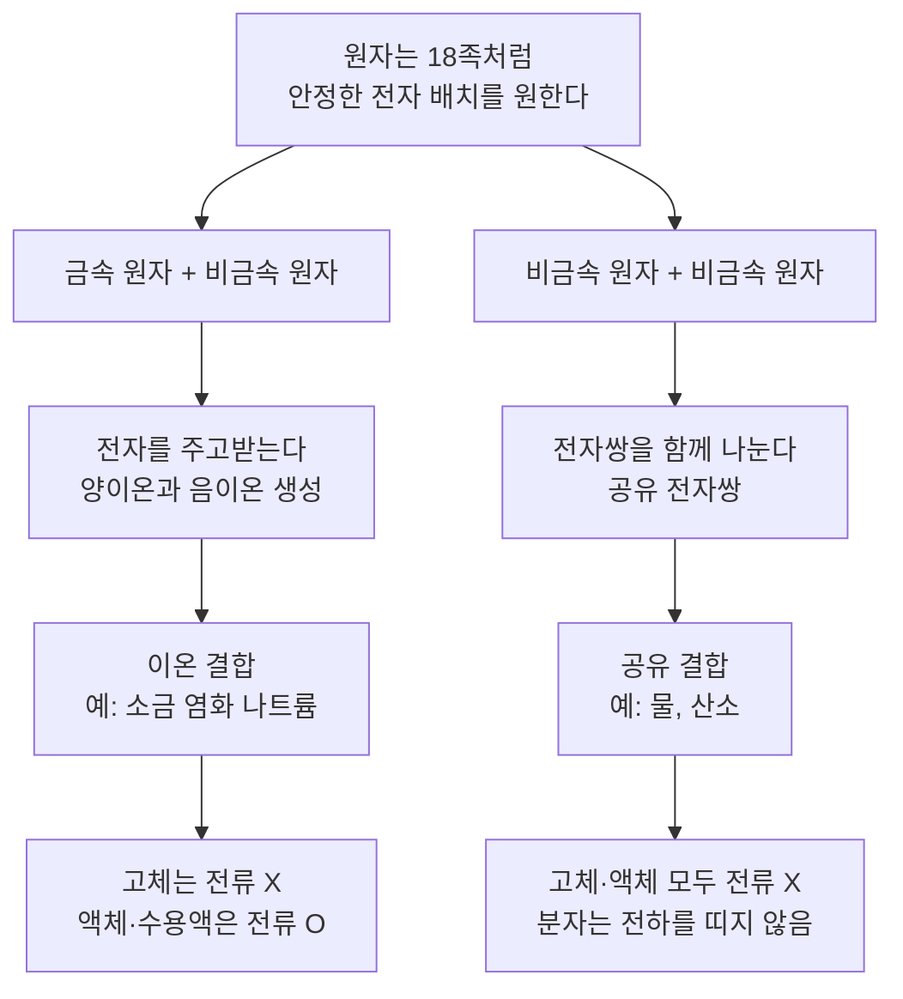
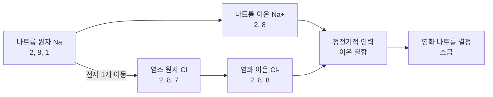
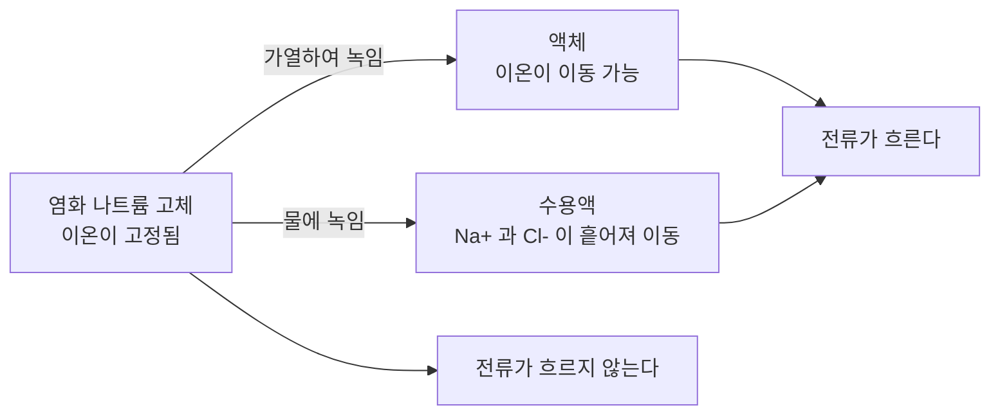

# 2-4. 이온 결합과 공유 결합 — 물·산소·소금을 만드는 두 가지 '손잡기'

> [!NOTE]
> **성취기준 [10통과1-02-04]** 인류의 생존에 필수적인 물, 산소, 소금 등이 만들어지는 결합의 차이를 이해하고 각 물질의 성질과 관련지어 설명할 수 있다.

**학습 목표**

1. 원자가 전자를 잃거나 얻어 이온이 되고, 양이온과 음이온이 정전기적 인력으로 결합하는 **이온 결합**을 염화 나트륨(소금)을 예로 설명할 수 있다.
2. 원자들이 전자쌍을 함께 나누어 가지는 **공유 결합**을 물과 산소를 예로 전자 점식과 전자껍질 모형으로 나타낼 수 있다.
3. 이온 결합 물질과 공유 결합 물질의 전기 전도성을 고체·액체·수용액 상태에서 비교하고, 그 차이를 '전하를 띤 입자가 움직일 수 있는가'로 설명할 수 있다.
4. 물·산소·소금의 결합 차이를 감전 안전, 2차전지, 소금물 전기 분해 등 생활과 산업 사례와 연결할 수 있다.

**이 단원의 학습 사다리**

| 단계 | 무엇을 하나? |
|---|---|
| STEP 1. 중학교 다시 보기 | 원자·이온·전기력·전류를 다시 꺼내 본다 |
| STEP 2. 기초 다지기 | 전자껍질, 원자가 전자, 전자 점식, '전류가 흐르는 조건'을 디딤돌로 놓는다 |
| STEP 3. 핵심 개념 | 이온의 형성 → 이온 결합(소금) → 공유 결합(물·산소) → 결합 비교 → 전기 전도성 |
| STEP 4. 오개념 바로잡기 | "소금 결정에는 NaCl 분자가 있다?", "물은 전기가 잘 통한다?"를 바로잡는다 |
| STEP 5. 선택과목·대학 | 전기 음성도와 극성, 쿨롱 법칙과 이온 결합의 세기, 분자 오비탈 |
| STEP 6. 산업·진로 | 2차전지 전해질, 소금물 전기 분해 공업, 초순수와 수질 관리, 의료용 전해질 |

---

## 🗺️ 단원 들어가기

우리 몸이 하루도 버틸 수 없는 세 가지 물질이 있다. 숨 쉴 때 들이마시는 **산소**, 몸무게의 절반 이상을 차지하는 **물**, 그리고 땀과 눈물에서 짠맛이 나게 하는 **소금**이다.

그런데 이상한 점이 있다. 소금은 하얀 고체 결정인데, 물은 액체이고 산소는 기체이다. 마른 소금 덩어리에 전선을 대면 전류가 흐르지 않지만, 소금을 물에 녹이면 전류가 잘 흐른다. 반면 설탕은 물에 녹여도 전류가 거의 흐르지 않는다. 같은 '하얀 가루'인 소금과 설탕은 무엇이 다를까?

답은 **원자들이 서로 손을 잡는 방식**, 즉 **화학 결합(chemical bond)** 에 있다. 이 단원에서는 원자가 손을 잡는 대표적인 두 가지 방법인 **이온 결합**과 **공유 결합**을 배우고, 그 차이가 **전기 전도성**이라는 성질로 어떻게 드러나는지 확인한다.

---

## STEP 1. 🔙 중학교 다시 보기

### 연계 개념표

| 중학교 성취기준 | 중학교에서 배운 것 | 고등학교에서 확장되는 것 |
|---|---|---|
| [9과11-01] | 원소와 화합물의 정의, 화학식으로 표현하기 | 화학식 NaCl은 '이온의 개수 비', H₂O는 '분자 하나의 구성'을 나타낸다는 차이 |
| [9과11-02] | 원자는 양성자·중성자·전자로 구성, 양성자 수가 원소의 종류를 결정 | 전자가 **전자껍질**에 배치되고, 가장 바깥 껍질의 전자(원자가 전자)가 결합을 결정한다 |
| [9과11-04] | 원자, 분자, 이온. 전자를 잃으면 양이온, 얻으면 음이온 | 원자가 **왜** 전자를 잃거나 얻는지(안정한 전자 배치), 이온끼리 어떻게 **결합**하는지 |
| [9과14-01] | 마찰 전기, 다른 종류의 전하끼리 끌어당기는 전기력 | 양이온과 음이온 사이의 전기력 = **이온 결합의 힘** |
| [9과14-02] | 전류는 전하의 흐름, 도체와 부도체 | 금속에서는 전자가, 수용액에서는 **이온**이 전하를 운반한다 |

> [!TIP]
> 바로 앞 단원(2-3)에서 "18족 원소는 가장 바깥 전자껍질이 꽉 차 있어 안정하고, 다른 원소들은 18족과 같은 전자 배치를 이루려고 결합한다"는 것을 배웠다. 이 단원은 그 결합이 **실제로 어떤 방식으로** 일어나는지 다룬다.

### 준비 운동 (사전 진단)

**Q1.** 양성자가 11개인 나트륨 원자가 전자 1개를 잃었다. 이 입자의 전하는 무엇이며, 이런 입자를 무엇이라고 하는가?

**Q2.** 염소 원자가 전자 1개를 얻으면 어떤 이온이 되는가?

**Q3.** (+)전하를 띤 물체와 (−)전하를 띤 물체를 가까이 하면 두 물체 사이에 어떤 힘이 작용하는가?

**Q4.** 다음 중 옳은 것을 고르시오.
ㄱ. 전류는 전하를 띤 입자가 이동하는 것이다.
ㄴ. 전하를 띤 입자가 있기만 하면, 움직이지 못해도 전류가 흐른다.

정답 및 해설

**Q1.** (+1)의 전하를 띠는 **양이온**(나트륨 이온, Na⁺)이다. 양성자는 11개 그대로인데 전자가 10개로 줄었으므로 (+)전하가 1만큼 많아졌다.

**Q2.** (−1)의 전하를 띠는 **음이온**(염화 이온, Cl⁻)이 된다.

**Q3.** 서로 **끌어당기는 전기력**이 작용한다. 같은 종류의 전하끼리는 밀어낸다.

**Q4. ㄱ** — 전하를 띤 입자가 있어도 **제자리에 묶여 움직이지 못하면 전류가 흐르지 않는다.** 이 사실이 이 단원 STEP 3-⑤의 핵심이다.

---

## STEP 2. 🧱 기초 다지기

### ① 전자껍질과 전자 배치

원자 속 전자는 원자핵 둘레의 몇 개의 층, 즉 **전자껍질(electron shell)** 에 나뉘어 들어 있다. 원자 번호 20번까지의 원소는 다음 규칙으로 생각하면 충분하다.

- 첫째 껍질(원자핵에 가장 가까운 껍질)에는 전자가 최대 **2개**
- 둘째 껍질에는 최대 **8개**
- 셋째 껍질에는 (이 단원에서 다루는 원소의 경우) **8개**까지 채워지면 안정하다고 생각한다

| 원소 | 원자 번호(전자 수) | 전자 배치(껍질별 전자 수) | 원자가 전자 수 |
|---|---|---|---|
| 수소 H | 1 | 1 | 1 |
| 헬륨 He | 2 | 2 | 0 (안정) |
| 탄소 C | 6 | 2, 4 | 4 |
| 질소 N | 7 | 2, 5 | 5 |
| 산소 O | 8 | 2, 6 | 6 |
| 네온 Ne | 10 | 2, 8 | 0 (안정) |
| 나트륨 Na | 11 | 2, 8, 1 | 1 |
| 마그네슘 Mg | 12 | 2, 8, 2 | 2 |
| 염소 Cl | 17 | 2, 8, 7 | 7 |
| 아르곤 Ar | 18 | 2, 8, 8 | 0 (안정) |

### ② 원자가 전자: 결합에 참여하는 '손'

가장 바깥 전자껍질에 있는 전자 중 화학 결합에 참여하는 전자를 **원자가 전자(valence electron)** 라고 한다. 18족 원소는 바깥 껍질이 꽉 차 있어 결합하려 하지 않으므로 원자가 전자 수를 0으로 본다.

> [!TIP]
> 💡 **비유** — 원자가 전자는 원자의 '손'이다. 원자 안쪽 껍질의 전자는 주머니 속에 넣은 손이라서 악수에 쓰이지 않는다. 화학 결합은 바깥으로 내민 손끼리 하는 악수이다.

### ③ 전자 점식: 원자가 전자를 점으로 그리기

원소 기호 주위에 원자가 전자를 점으로 찍어 나타낸 것을 **전자 점식(electron dot formula, 루이스 전자점식)** 이라고 한다. 원소 기호의 위·아래·왼쪽·오른쪽 네 방향에 점을 하나씩 찍고, 다섯 번째부터는 짝을 지어 찍는다.

| 원소 | 원자가 전자 수 | 점 찍는 방법 |
|---|---|---|
| H | 1 | 기호 옆에 점 1개 |
| Na | 1 | 기호 옆에 점 1개 |
| O | 6 | 점 6개: 짝을 이룬 점 2쌍 + 홀로 있는 점 2개 |
| Cl | 7 | 점 7개: 짝을 이룬 점 3쌍 + 홀로 있는 점 1개 |
| Ne | 8 | 점 8개: 짝을 이룬 점 4쌍(빈자리 없음) |

**짝을 이루지 않은 홀로 있는 점**의 개수가 그 원자가 공유 결합에서 내밀 수 있는 '손'의 개수가 된다. 산소는 홀로 있는 점이 2개이므로 손이 2개, 염소는 1개이다.

### ④ 18족처럼 되기: 옥텟 규칙

2-3 단원에서 배웠듯이 원자들은 가장 바깥 껍질에 전자 8개(수소·헬륨처럼 첫째 껍질만 있으면 2개)를 채워 18족 원소와 같은 전자 배치를 이루려는 경향이 있다. 이를 **옥텟 규칙(octet rule)** 이라 한다. 이 목표를 이루는 방법이 두 가지 있다.

| 방법 | 누구끼리? | 결합 이름 |
|---|---|---|
| 전자를 **주고받는다** | 전자를 잘 잃는 금속 원자 + 전자를 잘 얻는 비금속 원자 | 이온 결합 |
| 전자를 **함께 나눈다** | 둘 다 전자를 얻고 싶은 비금속 원자끼리 | 공유 결합 |

### ⑤ 전기력과 전류가 흐르는 조건

중학교에서 배운 **전기력**의 성질을 다시 정리하자.

- 다른 종류의 전하끼리는 **끌어당기고**, 같은 종류의 전하끼리는 **밀어낸다**.
- 전하의 양이 클수록, 거리가 가까울수록 전기력이 **강하다**.

**전류**는 전하를 띤 입자의 흐름이다. 전류가 흐르려면 두 가지 조건이 **모두** 필요하다.

1. **전하를 띤 입자**가 있어야 한다. (전자 또는 이온)
2. 그 입자가 **자유롭게 이동**할 수 있어야 한다.

> [!TIP]
> 💡 **비유** — 운동장에 학생(전하)이 아무리 많아도 모두 의자에 묶여 있으면 사람의 '흐름'은 생기지 않는다. 학생이 있고, 또 움직일 수 있어야 흐름이 생긴다.

---

## STEP 3. 📘 핵심 개념

### 2-4-① 이온의 형성: 전자를 잃거나 얻어 18족처럼 되기

**나트륨(Na)** 은 전자 배치가 2, 8, 1이다. 가장 바깥의 전자 1개만 내놓으면 2, 8이 되어 네온(Ne)과 같은 안정한 배치가 된다. 그래서 나트륨 원자는 전자 1개를 잃고 **나트륨 이온(Na⁺)** 이 되기 쉽다.

**염소(Cl)** 는 전자 배치가 2, 8, 7이다. 전자 1개만 더 얻으면 2, 8, 8이 되어 아르곤(Ar)과 같은 배치가 된다. 그래서 염소 원자는 전자 1개를 얻어 **염화 이온(Cl⁻)** 이 되기 쉽다.

| 원자 | 원자의 전자 배치 | 전자를 잃거나 얻음 | 이온 | 이온의 전자 배치 | 닮은 18족 원소 |
|---|---|---|---|---|---|
| 나트륨 Na | 2, 8, 1 | 1개 잃음 | Na⁺ | 2, 8 | Ne |
| 마그네슘 Mg | 2, 8, 2 | 2개 잃음 | Mg²⁺ | 2, 8 | Ne |
| 염소 Cl | 2, 8, 7 | 1개 얻음 | Cl⁻ | 2, 8, 8 | Ar |
| 산소 O | 2, 6 | 2개 얻음 | O²⁻ | 2, 8 | Ne |

- **금속 원소**는 원자가 전자를 잃고 **양이온(cation)** 이 되기 쉽다.
- **비금속 원소**(18족 제외)는 전자를 얻어 **음이온(anion)** 이 되기 쉽다.
- 이온의 전하 크기는 잃거나 얻은 전자의 개수와 같다.

#### 예제 1

마그네슘 이온(Mg²⁺)과 산화 이온(O²⁻)에 대해 양성자 수와 전자 수를 각각 구하시오. (Mg의 원자 번호는 12, O의 원자 번호는 8이다.)

**풀이**
- Mg²⁺: 양성자 12개. 전자 2개를 잃었으므로 전자는 $12 - 2 = 10$개. 전하는 $(+12) + (-10) = +2$.
- O²⁻: 양성자 8개. 전자 2개를 얻었으므로 전자는 $8 + 2 = 10$개. 전하는 $(+8) + (-10) = -2$.

두 이온은 양성자 수는 다르지만 전자 수(10개)와 전자 배치(2, 8)가 네온과 같다.

> [!IMPORTANT]
> 이온이 될 때 **변하는 것은 전자의 개수뿐**이다. 양성자 수는 그대로이므로 원소의 종류는 바뀌지 않는다. 나트륨 이온은 여전히 '나트륨'이다.

### 2-4-② 이온 결합: 소금(염화 나트륨)이 만들어지는 방법

나트륨과 염소가 만나면 나트륨 원자의 전자 1개가 염소 원자로 **이동**한다. 그 결과 생긴 Na⁺과 Cl⁻은 서로 반대 전하를 띠므로 **정전기적 인력(전기력)** 으로 강하게 끌어당긴다. 이처럼 양이온과 음이온 사이의 정전기적 인력으로 이루어지는 결합을 **이온 결합(ionic bond)** 이라고 한다.

#### 이온 결정: 끝없이 이어지는 '+, −, +, −'

소금 알갱이를 확대해 보면 정육면체 모양이 많다. 이는 수많은 Na⁺과 Cl⁻이 **가로·세로·높이 방향으로 번갈아 규칙적으로 쌓여** 있기 때문이다. 이렇게 이온들이 규칙적으로 배열된 고체를 **이온 결정(ionic crystal)** 이라고 한다.

- 염화 나트륨 결정에서 Na⁺ 하나는 가장 가까이 있는 Cl⁻ 6개(위·아래·앞·뒤·왼쪽·오른쪽)에 둘러싸여 있고, Cl⁻ 하나도 Na⁺ 6개에 둘러싸여 있다.
- 따라서 염화 나트륨에는 'Na 하나와 Cl 하나로 된 알갱이(분자)'가 따로 있지 않다. 화학식 **NaCl은 Na⁺과 Cl⁻이 1 : 1의 개수 비로 들어 있다**는 뜻이다.

<!-- fig:2-4-nacl-crystal -->

> [!TIP]
> 💡 **비유** — 이온 결정은 남녀가 번갈아 서서 앞뒤좌우 모두와 손을 잡은 거대한 강강술래와 같다. 누가 누구의 '짝'이라고 정할 수 없고, 전체가 하나로 연결되어 있다.

#### 이온 결합 화합물의 화학식 만들기

이온 결합 화합물 전체는 전기적으로 **중성**이다. 따라서 (양이온의 전하 합) + (음이온의 전하 합) = 0이 되도록 개수 비를 맞춘다.

#### 예제 2

다음 이온들이 결합할 때의 화학식을 쓰시오.
(1) 칼슘 이온(Ca²⁺)과 염화 이온(Cl⁻) (2) 마그네슘 이온(Mg²⁺)과 산화 이온(O²⁻)

**풀이**
(1) Ca²⁺ 1개의 전하 +2를 상쇄하려면 Cl⁻ 2개(−1 × 2 = −2)가 필요하다. → **CaCl₂** (염화 칼슘, 겨울철 제설제와 제습제로 쓰인다)
(2) +2와 −2가 1 : 1로 상쇄된다. → **MgO** (산화 마그네슘)

| 이온 결합 물질 | 이온 | 생활 속 쓰임 |
|---|---|---|
| 염화 나트륨 | Na⁺, Cl⁻ | 소금, 생리 식염수, 화학 공업의 원료 |
| 염화 칼슘 | Ca²⁺, Cl⁻ | 제설제, 제습제 |
| 산화 마그네슘 | Mg²⁺, O²⁻ | 내화 재료(높은 열에 견디는 벽돌) |
| 염화 칼륨 | K⁺, Cl⁻ | 저나트륨 소금, 비료 |

### 2-4-③ 공유 결합: 물과 산소가 만들어지는 방법

수소, 산소, 염소처럼 **비금속 원자끼리** 만나면 어떻게 될까? 둘 다 전자를 얻고 싶어 하므로 한쪽이 일방적으로 전자를 내주지 않는다. 대신 각자 전자를 내놓아 **전자쌍을 만들고, 그 전자쌍을 두 원자가 함께 가진다.** 이렇게 이루어지는 결합을 **공유 결합(covalent bond)** 이라고 한다.

- 두 원자가 함께 나누어 가지는 전자쌍: **공유 전자쌍(shared electron pair)**
- 결합에 참여하지 않고 한 원자에만 속한 전자쌍: **비공유 전자쌍(lone pair)**
- 공유 결합으로 만들어진, 독립적으로 존재하는 입자: **분자(molecule)**

#### (1) 수소 분자 H₂ — 가장 단순한 공유 결합

수소 원자는 전자가 1개뿐이다. 두 수소 원자가 각자 전자 1개씩 내놓아 공유 전자쌍 1개를 만들면, 두 원자 모두 전자 2개를 가진 것처럼 되어 헬륨(He)과 같은 배치가 된다.

#### (2) 물 분자 H₂O — 산소 하나가 수소 둘과 손잡기

산소 원자는 원자가 전자가 6개(홀로 있는 전자 2개)이므로 2개를 더 채워야 한다. 수소 원자 2개가 각각 전자 1개씩 내놓아 산소와 공유 전자쌍을 하나씩 만든다.

| 원자 | 물 분자 속에서 바깥 껍질의 전자 수 | 닮은 18족 원소 |
|---|---|---|
| 산소 O | 공유 전자쌍 2개(4개) + 비공유 전자쌍 2개(4개) = **8개** | Ne |
| 수소 H (각각) | 공유 전자쌍 1개 = **2개** | He |

공유 전자쌍 하나를 선 하나로 나타내면 물은 **H–O–H**로 쓸 수 있다.

#### (3) 산소 분자 O₂ — 두 쌍을 함께 나누는 이중 결합

산소 원자는 2개의 전자가 더 필요하다. 산소 원자 두 개는 각각 전자 2개씩을 내놓아 **공유 전자쌍 2개**를 만든다. 이처럼 공유 전자쌍이 2개인 결합을 **이중 결합(double bond)** 이라 하고 **O=O**로 나타낸다.

| 분자 | 선 구조 | 공유 전자쌍 수 | 비공유 전자쌍 수(분자 전체) | 결합 종류 |
|---|---|---|---|---|
| 수소 H₂ | H–H | 1 | 0 | 단일 결합 |
| 염소 Cl₂ | Cl–Cl | 1 | 6 | 단일 결합 |
| 물 H₂O | H–O–H | 2 | 2 | 단일 결합 2개 |
| 산소 O₂ | O=O | 2 | 4 | 이중 결합 |
| 질소 N₂ | N≡N | 3 | 2 | 삼중 결합 |

#### 예제 3

이산화 탄소(CO₂) 분자에서 탄소 원자는 가운데에 있고 양쪽에 산소 원자가 하나씩 이중 결합을 하고 있다(O=C=O). (1) 분자 전체의 공유 전자쌍 수와 비공유 전자쌍 수를 구하고, (2) 탄소 원자가 옥텟 규칙을 만족하는지 확인하시오. (C의 원자가 전자 4개, O의 원자가 전자 6개)

**풀이**
(1) 이중 결합 2개 → 공유 전자쌍 $2 \times 2 = 4$개.
원자가 전자 전체: $4 + 6 \times 2 = 16$개 = 전자쌍 8개. 비공유 전자쌍 = $8 - 4 = 4$개(산소 원자마다 2개씩).
(2) 탄소 주위의 전자: 공유 전자쌍 4개 × 2 = 8개. 옥텟 규칙을 만족한다.

> [!TIP]
> 💡 **비유** — 이온 결합은 친구에게 연필을 **아예 줘 버리는 것**이고, 공유 결합은 둘 사이에 연필을 **놓고 함께 쓰는 것**이다. 줘 버리면 한 명은 (+), 한 명은 (−)가 되어 서로 끌리고, 함께 쓰면 연필(전자쌍)이 두 사람을 묶어 주는 끈이 된다.

### 2-4-④ 물·산소·소금, 결합의 차이를 한눈에

| 비교 항목 | 소금(염화 나트륨) | 물 | 산소 |
|---|---|---|---|
| 구성 원소 | 금속(Na) + 비금속(Cl) | 비금속(H) + 비금속(O) | 비금속(O) + 비금속(O) |
| 결합 방법 | 전자 **이동** → 이온 사이 인력 | 전자쌍 **공유** | 전자쌍 **공유**(이중 결합) |
| 결합의 종류 | 이온 결합 | 공유 결합 | 공유 결합 |
| 물질을 이루는 입자 | 이온(Na⁺, Cl⁻) | 분자(H₂O) | 분자(O₂) |
| 화학식의 뜻 | 이온의 개수 비 1 : 1 | 분자 1개의 구성 원자 | 분자 1개의 구성 원자 |
| 상온에서의 상태 | 고체 | 액체 | 기체 |
| 인류 생존에서의 역할 | 체액의 이온 농도 유지, 신경·근육의 전기 신호에 필요한 이온 공급 | 생명체 구성 성분의 대부분, 여러 물질을 녹이는 용매 | 세포 호흡에 필요 |

#### 결합의 종류를 판단하는 간단한 방법

| 결합하는 원소 | 결합의 종류 | 예 |
|---|---|---|
| 금속 원소 + 비금속 원소 | 이온 결합 | NaCl, CaCl₂, MgO, KCl |
| 비금속 원소 + 비금속 원소 | 공유 결합 | H₂O, O₂, CO₂, CH₄(메테인), NH₃(암모니아) |

> [!WARNING]
> 이 판단법은 **대표적인 경우에 대한 길잡이**이다. 예를 들어 염화 암모늄처럼 비금속 원소로만 이루어졌는데 이온을 포함하는 물질도 있다. 통합과학에서는 위 표의 대표 예를 중심으로 판단하면 된다.

<!-- sim:bonding -->

### 2-4-⑤ 결합의 차이는 전기 전도성으로 드러난다

물질에 전류가 흐르는 성질을 **전기 전도성(electrical conductivity)** 이라고 한다. STEP 2-⑤의 두 조건(**전하를 띤 입자**가 있고, 그 입자가 **이동할 수 있어야** 한다)으로 두 결합 물질을 비교해 보자.

| 상태 | 이온 결합 물질(예: 염화 나트륨) | 공유 결합 물질(예: 설탕, 순수한 물) |
|---|---|---|
| 고체 | **전류 X** — 이온은 있지만 결정 속에 고정되어 이동할 수 없다 | **전류 X** — 전하를 띤 입자가 없다(분자는 중성) |
| 액체(녹은 상태) | **전류 O** — 이온이 자유롭게 이동한다 | **전류 X** — 분자가 움직여도 전하를 띠지 않는다 |
| 수용액 | **전류 O** — 물에 녹아 이온으로 나누어지고, 이온이 이동한다 | **전류 X(대부분)** — 분자 그대로 물에 섞일 뿐 이온이 생기지 않는다 |

수용액 속에서 전극을 연결하면 (+)극 쪽으로는 **음이온(Cl⁻)** 이, (−)극 쪽으로는 **양이온(Na⁺)** 이 이동한다. 이 이온들의 이동이 곧 전류이다. 물에 녹아 이온으로 나누어져 수용액이 전류를 흐르게 하는 물질을 **전해질(electrolyte)**, 물에 녹아도 이온이 생기지 않아 전류가 흐르지 않는 물질을 **비전해질(non-electrolyte)** 이라고 한다.

| 구분 | 예 |
|---|---|
| 전해질 | 염화 나트륨, 염화 칼슘, 염화 칼륨, 수산화 나트륨 |
| 비전해질 | 설탕, 포도당, 에탄올 |

#### 예제 4

세 물질 A, B, C의 전기 전도성을 조사한 결과이다. A, B, C는 각각 염화 칼륨, 포도당, 구리 중 하나이다. A, B, C가 각각 무엇인지 쓰고, 그렇게 판단한 근거를 설명하시오.

| 물질 | 고체 상태 | 액체 상태 | 수용액 |
|---|---|---|---|
| A | X | O | O |
| B | X | X | X |
| C | O | O | 물에 녹지 않음 |

**풀이**
- A: 고체에서는 전류가 흐르지 않다가 녹거나 물에 녹으면 흐른다 → 이온이 고정되어 있다가 풀려난다 → **이온 결합 물질, 염화 칼륨**
- B: 어떤 상태에서도 전류가 흐르지 않는다 → 전하를 띤 입자가 없다 → **공유 결합 물질(분자), 포도당**
- C: 고체에서도 전류가 흐른다 → 고체 속에서 움직이는 **전자**가 있다 → **금속, 구리** (금속의 전기 전도성은 2-6 단원에서 자세히 다룬다)

#### 생존 물질의 전기적 성질과 우리 생활

- **순수한 물은 전류가 거의 흐르지 않는다.** 그런데 수돗물, 빗물, 땀에는 여러 가지 이온이 조금씩 녹아 있어 전류가 흐른다. 젖은 손으로 전기 기구를 만지면 감전되기 쉬운 이유이다.
- **우리 몸의 체액**에는 Na⁺, K⁺, Cl⁻ 등의 이온이 녹아 있다. 이 이온들의 이동이 신경과 근육에서 전기 신호가 만들어지는 데 관여한다. 땀을 아주 많이 흘렸을 때 물과 함께 이온(전해질)을 보충하기도 하는 이유가 여기에 있다.
- **바닷물**은 염화 나트륨을 비롯한 여러 이온이 녹아 있어 전기 전도성이 크다. 바닷물에 녹아 있는 염류의 양(염분)을 측정할 때도 전기 전도성을 이용한다.

> [!CAUTION]
> **예외 미리 보기** — 염화 수소(HCl)는 비금속 원자끼리 공유 결합한 분자이지만, 물에 녹으면 이온으로 나누어져 수용액에 전류가 흐른다(염산). 또 흑연은 탄소 원자끼리 공유 결합한 물질이지만 고체 상태에서 전류가 흐른다. "공유 결합 물질은 무조건 전류가 흐르지 않는다"고 외우지 말고, **"전하를 띤 입자가 있고 움직일 수 있는가?"** 로 판단하는 습관을 들이자.

---

## STEP 4. ⚠️ 오개념 바로잡기

| 흔한 오개념 | 올바른 개념 | 왜 그럴까? |
|---|---|---|
| 소금 결정 속에는 NaCl 분자가 들어 있다 | 염화 나트륨은 Na⁺과 Cl⁻이 번갈아 쌓인 **이온 결정**이며, NaCl은 **개수 비**를 나타낸다 | 이온 하나가 주변의 반대 전하 이온 여러 개와 동시에 끌어당기므로 '짝'을 정할 수 없다 |
| 소금 고체에도 이온이 있으니 전류가 흐른다 | 고체 상태의 이온 결합 물질은 전류가 **흐르지 않는다** | 이온이 결정 속에 고정되어 **이동할 수 없기** 때문이다 |
| 소금물에서는 전자가 물속을 흘러 전류가 된다 | 수용액에서는 **이온**이 이동하여 전하를 운반한다 | 양이온은 (−)극 쪽으로, 음이온은 (+)극 쪽으로 움직인다 |
| 물은 전기가 잘 통한다 | **순수한 물**은 전류가 거의 흐르지 않는다 | 우리가 쓰는 물에 녹아 있는 **이온** 때문에 전류가 흐르는 것이다 |
| 공유 결합에서는 전자가 한 원자에서 다른 원자로 옮겨 간다 | 공유 결합에서는 전자쌍을 두 원자가 **함께 가진다** | 전자를 옮기는(주고받는) 것은 이온 결합이다 |
| 산소 분자 O₂의 두 원자는 공유 전자쌍 1개로 연결된다 | 산소 분자는 공유 전자쌍 **2개**(이중 결합)로 연결된다 | 산소 원자는 각각 전자 2개가 더 필요하므로 2개씩 내놓아 2쌍을 공유한다 |

---

## STEP 5. 🎓 선택과목·대학으로 한 걸음 더

> [!CAUTION]
> 이 절은 **통합과학 교육과정 범위 밖의 심화 내용**으로 평가 대상이 아니다. "이 개념이 앞으로 어디까지 이어지는가"를 맛보기로 보여 주기 위한 내용이다.

### 고2·3 선택과목과의 연결

| 과목 | 이어지는 내용 |
|---|---|
| 화학 | 물질의 구조와 성질 — 화학 결합의 전기적 성질 실험(물의 전기 분해), **전기 음성도**와 결합의 극성, 루이스 전자점식, 전자쌍 반발 이론으로 분자 구조 추론 |
| 물질과 에너지 | 결정성 고체를 화학 결합의 종류에 따라 분류, 물의 특별한 성질을 수소 결합으로 설명 |
| 화학 반응의 세계 | 산화·환원 반응, 화학 전지와 전기 분해의 원리, 산업 현장의 전기 분해 |

### ① 전기 음성도와 극성: 공유 전자쌍은 공평하게 나뉠까?

같은 원자끼리의 공유 결합(H–H, O=O)에서는 공유 전자쌍이 양쪽에 공평하게 나뉜다. 그러나 물(H–O–H)에서는 산소가 수소보다 공유 전자쌍을 **더 세게 끌어당긴다.** 원자가 공유 전자쌍을 끌어당기는 정도를 **전기 음성도(electronegativity)** 라고 한다.

- 그 결과 물 분자에서 산소 쪽은 약한 (−)전하, 수소 쪽은 약한 (+)전하를 띤다. 이런 결합을 **극성 공유 결합**이라 한다.
- 물 분자는 굽은 모양(결합각 약 104.5°)이므로 분자 전체도 극성을 띤다. 그래서 물 분자의 (−)쪽은 Na⁺을, (+)쪽은 Cl⁻을 둘러싸 끌어당겨 소금을 잘 녹인다.
- 전기 음성도 차이가 매우 크면 전자가 사실상 완전히 넘어가 이온 결합이 된다. 즉, **공유 결합과 이온 결합은 끊어진 두 칸이 아니라 하나로 이어진 스펙트럼**이다.

### ② 쿨롱 법칙으로 보는 이온 결합의 세기

대학 '일반화학'과 '일반물리학'에서는 두 전하 사이의 힘을 **쿨롱 법칙**으로 정량적으로 다룬다.

$$
F = k\frac{q_1 q_2}{r^2}
$$

($q_1, q_2$: 두 이온의 전하량, $r$: 이온 사이 거리, $k$: 쿨롱 상수) 이온의 전하가 클수록, 거리가 가까울수록 이온 결합이 강하다. 예를 들어 이온 사이 거리가 비슷하다고 가정하면, 전하가 ±2인 Mg²⁺–O²⁻ 사이의 힘은 전하가 ±1인 Na⁺–Cl⁻ 사이의 힘보다 약 $2 \times 2 = 4$배 크다. 실제로 산화 마그네슘은 약 2800 °C에서, 염화 나트륨은 약 800 °C에서 녹는다. 대학에서는 이 결합의 세기를 결정 전체에 대해 계산한 **격자 에너지(lattice energy)** 로 비교한다.

### ③ 분자 오비탈 이론: 전자 점식으로 설명할 수 없는 산소의 비밀

액체 산소를 강한 자석의 두 극 사이에 부으면 자석에 **달라붙는다.** 이는 산소 분자에 짝을 이루지 않은 전자가 있다는 증거인데, O=O 전자 점식에서는 모든 전자가 짝을 이루고 있어 이를 설명할 수 없다. 대학 '일반화학'과 '물리화학'에서는 전자를 원자 하나가 아니라 **분자 전체에 퍼진 파동(분자 오비탈)** 으로 다루는 **분자 오비탈 이론**으로 이 현상을 설명한다. 이는 '전자껍질 모형'이 출발점일 뿐, 더 정확한 양자역학 모형으로 확장된다는 것을 보여 준다.

### 고등학교 vs 대학교

| 구분 | 고등학교 통합과학 | 대학교 일반화학·물리화학·재료과학 |
|---|---|---|
| 원자 모형 | 전자껍질 모형, 전자 점식 | 양자역학적 오비탈(s, p, d), 혼성 오비탈 |
| 이온 결합 | 전자 이동과 정전기적 인력 | 쿨롱 법칙, 격자 에너지, 결정 구조의 종류 |
| 공유 결합 | 공유 전자쌍, 단일·이중·삼중 결합 | 전기 음성도, 원자가 결합 이론, 분자 오비탈 이론 |
| 성질 | 전기 전도성(고체·액체·수용액) | 이온 전도도의 정량 측정, 고체 속 이온 확산, 용액의 전기화학 |
| 관련 전공 | — | 화학, 화학공학, 신소재공학, 에너지공학, 약학 |

---

## STEP 6. 🏭 산업 현장과 진로 연결

### 사례 1. 2차전지 — 이온이 다니는 길, 전해질

- **원리** 리튬 이온 전지에서 충전·방전이 일어날 때 **리튬 이온(Li⁺)은 전지 내부의 전해질을 통해** 양극과 음극 사이를 오가고, **전자는 바깥의 도선(회로)을 통해** 이동한다. 전해질은 이온은 잘 통과시키지만 전자는 통과시키지 않아야 한다. 전자까지 전해질을 지나가 버리면 전지 내부에서 합선이 일어나 외부 회로에 전기를 공급할 수 없다.
- **소재** 일반적인 리튬 이온 전지의 전해질(전해액)은 리튬 이온을 내놓는 물질을 유기 용매에 녹인 액체이다. 양극과 음극이 직접 닿지 않도록 이온만 통과하는 얇은 막(분리막)을 사이에 둔다.
- **요즘 현장** 유기 용매는 불이 붙기 쉬워 화재 위험이 있다. 그래서 이온이 고체 속을 이동할 수 있는 특수한 **고체 전해질**을 쓰는 **전고체 전지**가 활발히 연구되고 있다. 보통의 이온 결정은 고체에서 이온이 움직이지 못하므로, '고체이면서도 이온이 잘 움직이는' 결정 구조를 찾는 것이 핵심 과제이다.

### 사례 2. 소금물 전기 분해 공업

- **원리** 염화 나트륨 수용액에는 이온이 자유롭게 움직이므로 전류를 흘려 전기 분해를 할 수 있다. 그 결과 **염소 기체, 수소 기체, 수산화 나트륨**을 얻는다.
- **어디에 쓰이나** 염소는 수돗물 소독과 플라스틱(PVC) 원료로, 수산화 나트륨은 비누·종이·섬유·화학 제품 생산에 쓰인다. 소금이라는 흔한 이온 결합 물질이 화학 산업의 출발 원료가 되는 셈이다.

### 사례 3. 초순수와 수질 관리 — 전기 전도성을 '측정 도구'로

- **반도체 공장의 초순수** 반도체 웨이퍼를 씻는 물에 이온이 남아 있으면 미세한 회로가 망가질 수 있다. 그래서 이온을 거의 완전히 제거한 **초순수(ultrapure water)** 를 쓴다. 이온이 적을수록 전류가 흐르기 어려우므로, 물의 **전기 전도도(또는 그 역수인 비저항)** 를 계속 측정하여 순도를 관리한다. 이론적으로 가장 순수한 물의 비저항은 25 °C에서 약 18 MΩ·cm이다.
- **환경 감시** 하천·지하수·정수장에서도 전기 전도도를 측정하면 물에 녹아 있는 이온의 양을 빠르게 어림할 수 있어, 오염이나 바닷물 유입을 감시하는 지표로 쓴다.

### 사례 4. 의료 — 생리 식염수와 전해질 검사

- 병원에서 쓰는 **생리 식염수**는 약 0.9 %의 염화 나트륨 수용액으로, 체액과 비슷한 농도를 맞춘 것이다.
- 혈액 검사에서 Na⁺, K⁺, Cl⁻ 등의 **전해질 농도**를 측정하여 탈수, 콩팥 기능 이상 등을 진단하는 데 활용한다.

### 관련 진로와 학과

| 진로 | 하는 일 | 관련 학과 |
|---|---|---|
| 2차전지 연구원 | 전해질·전극 소재 개발, 전지 안전성 평가 | 화학공학, 신소재공학, 화학, 에너지공학 |
| 화학 공정 엔지니어 | 전기 분해 등 화학 제품 생산 공정 설계·운영 | 화학공학, 화학 |
| 수처리·환경 엔지니어 | 초순수 제조, 상하수도 수질 관리 | 환경공학, 화학공학 |
| 임상병리사 | 혈액 전해질 등 임상 검사 | 임상병리학, 보건 계열 |
| 재료 분석 연구원 | 물질의 결합 구조와 전기적 성질 분석 | 화학, 신소재공학, 물리학 |

---

## 🔬 탐구 활동 — 이온 결합 화합물과 공유 결합 화합물의 성질을 비교하는 실험하기

### 활동 A. 고체와 수용액의 전기 전도성 비교하기 (모둠 활동)

**목표** 이온 결합 물질과 공유 결합 물질의 전기 전도성을 고체 상태와 수용액 상태에서 비교하고, 그 차이를 입자의 종류와 이동 가능성으로 설명한다.

**준비물** 염화 나트륨, 염화 칼슘(또는 염화 칼륨), 설탕, 에탄올, 증류수, 전기 전도성 측정기(또는 9 V 건전지·LED·집게 전선으로 만든 간이 측정기), 비커 6개, 페트리 접시, 약숟가락, 유리 막대, 전자저울, 세척병, 키친타월, 보안경, 실험용 장갑

<!-- fig:2-4-conductivity-test -->

**과정**
1. 페트리 접시에 염화 나트륨, 염화 칼슘, 설탕 고체를 각각 한 숟가락씩 덜고, 측정기의 두 전극을 고체 알갱이에 꽂아 전류가 흐르는지 확인한다.
2. 증류수 50 mL를 비커에 담고 전기 전도성을 측정한다(기준값).
3. 증류수 50 mL에 각 고체 약 2 g을 녹여 수용액을 만들고, 전기 전도성을 측정한다.
4. 에탄올(액체 상태의 공유 결합 물질)의 전기 전도성도 측정한다.
5. 측정이 끝날 때마다 전극을 증류수로 헹구고 키친타월로 닦아 다음 측정에 이전 물질이 섞이지 않게 한다.

**결과 기록**

| 물질 | 결합의 종류(예상) | 고체 상태 | 수용액(또는 액체) | 측정값 또는 LED 밝기 |
|---|---|---|---|---|
| 증류수 | | — | | |
| 염화 나트륨 | | | | |
| 염화 칼슘 | | | | |
| 설탕 | | | | |
| 에탄올 | | — | | |

**생각해 보기**
1. 염화 나트륨은 고체일 때와 수용액일 때 결과가 어떻게 달랐는가? 그 이유를 '이온의 이동'으로 설명해 보자.
2. 설탕 수용액에서 전류가 흐르지 않은(또는 거의 흐르지 않은) 이유는 무엇인가?
3. 증류수에서 측정값이 0이 아니라 아주 작게 나왔다면, 그 원인은 무엇일까?
4. 염화 나트륨을 녹인 액체 상태(약 800 °C 이상)는 학교에서 실험하기 어렵다. 액체 상태의 결과를 예상하고, 그 근거를 쓰시오.

> [!WARNING]
> **안전 수칙** 보안경과 장갑을 착용한다. 측정기에는 반드시 건전지 등 **낮은 전압의 전원**만 사용하고, 가정용 콘센트 전원을 절대 연결하지 않는다. 에탄올은 불이 붙기 쉬우므로 불꽃 가까이에서 다루지 않는다. 염화 칼슘이 피부나 눈에 닿으면 즉시 물로 씻는다. 남은 용액은 교사의 지시에 따라 처리한다.

### 활동 B. 전자 점식 카드로 분자와 이온 결정 만들기

1. 원소 카드(H, O, Na, Cl, C, N)에 원자가 전자 수만큼 점 스티커를 붙인다.
2. 비금속 카드끼리는 홀로 있는 점을 짝지어 **공유 전자쌍**을 만들고, H₂O, O₂, CO₂, N₂ 분자를 완성한다.
3. Na 카드와 Cl 카드 사이에서는 점 스티커 하나를 **옮겨 붙여** 이온 카드로 바꾸고, 여러 장을 바둑판처럼 번갈아 배열하여 이온 결정을 표현한다.
4. 완성한 모형마다 각 원자(이온) 주위의 전자 수가 8개(H는 2개)인지 확인한다.

---

## ✅ 개념 확인 문제

### 기본

**1.** 다음 중 네온(Ne)과 전자 배치가 같은 입자를 **모두** 고르시오.
ㄱ. Na⁺ ㄴ. Cl⁻ ㄷ. O²⁻ ㄹ. Mg²⁺

정답 및 해설

**정답 ㄱ, ㄷ, ㄹ**

Na⁺(11 − 1 = 10개), O²⁻(8 + 2 = 10개), Mg²⁺(12 − 2 = 10개)는 모두 전자가 10개이고 전자 배치가 2, 8로 네온과 같다. Cl⁻은 전자가 17 + 1 = 18개로 전자 배치가 2, 8, 8이며 아르곤(Ar)과 같다.

**2.** 다음 물질을 이온 결합 물질과 공유 결합 물질로 분류하시오.
NaCl, H₂O, O₂, CaCl₂, CO₂, MgO

정답 및 해설

**정답** 이온 결합 물질: NaCl, CaCl₂, MgO / 공유 결합 물질: H₂O, O₂, CO₂

NaCl, CaCl₂, MgO는 금속 원소(Na, Ca, Mg)와 비금속 원소(Cl, O)가 결합한 물질로 이온 결합 물질이다. H₂O, O₂, CO₂는 비금속 원소끼리 결합한 공유 결합 물질이다.

**3.** 물 분자(H₂O)에 있는 공유 전자쌍의 수와, 산소 원자가 가진 비공유 전자쌍의 수를 각각 쓰시오.

정답 및 해설

**정답** 공유 전자쌍 2개, 비공유 전자쌍 2개

산소는 원자가 전자 6개 중 2개를 수소 원자 2개와 각각 공유하고(공유 전자쌍 2개), 나머지 4개는 비공유 전자쌍 2개로 가진다. 그 결과 산소 주위의 전자는 8개가 된다.

**4.** 빈칸에 알맞은 말을 쓰시오.
"염화 나트륨 고체는 이온이 결정 속에 ( ㄱ )되어 있어 전류가 흐르지 않는다. 그러나 물에 녹이면 ( ㄴ )이/가 자유롭게 이동하여 전류가 흐른다. 이처럼 물에 녹아 수용액이 전류를 흐르게 하는 물질을 ( ㄷ )(이)라고 한다."

정답 및 해설

**정답** ㄱ: 고정, ㄴ: 이온(양이온과 음이온), ㄷ: 전해질

### 응용

**5.** 표는 물질 X, Y, Z의 상태에 따른 전기 전도성을 나타낸 것이다. X, Y, Z는 각각 염화 칼슘, 설탕, 알루미늄 중 하나이다.

| 물질 | 고체 | 액체 | 수용액 |
|---|---|---|---|
| X | O | O | 물에 녹지 않음 |
| Y | X | X | X |
| Z | X | O | O |

(1) X, Y, Z는 각각 무엇인가? (2) Z가 고체 상태에서 전류가 흐르지 않는 이유를 쓰시오.

정답 및 해설

**정답** (1) X: 알루미늄, Y: 설탕, Z: 염화 칼슘 (2) 이온이 결정 속에 고정되어 이동할 수 없기 때문이다.

X는 고체에서도 전류가 흐르므로 고체 속에서 이동하는 전자가 있는 금속(알루미늄)이다. Y는 어떤 상태에서도 전하를 띤 입자가 없으므로 공유 결합 물질인 설탕이다. Z는 고체에서는 흐르지 않다가 녹거나 물에 녹으면 흐르므로 이온 결합 물질인 염화 칼슘이다.

**6.** 다음 이온이 결합하여 만드는 화합물의 화학식을 쓰고, 전하의 합이 0이 됨을 확인하시오.
(1) 칼륨 이온 K⁺과 산화 이온 O²⁻ (2) 알루미늄 이온 Al³⁺과 산화 이온 O²⁻

정답 및 해설

**정답** (1) K₂O (2) Al₂O₃

(1) $2 \times (+1) + 1 \times (-2) = 0$
(2) $2 \times (+3) + 3 \times (-2) = +6 - 6 = 0$

양이온과 음이온의 전하 합이 0이 되는 가장 간단한 개수 비를 찾으면 된다.

**7.** 질소 분자(N₂)는 두 질소 원자가 공유 전자쌍 3개로 결합하고 있다(N≡N). 질소의 원자가 전자는 5개이다.
(1) 질소 원자 하나가 가진 비공유 전자쌍은 몇 개인가?
(2) 각 질소 원자 주위의 전자 수가 8개임을 확인하시오.

정답 및 해설

**정답** (1) 1개 (2) 아래 해설 참조

(1) 분자 전체의 원자가 전자는 $5 \times 2 = 10$개 = 전자쌍 5개. 공유 전자쌍이 3개이므로 비공유 전자쌍은 $5 - 3 = 2$개이고, 질소 원자 하나당 1개씩이다.
(2) 질소 원자 하나 주위의 전자 = 공유 전자쌍 3개(6개) + 비공유 전자쌍 1개(2개) = 8개. 옥텟 규칙을 만족한다.

### 융합·서술형

**8. [산업 연계]** 리튬 이온 전지의 전해질에 대해 답하시오.
(1) 전지가 작동할 때 전해질 속에서 전하를 운반하는 입자는 무엇인가?
(2) 전해질이 전자까지 잘 통과시킨다면 어떤 문제가 생길지 서술하시오.
(3) 화재 위험을 줄이기 위해 고체 전해질을 개발하려 한다. 소금 같은 일반적인 이온 결정을 그대로 쓰기 어려운 이유를 이 단원에서 배운 내용으로 설명하시오.

정답 및 해설

**예시 답안**
(1) 리튬 이온(Li⁺)이다.
(2) 전자가 바깥 도선 대신 전지 내부의 전해질을 통해 바로 이동하면, 전지 내부에서 합선(단락)이 일어나 외부 기기에 전류를 공급할 수 없고 열이 발생하여 위험해질 수 있다.
(3) 일반적인 이온 결정은 고체 상태에서 이온이 결정 속에 고정되어 이동하지 못하므로 전류(이온의 흐름)가 거의 흐르지 않는다. 따라서 고체이면서도 이온이 잘 이동할 수 있는 특수한 구조의 물질을 찾아야 한다.

**채점 포인트** ① 전하 운반체가 이온임 ② 전자는 외부 회로로만 흘러야 함 ③ 고체 이온 결정에서 이온이 고정되어 있음

**9. [생활·안전 연계]** 민수는 "순수한 물은 전기가 거의 통하지 않는다는데, 왜 젖은 손으로 콘센트를 만지면 위험하다고 할까?"라고 질문했다. (1) 두 사실이 모순이 아닌 이유를 설명하고, (2) 땀을 많이 흘린 손이 특히 위험한 이유를 결합의 종류와 관련지어 서술하시오.

정답 및 해설

**예시 답안**
(1) 순수한 물은 공유 결합으로 이루어진 물 분자로만 되어 있어 전하를 띤 입자가 거의 없으므로 전류가 거의 흐르지 않는다. 그러나 실제 생활에서 쓰는 물(수돗물, 빗물)이나 손에 묻은 물에는 여러 가지 이온이 녹아 있어 전류가 흐를 수 있다.
(2) 땀에는 이온 결합 물질인 염화 나트륨 등이 녹아 있어 Na⁺, Cl⁻ 같은 이온이 많다. 이 이온들이 이동하며 전하를 운반하므로 전류가 더 잘 흘러 감전 위험이 커진다.

**채점 포인트** ① 순수한 물 = 공유 결합 분자, 이온 거의 없음 ② 실제 물·땀에는 이온이 녹아 있음 ③ 이온의 이동이 전류

---

## 📝 한눈에 정리

### 핵심 요약

- 원자들은 18족 원소와 같은 안정한 전자 배치(바깥 껍질 전자 8개, 수소는 2개)를 이루기 위해 결합한다.
- 금속 원자는 전자를 잃어 **양이온**, 비금속 원자는 전자를 얻어 **음이온**이 되기 쉽다.
- **이온 결합**: 양이온과 음이온 사이의 정전기적 인력에 의한 결합. 예: 소금(염화 나트륨). 이온들이 규칙적으로 쌓인 **이온 결정**을 이룬다.
- **공유 결합**: 비금속 원자들이 전자쌍을 함께 나누어 가지는 결합. 예: 물(H–O–H), 산소(O=O, 이중 결합). **분자**를 이룬다.
- 이온 결합 물질은 **고체에서는 전류가 흐르지 않고, 액체·수용액에서는 흐른다**(이온의 이동).
- 공유 결합 물질(분자)은 대부분 **고체·액체·수용액 모두 전류가 흐르지 않는다**(전하를 띤 입자가 없음).
- 판단의 기준은 언제나 **"전하를 띤 입자가 있고, 그 입자가 이동할 수 있는가?"** 이다.

### 핵심 용어

| 용어 | 뜻 |
|---|---|
| 원자가 전자 | 가장 바깥 전자껍질에 있으며 화학 결합에 참여하는 전자 |
| 전자 점식 | 원소 기호 주위에 원자가 전자를 점으로 나타낸 식 |
| 이온 결합 | 양이온과 음이온 사이의 정전기적 인력에 의한 결합 |
| 이온 결정 | 양이온과 음이온이 규칙적으로 배열된 고체 |
| 공유 결합 | 원자들이 전자쌍을 함께 나누어 가지며 이루는 결합 |
| 공유 전자쌍 / 비공유 전자쌍 | 두 원자가 함께 가진 전자쌍 / 결합에 참여하지 않는 전자쌍 |
| 전기 전도성 | 물질에 전류가 흐르는 성질 |
| 전해질 | 물에 녹아 이온으로 나누어져 수용액이 전류를 흐르게 하는 물질 |

### 다음 단원으로

지금까지 원자들이 이온 결합과 공유 결합으로 손을 잡아 물·산소·소금 같은 물질을 만드는 방법을 배웠다. 다음 단원에서는 이렇게 결합한 **작은 기본 단위체들이 수없이 반복·연결되어** 지각을 이루는 규산염 광물과 생명체를 이루는 단백질·핵산이라는 거대하고 다양한 물질을 만들어 내는 규칙성을 탐구한다.
