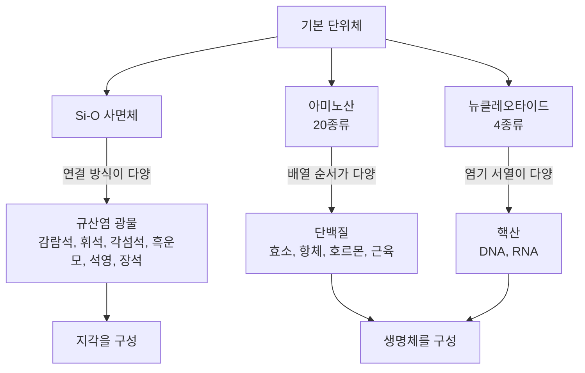
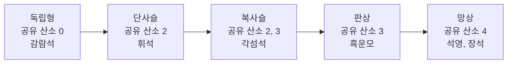
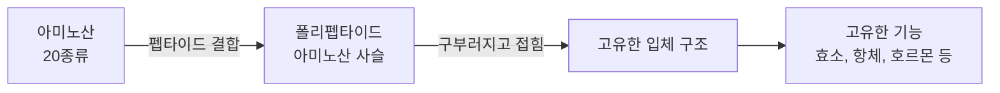

# 2-5. 지각과 생명체 구성 물질의 규칙성 — 작은 단위체가 만드는 거대한 다양성

> [!NOTE]
> **성취기준 [10통과1-02-05]** 지각과 생명체를 구성하는 물질들이 기본 단위체의 결합을 통해서 형성된다는 것을 규산염 광물, 단백질과 핵산의 예를 통해 설명할 수 있다.

**학습 목표**

1. 지각과 생명체를 구성하는 주요 원소를 비교하고, 규소와 탄소가 물질의 '뼈대'가 될 수 있는 이유를 원자가 전자 수로 설명할 수 있다.
2. 규산염 광물이 Si–O 사면체를 기본 단위로 하며, 사면체가 연결되는 방식에 따라 서로 다른 광물이 만들어짐을 설명할 수 있다.
3. 단백질은 아미노산이, 핵산은 뉴클레오타이드가 결합하여 만들어지며, 단위체의 종류와 배열 순서에 따라 다양한 구조와 기능이 나타남을 설명할 수 있다.
4. DNA 모형을 만들어 이중 나선 구조와 염기의 상보적 결합 규칙(A–T, G–C)을 확인할 수 있다.

**이 단원의 학습 사다리**

| 단계 | 무엇을 하나? |
|---|---|
| STEP 1. 중학교 다시 보기 | 조암 광물, 소화(단백질 → 아미노산), 염색체와 유전자를 다시 꺼내 본다 |
| STEP 2. 기초 다지기 | 단위체와 중합체, 결합 손의 개수, 지각·생명체의 구성 원소, 경우의 수를 디딤돌로 놓는다 |
| STEP 3. 핵심 개념 | Si–O 사면체 → 사면체의 연결과 광물 → 단백질 → 핵산과 DNA → 공통 규칙 |
| STEP 4. 오개념 바로잡기 | "단백질은 20종류뿐이다?", "DNA 두 가닥의 서열은 같다?"를 바로잡는다 |
| STEP 5. 선택과목·대학 | 규산염 광물의 화학식, 단백질의 1~4차 구조, DNA 복제와 구조 연구의 역사 |
| STEP 6. 산업·진로 | 유리·세라믹·시멘트, 바이오의약품과 단백질 공학, DNA 분석과 유전자 검사 |

---

## 🗺️ 단원 들어가기

해변의 모래, 교실 창문의 유리, 건물을 받치는 콘크리트, 그리고 여러분의 손톱과 머리카락, 몸속 효소, 세포핵 속 유전 정보. 전혀 관계없어 보이는 이 물질들에는 공통점이 하나 있다. 모두 **작은 기본 단위가 수없이 반복해서 연결된 물질**이라는 점이다.

알파벳 26자로 셰익스피어의 희곡도, 오늘의 뉴스 기사도 쓸 수 있다. 글자는 몇 개 안 되지만 **배열하는 방법**이 끝없이 다양하기 때문이다. 자연도 같은 전략을 쓴다. 지각은 'Si–O 사면체'라는 하나의 블록을, 생명체는 20종류의 '아미노산'과 4종류의 '뉴클레오타이드'라는 블록을 서로 다른 방식으로 이어 붙여 수많은 물질을 만든다.

---

## STEP 1. 🔙 중학교 다시 보기

### 연계 개념표

| 중학교 성취기준 | 중학교에서 배운 것 | 고등학교에서 확장되는 것 |
|---|---|---|
| [9과09-02] | 조암 광물(석영, 장석, 흑운모, 각섬석, 휘석, 감람석)의 색, 조흔색, 굳기 등 특성 관찰 | 조암 광물 대부분이 **규산염 광물**이며, 성질의 차이를 Si–O 사면체의 **연결 방식**으로 설명한다 |
| [9과09-03] | 화강암, 현무암 등 암석을 생성 과정에 따라 분류 | 암석 → 광물 → Si–O 사면체로 이어지는 '물질의 계층 구조' |
| [9과11-01], [9과11-02] | 원소와 화합물, 원자의 구성 | 지각과 생명체를 이루는 원소의 비율과 결합 방식 비교 |
| [9과13-01] | 단백질은 펩신, 트립신 등 소화 효소에 의해 **아미노산**으로 분해된다 | 단백질은 아미노산이 결합한 물질이며, 소화는 그 결합을 끊어 **단위체로 되돌리는** 과정이다 |
| [9과21-02] | 염색체와 유전자의 관계, 세포분열 시 염색체의 행동 | 염색체 속 **DNA의 구조**(뉴클레오타이드, 이중 나선, 염기의 상보성)와 유전 정보 저장 방식 |

> [!TIP]
> 앞 단원(2-4)에서 원자들이 공유 결합과 이온 결합으로 손을 잡는 방법을 배웠다. 이 단원에서는 그 결합으로 만들어진 **작은 단위**가 다시 서로 연결되어 **큰 물질**이 되는 다음 단계를 다룬다.

### 준비 운동 (사전 진단)

**Q1.** 화강암을 이루는 주요 광물 세 가지를 쓰시오.

**Q2.** 단백질이 소화 기관에서 최종적으로 분해되어 만들어지는 물질은 무엇인가?

**Q3.** 다음 중 옳은 것을 고르시오.
ㄱ. 염색체는 DNA와 단백질로 이루어져 있다.
ㄴ. 유전자는 염색체 전체를 가리키는 말이다.

**Q4.** 석영과 방해석을 서로 긁었을 때 긁히는 쪽은 어느 것인가?

정답 및 해설

**Q1.** 석영, 장석, 흑운모 — 화강암은 밝은 색 광물(석영, 장석)이 많고 검은 점처럼 흑운모가 섞여 있다.

**Q2.** 아미노산 — 위의 펩신, 이자액의 트립신 등이 단백질을 점점 작게 분해하여 최종적으로 아미노산이 된다.

**Q3. ㄱ** — 유전자는 DNA 중에서 특정한 유전 정보를 담고 있는 **일부분**이다. 염색체 하나에는 많은 유전자가 들어 있다.

**Q4.** 방해석 — 석영이 방해석보다 단단하므로 석영으로 방해석을 긁으면 방해석에 흠집이 난다.

---

## STEP 2. 🧱 기초 다지기

### ① 단위체와 중합체: 구슬과 목걸이

작은 분자가 여러 개 결합하여 만들어진 큰 분자를 **중합체(polymer)**, 중합체를 이루는 작은 기본 분자를 **단위체(monomer)** 라고 한다.

| 중합체 | 단위체 | 중학교 연결 |
|---|---|---|
| 녹말 | 포도당 | 녹말은 아밀레이스에 의해 분해된다 |
| 단백질 | 아미노산 | 단백질은 펩신, 트립신에 의해 분해된다 |
| 핵산(DNA, RNA) | 뉴클레오타이드 | 염색체 속에 DNA가 있다 |
| 플라스틱(폴리에틸렌) | 에틸렌 | 생활 속 고분자 물질 |

> [!TIP]
> 💡 **비유** — 단위체는 '구슬', 중합체는 '구슬 목걸이'이다. 같은 구슬이라도 몇 개를, 어떤 순서로, 어떤 모양으로 꿰느냐에 따라 전혀 다른 목걸이가 된다.

규산염 광물은 생물의 고분자와 달리 '분자'는 아니지만, **같은 기본 단위가 반복적으로 연결되어 큰 구조를 만든다**는 점에서 같은 규칙을 따른다.

### ② 결합 손의 개수: 왜 규소와 탄소가 '뼈대'가 될까?

2-4 단원에서 원자가 공유 결합할 때 내밀 수 있는 '손'의 수는 짝을 이루지 않은 원자가 전자 수와 관련 있다는 것을 배웠다.

| 원소 | 족 | 원자가 전자 수 | 공유 결합의 손 개수(대표적) |
|---|---|---|---|
| 수소 H | 1족 | 1 | 1 |
| 산소 O | 16족 | 6 | 2 |
| 질소 N | 15족 | 5 | 3 |
| 탄소 C | 14족 | 4 | **4** |
| 규소 Si | 14족 | 4 | **4** |

손이 1개인 원자는 사슬의 '끝'만 될 수 있고, 손이 2개인 원자는 사슬을 이어 줄 수 있지만 갈라지지는 못한다. **손이 4개인 원자는 사방으로 연결되며 사슬·고리·그물을 만들 수 있다.** 같은 14족인 **탄소**와 **규소**가 각각 생명체와 지각에서 물질의 '뼈대' 역할을 하는 것은 우연이 아니다.

### ③ 지각과 생명체는 무엇으로 이루어져 있을까?

| 순위 | 지각(질량 비율, 약) | 사람의 몸(질량 비율, 약) |
|---|---|---|
| 1 | 산소 O 46 % | 산소 O 65 % |
| 2 | 규소 Si 28 % | 탄소 C 18 % |
| 3 | 알루미늄 Al 8 % | 수소 H 10 % |
| 4 | 철 Fe 5 % | 질소 N 3 % |
| 5 | 칼슘 Ca, 나트륨 Na, 칼륨 K, 마그네슘 Mg 각각 2~4 % | 칼슘 Ca, 인 P 각각 1~2 % |

(값은 자료에 따라 조금씩 다르며, 대표적인 어림값이다.)

- 두 곳 모두 **산소**가 가장 많다.
- 지각에서는 **규소**가 두 번째로 많고, 산소와 규소가 결합한 **규산염 광물**이 지각의 대부분을 이룬다.
- 생명체에서는 물(H₂O) 때문에 산소와 수소가 많고, 그다음으로 **탄소**가 많다. 탄소는 단백질, 핵산, 탄수화물, 지질의 뼈대를 이룬다.

### ④ 수학 도구: 경우의 수로 다양성 어림하기

서로 다른 종류의 블록 $k$가지를 사용해 $n$개를 한 줄로 늘어놓는 방법의 수는 (같은 블록을 여러 번 써도 된다면)

$$
k \times k \times \cdots \times k = k^n
$$

이다. 예를 들어 4종류의 블록으로 3칸을 채우는 방법은 $4^3 = 64$가지, 20종류의 블록으로 3칸을 채우는 방법은 $20^3 = 8000$가지이다. 블록 종류가 적어도 **길이가 길어지면** 가짓수는 폭발적으로 늘어난다. 이 아이디어가 STEP 3에서 단백질과 DNA의 다양성을 설명하는 열쇠이다.

---

## STEP 3. 📘 핵심 개념

### 2-5-① 지각의 기본 블록: Si–O 사면체

지각에 가장 많은 두 원소인 산소와 규소는 서로 결합하여 **Si–O 사면체(규소–산소 사면체)** 라는 기본 단위를 만든다.

- 규소 원자 **1개**가 가운데에 있고, 산소 원자 **4개**가 둘러싸고 있다.
- 산소 4개를 이으면 네 개의 정삼각형 면을 가진 **사면체(정사면체에 가까운 모양)** 가 된다. 산소가 각 꼭짓점에 있다.
- Si–O 사면체는 전체적으로 **음(−)전하**를 띤다. 그래서 혼자서는 안정하지 못하고, ① 철, 마그네슘, 칼슘, 나트륨, 칼륨, 알루미늄 같은 **양이온과 결합**하거나 ② 이웃한 사면체와 **꼭짓점의 산소를 함께 나누어 가지며(공유하며)** 연결된다.

이처럼 Si–O 사면체를 기본 골격으로 하는 광물을 **규산염 광물(silicate mineral)** 이라고 한다. 지각을 이루는 광물의 **90 % 이상**이 규산염 광물이며, 중학교에서 배운 6가지 주요 조암 광물(감람석, 휘석, 각섬석, 흑운모, 석영, 장석)이 모두 규산염 광물이다.

> [!TIP]
> 💡 **비유** — Si–O 사면체는 네 귀퉁이에 '연결 고리'가 달린 피라미드 블록이다. 고리를 하나도 안 쓰면 블록이 따로 놀고(다른 이온이 붙잡아 줌), 고리를 2개 쓰면 줄이 되고, 3개 쓰면 판이 되고, 4개 모두 쓰면 입체 그물이 된다.

### 2-5-② 사면체의 연결 방식이 광물을 결정한다

Si–O 사면체가 이웃한 사면체와 **산소를 몇 개 공유하는가**, 즉 **어떤 모양으로 연결되는가**에 따라 서로 다른 규산염 광물이 만들어진다.

| 연결 방식 | 이웃 사면체와 공유하는 산소 수(사면체 1개당) | 구조의 모양 | 대표 광물 | 나타나는 성질 |
|---|---|---|---|---|
| 독립형 | 0 | 사면체가 하나씩 떨어져 있고, 양이온(철·마그네슘)이 사이를 연결 | 감람석 | 쪼개짐이 거의 없고, 깨지면 불규칙한 면이 생긴다 |
| 단사슬 구조 | 2 | 사면체가 한 줄로 이어진 사슬 | 휘석 | 사슬 방향을 따라 두 방향으로 쪼개진다(거의 직각) |
| 복사슬 구조 | 2와 3이 번갈아 | 사슬 두 줄이 나란히 연결 | 각섬석 | 두 방향으로 쪼개진다(약 60°와 120°) |
| 판상 구조 | 3 | 사면체가 평면으로 연결된 판 | 흑운모 | 판과 판 사이가 약해 **한 방향으로 얇게 벗겨진다** |
| 망상 구조 | 4 | 모든 꼭짓점이 연결된 3차원 그물 | 석영, 장석 | 석영은 쪼개짐 없이 단단하다(장석은 두 방향 쪼개짐) |

<!-- fig:2-5-silicate-structures -->

#### 연결 방식에서 성질 읽어 내기

- **쪼개짐(cleavage)** 은 광물이 결합이 약한 방향을 따라 평평하게 갈라지는 성질이다. 사면체끼리 산소를 공유한 결합은 강하고, 사슬이나 판 **사이**를 양이온이 연결하는 부분은 상대적으로 약하다. 그래서 약한 부분을 따라 쪼개진다.
  - 흑운모: 강한 '판' 사이를 양이온이 약하게 잇고 있어 책장을 넘기듯 얇게 벗겨진다.
  - 석영: 모든 방향으로 사면체가 산소를 공유하는 강한 그물이라 약한 면이 없다. 그래서 쪼개짐이 없고 매우 단단하다(중학교에서 석영이 방해석을 긁었던 이유).
- **색**: 감람석, 휘석, 각섬석, 흑운모는 철과 마그네슘을 포함하여 대체로 어두운 색(**유색 광물**)을 띠고, 석영과 장석은 대체로 밝은 색(**무색 광물**)을 띤다.
- **풍화에 대한 강도**: 석영은 화학적 풍화에 매우 강하다. 그래서 다른 광물이 풍화되어 사라진 뒤에도 남아 모래사장의 주성분이 된다.

#### 예제 1

다음 설명에 해당하는 광물을 쓰고, 그 성질을 Si–O 사면체의 연결 방식으로 설명하시오.
"얇은 종이처럼 한 방향으로 겹겹이 벗겨지며, 검은색을 띤다."

**풀이** **흑운모**이다. 흑운모는 Si–O 사면체가 산소 3개를 공유하여 평면으로 연결된 **판상 구조**이다. 판 내부는 강하게 결합되어 있지만 판과 판 사이는 양이온이 상대적으로 약하게 연결하고 있어, 판에 나란한 한 방향으로 얇게 쪼개진다. 철·마그네슘을 포함하여 검은색을 띤다.

> [!IMPORTANT]
> 같은 Si–O 사면체라는 **하나의 블록**에서 출발했지만, **연결 방식**과 사이에 들어가는 **양이온의 종류**가 달라지면서 성질이 전혀 다른 광물들이 만들어진다. 이것이 '지각을 구성하는 물질의 규칙성'이다.

### 2-5-③ 생명체의 기능을 담당하는 물질: 단백질

사람의 몸에서 물을 빼면 가장 많은 성분이 **단백질(protein)** 이다. 단백질은 **아미노산(amino acid)** 이라는 단위체가 수십~수천 개 결합하여 만들어진다.

- 생명체의 단백질을 이루는 아미노산은 **20종류**이다.
- 아미노산과 아미노산 사이의 결합을 **펩타이드 결합**이라 하고, 아미노산이 길게 이어진 사슬을 **폴리펩타이드**라고 한다.
- 폴리펩타이드 사슬은 그대로 펼쳐져 있지 않고, **아미노산의 배열 순서에 따라 정해진 방식으로 구부러지고 접혀** 고유한 **입체 구조**를 이룬다.
- 단백질의 **입체 구조가 그 기능을 결정**한다. 열쇠의 홈 모양이 맞아야 자물쇠가 열리듯, 효소나 항체도 정확한 모양을 갖추어야 제 기능을 한다.

<!-- fig:2-5-protein-folding -->

| 단백질의 기능 | 예 |
|---|---|
| 화학 반응을 빠르게 함(효소) | 아밀레이스, 펩신, 트립신 |
| 몸을 방어함 | 항체 |
| 신호를 전달함(호르몬) | 인슐린(혈당 조절) |
| 물질을 운반함 | 헤모글로빈(산소 운반) |
| 몸의 구조를 이룸 | 콜라겐(피부·뼈), 케라틴(머리카락·손톱) |
| 운동 | 근육을 이루는 단백질 |

#### 예제 2

아미노산 20종류를 사용해 아미노산 3개가 연결된 사슬을 만들 때, 만들 수 있는 서로 다른 배열은 몇 가지인가? 아미노산 100개로 된 사슬이라면 어느 정도일까?

**풀이**
- 3개: $20^3 = 8000$가지
- 100개: $20^{100}$가지. $\log_{10} 20 \approx 1.30$이므로 $20^{100} \approx 10^{130}$가지이다.

관측 가능한 우주 전체의 원자 수(약 $10^{80}$개로 어림)보다도 훨씬 큰 수이다. 단 20종류의 블록으로 사실상 **무한에 가까운 종류의 단백질**을 만들 수 있다.

> [!TIP]
> 💡 **비유** — 아미노산은 20가지 글자, 단백질은 그 글자로 쓴 문장이다. '사과'와 '과사'처럼 같은 글자라도 순서가 바뀌면 뜻이 달라지듯, 아미노산 하나의 순서만 바뀌어도 단백질의 모양과 기능이 달라질 수 있다.

> [!WARNING]
> 달걀을 삶으면 투명한 흰자가 하얗고 단단하게 변한다. 열 때문에 단백질의 **입체 구조가 풀리고 엉키면서** 성질이 바뀐 것이다. 이처럼 입체 구조가 망가지면 아미노산 배열은 그대로여도 단백질은 원래 기능을 잃는다. 단백질로 된 의약품을 냉장 보관하는 이유이기도 하다.

### 2-5-④ 생명의 정보를 담는 물질: 핵산과 DNA

**핵산(nucleic acid)** 은 유전 정보를 저장하고 전달하는 물질로, **DNA**(디옥시리보핵산)와 **RNA**(리보핵산)가 있다. 핵산의 단위체는 **뉴클레오타이드(nucleotide)** 이다.

#### 뉴클레오타이드: 인산 + 당 + 염기

뉴클레오타이드는 **인산**, **당**, **염기**가 1 : 1 : 1로 결합한 단위체이다.

| 구분 | DNA | RNA |
|---|---|---|
| 당 | 디옥시리보스 | 리보스 |
| 염기 | 아데닌(A), 구아닌(G), 사이토신(C), **타이민(T)** | 아데닌(A), 구아닌(G), 사이토신(C), **유라실(U)** |
| 가닥 | 두 가닥(이중 나선) | 한 가닥 |
| 주된 역할 | 유전 정보 저장 | 유전 정보 전달, 단백질 합성에 참여 |

뉴클레오타이드끼리는 한 뉴클레오타이드의 **당**과 다음 뉴클레오타이드의 **인산**이 결합하며 길게 이어진다. 그 결과 '당–인산–당–인산…'으로 이어지는 **뼈대**에 염기가 옆으로 하나씩 달린 긴 사슬(폴리뉴클레오타이드)이 된다.

#### DNA 이중 나선과 염기의 상보적 결합

1953년 왓슨과 크릭은 로절린드 프랭클린 등이 얻은 X선 회절 자료를 바탕으로 DNA의 **이중 나선(double helix)** 구조를 제안하였다.

- DNA는 **두 가닥**의 폴리뉴클레오타이드가 서로 꼬여 있는 **이중 나선** 모양이다.
- **당–인산 뼈대는 바깥쪽**, **염기는 안쪽**에 있다. 두 가닥의 염기들이 안쪽에서 짝을 지어 결합한다.
- 염기는 정해진 짝끼리만 결합한다. **A는 항상 T와, G는 항상 C와** 결합한다. 이를 **염기의 상보적 결합(complementary base pairing)** 이라고 한다.
- 따라서 한 가닥의 염기 서열을 알면 다른 가닥의 서열을 정확히 알 수 있다.
- 이중 가닥 DNA 전체에서는 **A의 양 = T의 양, G의 양 = C의 양**이다.

> [!TIP]
> 💡 **비유** — DNA는 꼬인 사다리이다. 사다리의 양옆 기둥이 당–인산 뼈대, 가로대가 염기쌍이다. 가로대는 반드시 'A–T' 또는 'G–C' 조각으로만 만들 수 있는 퍼즐이라, 한쪽 조각을 보면 맞은편 조각을 알 수 있다.

<!-- fig:2-5-dna-double-helix -->

#### 예제 3 — 상보적인 가닥 찾기

DNA 한 가닥의 염기 서열이 **ATGCCGTA**일 때, 이와 결합하는 다른 가닥의 염기 서열을 쓰시오.

**풀이** A↔T, G↔C로 바꾸어 쓴다.

| 원래 가닥 | A | T | G | C | C | G | T | A |
|---|---|---|---|---|---|---|---|---|
| 상보 가닥 | T | A | C | G | G | C | A | T |

→ **TACGGCAT**

#### 예제 4 — 염기 조성 계산하기

어떤 이중 가닥 DNA에서 아데닌(A)이 전체 염기의 20 %를 차지한다. 나머지 염기 T, G, C의 비율을 구하시오.

**풀이**
- A = T이므로 T = 20 %
- G + C = $100 - (20 + 20) = 60$ %, G = C이므로 G = C = 30 %

#### DNA의 다양성: 4종류 염기의 배열이 곧 정보

DNA의 유전 정보는 **염기의 배열 순서(염기 서열)** 에 담겨 있다. 염기는 4종류뿐이지만 사람의 DNA에는 약 30억 개의 염기쌍이 있으므로, 가능한 배열의 수는 상상할 수 없을 만큼 많다. 사람마다 생김새가 다른 것도 염기 서열의 일부가 조금씩 다르기 때문이다. 이 염기 서열이 어떻게 단백질의 아미노산 배열로 바뀌는지는 3-6 단원(유전자와 단백질)에서 배운다.

> [!NOTE]
> 중학교에서 배운 **염색체**는 이 긴 DNA가 단백질에 감겨 응축된 것이고, **유전자**는 DNA 중에서 특정 형질에 대한 정보를 가진 **일부 구간**이다. "염색체 ⊃ DNA ⊃ 유전자"의 관계로 정리해 두자.

### 2-5-⑤ 지각과 생명체에 공통으로 흐르는 규칙

| 비교 항목 | 규산염 광물 | 단백질 | 핵산(DNA) |
|---|---|---|---|
| 기본 단위 | Si–O 사면체 | 아미노산 | 뉴클레오타이드 |
| 단위의 종류 | 1가지(+ 사이에 들어가는 여러 양이온) | 20가지 | 4가지(염기 기준) |
| 단위를 잇는 방법 | 꼭짓점의 산소 공유, 양이온과의 결합 | 펩타이드 결합 | 당과 인산의 결합, 두 가닥은 염기쌍으로 연결 |
| 다양성을 만드는 요인 | 사면체의 **연결 방식**, 양이온의 종류 | 아미노산의 **종류·개수·배열 순서**, 접힌 입체 구조 | 염기의 **배열 순서** |
| 결과 | 성질이 다른 여러 광물 | 기능이 다른 수많은 단백질 | 생물마다, 사람마다 다른 유전 정보 |
| 이루는 곳 | 지각(암석) | 생명체(구조·기능) | 생명체(정보) |

> [!IMPORTANT]
> **핵심 규칙** — 자연은 적은 종류의 **기본 단위체**를 **결합**하고, 그 **연결 방식과 배열 순서를 다양하게** 하여 지각과 생명체를 이루는 수많은 물질을 만든다. 구조가 달라지면 성질과 기능도 달라진다.

---

## STEP 4. ⚠️ 오개념 바로잡기

| 흔한 오개념 | 올바른 개념 | 왜 그럴까? |
|---|---|---|
| 같은 Si–O 사면체로 이루어졌으니 규산염 광물은 성질이 모두 비슷하다 | 사면체의 **연결 방식**에 따라 쪼개짐, 굳기 등 성질이 크게 다르다 | 흑운모(판상)는 얇게 벗겨지지만 석영(망상)은 쪼개짐 없이 단단하다 |
| 석영은 규소 원자로만 이루어진 광물이다 | 석영은 Si–O 사면체가 산소를 모두 공유하여 연결된 광물로, **규소와 산소**로 이루어진다 | 규소 원소만으로 된 물질(반도체 재료)은 석영에서 산소를 떼어 내야 얻을 수 있다(2-6 단원) |
| 아미노산이 20종류이므로 단백질도 20종류이다 | 단백질의 종류는 **셀 수 없이 많다** | 아미노산의 종류·개수·배열 순서의 조합이 $20^n$가지로 늘어난다 |
| DNA 두 가닥의 염기 서열은 똑같다 | 두 가닥은 **상보적**이다(A–T, G–C) | 한 가닥이 ATG이면 맞은편은 TAC이다 |
| DNA에서는 A와 G의 양이 같다 | 이중 가닥 DNA에서 **A = T, G = C**이다 | 짝을 이루는 염기끼리 양이 같다. A와 G는 짝이 아니다 |
| 단백질은 우리 몸의 '영양소'일 뿐이다 | 단백질은 효소, 항체, 호르몬, 운반체 등 **생명 활동의 대부분의 기능**을 담당한다 | 음식 속 단백질은 아미노산으로 분해된 뒤, 우리 몸에 필요한 단백질로 다시 조립된다 |

---

## STEP 5. 🎓 선택과목·대학으로 한 걸음 더

> [!CAUTION]
> 이 절은 **통합과학 교육과정 범위 밖의 심화 내용**으로 평가 대상이 아니다. "이 개념이 앞으로 어디까지 이어지는가"를 맛보기로 보여 주기 위한 내용이다.

### 고2·3 선택과목과의 연결

| 과목 | 이어지는 내용 |
|---|---|
| 지구과학 | 지구의 역사와 한반도의 암석 — 마그마의 조성에 따라 다양한 화성암이 생성되는 과정 |
| 지구시스템과학 | 지구 탄생과 생동하는 지구 — 화산 활동으로 생성되는 암석의 특성, 편광현미경으로 암석 조직 관찰 |
| 세포와 물질대사 | 핵산과 단백질의 기본 구조와 세포에서의 주요 기능, 핵산과 단백질의 모형 제작 |
| 생명과학 | 생명의 연속성과 다양성 — 염색체의 구조, DNA와 유전자의 관계 |
| 생물의 유전 | DNA의 구조와 유전물질 규명의 과학사, 반보존적 DNA 복제, 생명공학기술 |

### ① 규산염 광물을 화학식으로 보면

대학 '광물학'과 '결정학'에서는 Si–O 사면체를 $\mathrm{SiO_4^{4-}}$로 나타내고, 연결 방식에 따라 규소와 산소의 개수 비가 어떻게 달라지는지 계산한다. 공유하는 산소가 많아질수록 규소 1개당 산소 수가 줄어든다.

| 구조 | Si : O | 예 |
|---|---|---|
| 독립형 | 1 : 4 | 감람석 |
| 단사슬 | 1 : 3 | 휘석 |
| 복사슬 | 4 : 11 | 각섬석 |
| 판상 | 2 : 5 | 운모 |
| 망상 | 1 : 2 | 석영($\mathrm{SiO_2}$) |

또 마그마가 식을 때 감람석 → 휘석 → 각섬석 → 흑운모 순으로 정출된다는 **보웬의 반응 계열**은 광물의 구조와 정출 온도의 관계를 보여 준다.

### ② 단백질의 4단계 구조와 인공지능

대학 '생화학'과 '구조생물학'에서는 단백질 구조를 네 단계로 나누어 분석한다.

| 단계 | 내용 |
|---|---|
| 1차 구조 | 아미노산의 배열 순서 |
| 2차 구조 | 사슬의 일부가 나선(알파 나선)이나 병풍(베타 병풍) 모양으로 접힌 구조 |
| 3차 구조 | 폴리펩타이드 한 가닥 전체가 접혀 만든 입체 구조 |
| 4차 구조 | 여러 가닥의 폴리펩타이드가 모여 이룬 구조(예: 헤모글로빈은 4개의 사슬) |

아미노산 서열(1차 구조)만으로 입체 구조를 예측하는 것은 오랫동안 생명과학의 큰 난제였다. 인공지능으로 단백질 구조를 예측하고 새로운 단백질을 설계한 연구는 **2024년 노벨 화학상**을 받았다.

### ③ DNA 구조의 세부와 복제

- 두 가닥의 방향은 서로 **반대(역평행)** 이다.
- 염기쌍은 **수소 결합**으로 연결되는데, A–T 사이에는 2개, G–C 사이에는 3개의 수소 결합이 있다. 그래서 G–C 비율이 높은 DNA일수록 두 가닥을 떼어 내는 데 더 높은 온도가 필요하다.
- DNA가 복제될 때 두 가닥이 풀리고 각 가닥을 틀로 새 가닥이 만들어진다. 새 DNA는 옛 가닥 하나와 새 가닥 하나로 이루어지는데, 이를 **반보존적 복제**라 한다. 상보적 결합 규칙 덕분에 정보가 정확하게 복사된다.

### 고등학교 vs 대학교

| 구분 | 고등학교 통합과학 | 대학교 광물학·생화학·분자생물학 |
|---|---|---|
| 규산염 광물 | Si–O 사면체의 연결 방식과 대표 광물 | 화학식, 결정 구조, X선 회절 분석, 상평형 |
| 단백질 | 아미노산 단위체, 배열 순서와 입체 구조 | 1~4차 구조, 효소 반응 속도론, 구조 예측 |
| 핵산 | 뉴클레오타이드, 이중 나선, 상보적 결합 | 복제·전사·번역의 분자 기전, 유전체 분석 |
| 연구 도구 | 모형 제작, 관찰 | X선 결정학, 극저온 전자 현미경, 염기 서열 분석, 생물정보학 |
| 관련 전공 | — | 지질학, 지구환경과학, 생명과학, 생화학, 약학, 바이오공학 |

---

## STEP 6. 🏭 산업 현장과 진로 연결

### 사례 1. 규산염 산업 — 유리, 세라믹, 시멘트

- **유리** 규사(석영 모래)에 소다회와 석회석 등을 섞어 약 1500 °C 안팎의 높은 온도에서 녹인 뒤 식혀 만든다. 석영 결정에서는 Si–O 사면체가 규칙적으로 배열되어 있지만, 유리에서는 사면체들이 **불규칙하게 연결된 채 굳어** 일정한 결정 구조가 없다(비결정질 고체). 고순도 석영 유리는 빛 신호를 멀리 보내는 **광섬유**의 재료가 된다.
- **세라믹(도자기·타일·내화물)** 점토(규산염 광물이 풍화된 물질)와 장석, 규석 등을 빚어 높은 온도에서 구워 단단하게 만든다. 열과 화학 약품에 강해 그릇, 건축 자재, 산업용 부품에 쓰인다.
- **시멘트** 석회석과 점토 등을 약 1450 °C에서 구워 만든 덩어리(클링커)에 석고를 넣고 곱게 간다. 시멘트 속 칼슘 규산염 성분이 물과 반응하며 굳어 콘크리트의 뼈대가 된다.
- **핵심** 세 산업 모두 지각에 가장 흔한 산소·규소 등의 원소로 된 원료를 쓰며, 원료 속 Si–O 사면체의 **연결 상태를 바꾸어** 원하는 성질을 얻는다.

### 사례 2. 바이오의약품과 단백질 공학

- **원리** 단백질의 기능은 아미노산 배열과 입체 구조로 결정된다. 사람 단백질의 유전자를 미생물이나 배양 세포에 넣으면, 그 세포가 사람과 같은 아미노산 배열의 단백질을 만들어 낸다.
- **인슐린** 과거에는 동물의 이자에서 인슐린을 추출했으나, 1980년대 초부터 유전자를 넣은 미생물로 **사람 인슐린**을 대량 생산하게 되었다.
- **항체 의약품** 특정 표적에만 결합하는 항체 단백질을 의약품으로 만들어 암, 자가 면역 질환 등의 치료에 쓴다. 우리나라도 바이오의약품의 위탁 생산과 바이오시밀러(특허가 끝난 바이오의약품과 효능이 같은 의약품) 분야에서 활발히 활동하고 있다.
- **단백질 공학** 아미노산 배열 일부를 바꾸어 성질을 개선한 단백질을 설계한다. 예를 들어 낮은 온도의 물에서도 때를 잘 분해하는 세제용 효소가 이렇게 개발된다.
- **관리의 핵심** 단백질 의약품은 입체 구조가 망가지면 효과가 사라지므로, 생산부터 운송·보관까지 정해진 온도를 유지하는 **저온 유통 체계(콜드 체인)** 가 필수이다.

### 사례 3. DNA 분석과 유전자 검사

- **원리** 사람마다 DNA 염기 서열의 일부가 조금씩 다르다. 또 상보적 결합 규칙 덕분에 아주 적은 양의 DNA도 같은 서열로 대량 복제(**중합 효소 연쇄 반응, PCR**)하여 분석할 수 있다.
- **어디에 쓰이나** 범죄 수사와 실종자·재난 희생자 신원 확인(유전자 감식), 친자 확인, 유전 질환 진단, 감염병 진단(코로나19 진단에도 PCR 검사가 쓰였다), 농축수산물 원산지 판별 등에 쓰인다.
- **기술의 변화** 사람 유전체(약 30억 염기쌍)의 서열을 처음 해독한 '인간 유전체 사업'은 10년 넘게 국제 협력으로 진행되어 2003년에 완료되었다. 지금은 분석 기술이 크게 발전하여 훨씬 짧은 시간과 적은 비용으로 개인의 유전체를 분석할 수 있다.
- **생각할 점** 유전 정보는 매우 민감한 개인 정보이므로, 검사 결과의 해석과 보호에 대한 윤리적 논의가 함께 필요하다(6-4 단원과 연결).

### 관련 진로와 학과

| 진로 | 하는 일 | 관련 학과 |
|---|---|---|
| 세라믹·유리 소재 엔지니어 | 유리, 세라믹, 광섬유, 건축 소재 개발 | 신소재공학, 세라믹공학, 화학공학 |
| 지질학자·광물 자원 탐사 전문가 | 광물 분석, 자원 탐사, 지질 조사 | 지질학, 지구환경과학, 자원공학 |
| 바이오의약품 연구원 | 단백질 의약품 개발·생산 공정 관리 | 생명과학, 생명공학, 약학, 화학공학 |
| 단백질 공학자 | 효소·항체 등 단백질 설계와 개량 | 생화학, 생명공학, 화학 |
| 유전체 분석가(생물정보학자) | DNA 서열 데이터 분석, 유전 질환 연구 | 생명과학, 생물정보학, 컴퓨터공학, 통계학 |
| 법유전학 전문가 | 유전자 감식, 신원 확인 | 생명과학, 법과학 |

---

## 🔬 탐구 활동 — DNA 모형을 제작하고 DNA의 구조적 특징과 규칙성 탐구하기

### 활동 A. 사다리에서 이중 나선으로, DNA 모형 만들기 (모둠 활동)

**목표** DNA 모형을 직접 제작하여 뉴클레오타이드의 구성, 이중 나선 구조, 염기의 상보적 결합 규칙을 확인한다.

**준비물** 4가지 색의 수수깡(또는 빨대) — 염기 A, T, G, C용, 오각형 색종이(당), 둥근 스티커 또는 구슬(인산), 모루(철사 끈) 2개, 이쑤시개, 셀로판테이프, 가위, 네임펜

**과정**
1. 색을 정한다. (예: A 빨강, T 파랑, G 초록, C 노랑) 수수깡을 약 4 cm 길이로 잘라 염기 조각을 만들고 글자를 적는다.
2. 오각형 종이(당)에 인산 스티커 1개와 염기 조각 1개를 붙여 **뉴클레오타이드** 10개를 만든다.
3. 모둠별로 서로 다른 10개짜리 염기 서열을 정해(예: ATGCGTTACG), 뉴클레오타이드를 그 순서대로 모루에 꿰어 **한 가닥**을 만든다. 당과 인산이 번갈아 이어지도록 한다.
4. 상보적 결합 규칙(A–T, G–C)에 따라 **맞은편 가닥**을 만들고, 두 가닥의 염기끼리 이쑤시개로 연결하여 사다리 모양을 만든다.
5. 사다리의 양 끝을 잡고 같은 방향으로 살짝 비틀어 **이중 나선**을 만든다.
6. 각 가닥과 전체에서 A, T, G, C의 개수를 세어 기록한다.

**결과 기록**

| 구분 | A | T | G | C | 합계 |
|---|---|---|---|---|---|
| 가닥 1 | | | | | 10 |
| 가닥 2 | | | | | 10 |
| 전체(이중 가닥) | | | | | 20 |

**생각해 보기**
1. 전체에서 A와 T, G와 C의 개수를 비교하면 어떤 규칙이 있는가? 그 이유는?
2. 한 가닥 안에서도 A와 T의 개수가 항상 같은가? 다른 모둠의 결과와 비교해 보자.
3. 당–인산 뼈대를 바깥쪽에, 염기를 안쪽에 둔 구조는 유전 정보를 보호하는 데 어떤 이점이 있을까?
4. 모둠마다 서열이 달랐는데도 모형의 기본 모양은 같았다. 이것이 'DNA는 모든 생물에서 같은 구조이지만 담긴 정보는 다르다'는 말과 어떻게 연결되는지 설명해 보자.

> [!TIP]
> 결과 해석 길잡이 — 전체에서는 항상 A = T, G = C이지만 한 가닥 안에서는 같지 않을 수 있다. 짝이 맞는 것은 **가닥과 가닥 사이**이기 때문이다.

### 활동 B. Si–O 사면체 블록으로 광물 구조 만들기 (짧은 활동)

1. 지점토로 작은 공(산소)과 그보다 작은 공(규소)을 만들고, 이쑤시개로 규소 1개에 산소 4개를 연결해 **사면체**를 여러 개 만든다.
2. 이웃 사면체와 꼭짓점의 산소를 **0개, 2개, 3개** 공유하도록 연결하여 독립형, 단사슬, 판상 구조를 각각 만들어 본다.
3. 판상 구조 모형을 두 장 겹친 뒤 사이를 약하게(지점토 조금) 붙이고 손으로 떼어 보며, 흑운모가 한 방향으로 벗겨지는 이유를 설명한다.

---

## ✅ 개념 확인 문제

### 기본

**1.** 지각을 구성하는 원소 중 질량 비율이 가장 큰 원소 두 가지를 순서대로 쓰고, 이 두 원소가 만드는 광물 무리의 이름을 쓰시오.

정답 및 해설

**정답** 산소, 규소 / 규산염 광물

지각은 산소(약 46 %)와 규소(약 28 %)가 가장 많으며, 이 두 원소가 결합한 Si–O 사면체를 기본 골격으로 하는 규산염 광물이 지각을 이루는 광물의 90 % 이상을 차지한다.

**2.** 빈칸에 알맞은 말을 쓰시오.
"Si–O 사면체는 규소 원자 ( ㄱ )개를 산소 원자 ( ㄴ )개가 둘러싼 구조이다. 사면체는 이웃한 사면체와 ( ㄷ )을/를 공유하거나 양이온과 결합하여 다양한 광물을 만든다."

정답 및 해설

**정답** ㄱ: 1, ㄴ: 4, ㄷ: 산소(꼭짓점의 산소)

**3.** 단백질과 핵산의 단위체를 각각 쓰고, 핵산 단위체를 이루는 세 가지 구성 요소를 쓰시오.

정답 및 해설

**정답** 단백질: 아미노산 / 핵산: 뉴클레오타이드 / 뉴클레오타이드의 구성 요소: 인산, 당, 염기

**4.** DNA 한 가닥의 염기 서열이 **ATTGCAC**일 때, 상보적인 가닥의 염기 서열을 쓰시오.

정답 및 해설

**정답** TAACGTG

A↔T, G↔C 규칙에 따라 A→T, T→A, T→A, G→C, C→G, A→T, C→G로 바꾸어 쓴다.

### 응용

**5.** 다음은 세 광물 A, B, C의 특징이다. 옳은 설명을 **모두** 고르시오.
- A: 사면체가 3차원 그물 모양으로 연결되어 있고, 쪼개짐이 없으며 매우 단단하다.
- B: 사면체가 평면으로 연결된 판 모양이며, 한 방향으로 얇게 벗겨진다.
- C: 사면체가 서로 산소를 공유하지 않고 독립적으로 존재한다.

ㄱ. A는 석영, B는 흑운모, C는 감람석에 해당한다.
ㄴ. 사면체 1개가 이웃 사면체와 공유하는 산소 수는 A > B > C이다.
ㄷ. 세 광물은 기본 단위가 서로 다르기 때문에 성질이 다르다.

정답 및 해설

**정답 ㄱ, ㄴ**

ㄱ. 망상 구조(석영), 판상 구조(흑운모), 독립형 구조(감람석)이다.
ㄴ. 공유하는 산소 수는 A(망상) 4개, B(판상) 3개, C(독립형) 0개이다.
ㄷ. 세 광물 모두 Si–O 사면체라는 **같은 기본 단위**로 이루어져 있다. 성질이 다른 것은 사면체의 **연결 방식**이 다르기 때문이다.

**6.** 염기 200개로 이루어진 이중 가닥 DNA(100 염기쌍)에서 구아닌(G)의 비율이 22 %이다. 이 DNA에 들어 있는 아데닌(A)의 개수를 구하시오.

정답 및 해설

**정답** 56개

G = C = 22 %이므로 G + C = 44 %, A + T = 56 %. A = T이므로 A = 28 %.
A의 개수 = $200 \times 0.28 = 56$개

**7.** DNA의 염기는 4종류이고, 단백질을 이루는 아미노산은 20종류이다. 염기 몇 개의 배열이 아미노산 하나를 지정한다고 할 때, (1) 염기 2개씩 묶는 경우와 (2) 염기 3개씩 묶는 경우 만들 수 있는 배열의 가짓수를 각각 구하고, 20종류의 아미노산을 모두 지정하려면 최소 몇 개씩 묶어야 하는지 설명하시오.

정답 및 해설

**정답** (1) 16가지 (2) 64가지 / 최소 3개씩

(1) $4^2 = 16$가지로 20종류를 모두 구별하기에 부족하다.
(2) $4^3 = 64$가지로 20종류를 모두 구별할 수 있다.
따라서 최소 3개의 염기가 하나의 단위가 되어야 한다. 실제로 생명체는 염기 3개를 한 단위로 아미노산을 지정하며, 이는 3-6 단원에서 자세히 배운다.

### 융합·서술형

**8. [산업 연계]** 창문 유리와 수정(석영 결정)은 모두 주로 Si–O 사면체로 이루어져 있다.
(1) 두 물질의 구조적 차이를 사면체의 배열로 설명하시오.
(2) 유리·세라믹·시멘트 산업을 '규산염 산업'이라고 묶어 부르는 이유와, 이 산업들의 원료를 대량으로 구할 수 있는 까닭을 지각의 구성 원소와 관련지어 서술하시오.

정답 및 해설

**예시 답안**
(1) 수정(석영 결정)은 Si–O 사면체가 산소를 모두 공유하며 3차원으로 **규칙적으로 배열**된 결정이고, 유리는 같은 사면체들이 **불규칙하게 연결된 채 굳어** 일정한 결정 구조가 없는 고체이다.
(2) 세 산업 모두 Si–O 사면체를 기본 단위로 하는 규산염 물질(규사, 점토, 장석 등)을 원료로 하여, 높은 온도로 처리해 사면체의 연결 상태를 바꾸어 제품을 만들기 때문이다. 지각은 산소와 규소가 가장 많은 원소이고 지각 광물의 대부분이 규산염 광물이므로 원료를 대량으로 얻을 수 있다.

**채점 포인트** ① 규칙적 배열 vs 불규칙 배열 ② 규산염 원료 공통 ③ 지각에 산소·규소가 가장 풍부

**9. [바이오·대학 연계]** 당뇨병 치료에 쓰는 사람 인슐린은 사람 인슐린 유전자를 넣은 미생물이 만들어 낸다.
(1) 미생물이 사람과 똑같은 단백질을 만들 수 있는 이유를 단위체의 관점에서 추론하시오.
(2) 인슐린 같은 단백질 의약품을 반드시 정해진 온도에서 보관·운송해야 하는 이유를 단백질의 구조와 기능의 관계로 설명하시오.

정답 및 해설

**예시 답안**
(1) 사람과 미생물 모두 DNA가 같은 4종류의 염기로 된 뉴클레오타이드로 이루어져 있고, 단백질도 같은 20종류의 아미노산으로 만든다. 따라서 사람 인슐린 유전자의 염기 서열을 넣어 주면 미생물도 같은 아미노산 배열의 단백질을 만들 수 있다.
(2) 단백질의 기능은 아미노산 사슬이 접혀 이룬 입체 구조에 의해 결정된다. 높은 온도 등에 노출되면 입체 구조가 변형되어 아미노산 배열은 같아도 기능을 잃을 수 있으므로, 구조가 유지되는 온도에서 보관해야 한다.

**채점 포인트** ① 생물 공통의 단위체(염기 4종, 아미노산 20종) ② 입체 구조가 기능을 결정 ③ 열에 의한 구조 변형

---

## 📝 한눈에 정리

### 핵심 요약

- 지각에는 산소와 규소가, 생명체에는 산소·탄소·수소가 많다. 결합 손이 4개인 14족 **규소**와 **탄소**가 각각 지각과 생명체 물질의 뼈대가 된다.
- **규산염 광물**은 규소 1개와 산소 4개로 된 **Si–O 사면체**를 기본 골격으로 하며, 지각 광물의 90 % 이상을 차지한다.
- 사면체가 산소를 공유하는 **연결 방식**(독립형, 단사슬, 복사슬, 판상, 망상)에 따라 감람석, 휘석, 각섬석, 흑운모, 석영·장석 등 성질이 다른 광물이 된다.
- **단백질**은 20종류의 **아미노산**이 펩타이드 결합으로 연결된 뒤 접혀 입체 구조를 이루며, 배열 순서와 구조에 따라 효소·항체·호르몬 등 다양한 기능을 한다.
- **핵산**은 **뉴클레오타이드**(인산 + 당 + 염기)가 연결된 물질이며, DNA는 두 가닥이 **이중 나선**을 이루고 염기는 **A–T, G–C**로 상보적으로 결합한다.
- 공통 규칙: **적은 종류의 단위체 + 다양한 연결·배열 → 다양한 구조와 성질·기능**.

### 핵심 용어

| 용어 | 뜻 |
|---|---|
| 단위체 / 중합체 | 큰 분자를 이루는 작은 기본 분자 / 단위체가 여러 개 결합한 큰 분자 |
| Si–O 사면체 | 규소 1개를 산소 4개가 사면체 모양으로 둘러싼 규산염 광물의 기본 단위 |
| 규산염 광물 | Si–O 사면체를 기본 골격으로 하는 광물. 지각 광물의 대부분 |
| 아미노산 | 단백질의 단위체. 생명체 단백질을 이루는 것은 20종류 |
| 펩타이드 결합 | 아미노산과 아미노산 사이의 결합 |
| 뉴클레오타이드 | 인산, 당, 염기로 이루어진 핵산의 단위체 |
| 이중 나선 | 두 가닥의 폴리뉴클레오타이드가 꼬여 있는 DNA의 구조 |
| 상보적 결합 | DNA에서 A는 T와, G는 C와만 짝을 지어 결합하는 규칙 |

### 다음 단원으로

지금까지 지각과 생명체를 이루는 물질이 기본 단위체의 결합으로 만들어지는 규칙성을 살펴보았다. 다음 단원에서는 물질을 **전기가 통하는 정도**에 따라 도체·부도체·반도체로 나누어 보고, 이 단원에서 만난 **규산염 광물(규사)에서 얻은 규소가 어떻게 반도체 소자의 재료**가 되어 현대 첨단기술을 떠받치는지 탐구한다.
