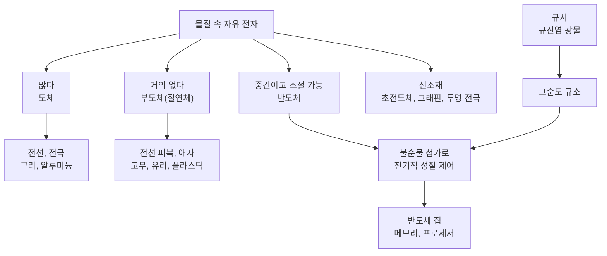
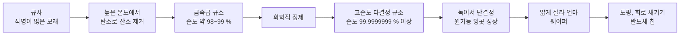

# 2-6. 물질의 전기적 성질과 소재 — 모래 한 줌에서 반도체 칩까지

> [!NOTE]
> **성취기준 [10통과1-02-06]** 지구를 구성하는 물질을 전기적 성질에 따라 구분할 수 있고, 물질의 전기적 성질을 응용하여 일상생활과 첨단기술에서 다양한 소재로 활용됨을 인식한다.

**학습 목표**

1. 물질 속 **자유 전자**의 이동 정도에 따라 물질을 도체, 부도체(절연체), 반도체로 구분할 수 있다.
2. 반도체는 **불순물을 첨가하여 전기적 성질을 쉽게 제어할 수 있음**을 알고, 이 성질이 첨단기술에서 중요한 이유를 설명할 수 있다.
3. 지각의 규산염 광물(규사)에서 반도체 소자의 재료인 규소를 얻는 과정을 설명할 수 있다.
4. 초전도체, 그래핀, 디스플레이 소재 등 전기적 성질을 응용한 소재가 일상생활과 첨단기술에 활용되는 사례를 조사하고 그 가치를 인식할 수 있다.

**이 단원의 학습 사다리**

| 단계 | 무엇을 하나? |
|---|---|
| STEP 1. 중학교 다시 보기 | 전류, 저항, 도체와 부도체, 반도체 소개를 다시 꺼내 본다 |
| STEP 2. 기초 다지기 | 전류와 전자의 이동, 옴의 법칙, 원자 속 '묶인 전자'와 '자유 전자'를 디딤돌로 놓는다 |
| STEP 3. 핵심 개념 | 도체 → 부도체 → 반도체와 불순물 → 규사에서 웨이퍼까지 → 신소재 |
| STEP 4. 오개념 바로잡기 | "반도체는 전기가 반만 통한다?", "부도체에는 전자가 없다?"를 바로잡는다 |
| STEP 5. 선택과목·대학 | 에너지띠 이론, n형·p형 반도체와 p-n 접합, 비저항 |
| STEP 6. 산업·진로 | 반도체 산업(웨이퍼·도핑·메모리), 디스플레이, 전선과 절연 소재, 초전도 응용 |

---

## 🗺️ 단원 들어가기

스마트폰 속 손톱만 한 칩에는 수십억 개의 전자 스위치가 들어 있다. 이 칩의 주재료는 무엇일까? 놀랍게도 그 출발점은 **바닷가와 강가에 흔한 모래**, 정확히는 2-5 단원에서 배운 규산염 광물인 **석영**이 많이 든 모래(규사)이다.

또 하나 생각해 보자. 전선의 속은 구리인데 겉은 왜 플라스틱으로 감싸 놓았을까? 구리는 전기가 잘 통하고 플라스틱은 전기가 통하지 않기 때문이다. 그렇다면 '전기가 통한다'와 '통하지 않는다' 사이에는 무엇이 있을까? 그리고 그 중간에 있는 물질이 왜 현대 문명의 핵심 소재가 되었을까?

이 단원에서는 물질을 **전기적 성질**에 따라 나누고, 그 성질을 응용한 소재들이 우리 삶을 어떻게 바꾸었는지 탐구한다.

---

## STEP 1. 🔙 중학교 다시 보기

### 연계 개념표

| 중학교 성취기준 | 중학교에서 배운 것 | 고등학교에서 확장되는 것 |
|---|---|---|
| [9과14-01] | 마찰 전기, 정전기 유도를 원자 모형(전자의 이동)으로 설명 | 물질 속을 자유롭게 움직이는 **자유 전자**의 개념 |
| [9과14-02] | 전류 모형, 저항·전류·전압의 관계, 도체와 부도체, 반도체 소개 | 자유 전자의 이동으로 도체·부도체·반도체를 **구분하는 기준**, 반도체의 전기적 성질 제어 |
| [9과14-03] | 전기 에너지가 열·빛 등 다른 에너지로 전환됨, 소비 전력 | 저항 때문에 생기는 에너지 손실과 저항이 0인 **초전도체** |
| [9과09-02] | 광물의 특성, 암석과 광물의 자원으로서 가치 | 규산염 광물(규사)이 **반도체 재료 자원**이 됨 |
| [9과11-03] | 주기율표에서 성질이 비슷한 원소 찾기 | 14족 규소와 13족·15족 불순물 원소 |

### 준비 운동 (사전 진단)

**Q1.** 구리, 고무, 유리, 알루미늄을 도체와 부도체로 분류하시오.

**Q2.** 전기 회로에서 전류의 방향과 도선 속 전자가 이동하는 방향은 같은가?

**Q3.** 저항에 3 V의 전압을 걸었더니 0.1 A의 전류가 흘렀다. 저항은 몇 Ω인가?

**Q4.** 연필심(흑연)은 전기가 통할까?

정답 및 해설

**Q1.** 도체: 구리, 알루미늄 / 부도체: 고무, 유리

**Q2.** 반대이다. 전류는 (+)극에서 (−)극 쪽으로 흐른다고 약속했지만, 실제로 도선 속 전자는 (−)극에서 (+)극 쪽으로 이동한다.

**Q3.** $R = V/I = 3/0.1 = 30\ \Omega$

**Q4.** 통한다. 흑연은 금속이 아니지만 내부에 자유롭게 움직이는 전자가 있어 전기가 통한다. "금속만 전기가 통한다"는 생각은 틀렸다.

---

## STEP 2. 🧱 기초 다지기

### ① 전류의 정체: 전하를 띤 입자의 흐름

2-4 단원에서 전류가 흐르려면 **전하를 띤 입자**가 있고, 그 입자가 **이동할 수 있어야** 한다는 것을 배웠다. 수용액에서는 이온이 전하를 운반했다. 금속 도선 같은 **고체**에서 전하를 운반하는 것은 **전자**이다.

> [!TIP]
> 💡 **비유** — 전기 회로를 물이 흐르는 관에 비유해 보자. 전압은 물을 밀어 주는 '수압의 차이', 전류는 관을 흐르는 '물의 양', 저항은 관이 좁거나 막혀서 흐름을 방해하는 정도이다.

### ② 옴의 법칙

중학교에서 배운 전압($V$), 전류($I$), 저항($R$)의 관계를 다시 정리하자.

$$
V = IR \qquad \left(R = \frac{V}{I}\right)
$$

- 전압의 단위는 V(볼트), 전류는 A(암페어), 저항은 Ω(옴)이다.
- 같은 전압을 걸었을 때 **저항이 작을수록 전류가 많이 흐른다.**

#### 미니 예제

1.5 V 건전지에 연결한 막대에 0.5 A의 전류가 흘렀다. 막대의 저항은?

$R = 1.5 / 0.5 = 3\ \Omega$

### ③ 물질 자체의 성질을 비교하려면

같은 물질이라도 **길이가 길수록, 굵기가 가늘수록** 저항이 커진다. 따라서 여러 물질이 전기를 얼마나 잘 통하게 하는지 공정하게 비교하려면 **같은 모양과 크기**로 만들어 비교해야 한다. 그렇게 비교하면 물질마다 저항이 크게 다르다는 것을 알 수 있다. 이 차이가 바로 물질의 **전기적 성질**이다.

### ④ 원자 속의 '묶인 전자'와 '자유 전자'

원자 속 전자는 원자핵의 (+)전하에 끌려 원자에 묶여 있다. 그런데 물질에 따라 **가장 바깥 전자(원자가 전자)** 가 원자에 묶여 있는 정도가 다르다.

- 금속 원자는 원자가 전자를 쉽게 내놓는다(2-4 단원: 금속은 양이온이 되기 쉽다).
- 금속 원자들이 모여 고체를 이루면, 각 원자가 내놓은 원자가 전자는 어느 한 원자에 속하지 않고 **물질 전체를 자유롭게 돌아다닌다.** 이런 전자를 **자유 전자(free electron)** 라고 한다.
- 반면 공유 결합이나 이온 결합을 이룬 물질에서는 전자가 결합에 단단히 묶여 있어 자유롭게 움직이기 어렵다.

> [!TIP]
> 💡 **비유** — 금속 속 자유 전자는 '교실 안을 자유롭게 돌아다니는 학생', 부도체 속 전자는 '자기 자리에 안전벨트를 매고 앉은 학생'이다. 전압은 "모두 앞문 쪽으로 이동!"이라는 신호이다. 돌아다니는 학생은 바로 움직이지만, 벨트를 맨 학생은 움직이지 못한다.

### ⑤ 주기율표 다시 보기: 13족, 14족, 15족

| 족 | 원자가 전자 수 | 원소 예 | 이 단원에서의 역할 |
|---|---|---|---|
| 13족 | 3 | 붕소 B, 알루미늄 Al, 갈륨 Ga | 반도체에 넣는 불순물 |
| 14족 | 4 | 탄소 C, 규소 Si, 저마늄 Ge | 반도체의 주재료(규소, 저마늄), 그래핀(탄소) |
| 15족 | 5 | 질소 N, 인 P, 비소 As | 반도체에 넣는 불순물 |

---

## STEP 3. 📘 핵심 개념

### 2-6-① 도체: 자유 전자가 많은 물질

전기가 잘 통하는 물질을 **도체(conductor)** 라고 한다. 도체 속에는 **자유 전자가 많아서**, 전압을 걸면 자유 전자들이 한 방향으로 이동하여 전류가 잘 흐른다.

| 도체 | 특징 | 쓰임 |
|---|---|---|
| 은 | 금속 중 전기가 가장 잘 통한다. 값이 비싸다 | 특수 전자 부품, 전도성 잉크 |
| 구리 | 은 다음으로 전기가 잘 통하고 값이 적당하다 | 가정용 전선, 전자 회로의 배선 |
| 알루미늄 | 구리보다는 덜 통하지만 가볍다 | 송전선(높은 철탑 사이의 전선) |
| 금 | 녹슬지 않는다 | 전자 부품의 접점 도금, 칩의 연결선 |
| 흑연 | 비금속이지만 자유롭게 움직이는 전자가 있다 | 전극, 연필심 |

> [!NOTE]
> 금속에서는 온도가 높아지면 원자들의 진동이 커져 자유 전자의 이동을 더 많이 방해한다. 그래서 금속 도체는 **온도가 높아질수록 저항이 커진다.**

### 2-6-② 부도체(절연체): 전자가 단단히 묶인 물질

전기가 거의 통하지 않는 물질을 **부도체(insulator)** 또는 **절연체**라고 한다. 부도체 속에도 전자는 아주 많지만, 거의 모두 원자나 결합에 **단단히 묶여 있어 자유 전자가 거의 없다.** 그래서 전압을 걸어도 전류가 거의 흐르지 않는다.

| 부도체 | 쓰임 |
|---|---|
| 고무, 플라스틱(PVC, 폴리에틸렌 등) | 전선 피복, 플러그·콘센트 외장, 공구 손잡이 |
| 유리, 도자기(세라믹) | 송전탑의 **애자**(전선과 철탑 사이를 절연하는 부품) |
| 운모 | 전열 기구 안의 절연판 |
| 에폭시 수지 등 | 전자 회로 기판, 반도체 칩을 감싸는 재료 |

2-5 단원에서 배운 **규산염 광물**(석영, 운모, 장석 등)과 이를 원료로 만든 **유리·도자기**는 대표적인 부도체이다. 또 2-4 단원의 **고체 상태의 이온 결합 물질**(소금 결정)과 **설탕 같은 분자 물질**도 전류가 흐르지 않는다.

> [!WARNING]
> 부도체도 **아주 높은 전압**이 걸리면 갑자기 전류가 흐를 수 있다(절연 파괴). 번개는 평소 부도체인 공기에 매우 높은 전압이 걸려 전류가 흐르는 현상이다. 그래서 고압 전선 가까이에서는 직접 닿지 않아도 위험하다.

### 2-6-③ 반도체: 전기적 성질을 '조절할 수 있는' 물질

**반도체(semiconductor)** 는 순수한 상태에서 전기가 통하는 정도가 **도체와 부도체의 중간**인 물질이다. 대표적인 반도체 원소는 14족의 **규소(Si, 실리콘)** 와 **저마늄(Ge)** 이다.

#### 순수한 규소는 왜 전기가 잘 통하지 않을까?

규소 원자는 원자가 전자가 4개이다. 순수한 규소 결정에서 각 규소 원자는 이웃한 규소 원자 4개와 전자쌍을 하나씩 **공유 결합**한다(2-4 단원). 원자가 전자가 모두 결합에 쓰여 묶여 있으므로, 상온에서 자유롭게 움직이는 전자가 **아주 적다.** 그래서 순수한 규소는 도체보다 전기가 훨씬 덜 통한다. 하지만 묶인 정도가 부도체만큼 강하지 않아서, 일부 전자는 열이나 빛 에너지를 받아 결합에서 풀려나 움직일 수 있다. 그래서 반도체는 온도가 높아지거나 빛을 받으면 전기가 더 잘 통하게 된다(금속과 반대 경향).

#### 반도체의 핵심: 불순물을 넣어 전기적 성질을 제어한다

반도체가 첨단기술의 주인공이 된 진짜 이유는 따로 있다. 순수한 규소에 **다른 원소(불순물)를 아주 조금 넣는 것만으로** 전기가 통하는 정도를 **크게, 그리고 원하는 만큼** 바꿀 수 있다는 점이다. 이렇게 반도체에 불순물을 의도적으로 첨가하는 것을 **도핑(doping)** 이라고 한다.

| 넣는 불순물 | 규소 결정 속에서 생기는 일 | 결과 |
|---|---|---|
| 15족 원소(예: 인) — 원자가 전자 5개 | 4개는 이웃 규소와 결합하고, **1개가 남아** 자유롭게 움직인다 | 움직일 수 있는 전하가 늘어 전기가 잘 통한다 |
| 13족 원소(예: 붕소) — 원자가 전자 3개 | 결합할 전자가 **1개 모자라 빈자리**가 생기고, 이웃 전자가 그 빈자리로 옮겨 가며 전하가 이동한다 | 움직일 수 있는 전하가 늘어 전기가 잘 통한다 |

- 넣는 **양**을 조절하면 전기가 통하는 정도를 조절할 수 있다. 규소 원자 수백만 개 사이에 불순물 원자가 하나 정도 들어가는 아주 적은 양만으로도 전기가 통하는 정도는 수천 배 이상 달라질 수 있다.
- 넣는 **종류**를 바꾸면 전하를 운반하는 방식이 달라진다.
- 하나의 규소 조각 안에서도 **아주 작은 영역마다 다른 불순물을 넣어** 영역마다 전기적 성질을 다르게 만들 수 있다. 이렇게 만든 아주 작은 전자 스위치(트랜지스터) 수십억 개를 손톱만 한 칩에 모아 넣은 것이 반도체 칩이다.

> [!TIP]
> 💡 **비유** — 도체는 항상 열려 있는 문, 부도체는 항상 잠긴 문이다. 반도체는 **열고 닫는 정도를 조절할 수 있는 문**이다. 정보를 0과 1로 처리하는 컴퓨터(1-4 단원)에 꼭 필요한 것은 바로 이 '조절할 수 있는 문'이다.

> [!NOTE]
> 서로 다른 불순물을 넣은 영역을 맞붙였을 때 생기는 현상(접합)과 이를 이용한 소자의 원리는 통합과학에서 다루지 않는다. 궁금하다면 STEP 5를 보자.

#### 예제 1 — 전기적 성질로 분류하기

같은 모양과 크기로 만든 막대 A, B, C에 각각 3 V의 전압을 걸고 전류를 측정하였다.

| 막대 | 전류 |
|---|---|
| A | 1 A |
| B | 0.000 001 A |
| C | 0.01 A |

(1) 각 막대의 저항을 구하시오. (2) A, B, C는 각각 구리, 유리, 규소 중 무엇일 가능성이 가장 큰가?

**풀이**
(1) $R = V/I$
- A: $3 / 1 = 3\ \Omega$
- B: $3 / 0.000\,001 = 3\,000\,000\ \Omega$
- C: $3 / 0.01 = 300\ \Omega$

(2) 저항이 가장 작은 A가 도체인 구리, 가장 큰 B가 부도체인 유리, 중간인 C가 반도체인 규소이다. (수치는 비교를 위해 가정한 값이다. 실제 유리의 저항은 이보다 훨씬 크다.)

### 2-6-④ 모래에서 반도체 칩까지: 규산염 광물의 변신

2-5 단원에서 지각에 두 번째로 많은 원소가 **규소**이고, 석영(Si–O 사면체가 산소를 모두 공유한 광물)이 풍화에 강해 모래에 많이 남는다는 것을 배웠다. 반도체 산업은 바로 이 **석영이 많은 모래(규사)** 에서 출발한다.

1. **규소 얻기** 석영은 규소와 산소가 단단히 결합한 물질이다. 규사를 탄소와 함께 매우 높은 온도로 가열하면 탄소가 산소를 떼어 가고 **규소**가 남는다. 이렇게 얻은 규소는 순도가 약 98~99 % 정도이다.
2. **정제** 반도체에는 원하지 않는 불순물이 거의 없어야 하므로, 화학적 정제를 거쳐 순도를 **99.9999999 %(9가 9개) 이상**으로 높인다.
3. **단결정 만들기** 고순도 규소를 녹인 뒤 작은 씨앗 결정을 담갔다가 천천히 돌리며 끌어올리면, 원자 배열이 전체적으로 하나로 이어진 원기둥 모양의 **단결정 덩어리(잉곳)** 가 만들어진다.
4. **웨이퍼** 잉곳을 얇은 원판으로 잘라 거울처럼 매끈하게 연마한 것이 **웨이퍼(wafer)** 이다. 현재 주력 웨이퍼의 지름은 300 mm이다.
5. **칩 만들기** 웨이퍼 위에 회로 모양을 새기고, 필요한 부분에 불순물을 넣고(도핑), 절연막과 금속 배선을 쌓아 수많은 칩을 만든 뒤 하나씩 잘라 낸다.

> [!IMPORTANT]
> 반도체 공정의 순서는 "**먼저 불순물을 철저히 없애고 → 그다음 원하는 불순물을 원하는 곳에 원하는 양만큼 넣는다**"이다. 불순물을 제거하는 것과 넣는 것은 모순이 아니다. **제어되지 않은** 불순물을 없애야 **제어된** 불순물로 전기적 성질을 정확히 조절할 수 있다.

#### 규소가 반도체 재료의 주인공이 된 이유

- 지각에 산소 다음으로 많아 원료(규사)가 풍부하다.
- 불순물 첨가로 전기적 성질을 조절하기 쉽다.
- 표면을 산소와 반응시키면 품질 좋은 **절연막**(규소 산화막)을 쉽게 만들 수 있어, 회로 안에서 전류가 흐르는 곳과 흐르지 않는 곳을 나누기 좋다.

#### 예제 2 — 순도 계산하기

(1) 순도 99.9999999 %인 규소에서 불순물 원자는 원자 몇 개 중 1개꼴인가?
(2) 지름 300 mm 웨이퍼의 넓이는 약 몇 cm²인가? 가로·세로 1 cm인 칩을 이론적으로 최대 몇 개 정도 만들 수 있는지 어림하시오. ($\pi \approx 3.14$)

**풀이**
(1) 불순물 비율 $= 100 - 99.9999999 = 0.0000001\ \% = \dfrac{0.0000001}{100} = 10^{-9}$ → 원자 **10억 개 중 1개**꼴이다.
(2) 반지름 15 cm → 넓이 $= 3.14 \times 15^2 = 3.14 \times 225 \approx 707\ \mathrm{cm^2}$. 칩 하나가 $1\ \mathrm{cm^2}$이므로 이론상 최대 약 700개이다. 실제로는 원판 가장자리에 사각형 칩을 다 채울 수 없고 불량품도 생기므로 이보다 적다.

### 2-6-⑤ 전기적 성질을 응용한 다양한 소재

#### (1) 초전도체: 저항이 0이 되는 물질

어떤 물질은 특정 온도(**임계 온도**) 이하로 차갑게 하면 **전기 저항이 완전히 0**이 된다. 이런 물질을 **초전도체(superconductor)** 라고 한다. 1911년 네덜란드의 카메를링 오너스가 수은을 약 −269 °C까지 냉각하여 처음 발견하였다.

- 저항이 0이므로 전류가 흘러도 열로 잃는 에너지가 없다. 한번 흐르기 시작한 전류가 계속 흐를 수 있어 **매우 강한 전자석**을 만들 수 있다.
- 초전도체는 내부로 자기장이 들어오지 못하게 밀어내는 성질이 있어, 자석 위에 초전도체를 놓으면 **공중에 뜨는** 현상을 볼 수 있다.
- **활용**: 병원의 **MRI(자기 공명 영상) 장치**의 강한 자석, 핵융합 연구 장치의 자석, 손실이 적은 초전도 전력 케이블, 자기 부상 열차 연구
- **한계**: 지금까지 쓰이는 초전도체는 액체 헬륨(약 −269 °C)이나 액체 질소(약 −196 °C)로 매우 차갑게 유지해야 한다. 상온에서 작동하는 초전도체는 아직 확인되지 않았다.

#### (2) 그래핀: 원자 한 층 두께의 탄소 소재

**그래핀(graphene)** 은 탄소 원자들이 벌집 모양의 육각형으로 연결된 **원자 한 층 두께**의 얇은 막이다. 연필심의 흑연은 그래핀이 수없이 겹쳐 쌓인 것이다.

- 전기가 매우 잘 통하고, 매우 강하며, 거의 투명하고, 잘 휘어진다.
- 2004년 흑연에서 접착테이프로 그래핀을 떼어 내는 데 성공한 안드레 가임과 콘스탄틴 노보셀로프는 2010년 노벨 물리학상을 받았다.
- **활용(연구·개발 중)**: 휘어지는 투명 전극, 열을 빠르게 퍼뜨리는 방열 소재, 고감도 센서, 2차전지 소재 등

#### (3) 디스플레이 소재: 빛과 전기를 함께 다루다

| 소재 | 전기적 성질 | 쓰임 |
|---|---|---|
| 투명 전극(예: 인듐 주석 산화물) | **투명하면서도 전기가 통한다** | 터치스크린, 디스플레이 화면의 전극, 태양 전지 |
| 유기 발광 소재(OLED) | 전류가 흐르면 **스스로 빛을 낸다** | 스마트폰·TV 화면, 휘어지는 디스플레이 |
| 박막 트랜지스터용 반도체 | 화소마다 전류를 켜고 끄는 스위치 역할 | 디스플레이의 각 화소 제어 |
| 액정 | 전압에 따라 분자 배열이 바뀌어 빛의 통과를 조절 | LCD 화면 |

#### (4) 그 밖의 소재

| 소재 | 전기적 성질 | 활용 |
|---|---|---|
| 전도성 고분자 | 플라스틱이면서 전기가 통한다(2000년 노벨 화학상) | 정전기 방지 필름, 유연한 전자 소자 |
| 절연 피복재(가교 폴리에틸렌 등) | 높은 전압에서도 절연을 유지하고 열에 강하다 | 고압 전력 케이블 |
| 이온 전도 고체 | 전자는 막고 이온만 이동시킨다(2-4 단원) | 전고체 전지의 고체 전해질 |

#### 예제 3

다음 상황에 가장 알맞은 소재를 위에서 찾아 쓰고, 그 이유를 전기적 성질로 설명하시오.
(1) 스마트폰 화면을 손가락으로 터치하면 위치를 인식해야 하는데, 화면은 투명해야 한다.
(2) 병원의 MRI 장치에서 매우 강한 자기장을 오랫동안 안정적으로 만들어야 한다.

**풀이**
(1) **투명 전극** — 빛을 통과시키면서도 전기가 통하므로, 화면을 가리지 않고 손가락이 닿은 위치의 전기적 변화를 전달할 수 있다.
(2) **초전도체** — 저항이 0이라 큰 전류를 흘려도 열로 잃는 에너지가 없으므로, 강한 전자석을 안정적으로 유지할 수 있다.

---

## STEP 4. ⚠️ 오개념 바로잡기

| 흔한 오개념 | 올바른 개념 | 왜 그럴까? |
|---|---|---|
| 부도체에는 전자가 없다 | 부도체에도 전자는 많지만 **원자나 결합에 묶여** 자유롭게 움직이지 못한다 | 모든 물질은 원자로 이루어져 있고, 원자에는 전자가 있다 |
| 반도체는 전기가 '반만' 통하는 물질이다 | 반도체는 **불순물·온도·빛 등에 따라 전기적 성질을 크게 바꿀 수 있는** 물질이다 | 중간 정도라는 점보다 '조절할 수 있다'는 점이 핵심이다 |
| 불순물은 항상 품질을 떨어뜨린다 | 반도체에서는 불순물을 **일부러, 정밀하게** 넣어 성질을 조절한다 | 원하지 않는 불순물은 철저히 없애고, 원하는 불순물만 정해진 양을 넣는다 |
| 금속만 전기가 통한다 | 흑연, 그래핀, 전도성 고분자, 이온이 녹은 수용액도 전기가 통한다 | 전하를 띤 입자가 이동할 수 있으면 전류가 흐른다 |
| 스위치를 켜면 전선 속 전자가 빛처럼 빠르게 달려간다 | 전선 속 자유 전자 하나하나는 **매우 느리게**(보통 1초에 1 mm도 안 되게) 이동한다 | 도선 전체에 이미 자유 전자가 가득 차 있어 한꺼번에 밀리기 시작하므로 전등은 바로 켜진다 |
| 실리콘 주방용품과 반도체 실리콘은 같은 물질이다 | 반도체의 실리콘(silicon)은 **규소 원소**, 주방용품의 실리콘(silicone)은 규소를 포함한 **고분자 물질**이다 | 우리말로는 둘 다 '실리콘'이라고 부르지만 영어 철자와 물질이 다르다 |

---

## STEP 5. 🎓 선택과목·대학으로 한 걸음 더

> [!CAUTION]
> 이 절은 **통합과학 교육과정 범위 밖의 심화 내용**으로 평가 대상이 아니다. "이 개념이 앞으로 어디까지 이어지는가"를 맛보기로 보여 주기 위한 내용이다.

### 고2·3 선택과목과의 연결

| 과목 | 이어지는 내용 |
|---|---|
| 물리학 | 빛과 물질 — 고체의 **에너지띠** 구조로 도체와 부도체의 차이 설명, 반도체 소자의 원리(p-n 접합과 다이오드), 반도체·디스플레이 제작 공정에서의 빛 |
| 전자기와 양자 | 다이오드·트랜지스터 등 반도체 소자를 활용한 전자회로(정류, 증폭, 논리회로), 터널 효과 |
| 물질과 에너지 | 결정성 고체를 화학 결합의 종류에 따라 분류 |

### ① 에너지띠 이론: '자유 전자'를 더 정확하게

원자가 하나일 때 전자는 정해진 에너지 준위만 가질 수 있다(2-1 단원의 선스펙트럼). 그런데 수많은 원자가 모여 고체가 되면 에너지 준위들이 촘촘히 모여 **띠(band)** 를 이룬다.

- **원자가 띠**: 결합에 묶인 전자들이 차지하는 띠
- **전도띠**: 전자가 자유롭게 움직일 수 있는 띠
- **띠틈(band gap)**: 두 띠 사이에 전자가 가질 수 없는 에너지 간격

| 물질 | 띠의 모양 | 전기 전도성 |
|---|---|---|
| 도체 | 원자가 띠와 전도띠가 겹치거나 전도띠가 일부 차 있다 | 전자가 쉽게 움직인다 |
| 반도체 | 띠틈이 작다(규소 약 1.1 eV) | 열·빛으로 일부 전자가 전도띠로 올라간다 |
| 부도체 | 띠틈이 매우 크다 | 전자가 거의 올라가지 못한다 |

STEP 3에서 '자유 전자가 많다/적다'라고 한 것을 대학 '고체물리학'에서는 이 에너지띠로 정확하게 설명한다.

### ② n형·p형 반도체와 p-n 접합

- 15족 원소를 넣어 남는 전자가 전하를 운반하는 반도체를 **n형 반도체**(negative), 13족 원소를 넣어 생긴 전자의 빈자리(**양공**, hole)가 (+)전하처럼 움직이는 반도체를 **p형 반도체**(positive)라고 한다.
- p형과 n형을 맞붙인 **p-n 접합**은 한쪽 방향으로만 전류를 잘 흐르게 한다. 이것이 **다이오드**이다. 교류를 직류로 바꾸는 정류 회로에 쓰인다.
- 접합에서 전자와 양공이 만나 빛을 내게 하면 **발광 다이오드(LED)**, 반대로 빛을 받아 전류를 만들면 **태양 전지**가 된다.
- p-n-p 또는 n-p-n 구조나 전압으로 전류의 통로를 여닫는 구조를 만들면 전류를 증폭하거나 켜고 끄는 **트랜지스터**가 된다.

### ③ 비저항: 물질 고유의 '전기가 통하기 어려운 정도'

모양과 관계없이 물질 자체의 성질을 나타내기 위해 **비저항** $\rho$를 쓴다.

$$
R = \rho\frac{L}{A} \qquad (L: \text{길이},\ A: \text{단면적},\ \rho: \text{비저항, 단위 } \Omega\cdot\mathrm{m})
$$

| 물질 | 비저항(대략적인 크기, 상온) |
|---|---|
| 구리 | 약 $1.7\times10^{-8}\ \Omega\cdot\mathrm{m}$ |
| 순수한 규소 | 약 $10^{3}\ \Omega\cdot\mathrm{m}$ 정도 |
| 유리 | 약 $10^{10}\ \Omega\cdot\mathrm{m}$ 이상 |

예를 들어 길이 10 m, 단면적 1 mm²($1\times10^{-6}\ \mathrm{m^2}$)인 구리선의 저항은

$$
R = 1.7\times10^{-8} \times \frac{10}{1\times10^{-6}} = 0.17\ \Omega
$$

이다. 같은 모양의 유리라면 저항이 구리의 $10^{17}$배 이상이다. 구리와 성능 좋은 절연체 사이에는 비저항이 20자릿수 넘게 차이 나기도 한다.

### 고등학교 vs 대학교

| 구분 | 고등학교 통합과학 | 대학교 고체물리학·반도체공학·재료공학 |
|---|---|---|
| 구분 기준 | 자유 전자의 이동 정도 | 에너지띠, 띠틈, 전하 운반자 농도와 이동도 |
| 반도체 | 불순물 첨가로 전기적 성질 제어 | n형·p형, p-n 접합, 다이오드·트랜지스터의 동작, 소자 설계 |
| 정량화 | 옴의 법칙 $V = IR$ | 비저항, 전도도, 운반자 농도 계산, 양자역학 |
| 신소재 | 초전도체·그래핀·디스플레이 소재 사례 | 초전도 이론, 2차원 물질, 유기 반도체, 화합물 반도체 |
| 관련 전공 | — | 전자공학, 반도체공학, 신소재공학, 물리학, 전기공학, 디스플레이공학 |

---

## STEP 6. 🏭 산업 현장과 진로 연결

### 사례 1. 반도체 산업 — 웨이퍼, 도핑, 그리고 메모리

- **웨이퍼 제조** STEP 3-④의 과정처럼 고순도 규소로 단결정 잉곳을 만들고, 얇게 잘라 연마하여 웨이퍼를 만든다.
- **전공정(회로 만들기)** 웨이퍼 위에 절연막을 만들고(산화), 빛으로 회로 모양을 옮기고(노광), 필요 없는 부분을 깎아 내고(식각), 불순물을 넣고(도핑), 얇은 막과 금속 배선을 쌓는(증착·배선) 과정을 수백 번 반복한다. 도핑은 주로 불순물 원소를 이온으로 만들어 가속한 뒤 웨이퍼 표면에 박아 넣는 **이온 주입** 방식으로 한다.
- **후공정** 완성된 칩을 잘라 외부와 연결하고 보호 재료로 감싼 뒤(패키징), 제대로 작동하는지 검사한다.
- **청정한 환경** 머리카락 굵기보다 훨씬 작은 회로를 만들기 때문에 먼지가 극도로 적은 **클린룸**과 이온을 제거한 **초순수**(2-4 단원)를 쓴다.
- **메모리 반도체** 정보를 저장하는 반도체로, 전원이 꺼지면 정보가 사라지는 **D램**과 전원이 꺼져도 정보가 남는 **낸드 플래시**가 대표적이다. 우리나라는 메모리 반도체 분야에서 세계적인 생산국이며, 반도체는 우리나라의 주요 수출 품목이다.
- **새로운 흐름** 전기차·충전기 등에 쓰이는 **전력 반도체**에서는 높은 전압과 온도에 강한 탄화 규소, 질화 갈륨 같은 화합물 반도체의 사용이 늘고 있다.

### 사례 2. 디스플레이 산업

- 스마트폰·TV 화면은 투명 전극, 화소마다 전류를 켜고 끄는 박막 트랜지스터, 스스로 빛을 내는 유기 발광 소재(OLED) 등 **전기적 성질이 서로 다른 소재들을 층층이 쌓아** 만든다.
- 유리 기판 대신 휘어지는 플라스틱 기판을 쓰면 접거나 말 수 있는 디스플레이를 만들 수 있다. 우리나라는 디스플레이 산업에서도 세계적인 기술력을 갖추고 있다.

### 사례 3. 전선과 절연 소재 — 도체와 부도체의 협력

- 가정용 전선은 **구리(도체)** 를 **PVC 등 플라스틱(부도체)** 으로 감싼 구조이다. 피복이 벗겨지면 감전이나 합선, 화재가 일어날 수 있다.
- 송전선은 가벼운 **알루미늄**으로 만들고, 철탑과 전선 사이는 유리·도자기·고분자로 만든 **애자**로 절연한다.
- 땅속에 묻는 고압 전력 케이블에는 높은 전압과 열을 견디는 절연 소재(가교 폴리에틸렌 등)가 쓰인다. 절연 소재의 품질이 전력망의 안전과 수명을 좌우한다.

### 사례 4. 초전도 기술의 활용

- **의료** 병원의 MRI 장치는 액체 헬륨으로 냉각한 초전도 코일로 강한 자기장을 만들어 몸속을 영상으로 보여 준다.
- **에너지 연구** 우리나라의 핵융합 연구 장치 **KSTAR**(한국핵융합에너지연구원)는 초전도 자석으로 초고온 플라스마를 가두는 실험을 하고 있다.
- **전력** 저항이 0인 초전도 케이블은 송전 중 에너지 손실을 크게 줄일 수 있어, 냉각 비용을 줄이는 기술과 함께 실증 연구가 이루어지고 있다.

### 관련 진로와 학과

| 진로 | 하는 일 | 관련 학과 |
|---|---|---|
| 반도체 공정 엔지니어 | 웨이퍼 위 회로 제작 공정(노광·식각·도핑·증착) 개발과 관리 | 전자공학, 반도체공학, 신소재공학, 화학공학 |
| 반도체 소자·회로 설계자 | 메모리·프로세서 등 칩의 구조와 회로 설계 | 전자공학, 전기공학, 컴퓨터공학 |
| 디스플레이 연구원 | OLED·투명 전극 등 디스플레이 소재와 공정 개발 | 디스플레이공학, 신소재공학, 화학, 물리학 |
| 신소재 연구원 | 초전도체·그래핀 등 새로운 전자 소재 연구 | 물리학, 신소재공학, 화학 |
| 전력 설비 엔지니어 | 전선·케이블·절연 설비 설계와 유지 관리 | 전기공학 |
| 의료 영상 장비 엔지니어 | MRI 등 의료 장비 개발·유지 관리 | 의공학, 전기전자공학, 물리학 |

---

## 🔬 탐구 활동 — 물질을 전기적 성질에 따라 구분하고, 소재 활용 사례 조사하기

### 활동 A. 주변 물질의 전기 전도성 조사하기 (모둠 활동)

**목표** 여러 물질에 같은 전압을 걸었을 때 전류가 흐르는 정도를 비교하여 도체와 부도체로 구분하고, 그 차이를 자유 전자의 이동으로 설명한다.

**준비물** 건전지(1.5 V 2개)와 건전지 끼우개, LED 또는 꼬마전구, 집게 전선 3개, 멀티미터(전류 측정 기능), 시료(구리선, 알루미늄 포일, 철 못, 연필심(흑연), 유리 막대, 고무줄, 플라스틱 자, 나무젓가락, 종이, 도자기 조각)

**과정**
1. 건전지–LED(또는 꼬마전구)–멀티미터–시료를 집게 전선으로 연결한 간이 회로를 만든다. 시료 자리를 비워 두면 회로가 끊긴 상태이다.
2. 각 시료를 집게 사이에 끼우고, 집게 사이 간격을 약 5 cm로 같게 맞춘다.
3. LED의 밝기와 멀티미터의 전류 값을 기록한다.
4. 결과를 바탕으로 시료를 도체와 부도체로 분류한다.

**결과 기록**

| 시료 | LED 밝기(밝음/어두움/꺼짐) | 전류(mA) | 분류 | 자유 전자로 설명하기 |
|---|---|---|---|---|
| 구리선 | | | | |
| 알루미늄 포일 | | | | |
| 연필심(흑연) | | | | |
| 유리 막대 | | | | |
| 고무줄 | | | | |
| 플라스틱 자 | | | | |
| 나무젓가락 | | | | |

**생각해 보기**
1. 금속이 아닌데 전류가 흐른 시료가 있는가? 그 이유는 무엇일까?
2. 도체로 분류된 시료들 사이에서도 전류 값에 차이가 있는가? 차이가 생긴 원인(물질의 종류, 굵기 등)을 생각해 보자.
3. 전선을 만들 때 구리와 플라스틱을 함께 쓰는 이유를 이 실험 결과로 설명해 보자.
4. 반도체(규소)는 이 실험에서 어떤 결과를 보일지 예상하고, 반도체의 진짜 가치는 이 실험으로는 알 수 없는 어떤 성질에 있는지 쓰시오.

> [!WARNING]
> **안전 수칙** 반드시 건전지 등 낮은 전압만 사용하고 가정용 콘센트에는 절대 연결하지 않는다. 도체 시료를 끼운 채 오래 두면 전선과 건전지가 뜨거워질 수 있으므로, 측정이 끝나면 바로 회로를 끊는다. 유리 막대와 도자기 조각을 다룰 때 깨지지 않도록 주의한다.

### 활동 B. '미래 소재 카드' 만들기 (조사·발표 활동)

1. 모둠별로 다음 중 하나를 고른다: 초전도체, 그래핀, 투명 전극, OLED 소재, 전력 반도체(탄화 규소 등), 고체 전해질, 전도성 고분자.
2. 아래 항목으로 소재 카드를 만든다.

| 항목 | 내용 |
|---|---|
| 소재 이름 | |
| 전기적 성질(도체·부도체·반도체·기타) | |
| 핵심 원리(한두 문장) | |
| 일상생활 활용 사례 | |
| 첨단기술 활용 사례 | |
| 현재의 한계와 해결 과제 | |
| 관련 진로·학과 | |

3. 모둠별로 2분간 발표하고, 다른 모둠의 소재 중 '10년 뒤 우리 생활을 가장 크게 바꿀 소재'를 골라 근거와 함께 투표한다.

---

## ✅ 개념 확인 문제

### 기본

**1.** 다음 물질을 도체, 부도체, 반도체로 분류하시오.
구리, 유리, 규소, 고무, 알루미늄, 저마늄

정답 및 해설

**정답** 도체: 구리, 알루미늄 / 부도체: 유리, 고무 / 반도체: 규소, 저마늄

도체는 자유 전자가 많아 전기가 잘 통하고, 부도체는 전자가 묶여 있어 자유 전자가 거의 없다. 규소와 저마늄은 14족 원소로 대표적인 반도체이다.

**2.** 도체와 부도체의 차이를 '자유 전자'라는 말을 넣어 한 문장으로 설명하시오.

정답 및 해설

**정답 예시** 도체는 물질 속을 자유롭게 이동할 수 있는 자유 전자가 많아 전기가 잘 통하고, 부도체는 전자가 원자나 결합에 묶여 있어 자유 전자가 거의 없으므로 전기가 거의 통하지 않는다.

**3.** 빈칸에 알맞은 말을 쓰시오.
"반도체는 순수한 상태에서 전기가 통하는 정도가 도체와 부도체의 중간이지만, ( ㄱ )을/를 아주 조금 첨가하면 전기적 성질을 크게 바꿀 수 있다. 이렇게 의도적으로 ( ㄱ )을/를 넣는 것을 ( ㄴ )(이)라고 한다."

정답 및 해설

**정답** ㄱ: 불순물(다른 원소), ㄴ: 도핑

**4.** 초전도체의 뜻을 쓰고, 초전도체가 실제로 쓰이는 예를 한 가지 쓰시오.

정답 및 해설

**정답** 특정 온도(임계 온도) 이하에서 전기 저항이 0이 되는 물질이다. 예: MRI 장치의 강한 자석, 핵융합 연구 장치의 자석 등

### 응용

**5.** 어떤 규소의 순도가 99.99999 %이다. 이 규소에서 규소 원자와 불순물 원자를 합쳐 1억 개를 골랐을 때, 그중 불순물 원자는 몇 개꼴인가?

정답 및 해설

**정답** 10개

불순물 비율 $= 100 - 99.99999 = 0.00001\ \% = 10^{-7}$
불순물 원자 수 $= 10^{8} \times 10^{-7} = 10$개

반도체용 규소는 이보다 순도가 100배 이상 높아야 한다(99.9999999 % 이상).

**6.** 다음은 모래에서 반도체 칩을 만드는 과정을 순서 없이 나열한 것이다. 올바른 순서대로 기호를 쓰시오.
ㄱ. 단결정 잉곳을 얇게 잘라 웨이퍼를 만든다.
ㄴ. 규사를 탄소와 함께 높은 온도로 가열해 산소를 제거한다.
ㄷ. 웨이퍼에 불순물을 넣고 회로를 새겨 칩을 만든다.
ㄹ. 화학적 정제로 규소의 순도를 높인다.
ㅁ. 고순도 규소를 녹여 단결정 잉곳을 만든다.

정답 및 해설

**정답** ㄴ → ㄹ → ㅁ → ㄱ → ㄷ

규사에서 산소를 떼어 규소를 얻고(ㄴ), 순도를 높인 뒤(ㄹ), 단결정 잉곳을 키워(ㅁ), 얇게 잘라 웨이퍼를 만들고(ㄱ), 도핑과 회로 공정으로 칩을 완성한다(ㄷ).

**7.** 같은 모양의 순수한 규소 막대 X와, 같은 크기의 규소에 15족 원소인 인(P)을 아주 조금 넣은 막대 Y에 같은 전압을 걸었다.
(1) 전류가 더 많이 흐르는 막대는 어느 것인가?
(2) 그 이유를 규소의 원자가 전자 수와 인의 원자가 전자 수를 비교하여 설명하시오.

정답 및 해설

**정답** (1) Y

(2) 규소는 원자가 전자가 4개로, 이웃 규소 4개와 모두 공유 결합하여 자유롭게 움직이는 전자가 적다. 원자가 전자가 5개인 인이 규소 자리에 들어가면 4개는 이웃 규소와 결합하고 **1개가 남아** 자유롭게 움직일 수 있다. 움직일 수 있는 전하가 많아지므로 Y에 전류가 더 많이 흐른다.

### 융합·서술형

**8. [산업 연계]** 반도체 공장을 견학한 학생이 이렇게 말했다. "규소를 99.9999999 % 이상으로 정제하느라 엄청난 비용을 들여 놓고, 다시 불순물을 넣는다니 이상해요." 이 학생에게 반도체 공정에서 '불순물 제거'와 '불순물 첨가'가 모두 필요한 이유를 설명하시오.

정답 및 해설

**예시 답안**
반도체는 아주 적은 양의 불순물로도 전기적 성질이 크게 변한다. 그래서 어떤 원소가 얼마나 들어 있는지 모르는 상태에서는 성질을 예측하거나 조절할 수 없다. 먼저 **원하지 않는 불순물을 철저히 제거**해 깨끗한 출발점을 만든 뒤, **원하는 종류의 불순물을 원하는 위치에 정해진 양만큼 넣어야** 각 부분의 전기적 성질을 정확하게 제어할 수 있다. 즉, 제거는 '통제되지 않은 불순물'을, 첨가는 '통제된 불순물'을 다루는 것이므로 모순이 아니다.

**채점 포인트** ① 반도체는 불순물에 민감함 ② 원치 않는 불순물 제거로 기준 상태 확보 ③ 의도한 불순물을 정밀하게 넣어 성질 제어

**9. [생활·진로 연계]** 스마트폰을 분해하면 다음 부품들이 있다. 각 부품에 쓰인 소재의 전기적 성질을 쓰고, 그 성질이 필요한 이유를 설명하시오. 또 이 단원에서 배운 신소재 하나를 골라 미래의 스마트폰에 어떻게 쓰일 수 있을지 제안하시오.
(가) 충전 단자와 내부 배선 (나) 회로 기판과 케이스 (다) 정보를 처리하고 저장하는 칩 (라) 터치 화면의 전극

정답 및 해설

**예시 답안**
(가) **도체**(구리·금 등) — 자유 전자가 많아 전류를 손실 적게 전달해야 한다.
(나) **부도체** — 서로 다른 회로가 합선되지 않도록 전류의 길을 나누고, 사용자를 감전에서 보호해야 한다.
(다) **반도체**(규소) — 불순물 첨가로 영역마다 전기적 성질을 제어해 수많은 전자 스위치를 만들어야 정보를 0과 1로 처리·저장할 수 있다.
(라) **투명 전극** — 화면을 가리지 않도록 투명하면서도 손가락 위치에 따른 전기적 변화를 전달해야 한다.
**제안 예** 그래핀은 전기가 잘 통하고 투명하며 잘 휘어지므로, 접거나 돌돌 마는 스마트폰의 투명 전극으로 쓸 수 있다. 또 열을 빠르게 퍼뜨리는 성질을 이용해 칩의 발열을 줄이는 방열 소재로 쓸 수 있다.

**채점 포인트** ① 부품별 전기적 성질을 바르게 연결 ② 필요한 이유를 자유 전자·제어 가능성으로 설명 ③ 신소재의 성질과 활용을 근거 있게 연결

---

## 📝 한눈에 정리

### 핵심 요약

- 물질은 **자유 전자의 이동 정도**에 따라 **도체**(자유 전자 많음), **부도체·절연체**(자유 전자 거의 없음), **반도체**(중간)로 구분한다.
- 도체(구리, 알루미늄, 금, 흑연)는 전선·전극에, 부도체(고무, 플라스틱, 유리, 도자기)는 피복·애자·기판에 쓰인다.
- 반도체(규소, 저마늄)는 **불순물을 아주 조금 첨가하여(도핑) 전기적 성질을 쉽게, 정밀하게 제어**할 수 있다.
- 반도체의 주재료인 **규소**는 지각의 규산염 광물(석영이 많은 **규사**)에서 산소를 제거하고 정제하여 얻으며, 단결정 잉곳 → 웨이퍼 → 칩으로 만들어진다.
- **초전도체**(임계 온도 이하에서 저항 0, MRI·핵융합 장치), **그래핀**(원자 한 층의 탄소, 전도성·강도·투명성), **디스플레이 소재**(투명 전극, OLED) 등 전기적 성질을 응용한 소재가 첨단기술을 이끈다.
- 하나의 기기 속에서도 **도체·부도체·반도체가 각자의 전기적 성질에 맞는 역할**을 나누어 맡는다.

### 핵심 용어

| 용어 | 뜻 |
|---|---|
| 자유 전자 | 특정 원자에 묶이지 않고 물질 속을 자유롭게 이동하는 전자 |
| 도체 | 자유 전자가 많아 전기가 잘 통하는 물질 |
| 부도체(절연체) | 전자가 묶여 있어 자유 전자가 거의 없어 전기가 거의 통하지 않는 물질 |
| 반도체 | 전기가 통하는 정도가 도체와 부도체의 중간이며, 불순물 첨가로 전기적 성질을 제어할 수 있는 물질 |
| 도핑 | 반도체에 불순물을 의도적으로 넣어 전기적 성질을 조절하는 것 |
| 웨이퍼 | 고순도 단결정 규소를 얇은 원판으로 잘라 연마한 반도체 칩의 기판 |
| 초전도체 | 임계 온도 이하에서 전기 저항이 0이 되는 물질 |
| 그래핀 | 탄소 원자가 벌집 모양으로 연결된 원자 한 층 두께의 소재 |

### 다음 단원으로

지금까지 원소에서 출발해 화학 결합, 지각과 생명체의 구성 물질, 그리고 물질의 전기적 성질과 첨단 소재까지 '물질의 규칙성'을 따라왔다. 다음 대단원에서는 시야를 넓혀, 이런 물질들이 모여 이룬 거대한 시스템인 **지구시스템**이 기권·수권·지권·생물권 사이에서 물질과 에너지를 주고받으며 어떻게 상호작용하는지 탐구한다.
