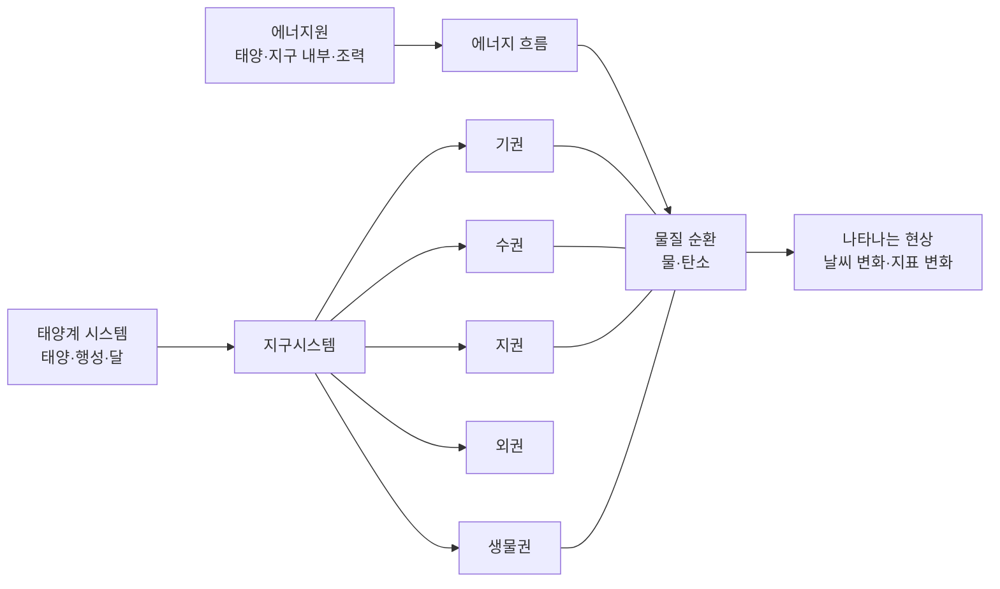
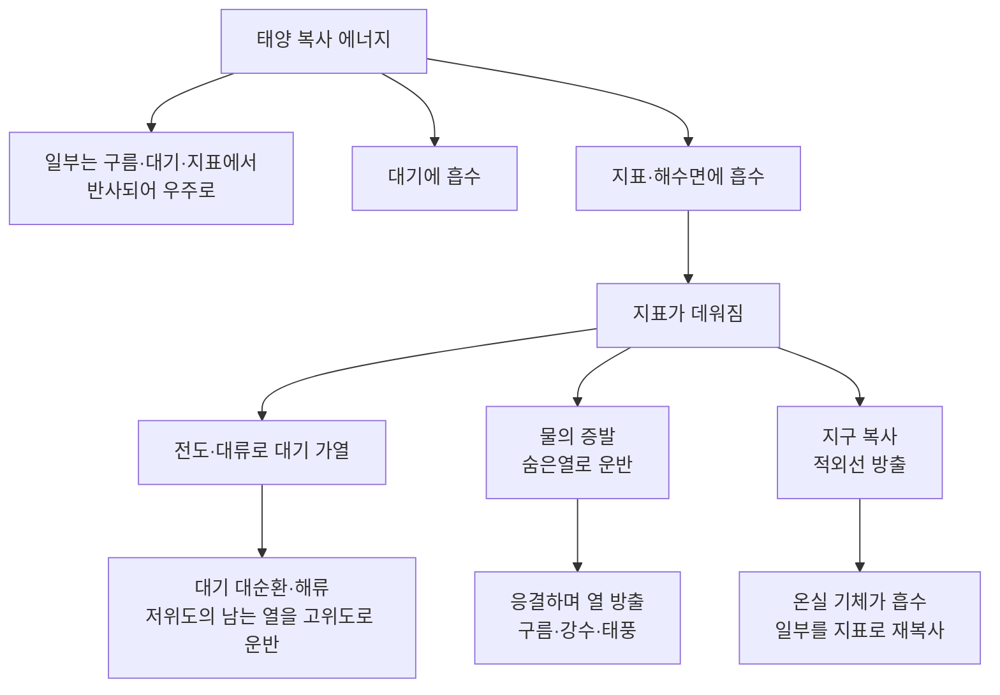
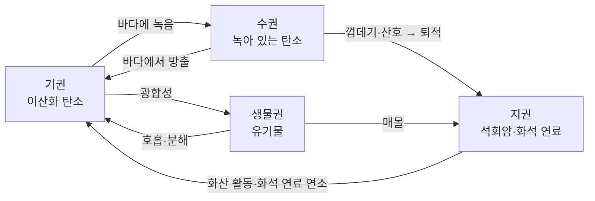

# 3-1. 지구시스템의 구성과 상호작용 — 주고받으며 살아 움직이는 행성

> [!NOTE]
> **성취기준 [10통과1-03-01]** 지구시스템은 태양계라는 시스템의 구성요소임을 알고, 지구시스템을 구성하는 권역들 간의 물질 순환과 에너지 흐름의 결과로 나타나는 현상을 논증할 수 있다.

**학습 목표**

1. 지구시스템이 태양계라는 더 큰 시스템의 구성 요소이며, 태양과 달로부터 에너지와 영향을 받는다는 것을 설명할 수 있다.
2. 기권, 수권, 지권의 성층 구조와 생물권, 외권의 특징을 설명할 수 있다.
3. 지구시스템의 에너지원(태양 에너지, 지구 내부 에너지, 조력 에너지)과 물·탄소의 순환 과정을 권역 사이의 상호작용으로 설명할 수 있다.
4. 날씨 변화, 지표 변화 같은 현상이 권역 간 물질 순환과 에너지 흐름의 결과임을 근거를 들어 논증할 수 있다.

**이 단원의 학습 사다리**

| 단계 | 무엇을 하나? |
|---|---|
| STEP 1. 중학교 다시 보기 | 지구계, 대기권 4개 층, 수권의 분포, 태양계를 다시 꺼내 본다 |
| STEP 2. 기초 다지기 | '시스템', '저장소와 흐름', '에너지는 높은 곳에서 낮은 곳으로'를 디딤돌로 놓는다 |
| STEP 3. 핵심 개념 | 태양계 속 지구 → 권역별 성층 구조 → 에너지원 → 물·탄소 순환 → 현상 논증 |
| STEP 4. 오개념 바로잡기 | "지구 내부 에너지가 날씨를 바꾼다?" 같은 착각을 바로잡는다 |
| STEP 5. 선택과목·대학 | 상자 모형과 체류 시간, 복사 평형으로 구하는 지구 온도 |
| STEP 6. 산업·진로 | 기상 위성과 수치예보, 조력 발전, 탄소 포집과 지구관측 |

---

## 🗺️ 단원 들어가기

여름철 태풍을 떠올려 보자. 태풍은 **바다**(수권) 위에서 태어나 **대기**(기권)를 타고 이동하며, 육지에 비를 퍼부어 **산사태**(지권)를 일으키고, **숲과 농작물, 사람**(생물권)에게 피해를 준다. 그리고 이 모든 것을 움직이는 연료는 약 1억 5천만 km 떨어진 **태양**에서 온다.

태풍 하나에 지구의 거의 모든 부분과 태양까지 등장한다. 지구를 '땅덩어리'가 아니라 **서로 물질과 에너지를 주고받는 여러 부분의 모임**, 즉 **시스템**으로 보아야 하는 이유이다. 이 단원에서는 지구시스템이 무엇으로 이루어져 있고, 각 부분이 어떻게 주고받으며, 그 결과 어떤 현상이 나타나는지를 근거를 들어 설명(논증)해 본다.

---

## STEP 1. 🔙 중학교 다시 보기

### 연계 개념표

| 중학교 성취기준 | 중학교에서 배운 것 | 고등학교에서 확장되는 것 |
|---|---|---|
| [9과07-01] | 태양계를 구성하는 천체(태양, 행성, 위성 등)와 지구형·목성형 행성 | 지구시스템은 **태양계 시스템의 구성 요소**이다 |
| [9과07-02] | 태양 활동이 지구에 미치는 영향 | 태양 에너지가 지구시스템의 **가장 큰 에너지원**이다. 외권과 지구 자기장의 역할 |
| [9과09-01] | 지구계의 구성 요소, 지권의 층상 구조(지각·맨틀·외핵·내핵)의 이름과 상태 | 각 권역의 **성층 구조**를 비교하고, 권역 사이의 **상호작용**으로 확장 |
| [9과17-01] | 기온 분포로 대기권을 대류권·성층권·중간권·열권으로 구분, 복사 평형 | 기권의 층 구조가 **에너지 흐름**과 날씨에 어떻게 연결되는가 |
| [9과18-01] | 해수·담수·빙하의 분포, 자원으로서 물의 가치 | 수권의 층 구조(혼합층·수온 약층·심해층)와 **물의 순환** |
| [9과18-03] | 대기 대순환과 해양 표층 순환의 관계, 해류의 에너지 재분배 | 기권–수권 상호작용으로 나타나는 **날씨와 기후** |
| [9과12-02] | 광합성과 호흡에서 출입하는 물질과 에너지 | 생물권이 참여하는 **탄소 순환** |

### 준비 운동 (사전 진단)

**Q1.** 대기권의 4개 층 중 구름, 비, 눈 같은 기상 현상이 나타나는 층은?

**Q2.** 지권의 층상 구조를 바깥쪽부터 차례대로 쓰고, 액체 상태인 층을 고르시오.

**Q3.** 지구에 있는 물 중 가장 많은 양을 차지하는 것은? ① 빙하 ② 지하수 ③ 해수 ④ 호수와 하천수

**Q4.** 식물의 광합성과 생물의 호흡에서 이산화 탄소는 각각 흡수되는가, 방출되는가?

정답 및 해설

**Q1. 대류권** — 대류권은 위로 갈수록 기온이 낮아져 공기가 위아래로 섞이는 대류가 일어나고, 수증기도 대부분 이 층에 있어 기상 현상이 나타난다.

**Q2.** 지각 → 맨틀 → 외핵 → 내핵. 액체 상태인 층은 **외핵**이다.

**Q3. ③** — 지구의 물은 대부분(약 97%)이 해수이다. 담수는 약 3%뿐이고, 그중에서도 대부분은 빙하이다.

**Q4.** 광합성에서는 이산화 탄소를 **흡수**하고, 호흡에서는 이산화 탄소를 **방출**한다.

---

## STEP 2. 🧱 기초 다지기

### ① 시스템이란 무엇인가?

**시스템(system)** 은 **여러 구성 요소가 서로 영향을 주고받으며(상호작용) 하나의 전체로 작동하는 집합**이다.

- 구성 요소: 시스템을 이루는 부분 (예: 인체의 심장, 폐, 혈관)
- 상호작용: 구성 요소끼리 물질이나 에너지, 정보를 주고받는 것 (예: 폐가 받아들인 산소를 혈액이 온몸으로 나른다)
- 시스템은 더 큰 시스템의 일부가 될 수 있다. (세포 → 기관 → 인체 → 생태계)

> [!TIP]
> 💡 **비유** — 학교는 하나의 시스템이다. 학생, 교사, 급식실, 도서관이 구성 요소이고, 수업·급식·대출이 상호작용이다. 급식실이 하루 멈추면 학생의 오후 수업까지 영향을 받는다. **한 부분의 변화가 다른 부분으로 퍼지는 것**이 시스템의 핵심 특징이다.

### ② 열린 시스템과 닫힌 시스템

| 구분 | 경계를 넘나드는 것 | 예 |
|---|---|---|
| 열린 시스템 | 물질과 에너지 모두 | 끓는 냄비(수증기와 열이 모두 빠져나감), 생물 |
| 닫힌 시스템 | 에너지만 (물질은 거의 출입 없음) | 뚜껑을 꼭 닫은 냄비, **지구시스템** |

지구는 태양 에너지를 받아들이고 우주로 에너지를 내보내지만, 우주와 주고받는 물질(운석, 대기 상층에서 빠져나가는 기체 등)은 지구 전체 질량에 비하면 매우 적다. 그래서 지구시스템은 **에너지는 출입하지만 물질은 거의 출입하지 않는 닫힌 시스템**으로 본다. 물질이 밖으로 나가지 않으니 지구 안에서 **계속 돌고 돈다(순환)**.

### ③ '저장소'와 '흐름'으로 생각하기

물질 순환을 이해하는 가장 쉬운 방법은 **저장소(reservoir)** 와 **흐름(flux)** 으로 나누는 것이다.

- 저장소: 물질이 머물러 있는 곳 (예: 바다, 대기, 빙하)
- 흐름: 저장소 사이를 이동하는 물질의 양 (예: 1년 동안 바다에서 증발하는 물의 양)

어떤 저장소의 양이 일정하게 유지되려면 **들어오는 양 = 나가는 양**이어야 한다.

$$
\text{저장소의 변화량} = \text{들어온 양} - \text{나간 양}
$$

> [!TIP]
> 💡 **비유** — 저장소는 '통장', 흐름은 '입금과 출금'이다. 매달 입금과 출금이 같으면 잔고가 일정하다. 출금(예: 빙하가 녹는 양)이 입금(눈이 쌓이는 양)보다 많아지면 잔고(빙하의 양)가 줄어든다.

### ④ 에너지는 '높은 곳'에서 '낮은 곳'으로 흐른다

- 열은 온도가 높은 곳에서 낮은 곳으로 이동한다. 이동 방법은 **전도**(맞닿은 물질을 따라), **대류**(유체가 직접 움직이며), **복사**(전자기파로, 물질 없이도)이다.
- 따뜻한 공기나 물은 밀도가 작아 위로 올라가고, 차가운 것은 가라앉는다. 이것이 대기와 바다, 그리고 맨틀에서 일어나는 **대류**의 기본 원리이다.
- 물이 증발할 때는 주위의 열을 흡수하고, 수증기가 응결할 때는 그 열을 다시 내놓는다(**숨은열**, latent heat). 이 덕분에 물은 에너지를 실어 나르는 '택배 상자' 역할을 한다.

---

## STEP 3. 📘 핵심 개념

### 3-1-① 태양계 시스템 속의 지구시스템

지구는 혼자 존재하지 않는다. **태양계(solar system)** 는 태양과 그 주위를 도는 8개의 행성, 왜소행성, 소행성, 위성, 혜성 등으로 이루어진 시스템이며, 태양이 태양계 전체 질량의 약 99.8%를 차지한다. **지구시스템(Earth system)** 은 태양계라는 큰 시스템의 한 구성 요소이다.

지구시스템이 태양계의 다른 구성 요소와 주고받는 상호작용은 다음과 같다.

| 상대 천체 | 무엇을 주고받나? | 지구시스템에 나타나는 결과 |
|---|---|---|
| 태양 | 빛(복사 에너지) | 대기·해수의 운동, 물의 순환, 광합성 → 지구시스템의 대부분의 변화 |
| 태양 | 태양풍(전기를 띤 입자의 흐름) | 지구 자기장과 상호작용 → 오로라, 자기 폭풍(통신·위성 장애) |
| 달·태양 | 인력(당기는 힘) | 바닷물이 주기적으로 높아졌다 낮아지는 **조석(밀물·썰물)** |
| 소행성·혜성 등 | 충돌, 운석 | 드물지만 큰 충돌은 생물권에 큰 변화를 일으킨 적이 있다 |

지구가 태양으로부터 적당한 거리(평균 약 1억 5천만 km)에 있어 **물이 액체 상태로 존재**할 수 있고, 적당한 질량을 가져 대기를 붙잡아 둘 수 있다. 이처럼 태양계 안에서의 '위치'와 '조건'이 지구시스템의 성격을 결정한다.

> [!IMPORTANT]
> 지구시스템을 이해할 때는 항상 **"이 에너지와 물질은 어디에서 왔는가?"** 를 먼저 물어야 한다. 대부분의 답은 '태양'이고, 일부는 '지구 내부', 일부는 '달과 태양의 인력'이다.

### 3-1-② 지구시스템의 구성 요소와 성층 구조

지구시스템은 **기권, 수권, 지권, 생물권, 외권**으로 나눈다. 기권·수권·지권은 깊이(높이)에 따라 성질이 다른 여러 층으로 나뉘는데, 이를 **성층 구조(layered structure)** 라고 한다. 층을 나누는 기준이 권역마다 다르다는 점에 주목하자.

#### (1) 기권 — 높이에 따른 기온 변화로 나눈다

**기권(atmosphere)** 은 지표에서 높이 약 1000 km까지 지구를 둘러싼 대기층이다. 부피비로 질소 약 78%, 산소 약 21%이고, 나머지는 아르곤, 이산화 탄소, 수증기 등이다. 대기는 중력에 붙잡혀 있어 지표 가까이에 밀집되어 있으므로, 대기 질량의 대부분(약 4분의 3 이상)이 가장 아래층인 대류권에 있다.

| 층 | 높이(대략) | 높이에 따른 기온 | 특징 |
|---|---|---|---|
| 열권 | 약 80 km 이상 | 높아짐 | 공기가 매우 희박. 태양 에너지를 직접 흡수. 오로라 발생 |
| 중간권 | 약 50~80 km | 낮아짐 | 대류는 있지만 수증기가 거의 없어 기상 현상 없음. 유성이 보인다 |
| 성층권 | 약 11~50 km | 높아짐 | **오존층**(약 20~30 km)이 태양 자외선을 흡수해 가열. 대기가 안정 |
| 대류권 | 지표~약 11 km | 낮아짐 | 지표가 데운 공기가 대류. 수증기가 많아 **기상 현상** 발생 |

대류권의 높이는 위도와 계절에 따라 다르다(적도 부근이 높고 극 부근이 낮다).

<!-- fig:3-1-atmosphere-layers -->

#### (2) 수권 — 깊이에 따른 수온 변화로 나눈다

**수권(hydrosphere)** 은 지구의 모든 물로, 약 97%가 해수이고 담수는 약 3%이다. 담수의 대부분은 빙하이며, 그다음이 지하수이고, 호수·하천수는 아주 적다. 해수는 깊이에 따른 수온 분포로 세 층으로 나뉜다.

| 층 | 수온 분포 | 왜 그럴까? |
|---|---|---|
| 혼합층 | 깊이에 따라 거의 일정 | 태양 에너지로 데워지고, **바람**이 물을 섞어 준다. 바람이 강할수록 두꺼워진다 |
| 수온 약층 | 깊어질수록 급격히 낮아짐 | 위는 따뜻하고 가벼운 물, 아래는 차갑고 무거운 물 → 매우 **안정**하여 위아래 물이 잘 섞이지 않는다 |
| 심해층 | 낮고 거의 일정 | 태양 에너지가 닿지 않는다. 극지방에서 가라앉은 차가운 물로 채워져 있다 |

> [!TIP]
> 💡 **비유** — 수온 약층은 '뚜껑'과 같다. 혼합층과 심해층 사이에서 물질과 에너지가 오가는 것을 막는다. 그래서 바다 표면이 아무리 뜨거워도 심해는 차갑게 유지된다.

<!-- fig:3-1-ocean-layers -->

#### (3) 지권 — 구성 물질과 상태로 나눈다

**지권(geosphere)** 은 지구의 표면과 내부를 이루는 고체 지구이다. 지구의 반지름은 약 6400 km이다.

| 층 | 깊이(대략) | 상태 | 특징 |
|---|---|---|---|
| 지각 | 대륙 평균 약 35 km, 해양 약 5~10 km | 고체 | 대륙 지각은 두껍고 가벼운 화강암질, 해양 지각은 얇고 무거운 현무암질 |
| 맨틀 | 지각 아래 ~ 약 2900 km | 고체 (일부는 매우 천천히 흐름) | 지구 부피의 약 80%를 차지. 매우 느린 대류가 일어난다 |
| 외핵 | 약 2900 ~ 5100 km | **액체** | 철과 니켈이 주성분. 외핵의 운동이 **지구 자기장**을 만든다 |
| 내핵 | 약 5100 km ~ 중심 | 고체 | 철과 니켈이 주성분. 압력이 매우 커서 고체 상태 |

지각과 맨틀의 경계를 **모호면**이라고 한다. 이 층 구조는 지구 내부를 통과하는 **지진파**가 층의 경계에서 속도가 갑자기 변하는 것을 분석하여 알아냈다.

#### (4) 생물권과 외권

- **생물권(biosphere)**: 지구에 사는 모든 생물. 독립된 층이라기보다 **지권 표면, 수권, 기권 아래쪽에 걸쳐** 분포한다. 광합성과 호흡으로 다른 권역과 물질을 활발히 주고받는다.
- **외권**: 기권 바깥의 우주 공간. 태양 에너지와 태양풍이 들어오는 통로이다. 지구 자기장이 만든 **자기권**은 태양풍의 대전 입자를 막아 생물권을 보호한다.

> [!NOTE]
> 교과서에 따라 외권을 지구시스템의 구성 요소에 포함하기도 하고, 지구시스템 바깥의 '우주'로 다루기도 한다. 어느 쪽이든 핵심은 **외권을 통해 태양 에너지가 들어오고, 지구 에너지가 우주로 나간다**는 점이다.

#### 예제 1 — 층을 나누는 기준 비교

기권, 수권(해수), 지권의 성층 구조를 나누는 기준을 각각 쓰고, 기권의 성층권과 해수의 수온 약층의 공통점을 '안정'이라는 말을 사용하여 설명하시오.

**풀이**
- 기준: 기권은 **높이에 따른 기온 변화**, 해수는 **깊이에 따른 수온 변화**, 지권은 **구성 물질과 상태**.
- 공통점: 두 층 모두 **위쪽이 따뜻하고 아래쪽이 차갑다.** 따뜻하고 가벼운 유체가 위에, 차갑고 무거운 유체가 아래에 있으므로 위아래로 섞이는 대류가 일어나기 어렵다. 즉, 두 층 모두 **매우 안정한 층**이다.

### 3-1-③ 지구시스템의 에너지원과 에너지 흐름

지구시스템을 움직이는 에너지원은 세 가지이다.

| 에너지원 | 어디에서 오나? | 상대적 크기 | 주로 일으키는 현상 |
|---|---|---|---|
| **태양 에너지** | 태양의 핵융합 반응 → 빛으로 전달 | 압도적으로 큼 (전체의 99.9% 이상) | 대기와 해수의 순환, 물의 순환, 날씨 변화, 광합성, 풍화·침식 |
| **지구 내부 에너지** | 지구 내부의 방사성 원소가 붕괴하며 내는 열 + 지구가 만들어질 때 남은 열 | 매우 작음 | 맨틀 대류, 판의 이동, 지진, 화산 활동, 조산 운동 |
| **조력 에너지** | 달과 태양이 지구를 당기는 인력 | 가장 작음 | 밀물과 썰물(조석), 해안의 침식·퇴적 |

에너지원마다 크기는 크게 다르지만, **각각 다른 권역에서 다른 종류의 변화를 일으킨다**는 점이 중요하다. 지구 내부 에너지는 양이 매우 적지만 판을 움직이고 화산을 일으키는 유일한 원동력이다(→ 3-2 단원).

#### 태양 에너지의 흐름

지구 대기 바깥에서 태양 광선에 수직인 면 $1\ \mathrm{m^2}$가 받는 태양 에너지는 1초에 약 1360 J(약 $1.36\ \mathrm{kW/m^2}$)이다. 이 에너지는 다음과 같이 흐른다.

지구는 장기적으로 **흡수하는 태양 복사 에너지 = 방출하는 지구 복사 에너지**인 **복사 평형** 상태를 유지한다(중학교 [9과17-01]). 그런데 위도별로 보면 저위도는 받는 에너지가 많아 남고, 고위도는 모자란다. 이 불균형을 메우기 위해 **대기와 해수가 움직이며 열을 저위도에서 고위도로 나르는 것**이 바로 바람과 해류, 그리고 날씨 변화의 근본 원인이다.

> [!TIP]
> 💡 **비유** — 지구는 '난방은 한쪽 방(적도)에만 들어오는 집'이다. 집 전체가 따뜻해지려면 선풍기(대기 대순환)와 온수관(해류)이 열을 다른 방으로 옮겨야 한다. 이 '열 배달' 과정에서 바람이 불고 비가 내린다.

#### 예제 2 — 에너지원 찾기

다음 현상을 일으키는 주된 에너지원을 쓰시오.
(1) 장마철 집중 호우 (2) 동해안의 해안 사구 형성에 필요한 바람 (3) 서해안 갯벌에서 하루 두 번 바닷물이 들고 나는 현상 (4) 일본 열도의 화산 분출

**풀이**
(1) 태양 에너지 — 바닷물을 증발시키고 대기를 움직이는 것은 태양 에너지이다.
(2) 태양 에너지 — 바람은 지표가 불균등하게 가열되어 생긴 기압 차이로 분다.
(3) 조력 에너지 — 달과 태양의 인력에 의한 조석 현상이다.
(4) 지구 내부 에너지 — 맨틀 대류와 판의 운동으로 마그마가 생성된다.

### 3-1-④ 권역 사이의 물질 순환 — 물과 탄소

지구시스템은 물질이 거의 드나들지 않는 닫힌 시스템이므로, 물질은 권역 사이를 **형태를 바꾸어 가며 순환**한다. 순환의 엔진은 에너지이다.

#### (1) 물의 순환

물은 고체(빙하), 액체(해수, 하천수, 지하수), 기체(수증기)로 모습을 바꾸며 수권 → 기권 → 지권·생물권 → 수권으로 돈다.

| 과정 | 이동 방향 | 원동력 |
|---|---|---|
| 증발 | 해수·지표의 물 → 대기 | 태양 에너지 |
| 증산 | 식물의 잎 → 대기 (생물권 → 기권) | 태양 에너지 |
| 응결·강수 | 수증기 → 구름 → 비·눈으로 지표에 | 상승 공기의 냉각, 중력 |
| 유출 | 하천·지하수 → 바다 | 중력 |
| 흡수·저장 | 토양·지하수·빙하, 생물의 몸 | — |

물의 순환은 **물질의 순환**이자 동시에 **에너지의 운반**이다. 저위도 바다에서 증발할 때 흡수한 숨은열이, 수증기가 이동하여 다른 곳에서 응결할 때 방출된다. 태풍이 엄청난 에너지를 가진 이유가 바로 이 숨은열이다.

#### 예제 3 — 물 수지 따져 보기

어떤 자료를 단순화하여, 1년 동안 대기로 들어가는 물의 총량을 100으로 놓은 상댓값이 다음과 같다고 하자.

| 해양 증발 | 해양 강수 | 육지 강수 | 육지 증발(증산 포함) | 육지 → 바다 유출 |
|---|---|---|---|---|
| 84 | 77 | 23 | 16 | ( 가 ) |

(1) (가)를 구하시오. (2) 이 자료에서 바다와 대기, 육지가 각각 물의 양을 일정하게 유지하는지 확인하시오.

**풀이**
(1) 육지에 들어오는 물은 강수 23이고 나가는 물은 증발 16과 유출 (가)이다. 육지의 물의 양이 일정하려면 $23 = 16 + (가)$ 이므로 **(가) = 7**이다.
(2)
- 바다: 들어옴(해양 강수 77 + 유출 7 = 84) = 나감(해양 증발 84) ✔
- 대기: 들어옴(84 + 16 = 100) = 나감(77 + 23 = 100) ✔
- 육지: 들어옴(23) = 나감(16 + 7 = 23) ✔

모든 저장소에서 들어온 양과 나간 양이 같으므로 각 권역의 물의 양은 일정하게 유지된다. 물은 끊임없이 움직이지만 **전체 양은 보존**된다. 또한 바다에서는 증발이 강수보다 많고, 그 차이(7)만큼 육지에서 하천을 통해 되돌아온다는 것도 알 수 있다.

#### (2) 탄소의 순환

탄소는 모든 권역에 서로 다른 모습으로 저장되어 있다.

| 권역 | 탄소의 형태 |
|---|---|
| 기권 | 이산화 탄소(CO₂), 메테인(CH₄) |
| 수권 | 물에 녹은 이산화 탄소, 탄산수소 이온·탄산 이온 |
| 지권 | 석회암(탄산 칼슘), 석탄·석유 같은 화석 연료 |
| 생물권 | 생물의 몸을 이루는 유기물 |

- **빠른 순환**: 광합성과 호흡처럼 수일~수십 년 사이에 일어나는 기권–생물권–수권 사이의 교환
- **느린 순환**: 석회암이 만들어지고 화산 활동으로 다시 대기로 나오는 데 수백만 년 이상 걸리는 지권 관련 순환

> [!WARNING]
> 인간이 **화석 연료를 태우는 것**은 수백만 년 동안 지권에 갇혀 있던 탄소를 수백 년 만에 기권으로 꺼내는 일이다. '느린 순환'으로 저장된 탄소를 '빠른 순환'으로 끌어낸 결과, 대기 중 이산화 탄소 농도는 산업 혁명 이전 약 280 ppm에서 2020년대에는 약 420 ppm으로 높아졌다. 바다가 이 이산화 탄소의 일부를 흡수하면서 바닷물이 산성 쪽으로 변하는 **해양 산성화**도 함께 일어나고 있다(→ 5-3 단원에서 자세히).

### 3-1-⑤ 권역 간 상호작용의 결과 — 현상을 논증하기

성취기준의 핵심은 지구에서 일어나는 현상이 **권역 사이의 물질 순환과 에너지 흐름의 결과**임을 **근거를 들어 주장하는 것(논증)** 이다. 먼저 권역 사이에서 어떤 상호작용이 일어나는지 정리해 보자.

| 영향을 주는 권역 → 받는 권역 | 상호작용의 예 |
|---|---|
| 기권 → 수권 | 바람이 해류를 일으키고 혼합층을 만든다. 대기의 CO₂가 바다에 녹는다 |
| 수권 → 기권 | 바다에서 증발한 수증기가 구름·태풍이 된다. 해수가 대기에 열을 공급한다 |
| 기권 → 지권 | 바람과 기온 변화로 암석이 풍화된다. 바람이 모래를 날라 사구를 만든다 |
| 수권 → 지권 | 하천과 빙하, 파도가 지표를 침식·운반·퇴적시킨다(V자곡, 삼각주, 해식 절벽) |
| 지권 → 기권 | 화산 가스와 화산재가 대기 성분을 바꾼다 |
| 지권 → 수권 | 해저 지진이 지진 해일을 일으킨다. 암석에서 녹아 나온 물질이 바닷물의 염분이 된다 |
| 생물권 → 기권 | 광합성으로 대기에 산소를 공급하고 CO₂를 흡수한다 |
| 생물권 → 지권 | 식물 뿌리가 암석을 쪼개고(풍화), 산호·조개껍데기가 석회암이 된다 |
| 기권·수권 → 생물권 | 기온과 강수량이 생물의 분포를 결정한다 |
| 외권 → 기권 | 태양 복사 에너지 유입, 태양풍이 오로라를 일으킨다 |

<!-- fig:3-1-sphere-interactions -->

#### 논증의 틀: 주장 – 근거 – 추론(연결)

| 요소 | 뜻 |
|---|---|
| 주장 | 내가 설명하려는 결론 ("○○ 현상은 △△ 권역 사이의 상호작용 결과이다") |
| 근거 | 관측 자료, 측정값, 사실 ("해수면 온도가 27 °C 이상인 바다에서 태풍이 발달한다") |
| 추론 | 근거가 왜 주장을 뒷받침하는지 원리로 연결 ("따뜻한 바다에서 증발한 수증기가 응결하며 숨은열을 방출하므로 …") |

#### 사례 1. 날씨 변화 — 태풍

- **주장** 태풍은 수권과 기권 사이의 물질 순환과 에너지 흐름의 결과로 발생하고 발달한다.
- **근거** 태풍은 해수면 온도가 높은(대략 26~27 °C 이상) 열대 해상에서 발생한다. 육지에 상륙하거나 차가운 바다로 이동하면 빠르게 약해진다.
- **추론** 태양 에너지로 데워진 바다에서 많은 물이 증발한다(수권 → 기권, 물질 이동). 수증기를 머금은 공기가 상승하며 응결할 때 숨은열을 방출하고(에너지 흐름), 이 열이 공기를 더 가볍게 만들어 상승 기류를 강화한다. 육지에서는 수증기 공급이 끊기므로 태풍이 약해진다. 따라서 태풍의 '연료'는 바다가 공급하는 수증기와 숨은열이다.
- **이어지는 영향** 태풍의 강풍과 폭우는 산사태·하천 범람(→ 지권), 농작물·산림 피해(→ 생물권)를 일으키고, 동시에 바닷물을 뒤섞어 바다 깊은 곳의 영양 물질을 위로 올려 보내기도 한다(→ 수권·생물권).

#### 사례 2. 지표 변화 — 석회 동굴과 카르스트 지형

- **주장** 석회 동굴은 기권·수권·지권 사이의 탄소와 물의 순환 결과로 만들어진다.
- **근거** 석회 동굴은 석회암 지대에서만 발달하고, 동굴 안에는 종유석과 석순이 자란다.
- **추론** 대기의 이산화 탄소가 빗물에 녹아 약한 산성을 띤 물이 된다(기권 → 수권). 이 물이 땅속으로 스며들어 석회암을 녹이면서 빈 공간이 생긴다(수권 → 지권, 탄소 이동). 녹은 물질이 동굴 천장에서 떨어질 때 이산화 탄소가 빠져나가며 다시 굳어 종유석이 된다.

#### 사례 3. 생물권의 역할 — 대기 중 산소

- **주장** 오늘날 대기에 산소가 약 21%나 있는 것은 생물권과 기권 사이의 상호작용 결과이다.
- **근거** 지구 초기 대기에는 산소가 거의 없었다. 광합성을 하는 생물(남세균 등)이 출현한 이후 대기 중 산소가 늘어났다는 지질학적 증거가 있다.
- **추론** 광합성 생물이 이산화 탄소와 물로 유기물을 만들며 산소를 내놓았고(생물권 → 기권), 산소가 쌓이면서 성층권에 오존층이 생겨 자외선을 막아 주자 생물이 육지로 진출할 수 있게 되었다(기권 → 생물권). 한 권역의 변화가 다른 권역을 바꾸고, 그것이 다시 처음 권역에 영향을 주는 **되먹임(feedback)** 의 예이다.

> [!IMPORTANT]
> 논증을 쓸 때는 반드시 ① **어느 권역에서 어느 권역으로** ② **무엇(물질 또는 에너지)이** ③ **어떤 원리로** 이동했는지를 밝힌다. "권역들이 상호작용해서 생긴다"라고만 쓰면 논증이 아니다.

---

## STEP 4. ⚠️ 오개념 바로잡기

| 흔한 오개념 | 올바른 개념 | 왜 그럴까? |
|---|---|---|
| 지구시스템에서 가장 중요한 에너지원은 지구 내부 에너지이다 | 양으로 보면 **태양 에너지가 압도적**이다(99.9% 이상) | 화산·지진이 극적이라 커 보이지만, 날씨·해류·물의 순환·광합성은 모두 태양 에너지로 움직인다 |
| 지구는 물질과 에너지가 자유롭게 드나드는 열린 시스템이다 | 지구시스템은 **에너지는 출입하지만 물질은 거의 출입하지 않는** 닫힌 시스템으로 본다 | 운석 등 물질 출입이 아주 조금 있지만 지구 전체 질량에 비하면 무시할 만하다. 그래서 물질은 순환한다 |
| 높이 올라갈수록 기온은 항상 낮아진다 | 기온은 대류권·중간권에서는 낮아지고, **성층권·열권에서는 높아진다** | 성층권은 오존이 자외선을 흡수하고, 열권은 태양 에너지를 직접 흡수하기 때문이다 |
| 바다는 깊어질수록 수온이 일정한 비율로 낮아진다 | 혼합층은 거의 일정, **수온 약층에서만 급격히** 낮아지고, 심해층은 낮고 일정하다 | 바람에 의한 혼합과 태양 에너지가 닿는 깊이가 제한되기 때문이다 |
| 생물권은 다른 권역에 영향을 받기만 한다 | 생물권은 대기의 **산소와 이산화 탄소 농도를 바꾸고**, 석회암을 만들고, 풍화를 일으키는 **능동적인 권역**이다 | 광합성과 호흡, 생물의 사체와 껍데기가 쌓이는 과정이 다른 권역의 물질을 바꾼다 |
| 맨틀은 액체 상태라서 대류한다 | 맨틀은 **고체**이지만 긴 시간 동안 매우 느리게 흐를 수 있다. 액체인 층은 **외핵**이다 | 엿처럼 단단한 물질도 오래 힘을 받으면 조금씩 흐른다. 맨틀 대류는 1년에 수 cm 정도로 매우 느리다 |

---

## STEP 5. 🎓 선택과목·대학으로 한 걸음 더

> [!CAUTION]
> 이 절은 **통합과학 교육과정 범위 밖의 심화 내용**으로 평가 대상이 아니다. "이 개념이 앞으로 어디까지 이어지는가"를 맛보기로 보여 주기 위한 내용이다.

### 고2·3 선택과목과의 연결

| 과목 | 이어지는 내용 |
|---|---|
| 지구과학 | 대기와 해양의 상호작용(해수의 순환, 엘니뇨처럼 대기와 해양이 함께 변하는 현상) |
| 지구시스템과학 | 지구 탄생과 생동하는 지구, 강수 과정과 대기의 운동, 해수의 운동 |
| 기후변화와 환경생태 | 기후위기와 환경생태 변화, 기후위기에 대응하는 우리의 노력 |
| 행성우주과학 | 태양과 별의 관측, 우주탐사와 행성계(다른 행성의 대기·바다와 지구 비교) |

### ① 상자 모형과 체류 시간

대학의 **지구시스템과학·생지화학(biogeochemistry)** 에서는 STEP 2의 '저장소와 흐름'을 **상자 모형(box model)** 으로 정량화한다. 저장소에 들어 있는 물질의 양을 $M$, 1년 동안 드나드는 흐름을 $F$라 하면, 물질 한 입자가 그 저장소에 평균적으로 머무는 시간인 **체류 시간(residence time)** $\tau$는 다음과 같다.

$$
\tau = \frac{M}{F}
$$

예를 들어 대기 중 수증기의 양은 지구 전체 강수량의 약 40분의 1 정도이므로, 대기에 들어간 물 분자는 평균 약 9~10일 만에 비나 눈으로 떨어진다. 반면 심해의 물이나 빙하의 얼음은 수백~수천 년 이상 머문다. 체류 시간이 짧은 저장소는 변화에 빠르게 반응하고, 긴 저장소는 '기억'이 오래간다. 이것이 오염 물질이 대기에서는 금방 씻겨 나가지만 지하수에서는 오래 남는 이유이다.

### ② 복사 평형으로 구하는 지구의 온도

대학 **대기과학·기후학**에서는 복사 평형을 식으로 쓴다. 지구가 흡수하는 태양 에너지와 지구가 방출하는 에너지가 같다고 놓으면,

$$
\frac{S(1-\alpha)}{4} = \sigma T^4
$$

($S$: 태양 상수 약 $1360\ \mathrm{W/m^2}$, $\alpha$: 지구의 반사율 약 0.3, $\sigma$: 슈테판–볼츠만 상수 $5.67\times10^{-8}\ \mathrm{W/(m^2\cdot K^4)}$, 4로 나누는 것은 지구가 원판 면적으로 햇빛을 받고 구 표면 전체로 방출하기 때문)

이를 풀면 $T \approx 255\ \mathrm{K}$(약 −18 °C)가 나온다. 실제 지표 평균 기온은 약 15 °C(288 K)이다. 그 차이 약 33 °C가 바로 **온실 효과**의 크기이다. 이처럼 단순한 모형에서 출발해 대기·해양·빙하·생물권을 모두 넣은 것이 **기후 모델**과 **지구시스템 모델**이다.

### ③ 되먹임(feedback)

권역 간 상호작용은 변화를 키우거나(양의 되먹임) 줄인다(음의 되먹임).

| 종류 | 예 |
|---|---|
| 양의 되먹임 | 기온 상승 → 빙하 감소 → 지표 반사율 감소 → 태양 에너지 흡수 증가 → 기온 더 상승 |
| 음의 되먹임 | 대기 CO₂ 증가 → 식물의 광합성이 활발해짐 → CO₂ 흡수 증가 → 증가 폭이 줄어듦 |

### 고등학교 vs 대학교

| 구분 | 고등학교 통합과학 | 대학교 지구시스템과학·대기과학·해양학 |
|---|---|---|
| 권역 | 성층 구조와 상호작용의 예 | 각 권역의 물리·화학 법칙(유체역학, 열역학, 화학 평형) |
| 물질 순환 | 순환 경로를 그림으로 이해 | 상자 모형, 체류 시간, 동위 원소로 추적 |
| 에너지 흐름 | 에너지원의 종류와 상대적 크기 | 복사 평형식, 에너지 수지의 정량 계산 |
| 현상 분석 | 근거를 들어 논증 | 관측 자료 분석 + 수치 모델 시뮬레이션 |
| 관련 전공 | — | 지구시스템과학, 대기과학, 해양학, 환경공학, 지리학 |

---

## STEP 6. 🏭 산업 현장과 진로 연결

### 사례 1. 기상 위성과 수치예보 — 기권·수권을 실시간으로 읽다

- **원리** 날씨는 기권과 수권 사이의 에너지·물질 교환으로 바뀐다. 따라서 대기의 온도·습도·바람과 바다의 표면 온도를 **동시에, 넓게, 계속** 관측해야 예보할 수 있다.
- **어디에 쓰이나** 우리나라는 정지궤도 기상 위성 **천리안위성 2A호**(2018년 발사)로 한반도 주변의 구름, 수증기, 해수면 온도 등을 관측한다. 해양·환경 관측용 **천리안위성 2B호**(2020년 발사)는 바다의 색(엽록소)과 대기 오염 물질을 관측한다.
- **수치예보** 관측 자료를 슈퍼컴퓨터에 넣고, 대기의 운동과 에너지 흐름을 나타내는 물리 법칙(방정식)을 풀어 미래의 날씨를 계산하는 방법이다. 기상청은 우리나라가 독자적으로 개발한 **한국형 수치예보모델(KIM)** 을 2020년부터 현업 예보에 사용하고 있다.
- **핵심 아이디어** 수치예보 모델은 지구를 수많은 격자(상자)로 나누고, 각 상자 사이에 오가는 공기·수증기·열의 '흐름'을 계산한다. 이 단원의 **저장소와 흐름** 개념이 그대로 쓰인다.

### 사례 2. 조력 발전 — 조력 에너지를 전기로

- **원리** 달과 태양의 인력으로 생기는 밀물과 썰물의 수위 차이를 이용해 수차(터빈)를 돌린다. 조석은 시간을 정확히 예측할 수 있어 발전량 예측이 쉽다는 장점이 있다.
- **어디에 쓰이나** 경기도 안산의 **시화호 조력발전소**는 2011년부터 가동되었으며, 설비 용량 254 MW로 세계 최대 규모의 조력 발전소이다. 우리나라 서해안은 조차(밀물과 썰물의 높이 차)가 커서 조력 발전에 유리하다.
- **고려할 점** 방조제 건설로 갯벌과 바닷물의 흐름이 바뀌면 생물권에 영향을 줄 수 있다. 에너지 개발도 지구시스템 전체를 고려해야 한다.

### 사례 3. 탄소 순환을 관리하는 기술 — 탄소 포집·저장

- **원리** 발전소나 공장에서 나오는 이산화 탄소를 대기로 내보내기 전에 붙잡아(포집) 땅속 깊은 지층에 가두는(저장) 기술을 **탄소 포집·저장(CCS)** 이라고 한다. 기권으로 갈 탄소를 지권으로 되돌려 보내는, 탄소 순환의 '우회로'를 사람이 만드는 셈이다.
- **관련 분야** 이산화 탄소를 다른 물질의 원료로 쓰는 탄소 포집·활용(CCU), 숲과 갯벌·바다 생태계가 탄소를 저장하는 능력(블루카본) 연구도 함께 진행되고 있다.

### 사례 4. 지구관측 위성과 빅데이터

- 위성은 빙하의 면적, 해수면 높이, 산림 면적, 대기 중 이산화 탄소 농도처럼 **권역 전체를 한 번에** 측정할 수 있다. 우리나라는 한국항공우주연구원이 개발한 **다목적실용위성(아리랑) 시리즈**로 지표를 정밀하게 관측한다.
- 전 지구 관측 자료는 매일 엄청난 양이 쌓이기 때문에, 이를 분석하는 **빅데이터·인공지능** 기술이 지구과학과 결합하고 있다. 교육과정에서도 전 지구 규모의 빅데이터와 시뮬레이션으로 지구시스템의 연계성을 확인하도록 권장한다.

### 관련 진로와 학과

| 진로 | 하는 일 | 관련 학과 |
|---|---|---|
| 예보관·기상 연구원 | 관측 자료 분석, 수치예보 모델 개발, 날씨·기후 예측 | 대기과학, 지구시스템과학 |
| 해양 연구원 | 해류·수온·해양 생태계 관측, 해양 에너지 개발 | 해양학, 해양공학 |
| 위성 자료 분석가 | 위성 영상으로 지표·대기·바다 변화 분석 | 지구과학, 원격탐사, 공간정보공학 |
| 환경·기후 컨설턴트 | 탄소 배출 관리, 기후 위험 평가 | 환경공학, 지구환경과학 |
| 신재생 에너지 엔지니어 | 조력·풍력·태양광 발전 설계 | 에너지공학, 전기공학, 토목공학 |

---

## 🔬 탐구 활동 — 권역 간 상호작용을 자료로 논증하기

> [!NOTE]
> 교육과정은 지구시스템의 연계성을 확인할 때 **과학 이론, 보도, 영상물, 전 지구 규모의 빅데이터와 시뮬레이션**을 활용하도록 권장한다. 이 활동은 그 권장 사항을 바탕으로 구성하였다.

### 활동 A. 한 가지 현상을 '지구시스템 지도'로 그리기 (모둠 활동)

**목표** 하나의 자연 현상이 여러 권역 사이의 물질 순환과 에너지 흐름으로 연결되어 있음을 그림과 논증으로 표현한다.

**준비물** 큰 종이(전지), 색 펜, 스마트 기기(자료 검색), 기상청 날씨누리 등 공공 기상·해양 자료

**과정**
1. 모둠별로 현상 하나를 고른다. (예: 태풍, 황사, 장마, 폭설, 해안 침식, 산호 백화, 빙하 감소)
2. 종이 가운데에 현상을 쓰고, 주위에 기권·수권·지권·생물권·외권 상자를 그린다.
3. 관련된 상호작용을 화살표로 연결하고, 화살표 위에 **무엇이**(물질/에너지) **어떤 과정으로** 이동하는지 쓴다.
4. 공공 기관의 관측 자료(위성 영상, 해수면 온도, 강수량 등)에서 근거를 1개 이상 찾아 붙인다.
5. '주장–근거–추론' 틀로 논증문을 작성하여 발표한다.

**결과 기록**

| 화살표 | 출발 권역 → 도착 권역 | 이동한 것(물질/에너지) | 과정·원리 | 근거 자료 |
|---|---|---|---|---|
| 1 | | | | |
| 2 | | | | |
| 3 | | | | |
| 4 | | | | |

**생각해 보기**
1. 모둠이 고른 현상에서 가장 중요한 에너지원은 무엇인가? 그 이유는?
2. 화살표 중 하나를 없앤다면(예: 바다의 수증기 공급이 끊긴다면) 현상은 어떻게 달라질까?
3. 다른 모둠의 지도와 비교했을 때, 서로 다른 현상인데도 공통으로 나타나는 화살표는 무엇인가?

### 활동 B. 간이 실험 — 물의 순환 모형 만들기

1. 투명한 큰 그릇 바닥 한쪽에 흙을 쌓고(지권), 다른 쪽에 따뜻한 물을 붓는다(수권).
2. 그릇 입구를 랩으로 덮고, 랩 위 가운데에 얼음을 담은 작은 봉지를 올린다(차가운 상층 대기).
3. 전등이나 햇빛을 비춘 뒤 10~20분간 관찰한다.
4. 랩 아래에 물방울이 맺히고(응결), 흙 쪽으로 떨어져(강수) 다시 물 쪽으로 흘러가는(유출) 과정을 기록한다.
5. 이 모형에서 '태양 에너지'와 '중력'의 역할을 각각 설명해 보자.

> [!WARNING]
> **안전 수칙** 뜨거운 물과 전등을 다룰 때 화상에 주의하고, 전기 기구 가까이에 물을 흘리지 않는다.

---

## ✅ 개념 확인 문제

### 기본

**1.** 지구시스템에 대한 설명으로 옳은 것을 **모두** 고르시오.
ㄱ. 지구시스템은 태양계라는 시스템의 구성 요소이다.
ㄴ. 지구시스템은 물질과 에너지가 모두 자유롭게 출입하는 열린 시스템이다.
ㄷ. 생물권은 지권 표면, 수권, 기권 아래쪽에 걸쳐 분포한다.

정답 및 해설

**정답 ㄱ, ㄷ**

ㄴ. 지구시스템은 에너지는 출입하지만 물질은 거의 출입하지 않는 닫힌 시스템으로 본다. 그래서 물질은 권역 사이를 순환한다.

**2.** 대기권에서 높이 올라갈수록 기온이 높아지는 층 두 개를 쓰고, 각 층에서 기온이 높아지는 까닭을 쓰시오.

정답 및 해설

**정답** 성층권, 열권

성층권은 오존층이 태양의 자외선을 흡수하여 가열되고, 열권은 공기가 희박한 상태에서 태양 에너지를 직접 흡수하여 가열된다.

**3.** 해수의 층 구조 중 다음 설명에 해당하는 층의 이름을 쓰시오.
(1) 바람이 강할수록 두꺼워진다.
(2) 깊어질수록 수온이 급격히 낮아져 매우 안정하다.
(3) 태양 에너지가 거의 닿지 않아 수온이 낮고 일정하다.

정답 및 해설

**정답** (1) 혼합층 (2) 수온 약층 (3) 심해층

**4.** 지구시스템의 에너지원 세 가지를 쓰고, 다음 현상과 바르게 연결하시오.
(가) 맨틀 대류 (나) 밀물과 썰물 (다) 증발과 강수

정답 및 해설

**정답** 태양 에너지, 지구 내부 에너지, 조력 에너지
(가) 지구 내부 에너지 (나) 조력 에너지 (다) 태양 에너지

### 응용

**5.** 어느 해 한 지역의 육지에 내린 강수량이 1200 mm, 육지에서 증발·증산으로 대기로 돌아간 양이 700 mm였다. 이 지역의 지하수와 토양 속 물의 양이 1년 동안 변하지 않았다면, 하천과 지하수를 통해 바다로 흘러간 물의 양은 몇 mm에 해당하는가? 이를 구한 원리도 쓰시오.

정답 및 해설

**정답** 500 mm

육지(저장소)의 물의 양이 변하지 않았으므로 '들어온 양 = 나간 양'이다. 들어온 양은 강수 1200 mm, 나간 양은 증발·증산 700 mm + 유출 $x$이다.
$1200 = 700 + x$ 이므로 $x = 500\ \mathrm{mm}$이다.

**6.** 다음은 탄소가 이동하는 과정들이다. 각각 어느 권역에서 어느 권역으로 이동하는지 쓰고, 이동에 걸리는 시간이 가장 긴 것을 고르시오.
(가) 식물의 광합성 (나) 산호의 골격이 쌓여 석회암이 됨 (다) 동물의 호흡

정답 및 해설

**정답** (가) 기권 → 생물권 (나) 수권(·생물권) → 지권 (다) 생물권 → 기권. 가장 긴 것은 **(나)**.

광합성과 호흡은 매일 일어나는 빠른 순환이다. 석회암이 만들어지는 과정은 오랜 시간 퇴적과 굳어짐이 필요한 느린 순환이다. 산호는 생물이지만 바닷물에 녹은 탄소를 이용해 골격을 만들므로 수권과 생물권이 함께 관여한다.

**7.** 성층권과 해수의 수온 약층은 서로 다른 권역에 있지만 공통적으로 '안정한 층'이라고 한다. 그 까닭을 밀도와 대류를 이용하여 설명하고, 수온 약층이 없다면 바다의 표층과 심해층 사이에서 어떤 변화가 일어날지 추론하시오.

정답 및 해설

**정답** 두 층 모두 위쪽이 따뜻하고(밀도가 작고) 아래쪽이 차가워(밀도가 크다) 위아래로 섞이는 대류가 일어나기 어렵기 때문이다.

수온 약층이 없다면 표층과 심해층의 물이 쉽게 섞여, 표층의 열이 심해로 더 잘 전달되고 심해의 영양 물질이 표층으로 더 잘 올라올 것이다. 즉, 두 층 사이의 물질과 에너지 교환이 활발해진다.

### 융합·서술형

**8. [산업 연계]** 기상청 예보관이 "올여름 우리나라 남쪽 바다의 해수면 온도가 평년보다 높아, 이 바다를 지나는 태풍이 약해지지 않고 강한 세력을 유지할 가능성이 크다."라고 발표했다. 이 예측을 '주장–근거–추론'의 틀로 논증하시오. 단, 권역의 이름과 '숨은열'이라는 용어를 반드시 사용하시오.

정답 및 해설

**예시 답안**
- **주장** 해수면 온도가 높은 바다를 지나는 태풍은 강한 세력을 유지할 가능성이 크다.
- **근거** 태풍은 따뜻한 열대 바다에서 발생하고, 육지나 차가운 바다로 들어가면 약해진다. 올여름 남쪽 바다의 해수면 온도가 평년보다 높다.
- **추론** 해수면 온도가 높으면 수권에서 기권으로 증발하는 수증기의 양이 많아진다. 이 수증기가 태풍 내부에서 응결하면서 숨은열을 방출하여 공기를 가열하고 상승 기류를 강화한다. 따라서 따뜻한 바다는 태풍에 에너지를 계속 공급하는 연료 역할을 하므로, 태풍이 약해지지 않고 세력을 유지할 수 있다.

**채점 포인트** ① 수권 → 기권 수증기(물질) 이동 ② 응결 시 숨은열 방출(에너지 흐름) ③ 관측 근거(해수면 온도)를 주장과 연결

**9. [대학·환경 연계]** 다음 글을 읽고 물음에 답하시오.

> 화석 연료는 수백만 년 이상 전에 생물의 유해가 땅속에 묻혀 만들어졌다. 산업 혁명 이후 인류는 화석 연료를 대량으로 태워 왔고, 대기 중 이산화 탄소 농도는 약 280 ppm에서 약 420 ppm으로 높아졌다.

(1) 화석 연료 연소가 탄소 순환에서 어떤 의미를 가지는지 '빠른 순환'과 '느린 순환'이라는 말을 사용하여 설명하시오.
(2) 대기 중 이산화 탄소 증가가 수권과 생물권에 줄 수 있는 영향을 각각 한 가지씩 쓰시오.

정답 및 해설

**예시 답안**
(1) 화석 연료 속 탄소는 원래 지권에 아주 오랫동안 저장되어 있다가 지각 변동으로 드러나 풍화되거나 화산 활동 등을 통해 매우 천천히 대기로 돌아오는 '느린 순환'에 속한다. 화석 연료를 태우면 이 탄소가 짧은 시간에 기권으로 이동하여 '빠른 순환'에 더해지므로, 광합성과 바다의 흡수로 처리할 수 있는 양보다 많은 탄소가 대기에 쌓인다.
(2) 수권: 바다에 녹는 이산화 탄소가 늘어나 해양 산성화가 일어난다(또는 온난화로 해수 온도 상승). 생물권: 해양 산성화로 조개·산호처럼 탄산 칼슘 껍데기나 골격을 만드는 생물이 어려움을 겪는다(또는 기후 변화로 생물의 분포가 바뀐다).

**채점 포인트** ① 지권 → 기권 탄소 이동 ② 느린 순환의 탄소가 빠른 순환으로 유입 ③ 다른 권역으로의 영향을 구체적으로 제시

---

## 📝 한눈에 정리

### 핵심 요약

- **지구시스템**은 태양계 시스템의 구성 요소이며, 태양으로부터 복사 에너지와 태양풍을, 달과 태양으로부터 인력을 받는다.
- 지구시스템은 **기권·수권·지권·생물권·외권**으로 이루어지며, 에너지는 출입하지만 물질은 거의 출입하지 않는 **닫힌 시스템**이다.
- **성층 구조**: 기권은 기온 변화로 대류권·성층권·중간권·열권, 해수는 수온 변화로 혼합층·수온 약층·심해층, 지권은 물질과 상태로 지각·맨틀·외핵·내핵으로 나눈다.
- 에너지원은 **태양 에너지**(압도적으로 큼), **지구 내부 에너지**, **조력 에너지**이며, 각각 다른 현상을 일으킨다.
- 물과 탄소는 권역 사이를 형태를 바꾸며 **순환**하고, 각 저장소에서 '들어온 양 = 나간 양'이면 양이 일정하게 유지된다.
- 날씨 변화(태풍), 지표 변화(풍화·침식, 석회 동굴) 같은 현상은 **권역 간 물질 순환과 에너지 흐름의 결과**이며, '주장–근거–추론'으로 논증할 수 있다.

### 핵심 용어

| 용어 | 뜻 |
|---|---|
| 지구시스템 | 기권·수권·지권·생물권·외권이 물질과 에너지를 주고받으며 이루는 하나의 시스템 |
| 성층 구조 | 높이나 깊이에 따라 성질이 다른 여러 층으로 나뉜 구조 |
| 수온 약층 | 깊이에 따라 수온이 급격히 낮아지는 해수의 층. 매우 안정하다 |
| 지구 내부 에너지 | 방사성 원소의 붕괴열 등에서 오는 에너지. 맨틀 대류·화산·지진의 원동력 |
| 조력 에너지 | 달과 태양의 인력에 의해 생기는 에너지. 조석을 일으킨다 |
| 물질 순환 | 물질이 형태를 바꾸며 권역 사이를 이동하는 과정 (물의 순환, 탄소의 순환) |
| 숨은열 | 물이 상태 변화할 때 흡수하거나 방출하는 열. 증발 때 흡수, 응결 때 방출 |
| 논증 | 주장을 근거와 원리(추론)로 뒷받침하는 것 |

### 다음 단원으로

이 단원에서 지구 내부 에너지는 양은 아주 적지만 지권을 움직이는 유일한 원동력이라고 했다. 다음 단원에서는 이 에너지가 **맨틀 대류와 판의 운동**으로 이어져 지진과 화산을 일으키는 과정을 **판구조론**의 관점에서 살펴보고, 지권의 변화가 기권·수권·생물권에 어떤 영향을 미치는지 추론해 본다.
