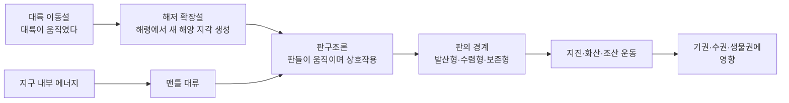
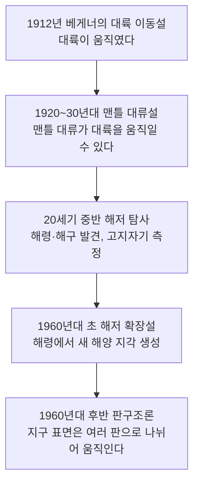

# 3-2. 판구조론과 지권의 변화 — 움직이는 땅, 이어진 지구

> [!NOTE]
> **성취기준 [10통과1-03-02]** 지권의 변화를 판구조론 관점에서 해석하고, 에너지 흐름의 결과로 발생하는 지권의 변화가 지구시스템에 미치는 영향을 추론할 수 있다.

**학습 목표**

1. 대륙 이동설에서 해저 확장설을 거쳐 판구조론이 정립되기까지의 과정을 증거와 함께 설명할 수 있다.
2. 판의 경계를 발산형·수렴형·보존형으로 구분하고, 각 경계에서 나타나는 지형과 지진·화산 활동을 설명할 수 있다.
3. 맨틀 대류와 같은 지구 내부의 에너지 흐름이 판을 움직여 지권을 변화시킨다는 것을 설명할 수 있다.
4. 화산 분출과 지진 같은 지권의 변화가 기권·수권·생물권에 미치는 영향을 추론하고, 피해를 줄이는 대책을 제안할 수 있다.

**이 단원의 학습 사다리**

| 단계 | 무엇을 하나? |
|---|---|
| STEP 1. 중학교 다시 보기 | 지권의 층상 구조, 대륙이동설, 판의 경계와 지진대·화산대를 다시 꺼내 본다 |
| STEP 2. 기초 다지기 | 밀도와 대류, 고체도 흐른다는 생각, 속력 = 거리 ÷ 시간을 디딤돌로 놓는다 |
| STEP 3. 핵심 개념 | 판구조론의 발달 → 판과 경계 → 맨틀 대류와 에너지 흐름 → 지진·화산과 한반도 → 지구시스템에 미치는 영향 |
| STEP 4. 오개념 바로잡기 | "판은 녹은 마그마 위에 떠 있다?" 같은 착각을 바로잡는다 |
| STEP 5. 선택과목·대학 | 지진의 규모와 에너지, 플룸 구조론, 판을 끌어당기는 힘 |
| STEP 6. 산업·진로 | 지진 조기경보와 내진 설계, 지열 발전, 화산재와 항공 운항 |

---

## 🗺️ 단원 들어가기

세계 지도를 펼쳐 남아메리카의 동쪽 해안선과 아프리카의 서쪽 해안선을 오려서 붙여 보면 놀랍도록 잘 맞는다. 우연일까? 100여 년 전 한 과학자는 "대륙들이 원래 하나였다가 갈라져 움직였다"라고 주장했지만, 당시 대부분의 과학자는 이를 받아들이지 않았다. **대륙처럼 거대한 땅덩어리를 무엇이 움직일 수 있단 말인가?**

이 질문의 답을 찾는 데 50년이 넘게 걸렸다. 그 결과 탄생한 이론이 **판구조론**이다. 판구조론은 지진과 화산이 왜 특정 지역에만 몰려 있는지, 히말라야산맥은 어떻게 생겼는지, 그리고 화산 하나가 어떻게 지구 반대편의 날씨와 비행기 운항까지 바꿀 수 있는지를 하나의 틀로 설명한다.

---

## STEP 1. 🔙 중학교 다시 보기

### 연계 개념표

| 중학교 성취기준 | 중학교에서 배운 것 | 고등학교에서 확장되는 것 |
|---|---|---|
| [9과09-01] | 지권의 층상 구조(지각, 맨틀, 외핵, 내핵)의 이름과 상태 | 지각과 맨틀 윗부분을 묶은 **판(암석권)** 과 그 아래 **연약권** |
| [9과09-03] | 암석을 생성 과정에 따라 분류(화성암·퇴적암·변성암), 암석의 순환 | 판의 경계에서 마그마가 생기고 암석이 만들어지는 과정 |
| [9과09-05] | 대륙이동설, 화산대·지진대의 분포가 판의 경계와 일치 | **왜** 판의 경계에서 지진·화산이 일어나는가 → 판의 경계 종류와 판을 움직이는 원동력 |
| [9과22-01] | 재해·재난(지진, 화산 등)의 발생 원인과 피해를 과학적으로 분석 | 화산 분출이 **지구시스템 전체**(기권·수권·생물권)에 미치는 영향 추론 |
| [9과22-02] | 과학적 원리를 이용한 재해·재난 대비 및 대처 방안 | 지진 조기경보, 내진 설계, 화산 감시 등 **과학 기반 대책** 수립 |

### 준비 운동 (사전 진단)

**Q1.** 베게너가 대륙 이동설의 증거로 제시한 것이 **아닌** 것은?
① 대서양 양쪽 대륙의 해안선 모양이 비슷하다. ② 멀리 떨어진 대륙에서 같은 종의 고생물 화석이 발견된다. ③ 해령을 중심으로 해양 지각의 나이가 대칭적으로 분포한다. ④ 지금은 따뜻한 지역에서 과거 빙하의 흔적이 발견된다.

**Q2.** 대륙 이동설이 처음 발표되었을 때 많은 과학자가 받아들이지 않은 가장 큰 이유는?

**Q3.** 세계 지도에서 지진과 화산이 띠 모양으로 몰려 있는 곳은 어디와 거의 일치하는가?

정답 및 해설

**Q1. ③** — 해양 지각의 나이 분포는 베게너가 세상을 떠난 뒤인 20세기 중반 이후 해저 탐사로 밝혀진 **해저 확장설**의 증거이다.

**Q2.** 대륙을 움직이는 **힘(원동력)** 을 설명하지 못했기 때문이다.

**Q3.** **판의 경계**와 거의 일치한다. 특히 태평양 둘레를 따라 고리 모양으로 이어진 지역(환태평양 지진대·화산대)이 대표적이다.

---

## STEP 2. 🧱 기초 다지기

### ① 밀도와 뜨고 가라앉기

**밀도(density)** 는 단위 부피당 질량이다($\rho = m/V$). 같은 부피라면 밀도가 큰 것이 더 무겁다.

- 밀도가 작은 물질은 밀도가 큰 물질 위에 뜬다. (물 위의 나무토막, 바닷물 위의 빙산)
- 같은 물질이라도 **뜨거우면 부피가 늘어 밀도가 작아지고**, 차가우면 밀도가 커진다.
- 대륙 지각(화강암질)은 해양 지각(현무암질)보다 밀도가 작다. 그래서 두 판이 부딪히면 **무거운 해양판이 아래로 가라앉는다.**

### ② 대류: 데워지면 올라가고, 식으면 내려간다

냄비에 물을 끓이면 바닥에서 데워진 물은 위로 올라가고, 위에서 식은 물은 다시 내려온다. 이렇게 유체가 직접 움직이며 열을 나르는 것이 **대류(convection)** 이다. 대류가 일어나려면 ① 아래쪽이 뜨겁고 위쪽이 차가워야 하고 ② 물질이 흐를 수 있어야 한다.

### ③ 고체도 오랜 시간이 지나면 흐른다

맨틀은 고체인데 어떻게 대류할 수 있을까? 매우 큰 압력과 높은 온도에서 아주 긴 시간 동안 힘을 받으면, 고체도 부서지지 않고 **아주 천천히 변형되며 흐를 수 있다.**

> [!TIP]
> 💡 **비유** — 단단한 엿이나 실리콘 장난감 점토(슬라임과 비슷한 '흐르는 고체')를 떠올려 보자. 망치로 치면 깨지지만, 책상 위에 며칠 두면 조금씩 퍼져서 납작해진다. 맨틀은 '수천만 년에 걸쳐 흐르는 엿'이다. 맨틀 대류의 속력은 1년에 수 cm로, 손톱이 자라는 속도와 비슷하다.

### ④ 속력 = 거리 ÷ 시간 (아주 긴 시간 버전)

판의 이동 속력도 중학교에서 배운 속력 공식으로 구한다. 다만 시간 단위가 '년', 그것도 '수백만 년'이다.

$$
\text{속력} = \frac{\text{이동 거리}}{\text{걸린 시간}}
$$

- $1\ \mathrm{km} = 100\,000\ \mathrm{cm} = 10^5\ \mathrm{cm}$
- 1년에 1 cm씩 움직여도 100만 년이면 $10^6\ \mathrm{cm} = 10\ \mathrm{km}$, 1억 년이면 1000 km를 움직인다.

> [!IMPORTANT]
> **'느리다'와 '작다'는 다르다.** 1년에 몇 cm는 눈에 보이지 않지만, 지구의 나이(약 46억 년)를 생각하면 대륙이 지구 반 바퀴를 돌 수도 있는 속력이다.

---

## STEP 3. 📘 핵심 개념

### 3-2-① 판구조론은 어떻게 탄생했나 — 대륙 이동설에서 판구조론까지

판구조론은 한 사람이 한 번에 만든 이론이 아니다. 새로운 증거가 쌓이면서 생각이 발전해 온 과정 자체가 과학의 본성을 잘 보여 준다.

#### (1) 대륙 이동설 (베게너, 1912년)

독일의 기상학자 **베게너(Wegener)** 는 과거에 모든 대륙이 **판게아(Pangaea)** 라는 하나의 초대륙으로 모여 있다가 갈라져 오늘날의 위치로 이동했다고 주장하였다.

| 증거 | 내용 |
|---|---|
| 해안선의 일치 | 남아메리카 동해안과 아프리카 서해안의 모양이 잘 들어맞는다 |
| 화석 분포 | 바다를 건널 수 없는 고생물(예: 민물 파충류 메소사우루스, 식물 글로소프테리스)의 화석이 멀리 떨어진 여러 대륙에서 발견된다 |
| 지질 구조의 연속성 | 북아메리카의 애팔래치아산맥과 유럽 북부(스코틀랜드·스칸디나비아)의 산맥이 대륙을 붙이면 하나로 이어진다 |
| 빙하의 흔적 | 지금은 열대·온대인 남아메리카, 아프리카, 인도, 오스트레일리아에 같은 시기의 빙하 흔적이 있고, 대륙을 모으면 남극 주변에 모인다 |

**한계** 대륙을 움직이는 **원동력을 설명하지 못했다.** 그래서 베게너가 살아 있을 때는 널리 인정받지 못했다.

#### (2) 맨틀 대류설

1920~30년대에 영국의 **홈스(Holmes)** 는 방사성 원소가 내는 열 때문에 맨틀에서 대류가 일어나고, 이 대류가 대륙을 움직일 수 있다고 제안했다. 대륙 이동의 원동력을 처음으로 설명한 생각이었지만, 당시에는 이를 확인할 관측 증거가 부족했다.

#### (3) 해저 확장설 (1960년대 초, 헤스·디츠)

제2차 세계 대전 이후 **음향 측심법**(배에서 음파를 쏘아 바닥에 반사되어 돌아오는 시간으로 수심을 재는 방법)으로 해저 지형을 자세히 조사하자, 바다 밑에 거대한 산맥인 **해령**과 깊은 골짜기인 **해구**가 있다는 것이 밝혀졌다. 이를 바탕으로 **해령에서 맨틀 물질이 올라와 새로운 해양 지각이 만들어지고, 양옆으로 밀려나며 해저가 넓어진다**는 **해저 확장설**이 등장했다.

| 해저 확장설의 증거 | 내용 | 해저 확장으로 설명하기 |
|---|---|---|
| 해양 지각의 나이 | 해령에서 멀어질수록 나이가 많아지고, 해령을 중심으로 **대칭** | 해령에서 만들어진 지각이 양쪽으로 밀려나므로 |
| 해저 퇴적물의 두께 | 해령에서 멀어질수록 두꺼워진다 | 오래된 지각일수록 퇴적물이 쌓인 시간이 길다 |
| 고지자기 줄무늬 | 해령 양쪽 암석에 기록된 지구 자기장의 방향(정자극기·역자극기)이 줄무늬처럼 **대칭** | 지구 자기장은 과거에 여러 번 역전되었고, 해령에서 굳은 암석이 그때의 자기장 방향을 기록한 채 양쪽으로 이동했으므로 |
| 해양 지각의 최대 나이 | 대부분 약 2억 년보다 젊다 (대륙 지각은 수십억 년 된 것도 있다) | 해양 지각은 해령에서 생겨 해구에서 사라지므로 오래 남지 못한다 |

> [!TIP]
> 💡 **비유** — 해령은 두 줄로 나오는 '컨베이어 벨트의 출발점'이고 해구는 '벨트가 다시 들어가는 곳'이다. 고지자기 줄무늬는 일정한 시간마다 색을 바꿔 가며 벨트 위에 찍은 도장과 같다. 출발점 양쪽으로 같은 순서의 도장이 대칭으로 찍혀 있다면, 벨트가 양쪽으로 움직였다는 강력한 증거가 된다.

#### (4) 판구조론 (1960년대 후반)

해저 확장설과 지진 분포 자료 등을 종합하여, **지구의 겉부분은 여러 개의 단단한 판으로 나뉘어 있고, 이 판들이 움직이며 서로 부딪치거나 멀어지거나 어긋나면서 지진·화산·조산 운동 같은 지각 변동이 일어난다**는 **판구조론(plate tectonics)** 이 정립되었다. 대륙 이동설이 '무엇이 일어났는가'를, 해저 확장설이 '해양에서 어떻게 일어나는가'를 보여 주었다면, 판구조론은 이를 지구 전체에 적용한 통합 이론이다.

#### 예제 1 — 해저 확장 속력 구하기

해령에서 수직 방향으로 100 km 떨어진 곳의 해양 지각 나이가 200만 년이었다. 해양 지각이 해령에서 생긴 뒤 일정한 속력으로 이동했다면, 이 판의 이동 속력은 1년에 몇 cm인가?

**풀이**
- 거리: $100\ \mathrm{km} = 100 \times 10^5\ \mathrm{cm} = 10^7\ \mathrm{cm}$
- 시간: 200만 년 $= 2 \times 10^6$ 년
- 속력: $\dfrac{10^7\ \mathrm{cm}}{2\times10^6\ \text{년}} = 5\ \mathrm{cm}/\text{년}$

이 판은 해령에서 1년에 약 5 cm씩 멀어지고 있다. 해령 반대편 판도 비슷하게 움직인다면 두 판 사이는 1년에 약 10 cm씩 벌어진다.

### 3-2-② 판과 판의 경계

#### (1) 판이란 무엇인가

**판(plate)** 은 지각과 맨틀의 윗부분을 합친 단단한 암석층으로, **암석권(lithosphere)** 이라고도 한다. 두께는 평균 약 100 km이다. 판 아래에는 맨틀 물질이 부분적으로 녹아 있어 유동성이 있는 **연약권(asthenosphere)** 이 있고, 판은 연약권 위에서 움직인다.

| 구분 | 구성 | 성질 |
|---|---|---|
| 암석권(판) | 지각 + 맨틀 최상부 | 단단하다. 힘을 받으면 깨진다(지진) |
| 연약권 | 상부 맨틀의 일부 (깊이 약 100~400 km) | 일부가 녹아 있어 천천히 흐를 수 있다 |

판은 **대륙판**(대륙 지각을 포함, 두껍고 밀도가 작음)과 **해양판**(해양 지각을 포함, 얇고 밀도가 큼)으로 나뉜다. 지구 표면은 유라시아판, 태평양판, 북아메리카판, 남아메리카판, 아프리카판, 인도–오스트레일리아판, 남극판, 필리핀판, 나스카판 등 크고 작은 판으로 덮여 있다. 우리나라는 **유라시아판**의 동쪽 가장자리 부근 안쪽에 있다.

#### (2) 판의 경계 세 가지

| 경계 | 판의 상대 운동 | 대표 지형 | 지진 | 화산 | 예 |
|---|---|---|---|---|---|
| **발산형** | 서로 멀어진다 | 해령, 열곡대 | 얕은 곳(천발) | 활발 | 대서양 중앙 해령, 아이슬란드, 동아프리카 열곡대 |
| **수렴형 – 섭입형** | 가까워지며 밀도가 큰 판이 아래로 들어감 | 해구, 호상 열도, 습곡 산맥 | 얕은 곳~깊은 곳 | 활발 | 일본 해구와 일본 열도, 페루–칠레 해구와 안데스산맥 |
| **수렴형 – 충돌형** | 대륙판끼리 부딪침 | 거대한 습곡 산맥 | 얕은 곳~중간 깊이 | 거의 없음 | 히말라야산맥(인도–오스트레일리아판과 유라시아판) |
| **보존형** | 서로 어긋나며 미끄러짐 | 변환 단층 | 얕은 곳(천발) | 거의 없음 | 산안드레아스 단층(미국 캘리포니아) |

- 진원의 깊이: 천발 지진(약 70 km보다 얕음), 중발 지진(약 70~300 km), 심발 지진(약 300 km보다 깊음)
- **섭입대**에서는 가라앉는 판을 따라 지진이 일어나므로, 해구에서 대륙 쪽으로 갈수록 진원이 점점 깊어진다.
- **충돌형** 경계에서는 두 대륙판 모두 밀도가 작아 어느 쪽도 깊이 가라앉지 않으므로, 땅이 두껍게 접히고 솟아올라 높은 산맥이 생긴다. 히말라야에서 바다 생물의 화석이 발견되는 이유이다.

> [!TIP]
> 💡 **비유** — 테이블 위에 수건 두 장을 놓고 실험해 보자. 서로 떼어 내면(발산형) 가운데가 벌어지고, 마주 밀면 하나가 다른 하나 아래로 들어가거나(섭입형) 둘 다 구겨져 솟아오르며(충돌형), 옆으로 엇갈려 밀면 경계를 따라 비벼진다(보존형).

#### (3) 화산은 왜 발산형·섭입형 경계에 많을까?

- **발산형 경계**: 판이 벌어진 틈으로 뜨거운 맨틀 물질이 올라오면서 압력이 낮아져 녹아 마그마가 생긴다. 주로 현무암질 용암이 조용히 흘러나온다.
- **섭입형 경계**: 가라앉는 해양판에서 빠져나온 물이 그 위의 맨틀을 녹기 쉽게 만들어 마그마가 생긴다. 이 마그마는 끈끈하고 가스를 많이 품고 있어 **폭발적인 분출**이 일어나기 쉽다.
- **판 내부의 화산 — 열점**: 하와이처럼 판의 경계가 아닌 곳에서도 화산이 생기는데, 맨틀 깊은 곳에서 뜨거운 물질이 기둥처럼 올라오는 **열점(hot spot)** 때문이다. 열점은 거의 제자리에 있고 판이 그 위를 지나가므로, 화산섬이 일렬로 늘어서며 열점에서 멀수록 나이가 많다.

#### 예제 2 — 판의 경계 판별하기

다음 지역의 판 경계 종류를 쓰고, 화산 활동이 활발한지 판단하시오.
(1) 지진은 자주 일어나지만 화산이 거의 없고, 세계에서 가장 높은 산맥이 있다.
(2) 깊은 해구가 있고, 해구에서 멀어질수록 진원의 깊이가 깊어지며, 화산섬들이 활처럼 늘어서 있다.
(3) 섬 한가운데를 따라 땅이 갈라진 틈이 있고, 용암이 자주 흘러나온다.

**풀이**
(1) 수렴형 중 **충돌형** 경계 (히말라야). 화산 활동이 거의 없다.
(2) 수렴형 중 **섭입형** 경계 (일본 열도). 화산 활동이 활발하다.
(3) **발산형** 경계 (아이슬란드). 화산 활동이 활발하다.

### 3-2-③ 판을 움직이는 에너지 — 맨틀 대류와 지구 내부 에너지

3-1 단원에서 지구시스템의 에너지원 중 하나가 **지구 내부 에너지**라고 했다. 지구 내부 에너지는 방사성 원소가 붕괴하며 내는 열과 지구가 만들어질 때 남은 열이다. 지구 내부는 뜨겁고 표면은 차가우므로, 열은 끊임없이 **안에서 밖으로** 흐른다. 이 열이 흐르는 과정에서 맨틀에 대류가 일어난다.

| 맨틀 대류의 부분 | 지표에서 나타나는 곳 | 일어나는 지권의 변화 |
|---|---|---|
| 상승하는 곳 | 해령, 열곡대 | 판이 갈라지고 새 지각 생성, 화산 활동 |
| 수평으로 이동하는 곳 | 판의 내부 | 판(대륙)의 이동 |
| 하강하는 곳 | 해구 | 판의 섭입, 지진, 화산, 습곡 산맥 형성 |

즉, **지진·화산·조산 운동 같은 지권의 변화는 지구 내부에서 표면으로 향하는 에너지 흐름의 결과**이다. 지진은 판이 움직이며 쌓인 에너지가 암석이 끊어지는 순간 한꺼번에 방출되는 현상이고, 화산은 내부의 열과 물질이 직접 지표로 나오는 현상이다.

> [!NOTE]
> 맨틀 대류만으로 판의 운동을 모두 설명할 수 있는 것은 아니다. 현재는 해구에서 무거운 판이 가라앉으며 판 전체를 **끌어당기는 힘**, 해령에서 높이 솟은 판이 **미끄러져 내려가는 힘** 등이 함께 작용한다고 본다(→ STEP 5).

### 3-2-④ 지진과 화산, 그리고 한반도

#### (1) 지진과 화산의 분포

세계의 지진대와 화산대는 띠 모양으로 분포하며 판의 경계와 거의 일치한다. 특히 태평양 둘레를 따라 고리 모양으로 이어진 **환태평양 지진대·화산대**('불의 고리')에 세계의 지진과 활화산이 많이 모여 있다. 태평양판 등 해양판이 주변 판 아래로 섭입하는 경계가 이 고리를 따라 이어져 있기 때문이다.

#### (2) 규모와 진도

| 구분 | 규모(magnitude) | 진도(intensity) |
|---|---|---|
| 뜻 | 지진이 방출한 **에너지의 양** | 어떤 장소에서 사람이 느끼거나 건물이 **흔들린 정도** |
| 값의 개수 | 지진 하나에 **하나** | 장소마다 **다르다** (진앙에서 멀수록 대체로 작다) |
| 표기 | 소수점 숫자 (예: 5.8) | 우리나라는 12단계 계급 사용 (로마 숫자 Ⅰ~Ⅻ 등) |

규모가 1 커지면 방출 에너지는 약 30배 넘게 커진다. 그래서 규모 5.8과 5.4는 숫자는 비슷해 보여도 에너지 차이가 크다.

#### (3) 한반도는 안전할까?

우리나라는 판의 경계에서 떨어진 **유라시아판 내부**에 있어, 일본이나 칠레처럼 판의 경계에 있는 나라보다 큰 지진이 드물다. 그러나 판의 내부도 주변 판들이 미는 힘을 받아 오래된 단층에 에너지가 쌓이므로, **지진에서 안전한 곳은 아니다.**

| 사례 | 내용 |
|---|---|
| 2016년 9월 경주 지진 | **규모 5.8**. 우리나라에서 지진 계기 관측을 시작한 이래 가장 큰 지진이었다 |
| 2017년 11월 포항 지진 | **규모 5.4**. 건물과 주택 피해가 컸고, 대학수학능력시험이 일주일 연기되었다 |
| 백두산 | 10세기 중엽(946년 무렵) 대규모로 분화한 기록이 있는 화산으로, 지금도 화산 활동 감시 대상이다 |
| 제주도·울릉도·독도 | 화산 활동으로 만들어진 화산섬이다 |

> [!IMPORTANT]
> 경주·포항 지진 이후 우리나라는 내진 설계 기준 강화, 지진 조기경보 개선, 학교 지진 대피 훈련 확대 등 대비를 강화했다. **'판의 경계가 아니니까 괜찮다'는 생각은 위험하다.**

### 3-2-⑤ 지권의 변화가 지구시스템에 미치는 영향 — 화산 분출을 중심으로

성취기준은 지권의 변화가 **지구시스템에 미치는 영향을 추론**하도록 요구한다. 화산이 분출하면 지권에서 나온 물질과 에너지가 다른 권역으로 퍼져 나간다.

#### (1) 화산 분출물

| 분출물 | 상태 | 예 |
|---|---|---|
| 화산 가스 | 기체 | 수증기(가장 많음), 이산화 탄소, 이산화 황 등 |
| 용암 | 액체 | 지표로 흘러나온 마그마 |
| 화산 쇄설물 | 고체 | 화산재, 화산탄, 화산력(작은 돌 조각) |

#### (2) 권역별 영향

| 영향을 받는 권역 | 해로운 영향 | 이로운 영향 |
|---|---|---|
| **기권** | 화산재가 햇빛을 가리고, 이산화 황이 성층권에서 작은 황산 방울(에어로졸)이 되어 햇빛을 반사 → **지구 기온 하강**. 산성비 | 지구 초기에는 화산 가스가 대기와 바다의 재료가 되었다 |
| **수권** | 화산재와 산성 물질이 하천·호수를 오염. 해저 화산·산사태로 **지진 해일**. 빙하 아래 화산 분출 시 홍수 | 해저 화산이 바닷물에 여러 물질을 공급 |
| **지권** | 화산재가 쌓여 지형 변화, 화산 이류(화산재와 물이 섞인 진흙 흐름) | 새로운 섬과 땅 생성, **비옥한 토양**, 광물 자원, 지열 |
| **생물권** | 생물의 서식지 파괴, 농작물 피해, 사람의 호흡기 질환과 인명 피해 | 시간이 지나면 화산재 토양에서 생물이 다시 번성. 관광 자원(온천, 화산 지형) |

#### 대표 사례

| 화산(분출 연도) | 일어난 일 | 영향을 받은 권역 |
|---|---|---|
| 인도네시아 탐보라 화산(1815년) | 막대한 화산 분출물이 대기로 올라가, 이듬해인 1816년 북반구 여러 지역에서 여름 기온이 낮아져 '여름이 없는 해'로 불렸다. 흉작과 식량난 | 지권 → 기권 → 생물권(사람) |
| 필리핀 피나투보 화산(1991년) | 성층권으로 올라간 이산화 황이 에어로졸을 만들어 이후 1~2년 동안 전 지구 평균 기온이 약 0.5 °C 낮아졌다 | 지권 → 기권 |
| 아이슬란드 에이야퍄틀라이외퀴들 화산(2010년) | 빙하 아래에서 분출하여 화산재가 유럽 하늘을 뒤덮었다. 약 일주일간 유럽 항공 운항이 대규모로 중단되었다(약 10만 편 결항) | 지권 → 수권(빙하) → 기권 → 인간 사회 |
| 콜롬비아 네바도델루이스 화산(1985년) | 분출열로 정상의 빙하와 눈이 녹아 거대한 화산 이류가 계곡을 따라 흘러내려, 아래 마을에서 2만 명 이상이 목숨을 잃었다 | 지권 → 수권 → 지권 → 생물권 |

#### 예제 3 — 화산 분출의 영향 추론하기

큰 화산이 폭발하여 다량의 이산화 황이 성층권까지 올라갔다. 이후 1~2년 동안 (1) 지구 평균 기온 (2) 농작물 생산량이 어떻게 변할지 추론하고, 성층권까지 올라간 물질의 영향이 대류권에만 머문 물질보다 오래가는 까닭을 3-1 단원의 내용으로 설명하시오.

**풀이**
(1) 이산화 황이 황산 에어로졸이 되어 햇빛을 반사하므로 지표에 도달하는 태양 에너지가 줄어 **기온이 낮아진다.**
(2) 기온이 낮아지고 일조량이 줄면 광합성이 줄어 **농작물 생산량이 감소할 수 있다.**
성층권은 위쪽이 따뜻하고 아래쪽이 차가운 **안정한 층**이라 대류가 거의 없고 비가 내리지 않으므로, 에어로졸이 씻겨 내려오지 않고 오래 머문다. 반면 대류권의 물질은 비에 의해 수일~수 주 만에 씻겨 내려온다.

> [!TIP]
> 💡 **추론의 사슬 만들기** — "지권의 변화 → (어떤 물질·에너지가) → (어느 권역으로) → (어떤 원리로) → (결과)"를 화살표로 이어 보자. 하나의 원인이 여러 권역을 차례로 거치며 연쇄적으로 영향을 주는 것이 지구시스템의 특징이다.

---

## STEP 4. ⚠️ 오개념 바로잡기

| 흔한 오개념 | 올바른 개념 | 왜 그럴까? |
|---|---|---|
| 판은 녹은 마그마의 바다 위에 떠 있다 | 판은 **고체 상태의 연약권** 위에서 움직인다. 연약권은 일부만 녹아 있어 천천히 흐를 수 있을 뿐이다 | 맨틀은 대부분 고체이다. 지구 내부에서 액체 상태인 층은 외핵뿐이다 |
| 판 = 대륙이다 | 판은 지각과 맨틀 윗부분을 합친 **암석권**이며, 하나의 판에 대륙과 해양이 함께 있을 수 있다 | 예를 들어 북아메리카판에는 북아메리카 대륙과 대서양 서쪽 해저가 함께 있다 |
| 베게너는 판구조론을 완성했다 | 베게너는 **대륙 이동설**을 제안했고, 판구조론은 해저 확장설 등의 증거가 쌓인 **1960년대 후반에 정립**되었다 | 과학 이론은 여러 과학자의 증거가 쌓이며 발전한다 |
| 규모와 진도는 같은 것이다 | **규모**는 지진 자체의 에너지(하나의 값), **진도**는 장소별 흔들림 정도(장소마다 다름)이다 | 같은 지진이라도 진앙 가까운 곳과 먼 곳의 흔들림은 다르다 |
| 판의 경계에서는 어디서나 화산이 생긴다 | **충돌형·보존형 경계에서는 화산 활동이 거의 없다** | 마그마가 생기려면 맨틀 물질이 상승하거나(발산형) 물이 공급되어야(섭입형) 한다 |
| 화산 폭발은 지구를 항상 뜨겁게 만든다 | 큰 폭발 직후에는 화산재와 황산 에어로졸이 햇빛을 가려 **기온이 내려가는** 경우가 많다 | 화산 가스의 이산화 탄소보다 성층권 에어로졸의 냉각 효과가 단기적으로 더 크다 |

---

## STEP 5. 🎓 선택과목·대학으로 한 걸음 더

> [!CAUTION]
> 이 절은 **통합과학 교육과정 범위 밖의 심화 내용**으로 평가 대상이 아니다. "이 개념이 앞으로 어디까지 이어지는가"를 맛보기로 보여 주기 위한 내용이다.

### 고2·3 선택과목과의 연결

| 과목 | 이어지는 내용 |
|---|---|
| 지구과학 | 지구의 역사와 한반도의 암석(한반도의 지질 구조, 암석이 기록한 지각 변동의 역사) |
| 지구시스템과학 | 지구 탄생과 생동하는 지구(지구 내부 구조, 판의 운동과 원동력, 마그마와 화성암) |
| 기후변화와 환경생태 | 화산 활동 등 자연적 요인과 인위적 요인에 의한 기후 변화 |

### ① 지진의 규모와 에너지

대학 **지진학(seismology)** 에서는 규모 $M$과 지진 에너지 $E$(단위 J) 사이의 경험적 관계를 다음과 같이 쓴다(구텐베르크–리히터 관계).

$$
\log_{10} E \approx 4.8 + 1.5M
$$

규모가 1 커지면 $E$는 $10^{1.5} \approx 32$배, 규모가 2 커지면 $10^{3} = 1000$배가 된다. 경주 지진(5.8)과 포항 지진(5.4)의 규모 차이는 0.4이므로 에너지 비는 $10^{1.5\times0.4} = 10^{0.6} \approx 4$배이다. 숫자 0.4 차이가 에너지로는 약 4배인 셈이다.

### ② 판을 움직이는 힘 — 맨틀 대류만이 아니다

지구물리학에서는 판에 작용하는 힘을 다음과 같이 나누어 분석한다.

| 힘 | 내용 |
|---|---|
| 섭입하는 판이 끌어당기는 힘(slab pull) | 식어서 무거워진 해양판이 해구에서 가라앉으며 판 전체를 끌어당긴다. 가장 큰 힘으로 여겨진다 |
| 해령에서 밀어내는 힘(ridge push) | 해령에서 높이 솟은 판이 중력에 의해 양쪽으로 미끄러져 내려간다 |
| 맨틀과의 마찰 | 판 아래 맨틀의 흐름이 판을 끌거나 방해한다 |

실제로 섭입대를 많이 가진 판(예: 태평양판)이 대체로 더 빠르게 움직인다는 관측이 이를 뒷받침한다.

### ③ 플룸 구조론과 지진파 단층 촬영

병원에서 CT로 몸속을 보듯, 수많은 지진파 자료로 지구 내부의 온도 차이를 3차원으로 그려 내는 기술을 **지진파 단층 촬영(seismic tomography)** 이라고 한다. 이를 통해 맨틀 깊은 곳에서 거대한 기둥 모양으로 올라오는 **뜨거운 플룸**과 섭입한 판이 쌓여 가라앉는 **차가운 플룸**이 발견되었다. 판구조론이 지구의 겉부분(약 100 km)을 설명한다면, **플룸 구조론**은 맨틀 전체의 운동을 설명하려는 이론이다. 하와이 같은 열점은 뜨거운 플룸이 지표에 닿은 곳으로 해석된다.

### 고등학교 vs 대학교

| 구분 | 고등학교 통합과학 | 대학교 지구물리학·지질학 |
|---|---|---|
| 판의 운동 | 경계의 종류와 상대 운동 | GPS 측정으로 판 속도를 mm 단위로 계산, 구면 위의 회전으로 기술 |
| 원동력 | 맨틀 대류(정성적) | 판에 작용하는 힘의 정량 분석, 맨틀 대류 수치 모델 |
| 지진 | 분포와 판 경계의 관계, 규모와 진도 | 지진파 분석으로 진원 결정, 규모–에너지 관계, 지진 위험도 평가 |
| 화산 | 분출물과 지구시스템 영향 | 마그마의 생성 조건, 분출 예측, 화산재 확산 시뮬레이션 |
| 관련 전공 | — | 지구환경과학, 지질학, 지구물리학, 지구시스템과학, 건축·토목공학 |

---

## STEP 6. 🏭 산업 현장과 진로 연결

### 사례 1. 지진 조기경보 — 빠른 파동으로 느린 파동을 앞지르다

- **원리** 지진이 일어나면 속력이 빠르지만 흔들림이 약한 **P파**와, 느리지만 흔들림이 큰 **S파**가 함께 퍼져 나간다. 진원 가까운 관측소에서 P파를 먼저 감지하여 지진의 위치와 규모를 빠르게 계산하고, **강한 흔들림(S파)이 도착하기 전에** 경보를 보낸다.
- **어디에 쓰이나** 기상청은 2015년부터 지진 조기경보를 운영하며, 규모가 큰 지진은 관측 후 몇 초~십여 초 안에 휴대 전화 긴급 재난 문자 등으로 알린다. 몇 초의 여유만 있어도 책상 아래로 피하고, 고속 열차를 감속시키고, 엘리베이터를 가까운 층에 멈추게 할 수 있다.
- **핵심 숫자(예)** P파의 속력을 약 7 km/s, S파를 약 3.5 km/s라고 가정하면, 진원에서 70 km 떨어진 곳에는 P파가 10초, S파가 20초 뒤에 도착한다. 경보 발령에 5초가 걸린다면 약 5초의 대비 시간이 생긴다.

### 사례 2. 내진 설계 — 흔들려도 무너지지 않게

- **원리** 건물이 지진의 흔들림을 견디도록 기둥·벽을 튼튼하게 만드는 **내진**, 건물과 땅 사이에 고무 받침 등을 넣어 흔들림이 건물에 덜 전달되게 하는 **면진**, 건물 안에 진동을 줄이는 장치를 다는 **제진** 기술이 있다.
- **우리나라의 변화** 건축물 내진 설계 의무는 1988년에 처음 도입되었고, 경주 지진 이후 적용 대상이 크게 넓어져 2017년부터는 2층 이상 건축물 등으로 확대되었다. 학교·병원 같은 공공시설의 내진 보강 사업도 진행되고 있다.
- 다리·터널·원자력 발전소·반도체 공장처럼 작은 흔들림에도 큰 피해가 나는 시설은 더욱 엄격한 기준으로 설계한다.

### 사례 3. 지열 발전 — 지구 내부 에너지를 전기로

- **원리** 땅속 깊은 곳의 뜨거운 물이나 수증기로 터빈을 돌려 전기를 만든다. 지구 내부에서 표면으로 흐르는 에너지를 직접 이용하는 것이다.
- **어디에 쓰이나** 아이슬란드, 뉴질랜드, 인도네시아, 필리핀, 미국 캘리포니아처럼 **판의 경계나 화산 지대**에 지열 발전소가 많다. 판 경계 위에 있는 아이슬란드는 전기와 난방의 상당 부분을 지열로 얻는다.
- **우리나라** 땅속 수십~수백 m의 일정한 온도를 냉난방에 이용하는 **지열 냉난방(지열 히트펌프)** 이 공공건물을 중심으로 보급되어 있다.
- **교훈** 2019년 정부조사연구단은 2017년 포항 지진이 인근 지열 발전 실증 연구 과정에서 땅속에 물을 주입한 것과 관련된 **촉발 지진**이라고 발표했다. 지권에 인위적으로 개입하는 기술은 지구시스템에 대한 충분한 조사와 감시가 함께해야 한다.

### 사례 4. 화산재와 항공 운항

- **원리** 화산재는 아주 작은 암석과 유리 조각이다. 제트 엔진 안의 높은 온도에서 녹았다가 엔진 부품에 달라붙어 엔진을 멈추게 할 수 있다. 1982년 인도네시아 상공에서 화산재 구름에 들어간 여객기의 엔진 4개가 모두 멈췄다가 겨우 다시 켜진 사고가 있었다.
- **대응 체계** 세계 9곳의 **화산재 경보 센터(VAAC)** 가 위성 영상과 대기 흐름 계산으로 화산재의 확산을 예측하여 항공사에 경로를 알린다. 2010년 아이슬란드 화산 분출 때 유럽의 항공 대란 이후, 엔진이 견딜 수 있는 화산재 농도 기준을 마련하는 연구가 활발해졌다.
- 화산 분출 → 기권(화산재 확산) → 인간 사회(항공·물류·관광)로 이어지는, 지구시스템과 사회 시스템의 연결을 보여 준다.

### 관련 진로와 학과

| 진로 | 하는 일 | 관련 학과 |
|---|---|---|
| 지진·화산 연구원 | 지진 관측과 분석, 화산 감시, 조기경보 시스템 개발 | 지구환경과학, 지구물리학, 지질학 |
| 구조 엔지니어 | 건물·교량 내진 설계, 내진 보강 | 건축공학, 토목공학 |
| 지열·자원 엔지니어 | 지열 발전소 설계, 지하 자원 탐사 | 에너지자원공학, 지질학 |
| 재난 안전 전문가 | 재난 위험 지도 제작, 대피 계획 수립, 재난 대응 훈련 | 방재안전공학, 소방방재학, 도시계획 |
| 항공 기상 전문가 | 화산재·난기류 등 항공 위험 기상 예보 | 대기과학, 항공운항학 |

---

## 🔬 탐구 활동 — 화산 분출로 인한 피해를 조사하고 대책 세우기

> [!NOTE]
> 교육과정 탐구 활동 "화산 분출로 인한 환경⋅사회경제적 피해의 종류를 조사하고, 지구와 생명 시스템 측면에서 피해를 줄이기 위한 대책 수립하기"를 바탕으로 구성하였다.

### 활동 A. 화산 피해 조사 보고서와 대책 만들기 (모둠 활동)

**목표** 실제 화산 분출 사례의 피해를 권역별·분야별로 분석하고, 지구 시스템과 생명 시스템을 함께 고려한 피해 감소 대책을 제안한다.

**준비물** 스마트 기기, 공공 기관·국제기구의 화산 자료, 신문 기사, 위성 영상, 전지와 색 펜

**과정**
1. 모둠별로 화산 분출 사례 하나를 고른다. (예: 탐보라 1815년, 피나투보 1991년, 에이야퍄틀라이외퀴들 2010년, 네바도델루이스 1985년, 또는 최근 사례)
2. 화산이 위치한 **판의 경계 종류**(또는 열점)를 찾고, 분출 형태를 조사한다.
3. 피해를 **환경적 피해**(기권·수권·지권·생물권)와 **사회경제적 피해**(인명, 건강, 농업, 교통, 산업, 관광)로 나누어 결과 기록 표에 정리한다.
4. 피해를 줄이기 위한 대책을 **분출 전(예측·대비) – 분출 중(경보·대피) – 분출 후(복구)** 로 나누어 제안한다.
5. 발표한 뒤, 백두산이 크게 분출한다면 우리나라에 어떤 영향이 있을지 추론하고 토의한다.

**결과 기록 (피해 분석)**

| 구분 | 영향을 받은 권역·분야 | 구체적인 피해 내용 | 근거 자료(출처) |
|---|---|---|---|
| 환경적 피해 | 기권 | | |
| | 수권 | | |
| | 지권 | | |
| | 생물권 | | |
| 사회경제적 피해 | 인명·건강 | | |
| | 농업·식량 | | |
| | 교통·항공 | | |
| | 기타 산업 | | |

**결과 기록 (대책 수립)**

| 시기 | 지구 시스템 측면의 대책 | 생명 시스템(사람·생물) 측면의 대책 |
|---|---|---|
| 분출 전 | 예: 지진계·위성·GPS로 땅의 부풂과 가스 방출 감시, 화산 위험 지도 제작 | 예: 대피 경로와 대피소 지정, 주민 교육 |
| 분출 중 | 예: 화산재 확산 예측, 항공 경로 조정 | 예: 마스크 보급, 실내 대피, 식수 보호 |
| 분출 후 | 예: 화산 이류 위험 지역 감시, 하천 정비 | 예: 호흡기 질환 치료, 농경지 복구, 생태계 회복 모니터링 |

**생각해 보기**
1. 같은 규모의 화산 분출이라도 피해가 지역마다 크게 다른 이유는 무엇일까? (인구 밀도, 대비 수준, 분출 형태 등)
2. 화산은 피해만 주는가? 화산이 지구시스템과 인간에게 주는 이로운 점을 찾아보자.
3. 내가 제안한 대책 중 과학 기술로 해결할 수 있는 것과, 사회적 합의·제도가 필요한 것을 구분해 보자.

### 활동 B. 빅데이터로 판의 경계 찾기

1. 공공 기관에서 제공하는 최근 지진 목록(위치, 깊이, 규모)을 내려받아 지도 위에 점으로 표시한다(스프레드시트나 지도 프로그램 이용).
2. 점이 띠 모양으로 모이는 곳을 선으로 이어 판의 경계를 그려 본다.
3. 진원의 깊이를 색으로 구분하여 표시하고, 일본 열도나 남아메리카 서해안에서 깊이가 어느 방향으로 깊어지는지 확인한다.
4. 그 결과를 판의 경계 종류(섭입형)로 설명해 보자.

---

## ✅ 개념 확인 문제

### 기본

**1.** 다음을 판구조론이 발달한 순서대로 나열하시오.
ㄱ. 해저 확장설 ㄴ. 판구조론 ㄷ. 대륙 이동설 ㄹ. 맨틀 대류설

정답 및 해설

**정답** ㄷ → ㄹ → ㄱ → ㄴ

대륙 이동설(1912년) → 맨틀 대류설(1920~30년대) → 해저 확장설(1960년대 초) → 판구조론(1960년대 후반)

**2.** 다음 중 **해저 확장설**의 증거를 **모두** 고르시오.
ㄱ. 해령에서 멀어질수록 해양 지각의 나이가 많아진다.
ㄴ. 해령을 중심으로 고지자기 줄무늬가 대칭으로 나타난다.
ㄷ. 멀리 떨어진 대륙에서 같은 종의 민물 파충류 화석이 발견된다.
ㄹ. 해령에서 멀어질수록 해저 퇴적물이 두꺼워진다.

정답 및 해설

**정답 ㄱ, ㄴ, ㄹ**

ㄷ은 베게너가 제시한 대륙 이동설의 증거이다.

**3.** 판의 경계 종류와 예를 바르게 연결하시오.
(1) 발산형 (2) 섭입형 (3) 충돌형 (4) 보존형
ㄱ. 히말라야산맥 ㄴ. 산안드레아스 단층 ㄷ. 대서양 중앙 해령 ㄹ. 일본 해구

정답 및 해설

**정답** (1) ㄷ (2) ㄹ (3) ㄱ (4) ㄴ

**4.** 빈칸에 알맞은 말을 쓰시오.
"판은 지각과 맨틀의 윗부분을 합친 ( ㄱ )(으)로, 그 아래 일부가 녹아 있어 유동성이 있는 ( ㄴ ) 위에서 움직인다. 판을 움직이는 주된 원동력은 지구 내부 에너지에 의한 ( ㄷ )이다."

정답 및 해설

**정답** ㄱ: 암석권, ㄴ: 연약권, ㄷ: 맨틀 대류

### 응용

**5.** 대서양은 1년에 약 2.5 cm씩 넓어지고 있다. 이 속력이 일정했다고 가정하면, 대서양이 1억 년 동안 넓어진 거리는 몇 km인가?

정답 및 해설

**정답** 2500 km

$2.5\ \mathrm{cm}/\text{년} \times 10^8\ \text{년} = 2.5\times10^8\ \mathrm{cm}$
$1\ \mathrm{km} = 10^5\ \mathrm{cm}$ 이므로 $2.5\times10^8 \div 10^5 = 2.5\times10^3 = 2500\ \mathrm{km}$

1년에 손톱만큼 움직여도 1억 년이면 수천 km가 된다.

**6.** 어떤 지역에서 해구를 기준으로 대륙 쪽으로 갈수록 진원의 깊이가 점점 깊어지고, 해구와 나란하게 화산이 분포한다. (1) 이 지역의 판 경계 종류를 쓰고, (2) 진원의 깊이가 이렇게 분포하는 까닭과 (3) 화산이 생기는 까닭을 설명하시오.

정답 및 해설

**정답** (1) 수렴형 경계 중 섭입형

(2) 밀도가 큰 해양판이 해구에서 대륙판 아래로 비스듬히 가라앉으면서, 가라앉는 판을 따라 지진이 일어나므로 대륙 쪽으로 갈수록 진원이 깊어진다.
(3) 가라앉는 해양판에서 빠져나온 물이 그 위의 맨틀을 녹기 쉽게 만들어 마그마가 생성되고, 이 마그마가 올라와 화산이 된다.

**7.** 2016년 경주 지진과 2017년 포항 지진에 대한 설명으로 옳은 것을 **모두** 고르시오.
ㄱ. 경주 지진의 규모는 5.8, 포항 지진의 규모는 5.4이다.
ㄴ. 두 지진은 판의 경계에서 일어났다.
ㄷ. 같은 지진이라도 장소에 따라 진도는 다를 수 있다.

정답 및 해설

**정답 ㄱ, ㄷ**

ㄴ. 우리나라는 유라시아판의 내부에 있으므로 두 지진은 판 내부에서 일어난 지진이다. 판 내부에도 주변 판이 미는 힘에 의해 에너지가 쌓여 지진이 일어날 수 있다.
ㄷ. 규모는 지진 하나에 하나의 값이지만, 진도는 장소마다 흔들린 정도이므로 다를 수 있다.

### 융합·서술형

**8. [산업 연계]** 2010년 아이슬란드 화산 분출로 유럽 하늘길이 약 일주일간 대규모로 막혔다. (1) 화산 분출이 항공 운항을 막기까지의 과정을 '지권 → 수권 → 기권 → 인간 사회'의 흐름으로 설명하고, (2) 비슷한 일이 다시 일어날 때 피해를 줄일 수 있는 과학 기술적 대책을 두 가지 제안하시오.

정답 및 해설

**예시 답안**
(1) 판의 경계(발산형)에 있는 아이슬란드에서 화산이 분출하였다(지권). 분출이 빙하 아래에서 일어나 마그마가 녹은 빙하 물과 만나 급격히 식으며 잘게 부서져 미세한 화산재가 많이 만들어졌다(수권). 화산재가 높이 솟아올라 바람을 타고 유럽 상공으로 퍼졌다(기권). 화산재는 제트 엔진 안에서 녹아 엔진을 멈추게 할 수 있으므로 항공 운항이 중단되어 사람과 물자의 이동이 막혔다(인간 사회).
(2) ① 위성 관측과 대기 흐름 계산으로 화산재 농도와 확산 경로를 실시간 예측하여 위험 구역만 피해 운항한다. ② 엔진이 견딜 수 있는 화산재 농도 기준을 연구하여 운항 가능 여부를 과학적으로 판단한다. (그 밖에 기내 화산재 감지 장치 개발, 화산 감시 강화로 분출 조기 예측 등)

**채점 포인트** ① 권역 사이의 연쇄적 흐름을 순서대로 제시 ② 화산재가 엔진에 위험한 이유 ③ 관측·예측에 기반한 구체적 대책

**9. [대학·에너지 연계]** 지열 발전소는 아이슬란드, 인도네시아, 필리핀처럼 판의 경계 부근에 많이 건설된다.
(1) 그 까닭을 지구 내부 에너지의 흐름과 판구조론으로 설명하시오.
(2) 판의 경계에서 떨어진 우리나라에서 땅속 깊이 물을 주입하는 지열 발전을 추진할 때 고려해야 할 점을 2017년 포항 지진 사례와 관련지어 서술하시오.

정답 및 해설

**예시 답안**
(1) 지구 내부의 열은 안에서 밖으로 흐르는데, 판의 경계(발산형·섭입형)에서는 마그마가 생성되어 지표 가까이까지 올라오므로 얕은 깊이에서도 땅속 온도가 매우 높다. 따라서 적은 비용으로 뜨거운 물과 수증기를 얻을 수 있어 지열 발전에 유리하다.
(2) 우리나라는 판 내부에 있어 땅속 온도가 높은 곳을 얻으려면 매우 깊이 시추해야 하고, 물을 주입하는 과정에서 지하의 단층에 영향을 주어 지진을 촉발할 수 있다. 실제로 2019년 정부조사연구단은 포항 지진이 지열 발전 실증 연구 과정의 물 주입과 관련된 촉발 지진이라고 발표했다. 따라서 사전에 주변 단층을 정밀 조사하고, 작은 지진을 실시간으로 감시하면서 위험 신호가 있으면 즉시 중단하는 안전 관리 체계가 필요하다.

**채점 포인트** ① 판의 경계에서 지하 온도가 높은 이유 ② 촉발 지진의 위험 ③ 단층 조사·감시 등 구체적인 안전 대책

---

## 📝 한눈에 정리

### 핵심 요약

- 판구조론은 **대륙 이동설(1912년) → 맨틀 대류설 → 해저 확장설(1960년대 초) → 판구조론(1960년대 후반)** 으로 증거가 쌓이며 발전했다.
- 해저 확장설의 증거: 해령 중심으로 대칭인 **해양 지각의 나이·고지자기 줄무늬**, 해령에서 멀수록 두꺼운 퇴적물.
- **판(암석권)** 은 지각과 맨틀 윗부분으로 이루어진 단단한 층이며, **연약권** 위에서 움직인다.
- 판의 경계: **발산형**(해령·열곡대, 화산 활발), **수렴형**(섭입형: 해구·호상 열도·화산 활발 / 충돌형: 습곡 산맥·화산 거의 없음), **보존형**(변환 단층, 화산 거의 없음).
- 지진·화산·조산 운동은 **지구 내부 에너지가 표면으로 흐르는 과정(맨틀 대류)의 결과**이다.
- 화산 분출은 화산재와 이산화 황 등으로 **기권(기온 하강)·수권(오염, 이류)·생물권(피해와 비옥한 토양)** 에 연쇄적으로 영향을 준다.
- 한반도는 판 내부에 있지만 경주(규모 5.8)·포항(규모 5.4) 지진처럼 지진에서 안전하지 않다.

### 핵심 용어

| 용어 | 뜻 |
|---|---|
| 대륙 이동설 | 과거 하나였던 대륙(판게아)이 갈라져 이동했다는 베게너의 학설 |
| 해저 확장설 | 해령에서 새 해양 지각이 생겨 양쪽으로 이동하며 해저가 넓어진다는 학설 |
| 판구조론 | 지구 겉부분이 여러 판으로 나뉘어 움직이며 지각 변동을 일으킨다는 이론 |
| 판(암석권) | 지각과 맨틀 윗부분을 합친 두께 약 100 km의 단단한 층 |
| 연약권 | 판 아래에서 일부가 녹아 천천히 흐를 수 있는 상부 맨틀의 층 |
| 섭입 | 밀도가 큰 판이 다른 판 아래로 비스듬히 가라앉는 것 |
| 맨틀 대류 | 지구 내부 에너지에 의해 맨틀 물질이 매우 느리게 순환하는 운동 |
| 규모 / 진도 | 지진이 방출한 에너지의 크기 / 장소별로 흔들린 정도 |

### 다음 단원으로

지금까지 지구 내부 에너지가 판을 움직여 지권을 바꾸는 과정을 보았다. 그런데 해구에서 판이 가라앉고, 화산재가 결국 땅으로 떨어지고, 빗물이 바다로 흘러가는 데에는 모두 공통된 힘이 작용한다. 바로 **중력**이다. 다음 단원에서는 지구 표면에서 떨어지는 물체부터 지구 주위를 도는 인공위성과 달까지, **중력이 만드는 다양한 운동**을 살펴본다.
