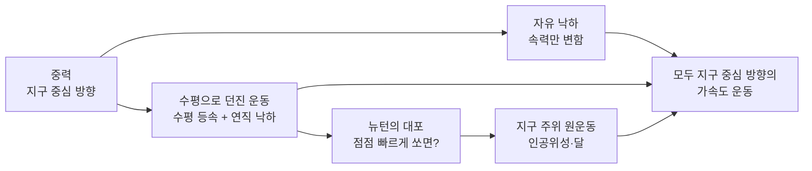
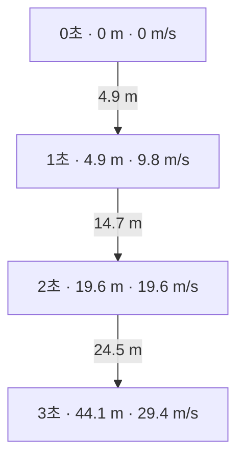
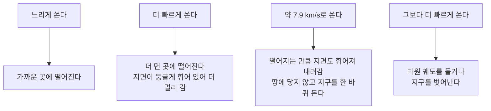

# 3-3. 중력과 운동 — 떨어지는 사과와 도는 달은 같은 운동이다

> [!NOTE]
> **성취기준 [10통과1-03-03]** 중력의 작용으로 인한 지구 표면과 지구 주위의 다양한 운동을 설명할 수 있다.

**학습 목표**

1. 중력이 지구 중심 방향으로 작용하며, 공기 저항이 없으면 지표 근처의 모든 물체가 같은 가속도(약 $9.8\ \mathrm{m/s^2}$)로 떨어진다는 것을 설명할 수 있다.
2. 자유 낙하 운동에서 시간에 따른 속도와 낙하 거리를 구할 수 있다.
3. 수평으로 던진 물체의 운동을 '수평 방향 등속 운동 + 연직 방향 자유 낙하'로 나누어 설명하고, 자유 낙하 운동과 비교할 수 있다.
4. 뉴턴의 대포 사고 실험을 이용하여 지표 근처의 낙하 운동과 인공위성·달의 원운동이 모두 중력에 의한 지구 중심 방향의 가속도 운동임을 설명할 수 있다.

**이 단원의 학습 사다리**

| 단계 | 무엇을 하나? |
|---|---|
| STEP 1. 중학교 다시 보기 | 중력과 무게, 알짜힘과 운동 상태 변화, 자유 낙하를 다시 꺼내 본다 |
| STEP 2. 기초 다지기 | 속도·가속도, 그래프 넓이로 거리 구하기, 운동을 방향별로 나누기를 디딤돌로 놓는다 |
| STEP 3. 핵심 개념 | 중력 → 자유 낙하 → 수평으로 던진 운동 → 뉴턴의 대포 → 인공위성과 달 |
| STEP 4. 오개념 바로잡기 | "우주 정거장에는 중력이 없다?" 같은 착각을 바로잡는다 |
| STEP 5. 선택과목·대학 | 만유인력 법칙, 구심 가속도와 궤도 속력, 뉴턴의 달 검증 |
| STEP 6. 산업·진로 | 인공위성 궤도와 GPS, 놀이기구 설계, 스포츠와 탄도 |

---

## 🗺️ 단원 들어가기

전해지는 이야기에 따르면 뉴턴은 사과가 떨어지는 것을 보고 이런 질문을 떠올렸다고 한다. **"사과는 땅으로 떨어지는데, 왜 달은 떨어지지 않을까?"**

그런데 놀랍게도 정답은 **"달도 떨어지고 있다"** 이다. 달은 지구를 향해 끊임없이 떨어지고 있지만, 옆으로 매우 빠르게 움직이고 있어서 땅에 닿지 않고 지구 주위를 계속 돌 뿐이다. 국제 우주 정거장의 우주인이 둥둥 떠 있는 것도 중력이 없어서가 아니라 **우주 정거장과 함께 계속 떨어지고 있기 때문**이다.

이 단원에서는 손에서 놓은 공, 옆으로 던진 공, 높은 산에서 쏜 대포알, 인공위성, 그리고 달까지 하나의 원리로 이어 본다. 그 원리는 바로 **중력에 의한 지구 중심 방향의 가속도 운동**이다.

---

## STEP 1. 🔙 중학교 다시 보기

### 연계 개념표

| 중학교 성취기준 | 중학교에서 배운 것 | 고등학교에서 확장되는 것 |
|---|---|---|
| [9과05-02] | 중력의 크기와 방향(지구 중심 방향), 질량과 무게의 구별 | 중력이 만드는 가속도 $g$, 무게 $= mg$ |
| [9과05-03] | 알짜힘이 0이 아니면 속력이나 운동 방향, 또는 둘 다 변한다 | 속력이 변하는 **낙하 운동**과 방향이 변하는 **원운동**이 모두 중력 때문이다 |
| [9과19-01] | 등속 운동과 속력이 일정하게 증가하는 운동의 그래프 | 수평 방향은 등속, 연직 방향은 등가속 → **두 운동의 합**으로 포물선 운동 분석 |
| [9과19-02] | 자유 낙하에서 속력이 1초마다 9.8 m/s씩 일정하게 증가 | 낙하 거리 계산, 자유 낙하와 수평으로 던진 운동의 비교 |
| [9과15-04] | 우주 탐사의 의의와 인류에게 미치는 영향 | 인공위성이 궤도를 도는 원리 |

### 준비 운동 (사전 진단)

**Q1.** 지구에서 질량이 60 kg인 사람이 달에 가면 질량과 무게는 각각 어떻게 될까?

**Q2.** 공기가 없는 곳에서 같은 높이에서 쇠공과 깃털을 동시에 떨어뜨리면 어느 것이 먼저 바닥에 닿을까?

**Q3.** 자유 낙하하는 물체의 속력은 1초마다 얼마씩 증가하는가? 정지 상태에서 떨어뜨린 뒤 3초가 지났을 때의 속력은?

**Q4.** 일정한 속력으로 원 궤도를 도는 물체는 운동 상태가 변하는 물체인가?

정답 및 해설

**Q1.** 질량은 **60 kg 그대로**이고, 무게는 지구에서의 **약 6분의 1**로 줄어든다. 질량은 물체의 고유한 양이고, 무게는 물체에 작용하는 중력의 크기이기 때문이다.

**Q2.** **동시에** 닿는다. 공기 저항이 없으면 질량에 관계없이 모든 물체의 속력이 같은 비율로 증가한다.

**Q3.** 약 **9.8 m/s**씩 증가한다. 3초 후의 속력은 $9.8 \times 3 = 29.4\ \mathrm{m/s}$이다.

**Q4.** **그렇다.** 속력은 일정하지만 운동 방향이 계속 변하므로 운동 상태가 변하는 운동이다. 따라서 알짜힘이 작용하고 있다.

---

## STEP 2. 🧱 기초 다지기

### ① 속도와 가속도

- **속도(velocity)**: 빠르기와 방향을 함께 나타낸 양
- **가속도(acceleration)**: 1초 동안 속도가 얼마나 변하는가

$$
a = \frac{\Delta v}{\Delta t} \qquad \text{단위: } \mathrm{m/s^2}
$$

속도가 변한다는 것은 **속력이 변하거나, 방향이 변하거나, 둘 다 변하는 것**이다. 그래서 속력이 일정하더라도 방향이 바뀌면 가속도가 있다.

### ② 힘과 가속도는 같은 방향이다

$$
F = ma \qquad (\text{알짜힘} = \text{질량} \times \text{가속도})
$$

이 식에서 $F$와 $a$는 **방향이 같다.** 물체에 작용하는 알짜힘이 아래쪽이면 가속도도 아래쪽이다. 즉, "가속도가 어느 쪽인가?"를 물으면 "알짜힘이 어느 쪽인가?"를 찾으면 된다.

### ③ 속도–시간 그래프 아래 넓이 = 이동 거리

중학교에서 배운 것처럼 속도–시간 그래프 아래의 넓이는 이동 거리이다.

- 등속 운동: 그래프가 수평선 → 넓이는 직사각형 → $s = vt$
- 정지에서 출발하여 속도가 일정하게 증가하는 운동: 그래프가 원점을 지나는 직선 → 넓이는 삼각형 → $s = \dfrac{1}{2} \times t \times v_{\text{나중}}$

### ④ 운동을 방향별로 나누어 생각하기

비스듬한 방향의 운동도 **수평 방향**과 **연직 방향**으로 나누어 생각하면 쉬워진다. 두 방향의 운동은 **서로 영향을 주지 않는다.**

> [!TIP]
> 💡 **비유** — 일정한 속력으로 달리는 기차 안에서 공을 가만히 떨어뜨리면, 기차 안의 사람에게 공은 똑바로 아래로 떨어진다(연직 낙하). 그러나 기차 밖에 서 있는 사람에게는 공이 기차와 함께 앞으로 가면서 떨어지므로 곡선을 그린다. 공은 **앞으로 가는 운동(수평)** 과 **떨어지는 운동(연직)** 을 동시에, 서로 간섭 없이 하고 있다.

---

## STEP 3. 📘 핵심 개념

### 3-3-① 중력 — 지구 중심을 향하는 힘

질량을 가진 모든 물체는 서로 당기는 힘을 주고받는다. 지구가 물체를 당기는 힘을 **중력(gravity)** 이라 하고, 그 크기가 곧 물체의 **무게(weight)** 이다.

- **방향**: 항상 **지구 중심 방향**. 그래서 지구 반대편에 사는 사람에게도 '아래'는 지구 중심 쪽이다.
- **크기**: 물체의 질량에 비례한다.

$$
W = mg \qquad (g \approx 9.8\ \mathrm{m/s^2} = 9.8\ \mathrm{N/kg})
$$

- 중력은 지구 중심에서 멀어질수록 약해진다. 하지만 고도 약 400 km에서 도는 국제 우주 정거장에서도 중력은 지표의 **약 90%** 나 된다. 지구 반지름(약 6400 km)에 비하면 400 km는 그리 먼 거리가 아니기 때문이다.
- 달 표면의 중력 가속도는 약 $1.6\ \mathrm{m/s^2}$로 지구의 약 6분의 1이다.

#### 왜 모든 물체가 같은 가속도로 떨어질까?

질량이 2배인 물체는 중력도 2배로 받지만, 움직이기 어려운 정도(관성)도 2배이다. 그래서 가속도는 같다.

$$
a = \frac{F}{m} = \frac{mg}{m} = g
$$

**공기 저항이 없다면** 쇠공이든 깃털이든 모두 같은 가속도 $g$로 떨어진다. 1971년 아폴로 15호의 우주인은 공기가 없는 달 표면에서 망치와 깃털을 동시에 떨어뜨려, 둘이 동시에 바닥에 닿는 것을 보여 주었다.

#### 예제 1 — 무게 구하기

질량 50 kg인 학생의 무게를 지구와 달에서 각각 구하시오. (지구 $g = 9.8\ \mathrm{m/s^2}$, 달 $g = 1.6\ \mathrm{m/s^2}$)

**풀이**
- 지구: $W = 50 \times 9.8 = 490\ \mathrm{N}$
- 달: $W = 50 \times 1.6 = 80\ \mathrm{N}$

질량은 어디서나 50 kg으로 같지만, 무게는 장소에 따라 달라진다.

### 3-3-② 자유 낙하 운동 — 속력이 일정하게 빨라진다

정지 상태의 물체가 중력만 받아 떨어지는 운동을 **자유 낙하 운동(free fall)** 이라고 한다. 물체에 작용하는 힘이 일정한 중력뿐이므로 가속도도 $g$로 일정하다. 즉, 자유 낙하는 **가속도가 일정한 직선 운동(등가속도 운동)** 이다.

**속도**: 1초마다 9.8 m/s씩 증가한다.

$$
v = gt
$$

**낙하 거리**: 속도–시간 그래프 아래 삼각형의 넓이이다.

$$
s = \frac{1}{2} \times t \times gt = \frac{1}{2}gt^2
$$

| 시간(s) | 0 | 1 | 2 | 3 | 4 |
|---|---|---|---|---|---|
| 속력(m/s) | 0 | 9.8 | 19.6 | 29.4 | 39.2 |
| 처음부터 떨어진 거리(m) | 0 | 4.9 | 19.6 | 44.1 | 78.4 |
| 1초 동안 떨어진 거리(m) | — | 4.9 | 14.7 | 24.5 | 34.3 |

1초 동안 떨어진 거리는 4.9 : 14.7 : 24.5 : 34.3 = **1 : 3 : 5 : 7** 로 늘어난다. 그래서 같은 시간 간격으로 찍은 **다중 섬광 사진**에서 자유 낙하하는 공의 간격은 아래로 갈수록 점점 넓어진다.

#### 예제 2 — 다리 위에서 떨어뜨린 돌

다리 위에서 돌을 가만히 놓았더니 3초 뒤에 강물에 닿았다. 공기 저항을 무시할 때, (1) 물에 닿는 순간 돌의 속력과 (2) 다리에서 수면까지의 높이를 구하시오.

**풀이**
(1) $v = gt = 9.8 \times 3 = 29.4\ \mathrm{m/s}$
(2) $s = \dfrac{1}{2}gt^2 = \dfrac{1}{2}\times 9.8 \times 3^2 = 4.9 \times 9 = 44.1\ \mathrm{m}$

> [!NOTE]
> 실제로는 공기 저항이 있어서 가볍고 넓적한 물체(깃털, 종이, 낙하산)는 천천히 떨어진다. 이 단원에서는 특별한 말이 없으면 **공기 저항을 무시**한다.

### 3-3-③ 수평으로 던진 물체의 운동 — 두 운동의 합

책상 위에서 공을 옆으로 굴려 떨어뜨리면 공은 곡선(포물선)을 그리며 떨어진다. 이 복잡해 보이는 운동도 방향별로 나누면 아주 단순하다.

| 방향 | 작용하는 힘 | 가속도 | 운동의 종류 | 식 |
|---|---|---|---|---|
| 수평 방향 | 없음 (공기 저항 무시) | 0 | **등속 운동** (처음 속력 $v_0$ 유지) | $x = v_0 t$ |
| 연직 방향 | 중력 $mg$ (아래쪽) | $g$ (아래쪽) | **자유 낙하와 똑같은 운동** | $y = \dfrac{1}{2}gt^2$ |

수평 방향으로는 아무 힘도 작용하지 않으므로 관성에 의해 처음 속력을 그대로 유지하고, 연직 방향으로는 자유 낙하와 똑같이 떨어진다. 두 운동은 서로 영향을 주지 않는다.

#### 자유 낙하와 수평으로 던진 운동의 비교

같은 높이에서 공 A는 가만히 놓고, 공 B는 수평으로 10 m/s로 던졌다고 하자.

| 시간(s) | 0 | 1 | 2 | 3 |
|---|---|---|---|---|
| A의 떨어진 거리(m) | 0 | 4.9 | 19.6 | 44.1 |
| B의 떨어진 거리(m) | 0 | 4.9 | 19.6 | 44.1 |
| B의 수평 이동 거리(m) | 0 | 10 | 20 | 30 |

- 두 공은 **매 순간 같은 높이**에 있다. 따라서 **동시에 바닥에 닿는다.**
- B는 1초마다 수평으로 같은 거리(10 m)씩 이동한다.
- 수평으로 더 빠르게 던지면 더 **멀리** 떨어지지만, 떨어지는 데 걸리는 **시간은 같다.** 떨어지는 시간은 오직 **높이**로 결정된다.

<!-- fig:3-3-strobe -->

> [!IMPORTANT]
> 자유 낙하와 수평으로 던진 운동은 **가속도가 같다**(크기 $g$, 방향 지구 중심 쪽). 차이는 처음에 수평 방향 속도가 있었느냐 없었느냐뿐이다.

#### 예제 3 — 옥상에서 수평으로 던진 공

높이 19.6 m인 건물 옥상에서 공을 수평 방향으로 5 m/s의 속력으로 던졌다. 공기 저항을 무시할 때 다음을 구하시오.
(1) 공이 땅에 닿을 때까지 걸린 시간 (2) 건물 벽에서 공이 떨어진 지점까지의 수평 거리 (3) 땅에 닿기 직전 공의 수평 방향 속력과 연직 방향 속력

**풀이**
(1) 연직 방향은 자유 낙하이므로 $19.6 = \dfrac{1}{2}\times 9.8 \times t^2 = 4.9t^2$, $t^2 = 4$, $t = 2\ \mathrm{s}$
(2) 수평 방향은 등속 운동이므로 $x = v_0 t = 5 \times 2 = 10\ \mathrm{m}$
(3) 수평 방향 속력은 처음과 같은 **5 m/s**, 연직 방향 속력은 $gt = 9.8 \times 2 =$ **19.6 m/s**

같은 옥상에서 공을 10 m/s로 던져도 걸리는 시간은 2초로 같고, 수평 거리만 20 m로 2배가 된다.

#### 비스듬히 던진 운동도 마찬가지이다

농구 슛이나 축구공을 차 올린 경우처럼 비스듬히 위로 던진 물체도, 수평 방향은 등속 운동, 연직 방향은 '위로 올라가며 느려졌다가 내려오며 빨라지는' 운동을 한다. 이때도 가속도는 **처음부터 끝까지 아래쪽으로 $g$** 이다. 가장 높은 점에서도 수평 방향 속도가 남아 있으며, 가속도는 0이 아니다.

### 3-3-④ 뉴턴의 대포 — 떨어지는 운동에서 도는 운동으로

뉴턴은 다음과 같은 **사고 실험**을 제시했다. 공기가 없다고 가정하고, 아주 높은 산꼭대기에서 대포알을 수평으로 쏜다.

핵심은 **지구가 둥글다**는 것이다.

- 수평으로 던진 물체는 처음 1초 동안 4.9 m 떨어진다(3-3-②).
- 한편 지구 표면은 둥글기 때문에, 수평으로 약 7.9 km 나아가면 지면이 약 4.9 m 아래로 휘어져 내려간다.
- 따라서 물체를 수평으로 약 **7.9 km/s**로 쏘면, 1초 동안 4.9 m 떨어지는 사이 지면도 4.9 m 내려가 버려서 **지면과의 높이가 그대로** 유지된다. 이 일이 매 순간 반복되므로 물체는 땅에 닿지 않고 지구 주위를 돈다.

> [!TIP]
> 💡 **비유** — 계단이 끝없이 아래로 이어진다고 상상해 보자. 한 걸음 내려갈 때마다 계단도 한 칸 내려가 있다면, 나는 계속 '내려가고' 있지만 계단과의 거리는 변하지 않는다. 인공위성은 지구를 향해 **계속 떨어지고 있지만, 지구 표면이 그만큼 계속 휘어져 멀어지기 때문에** 영원히 땅에 닿지 않는다.

**결론**: 지표 근처에서 떨어지는 공, 수평으로 던진 공, 그리고 지구 주위를 도는 인공위성은 **모두 중력에 의해 지구 중심 방향으로 떨어지는 운동**이다. 차이는 수평 방향 속력의 크기뿐이다.

<!-- sim:projectile -->

### 3-3-⑤ 지구 주위의 원운동 — 인공위성과 달

#### (1) 등속 원운동은 가속도 운동이다

일정한 속력으로 원을 그리며 도는 **등속 원운동**에서 속력은 변하지 않지만 **운동 방향은 매 순간 바뀐다.** 방향이 바뀌므로 속도가 변하고, 따라서 가속도가 있다. 이 가속도는 **원의 중심 방향**을 향한다.

인공위성과 달의 경우, 원의 중심 방향으로 작용하는 힘이 바로 **지구의 중력**이다. 중력이 지구 중심 쪽을 향하므로 가속도도 지구 중심 쪽을 향한다.

| 운동 | 작용하는 힘 | 가속도의 방향 | 속력 | 운동 방향 |
|---|---|---|---|---|
| 자유 낙하 | 중력 | 지구 중심 쪽 (아래) | 일정하게 증가 | 변하지 않음 |
| 수평으로 던진 운동 | 중력 | 지구 중심 쪽 (아래) | 증가 | 계속 변함 |
| 인공위성·달의 원운동 | 중력 | 지구 중심 쪽 | 일정 | 계속 변함 |

세 운동 모두 **힘(중력)과 가속도가 지구 중심 방향**이라는 점에서 같은 종류의 운동이다. 낙하 운동에서는 중력이 운동 방향과 나란해 **속력**을 바꾸고, 원운동에서는 중력이 운동 방향과 수직이어서 **방향**만 바꾼다.

#### (2) 중력이 갑자기 사라진다면?

줄에 매단 공을 빙빙 돌리다가 줄을 놓으면 공은 원의 바깥쪽이 아니라 **그 순간의 운동 방향(원의 접선 방향)으로 곧게** 날아간다. 마찬가지로 지구의 중력이 사라진다면 달과 인공위성은 관성에 따라 접선 방향으로 등속 직선 운동을 하며 멀어질 것이다(→ 관성은 3-4 단원에서 자세히). 중력은 이 직선 운동을 계속 지구 쪽으로 '구부려' 원 궤도로 만드는 역할을 한다.

#### (3) 지구 주위를 도는 여러 천체

| 천체 | 지표로부터 고도(대략) | 공전 속력(대략) | 공전 주기(대략) |
|---|---|---|---|
| 지표 바로 위를 도는 가상의 위성 | 0 km | 7.9 km/s | 약 84분 |
| 국제 우주 정거장(ISS) | 약 400 km | 약 7.7 km/s | 약 90분 (하루 약 15~16바퀴) |
| GPS 위성 | 약 20,200 km | 약 3.9 km/s | 약 12시간 |
| 정지 궤도 위성 | 약 35,786 km | 약 3.1 km/s | 약 23시간 56분 (지구 자전 주기와 같음) |
| 달 | 약 38만 km (지구 중심에서 평균 약 384,400 km) | 약 1.0 km/s | 약 27.3일 |

- **높이 돌수록 공전 속력은 느리고, 한 바퀴 도는 시간은 길다.** 높은 곳일수록 중력이 약하므로, 궤도를 유지하는 데 필요한 속력도 작아진다.
- **정지 궤도 위성**은 적도 상공에서 지구가 자전하는 방향으로, 지구 자전과 같은 주기로 돈다. 그래서 지상에서 보면 하늘의 한 점에 멈춰 있는 것처럼 보인다.

<!-- fig:3-3-orbits -->

#### (4) 우주 정거장의 '무중력'은 중력이 없는 것이 아니다

우주 정거장 안의 우주인이 떠 있는 것은 **우주 정거장과 우주인이 똑같이 지구를 향해 떨어지고 있기 때문**이다. 엘리베이터 줄이 끊어져 엘리베이터와 내가 함께 자유 낙하하면, 바닥이 나를 떠받치지 않으므로 몸무게를 느끼지 못하는 것과 같다. 이런 상태를 **무중력 상태**(정확히는 **자유 낙하 상태**)라고 한다.

#### 예제 4 — 같은 운동, 다른 모습

다음 중 물체의 가속도 방향이 '지구 중심 쪽'인 것을 **모두** 고르시오. (공기 저항 무시)
ㄱ. 위로 던져 올라가고 있는 공 ㄴ. 비스듬히 차 올린 축구공이 가장 높은 점에 있을 때 ㄷ. 정지 궤도를 도는 기상 위성 ㄹ. 지구 주위를 도는 달

**풀이** **ㄱ, ㄴ, ㄷ, ㄹ 모두**이다. 네 물체 모두 작용하는 힘은 중력뿐이고, 중력은 지구 중심을 향하므로 가속도도 지구 중심 쪽이다. 공이 위로 올라가고 있거나(ㄱ), 가장 높은 점에 있거나(ㄴ), 원을 그리며 돌고 있어도(ㄷ, ㄹ) 마찬가지이다. 운동하는 방향과 가속도의 방향은 다를 수 있다는 점에 주의하자.

---

## STEP 4. ⚠️ 오개념 바로잡기

| 흔한 오개념 | 올바른 개념 | 왜 그럴까? |
|---|---|---|
| 무거운 물체가 더 빨리 떨어진다 | 공기 저항이 없으면 **질량에 관계없이 같은 가속도**로 떨어진다 | 질량이 크면 중력도 크지만 관성도 같은 비율로 커서 가속도는 $g$로 같다. 일상의 차이는 공기 저항 때문이다 |
| 수평으로 세게 던진 공은 오래 날아서 늦게 떨어진다 | 같은 높이에서 던지면 **수평 속력과 관계없이 떨어지는 시간이 같다** | 연직 방향 운동은 수평 방향 운동과 독립이며, 떨어지는 시간은 높이로만 정해진다 |
| 가장 높은 점에서는 속도가 0이므로 가속도도 0이다 | 가장 높은 점에서도 가속도는 **아래쪽으로 $g$** 이다 | 중력은 계속 작용한다. 연직 속도가 0이 되는 순간에도 속도는 계속 변하고 있다 |
| 등속 원운동은 속력이 일정하므로 가속도가 0이다 | 운동 방향이 계속 바뀌므로 **원의 중심 방향으로 가속도가 있다** | 가속도는 속력뿐 아니라 방향의 변화도 포함한다 |
| 우주 정거장에는 중력이 없어서 우주인이 떠 있다 | 우주 정거장 고도에서도 중력은 지표의 **약 90%** 이다. 우주인은 정거장과 함께 **자유 낙하** 중이다 | 함께 떨어지는 물체끼리는 서로 떠받치지 않으므로 무게를 느끼지 못한다 |
| 인공위성은 엔진으로 계속 밀어 주어야 궤도를 돈다 | 궤도에 올라간 뒤에는 **관성(옆으로 가는 운동)과 중력(안으로 당기는 힘)** 만으로 계속 돈다 | 엔진은 궤도에 올릴 때와 아주 희박한 대기 저항 등으로 궤도가 낮아질 때 보정하는 데 쓴다 |

---

## STEP 5. 🎓 선택과목·대학으로 한 걸음 더

> [!CAUTION]
> 이 절은 **통합과학 교육과정 범위 밖의 심화 내용**으로 평가 대상이 아니다. "이 개념이 앞으로 어디까지 이어지는가"를 맛보기로 보여 주기 위한 내용이다.

### 고2·3 선택과목과의 연결

| 과목 | 이어지는 내용 |
|---|---|
| 물리학 | 힘과 에너지(뉴턴 운동 법칙, 포물선 운동, 역학적 에너지) |
| 역학과 에너지 | 시공간과 운동(포물선 운동, 원운동, 케플러 법칙과 만유인력) |
| 행성우주과학 | 우주탐사와 행성계(행성과 위성의 운동, 탐사선의 궤도) |

### ① 만유인력 법칙

뉴턴은 사과를 떨어뜨리는 힘과 달을 붙잡아 두는 힘이 같은 힘이라고 보고, 질량을 가진 모든 물체 사이에 작용하는 **만유인력 법칙**을 세웠다.

$$
F = G\frac{Mm}{r^2} \qquad (G = 6.67\times10^{-11}\ \mathrm{N\cdot m^2/kg^2})
$$

힘은 두 질량의 곱에 비례하고 거리($r$, 중심 사이 거리)의 제곱에 반비례한다. 지표에서 $F = mg$이므로 $g = \dfrac{GM}{R^2}$이며, 지구 반지름 $R$의 2배 거리에서는 중력 가속도가 $\dfrac{1}{4}$이 된다.

### ② 구심 가속도와 궤도 속력

반지름 $r$인 원을 속력 $v$로 도는 물체의 가속도(구심 가속도)는 다음과 같다.

$$
a = \frac{v^2}{r}
$$

인공위성에서는 이 가속도를 만드는 것이 중력이므로 $\dfrac{GMm}{r^2} = \dfrac{mv^2}{r}$, 즉

$$
v = \sqrt{\frac{GM}{r}}
$$

지구의 $GM \approx 3.99\times10^{14}\ \mathrm{m^3/s^2}$을 넣어 계산하면 다음과 같다.

| 궤도 | 지구 중심에서의 거리 $r$ | 궤도 속력 $v$ | 공전 주기 $T = 2\pi r / v$ |
|---|---|---|---|
| 지표 바로 위 | 약 6371 km | 약 7.9 km/s | 약 84분 |
| 국제 우주 정거장 | 약 6771 km | 약 7.7 km/s | 약 92분 |
| 정지 궤도 | 약 42,164 km | 약 3.07 km/s | 약 23시간 56분 |

STEP 3에서 '대략' 값으로만 보았던 숫자들이 하나의 식에서 모두 나온다. 이 식을 정리하면 케플러 제3법칙($T^2 \propto r^3$)도 얻을 수 있다.

### ③ 뉴턴의 '달 검증'

달은 지구 중심에서 지구 반지름의 약 60배 거리에 있다. 만유인력이 거리의 제곱에 반비례한다면 달 위치의 중력 가속도는 $\dfrac{9.8}{60^2} \approx 0.0027\ \mathrm{m/s^2}$이어야 한다. 한편 달의 공전 반지름(약 $3.84\times10^8\ \mathrm{m}$)과 주기(약 27.3일)로 구심 가속도 $v^2/r$를 계산하면 역시 약 $0.0027\ \mathrm{m/s^2}$이 나온다. 뉴턴은 이처럼 **"떨어지는 사과와 도는 달은 같은 법칙을 따른다"** 는 것을 수치로 확인했다.

### ④ 비스듬히 던진 운동과 탈출 속도

- 처음 속력 $v_0$, 각도 $\theta$로 비스듬히 던지면 수평 $x = v_0\cos\theta\, t$, 연직 $y = v_0\sin\theta\, t - \dfrac{1}{2}gt^2$으로 분석한다. 평평한 땅에서 공기 저항이 없다면 45°로 던질 때 가장 멀리 간다.
- 지표에서 약 **11.2 km/s** 이상으로 쏘면 지구 중력을 벗어날 수 있다(탈출 속도). 달·화성 탐사선은 이보다 빠른 속력을 얻거나 궤도를 단계적으로 키워 지구를 벗어난다.

### 고등학교 vs 대학교

| 구분 | 고등학교 통합과학 | 대학교 일반물리학·궤도역학 |
|---|---|---|
| 중력 | 지구 중심 방향, $W = mg$ | 만유인력 $F = GMm/r^2$, 중력장, 위치 에너지 $-GMm/r$ |
| 낙하·포물선 | 자유 낙하, 수평으로 던진 운동 (공기 저항 무시) | 벡터와 미적분으로 분석, 공기 저항(항력)을 포함한 수치 계산 |
| 원운동 | 지구 중심 방향 가속도 운동임을 정성적으로 이해 | $a = v^2/r$, 궤도 속력·주기 계산, 타원 궤도와 케플러 법칙 |
| 응용 | 뉴턴의 대포 사고 실험 | 인공위성 궤도 설계, 궤도 전이, 탐사선 경로 계산 |
| 관련 전공 | — | 물리학, 천문우주학, 항공우주공학, 기계공학 |

---

## STEP 6. 🏭 산업 현장과 진로 연결

### 사례 1. 인공위성 궤도 설계 — 목적에 따라 높이를 고른다

- **원리** 위성이 궤도를 돌려면 그 높이에 맞는 속력이 필요하고, 높이에 따라 공전 주기가 정해진다. 그래서 위성의 **임무에 맞추어 높이를 선택**한다.
- **저궤도(고도 수백~약 2000 km)** 지표에 가까워 자세히 볼 수 있다. 지구관측 위성, 국제 우주 정거장, 위성 인터넷용 소형 위성 등이 돈다. 우리나라는 한국항공우주연구원이 개발한 **다목적실용위성(아리랑)** 으로 지표를 정밀하게 관측한다. 2022년 **누리호**는 2차 발사에서 성능검증위성을 고도 약 700 km 궤도에 올려 우리나라도 독자적으로 위성을 궤도에 올릴 수 있게 되었다.
- **정지 궤도(고도 약 35,786 km)** 지구 자전과 같은 주기로 돌아 늘 같은 지역을 내려다본다. 기상 위성 **천리안위성 2A호**가 이 궤도에서 한반도 주변의 구름과 태풍을 계속 관측하고, 방송·통신 위성도 이 궤도를 쓴다.
- **달 궤도** 2022년 발사된 우리나라 첫 달 탐사선 **다누리**는 달 상공 약 100 km에서 달의 중력에 붙잡혀 달 주위를 돌며 관측한다. 지구 주위를 도는 위성과 같은 원리를 '달'에 적용한 것이다.

### 사례 2. GPS — 궤도를 정확히 아는 위성들이 만드는 위치

- **원리** GPS 위성은 고도 약 20,200 km에서 약 12시간마다 지구를 한 바퀴 돈다. 24개 이상의 위성이 여러 궤도면에 나뉘어 돌기 때문에 지구 어디서나 여러 개의 위성이 하늘에 보인다. 수신기는 **최소 4개 위성**의 신호가 도착하는 데 걸린 시간을 이용하여 자신의 위치(위도·경도·높이)와 시각을 계산한다.
- **핵심 기술** 위성의 궤도(위치)를 매우 정확하게 알아야 하므로, 지상국이 위성의 궤도를 계속 측정해 보정 정보를 보낸다. 위성의 원자시계는 상대성 이론에 따른 아주 작은 시간 차이까지 보정한다.
- **어디에 쓰이나** 스마트폰 지도, 자동차 내비게이션, 항공기·선박 항법, 측량, 지각 변동(판의 이동) 측정, 정밀 농업, 금융 거래 시각 동기화. 우리나라는 한반도 주변에 특화된 **한국형 위성항법시스템(KPS)** 을 2030년대 구축을 목표로 개발하고 있다.

### 사례 3. 놀이기구 설계 — 자유 낙하를 '체험'으로

- **자유 낙하 놀이기구** 탑승 의자를 높이 끌어올렸다가 놓으면 의자와 탑승자가 함께 자유 낙하에 가까운 운동을 한다. 의자가 몸을 떠받치지 않으므로 몸이 붕 뜨는 듯한 **무중력감**을 느낀다. 낙하 후에는 자석이나 마찰 장치로 속력을 서서히 줄여 멈춘다(→ 3-4 단원의 충격량 원리).
- **롤러코스터** 언덕 꼭대기를 넘어갈 때 탑승자가 떠오르는 느낌, 회전 구간에서 좌석에 눌리는 느낌은 모두 중력과 운동 방향 변화(가속도)의 조합이다. 설계자는 탑승자가 받는 가속도가 안전 범위를 넘지 않도록 궤도의 곡률과 속력을 계산한다.
- **무중력 비행** 항공기가 포물선 경로로 비행하면 기내의 모든 것이 항공기와 함께 '수평으로 던진(비스듬히 던진) 물체'처럼 운동하여, 한 번에 약 20여 초 동안 무중력 상태가 된다. 우주인 훈련과 무중력 실험에 쓰인다.

### 사례 4. 스포츠와 탄도 — 포물선을 다루는 기술

- **스포츠** 농구 슛, 배구 서브, 축구 프리킥, 멀리뛰기, 골프 샷은 모두 '수평 방향 + 연직 방향' 운동이다. 스포츠 과학에서는 고속 카메라로 공과 선수의 궤적을 촬영해 발사 속력과 각도를 분석하고 훈련에 활용한다.
- **구호품 투하·소방** 비행기에서 떨어뜨린 구호품은 비행기와 같은 수평 속도를 가지고 떨어지므로, 목표 지점보다 **앞에서** 떨어뜨려야 한다. 소방 헬기의 물 투하, 소방 호스의 물줄기 각도 조절도 같은 원리이다.
- **탄도학** 포탄·로켓의 경로를 계산하는 학문으로, 실제로는 공기 저항과 바람, 지구 자전의 영향까지 계산에 넣는다.

### 관련 진로와 학과

| 진로 | 하는 일 | 관련 학과 |
|---|---|---|
| 위성 궤도·임무 설계 엔지니어 | 위성 궤도 계산, 발사 및 궤도 진입 설계 | 항공우주공학, 기계공학, 천문우주학 |
| 위성 항법(GPS) 엔지니어 | 위성 신호 처리, 위치 정보 서비스 개발 | 전자공학, 측량·공간정보공학 |
| 놀이기구·기계 설계 엔지니어 | 놀이기구 구조 및 안전 설계, 가속도 해석 | 기계공학, 안전공학 |
| 스포츠 과학자 | 선수 동작·공의 궤적 분석, 훈련 프로그램 개발 | 스포츠과학, 체육학, 운동역학 |
| 물리학자·천문학자 | 중력, 천체의 운동, 우주 탐사 연구 | 물리학, 천문우주학 |

---

## 🔬 탐구 활동 — 자유 낙하와 수평으로 던진 물체의 운동을 시각화하여 비교하기

> [!NOTE]
> 교육과정 탐구 활동 "자유 낙하와 수평으로 던진 물체의 운동을 시각화하여 비교하기"와 적용 시 고려 사항(스마트 기기 앱을 활용한 다중섬광사진, 가상현실 기기로 달에서의 중력 체험하기)을 바탕으로 구성하였다.

### 활동 A. 스마트폰으로 다중 섬광 사진 만들기 (모둠 활동)

**목표** 자유 낙하하는 공과 수평으로 던진 공의 위치를 같은 시간 간격으로 기록하여, 연직 방향 운동이 같고 수평 방향 운동은 등속임을 확인한다.

**준비물** 같은 크기의 공 2개(탁구공보다 무거운 쇠구슬이나 골프공 권장), 책상, 자, 모눈종이 또는 1 cm 간격 눈금을 그린 배경판, 스마트폰과 거치대, 다중 섬광 사진(스트로보) 앱 또는 동영상 분석 프로그램

**과정**
1. 책상 옆 벽에 눈금 배경판을 붙이고, 스마트폰을 거치대에 고정하여 책상 모서리 아래 공간 전체가 화면에 담기도록 한다.
2. 공 A는 책상 모서리에서 가만히 놓고, 공 B는 책상 위에서 굴려 모서리를 수평으로 떠나게 한다. 두 공이 **동시에** 모서리를 떠나도록 연습한다. (자를 이용해 한 공은 밀어내고 다른 공은 떨어뜨리는 간단한 장치를 만들 수 있다.)
3. 느린 동작 또는 고속 촬영으로 영상을 찍는다.
4. 앱에서 일정한 시간 간격(예: 0.1초)으로 공의 위치를 겹쳐 찍은 다중 섬광 사진을 만들거나, 동영상 분석 프로그램으로 공의 위치를 표시한다.
5. 시간에 따른 두 공의 위치를 결과 기록 표에 적고, 그래프를 그린다.
6. 가상현실(VR) 기기나 시뮬레이션이 있다면, 달 중력($g$ 약 $1.6\ \mathrm{m/s^2}$)에서 같은 실험을 할 때 결과가 어떻게 달라지는지 비교해 본다.

**결과 기록**

| 시간(s) | 공 A 낙하 거리(cm) | 공 B 낙하 거리(cm) | 공 B 수평 이동 거리(cm) | 공 B의 0.1초당 수평 이동(cm) | 이론값 $\frac{1}{2}gt^2$ (cm) |
|---|---|---|---|---|---|
| 0 | 0 | 0 | 0 | — | 0 |
| 0.1 | | | | | 4.9 |
| 0.2 | | | | | 19.6 |
| 0.3 | | | | | 44.1 |
| 0.4 | | | | | 78.4 |

**생각해 보기**
1. 같은 시각에 공 A와 공 B의 높이를 비교하면 어떠한가? 두 공 중 어느 것이 먼저 바닥에 닿았는가?
2. 공 B의 0.1초당 수평 이동 거리는 일정한가? 이것은 수평 방향으로 어떤 힘이 작용했다는 뜻인가, 작용하지 않았다는 뜻인가?
3. 실험값과 이론값이 다르다면 그 원인은 무엇일까? (두 공이 떠난 시각의 차이, 공기 저항, 위치 표시의 오차 등)
4. 공 B를 더 빠르게 굴리면 바닥에 닿을 때까지 걸리는 시간과 수평 거리는 각각 어떻게 될지 예상하고 확인해 보자.

> [!WARNING]
> **안전 수칙** 공이 바닥에 떨어져 튀거나 굴러가 다른 학생이 밟지 않도록, 바닥에 수건이나 상자를 놓아 공을 받는다. 스마트폰은 거치대에 단단히 고정한다.

### 활동 B. 뉴턴의 대포 시뮬레이션

1. 공개된 물리 시뮬레이션 프로그램(포물선 운동·궤도 시뮬레이션)에서 '뉴턴의 대포'를 실행한다.
2. 발사 속력을 1 km/s, 4 km/s, 7 km/s, 7.9 km/s, 9 km/s로 바꾸어 가며 대포알의 경로를 관찰한다.
3. 대포알이 지구를 한 바퀴 도는 최소 속력을 찾고, 그 경로를 '떨어지는 운동'이라는 말로 설명해 보자.

---

## ✅ 개념 확인 문제

### 기본

**1.** 질량이 2 kg인 물체의 무게를 지구와 달에서 각각 구하시오. (지구 $g = 9.8\ \mathrm{m/s^2}$, 달 $g = 1.6\ \mathrm{m/s^2}$)

정답 및 해설

**정답** 지구 $19.6\ \mathrm{N}$, 달 $3.2\ \mathrm{N}$

$W = mg$ 이므로 지구에서 $2 \times 9.8 = 19.6\ \mathrm{N}$, 달에서 $2 \times 1.6 = 3.2\ \mathrm{N}$이다. 질량은 두 곳에서 모두 2 kg이다.

**2.** 정지 상태에서 자유 낙하하는 물체가 2초 동안 운동하였다. 공기 저항을 무시할 때 (1) 2초 후의 속력과 (2) 2초 동안 떨어진 거리를 구하시오.

정답 및 해설

**정답** (1) $19.6\ \mathrm{m/s}$ (2) $19.6\ \mathrm{m}$

(1) $v = gt = 9.8 \times 2 = 19.6\ \mathrm{m/s}$
(2) $s = \dfrac{1}{2}gt^2 = \dfrac{1}{2} \times 9.8 \times 4 = 19.6\ \mathrm{m}$

**3.** 빈칸에 알맞은 말을 쓰시오. (공기 저항 무시)
"수평으로 던진 물체는 수평 방향으로는 힘이 작용하지 않아 ( ㄱ ) 운동을 하고, 연직 방향으로는 ( ㄴ )이/가 작용하여 ( ㄷ ) 운동과 같은 운동을 한다."

정답 및 해설

**정답** ㄱ: 등속 (직선), ㄴ: 중력, ㄷ: 자유 낙하

**4.** 다음 설명이 옳으면 O, 틀리면 X 표시하시오.
(1) 일정한 속력으로 원운동하는 인공위성은 가속도가 0이다.
(2) 지구 주위를 도는 인공위성에 작용하는 중력의 방향은 지구 중심 쪽이다.
(3) 국제 우주 정거장 안의 우주인이 떠 있는 것은 그곳에 중력이 작용하지 않기 때문이다.

정답 및 해설

**정답** (1) X (2) O (3) X

(1) 운동 방향이 계속 바뀌므로 지구 중심 방향의 가속도가 있다.
(3) 우주 정거장 고도에서도 중력은 지표의 약 90%이다. 우주인과 우주 정거장이 함께 자유 낙하하고 있어 무게를 느끼지 못하는 것이다.

### 응용

**5.** 높이 44.1 m인 절벽 위에서 돌 A는 가만히 놓고, 동시에 돌 B는 수평 방향으로 10 m/s로 던졌다. 공기 저항을 무시할 때 (1) 두 돌이 바닥에 닿는 데 걸리는 시간을 각각 구하고, (2) 돌 B가 떨어진 지점은 절벽 아래에서 수평으로 몇 m 떨어져 있는지 구하시오.

정답 및 해설

**정답** (1) A, B 모두 3초 (2) 30 m

(1) 두 돌의 연직 방향 운동은 모두 자유 낙하이므로 $44.1 = 4.9t^2$, $t^2 = 9$, $t = 3\ \mathrm{s}$로 같다.
(2) B의 수평 방향은 등속 운동이므로 $x = 10 \times 3 = 30\ \mathrm{m}$이다.

**6.** 같은 높이에서 공 P는 가만히 놓고 공 Q는 수평으로 던지면서, 0.1초 간격으로 다중 섬광 사진을 찍었다. 이 사진에 대한 설명으로 옳은 것을 **모두** 고르시오. (공기 저항 무시)
ㄱ. 같은 시각에 찍힌 P와 Q의 높이는 같다.
ㄴ. Q의 사진에서 이웃한 공 사이의 수평 간격은 점점 넓어진다.
ㄷ. P의 사진에서 이웃한 공 사이의 간격은 아래로 갈수록 넓어진다.
ㄹ. P와 Q의 가속도는 크기와 방향이 같다.

정답 및 해설

**정답 ㄱ, ㄷ, ㄹ**

ㄱ. 연직 방향 운동이 둘 다 자유 낙하이므로 같은 시각에 같은 높이에 있다.
ㄴ. Q는 수평 방향으로 등속 운동을 하므로 수평 간격이 **일정**하다. 틀렸다.
ㄷ. 자유 낙하는 속력이 점점 빨라지므로 같은 시간 동안 떨어지는 거리가 1 : 3 : 5 : … 로 늘어난다.
ㄹ. 두 공 모두 중력만 받으므로 가속도는 크기 $g$, 방향 아래쪽으로 같다.

**7.** '뉴턴의 대포' 사고 실험에서, 높은 산 위에서 수평으로 쏜 대포알 A, B, C 중 A와 B는 지면에 떨어졌고 C는 지구를 한 바퀴 돌아 제자리로 돌아왔다(공기 저항 무시). 이에 대한 설명으로 옳은 것을 **모두** 고르시오. (A가 산에서 가장 가까운 곳에 떨어졌다.)
ㄱ. 발사 속력은 A < B < C 순이다.
ㄴ. C에는 중력이 작용하지 않는다.
ㄷ. A, B, C의 가속도는 모두 지구 중심 방향이다.

정답 및 해설

**정답 ㄱ, ㄷ**

ㄱ. 수평으로 더 빠르게 쏠수록 더 멀리 가며, 충분히 빠르면(약 7.9 km/s) 지구를 돈다.
ㄴ. C에도 중력이 작용한다. 중력이 없다면 C는 원을 그리지 않고 직선으로 날아가 버린다. 틀렸다.
ㄷ. 세 대포알 모두 중력만 받으므로 가속도는 지구 중심 방향이다. 이것이 '낙하 운동과 원운동은 같은 종류의 운동'이라는 뜻이다.

### 융합·서술형

**8. [산업 연계]** 구호 물품을 실은 비행기가 지면에서 높이 490 m인 곳을 50 m/s의 속력으로 수평으로 날고 있다. 공기 저항을 무시할 때,
(1) 구호 물품이 땅에 닿을 때까지 걸리는 시간을 구하시오.
(2) 구호 물품을 목표 지점에 정확히 떨어뜨리려면 목표 지점보다 수평 거리로 몇 m 앞에서 놓아야 하는지 구하고, 그 까닭을 설명하시오.

정답 및 해설

**정답** (1) 10초 (2) 500 m 앞

(1) 연직 방향은 자유 낙하이므로 $490 = 4.9t^2$, $t^2 = 100$, $t = 10\ \mathrm{s}$
(2) 비행기에서 놓은 물품은 비행기와 같은 수평 속도 50 m/s를 그대로 가지고 떨어지므로(관성), 떨어지는 10초 동안 수평으로 $50 \times 10 = 500\ \mathrm{m}$ 이동한다. 따라서 목표 지점 500 m 앞에서 놓아야 한다. 공기 저항을 무시하면 물품은 떨어지는 동안 내내 비행기 바로 아래에 있게 된다.

**채점 포인트** ① 연직 방향 자유 낙하로 시간 계산 ② 수평 방향 등속(비행기 속도 유지) ③ 앞에서 놓아야 하는 이유를 관성으로 설명

**9. [대학·우주 연계]** 친구가 다음과 같이 말했다.
"정지 궤도 위성은 하늘에 멈춰 있어. 그리고 우주는 무중력이라서 위성이 떨어지지 않는 거야."
(1) 친구의 말에서 잘못된 부분 두 가지를 찾아 과학적으로 바르게 고치시오.
(2) 정지 궤도 위성이 기상 관측에 유리한 까닭을 쓰시오.

정답 및 해설

**예시 답안**
(1) ① 정지 궤도 위성은 멈춰 있는 것이 아니라 적도 상공 약 35,786 km에서 약 3 km/s의 빠른 속력으로 지구를 돌고 있다. 한 바퀴 도는 시간이 지구의 자전 주기(약 23시간 56분)와 같고 자전 방향으로 돌기 때문에, 지상에서 보면 멈춰 있는 것처럼 보일 뿐이다.
② 위성이 있는 곳에도 지구의 중력이 작용한다. 위성은 중력에 의해 지구 중심 쪽으로 계속 떨어지고 있지만, 옆으로 충분히 빠르게 움직이고 있어서 지구 표면에 닿지 않고 원 궤도를 돈다. 중력이 없다면 위성은 직선으로 날아가 버린다.
(2) 지상에서 볼 때 늘 같은 위치에 있으므로, 한반도 주변처럼 같은 지역을 24시간 쉬지 않고 연속으로 관측할 수 있다. 따라서 구름과 태풍의 이동을 짧은 시간 간격으로 추적할 수 있다.

**채점 포인트** ① 정지 궤도의 '정지'는 상대적인 겉보기임 ② 중력이 원운동의 원인임(무중력 오개념 교정) ③ 연속 관측의 장점

---

## 📝 한눈에 정리

### 핵심 요약

- **중력**은 지구 중심 방향으로 작용하며, 무게 $W = mg$이다. 공기 저항이 없으면 모든 물체는 같은 가속도 $g \approx 9.8\ \mathrm{m/s^2}$로 떨어진다.
- **자유 낙하**: 속도 $v = gt$, 낙하 거리 $s = \frac{1}{2}gt^2$. 같은 시간 동안 떨어지는 거리는 1 : 3 : 5 : … 로 늘어난다.
- **수평으로 던진 운동** = 수평 방향 **등속 운동** + 연직 방향 **자유 낙하**. 같은 높이라면 자유 낙하하는 물체와 **동시에** 떨어진다.
- **뉴턴의 대포**: 수평으로 충분히 빠르게(지표 근처에서 약 7.9 km/s) 쏘면, 떨어지는 만큼 지면이 휘어져 내려가 지구 주위를 돈다.
- 인공위성과 달의 **원운동**은 속력은 일정하지만 방향이 변하는 가속도 운동이며, 가속도는 **중력에 의해 지구 중심 방향**이다.
- 지표 근처의 낙하 운동과 지구 주위의 원운동은 **모두 중력에 의한 지구 중심 방향의 가속도 운동**이다.
- 우주 정거장의 '무중력'은 중력이 없는 것이 아니라 **함께 자유 낙하하는 상태**이다.

### 핵심 용어

| 용어 | 뜻 |
|---|---|
| 중력 | 지구가 물체를 지구 중심 방향으로 당기는 힘. 크기는 무게 $mg$ |
| 중력 가속도 | 중력만 받을 때 물체의 가속도. 지표 근처에서 약 $9.8\ \mathrm{m/s^2}$ |
| 자유 낙하 운동 | 정지한 물체가 중력만 받아 떨어지는 등가속도 직선 운동 |
| 수평으로 던진 물체의 운동 | 수평 방향 등속 운동과 연직 방향 자유 낙하가 합쳐진 포물선 운동 |
| 등속 원운동 | 속력은 일정하고 방향만 계속 변하는 원운동. 원의 중심 방향 가속도를 가진다 |
| 뉴턴의 대포 | 수평 발사 속력을 높이면 낙하 운동이 원운동이 됨을 보인 사고 실험 |
| 정지 궤도 | 적도 상공 약 35,786 km, 지구 자전 주기와 같은 주기로 도는 궤도 |
| 무중력 상태 | 물체가 함께 자유 낙하하여 무게를 느끼지 못하는 상태 |

### 다음 단원으로

이 단원에서 "중력이 사라지면 위성은 접선 방향으로 곧게 날아간다"고 했다. 힘을 받지 않는 물체가 운동 상태를 그대로 유지하려는 이 성질이 바로 **관성**이다. 다음 단원에서는 상호작용(힘)이 없을 때 물체가 가속되지 않는다는 관성 법칙에서 출발하여, 물체가 충돌할 때 주고받는 **운동량과 충격량**의 관계를 안전장치와 스포츠에 적용해 본다.
