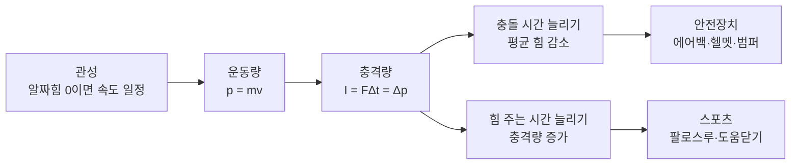

# 3-4. 운동량과 충격량 — 충돌을 다스리는 과학

> [!NOTE]
> **성취기준 [10통과1-03-04]** 상호작용이 없을 때 물체가 가속되지 않음을 알고, 충격량과 운동량의 관계를 충돌 관련 안전장치와 스포츠에 적용할 수 있다.

**학습 목표**

1. 물체에 작용하는 알짜힘이 0이면 물체의 속도가 변하지 않는다는 것(관성)을 일상 사례로 설명할 수 있다.
2. 운동량과 충격량의 뜻을 알고, '충격량 = 운동량의 변화량' 관계를 이용해 간단한 계산을 할 수 있다.
3. 충돌 시간을 늘려 충격력을 줄이는 원리를 에어백, 헬멧 등 안전장치에 적용하여 설명할 수 있다.
4. 힘을 가하는 시간을 늘려 충격량을 키우는 원리를 스포츠 기술에 적용하여 설명할 수 있다.

**이 단원의 학습 사다리**

| 단계 | 무엇을 하나? |
|---|---|
| STEP 1. 중학교 다시 보기 | 힘, 알짜힘, 속력 그래프를 다시 꺼내 본다 |
| STEP 2. 기초 다지기 | 속도와 가속도, '힘 = 질량 × 가속도'를 디딤돌로 놓는다 |
| STEP 3. 핵심 개념 | 관성 → 운동량 → 충격량 → 안전장치와 스포츠 |
| STEP 4. 오개념 바로잡기 | "에어백은 충격량을 줄인다?" 같은 착각을 바로잡는다 |
| STEP 5. 선택과목·대학 | 운동량 보존, 로켓, 미적분으로 보는 충격량 |
| STEP 6. 산업·진로 | 자동차 충돌 안전, 스포츠 용품, 포장 공학 |

---

## 🗺️ 단원 들어가기

달걀을 딱딱한 바닥에 떨어뜨리면 깨지지만, 같은 높이에서 두꺼운 이불 위로 떨어뜨리면 멀쩡하다. 두 경우 모두 달걀은 **같은 속력으로 떨어져서 결국 멈춘다.** 그런데 왜 결과가 다를까?

야구 선수는 공을 받을 때 글러브를 몸 쪽으로 당기고, 골프 선수는 공을 친 뒤에도 클럽을 끝까지 휘두른다(팔로스루). 하나는 '충격을 줄이는' 동작이고, 다른 하나는 '충격을 키우는' 동작이다. 이 단원에서는 이 모든 현상을 **운동량**과 **충격량**이라는 두 개념 하나로 설명해 본다.

---

## STEP 1. 🔙 중학교 다시 보기

### 연계 개념표

| 중학교 성취기준 | 중학교에서 배운 것 | 고등학교에서 확장되는 것 |
|---|---|---|
| [9과05-01] | 힘은 크기와 방향을 가지며 화살표로 나타낸다. 힘의 평형 | 알짜힘이 0인 상태 = 속도가 변하지 않는 상태(관성) |
| [9과05-03] | 알짜힘이 0이 아니면 운동 상태(속력·방향)가 변한다 | 운동 상태의 변화를 **운동량의 변화**로 수치화한다 |
| [9과19-01] | 등속 운동, 속력이 일정하게 변하는 운동의 그래프 | 시간–힘 그래프의 넓이 = 충격량 |
| [9과19-02] | 자유 낙하에서 속력은 1초마다 일정하게 증가한다 | 낙하 후 충돌하는 순간의 운동량 변화 계산 |

### 준비 운동 (사전 진단)

**Q1.** 책상 위에 가만히 놓인 책에는 힘이 하나도 작용하지 않는다. (O / X)

**Q2.** 마찰이 없는 얼음판 위에서 밀어 준 퍽(puck)은 손을 떠난 뒤 어떻게 움직일까?

**Q3.** 다음 중 '운동 상태가 변한 것'을 모두 고르시오.
ㄱ. 일정한 속력으로 곧게 달리는 자동차 ㄴ. 일정한 속력으로 원형 트랙을 도는 자동차 ㄷ. 브레이크를 밟아 속력이 줄어드는 자동차

정답 및 해설

**Q1. X** — 중력(아래)과 책상이 떠받치는 힘(위)이 함께 작용한다. 두 힘이 평형을 이루어 **알짜힘이 0**일 뿐이다.

**Q2.** 거의 같은 속력으로 같은 방향으로 계속 미끄러진다. 마찰이 없으면 운동을 방해하는 힘이 없기 때문이다.

**Q3. ㄴ, ㄷ** — 운동 상태의 변화는 '속력의 변화' 또는 '방향의 변화'이다. ㄴ은 속력은 같지만 방향이 계속 바뀐다.

---

## STEP 2. 🧱 기초 다지기

### ① 속력과 속도는 다르다

- **속력(speed)**: 얼마나 빠른가. 크기만 있다. (예: 20 m/s)
- **속도(velocity)**: 얼마나 빠르고 **어느 방향**인가. 크기와 방향이 모두 있다. (예: 동쪽으로 20 m/s)

방향이 있는 양은 부호로 나타낼 수 있다. 오른쪽을 (+)로 정하면 왼쪽으로 5 m/s는 $-5\ \mathrm{m/s}$이다.

> [!TIP]
> 💡 **비유** — 속력은 "시속 60 km", 속도는 "시속 60 km로 부산 방향". 내비게이션은 속도를 알아야 길을 안내할 수 있다.

### ② 가속도: 속도가 얼마나 빨리 변하는가

**가속도(acceleration)** 는 1초 동안 속도가 얼마나 변하는지를 나타낸다.

$$
a = \frac{\Delta v}{\Delta t} = \frac{v_{\text{나중}} - v_{\text{처음}}}{\text{걸린 시간}}
$$

- 단위: $\mathrm{m/s^2}$ ("1초마다 몇 m/s씩 변하는가")
- 중학교에서 배운 자유 낙하에서 속력이 1초마다 약 9.8 m/s씩 증가했던 것 → 가속도 $9.8\ \mathrm{m/s^2}$

### ③ 힘과 가속도의 관계

중학교에서 "알짜힘이 0이 아니면 운동 상태가 변한다"고 배웠다. 이것을 식으로 쓰면 다음과 같다.

$$
F = ma \quad (\text{알짜힘} = \text{질량} \times \text{가속도})
$$

- 같은 힘이면 질량이 클수록 속도가 덜 변한다(무거운 수레는 잘 안 밀린다).
- 힘의 단위 1 N은 1 kg의 물체를 $1\ \mathrm{m/s^2}$로 가속시키는 힘이다.

### ④ '넓이'로 양을 구하는 아이디어

중학교에서 속력–시간 그래프 아래 넓이가 이동 거리였다. 마찬가지로 **힘–시간 그래프 아래 넓이**도 의미 있는 양이 된다. 이것이 곧 STEP 3의 **충격량**이다.

---

## STEP 3. 📘 핵심 개념

### 3-4-① 상호작용이 없으면 가속되지 않는다 — 관성

물체에 작용하는 **알짜힘이 0**이면 물체의 속도는 변하지 않는다.

- 정지해 있던 물체 → 계속 정지
- 움직이던 물체 → 같은 속력, 같은 방향으로 계속 운동(등속 직선 운동)

이처럼 물체가 운동 상태를 유지하려는 성질을 **관성(inertia)** 이라 하고, 이 규칙을 **관성 법칙(뉴턴 운동 제1법칙)** 이라고 한다. 질량이 클수록 관성이 크다.

| 상황 | 관성으로 설명하기 |
|---|---|
| 버스가 갑자기 출발하면 승객이 뒤로 쏠린다 | 승객의 몸은 정지 상태를 유지하려 한다 |
| 버스가 갑자기 멈추면 승객이 앞으로 쏠린다 | 승객의 몸은 앞으로 가던 운동을 유지하려 한다 |
| 이불을 두드리면 먼지가 떨어진다 | 이불은 움직이지만 먼지는 제자리에 남으려 한다 |
| 우주 탐사선은 연료 없이도 오랫동안 날아간다 | 우주에는 운동을 방해하는 힘이 거의 없다 |

> [!IMPORTANT]
> 안전벨트는 **관성 때문에 앞으로 계속 움직이려는 몸**을 붙잡아 주는 장치이다. 차는 멈췄는데 몸은 그대로 앞으로 가려 하기 때문에, 벨트가 없으면 몸이 운전대나 앞 유리에 부딪힌다.

### 3-4-② 운동량: 운동의 '세기'를 나타내는 양

같은 속력으로 굴러오는 탁구공과 볼링공 중 어느 쪽을 멈추기 어려울까? 같은 볼링공이라도 천천히 굴러올 때와 빠르게 굴러올 때 중 어느 쪽이 멈추기 어려울까?

멈추기 어려운 정도는 **질량**과 **속도** 모두에 비례한다. 이를 **운동량(momentum)** 이라 한다.

$$
p = mv \qquad \text{단위: } \mathrm{kg\cdot m/s}
$$

- 운동량은 속도와 같은 **방향**을 가진다. 반대 방향이면 부호가 반대이다.
- 정지한 물체의 운동량은 0이다.

#### 예제 1

질량 0.15 kg인 야구공이 40 m/s로 날아온다. 질량 1500 kg인 자동차가 4 m/s로 천천히 움직인다. 운동량이 더 큰 것은?

**풀이**
- 야구공: $p = 0.15 \times 40 = 6\ \mathrm{kg\cdot m/s}$
- 자동차: $p = 1500 \times 4 = 6000\ \mathrm{kg\cdot m/s}$

자동차의 운동량이 1000배 크다. 느리게 움직이는 자동차도 멈추기 매우 어려운 이유이다.

### 3-4-③ 충격량: 운동량을 바꾸는 '힘 × 시간'

운동량을 바꾸려면 힘이 필요하다. 그런데 **얼마나 큰 힘**을 주었는지뿐 아니라 **얼마나 오래** 주었는지도 중요하다. 그래서 다음 양을 정의한다.

$$
I = F\Delta t \qquad \text{(충격량 = 힘 × 힘이 작용한 시간, 단위: } \mathrm{N\cdot s})
$$

이것을 **충격량(impulse)** 이라고 한다. STEP 2의 $F = ma$와 $a = \dfrac{\Delta v}{\Delta t}$를 합치면 아주 중요한 관계가 나온다.

$$
F = m\frac{v_{\text{나중}} - v_{\text{처음}}}{\Delta t}
\;\;\Rightarrow\;\;
F\Delta t = mv_{\text{나중}} - mv_{\text{처음}}
$$

$$
\boxed{\;\text{충격량} = \text{운동량의 변화량}\;\;(I = \Delta p)\;}
$$

> [!TIP]
> 💡 **비유** — 운동량을 '통장 잔고', 충격량을 '입금·출금액'이라고 생각하자. 잔고를 1000원 줄이려면 1000원을 한 번에 빼도 되고(큰 힘, 짧은 시간), 10원씩 100번 빼도 된다(작은 힘, 긴 시간). **빠져나간 총액(충격량)은 같지만 한 번에 빠지는 금액(힘)은 전혀 다르다.**

#### 힘–시간 그래프로 보는 충격량

실제 충돌에서 힘은 일정하지 않고 순간적으로 커졌다가 작아진다. 이때 **힘–시간 그래프 아래의 넓이**가 충격량이다.

| 충돌 방식 | 그래프 모양 | 넓이(충격량) | 최대 힘 |
|---|---|---|---|
| 딱딱한 바닥 | 폭이 좁고 높은 뾰족한 산 | 같다 | 매우 크다 |
| 푹신한 매트 | 폭이 넓고 낮은 완만한 산 | 같다 | 작다 |

같은 높이에서 떨어져 멈추는 달걀은 **운동량 변화량(충격량)이 같다.** 바닥은 달걀을 아주 짧은 시간에 멈추게 하므로 힘이 크고, 이불은 오랜 시간에 걸쳐 멈추게 하므로 힘이 작다. 그래서 이불 위의 달걀은 깨지지 않는다.

#### 예제 2

질량 0.06 kg인 달걀이 5 m/s로 떨어지다가 바닥에서 멈췄다.
(1) 달걀이 받은 충격량의 크기는?
(2) 딱딱한 바닥에서 0.002초 만에 멈출 때와 이불에서 0.1초 만에 멈출 때, 달걀이 받는 평균 힘의 크기를 각각 구하시오.

**풀이**
(1) $I = |\Delta p| = |0 - 0.06\times5| = 0.3\ \mathrm{N\cdot s}$
(2) $F = \dfrac{I}{\Delta t}$
- 바닥: $F = \dfrac{0.3}{0.002} = 150\ \mathrm{N}$
- 이불: $F = \dfrac{0.3}{0.1} = 3\ \mathrm{N}$

충격량은 같지만 평균 힘은 **50배** 차이가 난다.

#### 예제 3 — 튕겨 나오면 충격량이 더 크다

질량 0.5 kg인 공이 오른쪽으로 4 m/s로 벽에 부딪힌 뒤 왼쪽으로 4 m/s로 튕겨 나왔다. 공이 받은 충격량은?

**풀이** 오른쪽을 (+)로 정하면
$\Delta p = m v_{\text{나중}} - m v_{\text{처음}} = 0.5\times(-4) - 0.5\times(+4) = -4\ \mathrm{kg\cdot m/s}$

크기는 $4\ \mathrm{N\cdot s}$, 방향은 왼쪽이다. 벽에 붙어 멈췄다면 $2\ \mathrm{N\cdot s}$였을 것이다. **튕겨 나오면 운동량 변화가 더 크므로 충격량도 더 크다.**

### 3-4-④ 충격을 줄이는 안전장치 — 충돌 시간을 늘려라

충돌로 멈추는 경우 운동량 변화량은 이미 정해져 있다(처음 운동량 → 0). 따라서 몸을 보호하는 방법은 단 하나, **충돌 시간 $\Delta t$를 늘려 평균 힘 $F$를 줄이는 것**이다.

$$
F = \frac{\Delta p}{\Delta t} \quad \Rightarrow \quad \Delta t \uparrow \;\; \Rightarrow \;\; F \downarrow
$$

| 안전장치 | 어떻게 충돌 시간을 늘리나? |
|---|---|
| 에어백 | 부풀어 오른 주머니가 머리·가슴이 멈추는 거리와 시간을 늘린다 |
| 안전벨트 | 약간 늘어나면서 몸을 붙잡아 몸이 멈추는 시간을 늘린다 |
| 자동차 앞부분(크럼플 존) | 일부러 찌그러지면서 충돌 시간을 늘리고, 승객 공간은 단단하게 지킨다 |
| 헬멧 내부 스티로폼(EPS) | 충격 시 눌려 찌그러지며 머리가 멈추는 시간을 늘린다 |
| 운동장 우레탄 바닥, 체조 매트 | 넘어질 때 몸이 천천히 멈추게 한다 |
| 도로의 충격 흡수 장치(쿠션 드럼) | 차량이 부딪힐 때 찌그러지거나 밀려나며 충돌 시간을 늘린다 |
| 낙법, 착지할 때 무릎 굽히기 | 몸이 멈추는 시간을 길게 만든다 |

#### 예제 4 — 에어백의 효과

질량 60 kg인 운전자가 15 m/s(54 km/h)로 달리다 충돌하여 멈춘다.
머리와 상체가 단단한 운전대에 부딪혀 0.01초 만에 멈추는 경우와 에어백에 의해 0.15초에 걸쳐 멈추는 경우의 평균 힘을 비교하시오. (시간은 설명을 위해 가정한 값이다.)

**풀이** $|\Delta p| = 60\times15 = 900\ \mathrm{kg\cdot m/s}$
- 운전대: $F = 900 / 0.01 = 90\,000\ \mathrm{N}$
- 에어백: $F = 900 / 0.15 = 6\,000\ \mathrm{N}$

평균 힘이 **15분의 1**로 줄어든다. 충격량은 똑같다는 점에 주의하자.

### 3-4-⑤ 충격량을 키우는 스포츠 기술 — 힘 주는 시간을 늘려라

반대로 공을 멀리, 빠르게 보내고 싶다면 공에 **큰 충격량**을 주어야 한다. 힘의 크기에는 한계가 있으므로, **공과 접촉하는 시간을 늘리는 것**이 핵심이다.

| 스포츠 동작 | 원리 |
|---|---|
| 골프·야구·테니스의 팔로스루 | 공에 힘을 주는 시간을 조금이라도 더 늘려 충격량을 키운다 |
| 투포환·투창의 긴 회전·도움닫기 | 힘을 오래 작용시켜 운동량을 크게 만든다 |
| 야구 포수가 미트를 몸 쪽으로 당기기 | (반대) 공이 멈추는 시간을 늘려 손에 받는 힘을 줄인다 |
| 높이뛰기 매트, 멀리뛰기 모래판 | (반대) 착지할 때 충돌 시간을 늘려 부상을 막는다 |

> [!WARNING]
> "팔로스루를 하면 무조건 공이 빨라진다"는 정확하지 않다. 실제로 공과 배트가 붙어 있는 시간은 1000분의 1초 정도로 매우 짧다. 팔로스루의 진짜 의미는 **임팩트 순간까지 배트(클럽)의 속력을 줄이지 않고 끝까지 힘을 실어 주는 것**이며, 그 결과 공에 전달되는 충격량이 커진다.

---

## STEP 4. ⚠️ 오개념 바로잡기

| 흔한 오개념 | 올바른 개념 | 왜 그럴까? |
|---|---|---|
| 물체가 계속 움직이려면 힘이 계속 작용해야 한다 | 알짜힘이 0이면 물체는 **등속 직선 운동을 계속**한다 | 일상에서는 마찰력·공기 저항이 항상 작용해 멈추는 것처럼 보일 뿐이다 |
| 에어백은 충격량을 줄여 준다 | 에어백은 **충격량은 그대로** 두고 **평균 힘을 줄인다** | 멈추는 경우 $\Delta p$는 처음 운동량으로 정해져 있다. 바뀌는 것은 $\Delta t$이다 |
| 무거운 물체는 항상 운동량이 크다 | 운동량은 **질량 × 속도**이다 | 빠른 총알이 느린 사람보다 운동량이 클 수도 있다 |
| 운동량과 운동 에너지는 같은 것이다 | 운동량 $mv$는 방향이 있고, 운동 에너지 $\frac{1}{2}mv^2$는 방향이 없다 | 마주 오는 두 공의 운동량은 상쇄될 수 있지만 운동 에너지는 상쇄되지 않는다 |
| 벽에 붙는 것보다 튕겨 나올 때 충격이 작다 | 튕겨 나오면 **운동량 변화가 더 커서** 충격량이 더 크다 | 멈추는 데 더해 반대 방향으로 다시 가속해야 하기 때문이다 |
| 관성은 움직이는 물체에만 있다 | 정지한 물체도 **정지 상태를 유지하려는** 관성이 있다 | 버스가 출발할 때 몸이 뒤로 쏠리는 현상이 그 예이다 |

---

## STEP 5. 🎓 선택과목·대학으로 한 걸음 더

> [!CAUTION]
> 이 절은 **통합과학 교육과정 범위 밖의 심화 내용**으로 평가 대상이 아니다. "이 개념이 앞으로 어디까지 이어지는가"를 맛보기로 보여 주기 위한 내용이다.

### 고2·3 선택과목과의 연결

| 과목 | 이어지는 내용 |
|---|---|
| 물리학 | 뉴턴 운동 법칙(관성·가속도·작용 반작용), **운동량 보존 법칙**, 충돌 |
| 역학과 에너지 | 시공간과 운동, 다양한 운동의 분석, 열과 에너지 |

### ① 운동량 보존 법칙

두 물체가 서로만 힘을 주고받으면(외부 힘이 없으면), 작용–반작용 법칙에 의해 두 물체가 받는 충격량은 크기가 같고 방향이 반대이다. 따라서 한 물체가 얻은 운동량만큼 다른 물체가 잃는다.

$$
m_1v_1 + m_2v_2 = m_1v_1' + m_2v_2'
$$

**외부와 상호작용이 없으면 계(system) 전체의 운동량은 변하지 않는다.** 이 단원 성취기준의 "상호작용이 없을 때 가속되지 않는다"를 '여러 물체의 모임'으로 확장한 것이다.

### ② 로켓은 무엇을 밀고 나아가는가?

우주에는 밀어낼 공기가 없는데 로켓은 어떻게 가속할까? 로켓은 연료를 태운 가스를 뒤로 빠르게 내뿜는다. 처음 전체 운동량이 0이었다면, 가스가 뒤로 운동량을 가져가는 만큼 로켓은 앞으로 같은 크기의 운동량을 얻는다. 대학 역학에서는 이를 질량이 계속 줄어드는 물체의 운동으로 풀어 **로켓 방정식(치올콥스키 방정식)** 을 얻는다.

$$
\Delta v = v_{\text{e}} \ln\frac{m_0}{m_f}
$$

($v_{\text{e}}$: 가스 분출 속력, $m_0$: 처음 질량, $m_f$: 나중 질량) 연료를 많이 실을수록 속도를 크게 바꿀 수 있지만, 로그 함수라서 효과가 점점 줄어든다. 그래서 로켓은 다 쓴 연료통을 떼어 내는 **다단 로켓** 구조를 쓴다.

### ③ 미적분으로 보는 충격량

대학 '일반물리학'에서는 힘이 시간에 따라 변하는 경우를 적분으로 다룬다. 뉴턴은 원래 운동 제2법칙을 '운동량의 시간 변화율'로 표현했다.

$$
F = \frac{dp}{dt}, \qquad I = \int_{t_1}^{t_2} F\,dt = p_2 - p_1
$$

STEP 3에서 '그래프 아래 넓이'라고 한 것이 바로 적분이다. 또 운동량은 3차원 **벡터**로 다루며, 당구공처럼 비스듬히 부딪치는 2차원 충돌도 분석할 수 있다.

### 고등학교 vs 대학교

| 구분 | 고등학교 통합과학 | 대학교 일반물리학·동역학 |
|---|---|---|
| 운동량 | $p = mv$, 1차원(부호로 방향) | $\vec{p} = m\vec{v}$, 3차원 벡터 |
| 충격량 | $I = F\Delta t$ (평균 힘) | $I = \int F\,dt$ (변하는 힘) |
| 충돌 | 안전장치·스포츠 사례로 정성 분석 | 탄성·비탄성 충돌, 반발 계수, 질량 중심 |
| 응용 | 에어백 원리 이해 | 충돌 시뮬레이션(유한 요소 해석), 로켓 궤도 설계 |
| 관련 전공 | — | 기계공학, 자동차공학, 항공우주공학, 물리학, 스포츠과학 |

---

## STEP 6. 🏭 산업 현장과 진로 연결

### 사례 1. 자동차 충돌 안전 공학

- **원리** 크럼플 존은 앞부분이 단계적으로 찌그러지며 충돌 시간을 늘리고, 승객이 타는 공간(캐빈)은 고강도 강판으로 만들어 찌그러지지 않게 한다. "부드러운 앞부분 + 단단한 승객 공간"이 함께 있어야 한다.
- **에어백의 작동 순서** 충돌을 감지하는 **가속도 센서**가 급격한 감속을 감지 → 제어 장치가 판단 → 가스 발생 장치가 작동 → 수십 밀리초(0.0x초) 안에 에어백이 부풀어 오른다. 탑승자가 앞으로 쏠리기 전에 펼쳐져야 하므로 시간이 핵심이다.
- **평가 제도** 우리나라는 한국교통안전공단이 **자동차안전도평가(KNCAP)** 를 실시하여 충돌 시험 결과를 공개한다. 충돌 시험용 인체 모형(더미)의 머리·가슴에 단 센서로 받는 힘과 가속도를 측정한다.
- **요즘 현장** 실제 차를 부수는 시험은 비용이 크기 때문에, 먼저 컴퓨터로 수천 번 충돌을 계산하는 **충돌 시뮬레이션(CAE)** 을 하고 마지막에 실차 시험으로 확인한다.

### 사례 2. 스포츠 용품과 보호 장비

- 헬멧, 축구 정강이 보호대, 러닝화 밑창은 모두 **충격을 받을 때 천천히 찌그러지는 소재**(발포 폴리스타이렌, 폴리우레탄 폼 등)를 쓴다.
- 러닝화는 '충격 흡수(충돌 시간 늘리기)'와 '반발력(에너지 되돌려 주기)'을 함께 고려해 밑창 소재를 설계한다.

### 사례 3. 포장 공학과 물류

- 택배 상자 안의 에어캡(뽁뽁이), 스티로폼 완충재는 떨어질 때 제품이 멈추는 시간을 늘린다.
- 전자 제품 회사는 포장한 제품을 일정 높이에서 떨어뜨리는 **낙하 시험**으로 완충 설계를 검증한다.

### 사례 4. 항공우주 — 운동량 보존의 응용

- 로켓 발사는 STEP 5의 운동량 보존을 이용한다. 우리나라는 한국항공우주연구원이 개발한 **누리호**로 독자적인 발사 능력을 갖추었다.
- 우주선이 착륙할 때 쓰는 낙하산·역추진 엔진·착륙 다리의 완충 장치도 충돌 시간을 늘리는 원리이다.

### 관련 진로와 학과

| 진로 | 하는 일 | 관련 학과 |
|---|---|---|
| 자동차 안전 엔지니어 | 차체 구조·에어백 설계, 충돌 시험·시뮬레이션 | 기계공학, 자동차공학 |
| 스포츠 과학자·용품 개발자 | 동작 분석, 보호 장비·운동화 개발 | 스포츠과학, 체육학, 재료공학 |
| 포장 엔지니어 | 완충 포장 설계, 낙하 시험 | 기계공학, 산업공학, 포장학 |
| 항공우주 엔지니어 | 추진 시스템, 착륙 장치 설계 | 항공우주공학, 기계공학 |

---

## 🔬 탐구 활동 — 교통수단과 스포츠 등에서 충격을 줄이는 방법 탐색하기

### 활동 A. 달걀 낙하 보호 장치 설계하기 (모둠 활동)

**목표** 충격량과 충돌 시간의 관계를 이용하여 높은 곳에서 떨어지는 달걀을 보호하는 장치를 설계한다.

**준비물** 날달걀, 종이, 빨대, 고무줄, 비닐봉지, 테이프, 가위, 줄자, 스마트폰(느린 동작 촬영)

**과정**
1. 모둠별로 재료를 받고 15분 동안 보호 장치를 설계·제작한다(재료 양은 모든 모둠 동일).
2. 같은 높이(예: 2 m)에서 장치를 떨어뜨리고 스마트폰 슬로 모션으로 촬영한다.
3. 영상에서 장치가 바닥에 닿은 순간부터 완전히 멈출 때까지의 프레임 수를 세어 충돌 시간을 어림한다.
4. 달걀의 상태를 기록한다.

**결과 기록**

| 모둠 | 설계 핵심 아이디어 | 충돌 시간 어림(초) | 달걀 상태 |
|---|---|---|---|
| 1 | | | |
| 2 | | | |
| 3 | | | |

**생각해 보기**
1. 모든 모둠의 달걀이 받은 충격량은 같았을까? 그렇게 생각한 이유는?
2. 성공한 장치들의 공통점을 '충돌 시간'으로 설명해 보자.
3. 이 아이디어를 자동차나 헬멧 설계에 어떻게 적용할 수 있을까?

> [!WARNING]
> **안전 수칙** 높은 곳에서 떨어뜨릴 때는 교사의 지도 아래 안전한 계단이나 사다리를 이용하고, 아래에 사람이 없는지 확인한다. 깨진 달걀은 위생을 위해 바로 치운다.

### 활동 B. 스마트폰 가속도 센서로 충격 비교하기

1. 스마트폰 과학 실험 앱(가속도 측정 기능)을 켠다.
2. 스마트폰을 두꺼운 수건으로 감싸 쿠션 위에 가볍게 떨어뜨리는 경우와, 수건 없이 쿠션 위에 떨어뜨리는 경우의 가속도 그래프를 비교한다. (스마트폰 파손을 막기 위해 반드시 쿠션 위, 낮은 높이에서 한다.)
3. 그래프의 **최댓값**과 **뾰족한 정도(폭)** 를 비교하고, 충돌 시간과 힘의 관계로 설명한다.

---

## ✅ 개념 확인 문제

### 기본

**1.** 다음 중 관성으로 설명하기 **어려운** 것은?
① 달리던 사람이 돌에 걸리면 앞으로 넘어진다.
② 컵 밑의 종이를 빠르게 잡아당기면 컵은 제자리에 남는다.
③ 망치 자루를 바닥에 내리치면 망치 머리가 자루에 더 단단히 박힌다.
④ 풍선을 불어 놓았다가 놓으면 풍선이 공기를 내뿜으며 날아간다.

정답 및 해설

**정답 ④**

④는 풍선이 공기를 뒤로 밀어내고 그 반작용(또는 운동량 보존)으로 날아가는 현상이다. ①은 발은 멈췄지만 몸은 계속 앞으로 가려는 관성, ②는 컵이 정지 상태를 유지하려는 관성, ③은 자루가 멈춰도 망치 머리는 계속 내려가려는 관성으로 설명된다.

**2.** 질량 2 kg인 물체가 3 m/s로 운동하고 있다. 이 물체의 운동량의 크기를 구하시오.

정답 및 해설

**정답** $6\ \mathrm{kg\cdot m/s}$

$p = mv = 2 \times 3 = 6\ \mathrm{kg\cdot m/s}$

**3.** 정지해 있던 질량 0.4 kg의 축구공을 발로 차서 공이 20 m/s로 날아갔다. 발과 공이 닿아 있던 시간이 0.02초일 때, 공이 받은 (1) 충격량과 (2) 평균 힘의 크기를 구하시오.

정답 및 해설

**정답** (1) $8\ \mathrm{N\cdot s}$ (2) $400\ \mathrm{N}$

(1) $I = \Delta p = 0.4 \times 20 - 0 = 8\ \mathrm{N\cdot s}$
(2) $F = I/\Delta t = 8/0.02 = 400\ \mathrm{N}$

**4.** 빈칸에 알맞은 말을 쓰시오.
"충돌하여 멈추는 물체가 받는 충격량은 처음 ( ㄱ )에 의해 정해진다. 따라서 안전장치는 ( ㄴ )을/를 길게 하여 물체가 받는 평균 ( ㄷ )을/를 줄인다."

정답 및 해설

**정답** ㄱ: 운동량, ㄴ: 충돌 시간(힘이 작용하는 시간), ㄷ: 힘

### 응용

**5.** 같은 높이에서 같은 질량의 공 A, B를 떨어뜨렸다. A는 바닥에 닿은 뒤 멈추었고, B는 바닥에 닿은 뒤 위로 튀어 올랐다. 바닥에 닿기 직전 두 공의 속력은 같다. 옳은 설명을 **모두** 고르시오.
ㄱ. 바닥에 닿기 직전 A와 B의 운동량은 같다.
ㄴ. 바닥과 충돌하는 동안 받은 충격량의 크기는 B가 A보다 크다.
ㄷ. 충돌 시간이 같다면 바닥이 공에 작용한 평균 힘의 크기는 A가 B보다 크다.

정답 및 해설

**정답 ㄱ, ㄴ**

ㄱ. 질량과 속도(크기·방향)가 같으므로 운동량이 같다.
ㄴ. A는 '처음 운동량 → 0', B는 '처음 운동량 → 반대 방향 운동량'으로 변하므로 B의 운동량 변화량이 더 크다.
ㄷ. 충돌 시간이 같으면 충격량이 큰 B가 더 큰 평균 힘을 받는다. 따라서 틀렸다.

**6.** 그래프는 같은 질량, 같은 속력의 두 물체 P, Q가 각각 벽에 충돌하여 멈출 때 벽이 물체에 작용한 힘을 시간에 따라 나타낸 것이다. P의 그래프는 높고 폭이 좁고, Q의 그래프는 낮고 폭이 넓다. 두 그래프 아래 넓이를 비교하고, 어느 쪽이 '헬멧을 쓴 머리'의 경우에 해당하는지 설명하시오.

정답 및 해설

**정답** 넓이(충격량)는 같다. Q가 헬멧을 쓴 경우이다.

두 물체 모두 같은 운동량에서 0으로 변했으므로 충격량, 즉 그래프 아래 넓이가 같다. 헬멧은 충돌 시간을 늘려 최대 힘과 평균 힘을 줄이므로, 폭이 넓고 높이가 낮은 Q의 그래프에 해당한다.

**7.** 질량 50 kg인 학생이 높이 1.25 m에서 뛰어내려 5 m/s의 속력으로 착지했다. 무릎을 펴고 0.05초 만에 멈출 때와 무릎을 굽혀 0.5초 만에 멈출 때, 다리가 받는 평균 힘의 크기를 각각 구하시오. (중력의 영향은 무시하고 충돌로 인한 힘만 생각한다.)

정답 및 해설

**정답** 무릎을 폈을 때 $5000\ \mathrm{N}$, 굽혔을 때 $500\ \mathrm{N}$

$|\Delta p| = 50 \times 5 = 250\ \mathrm{kg\cdot m/s}$
- 무릎을 폈을 때: $F = 250 / 0.05 = 5000\ \mathrm{N}$
- 무릎을 굽혔을 때: $F = 250 / 0.5 = 500\ \mathrm{N}$

무릎을 굽혀 착지 시간을 10배로 늘리면 평균 힘은 10분의 1이 된다.

### 융합·서술형

**8. [산업 연계]** 자동차 회사의 설계팀이 "차체 앞부분을 최대한 단단하게 만들어 충돌해도 전혀 찌그러지지 않게 하자."라고 제안했다. 이 제안의 문제점을 충격량과 운동량의 관계를 이용하여 서술하고, 더 나은 설계 방향을 제시하시오.

정답 및 해설

**예시 답안**
차가 충돌하여 멈출 때 승객의 운동량 변화량(충격량)은 충돌 직전 속도로 정해져 있다. 차체 앞부분이 전혀 찌그러지지 않으면 차가 아주 짧은 시간에 멈추므로 $F = \Delta p / \Delta t$에서 $\Delta t$가 작아져 승객이 받는 평균 힘이 매우 커진다. 따라서 **앞부분(크럼플 존)은 단계적으로 찌그러지게 하여 충돌 시간을 늘리고, 승객이 타는 공간은 단단하게 만들어** 승객 공간이 침범되지 않도록 설계해야 한다.

**채점 포인트** ① 충격량(운동량 변화량)이 정해져 있음 ② 충돌 시간이 짧으면 힘이 커짐 ③ 찌그러지는 부분과 단단한 부분을 구분한 설계 제안

**9. [대학·스포츠 연계]** 야구에서 타자가 같은 힘으로 배트를 휘두르더라도 '공을 끝까지 보고 밀어 치는' 타격이 공을 더 멀리 보낸다고 한다. (1) 이를 충격량으로 설명하고, (2) 반대로 포수가 공을 받을 때 미트를 몸 쪽으로 당기는 이유를 같은 원리로 설명하시오.

정답 및 해설

**예시 답안**
(1) 공이 받는 충격량은 $F\Delta t$이다. 같은 크기의 힘이라도 배트가 공에 힘을 작용하는 시간이 길어지면 충격량이 커지고, 충격량은 공의 운동량 변화량과 같으므로 공이 더 빠른 속력으로 날아가 멀리 간다.
(2) 포수가 공을 멈출 때 공의 운동량 변화량은 정해져 있다. 미트를 당기면 공이 멈추는 시간이 길어져 손이 받는 평균 힘이 줄어든다. 즉, 타자는 **충격량을 키우기 위해**, 포수는 **힘을 줄이기 위해** 같은 원리(시간 늘리기)를 이용한다.

---

## 📝 한눈에 정리

### 핵심 요약

- 알짜힘이 0이면 물체는 정지 상태 또는 등속 직선 운동을 유지한다(**관성 법칙**).
- **운동량** $p = mv$: 질량과 속도의 곱, 방향이 있다. 단위 $\mathrm{kg\cdot m/s}$.
- **충격량** $I = F\Delta t$: 힘과 작용 시간의 곱, 힘–시간 그래프 아래 넓이. 단위 $\mathrm{N\cdot s}$.
- **충격량 = 운동량의 변화량** ($F\Delta t = \Delta p$).
- 충돌로 멈출 때 $\Delta p$는 정해져 있으므로, **충돌 시간을 늘리면 평균 힘이 줄어든다** → 에어백, 헬멧, 크럼플 존, 매트.
- **힘을 주는 시간을 늘리면 충격량이 커진다** → 팔로스루, 도움닫기.

### 핵심 용어

| 용어 | 뜻 |
|---|---|
| 관성 | 물체가 운동 상태를 유지하려는 성질. 질량이 클수록 크다 |
| 알짜힘 | 물체에 작용하는 모든 힘을 합한 힘 |
| 운동량 | 질량 × 속도. 운동의 세기와 방향 |
| 충격량 | 힘 × 작용 시간. 운동량의 변화량과 같다 |
| 충격력 | 충돌하는 동안 물체가 받는 힘 |
| 크럼플 존 | 충돌 시 일부러 찌그러지도록 설계한 자동차 앞뒤 부분 |

### 다음 단원으로

지금까지 '물체'라는 역학 시스템이 힘을 주고받는 모습을 살펴보았다. 다음 단원에서는 시스템을 **생명체**로 바꾸어, 세포라는 가장 작은 생명 시스템이 물질을 주고받고 화학 반응을 일으키며 생명을 유지하는 과정을 탐구한다.
