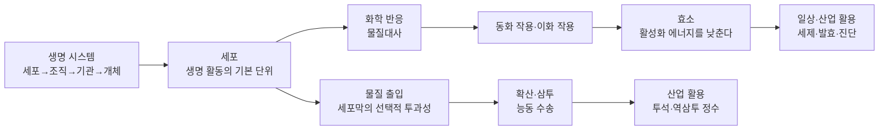

# 3-5. 생명 시스템과 물질대사 — 세포막과 효소가 지키는 생명

> [!NOTE]
> **성취기준 [10통과1-03-05]** 생명 시스템을 유지하기 위해서 다양한 화학 반응과 물질 출입이 필요함을 이해하고, 일상생활에서 활용되는 화학 반응 사례를 조사하여 발표할 수 있다.

**학습 목표**

1. 생명 시스템이 세포 → 조직 → 기관 → 개체의 단계로 구성됨을 알고, 주요 세포 소기관의 역할을 설명할 수 있다.
2. 세포막의 구조(인지질 이중층과 단백질)와 선택적 투과성을 이해하고, 확산과 삼투로 세포 안팎의 물질 출입을 설명할 수 있다.
3. 물질대사를 동화 작용과 이화 작용으로 구분하고, 효소가 활성화 에너지를 낮추어 생명체의 화학 반응을 돕는다는 것을 설명할 수 있다.
4. 효소의 기질 특이성과 온도·pH의 영향을 이해하고, 일상생활과 산업에서 효소가 활용되는 사례를 조사하여 발표할 수 있다.

**이 단원의 학습 사다리**

| 단계 | 무엇을 하나? |
|---|---|
| STEP 1. 중학교 다시 보기 | 세포의 구조, 확산, 소화 효소, 광합성과 호흡을 다시 꺼내 본다 |
| STEP 2. 기초 다지기 | 입자의 운동, 용액의 농도, 화학 반응과 에너지, 촉매를 디딤돌로 놓는다 |
| STEP 3. 핵심 개념 | 생명 시스템의 구성 → 세포막 → 확산·삼투 → 물질대사 → 효소 |
| STEP 4. 오개념 바로잡기 | "효소는 반응에 쓰이면 없어진다?" 같은 착각을 바로잡는다 |
| STEP 5. 선택과목·대학 | ATP와 능동 수송, 삼투압 계산, 효소 반응 속도론 |
| STEP 6. 산업·진로 | 효소 산업, 진단 기기, 혈액 투석과 역삼투 정수, 약물 전달 |

---

## 🗺️ 단원 들어가기

김장할 때 배추를 소금에 절이면 뻣뻣하던 배추가 몇 시간 만에 축 늘어진다. 신선한 파인애플을 넣고 젤리를 만들면 젤리가 굳지 않지만, 통조림 파인애플을 넣으면 잘 굳는다. 상처에 과산화 수소수를 바르면 하얀 거품이 보글보글 올라온다.

전혀 다른 장면 같지만, 세 현상은 모두 **세포**라는 작은 생명 시스템 안에서 일어나는 두 가지 일로 설명된다. 하나는 세포막을 통해 **물질이 드나드는 것(물질 출입)**, 다른 하나는 세포 안에서 **효소의 도움으로 화학 반응이 일어나는 것(물질대사)** 이다. 3-4 단원에서 물체들이 힘을 주고받는 역학 시스템을 보았다면, 이번에는 세포가 물질과 에너지를 주고받으며 생명을 유지하는 모습을 살펴보자.

---

## STEP 1. 🔙 중학교 다시 보기

### 연계 개념표

| 중학교 성취기준 | 중학교에서 배운 것 | 고등학교에서 확장되는 것 |
|---|---|---|
| [9과02-01] | 세포는 생명 활동의 기본 단위. 세포벽, 세포막, 핵, 엽록체, 미토콘드리아 | 리보솜, 소포체, 골지체 등 더 많은 세포 소기관과 **세포막의 구조**·선택적 투과성 |
| [9과02-02] | 생물의 유기적 구성 단계(세포–조직–기관–개체), 동물과 식물 비교 | 구성 단계를 **생명 시스템**의 관점에서 본다 |
| [9과04-01] | 확산·증발 현상으로 입자가 운동하고 있음을 추론 | 확산이 **세포막을 통한 물질 출입**의 기본 원리가 된다 |
| [9과13-01] | 소화 효소(아밀레이스, 펩신, 트립신, 라이페이스)가 영양소를 분해 | 효소의 공통 원리: **활성화 에너지**, 기질 특이성, 온도·pH의 영향 |
| [9과12-01], [9과12-02] | 광합성, 식물의 호흡과 광합성의 관계, 에너지와 물질의 출입 | 광합성 = **동화 작용**, 호흡 = **이화 작용**으로 묶어 물질대사로 이해 |
| [9과13-05] | 동물은 세포호흡으로 에너지를 얻는다(소화·순환·호흡·배설과 연결) | 세포호흡이 미토콘드리아에서 효소에 의해 단계적으로 일어나는 이화 작용임을 안다 |
| [9과16-06] | 화학 반응에서 열에너지가 출입한다 | 생명체의 화학 반응에서도 에너지가 흡수·방출된다 |

### 준비 운동 (사전 진단)

**Q1.** 식물 세포에는 있지만 동물 세포에는 없는 구조를 두 가지 쓰시오.

**Q2.** 방 한쪽 구석에서 향수 뚜껑을 열었더니 잠시 뒤 방 전체에서 향기가 났다. 이 현상의 이름과 원인을 쓰시오.

**Q3.** 침 속 소화 효소인 아밀레이스는 어떤 영양소를 분해하는가? 또 그 결과 무엇이 만들어지는가?

**Q4.** 다음 중 옳은 것을 고르시오.
ㄱ. 광합성은 빛에너지를 흡수하여 양분을 만드는 과정이다.
ㄴ. 호흡은 양분을 분해하여 생명 활동에 필요한 에너지를 얻는 과정이다.
ㄷ. 식물은 낮에는 광합성만 하고 호흡은 밤에만 한다.

정답 및 해설

**Q1.** 세포벽, 엽록체 (식물 세포에는 크게 발달한 액포도 있다.)

**Q2. 확산** — 향수 입자가 스스로 끊임없이 운동하여 농도가 높은 곳에서 낮은 곳으로 퍼져 나가기 때문이다.

**Q3.** 녹말을 분해하여 엿당을 만든다.

**Q4. ㄱ, ㄴ** — ㄷ. 호흡은 살아 있는 모든 세포에서 밤낮없이 일어난다. 낮에는 광합성량이 호흡량보다 많아 겉으로 산소를 내보내는 것처럼 보일 뿐이다.

---

## STEP 2. 🧱 기초 다지기

### ① 입자는 스스로 움직인다 — 확산의 출발점

중학교에서 물에 잉크를 떨어뜨리면 저어 주지 않아도 퍼지는 것을 보았다. 물질을 이루는 입자는 **스스로 끊임없이 무작위로 운동**한다. 그 결과 입자는 많은 곳(농도가 높은 곳)에서 적은 곳(농도가 낮은 곳)으로 퍼져 나가고, 결국 고르게 섞인다. 이것이 **확산(diffusion)** 이다.

- 온도가 높을수록 입자 운동이 활발해 확산이 빠르다.
- 확산에는 따로 에너지를 공급할 필요가 없다. 입자 스스로의 운동 때문이다.

> [!TIP]
> 💡 **비유** — 쉬는 시간에 교실 한쪽에 몰려 있던 학생들이 아무 목적 없이 이리저리 돌아다니다 보면 어느새 교실 전체에 흩어져 있다. 누가 "퍼져라!"라고 명령하지 않아도 무작위 운동만으로 퍼진다.

### ② 용액과 농도

- **용질**: 녹는 물질(예: 소금, 설탕) / **용매**: 녹이는 물질(예: 물) / **용액**: 용질 + 용매
- **퍼센트 농도(%)**: 용액 100 g 속에 녹아 있는 용질의 질량(g)

$$
\text{퍼센트 농도(\%)} = \frac{\text{용질의 질량}}{\text{용액의 질량}} \times 100
$$

생물 시간에는 "용질이 많은 쪽 = 농도가 높은 쪽 = 물(용매)의 비율이 낮은 쪽"이라는 관계가 매우 중요하다. 삼투를 이해하는 열쇠이기 때문이다.

#### 예제 1

설탕 10 g을 물 90 g에 녹였다. 이 설탕물의 퍼센트 농도는?

**풀이** 용액의 질량 = 10 + 90 = 100 g, 농도 = $\dfrac{10}{100}\times100 = 10\ \%$

> [!NOTE]
> 병원에서 쓰는 **생리 식염수**는 물 1 L에 소금(염화 나트륨)이 약 9 g 녹아 있는 약 0.9 % 용액으로, 우리 혈액과 농도가 비슷하도록 맞춘 것이다.

### ③ 화학 반응과 에너지

화학 반응이 일어나면 원자의 배열이 바뀌어 새로운 물질이 생기고, 이때 에너지가 출입한다([9과16-06]).

| 구분 | 에너지 출입 | 생명체 속 예 |
|---|---|---|
| 에너지를 **흡수**하는 반응 | 주변에서 에너지를 받아들인다 | 광합성(빛에너지 흡수) |
| 에너지를 **방출**하는 반응 | 주변으로 에너지를 내보낸다 | 세포호흡(양분 분해, 에너지 방출) |

### ④ 반응을 시작하게 하는 '문턱'과 촉매

종이는 공기 중에서 타는 반응을 할 수 있지만, 책상 위의 종이가 저절로 타지는 않는다. 성냥불로 열을 주어야 비로소 타기 시작한다. 이처럼 반응이 시작되려면 넘어야 하는 **에너지 문턱**이 있다. 이것을 **활성화 에너지(activation energy)** 라고 한다.

**촉매(catalyst)** 는 이 문턱을 낮추어 반응을 빠르게 해 주고, 자신은 반응 전후에 변하지 않는 물질이다. 생명체에서 촉매 역할을 하는 것이 바로 STEP 3의 **효소**이다.

### ⑤ 단백질은 '접힌 모양'이 기능을 정한다

2-5 단원에서 단백질은 **아미노산**이라는 단위체가 사슬처럼 길게 연결된 뒤, 특정한 **입체 구조로 접혀서** 만들어진다는 것을 배웠다. 아미노산의 종류와 순서가 달라지면 접힌 모양이 달라지고, 모양이 달라지면 하는 일도 달라진다. 효소의 주성분이 단백질이라는 점을 기억해 두자. 효소가 열에 약한 이유가 여기에 있다.

---

## STEP 3. 📘 핵심 개념

### 3-5-① 생명 시스템의 구성 — 세포에서 개체까지

생물의 몸은 작은 단위가 모여 더 큰 단위를 이루는 **계층 구조**의 시스템이다.

| 구성 단계 | 뜻 | 동물의 예 | 식물의 예 |
|---|---|---|---|
| 세포 | 생명 활동이 일어나는 기본 단위 | 근육 세포, 신경 세포 | 표피 세포, 공변세포 |
| 조직 | 모양과 기능이 비슷한 세포의 모임 | 상피 조직, 근육 조직 | 표피 조직, 통도 조직 |
| 조직계 | (식물에만) 여러 조직이 모여 일정한 기능을 하는 단위 | — | 표피 조직계, 관다발 조직계 |
| 기관 | 여러 조직이 모여 특정 기능을 하는 단위 | 위, 심장, 폐 | 뿌리, 줄기, 잎, 꽃 |
| 기관계 | (동물에만) 관련된 기능을 하는 기관의 모임 | 소화계, 순환계, 호흡계, 배설계 | — |
| 개체 | 독립적으로 생명 활동을 하는 하나의 생물 | 사람, 고양이 | 해바라기, 소나무 |

각 단계는 아래 단계가 단순히 더해진 것이 아니라, **서로 상호작용하며 새로운 기능을 만들어 낸다.** 세포 하나는 음식물을 소화할 수 없지만, 세포가 모여 만든 위와 소장은 소화를 한다. 이것이 '시스템'의 특징이다.

#### 세포 소기관 — 세포라는 작은 도시

세포 하나도 그 자체로 하나의 시스템이다. 세포 안에는 서로 다른 일을 나누어 맡은 **세포 소기관(organelle)** 들이 있다.

| 세포 소기관 | 하는 일 | 도시에 비유하면 | 동물 | 식물 |
|---|---|---|---|---|
| **핵** | 유전 물질(DNA)을 보관하고 세포의 생명 활동을 조절한다 | 시청(설계도 보관실) | ○ | ○ |
| **리보솜** | 단백질을 합성한다 | 조립 공장 | ○ | ○ |
| **소포체** | 리보솜에서 만든 단백질을 골지체 등으로 운반한다(일부는 지질 합성) | 도로와 운송망 | ○ | ○ |
| **골지체** | 단백질을 가공·포장하여 세포 밖으로 내보내거나 필요한 곳으로 보낸다 | 포장·택배 센터 | ○ | ○ |
| **미토콘드리아** | 세포호흡으로 양분을 분해하여 생명 활동에 쓸 에너지를 얻는다 | 발전소 | ○ | ○ |
| **엽록체** | 빛에너지를 흡수하여 광합성으로 양분을 만든다 | 태양광 식품 공장 | × | ○ |
| **세포막** | 세포를 둘러싸고 물질 출입을 조절한다 | 출입 검문소가 있는 성벽 | ○ | ○ |
| **세포벽** | 세포막 바깥에서 세포를 보호하고 모양을 유지한다 | 단단한 외벽 | × | ○ |
| **액포** | 물, 양분, 노폐물 등을 저장한다(성숙한 식물 세포에서 크게 발달) | 저수지·창고 | 작거나 드묾 | ○(크다) |
| **리소좀** | 분해 효소로 낡은 세포 소기관이나 세포 안으로 들어온 물질을 분해한다 | 재활용·청소 센터 | ○ | 드묾(주로 액포가 비슷한 역할) |

> [!IMPORTANT]
> 세포 소기관은 따로 노는 것이 아니라 **연결된 흐름**으로 일한다. 예를 들어 이자 세포가 소화 효소를 분비하는 과정은 다음과 같다.
> 핵(설계도) → 리보솜(효소 단백질 합성) → 소포체(운반) → 골지체(가공·포장) → 세포막을 통해 분비
> 이 전체 과정에 필요한 에너지는 미토콘드리아가 공급한다. 핵 속 설계도가 어떻게 단백질이 되는지는 다음 3-6 단원에서 자세히 배운다.

### 3-5-② 세포막의 구조와 선택적 투과성

세포가 살아 있으려면 양분과 산소는 들어오고, 이산화 탄소와 노폐물은 나가야 한다. 반대로 세포에 꼭 필요한 물질은 함부로 빠져나가면 안 된다. 이 출입을 담당하는 것이 **세포막(cell membrane)** 이다.

#### 세포막을 이루는 두 재료

1. **인지질(phospholipid)**: 물과 친한 **머리 부분(친수성)** 과 물을 싫어하는 **꼬리 부분(소수성)** 으로 이루어진 분자이다. 세포 안팎이 모두 물이므로, 인지질은 머리를 바깥쪽(물 쪽)으로, 꼬리를 안쪽으로 향하게 두 겹으로 늘어선다. 이것을 **인지질 이중층(phospholipid bilayer)** 이라고 한다.
2. **막단백질(membrane protein)**: 인지질 이중층에 박혀 있거나 걸쳐 있는 단백질이다. 특정 물질이 지나가는 **통로**나 **운반체** 역할, 신호를 받아들이는 역할 등을 한다.

인지질과 단백질은 한 자리에 고정되어 있지 않고 막 안에서 옆으로 움직일 수 있어서, 세포막은 단단한 벽이라기보다 **유동성이 있는 얇은 막**이다. 세포막의 두께는 수 nm(나노미터) 정도로 매우 얇다.

| 세포막 부분 | 성질 | 결과 |
|---|---|---|
| 인지질 머리 | 친수성(물과 잘 어울림) | 막의 안쪽 면·바깥쪽 면이 물과 접한다 |
| 인지질 꼬리 | 소수성(물을 밀어냄) | 막 가운데에 물을 싫어하는 층이 생겨 이온 등이 쉽게 통과하지 못한다 |
| 막단백질 | 특정 물질만 통과시키는 통로·운반체 | 필요한 물질을 골라서 출입시킨다 |

> [!TIP]
> 💡 **비유** — 세포막은 **기름 막으로 된 성벽에 '전용 출입문'이 달린 구조**이다. 기름에 잘 섞이는 작은 손님(산소, 이산화 탄소)은 성벽을 그냥 통과한다. 하지만 전하를 띤 손님(이온)이나 덩치 큰 손님(포도당)은 자기에게 맞는 전용 출입문(막단백질)으로만 들어올 수 있다.

#### 선택적 투과성

세포막이 물질의 종류에 따라 통과시키는 정도를 다르게 하는 성질을 **선택적 투과성(selective permeability)** 이라고 한다.

| 물질 | 크기·성질 | 세포막 통과 방법 |
|---|---|---|
| 산소($\mathrm{O_2}$), 이산화 탄소($\mathrm{CO_2}$) | 작고 전하가 없다 | 인지질 이중층을 **직접** 통과(확산) |
| 물($\mathrm{H_2O}$) | 작지만 극성이 있다 | 인지질 사이로 조금씩 통과하고, **물 전용 통로 단백질**이 있으면 훨씬 빠르게 이동 |
| 포도당, 아미노산 | 비교적 크고 물과 친하다 | **운반체 단백질**의 도움으로 이동 |
| 나트륨 이온($\mathrm{Na^+}$), 칼륨 이온($\mathrm{K^+}$) 등 | 전하를 띤다 | **통로 단백질**이나 운반체 단백질을 통해서만 이동 |
| 단백질, 녹말 같은 큰 분자 | 매우 크다 | 세포막을 그대로 통과하지 못한다 |

### 3-5-③ 막을 통한 물질 이동 — 확산, 삼투, 능동 수송

#### (1) 확산: 농도가 높은 쪽 → 낮은 쪽

세포막을 사이에 두고 농도 차이가 있으면, 물질은 **농도가 높은 쪽에서 낮은 쪽으로** 확산한다. 에너지가 필요 없다.

- **폐포와 모세 혈관**: 폐포 속 공기는 산소 농도가 높고 혈액은 낮으므로 산소가 혈액으로 확산한다. 이산화 탄소는 반대로 이동한다.
- **조직 세포**: 세포는 산소를 계속 쓰므로 세포 안 산소 농도가 낮게 유지된다. 그래서 산소가 혈액에서 세포로 계속 확산해 들어온다.
- 포도당처럼 인지질 이중층을 직접 통과하기 어려운 물질은 운반체 단백질을 통해 확산한다(농도가 높은 쪽 → 낮은 쪽이므로 역시 에너지가 필요 없다).

#### (2) 삼투: 물이 막을 통해 이동하는 확산

**삼투(osmosis)** 는 **용매(물)** 가 **반투과성 막**(물은 통과하고 용질은 통과하기 어려운 막)을 통해 **용질 농도가 낮은 쪽에서 높은 쪽으로** 이동하는 현상이다.

> [!IMPORTANT]
> 헷갈리기 쉬운 방향을 정리하자.
> - 용질 입장에서: 농도가 **높은** 쪽 → **낮은** 쪽으로 확산하려 한다. 그런데 막이 용질을 막는다.
> - 물 입장에서: 물이 **많은** 쪽(용질 농도가 **낮은** 쪽) → 물이 **적은** 쪽(용질 농도가 **높은** 쪽)으로 이동한다.
> 결국 삼투도 **'물의 확산'** 이다. 물은 '짠 쪽, 진한 쪽'으로 간다고 기억하자.

#### 세포를 다른 농도의 용액에 넣으면?

| 바깥 용액 | 물의 이동 | 적혈구(동물 세포) | 식물 세포 |
|---|---|---|---|
| 세포 안보다 농도가 **낮은** 용액(예: 증류수) | 바깥 → 세포 안 | 부풀다가 터진다(**용혈**) | 부풀지만 세포벽 덕분에 터지지 않고 팽팽해진다(**팽압** 증가) |
| 세포 안과 농도가 **같은** 용액(예: 생리 식염수) | 들어오고 나가는 양이 같다 | 모양 유지 | 모양 유지 |
| 세포 안보다 농도가 **높은** 용액(예: 진한 소금물) | 세포 안 → 바깥 | 쭈그러든다 | 세포막이 세포벽에서 떨어진다(**원형질 분리**) |

이제 단원 들어가기의 배추 절이기를 설명할 수 있다. 진한 소금물 속 배추 세포에서는 물이 바깥으로 빠져나가고, 세포가 팽압을 잃어 배추가 축 늘어진다(숨이 죽는다).

| 일상 속 삼투 | 설명 |
|---|---|
| 시든 채소를 찬물에 담가 두면 싱싱해진다 | 물이 세포 안으로 들어가 팽압이 회복된다 |
| 오이·배추를 소금에 절인다 | 세포 안의 물이 진한 소금물 쪽으로 빠져나간다 |
| 민물고기를 바닷물에 넣으면 살기 어렵다 | 몸속의 물이 농도가 높은 바닷물 쪽으로 빠져나간다 |
| 링거 주사는 혈액과 농도가 비슷한 용액을 쓴다 | 적혈구가 터지거나 쭈그러들지 않게 하기 위해서이다 |
| 비료를 너무 많이 주면 식물이 시든다 | 흙 속 용액의 농도가 높아져 뿌리에서 물이 빠져나간다 |

#### 예제 2

감자 조각(각 5.00 g)을 농도가 다른 설탕 용액에 1시간 동안 담갔다가 질량을 측정하였다(예시 자료).

| 설탕 용액 농도 | 0 % | 4 % | 8 % | 12 % | 16 % |
|---|---|---|---|---|---|
| 나중 질량(g) | 5.50 | 5.30 | 5.10 | 4.90 | 4.70 |

(1) 각 조건의 질량 변화율(%)을 구하시오.
(2) 감자 세포 안 용액의 농도는 약 몇 %의 설탕 용액과 비슷하다고 추정할 수 있는가?

**풀이**
(1) 질량 변화율 = $\dfrac{\text{나중 질량} - \text{처음 질량}}{\text{처음 질량}}\times100$
- 0 %: $\dfrac{5.50-5.00}{5.00}\times100 = +10\ \%$
- 4 %: $+6\ \%$, 8 %: $+2\ \%$, 12 %: $-2\ \%$, 16 %: $-6\ \%$

(2) 질량이 늘어난 것은 물이 감자 안으로 들어온 것(바깥 농도가 더 낮음), 줄어든 것은 물이 빠져나간 것(바깥 농도가 더 높음)이다. 8 %(+2 %)와 12 %(−2 %) 사이에서 변화율이 0이 되므로, 감자 세포 안 용액은 **약 10 % 설탕 용액**과 농도가 비슷하다고 추정할 수 있다.

#### (3) 능동 수송: 에너지를 써서 '거꾸로' 나르기 (간단히)

세포는 때로 **농도가 낮은 쪽에서 높은 쪽으로** 물질을 끌어와야 한다. 이때는 확산만으로 불가능하므로, 세포가 **에너지를 써서** 운반체 단백질로 물질을 퍼 올린다. 이것을 **능동 수송(active transport)** 이라고 한다.

- 식물의 뿌리털 세포는 흙 속보다 세포 안 농도가 더 높은데도 무기 염류를 흡수한다.
- 신경 세포는 세포 안의 나트륨 이온을 바깥으로 계속 퍼내고 칼륨 이온을 안으로 들인다.

| 구분 | 확산·삼투 | 능동 수송 |
|---|---|---|
| 이동 방향 | 농도가 높은 쪽 → 낮은 쪽(물은 용질 농도가 낮은 쪽 → 높은 쪽) | 농도가 낮은 쪽 → 높은 쪽 |
| 에너지 사용 | 필요 없음 | 필요함 |
| 비유 | 미끄럼틀 내려가기 | 짐을 들고 계단 올라가기 |

### 3-5-④ 물질대사 — 생명체 속 화학 반응의 총합

세포 안에서는 1초도 쉬지 않고 수많은 화학 반응이 일어난다. 생명체에서 일어나는 모든 화학 반응을 통틀어 **물질대사(metabolism)** 라고 한다. 물질대사에서는 물질이 바뀌면서 반드시 **에너지도 출입**한다.

| 구분 | 동화 작용(anabolism) | 이화 작용(catabolism) |
|---|---|---|
| 물질 변화 | 작고 간단한 물질 → 크고 복잡한 물질 (합성) | 크고 복잡한 물질 → 작고 간단한 물질 (분해) |
| 에너지 | **흡수** | **방출** |
| 예 | 광합성, 단백질 합성(아미노산 → 단백질), 녹말·글리코젠 합성 | 세포호흡, 소화(녹말 → 포도당 등) |
| 비유 | 레고 블록으로 성 쌓기(힘이 든다) | 레고 성 허물기(쌓여 있던 에너지가 풀려난다) |

**대표적인 예: 광합성과 세포호흡**

$$
\text{광합성(동화):}\quad \text{이산화 탄소} + \text{물} \xrightarrow{\ \text{빛에너지}\ } \text{포도당} + \text{산소}
$$

$$
\text{세포호흡(이화):}\quad \text{포도당} + \text{산소} \longrightarrow \text{이산화 탄소} + \text{물} + \text{에너지}
$$

광합성은 엽록체에서, 세포호흡은 주로 미토콘드리아에서 일어난다. 식물이 광합성으로 저장한 에너지를 동물이 먹고 세포호흡으로 꺼내 쓴다. 생명 시스템은 이처럼 **물질과 에너지를 주고받으며** 유지된다.

> [!WARNING]
> 우리 몸의 체온은 약 37 °C이다. 그런데 포도당을 공기 중에서 태우려면 높은 온도로 가열해야 한다. 세포는 어떻게 37 °C에서 포도당을 분해해 에너지를 얻을까? 만약 세포호흡이 연소처럼 한꺼번에 일어난다면 세포가 열로 타 버릴 것이다. 정답은 **효소**이다. 효소는 반응의 문턱(활성화 에너지)을 낮추고, 세포호흡은 여러 효소가 차례로 작용하는 **여러 단계**로 나뉘어 에너지를 조금씩 방출한다.

### 3-5-⑤ 효소 — 생명체의 촉매

**효소(enzyme)** 는 생명체에서 만들어져 물질대사가 잘 일어나도록 돕는 **생체 촉매**이다. 주성분은 **단백질**이다.

#### (1) 효소는 활성화 에너지를 낮춘다

반응물이 생성물로 바뀌려면 **활성화 에너지라는 '고개'** 를 넘어야 한다. 효소는 고개를 낮춘 **'터널'** 을 뚫어 준다.

| 비교 | 효소가 없을 때 | 효소가 있을 때 |
|---|---|---|
| 활성화 에너지 | 높다 | **낮다** |
| 반응 속도(체온 조건) | 매우 느리다 | 매우 빠르다 |
| 반응물·생성물의 종류 | 같다 | 같다 |
| 반응 전후 에너지 차이 | 같다 | 같다(효소는 이것을 바꾸지 않는다) |
| 효소 자신 | — | 반응 뒤에도 **변하지 않고 다시 쓰인다** |

> [!TIP]
> 💡 **비유** — 산 너머 마을(생성물)로 가려면 높은 고개를 넘어야 한다. 효소는 산에 터널을 뚫어 준다. **출발지와 도착지의 높이 차이는 그대로**지만, 훨씬 적은 힘으로 빨리 갈 수 있다. 그리고 터널은 한 번 쓰고 없어지지 않는다.

#### 예 — 과산화 수소의 분해

세포호흡 등 물질대사 과정에서는 세포에 해로운 **과산화 수소($\mathrm{H_2O_2}$)** 가 생긴다. 과산화 수소는 그냥 두어도 물과 산소로 분해되지만 매우 느리다. 간이나 감자 등 대부분의 세포에 들어 있는 효소 **카탈레이스(catalase)** 가 있으면 순식간에 분해된다.

$$
2\mathrm{H_2O_2} \xrightarrow{\ \text{카탈레이스}\ } 2\mathrm{H_2O} + \mathrm{O_2}
$$

상처에 과산화 수소수를 바르면 거품이 나는 이유가 이것이다. 상처의 혈액과 조직 세포 속 카탈레이스가 과산화 수소를 분해해 **산소 기체**가 생긴다.

#### (2) 기질 특이성 — 효소마다 맞는 짝이 정해져 있다

효소가 작용하는 물질을 **기질(substrate)** 이라고 한다. 효소에는 기질이 꼭 맞게 결합하는 부위인 **활성 부위(active site)** 가 있다. 활성 부위의 입체 구조에 맞는 기질하고만 반응하므로, **한 효소는 특정한 기질에만 작용한다.** 이것을 **기질 특이성(substrate specificity)** 이라고 한다.

| 효소 | 기질 | 생성물 | 작용하는 곳 |
|---|---|---|---|
| 아밀레이스 | 녹말 | 엿당 | 침, 이자액 |
| 펩신 | 단백질 | 더 작은 단백질 조각 | 위액 |
| 트립신 | 단백질 | 더 작은 단백질 조각 | 이자액 |
| 라이페이스 | 지방 | 지방산, 모노글리세리드 | 이자액 |
| 카탈레이스 | 과산화 수소 | 물, 산소 | 대부분의 세포 |

> [!TIP]
> 💡 **비유** — 효소와 기질은 **자물쇠와 열쇠**처럼 맞는 짝이 정해져 있다. 아밀레이스라는 자물쇠에는 녹말이라는 열쇠만 맞는다. 그래서 아밀레이스는 단백질이나 지방을 분해하지 못한다. 우리 몸에 수많은 종류의 효소가 필요한 이유이다.

#### (3) 온도와 pH의 영향 — 효소는 단백질이다

효소의 주성분은 단백질이고, 단백질은 **입체 구조**가 기능을 결정한다(STEP 2-⑤). 따라서 입체 구조를 바꾸는 조건은 효소의 활성에 큰 영향을 준다.

**온도**
- 온도가 높아지면 입자 운동이 활발해져 반응 속도가 빨라진다.
- 그러나 일정 온도를 넘으면 효소 단백질의 입체 구조가 망가져(**변성, denaturation**) 활성 부위에 기질이 맞지 않게 되고, 반응 속도가 급격히 떨어진다.
- 효소가 가장 잘 작용하는 온도를 **최적 온도**라고 한다. 사람 몸속 효소의 최적 온도는 대체로 체온(약 35~40 °C) 부근이다.
- 낮은 온도에서는 반응이 느려질 뿐 효소가 망가지지는 않아서, 온도를 다시 올리면 활성이 돌아온다. 반면 높은 온도로 변성된 효소는 대부분 다시 식혀도 활성이 돌아오지 않는다.

**pH**
- 효소마다 가장 잘 작용하는 **최적 pH**가 다르다. 최적 pH를 크게 벗어나면 역시 입체 구조가 변해 활성이 떨어진다.

| 효소 | 작용하는 곳 | 최적 pH(대략) |
|---|---|---|
| 펩신 | 위(강한 산성) | 약 2 |
| 침 속 아밀레이스 | 입(거의 중성) | 약 7 |
| 트립신 | 소장(약한 염기성) | 약 8 |

#### 예제 3

간 조각에 3 % 과산화 수소수를 떨어뜨리는 실험을 온도만 바꾸어 하고, 일정 시간 동안 발생한 산소의 부피를 측정했다(예시 자료).

| 온도(°C) | 0 | 20 | 37 | 60 | 100 |
|---|---|---|---|---|---|
| 산소 부피(mL) | 4 | 12 | 20 | 6 | 0 |

(1) 이 효소의 최적 온도는 대략 몇 °C인가?
(2) 0 °C와 100 °C에서 산소가 적게 발생한 이유를 각각 쓰시오.

**풀이**
(1) 산소가 가장 많이 발생한 약 37 °C 부근이다.
(2) 0 °C: 온도가 낮아 입자 운동이 느려서 효소와 기질이 만나는 횟수가 적다(효소는 망가지지 않음). 100 °C: 효소 단백질이 **변성**되어 활성 부위의 모양이 바뀌었기 때문에 기질과 결합하지 못한다.

#### 단원 들어가기 풀이 — 파인애플 젤리의 비밀

젤리를 굳게 하는 젤라틴은 **단백질**이다. 신선한 파인애플에는 **단백질 분해 효소**가 들어 있어 젤라틴을 분해하므로 젤리가 굳지 않는다. 통조림 파인애플은 만드는 과정에서 가열되어 효소가 변성되었기 때문에 젤리가 잘 굳는다. **효소의 기질 특이성(단백질만 분해)** 과 **온도에 의한 변성**을 한 번에 보여 주는 예이다.

#### 일상에서 활용되는 효소와 화학 반응

성취기준은 "일상생활에서 활용되는 화학 반응 사례를 조사하여 발표"하는 것을 요구한다. 아래는 조사의 출발점이 될 수 있는 사례이다(탐구 활동 C에서 직접 조사·발표한다).

| 분야 | 사례 | 관련 효소·생물 | 원리 |
|---|---|---|---|
| 전통 음식 | 식혜 | 엿기름 속 아밀레이스 | 밥의 녹말을 엿당으로 분해해 단맛을 낸다. 따뜻하게(약 60 °C 안팎) 유지하는 것은 효소가 잘 작용하는 온도를 맞추기 위해서이다 |
| 발효 식품 | 김치, 요구르트 | 젖산균의 효소 | 당을 분해해 젖산을 만든다(신맛) |
| 제빵·양조 | 빵, 막걸리 | 효모의 효소 | 당을 분해해 이산화 탄소와 알코올을 만든다. 빵이 부푸는 것은 이산화 탄소 때문이다 |
| 요리 | 고기 연하게 재우기 | 키위·파인애플의 단백질 분해 효소 | 고기 단백질을 일부 분해한다 |
| 유제품 | 유당을 줄인 우유 | 락테이스 | 유당(젖당)을 포도당과 갈락토스로 분해한다 |
| 세탁 | 효소 세제 | 단백질·지방·녹말 분해 효소 | 피, 음식물 얼룩을 분해해 떼어 낸다 |
| 의약품 | 소화제 | 여러 소화 효소 | 소화를 돕는다 |
| 응급 처치 | 과산화 수소수 소독 | 카탈레이스 | 과산화 수소가 분해되며 산소 거품이 생긴다 |

---

## STEP 4. ⚠️ 오개념 바로잡기

| 흔한 오개념 | 올바른 개념 | 왜 그럴까? |
|---|---|---|
| 효소는 반응에 쓰이면 없어진다 | 효소는 반응 전후에 **변하지 않고 반복해서 쓰인다** | 효소는 촉매이다. 기질과 잠시 결합했다가 생성물을 내놓고 원래대로 돌아간다 |
| 효소는 반응의 에너지(반응 전후 에너지 차이)를 바꾼다 | 효소는 **활성화 에너지만 낮춘다** | 터널을 뚫어도 출발지와 도착지의 높이 차이는 그대로이다 |
| 온도가 높을수록 효소 반응은 계속 빨라진다 | 최적 온도를 넘으면 효소가 **변성**되어 반응이 급격히 느려진다 | 효소의 주성분인 단백질은 열에 의해 입체 구조가 망가진다 |
| 차갑게 하면 효소가 죽는다(파괴된다) | 낮은 온도에서는 **활성이 낮아질 뿐**, 다시 온도를 올리면 회복된다 | 낮은 온도는 입자 운동을 느리게 할 뿐 입체 구조를 망가뜨리지 않는다. 그래서 효소를 냉장 보관한다 |
| 삼투에서 물은 농도가 높은 쪽에서 낮은 쪽으로 간다 | 물은 **용질 농도가 낮은 쪽 → 높은 쪽**으로 이동한다 | 용질 농도가 낮은 쪽이 '물의 농도'가 높은 쪽이다. 물의 입장에서는 확산이다 |
| 세포막은 구멍이 뚫린 체(거름망)여서 작은 것은 다 통과한다 | 세포막은 크기뿐 아니라 **전하·성질**에 따라 선택적으로 통과시킨다 | 나트륨 이온은 크기가 매우 작지만, 전하를 띠어 소수성 층을 직접 통과하지 못한다 |
| 확산은 살아 있는 세포만 일으킨다 | 확산은 입자의 **스스로의 운동** 때문에 일어나며 에너지가 필요 없다 | 죽은 달걀 막이나 셀로판(투석막)에서도 확산·삼투가 일어난다 |

---

## STEP 5. 🎓 선택과목·대학으로 한 걸음 더

> [!CAUTION]
> 이 절은 **통합과학 교육과정 범위 밖의 심화 내용**으로 평가 대상이 아니다. "이 개념이 앞으로 어디까지 이어지는가"를 맛보기로 보여 주기 위한 내용이다.

### 고2·3 선택과목과의 연결

| 과목 | 이어지는 내용 |
|---|---|
| 생명과학 | 생명 시스템의 구성(세포, 기관계의 통합적 작용), 물질대사와 에너지 |
| 세포와 물질대사 | 세포(세포 소기관, 세포막을 통한 물질 수송), 물질대사와 에너지(효소의 작용), 세포호흡과 광합성의 단계별 과정 |

### ① ATP — 세포의 에너지 화폐와 능동 수송

세포호흡으로 포도당에서 방출된 에너지는 그대로 쓰이지 않고 **ATP(아데노신 삼인산)** 라는 물질에 저장된다. ATP가 ADP와 인산으로 분해될 때 나오는 에너지를 근육 수축, 물질 합성, 능동 수송 등에 쓴다. 그래서 ATP를 **세포의 에너지 화폐**라고 부른다.

대표적인 능동 수송 단백질인 **나트륨–칼륨 펌프**는 ATP 1분자의 에너지를 써서 나트륨 이온 3개를 세포 밖으로, 칼륨 이온 2개를 세포 안으로 옮긴다. 이렇게 만든 이온 농도 차이는 신경 세포가 신호를 전달하는 바탕이 된다.

### ② 삼투압을 숫자로 — 반트호프 식

반투과성 막을 사이에 두고 삼투가 일어나지 않게 하려면 진한 용액 쪽에 압력을 가해야 한다. 이 압력을 **삼투압(π)** 이라 하며, 묽은 용액에서는 다음 식으로 어림한다.

$$
\pi = CRT
$$

($C$: 용질 입자의 몰 농도(mol/L), $R$: 기체 상수 $0.082\ \mathrm{atm\cdot L/(mol\cdot K)}$, $T$: 절대 온도(K))

**예** 바닷물을 염화 나트륨 0.55 mol/L 용액이라고 가정하자. 염화 나트륨은 물에서 $\mathrm{Na^+}$과 $\mathrm{Cl^-}$ 두 입자로 나뉘므로 입자 농도는 약 1.1 mol/L이다. 25 °C(298 K)에서

$$
\pi \approx 1.1 \times 0.082 \times 298 \approx 27\ \mathrm{atm}
$$

바닷물에서 담수를 얻는 **역삼투** 장치는 이보다 **더 큰 압력**을 바닷물 쪽에 가해, 물을 삼투와 **반대 방향**(진한 쪽 → 묽은 쪽)으로 밀어낸다(STEP 6).

### ③ 효소 반응 속도론 — 미카엘리스–멘텐 식

대학 '생화학'에서는 기질 농도 $[S]$에 따른 효소 반응 속도 $v$를 다음과 같이 나타낸다.

$$
v = \frac{V_{\max}[S]}{K_m + [S]}
$$

- $V_{\max}$: 효소가 모두 기질과 결합해 있을 때의 최대 속도
- $K_m$: 반응 속도가 $V_{\max}$의 절반이 될 때의 기질 농도(효소와 기질이 얼마나 잘 결합하는지의 지표)

**예** $V_{\max} = 100$, $K_m = 2\ \mathrm{mM}$일 때
- $[S] = 2\ \mathrm{mM}$: $v = \dfrac{100\times2}{2+2} = 50$ (최대 속도의 절반)
- $[S] = 18\ \mathrm{mM}$: $v = \dfrac{100\times18}{2+18} = 90$

기질을 9배로 늘려도 속도는 2배가 채 안 된다. 효소의 활성 부위가 거의 다 차서 **포화**되기 때문이다.

또 활성 부위에 기질 대신 결합해 반응을 막는 **저해제(inhibitor)** 를 연구한다. 많은 의약품이 특정 효소의 저해제이다. 예를 들어 아스피린 같은 일부 진통·소염제는 염증 물질을 만드는 효소의 작용을 억제한다.

### 고등학교 vs 대학교

| 구분 | 고등학교 통합과학 | 대학교 세포생물학·생화학 |
|---|---|---|
| 세포막 | 인지질 이중층 + 단백질, 선택적 투과성 | 유동 모자이크 모형, 막 전위, 수송 단백질의 종류와 구조 |
| 물질 이동 | 확산, 삼투, 능동 수송(정성적) | 확산 속도(픽의 법칙), 삼투압 계산, 에너지 수지 |
| 물질대사 | 동화·이화, 에너지 흡수·방출 | 해당 과정·TCA 회로·전자 전달계 등 대사 경로 전체 |
| 효소 | 활성화 에너지, 기질 특이성, 온도·pH | 반응 속도론($V_{\max}$, $K_m$), 저해 양식, 효소 구조 분석 |
| 관련 전공 | — | 생명과학, 생화학, 화학공학, 식품공학, 약학, 의학, 환경공학 |

---

## STEP 6. 🏭 산업 현장과 진로 연결

### 사례 1. 효소 산업 — 세제, 식품, 바이오 연료

- **원리** 효소는 기질 특이성이 높아 원하는 반응만 골라 일으키고, 비교적 낮은 온도와 중성 부근에서 작용한다. 높은 온도·압력이나 강한 화학 약품이 필요한 공정을 대신할 수 있어 에너지와 오염 물질을 줄인다.
- **세제** 효소 세제에는 단백질 분해 효소(피, 달걀 얼룩), 지방 분해 효소(기름 얼룩), 녹말 분해 효소(음식물 얼룩) 등이 들어 있다. 산업계는 찬물에서도 잘 작용하거나 세제의 염기성 조건에서도 변성되지 않는 효소를 개발해 왔다.
- **식품·발효** 녹말을 분해해 물엿·올리고당을 만들고, 우유 속 유당을 분해하며, 치즈를 굳히는 데 효소를 쓴다. 김치·장류·빵 같은 발효 식품은 미생물이 가진 효소의 작용을 이용한다.
- **바이오 연료** 옥수수 녹말이나 식물의 섬유질(셀룰로스)을 효소로 분해해 포도당을 만들고, 효모가 포도당을 발효시켜 **바이오에탄올**을 만든다. 질기고 단단한 셀룰로스를 효율적으로 분해하는 효소 개발이 핵심 기술 과제이다.

### 사례 2. 진단 기기 — 효소의 '정확한 짝 찾기' 능력

- **혈당 측정기**: 시험지에 포도당에만 반응하는 효소가 묻어 있다. 피 한 방울 속 포도당이 효소와 반응할 때 생기는 전기 신호의 크기로 혈당 농도를 계산한다. 혈액 속에 수많은 물질이 섞여 있어도 **기질 특이성** 덕분에 포도당만 측정할 수 있다.
- **임상 검사**: 병원의 혈액 검사 장비는 효소 반응으로 색 변화를 일으켜 특정 물질의 양을 측정한다. 또 간이 손상되면 간세포 속 효소가 혈액으로 새어 나오므로, 혈액 속 특정 효소의 양은 간 건강의 지표가 된다.

### 사례 3. 막 기술 — 혈액 투석과 역삼투 정수

**혈액 투석(인공 신장)**
- 콩팥(신장)이 제 기능을 못하면 혈액 속에 요소 같은 노폐물이 쌓인다. 혈액 투석기는 혈액을 몸 밖으로 꺼내 **반투과성 막**으로 된 가는 관 다발 속으로 흘려보낸다.
- 막 바깥에는 **투석액**이 흐른다. 노폐물은 혈액 쪽 농도가 높으므로 투석액 쪽으로 **확산**해 빠져나가고, 혈구와 단백질처럼 큰 성분은 막을 통과하지 못해 혈액에 남는다.
- 투석액에는 몸에 필요한 물질(일부 이온, 포도당 등)을 혈액과 비슷한 농도로 넣어, 필요한 물질은 빠져나가지 않게 한다. 확산과 선택적 투과성을 그대로 이용한 기술이다.
- 혈액 투석은 보통 일주일에 3회, 한 번에 약 4시간 정도 받는다.

**역삼투 정수와 해수 담수화**
- 삼투와 반대로, 진한 쪽(바닷물, 오염된 물)에 **삼투압보다 큰 압력**을 가하면 물만 막을 통과해 묽은 쪽으로 밀려 나간다. 이를 **역삼투(reverse osmosis)** 라고 한다.
- 이온조차 거의 통과하지 못할 만큼 촘촘한 막을 쓰며, 가정용 정수기와 물이 부족한 지역의 **해수 담수화 시설**에 쓰인다. 큰 압력을 만드는 데 드는 에너지를 줄이는 것이 주요 기술 과제이다.

### 사례 4. 약물 전달 — 세포막을 닮은 '캡슐'

- 인지질은 물속에서 저절로 이중층을 만든다. 이 성질을 이용해 약물을 인지질 이중층 주머니 안에 담은 **리포솜(liposome)** 을 만든다.
- 리포솜이나 이와 비슷한 **지질 나노 입자**는 세포막과 성질이 비슷해 세포와 잘 융합되고, 약물이 혈액 속에서 너무 빨리 분해되지 않도록 보호한다. 일부 항암제와 mRNA 백신(3-6 단원)에 이 기술이 쓰인다.

### 관련 진로와 학과

| 진로 | 하는 일 | 관련 학과 |
|---|---|---|
| 효소·발효 연구원 | 산업용 효소 개발, 발효 식품·바이오 연료 공정 개발 | 생명공학, 미생물학, 식품공학, 화학공학 |
| 의공학 엔지니어 | 투석기·인공 장기·진단 기기 설계 | 의공학, 기계공학, 전자공학 |
| 수처리·막 공정 엔지니어 | 정수·해수 담수화·폐수 처리 시설 설계 | 환경공학, 화학공학, 토목공학 |
| 제약 연구원 | 신약·약물 전달 시스템 개발, 효소 저해제 설계 | 약학, 생화학, 화학 |
| 임상병리사·진단 연구원 | 혈액·효소 검사, 진단 키트 개발 | 임상병리학, 생명과학, 의학 |

---

## 🔬 탐구 활동

### 활동 A. 막을 통한 물질의 이동 실험하기 — 생명 활동 유지에서 세포막의 역할 탐구

**목표** 반투과성 막(달걀 막, 투석막)과 식물 세포(감자)에서 일어나는 물질 이동을 관찰하고, 세포막의 선택적 투과성과 연결하여 설명한다.

**준비물** 날달걀 2개, 식초, 증류수, 진한 설탕물(또는 물엿), 투석막(셀로판 튜브), 녹말 용액, 포도당 용액, 아이오딘–아이오딘화 칼륨 용액, 포도당 검출 시약(베네딕트 용액 또는 포도당 검출 시험지), 감자, 칼(교사 지도), 전자저울, 비커, 농도가 다른 설탕 용액(0 %, 4 %, 8 %, 12 %, 16 %)

**과정**
1. **달걀 막 만들기**: 날달걀을 식초에 1~2일 담가 껍데기를 녹인다(이산화 탄소 거품이 생긴다). 껍데기가 녹으면 얇은 막만 남은 달걀을 조심스럽게 꺼내 질량을 잰다.
2. 한 개는 증류수, 다른 한 개는 진한 설탕물에 담가 하루 뒤 질량과 모양을 비교한다.
3. **투석막 실험**: 투석막 주머니에 녹말 용액과 포도당 용액을 섞어 넣고 입구를 묶는다. 아이오딘–아이오딘화 칼륨 용액을 탄 물이 든 비커에 넣는다.
4. 20~30분 뒤 주머니 안과 비커 물의 색을 관찰하고, 비커 물에 포도당이 있는지 검사한다.
5. **감자 삼투 실험**: 같은 크기로 자른 감자 조각의 처음 질량을 재고, 농도가 다른 설탕 용액에 1시간 담근 뒤 물기를 닦고 나중 질량을 잰다.

**결과 기록**

| 실험 | 조건 | 처음 | 나중 | 관찰 결과·해석 |
|---|---|---|---|---|
| 달걀 막 | 증류수 | g | g | |
| 달걀 막 | 진한 설탕물 | g | g | |
| 투석막 | 주머니 안의 색 | | | |
| 투석막 | 비커 물의 포도당 검출 | | | |
| 감자 | 0 % ~ 16 % 설탕 용액 | g | g | 질량 변화율(%) = |

**생각해 보기**
1. 증류수에 넣은 달걀과 설탕물에 넣은 달걀의 질량 변화를 '물의 이동 방향'으로 설명해 보자.
2. 투석막 실험에서 주머니 안은 청람색으로 변했지만 비커 물에서는 녹말이 검출되지 않았다. 포도당·아이오딘·녹말 중 막을 통과한 것과 통과하지 못한 것을 구분하고, 그 이유를 입자 크기로 설명해 보자.
3. 감자 실험 결과를 그래프로 그리고, 질량 변화가 0이 되는 농도를 찾아 감자 세포 안 용액의 농도를 추정해 보자.
4. 투석막은 크기만으로 물질을 거르지만, 실제 세포막은 그렇지 않다. 세포막이 투석막과 어떻게 다른지 막단백질을 이용해 설명해 보자.

> [!WARNING]
> **안전 수칙** 칼을 사용할 때는 교사의 지도를 받고 도마 위에서 몸 바깥쪽으로 자른다. 아이오딘 용액은 피부와 옷에 묻으면 착색되므로 장갑을 낀다. 베네딕트 용액으로 포도당을 검출할 때는 물중탕으로 가열하고, 보안경을 쓰며 시험관 입구를 사람 쪽으로 향하지 않는다. 실험에 쓴 달걀과 감자는 먹지 않는다.

### 활동 B. 효소 작용의 원리에 관한 실험하기 — 카탈레이스와 과산화 수소

**목표** 카탈레이스가 과산화 수소의 분해를 촉진함을 확인하고, 온도와 pH가 효소의 작용에 미치는 영향을 조사한다.

**준비물** 생간(닭 간 등) 또는 생감자 조각, 3 % 과산화 수소수, 시험관 6개, 시험관대, 비커, 묽은 염산, 묽은 수산화 나트륨 수용액, 얼음물, 끓는 물, 이산화 망가니즈, 향, 점화기, 보안경, 실험용 장갑

**과정**
1. 시험관 A~F에 3 % 과산화 수소수를 같은 양(약 5 mL)씩 넣는다.
2. 다음과 같이 처리한 물질을 넣고 거품이 발생하는 정도를 비교한다.

| 시험관 | 넣는 것 | 확인할 점 |
|---|---|---|
| A | 아무것도 넣지 않음 | 대조군 |
| B | 생간 조각 | 효소의 작용 |
| C | 끓는 물에 5분 삶은 간 조각 | 높은 온도의 영향 |
| D | 얼음물에 담가 둔 간 조각(과산화 수소수도 차갑게) | 낮은 온도의 영향 |
| E | 묽은 염산에 담갔던 간 조각 | 산성 조건의 영향 |
| F | 이산화 망가니즈(무기 촉매) | 효소와 무기 촉매의 비교 |

3. 거품이 많이 나는 시험관 입구에 불씨만 남은 향을 넣어 발생한 기체를 확인한다.
4. B 시험관의 반응이 끝난 뒤 과산화 수소수를 다시 넣어 거품이 또 생기는지 관찰한다.
5. (추가) 끓인 이산화 망가니즈로도 F와 같은 실험을 하여 C와 비교한다. 묽은 수산화 나트륨 수용액에 담갔던 간 조각으로도 실험해 본다.

**결과 기록**

| 시험관 | 거품 발생 정도(+++, ++, +, −) | 향불의 변화 | 해석 |
|---|---|---|---|
| A | | | |
| B | | | |
| C | | | |
| D | | | |
| E | | | |
| F | | | |

**생각해 보기**
1. 향불이 다시 타오른 것으로 보아 발생한 기체는 무엇인가?
2. 과정 4의 결과로 보아 효소는 반응 후에 어떻게 되는가?
3. 삶은 간(C)과 삶은 이산화 망가니즈의 결과가 다르다면, 그 이유를 '효소의 주성분'으로 설명해 보자.
4. 이 실험에서 조작 변인과 통제 변인은 각각 무엇인가? 공정한 비교를 위해 무엇을 같게 해야 할까?

> [!WARNING]
> **안전 수칙** 보안경과 장갑을 반드시 착용한다. 과산화 수소수·염산·수산화 나트륨 수용액이 피부에 묻으면 즉시 많은 물로 씻는다. 시험관 입구를 사람 쪽으로 향하지 않는다. 향불은 교사의 지도 아래 다루고, 사용 후 완전히 끈다. 간을 삶을 때는 끓는 물과 수증기에 화상을 입지 않도록 집게를 사용한다. 생간에는 식중독 세균이 있을 수 있으므로 맨손으로 만지지 않고, 실험 후 도구를 세척하고 손을 비누로 씻는다. 이산화 망가니즈 가루는 들이마시지 않도록 주의하고, 사용한 이산화 망가니즈와 폐액은 하수구에 버리지 말고 교사의 안내에 따라 처리한다.

### 활동 C. 일상생활에서 활용되는 화학 반응 사례 조사·발표하기

**목표** 생명 시스템의 화학 반응(효소 반응, 발효 등)이 일상과 산업에서 활용되는 사례를 조사하여 발표한다.

**과정**
1. 모둠별로 주제를 하나 고른다. (예: 효소 세제는 어떻게 얼룩을 지우나? / 식혜와 엿은 어떻게 단맛을 낼까? / 김치가 시어지는 이유 / 유당을 줄인 우유 / 혈당 측정기의 원리 / 바이오에탄올 만들기)
2. 다음 질문에 답하도록 자료를 조사한다. ① 어떤 물질이 어떤 물질로 바뀌는가? ② 어떤 효소(또는 생물)가 관여하는가? ③ 온도·pH 등 조건을 어떻게 조절하는가? ④ 우리 생활이나 산업에 어떤 도움을 주는가?
3. 출처를 밝혀 발표 자료(포스터, 슬라이드, 짧은 영상 등)를 만들고 발표한다.

**발표 평가 기준**

| 평가 항목 | 확인할 점 |
|---|---|
| 과학적 정확성 | 반응물·생성물, 효소의 역할을 정확히 설명했는가 |
| 개념 연결 | 활성화 에너지, 기질 특이성, 온도·pH 중 하나 이상을 연결했는가 |
| 자료의 신뢰성 | 공공기관·교과서·학술 자료 등 믿을 만한 출처를 밝혔는가 |
| 소통 | 청중이 이해하기 쉽게 그림·표를 활용했는가 |

---

## ✅ 개념 확인 문제

### 기본

**1.** 세포 소기관과 그 역할을 옳게 짝 지은 것을 **모두** 고르시오.
ㄱ. 리보솜 – 단백질 합성
ㄴ. 미토콘드리아 – 광합성
ㄷ. 골지체 – 단백질의 가공과 분비
ㄹ. 핵 – 유전 물질(DNA) 보관

정답 및 해설

**정답 ㄱ, ㄷ, ㄹ**

ㄴ. 미토콘드리아는 세포호흡으로 에너지를 얻는 곳이다. 광합성은 엽록체에서 일어난다.

**2.** 다음 물질 중 세포막의 인지질 이중층을 **직접** 통과하기 쉬운 것을 모두 고르시오.
ㄱ. 산소 ㄴ. 이산화 탄소 ㄷ. 나트륨 이온 ㄹ. 녹말

정답 및 해설

**정답 ㄱ, ㄴ**

산소와 이산화 탄소는 작고 전하를 띠지 않아 인지질 이중층을 직접 통과한다. 나트륨 이온은 전하를 띠어 막단백질(통로)을 통해서만 이동하고, 녹말은 너무 커서 세포막을 통과하지 못한다.

**3.** 적혈구를 증류수, 생리 식염수, 진한 소금물에 각각 넣었다. 각 용액에서 적혈구에 일어나는 변화를 쓰시오.

정답 및 해설

**정답** 증류수: 물이 들어와 부풀다가 터진다(용혈). 생리 식염수: 모양을 유지한다. 진한 소금물: 물이 빠져나가 쭈그러든다.

물은 용질 농도가 낮은 쪽에서 높은 쪽으로 이동한다. 생리 식염수는 혈액과 농도가 비슷하여 물이 들어오고 나가는 양이 같다.

**4.** 다음 반응을 동화 작용과 이화 작용으로 구분하시오.
ㄱ. 광합성 ㄴ. 세포호흡 ㄷ. 아미노산으로 단백질 합성 ㄹ. 소화 과정에서 녹말 분해

정답 및 해설

**정답** 동화 작용: ㄱ, ㄷ / 이화 작용: ㄴ, ㄹ

동화 작용은 간단한 물질로 복잡한 물질을 합성하며 에너지를 흡수하고, 이화 작용은 복잡한 물질을 간단한 물질로 분해하며 에너지를 방출한다.

### 응용

**5.** 어떤 효소의 반응 속도를 온도에 따라 측정했더니 40 °C까지는 빨라지다가 그 이상에서는 급격히 느려졌다. 이 효소를 60 °C에 10분 두었다가 40 °C로 되돌리면 반응 속도는 어떻게 될지 예상하고, 그 이유를 쓰시오. 또 0 °C에 두었다가 40 °C로 되돌리는 경우와 비교하시오.

정답 및 해설

**정답** 60 °C에 두었던 효소는 40 °C로 되돌려도 반응 속도가 거의 회복되지 않는다. 0 °C에 두었던 효소는 40 °C로 되돌리면 반응 속도가 회복된다.

효소의 주성분은 단백질이다. 높은 온도에서는 입체 구조가 망가지는 변성이 일어나 활성 부위에 기질이 결합하지 못하며, 이 변화는 대부분 되돌릴 수 없다. 낮은 온도에서는 입자 운동이 느려 반응이 느릴 뿐 구조는 그대로이므로 온도를 올리면 활성이 돌아온다.

**6.** 처음 질량이 각각 8.0 g인 무 조각 A, B를 서로 다른 소금물에 1시간 담갔더니 A는 8.8 g, B는 7.2 g이 되었다.
(1) A, B의 질량 변화율(%)을 각각 구하시오.
(2) 무 세포 안 용액보다 농도가 높은 소금물에 넣은 것은 어느 것인가?

정답 및 해설

**정답** (1) A: +10 %, B: −10 % (2) B

(1) A: $\dfrac{8.8-8.0}{8.0}\times100 = +10\ \%$, B: $\dfrac{7.2-8.0}{8.0}\times100 = -10\ \%$
(2) B는 질량이 줄었으므로 세포 안의 물이 바깥으로 빠져나갔다. 물은 용질 농도가 높은 쪽으로 이동하므로, B를 담근 소금물의 농도가 무 세포 안보다 높다.

**7.** 탐구 활동 B에서 한 학생이 "생간 조각은 3 % 과산화 수소수에, 삶은 간 조각은 6 % 과산화 수소수에 넣어 거품 양을 비교했다."라고 했다. 이 실험 설계의 문제점을 쓰고, 올바르게 고치시오.

정답 및 해설

**정답** 조작 변인(간을 삶았는지 여부) 외에 과산화 수소수의 농도라는 다른 변인까지 달라져, 거품 양의 차이가 온도(삶기) 때문인지 기질 농도 때문인지 알 수 없다.

두 시험관 모두 **같은 농도·같은 양**의 과산화 수소수를 쓰고, 간 조각의 크기와 질량, 실험 시간도 같게 해야 한다(통제 변인). 그래야 '삶기(높은 온도)'의 영향만 비교할 수 있다.

### 융합·서술형

**8. [산업 연계]** 혈액 투석기는 반투과성 막을 사이에 두고 한쪽에 환자의 혈액, 다른 쪽에 투석액을 흘려보낸다. (1) 요소 같은 노폐물이 혈액에서 제거되는 원리를 쓰고, (2) 투석액에 포도당과 일부 이온을 혈액과 비슷한 농도로 넣는 이유를 쓰시오. (3) 이 막과 실제 세포막의 차이를 한 가지 쓰시오.

정답 및 해설

**예시 답안**
(1) 요소는 혈액 쪽 농도가 높고 투석액 쪽 농도가 낮으므로, 막을 통해 투석액 쪽으로 **확산**해 빠져나간다. 혈구와 단백질은 막을 통과하지 못해 혈액에 남는다.
(2) 투석액에 포도당과 이온이 없으면 농도 차이 때문에 몸에 필요한 이 물질들까지 확산으로 빠져나가 버린다. 혈액과 농도를 비슷하게 맞추면 농도 차이가 거의 없어 필요한 물질은 유지된다.
(3) 투석막은 주로 **입자 크기**로 물질을 거르지만, 세포막은 인지질 이중층과 **막단백질**이 물질의 크기·전하·종류에 따라 선택적으로 통과시키고, 에너지를 써서 농도가 낮은 쪽에서 높은 쪽으로 옮기는 능동 수송도 한다.

**채점 포인트** ① 농도 차이에 의한 확산 ② 필요한 물질의 농도 차이를 없앤다는 설명 ③ 막단백질 또는 능동 수송 언급

**9. [산업·생활 연계]** 효소 세제의 사용 설명서에 "40 °C 정도의 미지근한 물을 사용하세요."와 "실크나 울(양모) 소재에는 사용하지 마세요."라는 문구가 있다. 실크와 울의 주성분은 단백질이다. 두 문구를 효소의 성질을 이용하여 설명하시오.

정답 및 해설

**예시 답안**
- 미지근한 물: 효소는 최적 온도에서 가장 잘 작용한다. 물이 너무 차가우면 반응이 느리고, 너무 뜨거우면 효소 단백질이 **변성**되어 활성을 잃는다. 따라서 세제 효소의 최적 온도에 가까운 물을 쓰라는 것이다.
- 실크·울 사용 금지: 세제 속 **단백질 분해 효소**는 기질 특이성에 따라 '단백질'을 분해한다. 효소는 얼룩 단백질과 옷감 단백질을 구별하지 못하므로, 단백질이 주성분인 실크와 울 섬유까지 분해해 옷감이 상할 수 있다.

**채점 포인트** ① 최적 온도와 변성 ② 기질 특이성(단백질 분해 효소는 단백질을 기질로 함) ③ 옷감의 주성분과 연결

---

## 📝 한눈에 정리

### 핵심 요약

- 생명 시스템은 **세포 → 조직 → 기관 → (기관계) → 개체**의 단계로 구성되고, 세포 안에서는 핵·리보솜·소포체·골지체·미토콘드리아·엽록체 등이 역할을 나누어 협력한다.
- **세포막**은 인지질 이중층과 막단백질로 이루어지며, 물질의 크기·성질에 따라 출입을 조절하는 **선택적 투과성**이 있다.
- **확산**: 농도가 높은 쪽 → 낮은 쪽, 에너지 불필요. **삼투**: 물이 반투과성 막을 통해 용질 농도가 낮은 쪽 → 높은 쪽으로 이동. **능동 수송**: 에너지를 써서 농도가 낮은 쪽 → 높은 쪽.
- **물질대사** = 생명체 속 화학 반응의 총합. **동화 작용**(합성, 에너지 흡수)과 **이화 작용**(분해, 에너지 방출).
- **효소**는 단백질이 주성분인 생체 촉매로, **활성화 에너지를 낮추고** 반응 후에도 변하지 않는다.
- 효소는 **기질 특이성**이 있고, **최적 온도·최적 pH**에서 가장 잘 작용하며, 높은 온도에서는 변성된다.
- 효소와 막의 원리는 세제·발효 식품·바이오 연료·진단 기기·혈액 투석·역삼투 정수·약물 전달에 활용된다.

### 핵심 용어

| 용어 | 뜻 |
|---|---|
| 세포 소기관 | 세포 안에서 특정한 기능을 나누어 맡은 구조(핵, 미토콘드리아, 리보솜 등) |
| 인지질 이중층 | 친수성 머리를 바깥, 소수성 꼬리를 안쪽으로 하여 두 겹으로 배열된 인지질 층. 세포막의 기본 구조 |
| 선택적 투과성 | 세포막이 물질의 종류에 따라 통과시키는 정도를 다르게 하는 성질 |
| 확산 | 입자가 스스로 운동하여 농도가 높은 쪽에서 낮은 쪽으로 퍼지는 현상 |
| 삼투 | 물이 반투과성 막을 통해 용질 농도가 낮은 쪽에서 높은 쪽으로 이동하는 현상 |
| 능동 수송 | 에너지를 써서 물질을 농도가 낮은 쪽에서 높은 쪽으로 이동시키는 것 |
| 물질대사 | 생명체에서 일어나는 모든 화학 반응. 동화 작용과 이화 작용으로 나뉨 |
| 활성화 에너지 | 화학 반응이 일어나기 위해 넘어야 하는 최소한의 에너지 문턱 |
| 효소 | 단백질이 주성분인 생체 촉매. 활성화 에너지를 낮춘다 |
| 기질 특이성 | 효소가 활성 부위에 맞는 특정 기질에만 작용하는 성질 |
| 변성 | 높은 온도나 극단적인 pH로 단백질의 입체 구조가 바뀌어 기능을 잃는 현상 |

### 다음 단원으로

이 단원에서 세포는 막으로 물질 출입을 조절하고, 효소로 화학 반응을 일으키며 생명을 유지한다는 것을 배웠다. 그런데 효소와 막단백질은 모두 **단백질**이다. 세포는 수천 가지나 되는 단백질을 어떻게 정확한 모양으로 만들어 낼까? 다음 3-6 단원에서는 핵 속 **유전자(DNA)** 에 담긴 정보가 **RNA**를 거쳐 **단백질**로 만들어지는 세포 내 정보의 흐름을 탐구한다.
