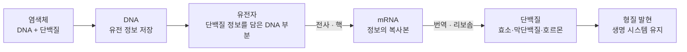
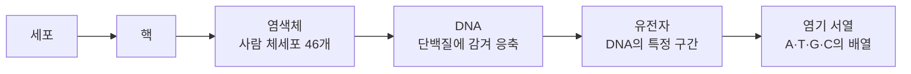
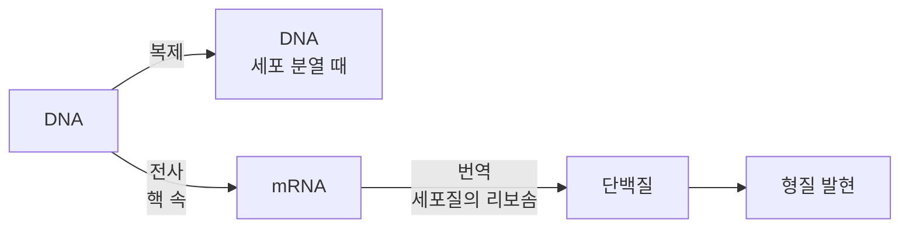
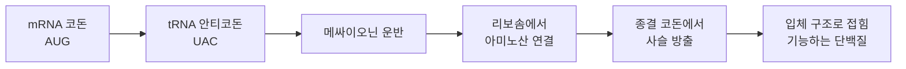
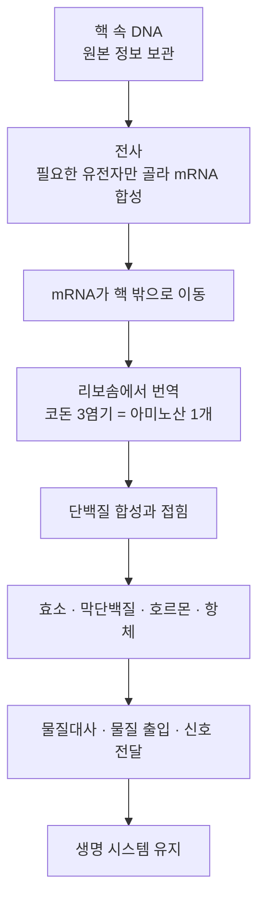

# 3-6. 유전자와 단백질 — 세포 속 정보의 흐름

> [!NOTE]
> **성취기준 [10통과1-03-06]** 생명 시스템의 유지에 필요한 세포 내 정보의 흐름을 유전자로부터 단백질이 만들어지는 과정을 중심으로 설명할 수 있다.

**학습 목표**

1. DNA, 유전자, 염색체의 관계를 설명할 수 있다.
2. 유전 정보가 DNA → RNA → 단백질의 방향으로 흐른다는 것(중심 원리)을 설명할 수 있다.
3. 전사와 번역 과정을 설명하고, 3개의 염기로 된 코돈이 하나의 아미노산을 지정한다는 것을 이용해 염기 서열로부터 아미노산 서열을 찾을 수 있다.
4. 세포 내 정보의 흐름이 체계적으로 구성되어 생명 시스템을 유지한다는 것을 사례를 들어 설명할 수 있다.

**이 단원의 학습 사다리**

| 단계 | 무엇을 하나? |
|---|---|
| STEP 1. 중학교 다시 보기 | 염색체와 유전자, 핵의 역할, 단백질·핵산의 단위체를 다시 꺼내 본다 |
| STEP 2. 기초 다지기 | 단위체의 배열, 상보적 짝, 경우의 수, 정보의 부호화를 디딤돌로 놓는다 |
| STEP 3. 핵심 개념 | DNA·유전자·염색체 → 중심 원리 → 전사 → 번역과 유전 암호 → 체계적인 정보 흐름 |
| STEP 4. 오개념 바로잡기 | "세포마다 가진 유전자가 다르다?" 같은 착각을 바로잡는다 |
| STEP 5. 선택과목·대학 | RNA 가공, 유전자 발현 조절, 역전사, 유전자 가위, 정보로 보는 유전체 |
| STEP 6. 산업·진로 | 재조합 단백질 의약품, mRNA 백신, 분자 진단, 유전자 가위 |

---

## 🗺️ 단원 들어가기

2020년 말, 새로운 감염병이 전 세계로 퍼진 지 약 1년 만에 **mRNA 백신**이 사용 승인을 받았다. 놀라운 점은 이 백신이 바이러스 단백질 자체를 넣는 것이 아니라, 그 단백질을 만드는 **'설계도의 복사본'** 만 넣는다는 것이다. 설계도를 받은 우리 세포는 스스로 그 단백질을 만들어 낸다. 세포는 어떻게 설계도를 읽고 단백질을 만들까?

또 다른 수수께끼가 있다. 우리 몸의 신경 세포, 근육 세포, 피부 세포는 모양도 하는 일도 전혀 다르다. 그런데 이 세포들은 모두 **똑같은 DNA**를 가지고 있다. 같은 설계도를 가졌는데 어떻게 서로 다른 세포가 될까?

3-5 단원에서 세포막의 막단백질과 화학 반응을 돕는 효소가 모두 **단백질**이라는 것을 배웠다. 이 단원에서는 단백질을 만드는 정보가 어디에 저장되어 있고, 어떤 과정을 거쳐 단백질이 되는지 따라가 본다.

---

## STEP 1. 🔙 중학교 다시 보기

### 연계 개념표

| 성취기준 | 이전에 배운 것 | 이 단원에서 확장되는 것 |
|---|---|---|
| [9과02-01] | 핵은 세포의 생명 활동을 조절하고 유전 물질을 가지고 있다 | 핵 속 DNA의 정보가 어떻게 핵 밖의 리보솜으로 전달되는가 |
| [9과21-02] | 염색체와 유전자의 관계, 체세포분열과 생식세포 형성 과정의 염색체 행동 | 염색체 = DNA + 단백질, 유전자 = DNA의 특정 부분. 유전자의 정보가 단백질로 바뀌는 과정 |
| [9과21-04] | 멘델은 형질을 결정하는 요인(유전 인자)이 부모에게서 자손에게 전달된다고 보았다 | 유전자가 **단백질을 만들어** 형질을 나타낸다 |
| [9과02-03] | 같은 종의 개체 사이에 나타나는 형질의 차이(변이)와 생물다양성 | 염기 서열의 차이 → 단백질의 차이 → 형질의 차이 |
| [10통과1-02-05] (통합과학1 2-5) | 단백질은 아미노산, 핵산은 뉴클레오타이드라는 단위체가 결합해 만들어진다 | **핵산의 염기 서열**이 **단백질의 아미노산 서열**을 결정한다 |
| [10통과1-03-05] (통합과학1 3-5) | 리보솜은 단백질을 합성한다. 효소와 막단백질은 단백질이다 | 리보솜이 mRNA의 정보를 읽어 단백질을 만드는 **번역** 과정 |

### 준비 운동 (사전 진단)

**Q1.** 사람의 체세포 하나에 들어 있는 염색체는 몇 개인가?

**Q2.** 염색체, DNA, 유전자를 큰 것부터 작은 것 순서로 나열하시오.

**Q3.** 단백질을 이루는 단위체와 핵산을 이루는 단위체의 이름을 각각 쓰시오.

**Q4.** DNA를 이루는 염기 네 종류를 쓰고, 서로 짝을 이루는 염기끼리 연결하시오.

정답 및 해설

**Q1. 46개** (23쌍) — 이 중 1쌍은 성별을 결정하는 성염색체이다.

**Q2. 염색체 > DNA > 유전자** — 염색체는 DNA가 단백질과 함께 응축된 구조이고, 유전자는 DNA 중 특정 형질에 대한 정보를 담은 일부 구간이다.

**Q3.** 단백질: 아미노산, 핵산: 뉴클레오타이드

**Q4.** 아데닌(A), 타이민(T), 구아닌(G), 사이토신(C). A–T, G–C가 짝을 이룬다.

---

## STEP 2. 🧱 기초 다지기

### ① 단위체의 '순서'가 정보이다

2-5 단원에서 배운 내용을 다시 정리해 보자.

| 구분 | 단위체 | 단위체의 종류 | 정보는 어디에? |
|---|---|---|---|
| 핵산(DNA, RNA) | 뉴클레오타이드(인산 + 당 + 염기) | 염기에 따라 4종류 | **염기의 배열 순서(염기 서열)** |
| 단백질 | 아미노산 | 20종류 | **아미노산의 배열 순서(아미노산 서열)** → 입체 구조 → 기능 |

한글 자모 24개로 수많은 문장을 쓸 수 있듯이, 염기 4종류의 **배열 순서**만 바꾸어도 엄청난 양의 정보를 저장할 수 있다. 같은 글자라도 "사과"와 "과사"의 뜻이 다르듯, **순서가 곧 정보**이다.

### ② 상보적 염기 짝 — 한쪽을 알면 다른 쪽을 안다

DNA는 두 가닥이 꼬인 **이중 나선** 구조이다. 두 가닥의 염기는 정해진 짝끼리만 결합한다.

$$
\mathrm{A} - \mathrm{T}, \qquad \mathrm{G} - \mathrm{C}
$$

이처럼 서로 짝이 정해진 관계를 **상보적(complementary)** 이라고 한다. 한 가닥의 염기 서열을 알면 다른 가닥의 서열을 저절로 알 수 있다.

#### 예제 1

DNA 한 가닥의 염기 서열이 `A T G C C A T T G` 일 때, 이와 짝을 이루는 상보적인 가닥의 염기 서열은?

**풀이** A↔T, G↔C로 바꾸면 `T A C G G T A A C`

> [!TIP]
> 💡 **비유** — 상보적 가닥은 **도장과 찍힌 자국**의 관계와 같다. 도장이 있으면 자국을 만들 수 있고, 자국이 있으면 도장 모양을 알 수 있다. 세포가 DNA를 복제하거나 RNA를 만들 때 바로 이 원리를 쓴다.

### ③ 경우의 수 — 염기 몇 개로 아미노산 하나를 나타낼까?

단백질을 이루는 아미노산은 20종류이다. 염기 4종류로 20가지를 구별하려면 염기 몇 개를 한 묶음으로 써야 할까?

| 묶음의 염기 수 | 만들 수 있는 조합의 수 | 아미노산 20종류를 구별할 수 있나? |
|---|---|---|
| 1개 | $4^1 = 4$ | 부족 |
| 2개 | $4^2 = 16$ | 부족 |
| **3개** | $4^3 = 64$ | **충분** (남는 조합도 있다) |

그래서 생물은 **염기 3개를 한 묶음**으로 아미노산 하나를 지정한다. 이 세 염기 묶음을 STEP 3에서 **코돈**이라고 부른다.

### ④ 정보의 부호화 — 1-4 단원과 연결하기

1-4 단원에서 디지털 정보는 0과 1 두 기호의 배열로 문자·소리·영상을 나타낸다고 배웠다. 컴퓨터는 0과 1을 8개 묶어(8비트) $2^8 = 256$가지 기호를 구별한다. 생명체도 같은 방식을 쓴다.

| 비교 | 컴퓨터 | 세포 |
|---|---|---|
| 기본 기호 | 0, 1 (2종류) | A, T(또는 U), G, C (4종류) |
| 묶음 단위 | 8비트 = 1바이트 | 염기 3개 = 1코돈 |
| 묶음이 나타내는 것 | 문자 하나 | 아미노산 하나(또는 '시작·끝' 신호) |
| 정보 저장 장치 | 저장 장치(SSD 등) | DNA |

---

## STEP 3. 📘 핵심 개념

### 3-6-① DNA, 유전자, 염색체

**DNA(deoxyribonucleic acid, 디옥시리보핵산)** 는 생물의 **유전 정보를 저장하는 물질**이다. 두 가닥의 뉴클레오타이드 사슬이 상보적 염기끼리 결합하여 꼬인 이중 나선 구조를 이룬다.

**유전자(gene)** 는 DNA 중에서 **특정 단백질(또는 형질)에 대한 정보를 담고 있는 구간**이다. DNA라는 긴 책에서 한 '장(chapter)'에 해당한다.

**염색체(chromosome)** 는 DNA가 **히스톤 등 단백질에 감기고 응축된 구조**이다. 평소에는 핵 속에 실처럼 풀어져 있다가, 세포가 분열할 때 굵고 짧게 뭉쳐 현미경으로 보이게 된다.

| 구분 | 무엇인가? | 비유(도서관) |
|---|---|---|
| 유전체(genome) | 한 생물이 가진 유전 정보 전체 | 도서관 전체 장서 |
| 염색체 | DNA가 단백질과 함께 응축된 구조 | 책 한 권(제본된 상태) |
| DNA | 유전 정보를 저장하는 이중 나선 물질 | 책의 종이와 글자 |
| 유전자 | 특정 단백질 정보를 담은 DNA 구간 | 책 속의 한 장(요리법 하나) |
| 염기 | 정보를 나타내는 기호(A, T, G, C) | 글자 |

<!-- fig:3-6-chromosome-dna-gene -->

**사람의 경우 (대략적인 값)**

| 항목 | 값 |
|---|---|
| 체세포 하나의 염색체 수 | 46개(23쌍) |
| 염색체 한 세트(23개)의 염기쌍 수 | 약 30억 개 |
| 단백질을 만드는 유전자 수 | 약 2만 개 |
| 체세포 하나의 DNA를 모두 이어 붙인 길이 | 약 2 m |

길이 약 2 m의 DNA가 지름 수 μm(마이크로미터)의 핵 속에 들어가 있을 수 있는 것은 DNA가 단백질에 감겨 촘촘하게 응축되어 있기 때문이다.

> [!IMPORTANT]
> 한 사람의 몸을 이루는 체세포는 모두 수정란 하나가 체세포분열로 늘어난 것이므로, 원칙적으로 **모두 같은 DNA(같은 유전자)를 가진다.** 세포마다 모양과 기능이 다른 것은 유전자가 달라서가 아니라 **어떤 유전자를 사용하는지(발현하는지)가 다르기 때문**이다. 근육 세포는 근육 수축에 필요한 단백질의 유전자를, 이자 세포는 소화 효소나 인슐린의 유전자를 주로 사용한다.

### 3-6-② 유전 정보의 흐름 — 중심 원리

DNA는 핵 속에 있다. 그런데 단백질을 만드는 **리보솜**은 핵 밖(세포질)에 있다. 그래서 세포는 DNA의 정보를 **RNA**에 옮겨 적어 핵 밖으로 내보낸다.

유전 정보가 **DNA → RNA → 단백질**의 방향으로 흐르는 원리를 **중심 원리(central dogma)** 라고 한다. 1958년 프랜시스 크릭이 제안하였다.

- **복제(replication)**: DNA가 똑같은 DNA를 만든다. 세포 분열 전에 일어나 딸세포에 같은 유전 정보를 물려준다.
- **전사(transcription)**: DNA의 유전자 정보를 RNA로 옮겨 적는다.
- **번역(translation)**: RNA의 염기 서열을 아미노산 서열로 바꾸어 단백질을 만든다.

<!-- fig:3-6-central-dogma-cell -->

#### DNA와 RNA 비교

| 구분 | DNA | RNA |
|---|---|---|
| 가닥 | 두 가닥(이중 나선) | 한 가닥 |
| 염기 | A, T, G, C | A, **U(유라실)**, G, C |
| 당 | 디옥시리보스 | 리보스 |
| 주로 있는 곳 | 핵 | 핵에서 만들어져 세포질로 이동 |
| 역할 | 유전 정보의 **원본 보관** | 정보 전달(mRNA), 아미노산 운반(tRNA), 리보솜 구성(rRNA) |
| 수명 | 안정적으로 오래 유지 | 비교적 빨리 분해된다 |

> [!TIP]
> 💡 **비유** — DNA는 도서관 **귀중본 서고에 있는 원본 요리책**이다. 원본은 대출할 수 없다(핵 밖으로 나가지 않는다). 요리사(리보솜)가 요리를 하려면 필요한 요리법 한 장만 **복사(전사)** 해서 주방(세포질)으로 가져간다. 복사본(mRNA)은 쓰고 나면 버려도 되고, 많이 필요하면 여러 장 복사하면 된다.

**왜 굳이 RNA를 거칠까?** — 정보 흐름이 체계적인 이유

1. **원본 보호**: 소중한 원본(DNA)은 핵 속에 안전하게 두고 복사본만 내보낸다.
2. **필요한 것만 복사**: 수만 개 유전자 중 지금 필요한 유전자만 골라 전사한다.
3. **양 조절**: 많이 필요한 단백질은 mRNA를 여러 개 만들고, 한 mRNA로 단백질을 여러 개 만들어 생산량을 늘린다.

### 3-6-③ 전사 — DNA의 정보를 RNA로 옮겨 적기

전사는 **핵 속**에서 다음과 같이 일어난다.

1. 유전자 부분의 DNA 이중 나선이 풀려 두 가닥이 떨어진다.
2. 두 가닥 중 **한 가닥만** 틀(주형 가닥)로 쓰인다.
3. **RNA 중합 효소**가 주형 가닥을 따라 움직이며, 상보적인 RNA 뉴클레오타이드를 하나씩 연결해 **mRNA(전령 RNA)** 를 만든다.
4. 다 만들어진 mRNA는 DNA에서 떨어져 핵공을 통해 세포질로 나간다. DNA는 다시 이중 나선으로 돌아가며, **DNA 자체는 변하지 않는다.**

**전사할 때의 짝 규칙** (DNA 주형 가닥 → mRNA)

| DNA 주형 가닥의 염기 | A | T | G | C |
|---|---|---|---|---|
| mRNA의 염기 | **U** | A | C | G |

> [!WARNING]
> RNA에는 타이민(T)이 없다. DNA의 **A**에는 T가 아니라 **U(유라실)** 가 짝을 이룬다. 시험에서 가장 많이 틀리는 부분이다.

#### 예제 2

어떤 유전자의 DNA 주형 가닥 염기 서열이 `TAC CTT CAA ACC ATT` 이다.
(1) 이 가닥으로부터 전사된 mRNA의 염기 서열을 쓰시오.
(2) 주형이 아닌 다른 가닥(상보적 가닥)의 염기 서열을 쓰고, mRNA와 비교하시오.

**풀이**
(1) T→A, A→U, C→G, G→C로 바꾸면 mRNA: `AUG GAA GUU UGG UAA`
(2) 다른 가닥은 주형 가닥과 상보적이므로 `ATG GAA GTT TGG TAA`
mRNA와 비교하면 **T가 U로 바뀐 것만 다르고 서열이 같다.** mRNA와 다른 가닥은 모두 주형 가닥의 상보적 서열이기 때문이다.

### 3-6-④ 번역과 유전 암호 — 염기 3개 = 아미노산 1개

#### 코돈

mRNA의 염기 서열은 **연속된 3개의 염기**씩 끊어 읽는다. 하나의 아미노산을 지정하는 mRNA의 3염기 조합을 **코돈(codon)** 이라고 한다. STEP 2-③에서 본 것처럼 코돈은 $4^3 = 64$가지이다.

- **개시 코돈**: `AUG` — 번역이 여기서 시작된다. 메싸이오닌을 지정한다.
- **종결 코돈**: `UAA`, `UAG`, `UGA` — 아미노산을 지정하지 않고 "번역 끝"을 뜻한다.
- 나머지 61개 코돈이 20종류의 아미노산을 지정하므로, **한 아미노산을 여러 코돈이 지정하기도 한다.** (예: 글라이신은 `GGU`, `GGC`, `GGA`, `GGG` 4개)

#### 유전 암호표

코돈과 아미노산의 대응 관계를 정리한 표를 **유전 암호표**라고 한다. 첫 번째 염기는 행, 두 번째 염기는 열에서 찾고, 칸 안에서 세 번째 염기를 찾는다. (외울 필요는 없고, 표를 **읽을 줄** 알면 된다.)

| 첫째 염기 / 둘째 염기 | U | C | A | G |
|---|---|---|---|---|
| **U** | UUU·UUC 페닐알라닌 UUA·UUG 류신 | UCU·UCC·UCA·UCG 세린 | UAU·UAC 타이로신 UAA·UAG **종결** | UGU·UGC 시스테인 UGA **종결** UGG 트립토판 |
| **C** | CUU·CUC·CUA·CUG 류신 | CCU·CCC·CCA·CCG 프롤린 | CAU·CAC 히스티딘 CAA·CAG 글루타민 | CGU·CGC·CGA·CGG 아르지닌 |
| **A** | AUU·AUC·AUA 아이소류신 AUG 메싸이오닌(**개시**) | ACU·ACC·ACA·ACG 트레오닌 | AAU·AAC 아스파라진 AAA·AAG 라이신 | AGU·AGC 세린 AGA·AGG 아르지닌 |
| **G** | GUU·GUC·GUA·GUG 발린 | GCU·GCC·GCA·GCG 알라닌 | GAU·GAC 아스파트산 GAA·GAG 글루탐산 | GGU·GGC·GGA·GGG 글라이신 |

#### 번역의 주인공들

| 구성 요소 | 역할 | 비유(조립 공장) |
|---|---|---|
| **mRNA** | 아미노산 순서 정보(코돈)를 가지고 있다 | 작업 지시서 |
| **리보솜** | mRNA에 붙어 코돈을 하나씩 읽으며 아미노산을 연결한다 | 조립 기계 |
| **tRNA(운반 RNA)** | 특정 아미노산을 운반한다. 코돈과 상보적인 3염기(**안티코돈**)를 가지고 있다 | 부품 배달원(배달원마다 맡은 부품이 정해져 있다) |
| **아미노산** | 단백질의 재료 | 부품 |

#### 번역 과정

1. **시작**: 리보솜이 mRNA에 결합하고, 개시 코돈 `AUG`에 메싸이오닌을 가진 tRNA가 안티코돈으로 결합한다.
2. **연장**: 리보솜이 mRNA를 따라 코돈 하나(염기 3개)씩 이동한다. 각 코돈에 맞는 안티코돈을 가진 tRNA가 아미노산을 가져오고, 리보솜은 앞의 아미노산과 새 아미노산을 **펩타이드 결합**으로 연결한다.
3. **종결**: 종결 코돈에 이르면 이에 맞는 tRNA가 없으므로 번역이 끝나고, 완성된 아미노산 사슬(폴리펩타이드)이 떨어져 나온다.
4. **접힘**: 아미노산 사슬은 아미노산 서열에 따라 특정한 **입체 구조로 접혀** 기능을 가진 단백질이 된다(2-5, 3-5 단원과 연결).

#### 예제 3

예제 2의 mRNA `AUG GAA GUU UGG UAA` 로부터 만들어지는 아미노산 서열을 유전 암호표를 이용해 쓰시오.

**풀이**
- `AUG` → 메싸이오닌(개시)
- `GAA` → 글루탐산
- `GUU` → 발린
- `UGG` → 트립토판
- `UAA` → 종결

아미노산 서열: **메싸이오닌 – 글루탐산 – 발린 – 트립토판** (아미노산 4개, 종결 코돈은 아미노산을 지정하지 않는다.)

전체 흐름을 한 줄로 쓰면 다음과 같다.

| 단계 | 서열 |
|---|---|
| DNA 주형 가닥 | TAC · CTT · CAA · ACC · ATT |
| ↓ 전사 (핵) | |
| mRNA | AUG · GAA · GUU · UGG · UAA |
| ↓ 번역 (리보솜) | |
| tRNA 안티코돈 | UAC · CUU · CAA · ACC · (없음) |
| 아미노산 | 메싸이오닌 · 글루탐산 · 발린 · 트립토판 · (종결) |

> [!TIP]
> 표를 보면 **tRNA의 안티코돈은 DNA 주형 가닥과 T↔U만 다르고 같다.** 안티코돈은 코돈의 상보적 서열이고, 코돈은 주형 가닥의 상보적 서열이므로 '상보의 상보'는 원래대로 돌아온다.

<!-- sim:transcription -->

#### 예제 4

아미노산 300개로 이루어진 단백질이 있다. 이 단백질의 정보를 담은 mRNA에서 개시 코돈부터 종결 코돈까지의 염기는 최소 몇 개인가?

**풀이** 아미노산 1개에 코돈 1개(염기 3개)가 필요하므로 $300 \times 3 = 900$개. 여기에 아미노산을 지정하지 않는 종결 코돈 1개(염기 3개)를 더하면 $900 + 3 = 903$개이다. (개시 코돈 `AUG`는 메싸이오닌을 지정하므로 아미노산 300개에 이미 포함된다.)

### 3-6-⑤ 체계적인 정보 흐름이 생명 시스템을 유지한다

#### 단백질이 하는 일

유전자 → 단백질의 흐름이 중요한 이유는 생명 활동의 거의 모든 일을 단백질이 하기 때문이다.

| 단백질의 역할 | 예 | 관련 단원 |
|---|---|---|
| 효소(화학 반응 촉진) | 아밀레이스, 카탈레이스, RNA 중합 효소 | 3-5 |
| 물질 운반 | 적혈구의 헤모글로빈(산소 운반), 세포막의 운반체 단백질 | 3-5 |
| 몸의 구조 | 머리카락·손톱의 케라틴, 피부·뼈의 콜라젠 | — |
| 신호 전달(호르몬) | 혈당을 낮추는 인슐린 | 중학교 [9과20-03] |
| 방어 | 병원체를 인식하는 항체 | 6-1 |
| 운동 | 근육 수축에 관여하는 단백질 | — |

#### 정보가 바뀌면 단백질이 바뀐다 — 겸상 적혈구 빈혈증

헤모글로빈 유전자의 염기 **하나**가 바뀌면 어떻게 될까?

| 구분 | DNA 주형 가닥 | mRNA 코돈 | 아미노산 | 결과 |
|---|---|---|---|---|
| 정상 | CTC | GAG | 글루탐산 | 정상 헤모글로빈, 둥근 원반 모양의 적혈구 |
| 겸상 적혈구 빈혈증 | C**A**C | G**U**G | **발린** | 헤모글로빈이 서로 뭉쳐 적혈구가 낫(겸상) 모양으로 변하고, 산소 운반 능력이 떨어진다 |

**염기 1개 → 코돈 1개 → 아미노산 1개 → 단백질의 입체 구조 → 세포 모양 → 개체의 형질**로 변화가 차례로 이어진다. 정보가 체계적으로 연결되어 있기 때문에, 작은 변화도 생명 시스템 전체에 영향을 줄 수 있다.

> [!NOTE]
> 반대로 염기가 바뀌어도 단백질이 바뀌지 않는 경우도 있다. 예를 들어 `GGU`가 `GGC`로 바뀌어도 둘 다 글라이신을 지정한다. 한 아미노산을 여러 코돈이 지정하는 덕분에 작은 오류의 영향이 줄어든다.

#### 유전 암호는 거의 모든 생물에 공통이다

사람, 대장균, 벼, 효모는 거의 **같은 유전 암호표**를 사용한다. `AUG`는 어느 생물에서나 메싸이오닌이다. 그래서 사람의 인슐린 유전자를 대장균에 넣으면 대장균이 **사람의 인슐린**을 만들 수 있다(STEP 6). 유전 암호의 공통성은 모든 생물이 공통 조상에서 유래했다는 증거로도 여겨지며, 통합과학2의 '진화와 생물다양성'으로 이어진다.

#### 세포 내 정보 흐름의 전체 그림

| 체계성의 특징 | 내용 |
|---|---|
| 방향성 | 정보는 DNA → RNA → 단백질의 정해진 방향으로 흐른다 |
| 역할 분담 | 저장(DNA, 핵) – 전달(mRNA) – 해독(리보솜·tRNA) – 실행(단백질) |
| 정확성 | 상보적 염기 짝과 코돈–안티코돈 결합으로 정보가 정확히 옮겨진다 |
| 조절 | 세포마다, 시기마다 필요한 유전자만 골라 발현한다 |
| 공통성 | 거의 모든 생물이 같은 유전 암호를 사용한다 |

---

## STEP 4. ⚠️ 오개념 바로잡기

| 흔한 오개념 | 올바른 개념 | 왜 그럴까? |
|---|---|---|
| 근육 세포에는 근육 유전자만, 피부 세포에는 피부 유전자만 있다 | 한 사람의 체세포는 원칙적으로 **모두 같은 유전자**를 가진다 | 모든 체세포가 수정란 하나에서 체세포분열로 생겼다. 차이는 **어떤 유전자를 발현하는가**에 있다 |
| DNA 전체가 유전자이다 | 유전자는 DNA 중 **특정 단백질 정보를 담은 일부 구간**이다 | 사람 DNA에서 단백질 정보를 직접 담은 부분은 전체의 일부(약 1~2 %로 알려짐)에 불과하다 |
| 리보솜은 DNA를 직접 읽어 단백질을 만든다 | 리보솜은 DNA가 아니라 **mRNA**를 읽는다 | DNA는 핵 속에 있고, 리보솜은 핵 밖에 있다. mRNA가 정보를 전달한다 |
| 전사가 끝나면 DNA가 RNA로 바뀌어 없어진다 | 전사 후에도 **DNA는 그대로** 남는다 | DNA는 틀로만 쓰이고, RNA는 새 재료로 만들어진다. 원본은 계속 사용된다 |
| RNA에도 T가 있어 A–T로 짝을 짓는다 | RNA에는 T 대신 **U**가 있어, DNA의 A에는 U가 짝을 이룬다 | DNA와 RNA는 염기 한 종류와 당의 종류가 다르다 |
| 염기가 하나라도 바뀌면 반드시 단백질이 달라진다 | 한 아미노산을 **여러 코돈**이 지정하므로 아미노산이 바뀌지 않을 수도 있다 | 예: `GGU`→`GGC`는 둘 다 글라이신이다 |
| 형질 하나는 항상 유전자 하나가 결정한다 | 키·피부색처럼 **여러 유전자와 환경**이 함께 영향을 주는 형질이 많다 | 유전자는 단백질을 만들고, 여러 단백질과 환경이 어울려 형질이 나타난다 |

---

## STEP 5. 🎓 선택과목·대학으로 한 걸음 더

> [!CAUTION]
> 이 절은 **통합과학 교육과정 범위 밖의 심화 내용**으로 평가 대상이 아니다. "이 개념이 앞으로 어디까지 이어지는가"를 맛보기로 보여 주기 위한 내용이다.

### 고2·3 선택과목과의 연결

| 과목 | 이어지는 내용 |
|---|---|
| 생명과학 | 생명의 연속성과 다양성(염색체, 세포 분열, 유전) |
| 생물의 유전 | 유전자와 유전물질(DNA의 구조와 복제), 유전자의 발현(전사·번역의 자세한 과정, 발현 조절) |
| 세포와 물질대사 | 세포 소기관(핵, 리보솜, 소포체, 골지체)과 단백질의 이동 |

### ① DNA 가닥에는 방향이 있다, 그리고 RNA 가공

대학 '분자생물학'에서는 DNA와 RNA 가닥의 양 끝을 **5′ 끝**과 **3′ 끝**으로 구분한다. 두 가닥은 서로 반대 방향으로 놓여 있고(역평행), RNA 중합 효소는 RNA를 항상 5′ → 3′ 방향으로만 합성한다. 리보솜도 mRNA를 5′ → 3′ 방향으로 읽는다.

또 사람 같은 진핵생물의 유전자에는 단백질 정보가 담긴 **엑손(exon)** 사이에 정보가 없는 **인트론(intron)** 이 끼어 있다. 처음 전사된 RNA에서 인트론을 잘라 내고 엑손만 이어 붙이는 과정을 **RNA 스플라이싱(splicing)** 이라고 한다. 엑손을 다르게 조합하면(선택적 스플라이싱) 유전자 하나로 여러 종류의 단백질을 만들 수 있다. 사람의 단백질 유전자가 약 2만 개뿐인데도 훨씬 많은 종류의 단백질을 만드는 이유 중 하나이다.

### ② 유전자 발현 조절

같은 DNA를 가진 세포가 서로 다른 세포가 되는 비밀은 **유전자 발현 조절**이다. 세균의 경우 젖당이 있을 때만 젖당 분해 효소 유전자들이 전사되는 **젖당 오페론**이 대표적인 예이다. 진핵생물에서는 전사를 켜고 끄는 단백질(전사 인자), DNA가 감긴 정도의 변화 등 여러 단계에서 발현이 조절된다. 수정란이 여러 종류의 세포로 바뀌는 **세포 분화**, 줄기세포 연구가 모두 이 원리와 관련된다.

### ③ 중심 원리의 예외 — 역전사

일부 바이러스(레트로바이러스, 예: 사람 면역 결핍 바이러스 HIV)는 RNA를 유전 물질로 가지며, **역전사 효소**를 이용해 **RNA → DNA** 방향으로 정보를 옮긴다. 이 발견(1970년)은 중심 원리를 '정보가 단백질에서 다시 핵산으로 거슬러 가지는 않는다'는 의미로 다듬게 했다. 역전사 효소는 오늘날 RNA 바이러스를 검사하는 **RT-PCR**에 꼭 필요한 도구이다.

### ④ 유전자 가위 — 염기 서열을 정확히 고치기

**크리스퍼 유전자 가위(CRISPR-Cas9)** 는 세균이 바이러스를 막는 방어 체계에서 발견되었다.
- **가이드 RNA**: 고치려는 DNA 부위와 상보적인 약 20개 염기로 된 RNA. '주소' 역할을 한다.
- **Cas9 단백질**: 가이드 RNA가 찾아간 DNA를 자르는 효소. '가위' 역할을 한다.
- 잘린 DNA를 세포가 수선하는 과정에서 유전자가 망가지거나(기능 제거), 원하는 서열로 바뀌게(교정) 할 수 있다.

상보적 염기 짝(STEP 2-②)이라는 고1 개념이 첨단 기술의 핵심 원리로 쓰이는 셈이다. 이 기술을 개발한 두 과학자(에마뉘엘 샤르팡티에, 제니퍼 다우드나)는 2020년 노벨 화학상을 받았다.

### ⑤ 정보로 보는 유전체 — 생물정보학

염기 4종류는 각각 2비트($2^2 = 4$)로 나타낼 수 있다. 사람 유전체 한 세트를 약 30억 염기쌍이라 하면

$$
3\times10^{9}\ \text{염기} \times 2\ \text{비트} = 6\times10^{9}\ \text{비트} = 7.5\times10^{8}\ \text{바이트} \approx 750\ \mathrm{MB}
$$

정도의 정보량이다. 대학의 **생물정보학**은 이런 거대한 서열 데이터를 컴퓨터와 인공지능으로 분석하여 유전자의 위치를 찾고, 단백질의 입체 구조를 예측하며, 질병과 관련된 염기 서열 차이를 찾아낸다.

### 연대표 — 유전 정보 연구의 주요 장면

| 연도 | 사건 |
|---|---|
| 1953 | 왓슨과 크릭이 DNA 이중 나선 구조 모형 발표(로절린드 프랭클린의 X선 회절 사진이 중요한 근거) |
| 1958 | 크릭이 중심 원리 제안 |
| 1961 | `UUU`가 페닐알라닌을 지정한다는 사실을 밝혀 최초로 코돈을 해독 |
| 1960년대 중반 | 64개 코돈의 의미가 모두 밝혀짐 |
| 1970 | 역전사 효소 발견 |
| 1982 | 대장균으로 생산한 사람 인슐린이 의약품으로 처음 승인됨(미국) |
| 2003 | 인간 유전체 사업 완료 발표 |
| 2020 | 유전자 가위 개발로 노벨 화학상, mRNA 백신 사용 승인 |
| 2023 | mRNA 백신의 바탕이 된 염기 변형 연구로 노벨 생리의학상 |

### 고등학교 vs 대학교

| 구분 | 고등학교 통합과학 | 대학교 분자생물학·유전학 |
|---|---|---|
| DNA | 이중 나선, 상보적 염기 짝 | 5′·3′ 방향, 복제 기구, 손상 수선 |
| 전사 | 주형 가닥 → mRNA | 프로모터, 전사 인자, RNA 가공(스플라이싱) |
| 번역 | 코돈 → 아미노산, tRNA·리보솜 | 리보솜의 구조, 번역 조절, 단백질 접힘과 이동 |
| 정보 흐름 | DNA → RNA → 단백질 | 역전사, 비암호화 RNA, 후성유전 |
| 응용 | 원리 이해 | 유전자 재조합, PCR, 유전자 가위, 생물정보학 |
| 관련 전공 | — | 생명과학, 분자생물학, 유전공학, 생명공학, 의학, 약학, 생물정보학 |

---

## STEP 6. 🏭 산업 현장과 진로 연결

### 사례 1. 재조합 단백질 의약품 — 미생물 공장에서 만드는 인슐린

- **원리** 유전 암호가 거의 모든 생물에 공통이므로, 사람의 유전자를 세균이나 효모, 배양 동물 세포에 넣으면 그 세포가 **사람의 단백질**을 만든다. 이렇게 다른 생물의 유전자를 넣어 만든 단백질을 **재조합 단백질**이라고 한다.
- **인슐린** 인슐린은 아미노산 51개로 이루어진 작은 단백질 호르몬이다. 예전에는 돼지나 소의 이자에서 뽑아 썼지만, 공급이 제한적이고 사람 인슐린과 약간 달랐다. 1980년대 초 대장균으로 만든 사람 인슐린이 의약품으로 승인된 뒤, 오늘날 당뇨병 환자에게 쓰이는 인슐린의 대부분은 미생물이나 세포 배양으로 생산된다.
- **확장** 성장 호르몬, 혈액 응고 인자, 항체 의약품 등 많은 **바이오의약품**이 같은 원리로 생산된다. 우리나라도 대규모 세포 배양 설비를 갖춘 바이오의약품 생산 산업이 크게 성장하였다. 생산 현장에서는 세포가 단백질을 잘 만들도록 온도·pH·영양분을 조절하는 **배양 공정**과, 만들어진 단백질만 순수하게 골라내는 **정제 공정**이 핵심이다.

### 사례 2. mRNA 백신 — 번역 원리를 그대로 이용한 기술

- **원리** 바이러스 표면 단백질(예: 코로나19 바이러스의 스파이크 단백질)의 정보를 담은 **mRNA**를 만들어 몸에 주사한다. 세포 속에 들어간 mRNA는 **세포질의 리보솜에서 번역**되어 스파이크 단백질을 만든다. 면역계는 이 단백질을 '침입자'로 기억해 두었다가, 진짜 바이러스가 들어오면 빠르게 대응한다.
- **지질 나노 입자** mRNA는 쉽게 분해되고 그대로는 세포막을 통과하기 어렵다. 그래서 세포막과 비슷한 지질로 만든 작은 입자로 감싸 세포 안으로 전달한다(3-5 단원의 약물 전달과 연결).
- **안전성의 핵심 원리** mRNA는 세포질에서 번역에 쓰인 뒤 분해되며, 핵 안의 DNA에 끼어들거나 DNA를 바꾸지 않는다. 정보 흐름 DNA → RNA → 단백질에서 **RNA → 단백질** 단계만 이용하는 것이다.
- **핵심 숫자** 스파이크 단백질은 약 1,270개의 아미노산으로 이루어져 있다. 따라서 이를 지정하는 데에만 약 $1270 \times 3 \approx 3800$개의 염기가 필요하다. mRNA의 염기 일부를 변형해 몸속에서 불필요한 염증 반응을 줄인 연구는 2023년 노벨 생리의학상을 받았다.
- **장점** 바이러스의 염기 서열만 알면 비교적 빠르게 백신을 설계할 수 있다. 감염병 백신 외에 암 치료 백신 등으로도 연구가 확장되고 있다.

### 사례 3. 분자 진단 — 상보적 염기 짝으로 병원체 찾기

- **PCR(중합 효소 연쇄 반응)** 원하는 DNA 구간을 반복해서 복제해 양을 늘리는 기술이다. 가열(두 가닥 분리) → 냉각(찾고 싶은 서열에 상보적인 짧은 DNA 조각 결합) → DNA 합성의 한 주기마다 DNA 양이 약 2배가 된다. 30주기를 반복하면 이론적으로 $2^{30} \approx 1.07\times10^{9}$, 즉 약 10억 배로 늘어난다.
- 높은 온도를 반복하므로 **고온에서도 변성되지 않는 DNA 중합 효소**(뜨거운 온천에 사는 세균에서 얻음)를 쓴다. 3-5 단원의 '효소는 열에 약하다'는 성질을 극복한 사례이다.
- **RT-PCR** 코로나19 바이러스처럼 RNA를 가진 병원체는 먼저 역전사 효소로 RNA를 DNA로 바꾼 뒤 PCR을 한다. 통합과학2 6-1 단원의 '핵산과 단백질을 이용한 감염병 진단 기술'로 이어진다.
- **유전자 검사** 질병과 관련된 염기 서열의 차이를 찾아 진단하거나, 환자에게 맞는 약을 고르는 데 쓰인다.

### 사례 4. 유전자 가위 — 치료와 작물 개발

- **치료** 2023년 영국과 미국에서 유전자 가위를 이용한 **겸상 적혈구 빈혈증** 치료법이 처음으로 승인되었다. STEP 3에서 본 바로 그 질환이다. 환자의 혈액 줄기세포를 꺼내 유전자 가위로 편집한 뒤 다시 넣는 방식이다.
- **농업** 병에 강하거나 저장성이 좋은 작물을 개발하는 데 연구되고 있다. 외부 유전자를 넣지 않고 작물 자신의 유전자 일부만 고치는 방식도 있어, 이를 어떻게 관리할지에 대한 사회적 논의가 이루어지고 있다.
- **윤리적 쟁점** 다음 세대로 전달되는 생식세포나 배아의 유전자를 편집하는 것은 안전성과 윤리 문제로 엄격히 제한된다. 이 논의는 통합과학2 6-4 단원 '과학기술과 윤리'에서 다룬다.

### 관련 진로와 학과

| 진로 | 하는 일 | 관련 학과 |
|---|---|---|
| 바이오의약품 연구원·생산 공정 엔지니어 | 재조합 단백질·항체 의약품 개발, 세포 배양과 정제 공정 설계 | 생명공학, 화학공학, 약학 |
| 백신·신약 연구원 | mRNA 설계, 전달체 개발, 임상 시험 | 약학, 의학, 분자생물학, 면역학 |
| 분자 진단 연구원·임상병리사 | PCR 진단 키트 개발, 유전자 검사 | 임상병리학, 생명과학, 의공학 |
| 유전 상담사 | 유전자 검사 결과 해석과 상담 | 유전학, 의학, 간호학 |
| 생물정보학자 | 유전체·단백질 데이터 분석, 인공지능 활용 | 생물정보학, 컴퓨터공학, 통계학 |
| 농생명 연구원 | 유전자 교정 작물·미생물 개발 | 식물생명과학, 농생명공학 |

---

## 🔬 탐구 활동

### 활동 A. 브로콜리(또는 바나나)에서 DNA 추출하기

**목표** 세포에서 DNA를 직접 추출하여 관찰하고, 각 과정을 세포막의 구조(3-5 단원)와 연결하여 설명한다.

**준비물** 브로콜리 꽃봉오리 부분(또는 바나나), 막자사발과 막자(또는 지퍼 백), 주방 세제, 소금, 물, 거름종이와 깔때기(또는 커피 필터), 시험관, 냉장고에 차갑게 보관한 에탄올(소독용 알코올), 유리 막대(또는 나무 꼬치)

**과정**
1. 브로콜리를 잘게 잘라 막자사발에서 곱게 간다(바나나는 지퍼 백에 넣고 으깬다).
2. 물 100 mL에 주방 세제 1숟가락과 소금 약간을 녹인 **추출액**을 만들어 넣고, 거품이 많이 나지 않도록 천천히 5분 정도 섞는다.
3. 거름종이로 걸러 거른 액을 시험관에 약 1/3 높이까지 담는다.
4. 차가운 에탄올을 시험관 벽을 따라 천천히 부어, 거른 액 위에 같은 양 정도의 층을 만든다.
5. 몇 분 뒤 두 층의 경계에 생기는 하얀 실 같은 물질을 유리 막대로 감아 올려 관찰한다.

**결과 기록**

| 관찰 항목 | 기록 |
|---|---|
| 하얀 물질이 생긴 위치 | |
| 모양·색·느낌 | |
| 감아 올렸을 때의 모습 | |

**생각해 보기**
1. 주방 세제는 기름때를 녹인다. 세제를 넣으면 세포에서 어떤 일이 일어날까? 세포막과 핵막의 주성분(인지질)으로 설명해 보자.
2. DNA는 물에는 녹지만 에탄올에는 잘 녹지 않는다. 과정 4에서 하얀 물질이 경계에 모인 이유는?
3. 눈에 보인 하얀 실은 DNA 분자 하나일까, 수많은 DNA 가닥이 엉긴 덩어리일까? DNA 분자의 굵기를 생각하며 토의해 보자.
4. 브로콜리 DNA와 사람 DNA의 염기 종류는 같다. 그렇다면 두 생물의 차이는 무엇에서 비롯될까?

> [!WARNING]
> **안전 수칙** 에탄올은 불이 잘 붙으므로 불 가까이에서 사용하지 않는다. 실험 재료는 먹지 않는다. 세제가 눈에 들어가면 즉시 많은 물로 씻는다.

### 활동 B. 전사·번역 모의 활동과 돌연변이 탐구

**목표** 역할 놀이와 카드를 이용해 유전 정보가 DNA → mRNA → 단백질로 전달되는 과정을 모의로 수행하고, 염기 하나의 변화가 단백질에 미치는 영향을 탐구한다.

**준비물** DNA 서열 카드(교사 제공), 빈 mRNA 카드, 아미노산 카드(이름 표시), 유전 암호표, 색 테이프

**과정**
1. 교실 앞쪽을 '핵', 뒤쪽을 '세포질(리보솜)'로 정한다. DNA 카드는 핵 밖으로 가지고 나갈 수 없다.
2. **전사 모둠**: 핵에서 DNA 주형 가닥 카드 `TAC GGA AAG CTT ACT` 를 보고 상보적인 mRNA 카드를 작성해 세포질로 전달한다.
3. **번역 모둠**: 리보솜 역할 학생이 mRNA를 3염기씩 읽고, tRNA 역할 학생들이 유전 암호표를 보고 알맞은 아미노산 카드를 가져와 순서대로 테이프로 잇는다.
4. **돌연변이 실험**: 원래 DNA 카드에서 염기 하나를 바꾼 세 종류의 카드로 2~3을 반복하고 결과를 비교한다.
   - 변이 ①: 두 번째 묶음 `GGA` → `GGG`
   - 변이 ②: 세 번째 묶음 `AAG` → `ACG`
   - 변이 ③: 네 번째 묶음 `CTT` → `ATT`

**결과 기록**

| 구분 | DNA 주형 가닥 | mRNA | 아미노산 서열 | 원래와 비교 |
|---|---|---|---|---|
| 원래 | TAC GGA AAG CTT ACT | | | — |
| 변이 ① | TAC GG**G** AAG CTT ACT | | | |
| 변이 ② | TAC GGA A**C**G CTT ACT | | | |
| 변이 ③ | TAC GGA AAG **A**TT ACT | | | |

교사용 참고 답

- 원래: mRNA `AUG CCU UUC GAA UGA` → 메싸이오닌–프롤린–페닐알라닌–글루탐산(종결)
- 변이 ①: mRNA `AUG CCC UUC GAA UGA` → 아미노산 서열 변화 없음(`CCU`, `CCC` 모두 프롤린)
- 변이 ②: mRNA `AUG CCU UGC GAA UGA` → 세 번째 아미노산이 페닐알라닌 → 시스테인으로 바뀜
- 변이 ③: mRNA `AUG CCU UUC UAA UGA` → 네 번째 코돈이 종결 코돈이 되어 메싸이오닌–프롤린–페닐알라닌에서 번역이 끝남(글루탐산이 빠져 단백질이 짧아짐)

**생각해 보기**
1. DNA 카드를 핵 밖으로 가지고 나가지 못하게 한 규칙은 실제 세포의 어떤 특징을 나타낸 것인가?
2. 변이 ①~③ 중 단백질 기능에 가장 큰 영향을 줄 것으로 예상되는 것은 무엇이며, 그 이유는?
3. 이 활동으로 '세포 내 정보의 흐름이 체계적'이라는 말의 뜻을 설명해 보자.

---

## ✅ 개념 확인 문제

### 기본

**1.** 다음 설명에 해당하는 것을 [보기]에서 고르시오.
[보기] 염색체, DNA, 유전자
(1) 유전 정보를 저장하는 이중 나선 구조의 물질
(2) DNA 중 특정 단백질에 대한 정보를 가진 구간
(3) DNA가 단백질과 함께 응축된 구조로, 세포 분열 때 잘 관찰된다

정답 및 해설

**정답** (1) DNA (2) 유전자 (3) 염색체

**2.** DNA 주형 가닥의 염기 서열이 `TAC GCA` 일 때, 전사된 mRNA의 염기 서열을 쓰시오.

정답 및 해설

**정답** `AUG CGU`

T→A, A→U, C→G, G→C. DNA의 A에는 RNA의 U가 짝을 이룬다는 점에 주의한다.

**3.** 빈칸에 알맞은 말을 쓰시오.
"DNA의 유전 정보가 RNA로 옮겨지는 과정을 ( ㄱ )(이)라 하고 주로 ( ㄴ ) 속에서 일어난다. mRNA의 정보에 따라 아미노산이 연결되어 단백질이 만들어지는 과정을 ( ㄷ )(이)라 하고 세포질의 ( ㄹ )에서 일어난다."

정답 및 해설

**정답** ㄱ: 전사, ㄴ: 핵, ㄷ: 번역, ㄹ: 리보솜

**4.** 아미노산을 지정하는 mRNA의 3염기 조합을 무엇이라 하는가? 또 이러한 조합은 모두 몇 가지인가?

정답 및 해설

**정답** 코돈, 64가지

염기 4종류를 3개씩 배열하므로 $4^3 = 64$가지이다. 이 중 61개는 아미노산을 지정하고 3개는 종결 코돈이다.

### 응용

**5.** 다음 mRNA로부터 만들어지는 아미노산 서열을 유전 암호표를 이용하여 쓰시오.
`AUG AAA UUU GGC UAG`

정답 및 해설

**정답** 메싸이오닌 – 라이신 – 페닐알라닌 – 글라이신

`AUG` 메싸이오닌(개시), `AAA` 라이신, `UUU` 페닐알라닌, `GGC` 글라이신, `UAG` 종결. 종결 코돈은 아미노산을 지정하지 않으므로 아미노산은 4개이다.

**6.** 어떤 단백질은 아미노산 150개로 이루어져 있다. (1) 이 단백질의 정보를 가진 mRNA에서 개시 코돈부터 종결 코돈까지의 코돈 수와 염기 수를 각각 구하시오. (2) 이 mRNA를 전사한 DNA 주형 가닥의 해당 구간 염기 수는?

정답 및 해설

**정답** (1) 코돈 151개, 염기 453개 (2) 453개

(1) 아미노산 150개에 코돈 150개(개시 코돈 포함), 여기에 종결 코돈 1개를 더해 151개. 염기 수는 $151\times3 = 453$개.
(2) mRNA의 염기 하나는 주형 가닥의 염기 하나와 상보적으로 짝을 이루므로 같은 453개이다.

**7.** 어떤 유전자의 mRNA 코돈 하나가 `GAG`에서 다음과 같이 바뀌었다. 각 경우 단백질에 어떤 변화가 생기는지 유전 암호표를 이용하여 쓰시오.
(1) `GAG` → `GAA` (2) `GAG` → `GUG` (3) `GAG` → `UAG`

정답 및 해설

**정답**
(1) `GAG`, `GAA` 모두 글루탐산이므로 아미노산 서열이 바뀌지 않는다.
(2) 글루탐산이 발린으로 바뀐다. 이것이 겸상 적혈구 빈혈증에서 헤모글로빈에 일어나는 변화이다.
(3) `UAG`는 종결 코돈이므로 번역이 그 자리에서 끝나 단백질이 짧아진다. 정상적인 기능을 하기 어렵다.

같은 염기 1개의 변화라도 결과는 크게 다를 수 있다.

### 융합·서술형

**8. [산업 연계]** 대장균은 세균이고 사람과 전혀 다른 생물인데도, 사람의 인슐린 유전자를 넣은 대장균은 사람의 인슐린을 만들 수 있다. (1) 그 이유를 유전 정보의 흐름과 유전 암호의 특징으로 설명하고, (2) 이 기술이 동물의 이자에서 인슐린을 뽑아 쓰던 방법보다 좋은 점을 두 가지 쓰시오.

정답 및 해설

**예시 답안**
(1) 대장균도 사람과 마찬가지로 DNA → mRNA → 단백질의 정보 흐름을 가지고 있으며, 거의 모든 생물이 **같은 유전 암호**를 사용한다. 따라서 대장균의 리보솜은 사람 인슐린 유전자에서 전사된 mRNA의 코돈을 사람 세포와 같은 아미노산으로 번역하여, 아미노산 서열이 같은 사람 인슐린을 만든다.
(2) ① 사람 인슐린과 아미노산 서열이 같은 단백질을 얻을 수 있다. ② 미생물을 대량으로 배양하여 많은 양을 안정적으로 생산할 수 있다. (이 밖에 동물의 이자 공급량에 좌우되지 않는다 등)

**채점 포인트** ① 정보 흐름(전사·번역)이 공통 ② 유전 암호의 공통성 ③ 생산 측면의 장점

**9. [대학·의료 연계]** 다음은 mRNA 백신에 대한 두 학생의 대화이다.
> 민수: "mRNA 백신을 맞으면 내 DNA가 바뀌는 거 아니야?"
> 지아: "아니야. 정보가 흐르는 방향과 일어나는 장소를 생각해 봐."

(1) 지아의 입장에서 민수에게 설명하는 글을 중심 원리를 이용해 쓰시오. (2) mRNA를 지질 나노 입자로 감싸는 이유를 세포막의 구조와 관련지어 쓰시오.

정답 및 해설

**예시 답안**
(1) 세포 안의 유전 정보는 DNA → mRNA → 단백질 방향으로 흐른다. 백신의 mRNA는 이 중 **번역 단계**에만 쓰인다. mRNA는 핵 밖 세포질의 리보솜에서 번역되어 바이러스 표면 단백질을 만들고, 그 뒤 분해된다. mRNA는 핵 안의 DNA에 끼어들지 않으므로 DNA를 바꾸지 않는다.
(2) mRNA는 크고 전하를 띤 분자라서 인지질 이중층으로 된 세포막을 스스로 통과하기 어렵고, 몸속에서 쉽게 분해된다. 세포막과 성질이 비슷한 지질로 감싸면 mRNA를 분해로부터 보호하면서 세포막과 융합해 세포 안으로 들어가게 할 수 있다.

**채점 포인트** ① 번역 단계·세포질에서 작용 ② DNA에 끼어들지 않음 ③ 세포막(인지질 이중층)의 선택적 투과성과 지질 입자의 역할

---

## 📝 한눈에 정리

### 핵심 요약

- **유전자**는 DNA 중 특정 단백질 정보를 담은 구간이고, **염색체**는 DNA가 단백질과 함께 응축된 구조이다. 한 사람의 체세포는 모두 같은 DNA를 가진다.
- 유전 정보는 **DNA → RNA → 단백질**의 방향으로 흐른다(**중심 원리**).
- **전사**: 핵 속에서 DNA 주형 가닥에 상보적인 mRNA를 만든다(A–U, T–A, G–C, C–G).
- **번역**: 리보솜에서 mRNA의 **코돈(3염기)** 마다 tRNA가 알맞은 아미노산을 가져와 연결한다. 개시 코돈 AUG, 종결 코돈 UAA·UAG·UGA.
- 염기 4종류를 3개씩 묶으면 $4^3 = 64$가지 코돈 → 아미노산 20종류를 지정하기에 충분하다.
- 정보 흐름은 저장–전달–해독–실행으로 역할이 나뉘고, 상보적 짝으로 정확히 전달되며, 거의 모든 생물에 공통이다. 염기 하나의 변화가 단백질과 형질을 바꿀 수도 있다.
- 이 원리는 재조합 단백질 의약품, mRNA 백신, PCR 진단, 유전자 가위 등 생명공학 산업의 바탕이다.

### 핵심 용어

| 용어 | 뜻 |
|---|---|
| DNA | 유전 정보를 저장하는 이중 나선 구조의 핵산 |
| 유전자 | DNA 중 특정 단백질(형질)에 대한 정보를 가진 구간 |
| 염색체 | DNA가 단백질과 함께 응축된 구조. 사람 체세포에는 46개 |
| 중심 원리 | 유전 정보가 DNA → RNA → 단백질 방향으로 흐른다는 원리 |
| 전사 | DNA의 유전 정보를 mRNA로 옮겨 적는 과정(핵) |
| 번역 | mRNA의 정보에 따라 아미노산을 연결해 단백질을 만드는 과정(리보솜) |
| 코돈 | 하나의 아미노산을 지정하는 mRNA의 연속된 3개 염기 |
| 안티코돈 | 코돈과 상보적으로 결합하는 tRNA의 3개 염기 |
| 유전 암호표 | 64개 코돈과 그것이 지정하는 아미노산(또는 종결)을 정리한 표 |

### 다음 단원으로

통합과학1에서 우리는 우주에서 만들어진 원소가 결합해 물질을 이루고, 지구와 생명이 각각의 시스템으로서 상호작용하는 모습을 살펴보았다. 이 단원에서는 생명 시스템 안에서 DNA의 정보가 단백질로 정확하게 전달된다는 것을 배웠지만, 염기 서열은 조금씩 바뀌기도 하고 그 차이가 생물의 다양성을 만든다. 통합과학2의 첫 단원 4-1에서는 시선을 **수억 년의 시간**으로 넓혀, 지질시대 동안 지구 환경이 어떻게 변해 왔고 그 변화 속에서 **생물다양성**이 어떻게 달라졌는지 탐구한다.
