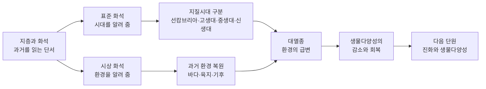

# 4-1. 지질시대의 환경 변화와 생물다양성 — 돌 속에 새겨진 46억 년의 일기

> [!NOTE]
> **성취기준 [10통과2-01-01]** 지질시대를 통해 지구 환경이 끊임없이 변화해 왔으며 이러한 환경 변화가 생물다양성에 미치는 영향을 추론할 수 있다.

**학습 목표**

1. 화석과 지층을 이용하여 과거의 환경과 생물을 추론하고, 표준 화석과 시상 화석의 차이를 설명할 수 있다.
2. 지질시대를 구분하는 기준을 알고, 선캄브리아 시대·고생대·중생대·신생대의 환경과 대표 생물을 설명할 수 있다.
3. 대멸종(특히 고생대 말과 중생대 말)의 증거와 원인 가설을 근거를 들어 평가할 수 있다.
4. 환경 변화와 대멸종이 생물다양성을 어떻게 감소시키고 다시 증가시켰는지 추론할 수 있다.

**이 단원의 학습 사다리**

| 단계 | 무엇을 하나? |
|---|---|
| STEP 1. 중학교 다시 보기 | 퇴적암, 암석의 순환, 대륙 이동, 변이와 생물다양성을 다시 꺼내 본다 |
| STEP 2. 기초 다지기 | 지층이 쌓이는 규칙, 화석이 되는 조건, '억 년' 단위 감각을 디딤돌로 놓는다 |
| STEP 3. 핵심 개념 | 화석과 지층 → 표준·시상 화석 → 지질시대 구분 → 시대별 환경과 생물 → 대멸종과 생물다양성 |
| STEP 4. 오개념 바로잡기 | "공룡과 원시인이 함께 살았다?" 같은 착각을 바로잡는다 |
| STEP 5. 선택과목·대학 | 방사성 동위 원소 연대 측정, 생층서학, 고기후 연구 |
| STEP 6. 산업·진로 | 석유·가스 탐사의 미화석 분석, 지질 조사, 고기후 연구, 화석 산지 보존 |

---

## 🗺️ 단원 들어가기

강원도 태백의 산속 바위에서 바다에 살던 **삼엽충**의 화석이 나온다. 해발 수백 m의 산이 옛날에는 바다 밑이었다는 뜻이다. 경상남도 고성의 바닷가 바위에는 **공룡 발자국**이 줄지어 찍혀 있다. 지금은 파도가 치는 곳이 옛날에는 공룡이 걸어 다니던 물가였다는 뜻이다.

암석과 화석은 지구가 남긴 '일기장'이다. 이 일기장을 펼치면 지구 환경은 한 번도 멈춘 적 없이 변해 왔고, 생물은 그 변화에 맞춰 번성하기도 하고 한꺼번에 사라지기도 했다는 사실을 알 수 있다. 공룡이 사라진 뒤에야 작은 포유류가 세상을 채울 수 있었고, 그 후손 중 하나가 바로 우리다. 이 단원에서는 **환경 변화가 생물다양성을 어떻게 바꾸어 왔는지** 돌 속의 증거로 추론해 본다.

---

## STEP 1. 🔙 중학교 다시 보기

### 연계 개념표

| 중학교 성취기준 | 중학교에서 배운 것 | 고등학교에서 확장되는 것 |
|---|---|---|
| [9과09-03] | 암석을 생성 과정에 따라 화성암·퇴적암·변성암으로 분류하고, 암석의 순환을 설명한다 | 화석은 주로 **퇴적암** 속에 보존된다. 퇴적암의 층(지층)이 쌓인 순서로 과거 사건의 순서를 읽는다 |
| [9과09-05] | 대륙이동설, 지진·화산 분포와 판의 경계 | 대륙이 모였다 흩어지면서(판게아 형성·분리) 기후와 바다 환경이 바뀌고, 이것이 생물의 번성과 멸종에 영향을 준다 |
| [9과09-01] | 지구계의 구성 요소(지권·수권·기권·생물권·외권) | 대멸종은 화산 활동(지권) → 대기 조성 변화(기권) → 바다 환경 변화(수권) → 생물 멸종(생물권)으로 이어지는 **지구시스템 전체의 사건**이다 |
| [9과02-03] | 생물다양성의 뜻, 변이와 생물다양성의 관계 | 생물다양성은 지질시대 동안 일정하지 않았다. 대멸종으로 급감했다가 다시 회복·증가했다 |

### 준비 운동 (사전 진단)

**Q1.** 다음 중 화석이 가장 많이 발견되는 암석은? ① 화강암 ② 현무암 ③ 사암·이암·석회암 ④ 편마암

**Q2.** 지층이 뒤집히지 않았다면, 아래에 있는 지층과 위에 있는 지층 중 어느 것이 먼저 쌓였을까?

**Q3.** 중학교에서 배운 '판게아'는 무엇인가?

**Q4.** "같은 종의 생물이라도 생김새나 특성이 조금씩 다르다." 이 차이를 무엇이라고 하는가?

정답 및 해설

**Q1. ③** — 화석은 생물의 몸이나 흔적이 진흙·모래에 묻혀 굳어야 만들어지므로 주로 **퇴적암**에서 발견된다. 마그마가 식어 만들어진 화성암(①, ②)이나 높은 열과 압력을 받은 변성암(④)에서는 화석이 거의 남지 않는다.

**Q2. 아래 지층** — 퇴적물은 아래부터 차례로 쌓이므로 아래쪽 지층이 먼저 쌓인 더 오래된 지층이다.

**Q3.** 과거에 지구의 대륙들이 하나로 모여 있던 거대한 초대륙이다. 이후 여러 조각으로 갈라져 이동하여 오늘날의 대륙 분포가 되었다.

**Q4. 변이** — 같은 종의 개체 사이에 나타나는 형질의 차이를 변이라고 한다. 변이는 다음 단원(4-2)에서 진화를 설명하는 출발점이 된다.

---

## STEP 2. 🧱 기초 다지기

### ① 지층은 아래부터 쌓인다 — 지층 누중의 법칙

강이나 바다 밑에 모래·진흙이 쌓이고, 그 위에 또 쌓이고, 오랜 시간 눌리고 굳어 **퇴적암**이 된다. 이렇게 켜켜이 쌓인 암석층을 **지층(stratum)** 이라고 한다.

- **지층 누중의 법칙(law of superposition)**: 지층이 뒤집히지 않았다면 **아래 지층이 위 지층보다 먼저 쌓였다(더 오래되었다).**

> [!TIP]
> 💡 **비유** — 책상 위에 매일 받은 가정 통신문을 그냥 올려 둔다고 하자. 한 달 뒤 맨 아래에 있는 종이가 가장 오래된 것이고, 맨 위가 오늘 받은 것이다. 지층은 지구가 매일 쌓아 둔 '통신문 더미'이다.

다만 지층이 휘어지거나(습곡) 끊어지거나(단층) 심하면 뒤집히기도 하므로, 실제 조사에서는 지층의 구조도 함께 살핀다.

### ② 화석은 어떻게 만들어질까?

**화석(fossil)** 은 지질시대에 살았던 생물의 몸체나 흔적(발자국, 기어간 자국, 알, 배설물 등)이 암석 속에 남은 것이다. 생물은 죽으면 대부분 썩거나 먹혀 사라지므로 화석이 되려면 조건이 필요하다.

| 화석이 되기 쉬운 조건 | 이유 |
|---|---|
| 뼈·껍데기·이빨처럼 **단단한 부분**이 있다 | 부드러운 살은 금방 썩는다 |
| 죽은 뒤 **빨리 묻힌다** | 썩거나 다른 동물에게 먹히기 전에 보호된다 |
| 묻힌 뒤 **지층이 큰 변성 작용을 받지 않는다** | 높은 열과 압력을 받으면 화석이 부서지거나 녹아 없어진다 |

그래서 껍데기가 단단한 바다 생물(조개, 삼엽충, 암모나이트)의 화석이 많고, 해파리처럼 몸이 부드러운 생물의 화석은 드물다. **화석 기록은 과거 생물의 '일부'만 보여 준다**는 점을 기억하자.

### ③ '억 년'을 다루는 수 감각

지질시대의 시간은 너무 길어서 감이 잘 오지 않는다. 단위를 정리해 두자.

| 표기 | 같은 뜻 | 과학적 표기 |
|---|---|---|
| 1만 년 | 10,000년 | $1\times10^{4}$년 |
| 100만 년 | 1,000,000년 | $1\times10^{6}$년 |
| 1억 년 | 100,000,000년 | $1\times10^{8}$년 |
| 46억 년 | 4,600,000,000년 | $4.6\times10^{9}$년 |

- 국제적으로는 '100만 년 전'을 **Ma**(mega-annum)로 쓴다. 예: 66 Ma = 6600만 년 전.
- 비율로 생각하면 감이 온다. 46억 년 중 6600만 년은 $\dfrac{0.66}{46}\approx 0.014$, 즉 약 1.4%에 불과하다.

### ④ 환경이 바뀌면 생물은 어떻게 될까?

생물은 저마다 살기 알맞은 온도·물·먹이·서식지 범위가 있다. 환경이 바뀌면 다음 셋 중 하나가 일어난다.

1. **견딘다** — 변화가 견딜 수 있는 범위 안이면 그대로 살아간다.
2. **옮겨 간다** — 알맞은 환경을 찾아 서식지를 옮긴다.
3. **사라진다** — 변화가 너무 크고 빠르면 멸종한다.

변화가 **전 지구적이고 매우 빠르면** 많은 생물이 한꺼번에 3번을 겪는다. 이것이 STEP 3에서 배울 **대멸종**이다.

---

## STEP 3. 📘 핵심 개념

### 4-1-① 화석과 지층 — 과거를 읽는 두 가지 단서

지층과 화석을 함께 보면 **사건의 순서**와 **그때의 환경**을 알 수 있다.

**(1) 화석은 생물이 변해 왔다는 증거이다**

여러 지역의 지층을 조사해 보면, 오래된 지층에서 새로운 지층으로 갈수록 **화석으로 나오는 생물의 종류가 일정한 순서로 바뀐다.** 이를 **동물군 천이의 법칙(principle of faunal succession)** 이라고 한다. 예를 들어 삼엽충 화석이 나오는 지층은 언제나 공룡 화석이 나오는 지층보다 아래(더 오래된 쪽)에 있다.

**(2) 화석으로 알 수 있는 것**

| 화석이 알려 주는 것 | 예 |
|---|---|
| 지층이 쌓인 **시대** | 삼엽충이 나오면 고생대 지층 |
| 지층이 쌓일 때의 **환경** | 산호 화석이 나오면 따뜻하고 얕은 바다였다 |
| 생물의 **변화 과정** | 오래된 지층부터 새 지층까지 화석의 변화를 비교 |
| 멀리 떨어진 지층의 **대비(비교)** | 두 지역에서 같은 화석이 나오면 같은 시대의 지층 |
| 과거의 **수륙 분포·대륙 이동** | 지금은 떨어진 대륙에서 같은 육상 생물 화석이 발견됨 |

> [!IMPORTANT]
> 산꼭대기 지층에서 바다 생물 화석이 나온다면, 그곳은 옛날에 바다 밑이었고 이후 **지각 변동으로 솟아올랐다**고 추론할 수 있다. 히말라야산맥 높은 곳의 지층에서도 바다 생물 화석이 발견된다. 3-2단원의 판구조론과 연결되는 증거이다.

<!-- fig:4-1-strata-correlation -->

#### 예제 1 — 지층 단면 읽기

어떤 절벽에 지층 A(맨 아래), B, C(맨 위)가 차례로 쌓여 있다. A에서는 삼엽충, B에서는 고사리 화석, C에서는 조개 화석이 나왔다. (지층은 뒤집히지 않았다.)
(1) 가장 오래된 지층은?
(2) 이 지역의 환경은 어떻게 바뀌었을까?

**풀이**
(1) 지층 누중의 법칙에 따라 맨 아래의 **A**가 가장 오래되었다.
(2) A(삼엽충: 바다) → B(고사리: 따뜻하고 습한 육지) → C(조개: 얕은 바다나 갯벌). 즉 **바다 → 육지 → 다시 얕은 바다**로 환경이 바뀌었다. 지각이 솟아오르거나 해수면이 낮아졌다가, 다시 해수면이 높아지거나 땅이 가라앉았다고 추론할 수 있다.

### 4-1-② 표준 화석과 시상 화석

화석은 쓰임새에 따라 두 가지로 나누어 볼 수 있다.

| 구분 | **표준 화석(index fossil)** | **시상 화석(facies fossil)** |
|---|---|---|
| 알려 주는 것 | 지층이 쌓인 **시대** | 지층이 쌓인 **환경** |
| 생물의 생존 기간 | **짧다** (특정 시대에만 살았다) | **길다** (오랜 기간 살았다) |
| 생물의 분포 지역 | **넓다** (전 세계에 퍼져 살았다) | **좁다** (특정 환경에서만 살았다) |
| 개체 수 | 많을수록 좋다 | — |
| 예 | 삼엽충·필석·방추충(고생대), 암모나이트·공룡(중생대), 화폐석·매머드(신생대) | 산호(따뜻하고 얕고 맑은 바다), 고사리(따뜻하고 습한 육지), 조개(얕은 바다·갯벌) |

> [!TIP]
> 💡 **비유** — 표준 화석은 '유행어', 시상 화석은 '지역 특산물'이다. 한때 전국에서 잠깐 유행했던 유행어가 적힌 일기는 **언제** 썼는지 알려 준다. 반면 '제주 감귤'처럼 특정 지역에서만 나는 특산물이 등장하는 일기는 **어디**에서 썼는지 알려 준다. 특산물(시상 화석)은 수십 년이 지나도 계속 나오므로 시기를 알려 주지는 못한다.

**왜 이런 조건이 필요할까?**

- 표준 화석: 생존 기간이 길면 "언제"를 좁힐 수 없다. 분포가 좁으면 다른 지역의 지층과 비교할 수 없다. 그래서 **짧고 넓게** 살았던 생물이 좋다.
- 시상 화석: 생존 기간이 길어야 여러 시대 지층에서 환경 판단에 쓸 수 있고, 사는 환경이 까다로워야(좁아야) 그 환경을 확실히 알려 준다.

**대표적인 시상 화석과 알려 주는 환경**

| 시상 화석 | 과거 환경 |
|---|---|
| 산호 | 수온이 따뜻하고, 수심이 얕고, 물이 맑은 바다 |
| 고사리 | 따뜻하고 습한 육지 |
| 조개 | 얕은 바다나 갯벌 |
| 스트로마톨라이트 | 남세균이 자라는 얕고 따뜻한 바다 |

#### 예제 2

다음 생물 중 표준 화석으로 가장 알맞은 것과 그 이유를 고르시오.
- 생물 P: 약 3억 년 동안 살았고, 따뜻한 얕은 바다에서만 살았다.
- 생물 Q: 약 500만 년 동안 살았고, 전 세계 바다에 널리 퍼져 많은 개체가 살았다.

**풀이** **Q**가 표준 화석으로 알맞다. 생존 기간이 짧아 시대를 좁힐 수 있고, 분포가 넓어 여러 지역의 지층을 비교(대비)하는 데 쓸 수 있다. P는 생존 기간이 길고 서식 환경이 좁으므로 **시상 화석**에 가깝다.

### 4-1-③ 지질시대의 구분

지구가 탄생한 약 46억 년 전부터 현재까지를 **지질시대(geologic time)** 라고 한다. 지질시대는 **생물계의 큰 변화(특히 대멸종)** 와 **큰 지각 변동**을 기준으로 나눈다. 화석이 갑자기 많아지거나 갑자기 사라지는 경계가 시대의 경계가 된다.

**큰 단위부터 작은 단위로**: 누대(eon) > 대(era) > 기(period) > 세(epoch)

| 시대 | 시작(약) | 길이(약) | 지질시대 전체 중 비율(약) | 나누는 기준 |
|---|---|---|---|---|
| 선캄브리아 시대 | 46억 년 전 | 약 40억 년 | 88.3% | 화석이 드물다 |
| 고생대 | 5억 3900만 년 전 | 약 2억 9천만 년 | 6.2% | 단단한 껍데기를 가진 생물의 화석이 갑자기 많아짐 |
| 중생대 | 2억 5200만 년 전 | 약 1억 8600만 년 | 4.0% | 고생대 말 대멸종 이후 |
| 신생대 | 6600만 년 전 | 6600만 년 | 1.4% | 중생대 말 대멸종 이후 ~ 현재 |

(연대는 국제층서위원회(ICS)의 국제 지질 연대표를 기준으로 어림한 값이다. 고생대의 시작은 흔히 '약 5억 4천만 년 전'으로 어림하기도 한다.)

**각 대(era)를 이루는 기(period)**

| 대 | 기 (오래된 것 → 새로운 것) |
|---|---|
| 고생대 | 캄브리아기 → 오르도비스기 → 실루리아기 → 데본기 → 석탄기 → 페름기 |
| 중생대 | 트라이아스기 → 쥐라기 → 백악기 |
| 신생대 | 팔레오기 → 네오기 → 제4기(현재) |

> [!NOTE]
> **선캄브리아 시대**라는 이름은 '캄브리아기 이전'이라는 뜻이다. 화석이 드물어 오랫동안 잘게 나누기 어려웠기 때문에 하나로 묶어 부른다. 하지만 이 시기가 지구 역사의 대부분(약 88%)을 차지한다.

<!-- fig:4-1-geologic-timescale -->

#### 예제 3 — 46억 년을 1년 달력으로

지구의 나이 46억 년을 1년(365일)으로 줄인 달력을 만들자. 1월 1일 0시에 지구가 탄생했고, 12월 31일 자정이 현재이다.
(1) 중생대가 끝난 6600만 년 전은 달력의 며칠쯤인가?
(2) 고생대가 시작된 약 5억 3900만 년 전은 달력의 며칠쯤인가?

**풀이** 현재로부터 거슬러 올라간 날 수 $= 365 \times \dfrac{\text{몇 년 전}}{46\text{억 년}}$

(1) $365 \times \dfrac{0.66}{46} \approx 5.2$일 전 → 12월 31일 자정에서 약 5.2일 전 = **12월 26일쯤**
(2) $365 \times \dfrac{5.39}{46} \approx 42.8$일 전 → 12월 31일 자정에서 약 43일 전 = **11월 19일쯤**

1년 달력에서 껍데기를 가진 동물이 쏟아져 나온 것은 11월 중순이 지나서이고, 공룡이 사라진 것은 크리스마스 다음 날쯤이다. 약 30만 년 전에 나타난 현생 인류는 12월 31일 밤 11시 25분쯤에야 등장한다.

### 4-1-④ 지질시대의 환경과 생물

각 시대의 환경과 생물을 '기후 · 대륙 · 바다 생물 · 육지 생물'로 나누어 정리하자.

**(1) 선캄브리아 시대 (약 46억 년 전 ~ 약 5억 3900만 년 전)**

- **환경**: 초기에는 대기에 산소가 거의 없었다. 바다에서 **남세균(cyanobacteria)** 이 광합성을 하면서 산소가 조금씩 쌓였고, 약 24억 년 전 무렵부터 대기 중 산소가 크게 늘어났다. 여러 차례 큰 빙하기가 있었던 것으로 알려져 있다.
- **생물**: 대부분 단세포 생물. 남세균이 만든 층 모양의 퇴적 구조인 **스트로마톨라이트**가 대표적이다. 선캄브리아 시대 말기에는 단단한 껍데기가 없는 다세포 동물들(**에디아카라 동물군**)이 나타났다.
- **화석이 드문 이유**: 단단한 골격을 가진 생물이 거의 없었고, 오래된 암석일수록 변성·침식을 많이 받았기 때문이다.

> [!TIP]
> 💡 스트로마톨라이트는 지금도 오스트레일리아 서부 샤크만 같은 얕은 바다에서 만들어지고 있다. 수십억 년 전 지구의 산소를 만들기 시작한 생물의 '현재 진행형' 모습을 볼 수 있는 셈이다. 남세균의 광합성이 지구 대기를 바꾼 이야기는 4-3단원 '산화와 환원'에서 다시 만난다.

**(2) 고생대 (약 5억 3900만 년 전 ~ 약 2억 5200만 년 전)**

- **환경**: 대체로 온난했지만 오르도비스기 말, 석탄기~페름기 초에는 빙하기가 있었다. 대기 중 산소가 늘어 **오존층**이 형성되면서 해로운 자외선이 줄어, 생물이 육지로 올라올 수 있게 되었다. 고생대 말에는 여러 대륙이 모여 초대륙 **판게아**가 만들어졌다.
- **바다 생물**: 캄브리아기 초에 다양한 동물이 짧은 기간에 폭발적으로 나타났다(**캄브리아기 대폭발**). **삼엽충**, **필석**, 갑주어(단단한 껍데기를 두른 원시 어류)가 번성했고, 데본기에는 어류가 크게 번성하여 '어류의 시대'라고도 한다. 석탄기~페름기에는 **방추충**이 번성했다.
- **육지 생물**: 실루리아기 무렵 식물이 육지로 진출했다. 데본기 후기에 양서류가 나타났고, 석탄기에는 거대한 **양치식물** 숲이 우거졌다(이 숲이 묻혀 오늘날의 석탄이 되었다). 석탄기에 파충류가 나타났고 거대한 곤충도 살았다.

**(3) 중생대 (약 2억 5200만 년 전 ~ 6600만 년 전)**

- **환경**: 전반적으로 **온난**하여 빙하가 거의 없었다. 판게아가 갈라지기 시작해 대서양이 열리는 등 대륙이 오늘날의 모습에 가까워졌다.
- **바다 생물**: **암모나이트**가 크게 번성했다.
- **육지 생물**: **공룡** 등 파충류가 번성하여 '파충류의 시대'라고 한다. **소철, 은행나무** 같은 겉씨식물이 번성했다. 트라이아스기 후기에 포유류가, 쥐라기에 **시조새**(파충류와 조류의 특징을 함께 가진 생물)가 나타났다. 백악기에는 **속씨식물**(꽃 피는 식물)이 나타났다.

**(4) 신생대 (6600만 년 전 ~ 현재)**

- **환경**: 초기에는 따뜻했지만 점차 기온이 낮아졌고, **제4기(약 258만 년 전 ~ 현재)** 에는 빙하기와 간빙기가 여러 번 반복되었다. 대륙 충돌로 히말라야산맥·알프스산맥 같은 높은 산맥이 만들어졌다.
- **바다 생물**: **화폐석**(동전 모양의 껍데기를 가진 단세포 생물)이 번성했다.
- **육지 생물**: **포유류**가 크게 번성하여 '포유류의 시대'라고 한다. **속씨식물**이 번성하고 초원이 넓어졌다. 빙하기에는 **매머드**가 살았고, 제4기에 현생 인류가 나타났다.

**한눈에 보는 지질시대**

| 시대 | 기후 | 대표 표준 화석 | 번성한 생물 |
|---|---|---|---|
| 선캄브리아 | 산소 적음 → 증가, 큰 빙하기 | (화석 드묾) 스트로마톨라이트 | 남세균, 에디아카라 동물군 |
| 고생대 | 대체로 온난, 일부 빙하기 | 삼엽충, 필석, 방추충 | 어류, 양치식물, 양서류 |
| 중생대 | 온난, 빙하 거의 없음 | 암모나이트, 공룡 | 파충류(공룡), 겉씨식물 |
| 신생대 | 점차 한랭, 빙하기 반복 | 화폐석, 매머드 | 포유류, 속씨식물 |

> [!NOTE]
> **우리나라에서 만나는 지질시대** — 강원도 태백·영월 일대의 고생대 지층에서는 삼엽충 화석이 나온다. 경상도 일대의 중생대 백악기 지층에서는 공룡 발자국과 공룡알 화석이 많이 발견되어, 경남 고성의 공룡 발자국 화석 산지, 경기 화성의 공룡알 화석 산지, 전남 해남 우항리의 공룡·익룡·새 발자국 화석 산지 등이 천연기념물로 보호되고 있다.

### 4-1-⑤ 대멸종과 생물다양성의 변화

**(1) 대멸종이란?**

멸종은 지질시대 내내 조금씩 일어났다. 그런데 비교적 **짧은 지질학적 시간 동안 전 세계의 매우 많은 생물 종이 한꺼번에 사라진 사건**이 여러 번 있었다. 이를 **대멸종(mass extinction)** 이라고 한다. 고생대 이후 큰 대멸종은 다섯 번 있었던 것으로 알려져 있다(**5대 대멸종**).

| 순서 | 시기(약) | 사라진 해양 생물 종의 비율(추정) | 주요 원인 가설 |
|---|---|---|---|
| 1 | 오르도비스기 말 (약 4억 4400만 년 전) | 약 85% | 빙하기 → 해수면 하강, 수온 하강 |
| 2 | 데본기 후기 (약 3억 7천만 년 전) | 약 75% | 바닷물의 산소 부족, 기후 변화 |
| 3 | **페름기 말 = 고생대 말** (약 2억 5200만 년 전) | **약 90% 이상** (가장 큰 대멸종) | 대규모 화산 활동(시베리아), 판게아 형성, 급격한 온난화·바다의 산소 부족 |
| 4 | 트라이아스기 말 (약 2억 100만 년 전) | 약 75~80% | 판게아가 갈라질 때의 대규모 화산 활동 |
| 5 | **백악기 말 = 중생대 말** (6600만 년 전) | **약 75%** | 소행성(운석) 충돌, 대규모 화산 활동(인도 데칸) |

(비율은 화석 자료로 추정한 값으로, 연구마다 차이가 있다.)

<!-- fig:4-1-mass-extinctions -->

**(2) 고생대 말 대멸종 — 지구 역사상 가장 큰 멸종**

- **사라진 생물**: 삼엽충, 방추충 등 고생대를 대표하던 생물이 완전히 사라졌고, 해양 생물 종의 대부분이 멸종했다.
- **주요 가설**
  - **대규모 화산 활동**: 오늘날 시베리아 지역에서 엄청난 양의 용암이 오랜 기간 분출했다(이 용암이 굳은 지대를 '시베리아 트랩'이라고 한다). 이때 나온 이산화 탄소 등 기체가 **급격한 온난화**, **바닷물의 산소 부족**, **바닷물의 산성화**를 일으켰다는 가설이다. 화산 활동 시기가 멸종 시기와 잘 맞는다는 점이 강력한 근거이다.
  - **판게아의 형성**: 대륙이 하나로 모이면서 생물이 많이 사는 **얕은 바다(대륙붕)** 의 면적이 줄고, 대륙 내부는 건조해졌다는 가설이다.
- 실제로는 여러 원인이 겹쳐 일어났다고 보는 견해가 많다.

**(3) 중생대 말 대멸종 — 공룡의 퇴장**

- **사라진 생물**: 공룡(조류를 제외한), 암모나이트, 바다의 대형 파충류 등이 사라졌다.
- **살아남은 생물**: 몸집이 작은 포유류, 조류, 악어, 거북 등.
- **주요 가설과 증거**
  - **소행성 충돌설**: 1980년 미국의 앨버레즈(Alvarez) 부자 연구진이 중생대와 신생대 경계 지층에서 지각에는 드물고 운석에는 많은 원소인 **이리듐**이 비정상적으로 많이 들어 있는 얇은 층을 찾아냈다. 이후 멕시코 유카탄반도에서 지름 약 180 km의 거대한 충돌 구덩이(**칙술루브 크레이터**)가 확인되어, 지름 약 10 km의 소행성이 충돌했다는 가설이 힘을 얻었다. 충돌로 솟아오른 먼지가 햇빛을 가려 광합성이 줄고 먹이 사슬이 무너졌다고 본다.
  - **화산 활동설**: 같은 시기 인도 지역(데칸)에서 대규모 용암 분출이 있었고, 이것이 기후를 크게 바꾸었다는 가설이다.
  - 오늘날에는 소행성 충돌이 결정적인 원인이었고, 화산 활동이 환경을 이미 불안정하게 만들었을 수 있다는 견해가 많다.

**(4) 대멸종 이후 — 생물다양성은 어떻게 회복될까?**

대멸종은 생물다양성을 크게 줄였지만, 역설적으로 **새로운 생물이 다양해질 기회**를 만들기도 했다.

1. 대멸종으로 많은 생물이 사라지면 그 생물이 차지하던 **서식지와 먹이(생태적 자리)** 가 비게 된다.
2. 살아남은 생물이 빈자리로 퍼져 나가며 다양한 환경에 적응한다.
3. 오랜 시간이 지나면서 새로운 종이 많이 생겨나 생물다양성이 다시 증가한다.

| 대멸종 | 사라진 주인공 | 빈자리를 채운 새 주인공 |
|---|---|---|
| 고생대 말 | 삼엽충, 방추충 등 | 중생대의 파충류(공룡), 암모나이트 |
| 중생대 말 | 공룡, 암모나이트 | 신생대의 포유류, 조류 |

> [!TIP]
> 💡 **비유** — 대멸종은 숲에 난 큰 산불과 같다. 산불은 숲을 잿더미로 만들지만, 몇 년이 지나면 햇빛이 드는 빈터에 전에는 그늘에 가려 자라지 못하던 풀과 나무가 빠르게 자라난다. 다만 숲이 예전처럼 풍성해지기까지는 매우 오랜 시간이 걸린다. 대멸종 뒤 생물다양성이 회복되는 데에도 **수백만 ~ 수천만 년**이 걸린 것으로 알려져 있다.

**생물다양성 변화의 큰 흐름**

- 고생대 이후 생물다양성(예: 바다 동물의 과(family) 수)은 대멸종 때마다 **급감**했다가 다시 **회복**하는 과정을 되풀이했다.
- 장기적으로 보면 회복 후에는 대멸종 이전보다 다양성이 더 커지는 경향이 있다.
- 즉 **환경 변화는 생물다양성을 줄이기도 하고, 새로운 다양성이 생기는 계기가 되기도 한다.** 이렇게 새로운 종이 생겨나는 과정은 다음 단원의 '진화'로 이어진다.

> [!WARNING]
> **'여섯 번째 대멸종'?** — 오늘날 서식지 파괴, 남획, 외래종, 기후 변화 등 인간 활동 때문에 생물이 사라지는 속도가 자연 상태보다 훨씬 빠르다는 연구가 많다. 2019년 '생물다양성과학기구(IPBES)' 보고서는 약 100만 종의 동식물이 멸종 위기에 놓여 있다고 평가했다. 과거 대멸종의 원인이 화산이나 소행성이었다면, 지금의 원인은 **우리 자신**일 수 있다. 이 문제는 4-2단원의 생물다양성 보전에서 다시 다룬다.

---

## STEP 4. ⚠️ 오개념 바로잡기

| 흔한 오개념 | 올바른 개념 | 왜 그럴까? |
|---|---|---|
| 공룡과 원시 인류는 같은 시대에 살았다 | 공룡(조류 제외)은 **6600만 년 전**에 사라졌고, 현생 인류는 약 30만 년 전에 나타났다 | 영화·만화의 영향이다. 1년 달력으로 보면 공룡은 12월 26일쯤 사라졌고, 인류는 12월 31일 밤에 등장한다 |
| 화석은 과거의 모든 생물을 빠짐없이 보여 준다 | 화석은 **단단한 부분이 있고, 빨리 묻힌** 일부 생물만 남는다 | 부드러운 몸의 생물이나 육지 생물은 화석으로 잘 남지 않아 기록에 빈틈이 많다 |
| 표준 화석은 오래 살아남은 생물일수록 좋다 | 표준 화석은 **생존 기간이 짧고 분포가 넓은** 생물이 좋다 | 오래 산 생물은 여러 시대 지층에 나오므로 시대를 좁혀 주지 못한다(이런 생물은 시상 화석에 가깝다) |
| 대멸종은 하루아침에 모든 생물이 죽은 사건이다 | 대멸종은 지질학적으로 **짧은** 시간(수만 ~ 수십만 년 등)에 **많은** 종이 사라진 사건이다 | 지질학의 '짧다'는 사람의 시간 감각과 다르다. 또 일부 생물은 살아남아 다음 시대의 조상이 되었다 |
| 대멸종은 생물다양성을 영원히 줄였다 | 대멸종 후 **빈 생태적 자리를 채우며 새로운 종이 생겨나** 다양성이 회복·증가했다 | 공룡이 사라진 뒤 포유류가 크게 다양해진 것이 대표적이다 |
| 공룡은 완전히 멸종했다 | 많은 과학자들은 **조류가 공룡의 한 갈래에서 이어진 후손**이라고 본다 | 시조새처럼 깃털 달린 공룡 화석들이 그 근거이다. 그래서 '조류를 제외한 공룡'이 멸종했다고 표현한다 |

---

## STEP 5. 🎓 선택과목·대학으로 한 걸음 더

> [!CAUTION]
> 이 절은 **통합과학 교육과정 범위 밖의 심화 내용**으로 평가 대상이 아니다. "이 개념이 앞으로 어디까지 이어지는가"를 맛보기로 보여 주기 위한 내용이다.

### 고2·3 선택과목과의 연결

| 과목 | 이어지는 내용 |
|---|---|
| 지구과학 | 지구의 역사와 한반도의 암석: 지층의 상대 연령과 절대 연령, 지질시대의 환경과 생물, 한반도의 지질 |
| 지구시스템과학 | 지구 탄생과 생동하는 지구: 지구시스템의 형성과 변화 |
| 생명과학 | 생명의 연속성과 다양성: 진화의 증거, 생물의 분류와 계통 |
| 기후변화와 환경생태 | 과거 기후 변화와 현재의 기후 위기, 생물다양성 |

### ① 방사성 동위 원소로 '몇 년 전'인지 알아내기 — 절대 연령

지층 누중의 법칙과 화석은 '어느 것이 먼저인가(상대 연령)'를 알려 주지만, '정확히 몇 년 전인가(절대 연령)'는 알려 주지 못한다. 대학 지구화학에서는 **방사성 동위 원소**가 일정한 비율로 붕괴하는 성질을 이용한다. 처음 양의 절반이 붕괴하는 데 걸리는 시간을 **반감기(half-life)** $T$라고 하면, 시간 $t$가 지난 뒤 남은 양 $N$은 다음과 같다.

$$
N = N_0 \left(\frac{1}{2}\right)^{t/T}
$$

**예** 탄소-14의 반감기는 약 5730년이다. 어떤 나무 화석에 탄소-14가 처음 양의 $\frac{1}{8}$만 남아 있다면, $\frac{1}{8} = \left(\frac{1}{2}\right)^3$이므로 반감기가 3번 지났다. 따라서 $t \approx 3 \times 5730 = 17\,190$년, 약 1만 7천 년 전의 나무이다.

> [!NOTE]
> 탄소-14는 반감기가 짧아 대략 수만 년 전까지만 측정할 수 있다. 공룡 화석처럼 수천만 년 된 시료에는 쓸 수 없고, 대신 반감기가 수억 ~ 수십억 년인 우라늄, 포타슘(칼륨) 등의 동위 원소를 화성암에 적용한다. 지질시대 연대표의 숫자들은 이런 측정을 종합해 국제층서위원회가 정한 것이다.

### ② 생층서학 — 화석으로 지층의 '바코드' 읽기

대학의 **층서학·고생물학**에서는 표준 화석의 개념을 정밀하게 발전시킨다. 특정 화석 종이 처음 나타나는 지층(출현)과 마지막으로 나타나는 지층(소멸)을 기준으로 지층을 잘게 나누는데, 이를 **생층서(biostratigraphy)** 라고 한다. 지질시대의 경계도 이렇게 정하며, 국제층서위원회는 각 경계의 기준이 되는 대표 지층 단면을 세계 곳곳에 지정해 두고 있다(이를 흔히 '황금 못(golden spike)'이라고 부른다).

### ③ 화석으로 과거 기후 읽기 — 고기후학

바다 밑에 쌓인 미세한 화석(유공충 등)의 껍데기에는 산소가 들어 있는데, 무거운 산소($^{18}\mathrm{O}$)와 가벼운 산소($^{16}\mathrm{O}$)의 비율은 그 생물이 살던 당시의 **수온과 빙하의 양**에 따라 달라진다. 남극 빙하 속 공기 방울에는 과거 대기의 이산화 탄소가 갇혀 있다. 대학 **고기후학·지구화학**에서는 이런 자료로 수십만 ~ 수천만 년의 기후 변화를 복원하고, 이를 미래 기후 예측 모델을 검증하는 데 쓴다.

### 고등학교 vs 대학교

| 구분 | 고등학교 통합과학 | 대학교 지질학·고생물학 |
|---|---|---|
| 연대 | 지층 누중, 표준 화석으로 순서 판단 | 방사성 동위 원소 연대 측정, 반감기 계산 |
| 화석 | 표준 화석·시상 화석 구분 | 미화석 분석, 생층서 분대, 계통 분석 |
| 환경 복원 | 시상 화석으로 정성적 추론 | 동위 원소·지구화학 자료로 수온·대기 조성 정량 복원 |
| 대멸종 | 원인 가설 비교·평가 | 연대 측정 정밀도 비교, 기후 모델 시뮬레이션 |
| 관련 전공 | — | 지질학, 지구환경과학, 고생물학, 해양학, 대기과학 |

---

## STEP 6. 🏭 산업 현장과 진로 연결

### 사례 1. 석유·가스 탐사 — 미화석으로 땅속 지층 대비하기

- **원리** 석유와 천연가스는 특정 시대·특정 환경에서 쌓인 지층에 모여 있다. 땅속 수천 m 아래를 직접 볼 수 없으므로, 시추하면서 올라오는 **암석 부스러기** 속의 아주 작은 화석, 즉 **미화석(microfossil)** 을 현미경으로 분석한다. 대표적인 미화석은 유공충(작은 껍데기를 가진 단세포 생물), 석회질 나노화석, 꽃가루·포자 화석이다.
- **어디에 쓰이나**
  - **표준 화석 역할**: 미화석의 종류로 지금 뚫고 있는 지층이 어느 시대인지 판단한다.
  - **지층 대비**: 수 km 떨어진 두 시추공에서 같은 미화석이 나오는 깊이를 연결하면 땅속 지층이 어떻게 이어지는지 그릴 수 있다.
  - **시상 화석 역할**: 미화석의 종류로 깊은 바다였는지 얕은 바다였는지 등 퇴적 환경을 판단한다.
  - **열 이력**: 꽃가루·포자 화석은 땅속에서 열을 많이 받을수록 색이 노란색에서 갈색, 검은색으로 짙어진다. 이를 보고 지층이 원유가 만들어질 만큼 열을 받았는지 가늠한다.
- **핵심** 미화석은 크기가 작아 좁은 시추공 부스러기에서도 **많은 개체**를 얻을 수 있다는 점이 큰 장점이다. 표준 화석의 조건('개체 수가 많다')을 산업에서 그대로 활용하는 셈이다.

### 사례 2. 지질 조사와 지질도 제작

- 한국지질자원연구원 같은 기관은 전국의 암석과 지층을 조사해 **지질도**를 만든다. 지질도는 터널·댐·도로 건설, 지하수 개발, 광물 자원 탐사, 지진·산사태 같은 지질 재해 대비에 기초 자료가 된다.
- 지층의 시대와 구조를 판단할 때 화석은 여전히 중요한 단서이다.

### 사례 3. 고기후 연구와 기후 변화 대응

- 극지연구소 등은 남극·북극에서 빙하 코어를 채취하고, 해양 연구 기관은 해저 퇴적물 속 미화석을 분석해 과거 기후를 복원한다.
- 과거에 이산화 탄소 농도가 급변했을 때 생물이 어떻게 반응했는지(예: 대멸종)는 **현재 기후 변화가 생태계에 미칠 영향**을 예측하는 중요한 참고 자료가 된다.

### 사례 4. 화석 산지 보존과 지질공원

- 중요한 화석 산지는 천연기념물로 지정하여 보호하고, 건설 공사 중 화석이 발견되면 전문가가 조사한다.
- 제주도, 청송, 무등산, 한탄강 일대 등은 **유네스코 세계지질공원**으로 인증받아 지질 유산을 보존하면서 교육·관광 자원으로 활용하고 있다. 자연사 박물관과 지질공원에서는 화석을 연구·전시하고 해설하는 전문 인력이 일한다.

### 관련 진로와 학과

| 진로 | 하는 일 | 관련 학과 |
|---|---|---|
| 석유·자원 지질학자 | 시추 자료·미화석 분석, 지층 대비, 자원 탐사 | 지질학, 지구시스템과학, 에너지자원공학 |
| 고생물학자 | 화석 발굴·분류, 과거 생물과 진화 연구 | 지질학, 생물학, 고생물학 |
| 지반·지질 조사 기술자 | 건설 부지의 지층·암반 조사 | 지질학, 토목공학, 지구환경과학 |
| 고기후·기후 과학자 | 빙하 코어·해저 퇴적물로 과거 기후 복원, 기후 모델 | 대기과학, 해양학, 지구환경과학 |
| 자연사 박물관 학예사, 지질공원 해설사 | 화석 연구·전시·교육 | 지질학, 생물학, 과학교육 |

---

## 🔬 탐구 활동 — 생물 대멸종의 원인과 그 이후의 변화를 설명하는 여러 가설들의 타당성 평가하기

### 활동 A. 증거 카드로 중생대 말 대멸종 가설 평가하기 (모둠 활동)

**목표** 여러 증거를 근거로 대멸종 원인 가설의 타당성을 평가하고, 과학적 주장이 증거로 뒷받침되는 과정을 경험한다.

**준비물** 증거 카드(아래 표의 내용을 카드로 만든 것), 활동지, 지질 연대표, 모둠별 화이트보드

**증거 카드**

| 카드 | 증거 내용 |
|---|---|
| ① | 중생대와 신생대 경계의 얇은 점토층에 이리듐이 비정상적으로 많다. 이 층은 세계 여러 곳에서 발견된다 |
| ② | 멕시코 유카탄반도 땅속에 지름 약 180 km의 충돌 구덩이가 있고, 생긴 시기가 경계층의 시기와 거의 같다 |
| ③ | 경계층에서 강한 충격을 받아야 생기는 특이한 결정 구조의 광물 알갱이(충격 석영)와 녹았다 굳은 유리 알갱이가 발견된다 |
| ④ | 같은 시기 인도 지역에서 매우 넓은 지역을 덮는 용암이 수십만 년 이상에 걸쳐 분출했다 |
| ⑤ | 바다의 플랑크톤 화석은 경계층에서 갑자기 크게 줄어든다 |
| ⑥ | 작은 포유류, 거북, 악어, 조류 일부는 살아남았다 |

**과정**
1. 모둠별로 가설을 하나씩 맡는다: (가) 소행성 충돌설 (나) 화산 활동설 (다) 서서히 진행된 기후 변화설
2. 증거 카드마다 맡은 가설을 **지지 / 반대 / 관계 없음** 중 어디에 해당하는지 판단하고 이유를 쓴다.
3. 아래 '평가 기준'으로 가설에 점수를 매긴다.
4. 모둠별로 발표하고, 반 전체가 "가장 타당한 설명"을 토의한다. 여러 원인이 함께 작용했을 가능성도 검토한다.

**평가 기준과 결과 기록**

| 평가 기준 | (가) 소행성 충돌 | (나) 화산 활동 | (다) 서서히 진행된 기후 변화 |
|---|---|---|---|
| 시기가 멸종 시기와 일치하는가 | | | |
| 전 지구적 규모의 영향을 설명하는가 | | | |
| 생물이 죽는 과정(메커니즘)이 구체적인가 | | | |
| 살아남은 생물(카드 ⑥)도 설명하는가 | | | |
| 지지하는 증거 카드 번호 | | | |
| 종합 평가(상·중·하) | | | |

**생각해 보기**
1. 카드 ①~③이 모두 같은 가설을 지지한다면, 하나의 증거만 있을 때보다 가설이 더 믿을 만해지는 이유는 무엇일까?
2. 카드 ⑥에서 살아남은 생물들의 공통점(몸집, 먹이, 생활 방식)을 찾고, 대멸종 이후 이들이 생물다양성 회복에 어떤 역할을 했을지 추론해 보자.
3. 같은 방법으로 **고생대 말 대멸종**의 가설(시베리아 화산 활동, 판게아 형성)을 평가하려면 어떤 증거가 필요할지 제안해 보자.

### 활동 B. 대멸종 전후의 생물다양성 그래프 해석하기

1. 교사가 제공하는 '지질시대에 따른 바다 동물의 과(family) 수 변화' 그래프에서 급격히 줄어든 지점 다섯 곳을 찾아 표시한다.
2. 각 지점의 시기를 지질 연대표와 비교해 어느 대멸종인지 쓴다.
3. 대멸종 직후와 수천만 년 뒤의 과 수를 비교하여, 생물다양성이 회복되는 데 걸린 시간을 어림한다.
4. "대멸종은 생물다양성에 부정적인 영향만 주었다."라는 주장에 대해 그래프를 근거로 찬반 의견을 쓴다.

---

## ✅ 개념 확인 문제

### 기본

**1.** 표준 화석이 되기 위한 조건으로 옳은 것을 **모두** 고르시오.
ㄱ. 생존 기간이 짧다. ㄴ. 분포 지역이 넓다. ㄷ. 특정한 환경에서만 살았다. ㄹ. 개체 수가 많다.

정답 및 해설

**정답 ㄱ, ㄴ, ㄹ**

표준 화석은 지층의 시대를 알려 주므로 생존 기간이 짧고(시대를 좁힘), 분포가 넓고(여러 지역 지층을 비교), 개체 수가 많아야(발견되기 쉬움) 한다. ㄷ은 시상 화석의 조건이다.

**2.** 어느 지층에서 산호 화석이 발견되었다. 이 지층이 쌓일 당시의 환경을 추론하시오.

정답 및 해설

**정답** 수온이 따뜻하고, 수심이 얕으며, 물이 맑은 바다

산호는 이런 환경에서만 살아가므로 대표적인 시상 화석이다.

**3.** 다음 화석과 그 화석이 대표하는 지질시대를 바르게 연결하시오.
(가) 삼엽충 (나) 암모나이트 (다) 화폐석 / A. 고생대 B. 중생대 C. 신생대

정답 및 해설

**정답** (가)–A, (나)–B, (다)–C

삼엽충은 고생대, 암모나이트는 중생대, 화폐석은 신생대의 대표적인 표준 화석이다.

**4.** 빈칸에 알맞은 말을 쓰시오.
"지질시대는 주로 생물계의 큰 변화를 기준으로 구분한다. 고생대와 중생대의 경계에는 지구 역사상 가장 큰 ( ㄱ )이 있었고, 중생대와 신생대의 경계(약 ( ㄴ ) 년 전)에는 공룡과 ( ㄷ )이/가 사라졌다."

정답 및 해설

**정답** ㄱ: 대멸종, ㄴ: 6600만, ㄷ: 암모나이트

고생대 말(페름기 말) 대멸종은 해양 생물 종의 약 90% 이상이 사라진 가장 큰 대멸종이다. 중생대 말 대멸종으로 조류를 제외한 공룡과 암모나이트가 사라졌다.

### 응용

**5.** 어떤 지역의 지층이 아래에서 위로 A, B, C 순서로 쌓여 있다(뒤집히지 않음). A에서는 방추충, B에서는 공룡 발자국, C에서는 화폐석 화석이 나왔다. 옳은 설명을 **모두** 고르시오.
ㄱ. A는 고생대, B는 중생대, C는 신생대에 쌓였다.
ㄴ. A가 쌓일 때 이 지역은 바다였고, B가 쌓일 때는 육지(물가)였다.
ㄷ. B 지층에서는 삼엽충 화석이 함께 발견될 가능성이 높다.

정답 및 해설

**정답 ㄱ, ㄴ**

ㄱ. 방추충은 고생대, 공룡은 중생대, 화폐석은 신생대의 표준 화석이다. 지층 누중의 법칙과도 맞는다.
ㄴ. 방추충은 바다 생물이고, 공룡 발자국은 땅(물가)을 걸은 흔적이다.
ㄷ. 삼엽충은 고생대 말에 멸종했으므로 중생대 지층(B)에서는 발견되지 않는다.

**6.** 지구의 나이 46억 년을 1년(365일) 달력으로 나타낼 때, 고생대 말 대멸종(약 2억 5200만 년 전)은 12월 31일 자정에서 며칠 전쯤인가? 소수 첫째 자리까지 구하고, 달력의 날짜로 나타내시오.

정답 및 해설

**정답** 약 20.0일 전, 12월 11일 자정 무렵(12월 12일이 시작될 즈음)

$365 \times \dfrac{2.52}{46} = 365 \times 0.0548 \approx 20.0$일 전이다. 12월 31일 자정(= 1월 1일 0시)에서 20일을 거슬러 올라가면 12월 12일 0시 무렵이다. 지구 역사의 대부분은 고생대 이전, 즉 선캄브리아 시대였다는 것을 알 수 있다.

**7.** 다음은 중생대 말 대멸종 전후의 생물에 대한 설명이다. 대멸종 이후 신생대에 포유류가 크게 다양해진 까닭을 '생태적 자리'라는 말을 사용하여 설명하시오.
"중생대에는 공룡이 육지의 대형 동물 자리를 대부분 차지했고, 포유류는 대체로 몸집이 작았다. 대멸종 때 공룡(조류 제외)은 사라졌지만 작은 포유류 일부는 살아남았다."

정답 및 해설

**예시 답안**
공룡이 멸종하면서 공룡이 차지하던 서식지와 먹이 같은 **생태적 자리가 비게** 되었다. 살아남은 포유류가 이 빈자리로 퍼져 나가 다양한 환경(초원, 숲, 바다, 하늘 등)에 적응하면서 오랜 시간에 걸쳐 많은 새로운 종이 생겨났다. 따라서 대멸종은 포유류가 다양해지는 계기가 되었다.

**채점 포인트** ① 공룡 멸종으로 생태적 자리가 빔 ② 살아남은 포유류가 다양한 환경에 적응 ③ 새로운 종 형성 → 다양성 증가

### 융합·서술형

**8. [산업 연계]** 석유 탐사 회사가 5 km 떨어진 두 시추공 X, Y를 뚫었다. 유공충 미화석 종 M이 들어 있는 지층의 **맨 아래 경계**는 X에서는 깊이 1200 m, Y에서는 깊이 1500 m에 있다. 종 M은 생존 기간이 짧고 당시 바다에 널리 퍼져 살았던 생물이다. 또 X의 1250 m 지층에서 석유가 발견되었다.
(1) 종 M은 어떤 화석으로 활용되고 있는가?
(2) Y에서 X의 석유 지층과 같은 시대의 지층을 찾으려면 대략 어느 깊이를 조사해야 하는지 쓰고, 그 판단의 근거와 한계를 서술하시오.

정답 및 해설

**예시 답안**
(1) 생존 기간이 짧고 분포가 넓으므로 지층의 시대를 알려 주는 **표준 화석**으로 활용되고 있다.
(2) X에서 석유 지층(1250 m)은 종 M 화석층의 맨 아래 경계(1200 m)보다 50 m 아래에 있다. Y에서는 그 경계가 1500 m에 있으므로, 지층 두께가 비슷하다고 가정하면 **약 1550 m 부근**이 같은 시대의 지층일 가능성이 높다. 이처럼 같은 표준 화석이 나오는 층을 연결하는 것을 지층 대비라고 한다.
**한계**: 두 지역에서 지층의 두께가 다를 수 있고, 단층이나 침식으로 지층 일부가 빠져 있을 수 있다. 또 같은 시대 지층이라도 퇴적 환경이 달라 석유가 있다는 보장은 없다. 따라서 다른 미화석(시상 화석 역할), 지진파 탐사 자료 등을 함께 확인해야 한다.

**채점 포인트** ① 표준 화석 ② 같은 화석층을 기준으로 한 깊이 추론(약 1550 m) ③ 지층 두께 변화·단층 등 한계 언급

**9. [대학·탐구 연계]** 고생대 말 대멸종의 원인으로 (가) 시베리아 지역의 대규모 화산 활동설과 (나) 판게아 형성설이 제시되어 있다. 정밀한 연대 측정 결과 시베리아 화산 활동의 시기가 대멸종 시기와 거의 일치한다는 연구가 발표되었다.
(1) 이 연구 결과가 (가) 가설을 지지하는 이유를 쓰시오.
(2) 그런데도 "(가)가 유일한 원인이다"라고 결론 내리기 어려운 이유를 한 가지 쓰시오.
(3) 대멸종 연구가 오늘날 인류가 직면한 문제에 주는 시사점을 쓰시오.

정답 및 해설

**예시 답안**
(1) 원인은 결과보다 먼저 또는 동시에 일어나야 한다. 화산 활동 시기가 멸종 시기와 일치하므로 화산 활동이 원인이 될 수 있는 **시간적 조건**을 만족한다. 또 화산이 내뿜은 이산화 탄소 등이 온난화와 바닷물의 산소 부족을 일으켰다는 **메커니즘**도 제시할 수 있다.
(2) 시기가 일치한다는 것만으로는 원인이라고 단정할 수 없다(동시에 일어난 다른 사건일 수 있음). 판게아 형성처럼 더 오랜 기간에 걸친 환경 변화가 생물을 이미 약하게 만들었을 수 있으며, 여러 원인이 겹쳐 작용했을 가능성도 있다.
(3) 과거 대멸종의 상당수는 대기 중 이산화 탄소의 급증과 급격한 기후 변화와 관련이 있다. 오늘날 인간 활동으로 이산화 탄소가 빠르게 늘고 있으므로, 대멸종 연구는 **기후 변화와 생물다양성 감소에 대비해야 한다**는 경고가 된다.

**채점 포인트** ① 시간적 일치와 메커니즘 ② 상관관계 ≠ 인과관계, 복합 원인 가능성 ③ 현재 기후 변화·생물다양성 위기와 연결

---

## 📝 한눈에 정리

### 핵심 요약

- 화석은 주로 **퇴적암**에서 발견되며, 지층이 쌓인 **시대**와 **환경**, 생물의 변화를 알려 준다. 지층은 아래부터 쌓인다(**지층 누중의 법칙**).
- **표준 화석**: 생존 기간 짧고 분포 넓음 → 시대를 알려 줌(삼엽충·암모나이트·화폐석). **시상 화석**: 생존 기간 길고 특정 환경에서만 삶 → 환경을 알려 줌(산호·고사리).
- 지질시대는 생물계의 큰 변화를 기준으로 **선캄브리아 시대(약 46억~5.39억 년 전) – 고생대 – 중생대(약 2.52억 년 전부터) – 신생대(6600만 년 전부터)** 로 나눈다.
- 고생대: 삼엽충·어류·양치식물, 판게아 형성 / 중생대: 온난, 공룡·암모나이트·겉씨식물 / 신생대: 한랭화·빙하기, 포유류·속씨식물.
- 고생대 이후 **5대 대멸종**이 있었고, 가장 큰 것은 **고생대 말(대규모 화산 활동·판게아 형성)**, 공룡이 사라진 것은 **중생대 말(소행성 충돌·화산 활동)** 이다.
- 대멸종은 생물다양성을 급감시켰지만, 빈 생태적 자리를 새로운 생물이 채우며 생물다양성이 **회복·증가**하는 계기도 되었다.

### 핵심 용어

| 용어 | 뜻 |
|---|---|
| 지층 누중의 법칙 | 지층이 뒤집히지 않았다면 아래 지층이 위 지층보다 먼저 쌓였다는 원리 |
| 표준 화석 | 생존 기간이 짧고 분포가 넓어 지층의 시대를 알려 주는 화석 |
| 시상 화석 | 특정 환경에서만 살아 지층이 쌓일 당시의 환경을 알려 주는 화석 |
| 지질시대 | 지구 탄생(약 46억 년 전)부터 현재까지의 기간 |
| 대멸종 | 지질학적으로 짧은 기간에 전 세계 많은 생물 종이 한꺼번에 사라진 사건 |
| 판게아 | 고생대 말에 대륙들이 모여 만들어진 초대륙 |
| 생물다양성 | 지구에 사는 생물의 다양한 정도(유전자·종·생태계 수준) |

### 다음 단원으로

지질시대 동안 생물은 대멸종으로 사라지기도 하고, 빈자리를 채우며 새로운 종으로 다양해지기도 했다. 그렇다면 **새로운 종은 도대체 어떻게 생겨날까?** 다음 단원 「4-2. 진화와 생물다양성」에서는 같은 종 안의 작은 차이(변이)와 환경에 의한 자연선택이 쌓여 생물이 진화하고 생물다양성이 만들어지는 과정을 탐구한다.
