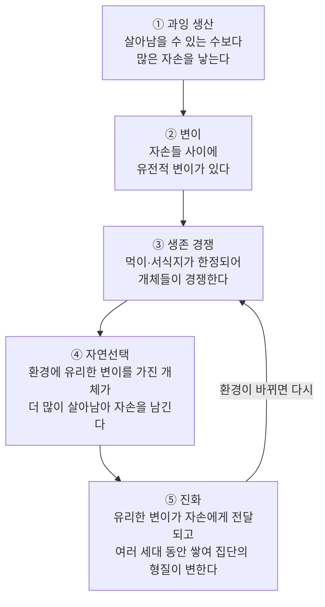
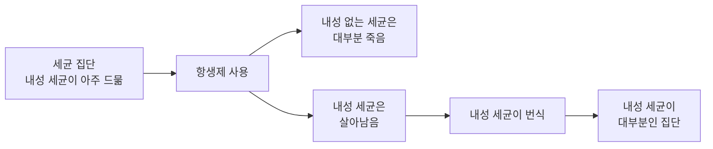
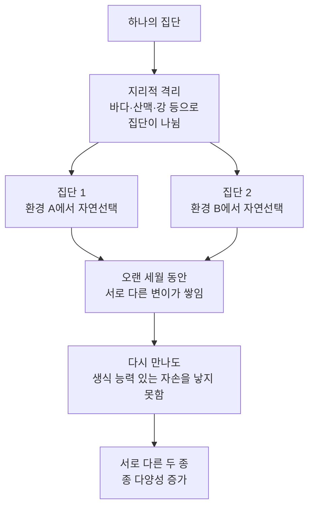

# 4-2. 진화와 생물다양성 — 작은 차이가 만든 거대한 다양성

> [!NOTE]
> **성취기준 [10통과2-01-02]** 변이의 발생과 자연선택 과정을 통해 생물의 진화가 일어나고, 진화의 과정을 통해 생물다양성이 형성되었음을 추론할 수 있다.

**학습 목표**

1. 유전적 변이가 생기는 원인을 유전자·생식세포 형성·수정과 관련지어 설명하고, 유전되지 않는 변이와 구별할 수 있다.
2. 다윈의 자연선택설을 '과잉 생산 → 변이 → 생존 경쟁 → 자연선택 → 진화'의 과정으로 설명하고, 모의실험으로 확인할 수 있다.
3. 항생제 내성 세균, 핀치의 부리, 회색가지나방의 몸 색 변화 등의 사례를 자연선택으로 설명할 수 있다.
4. 생물다양성을 유전적 다양성·종 다양성·생태계 다양성으로 설명하고, 생물다양성 보전 사례와 실천 방안을 제안할 수 있다.

**이 단원의 학습 사다리**

| 단계 | 무엇을 하나? |
|---|---|
| STEP 1. 중학교 다시 보기 | 변이, 종과 분류, 생물다양성 보전, 염색체와 유전자를 다시 꺼내 본다 |
| STEP 2. 기초 다지기 | 유전자와 형질, 개체와 집단, 비율 계산을 디딤돌로 놓는다 |
| STEP 3. 핵심 개념 | 변이 → 자연선택설 → 진화의 사례 → 종의 형성 → 생물다양성의 세 수준과 보전 |
| STEP 4. 오개념 바로잡기 | "기린은 목을 늘이려 애써서 목이 길어졌다?" 같은 착각을 바로잡는다 |
| STEP 5. 선택과목·대학 | 집단유전학(하디·바인베르크), 유전적 부동, 분자 계통수 |
| STEP 6. 산업·진로 | 항생제 내성과 신약 개발, 품종 개량과 종자 은행, 유전자원·바이오 산업, 생태 복원 |

---

## 🗺️ 단원 들어가기

1928년 영국의 플레밍은 푸른곰팡이에서 세균을 죽이는 물질 **페니실린**을 발견했다. 페니실린 같은 **항생제**는 그전까지 목숨을 앗아 가던 수많은 세균 감염병을 치료할 수 있게 해 주었다. 그런데 오늘날 병원에서는 웬만한 항생제가 듣지 않는 '슈퍼 세균' 때문에 골머리를 앓고 있다. 항생제는 그대로인데, **세균이 변했다.** 세균은 어떻게 변했을까?

바다 건너 갈라파고스 제도에는 부리 모양이 저마다 다른 핀치 새들이 산다. 굵고 단단한 부리, 가늘고 뾰족한 부리……. 1830년대 이 섬들을 찾은 젊은 박물학자 **다윈**은 이 다양성에 주목했고, 훗날 "생물은 어떻게 변하고 다양해지는가"에 대한 답을 내놓았다. 바로 **자연선택에 의한 진화**이다. 세균의 내성과 핀치의 부리는 같은 원리로 설명된다.

---

## STEP 1. 🔙 중학교 다시 보기

### 연계 개념표

| 중학교 성취기준 | 중학교에서 배운 것 | 고등학교에서 확장되는 것 |
|---|---|---|
| [9과02-03] | 생물다양성의 뜻, 같은 종의 생물 사이에 나타나는 **변이**와 생물다양성의 관계 | 변이가 **왜** 생기는지(유전적 원인), 변이가 자연선택을 거쳐 진화로 이어지는 과정 |
| [9과02-04] | 생물학적 **종**의 개념, 생물을 5계로 분류 | 한 종이 **어떻게 두 종으로 나뉘는지**(종의 형성), 분류 체계가 진화의 역사를 반영함 |
| [9과02-05] | 생물다양성 보전의 필요성과 유지 방안 조사·실천 | 생물다양성을 **세 수준**으로 나누어 분석하고, 국내외 보전 사례·국제 협약·산업과 연결 |
| [9과21-02] | 염색체와 유전자의 관계, 생식세포 형성 과정의 특징 | 생식세포 형성과 수정 과정에서 **유전자 조합이 다양해져** 유전적 변이가 생긴다 |
| [9과21-04] | 멘델 유전 원리: 형질은 부모에서 자손으로 유전된다 | **유전되는 변이만** 진화에 기여한다 |

### 준비 운동 (사전 진단)

**Q1.** 같은 반 친구들의 키, 혈액형, 눈꺼풀 모양이 서로 다른 것처럼 같은 종의 개체 사이에 나타나는 형질의 차이를 무엇이라고 하는가?

**Q2.** 말과 당나귀 사이에서 태어난 노새는 생식 능력이 없다. 말과 당나귀는 같은 종일까, 다른 종일까?

**Q3.** 사람의 체세포에는 염색체가 46개 있다. 정자나 난자 같은 생식세포에는 염색체가 몇 개 있을까?

**Q4.** 생물다양성을 보전하기 위해 개인이 할 수 있는 일을 한 가지 쓰시오.

정답 및 해설

**Q1. 변이** — 같은 종의 개체 사이에 나타나는 형질의 차이를 변이라고 한다.

**Q2. 다른 종** — 생물학적 종은 자연 상태에서 서로 짝짓기하여 **생식 능력이 있는 자손**을 낳을 수 있는 무리이다. 노새는 생식 능력이 없으므로 말과 당나귀는 다른 종이다.

**Q3. 23개** — 생식세포는 체세포 염색체 수의 절반을 가진다. 정자(23개)와 난자(23개)가 수정하면 다시 46개가 된다.

**Q4.** (예) 외래 생물을 함부로 자연에 풀어 주지 않기, 일회용품 줄이기, 야생 동식물을 함부로 채집하지 않기, 생태 탐방로 벗어나지 않기 등

---

## STEP 2. 🧱 기초 다지기

### ① 유전자가 형질을 정한다

3-6단원에서 배웠듯이 **유전자(gene)** 는 DNA의 일부로, 그 **염기 서열**에 단백질을 만드는 정보가 담겨 있다. 만들어진 단백질이 몸의 생김새와 기능, 즉 **형질(trait)** 을 나타낸다.

$$
\text{DNA의 염기 서열(유전자)} \;\rightarrow\; \text{단백질} \;\rightarrow\; \text{형질}
$$

따라서 유전자가 조금 다르면 단백질이 달라지고, 형질도 달라질 수 있다. 유전자는 생식세포를 통해 자손에게 전달되므로, **유전자의 차이로 생긴 형질의 차이는 자손에게 유전된다.**

### ② 개체와 집단

- **개체(individual)**: 독립적으로 살아가는 생물 하나. 예: 나방 한 마리
- **집단(population)**: 일정한 지역에 사는 **같은 종** 개체들의 무리. 예: 어느 숲에 사는 회색가지나방 전체

> [!IMPORTANT]
> 진화는 **개체가 아니라 집단에서** 일어난다. 나방 한 마리는 살아 있는 동안 몸 색이 바뀌지 않는다. 대신 여러 세대를 거치며 집단 속에서 검은 나방이 차지하는 **비율**이 바뀐다. 이것이 진화이다.

### ③ 비율로 변화를 읽기

집단의 변화는 '몇 마리인가'보다 '**몇 %인가**'로 보아야 한다.

$$
\text{어떤 형질의 비율} \;(\%) = \frac{\text{그 형질을 가진 개체 수}}{\text{집단 전체 개체 수}} \times 100
$$

예: 100마리 중 검은 나방 20마리 → 20%. 다음 세대에 120마리 중 검은 나방 48마리 → 40%. 개체 수도 늘었지만 더 중요한 것은 **비율이 20%에서 40%로 커졌다**는 점이다.

### ④ 지수적 증가 — 2배, 2배, 또 2배

세균은 한 개가 둘로 나뉘며 번식한다. 한 번 분열할 때마다 수가 2배가 되므로, $n$번 분열하면

$$
N = N_0 \times 2^{n}
$$

이 된다. $2^{10} = 1024$, 즉 10번만 분열해도 약 1000배가 된다. 생물은 이처럼 살아남을 수 있는 수보다 **훨씬 많은 자손**을 낳을 수 있다. 이것이 자연선택설의 첫 단계인 '과잉 생산'의 수학적 바탕이다.

> [!TIP]
> 💡 **비유** — 종이를 반으로 접을 때마다 두께가 2배가 된다. 0.1 mm 종이를 10번 접을 수 있다면 두께는 약 10 cm, 20번이면 약 100 m가 된다. 2배씩 늘어나는 것은 처음에는 느려 보여도 금세 엄청난 수가 된다.

---

## STEP 3. 📘 핵심 개념

### 4-2-① 변이 — 진화의 재료

같은 종의 개체 사이에 나타나는 형질의 차이를 **변이(variation)** 라고 한다. 변이는 원인에 따라 두 가지로 나뉜다.

| 구분 | **유전적 변이** | **비유전적 변이(환경에 의한 변이)** |
|---|---|---|
| 원인 | 유전자(DNA)의 차이 | 환경(먹이, 햇빛, 운동, 기후 등)의 차이 |
| 자손에게 전달 | **된다** | **안 된다** |
| 진화에 기여 | **한다** | 하지 않는다 |
| 예 | 무당벌레 날개 무늬의 차이, 사람의 혈액형, 나방 몸 색의 차이 | 운동으로 커진 근육, 햇볕에 그을린 피부, 같은 품종이라도 거름을 많이 준 벼가 더 큼 |

**유전적 변이는 왜 생길까?**

1. **돌연변이(mutation)**: DNA의 염기 서열이 바뀌는 것이다. DNA가 복제될 때의 오류, 자외선·방사선·일부 화학 물질 등에 의해 생긴다. 염기 서열이 바뀌면 다른 단백질이 만들어져 **새로운 형질**이 나타날 수 있다. 돌연변이는 **새로운 유전자를 만드는 근본적인 원천**이다.
2. **생식세포 형성 과정**: 생식세포가 만들어질 때 부모에게서 받은 염색체 쌍이 둘로 나뉘어 들어가는데, 어느 쪽 염색체가 어느 생식세포로 들어갈지는 **무작위**이다. 그래서 같은 부모에게서도 유전자 조합이 서로 다른 생식세포가 매우 많이 만들어진다.
3. **수정**: 어떤 정자와 어떤 난자가 만나 수정할지도 무작위이다. 그래서 같은 부모에게서 태어난 형제자매도 생김새가 서로 다르다.

> [!TIP]
> 💡 **비유** — 돌연변이는 카드 묶음에 **새로운 카드를 추가**하는 것, 생식세포 형성과 수정은 이미 있는 카드를 **섞고 나누어 새로운 패를 만드는** 것이다. 새 카드가 없으면 패의 종류에 한계가 있고, 섞지 않으면 새 카드가 있어도 조합이 다양해지지 않는다. 두 과정이 함께 작용해 집단 안의 변이가 풍부해진다.

> [!NOTE]
> 돌연변이는 **우연히** 일어나며, 생물에게 필요해서 일어나는 것이 아니다. 대부분의 돌연변이는 생존에 영향이 없거나 해롭고, 드물게 특정 환경에서 유리한 것이 있다. 어떤 돌연변이가 유리한지는 **환경에 따라 달라진다.**

### 4-2-② 다윈의 자연선택설

**(1) 다윈과 『종의 기원』**

영국의 박물학자 **다윈(Charles Darwin, 1809~1882)** 은 1831년부터 약 5년 동안 비글호를 타고 세계를 항해하며 여러 생물과 화석을 관찰했다. 특히 갈라파고스 제도의 섬마다 핀치, 거북 등의 생김새가 조금씩 다르다는 점에 주목했다. 그는 20여 년의 연구 끝에 1859년 『종의 기원』을 펴내 **자연선택(natural selection)** 에 의한 진화를 주장했다. 같은 시기 **월리스(Alfred Russel Wallace)** 도 독자적으로 비슷한 생각에 도달했다.

다윈은 인구가 식량보다 빠르게 늘어난다는 맬서스의 『인구론』, 그리고 사람이 원하는 형질을 가진 가축·작물을 골라 기르는 **인위 선택(artificial selection)** 에서 힌트를 얻었다. 사람이 고르듯 **자연(환경)도 생물을 고른다**고 생각한 것이다.

**(2) 자연선택설의 과정**

| 단계 | 핵심 내용 | 기린의 목으로 설명하기 |
|---|---|---|
| 과잉 생산 | 생물은 살아남을 수 있는 수보다 많은 자손을 낳는다 | 기린은 먹이가 감당할 수 있는 수보다 많은 새끼를 낳는다 |
| 변이 | 자손들의 형질은 조금씩 다르다 | 목이 조금 긴 새끼, 조금 짧은 새끼가 태어난다 |
| 생존 경쟁 | 먹이·공간이 부족해 경쟁이 일어난다 | 키 작은 나무의 잎이 부족해진다 |
| 자연선택 | 환경에 유리한 형질을 가진 개체가 더 많이 살아남아 번식한다 | 목이 긴 기린이 높은 곳의 잎을 먹어 더 많이 살아남는다 |
| 진화 | 유리한 형질이 유전되어 여러 세대 동안 쌓인다 | 세대가 거듭될수록 목이 긴 기린의 비율이 높아진다 |

> [!WARNING]
> **라마르크의 용불용설과 비교** — 다윈보다 앞서 프랑스의 라마르크는 "기린이 높은 곳의 잎을 먹으려고 목을 계속 늘이다 보니 목이 길어졌고, 그렇게 **얻은 형질이 자손에게 유전**되었다"고 설명했다(용불용설, 획득 형질의 유전). 그러나 살면서 얻은 형질(비유전적 변이)은 유전자를 바꾸지 않으므로 자손에게 전달되지 않는다. 운동선수 부모의 근육이 자녀에게 그대로 유전되지 않는 것과 같다. 오늘날에는 **이미 존재하던 유전적 변이 중에서 환경에 유리한 것이 선택된다**는 자연선택설이 진화를 설명하는 핵심 원리로 받아들여진다.

<!-- fig:4-2-lamarck-vs-darwin -->

**(3) 다윈 이후 — 유전학과 만나다**

다윈은 변이가 **왜** 생기고 **어떻게** 유전되는지 설명하지 못했다(당시에는 유전자의 존재를 몰랐다). 20세기에 멘델 유전학과 DNA 연구가 발전하면서 '변이 = 유전자의 차이(돌연변이·유전자 조합)'라는 사실이 밝혀졌고, 자연선택설은 유전학과 결합하여 더욱 탄탄해졌다.

#### 예제 1 — 과잉 생산

좋은 조건에서 어떤 세균은 20분마다 한 번씩 분열한다. 세균 1마리에서 시작하여 6시간 동안 모든 세균이 살아남아 분열한다면 몇 마리가 될까?

**풀이** 6시간 = 360분, 분열 횟수 $n = 360 \div 20 = 18$번
$N = 1 \times 2^{18} = 262\,144$마리

하룻밤 사이에 수십만 마리가 된다. 실제로는 먹이와 공간이 한정되어 있으므로 대부분이 살아남지 못한다. **과잉 생산은 반드시 생존 경쟁으로 이어진다.**

### 4-2-③ 자연선택으로 진화한 사례

**(1) 회색가지나방의 몸 색 변화 — 공업 암화**

- **배경**: 영국에 사는 **회색가지나방**에는 몸 색이 밝은 회색(흰색)인 개체와 검은색인 개체가 있다(유전적 변이). 나방은 낮에 나무줄기에 앉아 쉬는데, 새가 눈에 잘 띄는 나방을 잡아먹는다.
- **산업혁명 이전**: 나무줄기에 밝은 색의 지의류가 덮여 있어 **밝은 나방**이 눈에 덜 띄었다. 검은 나방은 매우 드물었다.
- **산업혁명 이후(19세기)**: 공장 매연(석탄 그을음)으로 지의류가 죽고 나무줄기가 검게 변했다. 이제 **검은 나방**이 눈에 덜 띄어 더 많이 살아남았다. 공업 지역에서는 19세기 말까지 검은 나방이 대부분을 차지하게 되었다.
- **대기 오염 규제 이후(20세기 중반~)**: 공기가 깨끗해져 나무줄기가 다시 밝아지자 **밝은 나방의 비율이 다시 증가**했다.

이처럼 공업화로 환경이 어두워지면서 몸 색이 어두운 개체가 많아지는 현상을 **공업 암화(industrial melanism)** 라고 한다. 이 사례는 **환경이 바뀌면 '유리한 변이'도 바뀐다**는 것을 잘 보여 준다.

#### 예제 2 — 세대에 따른 비율 변화

검게 변한 숲에 회색가지나방 80마리(밝은 나방 64마리, 검은 나방 16마리)가 산다. 매 세대 새가 **밝은 나방의 50%**, **검은 나방의 25%** 를 잡아먹고, 살아남은 나방은 각각 같은 색의 자손을 2마리씩 남긴 뒤 죽는다고 가정하자. 각 세대에서 검은 나방의 비율을 구하시오.

**풀이** 1세대를 거치면
- 밝은 나방: $64 \times 0.5 = 32$마리 생존 → 자손 $32\times 2 = 64$마리
- 검은 나방: $16 \times 0.75 = 12$마리 생존 → 자손 $12\times 2 = 24$마리

즉 밝은 나방은 매 세대 $0.5 \times 2 = 1$배(그대로), 검은 나방은 매 세대 $0.75 \times 2 = 1.5$배가 된다.

| 세대 | 밝은 나방 | 검은 나방 | 검은 나방의 비율 |
|---|---|---|---|
| 0 (처음) | 64 | 16 | $16/80 = 20.0\%$ |
| 1 | 64 | 24 | $24/88 \approx 27.3\%$ |
| 2 | 64 | 36 | $36/100 = 36.0\%$ |
| 3 | 64 | 54 | $54/118 \approx 45.8\%$ |
| 4 | 64 | 81 | $81/145 \approx 55.9\%$ |

단 4세대 만에 검은 나방이 소수(20%)에서 다수(약 56%)가 되었다. 생존율의 작은 차이(50% vs 75%)가 **세대를 거듭하며 쌓이면** 집단의 형질이 크게 바뀐다. 이것이 자연선택에 의한 진화이다.

<!-- sim:natural-selection -->

**(2) 갈라파고스 핀치의 부리**

- 갈라파고스 제도에는 부리 모양이 서로 다른 10여 종의 핀치가 산다. 큰 씨앗을 깨 먹는 핀치는 **굵고 단단한 부리**, 곤충을 잡아먹는 핀치는 **가늘고 뾰족한 부리**를 가지고 있다. 섬마다 먹이 환경이 달라, 각 환경에 알맞은 부리를 가진 개체가 선택되어 왔다.
- **실제 관찰된 진화**: 1970년대에 그랜트(Grant) 부부 연구진은 갈라파고스의 한 작은 섬에서 핀치를 오랫동안 관찰했다. 심한 가뭄이 든 해에 작고 부드러운 씨앗이 부족해지고 크고 단단한 씨앗만 남자, **부리가 큰 개체가 더 많이 살아남았다.** 그 결과 다음 세대 핀치의 **평균 부리 크기가 커졌다.** 자연선택이 사람이 지켜보는 동안에도 일어날 수 있음을 보여 준 연구이다.

**(3) 항생제 내성 세균**

- 세균 집단에는 돌연변이 등으로 **우연히 항생제에 견디는 능력(내성)을 가진 세균**이 아주 드물게 섞여 있다.
- 항생제를 쓰면 내성이 없는 세균은 대부분 죽고, **내성 세균만 살아남아** 빠르게 번식한다.
- 항생제를 자주, 잘못 쓸수록 내성 세균이 선택될 기회가 많아져 결국 **항생제가 잘 듣지 않는 세균 집단**이 된다. 여러 항생제에 내성을 가진 세균을 흔히 '슈퍼 세균(다제 내성균)'이라고 한다.

> [!IMPORTANT]
> 항생제가 세균에게 내성을 '만들어 주는' 것이 아니다. 내성은 항생제를 쓰기 전부터 일부 세균에 **이미 있던 변이**이고, 항생제는 내성 세균을 **골라 남기는(선택하는)** 환경으로 작용한다. 의사가 처방한 항생제를 **정해진 기간 끝까지** 복용하고, 감기처럼 바이러스가 원인인 병에 항생제를 쓰지 않아야 하는 이유이다.

**세 사례의 공통 구조**

| 사례 | 변이 | 선택하는 환경 | 결과 |
|---|---|---|---|
| 회색가지나방 | 밝은 몸 색 / 검은 몸 색 | 나무줄기 색과 새의 포식 | 환경에 따라 검은 나방 또는 밝은 나방의 비율 증가 |
| 핀치 | 부리의 크기·모양 | 섬의 먹이(씨앗의 크기·단단함) | 먹이에 맞는 부리를 가진 개체의 비율 증가 |
| 세균 | 항생제 내성 유무 | 항생제 | 내성 세균의 비율 증가 |

### 4-2-④ 진화와 생물다양성의 형성

자연선택은 집단의 형질을 바꾼다. 그렇다면 이것이 어떻게 **새로운 종**으로 이어지고, 지구의 다양한 생물을 만들었을까?

**(1) 종의 형성(종 분화)**

중학교에서 배운 **생물학적 종(species)** 은 "자연 상태에서 짝짓기하여 생식 능력이 있는 자손을 낳을 수 있는 무리"이다. 한 종이 두 종으로 나뉘는 과정을 간단히 정리하면 다음과 같다.

1. 한 종의 집단이 바다·산맥 등으로 나뉘어 서로 만나지 못하게 된다(**지리적 격리**).
2. 나뉜 집단은 서로 다른 환경에서 서로 다른 변이가 선택되며 각자 진화한다.
3. 오랜 세월이 지나면 다시 만나도 짝짓기를 하지 않거나 생식 능력 있는 자손을 낳지 못하게 된다(**생식적 격리**). 이제 두 집단은 **다른 종**이다.

갈라파고스 핀치는 남아메리카 대륙에서 건너온 조상 핀치가 여러 섬으로 퍼져 나가 섬마다 다른 환경에 적응하면서 여러 종으로 나뉜 것으로 설명된다.

**(2) 진화의 역사가 생물다양성을 만들었다**

- 4-1단원에서 본 것처럼, 지질시대 동안 환경은 끊임없이 변했다. 환경이 변할 때마다 자연선택의 방향도 바뀌었고, 새로운 종이 생겨나거나 멸종했다.
- 대멸종으로 생긴 빈 생태적 자리는 살아남은 생물이 **다양한 환경에 적응하며 여러 종으로 갈라지는** 무대가 되었다(예: 중생대 말 이후 포유류의 다양화).
- 화석 기록에서 오래된 지층부터 새 지층으로 생물이 단계적으로 바뀌어 나타나는 것은 생물이 **공통 조상으로부터 오랜 시간에 걸쳐 갈라져 나왔다**는 증거가 된다.
- 결국 오늘날의 생물다양성은 수십억 년에 걸친 **변이 → 자연선택 → 종 분화**가 쌓인 결과이다.

> [!TIP]
> 💡 **비유** — 생물의 역사는 거대한 '나무'와 같다. 줄기(공통 조상)에서 가지가 갈라지고(종 분화), 어떤 가지는 말라 죽고(멸종), 어떤 가지는 무성하게 뻗어 나간다(적응과 다양화). 오늘날 살아 있는 생물들은 이 나무의 맨 끝에 달린 잎들이다.

### 4-2-⑤ 생물다양성의 세 수준과 보전

**(1) 생물다양성의 세 수준**

**생물다양성(biodiversity)** 은 지구에 사는 생물의 다양한 정도를 말하며, 세 가지 수준으로 나누어 본다.

| 수준 | 뜻 | 예 |
|---|---|---|
| **유전적 다양성** | 같은 종 안에서 개체들이 가진 유전자의 다양한 정도 | 무당벌레 날개 무늬, 사람의 혈액형·피부색, 벼의 여러 품종 |
| **종 다양성** | 한 지역에 사는 생물 종의 다양한 정도. **종의 수(종 풍부도)** 와 각 종이 **얼마나 고르게 분포하는가(균등도)** 를 함께 고려한다 | 열대 우림은 극지방보다 종 다양성이 높다 |
| **생태계 다양성** | 한 지역에 존재하는 생태계(숲, 초원, 습지, 갯벌, 사막, 강, 바다 등)의 다양한 정도 | 산·강·갯벌·바다가 고루 있는 지역 |

세 수준은 서로 연결되어 있다. 생태계가 다양하면 다양한 환경에 사는 여러 종이 있을 수 있고(종 다양성↑), 각 종 안의 유전적 다양성은 그 종이 환경 변화에 적응할 수 있는 바탕이 된다.

<!-- fig:4-2-biodiversity-levels -->

> [!IMPORTANT]
> **유전적 다양성이 왜 중요할까?** 1840년대 아일랜드에서는 많은 사람들이 소수 품종의 감자에 의존했는데, 감자역병이 퍼지자 거의 모든 감자가 함께 병에 걸려 큰 기근이 일어났다. 유전적 다양성이 낮은 집단은 **환경 변화나 질병에 한꺼번에 무너질 위험**이 크다. 반대로 유전적 다양성이 높으면 그중 일부는 살아남아 집단이 유지될 수 있다. 4-2-③의 자연선택도 **변이가 있어야** 일어날 수 있다.

#### 예제 3 — 종 다양성 비교

두 지역 A, B에서 조사한 식물의 개체 수이다. 어느 지역의 종 다양성이 더 높은가?

| 종 | 지역 A | 지역 B |
|---|---|---|
| 민들레 | 25 | 85 |
| 토끼풀 | 25 | 5 |
| 질경이 | 25 | 5 |
| 강아지풀 | 25 | 5 |
| 합계 | 100 | 100 |

**풀이** 두 지역 모두 종의 수는 4종으로 같다(종 풍부도 같음). 그러나 A는 네 종이 25%씩 **고르게** 분포하고, B는 민들레가 85%를 차지해 한 종에 치우쳐 있다. 따라서 균등도가 높은 **지역 A의 종 다양성이 더 높다.**

> [!TIP]
> 💡 **비유** — 과일 바구니 두 개에 사과·배·귤·포도가 모두 들어 있다. 한 바구니는 네 가지가 5개씩, 다른 바구니는 사과 17개에 나머지가 1개씩이다. 눈을 감고 아무거나 꺼낼 때 '다양함'을 느끼는 쪽은 앞의 바구니이다.

**(2) 생물다양성은 왜 중요할까?**

| 가치 | 내용 |
|---|---|
| 생태계 유지 | 다양한 생물이 먹이 관계로 얽혀 있어야 생태계가 안정적으로 유지된다(5단원에서 자세히 배운다) |
| 생물 자원 | 식량, 옷감, 목재, 의약품의 원료를 제공한다. 예: 푸른곰팡이에서 페니실린, 주목나무 껍질에서 항암제 성분 |
| 생태계 서비스 | 깨끗한 물과 공기, 꽃가루받이, 홍수 조절, 토양 형성 |
| 문화·정서적 가치 | 휴식, 관광, 교육, 예술의 원천 |

**(3) 생물다양성을 위협하는 요인**

| 위협 요인 | 내용과 예 |
|---|---|
| 서식지 파괴·단편화 | 개발로 숲·습지가 사라지거나 도로로 서식지가 잘게 쪼개진다 |
| 남획 | 필요 이상으로 잡거나 채집한다 |
| 외래 생물 유입 | 천적이 없는 외래 생물이 토종 생물을 위협한다. 우리나라는 황소개구리, 뉴트리아, 큰입배스, 파랑볼우럭(블루길) 등을 생태계 교란 생물로 지정해 관리한다 |
| 환경 오염 | 수질·토양 오염, 플라스틱 쓰레기 |
| 기후 변화 | 기온 상승으로 서식지가 이동하거나 사라진다 |

**(4) 생물다양성 보전 사례와 실천 방안**

| 차원 | 보전 방법과 사례 |
|---|---|
| **국제** | 생물다양성협약(1992년 채택), 유전자원의 이용으로 생긴 이익을 공유하는 나고야 의정서(2010년 채택), 중요한 습지를 보전하는 람사르 협약. 2022년에는 2030년까지 육지와 바다의 30%를 보호 지역 등으로 보전하자는 목표가 국제적으로 합의되었다 |
| **국가** | 국립공원·보호 구역 지정, 멸종 위기 야생 생물 지정과 보호, 종 복원 사업(지리산 반달가슴곰은 2004년부터, 황새는 2015년 충남 예산에서, 따오기는 2019년 경남 창녕 우포늪에서 야생 방사), 생태 통로 설치, 종자 은행 운영 |
| **지역 사회** | 습지·하천 복원, 갯벌 보전(우리나라 서남해안 갯벌은 2021년 유네스코 세계자연유산으로 등재), 생태 관광 |
| **개인** | 외래 생물(반려동물 포함)을 자연에 풀어 주지 않기, 멸종 위기 생물로 만든 제품 사지 않기, 일회용품·에너지 사용 줄이기, 탐방로 지키기, 시민 과학(생물 조사) 참여 |

> [!NOTE]
> **생태 통로**는 도로나 댐으로 끊어진 서식지를 이어 주는 다리나 터널이다. 야생 동물이 안전하게 이동할 수 있어 로드킬을 줄이고, 나뉜 집단 사이에 짝짓기가 가능해져 **유전적 다양성이 유지**되도록 돕는다.

---

## STEP 4. ⚠️ 오개념 바로잡기

| 흔한 오개념 | 올바른 개념 | 왜 그럴까? |
|---|---|---|
| 기린은 높은 곳의 잎을 먹으려고 애써서 목이 길어졌고, 그것이 유전되었다 | 목이 긴 **변이가 이미 있었고**, 그 개체가 더 많이 살아남아 번식하여 목이 긴 형질이 집단에 퍼졌다 | 살면서 얻은 형질(근육, 그을린 피부)은 유전자를 바꾸지 않아 유전되지 않는다 |
| 항생제가 세균에게 내성을 만들어 준다 | 내성 세균은 항생제 사용 **전에 이미 일부 존재**했고, 항생제는 그것을 **선택**했을 뿐이다 | 돌연변이는 필요와 상관없이 우연히 일어난다. 환경은 변이를 만들지 않고 고른다 |
| 진화는 개체가 일생 동안 변하는 것이다 | 진화는 여러 세대에 걸쳐 **집단**의 유전적 구성이 변하는 것이다 | 나방 한 마리의 색은 바뀌지 않는다. 바뀌는 것은 집단 속 검은 나방의 비율이다 |
| 진화는 항상 더 크고 복잡하고 '우월한' 방향으로 일어난다 | 진화는 **그 환경에 유리한** 방향으로 일어날 뿐, 정해진 목표나 방향이 없다 | 환경이 다시 밝아지자 밝은 나방이 다시 늘었다. 동굴 생물은 눈이 퇴화하기도 한다 |
| '적자생존'은 가장 힘센 개체가 살아남는다는 뜻이다 | 환경에 **가장 잘 맞는** 변이를 가진 개체가 **더 많은 자손**을 남긴다는 뜻이다 | 숨기를 잘하는 것, 먹이를 적게 먹는 것, 번식을 잘하는 것도 유리할 수 있다 |
| 종 수만 많으면 종 다양성이 높다 | 종 다양성은 종의 수와 함께 각 종이 **얼마나 고르게** 분포하는지도 고려한다 | 4종이 고르게 사는 곳이 한 종이 대부분을 차지하는 곳보다 다양성이 높다 |

---

## STEP 5. 🎓 선택과목·대학으로 한 걸음 더

> [!CAUTION]
> 이 절은 **통합과학 교육과정 범위 밖의 심화 내용**으로 평가 대상이 아니다. "이 개념이 앞으로 어디까지 이어지는가"를 맛보기로 보여 주기 위한 내용이다.

### 고2·3 선택과목과의 연결

| 과목 | 이어지는 내용 |
|---|---|
| 생명과학 | 생명의 연속성과 다양성: 유전 원리, 진화의 증거와 원리, 생물의 분류 |
| 생물의 유전 | 유전자와 염색체, 유전 현상, 유전자 발현 |
| 지구과학 | 지구의 역사: 화석 기록과 생물의 변천 |
| 기후변화와 환경생태 | 생물다양성 위기와 보전, 생태계와 기후 변화 |

### ① 진화를 수식으로 — 집단유전학

대학의 **집단유전학(population genetics)** 에서는 집단 속 유전자의 비율(**대립유전자 빈도**)이 세대에 따라 어떻게 변하는지 수식으로 다룬다. 어떤 형질을 정하는 대립유전자가 A, a 두 가지이고 그 빈도를 각각 $p$, $q$라 하면 $p + q = 1$이다. 자연선택·돌연변이·이주 등이 없고 집단이 충분히 크며 무작위로 짝짓기하면, 유전자형의 비율은 세대가 지나도 일정하게 유지된다(**하디·바인베르크 평형**).

$$
p^2 + 2pq + q^2 = 1 \qquad (\text{AA} : \text{Aa} : \text{aa})
$$

**예** 열성 형질(aa)을 나타내는 개체가 16%라면 $q^2 = 0.16$이므로 $q = 0.4$, $p = 0.6$이다. 보인자(Aa)의 비율은 $2pq = 2 \times 0.6 \times 0.4 = 0.48$, 즉 48%이다.

평형이 **깨지는 것 자체가 진화의 신호**이다. 그래서 이 식은 실제 집단에서 진화가 일어나고 있는지 판단하는 기준선으로 쓰인다.

### ② 자연선택만이 아니다 — 유전적 부동

집단이 작으면 유리하지도 불리하지도 않은 유전자의 비율이 **우연히** 크게 바뀔 수 있다. 이를 **유전적 부동(genetic drift)** 이라고 한다. 산불·홍수로 집단의 대부분이 우연히 죽어 소수만 남는 **병목 효과**, 소수의 개체가 새로운 섬으로 건너가 집단을 이루는 **창시자 효과**가 그 예이다. 멸종 위기종은 개체 수가 적어 유전적 부동으로 유전적 다양성을 잃기 쉽기 때문에, 보전 생물학에서는 **유전적 다양성 관리**가 중요한 과제가 된다. 생식세포 형성 때 상동 염색체끼리 일부를 맞바꾸는 **교차**도 대학 유전학에서 다루는 변이의 원천이다.

### ③ DNA로 그리는 생명의 나무 — 분자 계통학

두 생물의 DNA 염기 서열을 비교하면 차이가 적을수록 가까운 친척(최근에 갈라짐)이다. 대학 **분자진화학·생물정보학**에서는 수많은 생물의 유전체 서열을 컴퓨터로 비교해 **계통수(phylogenetic tree)** 를 그린다. 중학교에서 배운 5계 분류도 이러한 연구로 계속 수정·보완되고 있으며, 대학에서는 세균·고세균·진핵생물의 **3역 체계**를 다룬다.

### 고등학교 vs 대학교

| 구분 | 고등학교 통합과학 | 대학교 진화생물학·집단유전학 |
|---|---|---|
| 변이 | 돌연변이, 생식세포 형성과 수정으로 정성 설명 | 돌연변이율, 교차와 재조합, 유전체 수준 분석 |
| 진화의 원리 | 다윈의 자연선택설 | 자연선택 + 유전적 부동 + 유전자 흐름 + 돌연변이, 하디·바인베르크 모델 |
| 사례 분석 | 비율 변화로 정성·간단 계산 | 선택 계수, 집단 크기를 넣은 수학 모델·컴퓨터 시뮬레이션 |
| 생물다양성 | 세 수준의 개념, 균등도의 직관적 비교 | 다양성 지수(심프슨·섀넌), 보전 유전학, 경관 생태학 |
| 관련 전공 | — | 생명과학, 미생물학, 약학, 의학, 농생명과학, 산림자원학, 환경생태학 |

---

## STEP 6. 🏭 산업 현장과 진로 연결

### 사례 1. 항생제 내성과 신약 개발

- **원리** 항생제를 쓸 때마다 내성 세균이 선택된다(4-2-③). 따라서 새 항생제를 개발해도 시간이 지나면 내성균이 나타나는 '군비 경쟁'이 벌어진다.
- **현장의 대응**
  - **항생제 적정 사용**: 병원에서는 꼭 필요한 경우에만, 알맞은 항생제를 알맞은 기간 쓰도록 관리한다. 질병관리청 등은 국가 차원의 항생제 내성 관리 대책을 세워 사람뿐 아니라 가축·수산 분야의 항생제 사용까지 함께 관리한다(사람·동물·환경의 건강을 함께 보는 '원헬스' 접근).
  - **감염 관리**: 내성균 환자를 격리하고 손 위생을 철저히 하여 내성균이 퍼지지 않게 한다.
  - **신약 개발**: 세균의 새로운 표적을 공격하는 항생제, 세균만 골라 감염시키는 바이러스(박테리오파지)를 이용한 치료 등이 연구되고 있다. 신약 후보를 찾기 위해 토양·바다 미생물처럼 **생물다양성 속의 천연물**을 탐색하기도 한다.
- **핵심 숫자** 2022년에 발표된 대규모 국제 연구는 2019년 한 해 동안 항생제 내성균 감염이 직접적인 원인이 되어 세계에서 약 127만 명이 사망한 것으로 추정했다. 세계보건기구(WHO)는 항생제 내성을 인류 건강의 주요 위협 중 하나로 꼽는다.

### 사례 2. 품종 개량 — 사람이 하는 선택

- **원리** 사람이 원하는 형질을 가진 개체를 골라 번식시키는 **인위 선택**이다. 양배추, 브로콜리, 콜리플라워, 케일, 콜라비는 모양이 전혀 달라 보이지만 모두 **야생 양배추 한 종**에서 사람이 서로 다른 부분(잎, 꽃봉오리, 줄기)을 골라 키워 만든 품종이다.
- **유전적 다양성이 필요한 이유** 새로운 병이나 기후 변화에 강한 품종을 만들려면 그 성질을 가진 유전자가 어딘가에 있어야 한다. 이 유전자는 흔히 오래된 **재래종**이나 **야생 근연종**(작물과 가까운 야생 식물)에 있다.
- **경고 사례** 전 세계에 수출되는 바나나는 대부분 한 품종(캐번디시)이다. 20세기 중반 이전의 주력 품종(그로미셸)은 곰팡이병(파나마병)으로 재배가 어려워져 교체되었고, 오늘날에는 캐번디시를 공격하는 새로운 형태의 파나마병이 퍼져 대책이 연구되고 있다. 단일 품종 재배는 **유전적 다양성이 낮아** 질병에 취약하다.

### 사례 3. 종자 은행 — 미래를 위한 유전자 금고

| 시설 | 특징 |
|---|---|
| **스발바르 국제종자저장고** (노르웨이) | 북극권 스발바르 제도의 영구 동토층 산속 터널에 2008년 문을 열었다. 세계 각국 유전자은행의 **농작물 종자 사본**을 약 −18 °C로 보관하며, 보관 중인 종자는 100만 점이 넘는다. 맡긴 기관이 소유권을 가지는 '안전 중복 보관' 방식이다. 2015년 시리아 내전으로 연구 시설을 잃은 국제 농업 연구 기관이 처음으로 종자를 되찾아 가 다시 증식했다 |
| **국립백두대간수목원 시드볼트** (경상북도 봉화) | 산림청 산하 국립백두대간수목원에 있는 지하 터널형 종자 영구 저장 시설이다. 농작물 중심인 스발바르와 달리 **야생 식물 종자**를 주로 보관하며, 영하 20 °C 안팎의 낮은 온도와 낮은 습도를 유지한다 |
| **농업유전자원센터** (농촌진흥청) | 우리나라의 작물 유전자원을 수집·보존하고 연구·육종에 제공하는 국가 유전자은행이다 |

- **왜 필요한가** 기후 변화·전쟁·재해로 어떤 작물이나 야생 식물이 사라져도, 종자를 꺼내 다시 키우고 품종 개량에 쓸 수 있다. 종자 은행은 **유전적 다양성을 지키는 보험**이다.

### 사례 4. 유전자원·바이오 산업과 생태 복원

- **유전자원 산업** 생물이 가진 유전자와 물질은 의약품, 화장품, 식품, 효소, 바이오 소재의 원천이다. 주목나무에서 얻은 항암제 성분, 버드나무 껍질 성분에서 출발한 진통·해열제처럼 생물다양성은 곧 **잠재적 신약 창고**이다. 나고야 의정서에 따라 다른 나라의 유전자원을 이용할 때는 사전 승인을 받고 이익을 공유해야 하므로, 국립생물자원관 등은 우리나라 고유 생물 자원을 조사·확보하고 있다.
- **생태 복원** 훼손된 하천·습지·산림·광산 지역을 원래의 생태계에 가깝게 되살리는 분야이다. 생태 통로 설치, 하천의 콘크리트 제방을 자연형 하천으로 바꾸는 사업, 멸종 위기종 서식지 복원 등이 있다. 개발 사업 전에는 **환경영향평가**로 생물다양성에 미칠 영향을 조사한다.

### 관련 진로와 학과

| 진로 | 하는 일 | 관련 학과 |
|---|---|---|
| 신약·항생제 연구원 | 내성 기전 연구, 새 항생제·치료법 개발 | 약학, 미생물학, 생명공학, 화학 |
| 감염 관리 전문가·임상병리사 | 내성균 검사, 병원 감염 관리 | 의학, 간호학, 임상병리학 |
| 식물 육종가·종자 연구원 | 품종 개량, 유전자원 수집·보존 | 원예학, 농학, 식물자원학, 생명과학 |
| 생물자원·보전 연구원 | 생물 조사, 멸종 위기종 복원, 종자 은행 운영 | 생명과학, 산림자원학, 환경생태학, 수의학 |
| 생태 복원 기술자·환경영향평가사 | 훼손지 복원 설계, 개발 사업의 생태 영향 평가 | 환경공학, 조경학, 생태학 |

---

## 🔬 탐구 활동 — 자연선택 과정에 대한 모의실험하기

### 활동 A. 색종이 나방 사냥 (모둠 활동)

**목표** 배경 색에 따라 '먹이'의 생존율이 달라지는 과정을 모의실험하여, 자연선택에 의해 집단의 형질 비율이 변하는 과정을 설명한다.

**준비물** 배경 2종(흰 도화지 1장, 글씨가 빽빽한 신문지 1장, 각각 A3 크기 정도), 펀치로 뚫은 둥근 종이 조각 4종(흰 종이, 신문지, 빨간 색종이, 초록 색종이) 각 40개씩, 핀셋, 초시계, 기록지

**과정**
1. 신문지 배경 위에 네 종류의 종이 조각을 **10개씩**(총 40개) 골고루 흩뿌린다. 종이 조각이 '나방 집단', 색이 '변이'이다.
2. '포식자' 역할의 학생은 배경을 등지고 섰다가, 신호에 맞춰 돌아서서 **15초 동안 핀셋으로 한 번에 하나씩** 종이 조각을 집어 낸다(먹힘).
3. 남은 조각(살아남은 나방)을 색깔별로 센다.
4. '번식': 살아남은 조각 **1개마다 같은 색 조각 1개**를 추가해 다시 흩뿌린다.
5. 2~4를 3세대 반복한다(포식자 역할은 매번 다른 학생이 맡는다).
6. 흰 도화지 배경에서도 같은 실험을 하고 결과를 비교한다.

**결과 기록 (신문지 배경)**

| 세대 | 흰 종이 | 신문지 | 빨강 | 초록 | 합계 | 신문지 조각의 비율(%) |
|---|---|---|---|---|---|---|
| 0 (처음) | 10 | 10 | 10 | 10 | 40 | 25 |
| 1 (번식 후) | | | | | | |
| 2 (번식 후) | | | | | | |
| 3 (번식 후) | | | | | | |

**생각해 보기**
1. 신문지 배경에서 비율이 가장 많이 늘어난 색은? 흰 도화지 배경에서는? 그 이유를 자연선택의 단계(과잉 생산, 변이, 생존 경쟁, 자연선택, 진화)에 맞춰 설명해 보자.
2. 이 실험에서 '번식' 단계에 같은 색 조각을 추가하는 것은 실제 생물의 어떤 성질을 나타낸 것일까?
3. 이 결과를 회색가지나방의 공업 암화와 비교해 보자. 배경을 신문지에서 흰 도화지로 바꾸는 것은 실제 역사의 어떤 사건에 해당할까?
4. 이 모의실험이 실제 자연선택과 **다른 점**(한계)을 두 가지 찾아보자. (예: 돌연변이로 새로운 색이 생기지 않음, 포식자가 사람임)

### 활동 B. 부리 도구로 먹이 집기 — 핀치의 부리 모델

**목표** 먹이 환경에 따라 유리한 '부리'가 달라짐을 확인한다.

**준비물** 부리 도구(핀셋, 빨래집게, 숟가락, 이쑤시개), 먹이(마른 콩, 쌀, 해바라기씨), 종이컵(위장), 접시, 초시계

**과정**
1. 각자 부리 도구 하나를 골라 '핀치'가 된다. 접시에 먹이 세 종류를 섞어 둔다.
2. 30초 동안 부리 도구만으로 먹이를 집어 종이컵에 옮긴다. 먹이를 가장 적게 모은 핀치 2명은 '굶어 죽어' 다음 라운드에 참여하지 못한다.
3. 다음 라운드에서는 먹이 환경을 바꾼다(예: '가뭄'이 들어 마른 콩만 남음).
4. 라운드마다 살아남은 부리 도구의 종류와 수를 기록한다.

**결과 기록**

| 라운드 | 먹이 환경 | 핀셋 | 빨래집게 | 숟가락 | 이쑤시개 |
|---|---|---|---|---|---|
| 1 | 세 종류 섞임 | | | | |
| 2 | 마른 콩만 | | | | |
| 3 | 쌀만 | | | | |

**생각해 보기**
1. 먹이 환경이 바뀔 때 '유리한 부리'는 어떻게 달라졌나? 그랜트 부부의 핀치 연구 결과와 비교해 보자.
2. 부리 도구가 한 종류뿐인 집단이 있다면 먹이 환경이 바뀔 때 어떤 일이 생길까? '유전적 다양성'과 연결해 설명해 보자.

> [!WARNING]
> **안전 수칙** 핀셋·이쑤시개의 뾰족한 끝이 다른 사람을 향하지 않도록 한다. 실험에 쓴 콩·쌀·씨앗은 먹지 않는다. 견과류·곡물 알레르기가 있는 학생은 미리 알리고 다른 먹이(구슬, 클립 등)로 대체한다.

---

## ✅ 개념 확인 문제

### 기본

**1.** 다윈의 자연선택설에 따른 진화 과정을 순서대로 나열하시오.
ㄱ. 생존 경쟁 ㄴ. 과잉 생산 ㄷ. 자연선택 ㄹ. 변이 ㅁ. 진화

정답 및 해설

**정답** ㄴ → ㄹ → ㄱ → ㄷ → ㅁ

생물은 살아남을 수 있는 수보다 많은 자손을 낳고(과잉 생산), 자손 사이에는 변이가 있으며, 한정된 자원을 두고 생존 경쟁이 일어난다. 환경에 유리한 변이를 가진 개체가 더 많이 살아남아 자손을 남기고(자연선택), 이것이 여러 세대 쌓여 진화가 일어난다.

**2.** 다음 중 자손에게 유전되어 진화의 재료가 될 수 있는 변이를 **모두** 고르시오.
ㄱ. 꾸준한 운동으로 발달한 근육 ㄴ. 돌연변이로 생긴 세균의 항생제 내성 ㄷ. 무당벌레의 날개 무늬 차이 ㄹ. 여름에 햇볕에 그을린 피부

정답 및 해설

**정답 ㄴ, ㄷ**

ㄴ, ㄷ은 유전자(DNA)의 차이로 생긴 **유전적 변이**이다. ㄱ, ㄹ은 살면서 환경의 영향으로 생긴 **비유전적 변이**로, 생식세포의 유전자를 바꾸지 않으므로 자손에게 전달되지 않는다.

**3.** 다음 사례는 생물다양성의 세 수준 중 어디에 해당하는지 쓰시오.
(가) 우리나라에는 산림, 하천, 갯벌, 바다 등 여러 생태계가 있다.
(나) 같은 종인 아시아무당벌레도 날개의 색과 점무늬가 개체마다 다르다.
(다) 열대 우림 1 ha에는 극지방보다 훨씬 많은 종의 나무가 자란다.

정답 및 해설

**정답** (가) 생태계 다양성 (나) 유전적 다양성 (다) 종 다양성

(나)는 **같은 종 안**의 차이이므로 유전적 다양성이고, (다)는 **종의 수**에 관한 것이므로 종 다양성이다.

**4.** 유전적 변이가 생기는 원인 세 가지를 쓰시오.

정답 및 해설

**정답** ① 돌연변이(DNA 염기 서열의 변화) ② 생식세포 형성 과정에서 염색체가 무작위로 나뉘어 들어가 유전자 조합이 다양해짐 ③ 수정 과정에서 생식세포가 무작위로 결합함

돌연변이는 새로운 유전자를 만들고, 생식세포 형성과 수정은 이미 있는 유전자를 새롭게 조합한다.

### 응용

**5.** 어떤 세균 집단 1,000,000마리 중 100마리만 항생제 내성을 가지고 있다. 항생제를 쓰자 내성이 없는 세균은 99%가 죽고 내성 세균은 모두 살아남았다.
(1) 항생제 사용 전과 후, 집단에서 내성 세균이 차지하는 비율을 각각 구하시오.
(2) 증상이 나아졌다고 처방받은 항생제를 중간에 끊으면 어떤 문제가 생길 수 있는지 자연선택으로 설명하시오.

정답 및 해설

**정답** (1) 사용 전 0.01%, 사용 후 약 1% (2) 해설 참조

(1) 사용 전: $\dfrac{100}{1\,000\,000}\times100 = 0.01\%$
사용 후: 내성 없는 세균 $999\,900 \times 0.01 = 9\,999$마리, 내성 세균 100마리가 남는다.
$\dfrac{100}{9\,999 + 100}\times100 = \dfrac{100}{10\,099}\times100 \approx 0.99\%$ (약 1%)
항생제 한 번으로 내성 세균의 비율이 약 **100배** 높아졌다.
(2) 항생제를 중간에 끊으면 살아남은 세균 중 내성 세균의 비율이 높은 상태에서 세균이 다시 번식한다. 그 결과 **내성 세균이 대부분인 집단**이 되어 다음에는 같은 항생제가 잘 듣지 않게 된다. 정해진 기간 끝까지 복용해야 몸의 면역 작용과 함께 세균을 충분히 줄일 수 있다.

**6.** 어떤 숲에 밝은 나방 50마리와 검은 나방 50마리가 산다. 새가 밝은 나방의 40%, 검은 나방의 20%를 잡아먹었다.
(1) 살아남은 나방 중 검은 나방의 비율을 소수 첫째 자리까지 구하시오.
(2) 이 숲의 나무줄기는 밝은 색과 어두운 색 중 어느 쪽일 가능성이 높은가? 그 이유는?

정답 및 해설

**정답** (1) 약 57.1% (2) 어두운 색

(1) 밝은 나방 $50 \times 0.6 = 30$마리, 검은 나방 $50 \times 0.8 = 40$마리가 살아남았다.
$\dfrac{40}{30 + 40}\times100 = \dfrac{40}{70}\times 100 \approx 57.1\%$
(2) 검은 나방이 덜 잡아먹혔으므로 검은 나방이 눈에 덜 띄는 환경, 즉 **나무줄기가 어두운 색**일 가능성이 높다. 이런 선택이 여러 세대 반복되면 검은 나방의 비율은 계속 높아진다.

**7.** 두 지역 P, Q의 식물을 조사했다. P에는 5종이 각각 20개체씩, Q에는 8종이 있는데 한 종이 93개체, 나머지 7종이 1개체씩 있었다. 두 지역의 종 다양성을 '종 풍부도'와 '균등도'를 이용해 비교하고, 어느 쪽의 종 다양성이 더 높다고 볼 수 있는지 판단 근거와 함께 쓰시오.

정답 및 해설

**예시 답안**
종 풍부도(종의 수)는 Q(8종)가 P(5종)보다 높다. 그러나 Q는 한 종이 전체 100개체 중 93%를 차지해 균등도가 매우 낮고, P는 다섯 종이 20%씩 고르게 분포해 균등도가 높다. Q에서 무작위로 식물을 고르면 대부분 같은 종이 나오므로, **균등도까지 고려하면 P의 종 다양성이 더 높다고 볼 수 있다.**

**채점 포인트** ① 종 풍부도 비교(Q > P) ② 균등도 비교(P > Q) ③ 두 요소를 함께 고려한 판단

### 융합·서술형

**8. [산업 연계]** 어느 나라가 수확량이 가장 많은 단 한 품종의 밀만 전국에 심기로 했다.
(1) 이 정책의 위험성을 생물다양성의 수준과 관련지어 서술하시오.
(2) 이 위험에 대비하기 위해 종자 은행(예: 스발바르 국제종자저장고, 국립백두대간수목원 시드볼트)이 어떤 역할을 할 수 있는지 서술하시오.

정답 및 해설

**예시 답안**
(1) 한 품종만 심으면 밀의 **유전적 다양성**이 매우 낮아진다. 그 품종에 치명적인 새로운 병이나 해충, 가뭄 같은 기후 변화가 닥치면 모든 밀이 한꺼번에 피해를 입어 식량 위기가 올 수 있다. 1840년대 아일랜드 감자 기근, 바나나 파나마병이 그 예이다.
(2) 종자 은행은 여러 품종, 재래종, 야생 근연종의 종자를 낮은 온도에서 오랫동안 보관한다. 위기가 닥치면 보관된 종자 중 병이나 가뭄에 강한 유전자를 가진 것을 꺼내 **새로운 품종을 개량**하거나, 사라진 품종을 **다시 재배**할 수 있다. 스발바르는 주로 농작물 종자의 사본을, 백두대간 시드볼트는 주로 야생 식물 종자를 보관해 서로 다른 유전자원을 지킨다.

**채점 포인트** ① 유전적 다양성 감소 ② 환경 변화·질병에 한꺼번에 취약 ③ 종자 은행의 보관·복원·품종 개량 역할

**9. [대학·의료 연계]** 결핵 같은 세균 감염병은 흔히 **여러 종류의 항생제를 동시에** 오랜 기간 사용해 치료한다.
(1) 한 가지 항생제만 쓸 때보다 여러 항생제를 함께 쓸 때 내성 세균이 살아남기 어려운 이유를 자연선택의 관점에서 설명하시오.
(2) 신약 개발 연구원이 "새 항생제를 개발하는 것만으로는 내성 문제를 해결할 수 없다."라고 말했다. 그 이유와 함께, 사회가 함께 해야 할 노력을 두 가지 제안하시오.

정답 및 해설

**예시 답안**
(1) 한 가지 항생제에 내성을 가진 세균은 드물게 존재하지만, 서로 다른 방식으로 작용하는 여러 항생제에 **동시에** 내성을 가진 세균은 훨씬 더 드물다. 여러 항생제를 함께 쓰면 하나에 내성이 있는 세균도 다른 항생제에 죽으므로, 살아남아 선택될 세균이 거의 없어진다.
(2) 새 항생제도 사용하는 순간 그것에 내성을 가진 변이 세균이 선택되기 시작하므로 시간이 지나면 다시 내성균이 늘어난다. 따라서 ① 꼭 필요할 때만 정해진 용량·기간대로 항생제를 쓰는 **적정 사용**, ② 축산·수산 분야의 항생제 사용 관리, ③ 손 씻기·예방 접종 등 **감염 예방**으로 항생제를 쓸 일 자체를 줄이는 노력이 함께 필요하다.

**채점 포인트** ① 여러 항생제에 동시 내성인 변이는 매우 드묾 ② 새 항생제도 결국 내성균을 선택함 ③ 적정 사용·감염 예방 등 구체적 제안

---

## 📝 한눈에 정리

### 핵심 요약

- **변이**는 같은 종 개체 사이의 형질 차이이다. 진화의 재료가 되는 것은 **유전적 변이**이며, 그 원인은 **돌연변이**, **생식세포 형성 과정의 유전자 조합**, **무작위 수정**이다.
- **다윈의 자연선택설**: 과잉 생산 → 변이 → 생존 경쟁 → 자연선택 → 진화. 환경에 유리한 변이를 가진 개체가 더 많이 살아남아 자손을 남기고, 이것이 여러 세대 쌓여 집단의 형질이 변한다.
- 진화는 **개체가 아닌 집단**에서, **여러 세대**에 걸쳐 일어난다. 환경은 변이를 만들지 않고 **고른다**.
- 사례: **회색가지나방의 공업 암화**, **핀치의 부리**, **항생제 내성 세균**.
- 지리적 격리 → 서로 다른 자연선택 → 생식적 격리를 거쳐 **새로운 종**이 생기고, 이것이 오랜 시간 쌓여 오늘날의 생물다양성이 형성되었다.
- **생물다양성의 세 수준**: 유전적 다양성, 종 다양성(종 풍부도 + 균등도), 생태계 다양성.
- 보전: 국제 협약, 보호 구역·종 복원·생태 통로·종자 은행, 외래 생물 관리, 개인의 실천.

### 핵심 용어

| 용어 | 뜻 |
|---|---|
| 변이 | 같은 종의 개체 사이에 나타나는 형질의 차이 |
| 돌연변이 | DNA의 염기 서열이 바뀌어 새로운 유전자가 생기는 것 |
| 자연선택 | 환경에 유리한 변이를 가진 개체가 더 많이 살아남아 자손을 남기는 현상 |
| 진화 | 여러 세대에 걸쳐 집단의 유전적 형질이 변하는 것 |
| 공업 암화 | 공업화로 환경이 어두워져 몸 색이 어두운 개체의 비율이 높아지는 현상 |
| 종 분화 | 한 종의 집단이 격리되어 서로 다른 종으로 나뉘는 과정 |
| 유전적 다양성 | 같은 종 안에서 유전자가 다양한 정도 |
| 종 다양성 | 한 지역에 사는 종의 수와 각 종의 분포가 고른 정도 |
| 생태계 다양성 | 한 지역에 있는 생태계의 다양한 정도 |

### 다음 단원으로

지구의 생물은 환경 변화에 맞춰 진화하며 다양해졌다. 그런데 남세균의 광합성이 대기에 산소를 채운 것처럼, 생물과 인류의 활동도 지구 환경을 크게 바꾸어 왔다. 다음 단원 「4-3. 산화와 환원」에서는 광합성, 화석 연료의 사용, 철의 제련처럼 자연과 인류의 역사를 바꾼 변화들 속에 숨은 공통 규칙인 **산화와 환원**을 탐구한다.
