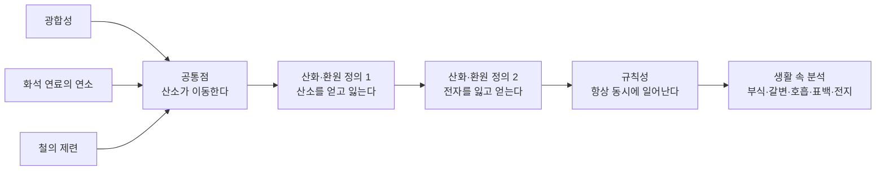
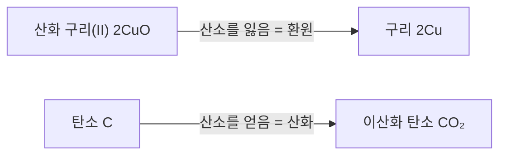
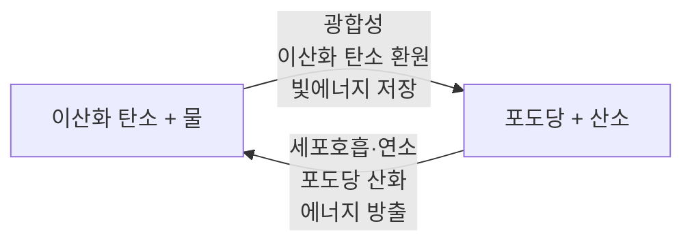

# 4-3. 산화와 환원 — 전자를 주고받으며 세상이 변한다

> [!NOTE]
> **성취기준 [10통과2-01-03]** 자연과 인류의 역사에 큰 변화를 가져온 광합성, 화석 연료 사용, 철의 제련 등에서 공통점을 찾아 산화와 환원을 이해하고, 생활 주변의 다양한 변화를 산화와 환원의 특징과 규칙성으로 분석할 수 있다.

**학습 목표**

1. 광합성, 화석 연료의 연소, 철의 제련에서 '산소의 이동'이라는 공통점을 찾아 산화와 환원을 설명할 수 있다.
2. 산화와 환원을 산소의 이동과 전자의 이동으로 정의하고, 두 반응이 항상 동시에 일어남을 설명할 수 있다.
3. 금속과 금속 이온의 반응을 전자의 이동으로 해석하고, 금속의 반응성 차이로 반응 여부를 예측할 수 있다.
4. 철의 부식, 사과의 갈변, 호흡, 표백·소독, 전지 등 생활 속 변화를 산화·환원의 특징과 규칙성으로 분석할 수 있다.

**이 단원의 학습 사다리**

| 단계 | 무엇을 하나? |
|---|---|
| STEP 1. 중학교 다시 보기 | 화학 반응식, 질량 보존, 이온, 광합성과 세포호흡을 다시 꺼내 본다 |
| STEP 2. 기초 다지기 | 반응식에서 원자 세기, 이온 만들기, 전자(e⁻)를 식에 쓰는 법을 익힌다 |
| STEP 3. 핵심 개념 | 역사를 바꾼 세 반응 → 산소의 이동 → 전자의 이동 → 금속의 반응성 → 생활 속 산화·환원 |
| STEP 4. 오개념 바로잡기 | "산화는 산소와 반응하는 것뿐이다?" 같은 착각을 바로잡는다 |
| STEP 5. 선택과목·대학 | 산화수, 산화제·환원제, 전극 전위와 전지 전압, 생체 속 전자 전달 |
| STEP 6. 산업·진로 | 제철과 수소환원제철, 2차 전지, 부식 방지, 반도체 세정 |

---

## 🗺️ 단원 들어가기

지구의 대기에는 산소가 약 21% 들어 있다. 그런데 아주 먼 옛날 지구의 대기에는 산소 기체가 거의 없었다. 지금의 산소는 어디에서 왔을까? 바로 수십억 년에 걸친 **광합성**이 만들어 냈다.

인류의 역사도 비슷한 반응들로 바뀌었다. 사람들은 돌을 다듬어 쓰다가 광석에서 **철을 뽑아내는 법(제련)** 을 알게 되면서 단단한 농기구와 도구를 갖게 되었다. 수천 년 뒤에는 **석탄과 석유를 태워** 얻은 에너지로 증기 기관과 공장을 움직이며 산업 혁명을 일으켰다.

광합성, 화석 연료의 연소, 철의 제련. 전혀 달라 보이는 이 세 가지 변화에는 놀라운 공통점이 있다. 세 반응 모두 **어떤 물질은 산소를 얻고, 다른 물질은 산소를 잃는다.** 이 단원에서는 이 공통점에서 출발하여 **산화와 환원**이라는 규칙을 찾고, 그 규칙으로 녹슨 자전거, 갈색으로 변한 사과, 스마트폰 배터리까지 설명해 본다.

---

## STEP 1. 🔙 중학교 다시 보기

### 연계 개념표

| 중학교 성취기준 | 중학교에서 배운 것 | 고등학교에서 확장되는 것 |
|---|---|---|
| [9과16-01] | 물리 변화와 화학 변화, 화학 변화에서는 새로운 물질이 생긴다 | 산화·환원은 우리 주변에서 가장 흔한 화학 변화이다 |
| [9과16-02] | 화학 반응식을 쓰고, 계수비를 입자 수의 비로 해석한다 | 반응식에서 **산소와 전자가 어디에서 어디로 이동했는지** 추적한다 |
| [9과16-03] | 화학 반응에서 질량이 보존되고, 원자의 종류와 수는 변하지 않는다 | 녹슨 철의 질량이 늘어나는 이유, **잃은 전자 수 = 얻은 전자 수** |
| [9과11-04] | 원자가 전자를 잃으면 양이온, 얻으면 음이온이 된다 | 전자를 잃는 것이 **산화**, 얻는 것이 **환원**이다 |
| [9과12-01], [9과12-02] | 광합성의 재료와 산물, 광합성과 호흡에서 출입하는 물질과 에너지 | 광합성에서 이산화 탄소는 **환원**되고, 호흡에서 포도당은 **산화**된다 |
| [9과13-05] | 동물은 세포호흡으로 에너지를 얻는다 | 세포호흡은 포도당이 산소와 반응하는 **산화·환원 반응**이다 |

> [!TIP]
> 고등학교 「통합과학1」의 '원소의 주기성과 화학 결합', '이온 결합과 공유 결합' 단원에서 배운 **원자가 전자**와 **이온의 형성**도 이 단원의 중요한 바탕이다.

### 준비 운동 (사전 진단)

**Q1.** 마그네슘 리본을 태우면 흰 빛을 내며 흰색 가루가 생긴다. 빈칸에 알맞은 화학식을 쓰시오.
$\mathrm{2Mg + O_2 \rightarrow 2(\quad)}$

**Q2.** 나트륨 원자(Na)가 전자 1개를 잃으면 어떤 입자가 되는가? 염소 원자(Cl)가 전자 1개를 얻으면 어떤 입자가 되는가?

**Q3.** 강철솜(철)을 공기 중에서 태우면 타고 난 뒤의 질량이 처음보다 늘어난다. 질량 보존 법칙에 어긋나는 것일까?

**Q4.** 광합성에 필요한 물질 두 가지와 광합성으로 만들어지는 물질 두 가지를 쓰시오.

정답 및 해설

**Q1. MgO** — 마그네슘이 산소와 결합하여 산화 마그네슘이 된다. 반응 전후 Mg 원자 2개, O 원자 2개로 원자 수가 같다.

**Q2.** 나트륨은 전자를 잃어 **나트륨 이온(Na⁺, 양이온)**, 염소는 전자를 얻어 **염화 이온(Cl⁻, 음이온)** 이 된다.

**Q3. 어긋나지 않는다.** 공기 중의 산소가 철과 결합했기 때문에 그만큼 질량이 늘어난 것이다. 반응한 산소의 질량까지 합하면 반응 전후 전체 질량은 같다.

**Q4.** 필요한 물질: 이산화 탄소, 물 / 만들어지는 물질: 포도당(양분), 산소

---

## STEP 2. 🧱 기초 다지기

### ① 화학 반응식에서 원자를 세는 법

화학 반응식의 화살표 왼쪽은 **반응물**, 오른쪽은 **생성물**이다. 화학식 앞의 숫자(계수)는 입자의 개수를, 원소 기호 오른쪽 아래 숫자는 한 입자 속 원자의 개수를 뜻한다.

$$
\mathrm{2CuO + C \rightarrow 2Cu + CO_2}
$$

| 원자 | 반응 전 | 반응 후 |
|---|---|---|
| Cu | 2 (2CuO 속) | 2 (2Cu) |
| O | 2 (2CuO 속) | 2 (CO₂ 속) |
| C | 1 | 1 (CO₂ 속) |

원자의 종류와 수는 그대로이고 **원자들이 짝을 바꾸었을 뿐**이다. 산화 구리(II) 속에 있던 산소가 탄소에게로 옮겨 갔다. 이 '옮겨 감'을 추적하는 것이 이 단원의 첫 번째 열쇠이다.

> [!TIP]
> '산화 구리(II)'의 (II)는 구리 이온의 전하가 +2라는 뜻이다(Cu²⁺). 구리는 +1인 이온도 만들 수 있어서 이렇게 구분해 쓴다. 산화 철(III)의 (III)도 Fe³⁺를 뜻한다.

### ② 원자가 이온이 되는 과정

원자는 양성자(+)의 수와 전자(−)의 수가 같아 전기적으로 중성이다. 여기서 전자를 잃거나 얻으면 이온이 된다.

| 원자 | 전자 변화 | 생기는 이온 | 이름 |
|---|---|---|---|
| Na | 1개 잃음 | Na⁺ | 나트륨 이온 |
| Mg | 2개 잃음 | Mg²⁺ | 마그네슘 이온 |
| Zn | 2개 잃음 | Zn²⁺ | 아연 이온 |
| Cu | 2개 잃음 | Cu²⁺ | 구리(II) 이온 |
| Ag | 1개 잃음 | Ag⁺ | 은 이온 |
| Cl | 1개 얻음 | Cl⁻ | 염화 이온 |
| O | 2개 얻음 | O²⁻ | 산화 이온 |

이온식의 오른쪽 위 숫자와 부호는 **잃거나 얻은 전자 수**를 그대로 보여 준다. 전자는 (−)전하를 띠므로, 전자를 잃으면 (+)가 되고 전자를 얻으면 (−)가 된다.

### ③ 금속은 전자를 내주기 쉽고, 산소·염소는 전자를 받기 쉽다

「통합과학1」에서 원자들은 가장 바깥 전자껍질을 18족 원소처럼 안정하게 만들려는 경향이 있다고 배웠다.

- **금속 원소**(Na, Mg, Al, Zn, Fe 등): 원자가 전자가 적어 **전자를 잃고** 양이온이 되기 쉽다.
- **산소, 염소 같은 비금속 원소**: 원자가 전자가 많아 **전자를 얻어** 음이온이 되기 쉽다.

그래서 금속과 산소가 만나면 전자가 금속에서 산소 쪽으로 옮겨 간다. 이 경향이 산화·환원 반응이 일어나는 근본 이유이다.

### ④ 전자를 식 안에 쓰는 법

전자의 이동을 분명히 보이기 위해 전자를 $\mathrm{e^-}$로 쓰고, 한쪽 물질의 변화만 따로 적는다.

$$
\mathrm{Zn \rightarrow Zn^{2+} + 2e^-} \qquad (\text{아연이 전자 2개를 잃는다})
$$

$$
\mathrm{Cu^{2+} + 2e^- \rightarrow Cu} \qquad (\text{구리 이온이 전자 2개를 얻는다})
$$

**전하 맞추기 확인법**: 화살표 양쪽의 전하 합이 같아야 한다. 첫 번째 식은 왼쪽 0, 오른쪽 $(+2) + 2\times(-1) = 0$으로 같다.

> [!TIP]
> 💡 **비유** — 전자의 이동은 **캐치볼**과 같다. 공(전자)을 던진 사람이 있으면 반드시 받은 사람이 있다. 던지기만 하고 아무도 받지 않는 캐치볼은 없다. 이것이 STEP 3에서 배울 "산화와 환원은 항상 동시에 일어난다"의 핵심이다.

---

## STEP 3. 📘 핵심 개념

### 4-3-① 역사를 바꾼 세 가지 반응 — 공통점 찾기

#### (1) 광합성: 지구 대기를 바꾼 반응

식물과 조류, 남세균(사이아노박테리아)은 빛에너지를 이용해 이산화 탄소와 물로 포도당을 만들고 산소를 내놓는다.

$$
\mathrm{6CO_2 + 6H_2O \xrightarrow{\text{빛에너지}} C_6H_{12}O_6 + 6O_2}
$$

광합성 생물이 오랜 세월 내놓은 산소가 대기에 쌓이면서 산소로 호흡하는 생물이 번성하고, 높은 하늘에 오존층이 만들어져 생물이 육지로 올라올 수 있는 환경이 되었다.

- **이산화 탄소**는 산소를 잃고 포도당이 된다.
- **물**은 산소 기체($\mathrm{O_2}$)를 내놓는다. (물에서 산소 기체가 생기는 과정은 4-3-③의 전자 이동으로 설명한다.)

#### (2) 화석 연료의 연소: 산업 혁명을 일으킨 반응

석탄, 석유, 천연가스에는 탄소와 수소가 많이 들어 있다. 이것이 공기 중의 산소와 결합하며 많은 열을 낸다. 천연가스의 주성분인 메테인의 연소는 다음과 같다.

$$
\mathrm{CH_4 + 2O_2 \rightarrow CO_2 + 2H_2O}
$$

18세기 후반 석탄을 태워 움직이는 증기 기관이 널리 쓰이면서 산업 혁명이 일어났고, 오늘날에도 화력 발전·자동차·난방 등에 화석 연료가 쓰인다. 한편 이 반응에서 생기는 이산화 탄소는 지구온난화의 주요 원인이 되고 있다.

- **메테인 속 탄소와 수소**는 산소를 얻어 이산화 탄소와 물이 된다.

#### (3) 철의 제련: 철기 시대를 연 반응

자연에서 철은 대부분 산소와 결합한 **철광석**(주성분 산화 철(III), $\mathrm{Fe_2O_3}$ 등)으로 존재한다. 철광석을 숯이나 코크스(석탄을 가공한 탄소 덩어리)와 함께 높은 온도로 가열하면 순수한 철을 얻을 수 있다. 이것을 **제련(smelting)** 이라고 한다. 오늘날 용광로에서는 코크스가 타서 생긴 일산화 탄소가 철광석에서 산소를 떼어 낸다.

$$
\mathrm{Fe_2O_3 + 3CO \rightarrow 2Fe + 3CO_2}
$$

철기를 쓰게 되면서 단단한 농기구로 농업 생산량이 늘었고, 도구와 무기가 바뀌면서 사회와 국가의 모습도 크게 달라졌다.

- **산화 철(III)** 은 산소를 잃고 철이 된다.
- **일산화 탄소**는 산소를 얻어 이산화 탄소가 된다.

#### 세 반응의 공통점

| 반응 | 산소를 **얻는** 물질 | 산소를 **잃는** 물질 | 인류·지구에 준 변화 |
|---|---|---|---|
| 광합성 | (물에서 산소 기체 발생) | 이산화 탄소 → 포도당 | 대기 중 산소 증가, 생물의 에너지원 |
| 화석 연료의 연소 | 메테인(탄소·수소) → CO₂, H₂O | 산소 기체 → 화합물 속 산소 | 산업 혁명, 에너지 사용, 기후변화 |
| 철의 제련 | 일산화 탄소 → 이산화 탄소 | 산화 철(III) → 철 | 철기 시대, 현대 산업의 기초 소재 |

세 반응 모두 **산소가 한 물질에서 다른 물질로 이동**한다. 산소를 얻는 물질이 있으면, 반드시 산소를 잃는 물질(또는 산소를 내주는 쪽)이 함께 있다.

### 4-3-② 산소의 이동으로 보는 산화와 환원

물질이 산소를 얻는 반응을 **산화(oxidation)**, 물질이 산소를 잃는 반응을 **환원(reduction)** 이라고 한다.

| 구분 | 정의 | 예 |
|---|---|---|
| 산화 | 물질이 **산소를 얻는** 반응 | 마그네슘의 연소, 철이 녹스는 것, 메테인의 연소 |
| 환원 | 물질이 **산소를 잃는** 반응 | 철광석이 철로 되는 것, 산화 구리(II)가 구리로 되는 것 |

중학교에서 해 본 실험을 다시 보자. 검은색 산화 구리(II) 가루와 탄소 가루를 섞어 가열하면 붉은색 구리가 생기고, 석회수를 뿌옇게 만드는 이산화 탄소가 발생한다.

$$
\mathrm{2CuO + C \rightarrow 2Cu + CO_2}
$$

산화 구리(II)가 잃은 산소를 탄소가 얻었다. **산소를 잃는 물질이 있으면 그 산소를 얻는 물질이 반드시 있으므로, 산화와 환원은 항상 동시에 일어난다.** 그래서 이런 반응을 묶어 **산화·환원 반응**이라고 부른다.

#### 예제 1

다음 반응에서 산화되는 물질과 환원되는 물질을 쓰시오.

$$
\mathrm{CuO + H_2 \rightarrow Cu + H_2O}
$$

**풀이**
- 산화 구리(II)(CuO)는 산소를 잃고 구리(Cu)가 되었다 → **환원**
- 수소(H₂)는 산소를 얻어 물(H₂O)이 되었다 → **산화**

산소 원자 1개가 CuO에서 H₂ 쪽으로 옮겨 갔다. 산화와 환원이 한 반응 안에서 동시에 일어났다.

#### 예제 2

프로페인($\mathrm{C_3H_8}$)은 휴대용 가스버너와 캠핑용 가스의 연료로 쓰인다. 프로페인의 연소 반응식을 완성하고 산화되는 물질을 쓰시오.

$$
\mathrm{C_3H_8 + (\ \ )O_2 \rightarrow 3CO_2 + 4H_2O}
$$

**풀이** 오른쪽 산소 원자 수는 $3\times2 + 4\times1 = 10$개이므로 $\mathrm{O_2}$는 5개가 필요하다. 계수는 **5**이다. 프로페인 속 탄소와 수소가 산소를 얻어 이산화 탄소와 물이 되었으므로 **프로페인이 산화**된다.

### 4-3-③ 전자의 이동으로 보는 산화와 환원

마그네슘이 탈 때 생기는 산화 마그네슘(MgO)은 마그네슘 이온(Mg²⁺)과 산화 이온(O²⁻)으로 이루어진 이온 결합 물질이다. 즉, 마그네슘이 산소를 얻는 동안 실제로는 **마그네슘에서 산소로 전자가 이동**했다.

$$
\mathrm{2Mg + O_2 \rightarrow 2MgO}
$$

$$
\text{마그네슘: } \mathrm{2Mg \rightarrow 2Mg^{2+} + 4e^-} \qquad (\text{전자를 잃음})
$$

$$
\text{산소: } \mathrm{O_2 + 4e^- \rightarrow 2O^{2-}} \qquad (\text{전자를 얻음})
$$

이처럼 산화·환원을 전자의 이동으로 다시 정의할 수 있다.

| 구분 | 산소의 이동으로 | 전자의 이동으로 |
|---|---|---|
| **산화** | 산소를 얻는다 | **전자를 잃는다** |
| **환원** | 산소를 잃는다 | **전자를 얻는다** |

> [!TIP]
> 💡 **외우는 방법** — "**산**화는 **잃**고, **환**원은 **얻**는다" → **산잃환얻**. 영어권 학생들은 OIL RIG(Oxidation Is Loss, Reduction Is Gain)라고 외운다.

#### 왜 전자의 이동으로 정의를 넓힐까?

산소가 전혀 없는 반응도 있기 때문이다. 나트륨과 염소 기체가 반응하여 염화 나트륨(소금)이 되는 반응을 보자.

$$
\mathrm{2Na + Cl_2 \rightarrow 2NaCl}
$$

- 나트륨: $\mathrm{2Na \rightarrow 2Na^+ + 2e^-}$ → 전자를 잃음 → **산화**
- 염소: $\mathrm{Cl_2 + 2e^- \rightarrow 2Cl^-}$ → 전자를 얻음 → **환원**

산소는 하나도 없지만, 마그네슘의 연소와 **똑같은 방식**으로 전자가 이동한다. 전자의 이동으로 정의하면 훨씬 더 많은 반응을 같은 규칙으로 설명할 수 있다.

#### 광합성에서 물이 산소를 내놓는 과정

4-3-①에서 미뤄 두었던 광합성의 물을 다시 보자. 광합성에서 물은 빛에너지를 이용해 **전자를 잃고** 산소 기체를 내놓는다. 즉, 물은 **산화**된다. 물이 잃은 전자는 여러 단계를 거쳐 이산화 탄소 쪽으로 전달되어, 이산화 탄소가 포도당으로 **환원**되는 데 쓰인다. 결국 광합성은 '물에서 이산화 탄소로 전자를 옮기는' 거대한 산화·환원 반응이다.

> [!IMPORTANT]
> **산화·환원의 규칙성**
> 1. 산화와 환원은 **항상 동시에** 일어난다.
> 2. 한 반응에서 **잃은 전자의 총수 = 얻은 전자의 총수**이다. (전자는 사라지거나 새로 생기지 않는다.)
> 3. 산소를 얻는 물질은 대개 전자를 잃는 물질이므로, 두 정의는 서로 모순되지 않는다.

#### 예제 3

$\mathrm{2Na + Cl_2 \rightarrow 2NaCl}$ 반응에서 나트륨 원자 4개가 모두 반응했다면, 이동한 전자는 몇 개이고 반응한 염소 분자는 몇 개인가?

**풀이** 나트륨 원자 1개는 전자 1개를 잃으므로 전자 **4개**가 이동한다. 염소 분자($\mathrm{Cl_2}$) 1개는 전자 2개를 얻으므로, 전자 4개를 받으려면 염소 분자 **2개**가 필요하다. 반응식의 계수비(Na : Cl₂ = 2 : 1)와도 일치한다.

### 4-3-④ 금속과 금속 이온의 반응 — 반응성의 규칙성

#### (1) 아연판을 황산 구리(II) 수용액에 넣으면

푸른색 황산 구리(II) 수용액에 아연판을 넣어 두면 다음 변화가 관찰된다.

- 아연판 표면에 **붉은색 물질(구리)** 이 달라붙는다.
- 수용액의 **푸른색이 점점 옅어진다.** (푸른색을 내는 Cu²⁺가 줄어든다.)
- 아연판이 조금씩 녹아 작아진다.

$$
\mathrm{Zn + Cu^{2+} \rightarrow Zn^{2+} + Cu}
$$

| 입자 | 변화 | 전자 | 산화·환원 |
|---|---|---|---|
| 아연(Zn) | 아연 이온(Zn²⁺)이 되어 녹아 나감 | 2개 잃음 | 산화 |
| 구리 이온(Cu²⁺) | 구리(Cu)가 되어 석출됨 | 2개 얻음 | 환원 |
| 황산 이온(SO₄²⁻) | 변화 없음 | — | 반응에 참여하지 않음 |

아연이 내놓은 전자를 구리 이온이 받아 갔다. 산소가 전혀 없어도 전자의 이동으로 산화·환원을 설명할 수 있다.

#### (2) 구리줄을 질산 은 수용액에 넣으면

무색의 질산 은 수용액에 구리줄을 넣으면, 구리줄 표면에 **반짝이는 은 결정**이 나뭇가지처럼 자라고 수용액은 점점 **푸른색**으로 변한다.

$$
\mathrm{Cu + 2Ag^+ \rightarrow Cu^{2+} + 2Ag}
$$

구리 원자 1개는 전자 2개를 잃고, 은 이온 1개는 전자 1개를 얻는다. 잃은 전자 수와 얻은 전자 수를 맞추기 위해 **은 이온 2개가 구리 원자 1개와 반응**한다. 따라서 반응이 진행될수록 수용액 속 **양이온의 총수는 줄어든다**(Ag⁺ 2개가 Cu²⁺ 1개로 바뀜).

#### (3) 금속의 반응성 — 누가 전자를 더 잘 내놓는가?

반대로 구리판을 황산 아연 수용액에 넣으면 아무 변화도 일어나지 않는다. 아연이 구리보다 **전자를 더 잘 잃기(산화되기 쉬운)** 때문이다. 금속이 전자를 잃고 양이온이 되려는 정도를 **금속의 반응성**이라 하며, 실험으로 정한 순서는 다음과 같다.

$$
\mathrm{K > Ca > Na > Mg > Al > Zn > Fe > Ni > Sn > Pb > (H) > Cu > Hg > Ag > Pt > Au}
$$

> [!IMPORTANT]
> **반응성이 큰 금속**을 **반응성이 작은 금속의 이온**이 든 수용액에 넣으면, 반응성이 큰 금속이 전자를 잃고(산화) 반응성이 작은 금속 이온이 전자를 얻어(환원) 금속으로 석출된다. 그 반대는 일어나지 않는다.

순서 중간의 (H)는 수소이다. 수소보다 반응성이 큰 금속(Mg, Zn, Fe 등)은 묽은 염산과 반응하여 **수소 기체**를 발생시키지만, 구리·은·금은 묽은 염산과 반응하지 않는다.

$$
\mathrm{Zn + 2H^+ \rightarrow Zn^{2+} + H_2}
$$

아연은 전자를 잃고(산화), 수소 이온은 전자를 얻어 수소 기체가 된다(환원). 금이 수천 년이 지나도 반짝이는 이유도 반응성이 매우 작아 산화되지 않기 때문이다.

#### 예제 4

다음 실험 중 금속 표면에 새로운 금속이 석출되는 것을 모두 고르고, 그 반응의 이온 반응식을 쓰시오.
ㄱ. 철못을 황산 구리(II) 수용액에 넣는다.
ㄴ. 은반지를 황산 구리(II) 수용액에 넣는다.
ㄷ. 마그네슘 리본을 질산 은 수용액에 넣는다.

**풀이** 반응성은 Mg > Fe > Cu > Ag이다.
- ㄱ. Fe > Cu이므로 반응한다. $\mathrm{Fe + Cu^{2+} \rightarrow Fe^{2+} + Cu}$
- ㄴ. Ag < Cu이므로 반응하지 않는다.
- ㄷ. Mg > Ag이므로 반응한다. $\mathrm{Mg + 2Ag^+ \rightarrow Mg^{2+} + 2Ag}$

정답은 **ㄱ, ㄷ**이다. ㄷ에서 Mg 1개가 전자 2개를 잃으므로 Ag⁺ 2개가 필요하다.

### 4-3-⑤ 생활 속 산화·환원 분석하기

#### (1) 철의 부식과 부식 방지

철은 공기 중의 **산소**와 **물**을 함께 만나면 서서히 산화되어 붉은 녹이 된다. 녹의 주성분은 물을 포함한 산화 철(III)이다. 철이 녹스는 과정을 간단히 나타내면 다음과 같다.

$$
\mathrm{4Fe + 3O_2 \rightarrow 2Fe_2O_3} \quad (\text{실제로는 물이 함께 관여한다})
$$

- 철은 전자를 잃고(산화), 산소는 전자를 얻는다(환원).
- **물과 산소 중 하나라도 없으면** 녹이 잘 슬지 않는다.
- 바닷물이나 겨울철 도로의 제설제처럼 **염분이 있으면 녹이 더 빨리** 슨다. 그래서 바닷가 철 구조물과 겨울철 자동차 하부는 부식에 특히 신경 쓴다.

| 부식 방지 방법 | 원리 | 예 |
|---|---|---|
| 페인트칠, 기름칠, 플라스틱 코팅 | 철이 산소·물과 만나지 못하게 막는다 | 다리, 철제 대문, 자전거 체인 |
| 아연 도금(함석) | 철 표면을 아연으로 덮는다. 긁혀도 **아연이 먼저 산화**되어 철을 보호한다 | 지붕, 가드레일, 아연 도금 강판 |
| 주석 도금(양철) | 철 표면을 주석으로 덮어 산소·물을 막는다 | 통조림 캔 |
| 합금 | 철에 크로뮴·니켈 등을 섞어 표면에 치밀한 보호막이 생기게 한다 | 스테인리스강(주방 기구, 수저) |
| 희생 양극(희생 금속) | 철보다 **반응성이 큰 금속**(마그네슘, 아연 등)을 연결해 그 금속이 대신 산화되게 한다 | 선박 바닥, 지하 배관, 해양 구조물 |

> [!WARNING]
> 양철(주석 도금)은 흠집이 나서 철이 드러나면 오히려 철이 더 빨리 녹슬 수 있다. 주석보다 철의 반응성이 커서 **철이 먼저 산화**되기 때문이다. 반면 함석(아연 도금)은 흠집이 나도 아연이 먼저 산화되어 철을 지켜 준다. 반응성 순서 하나로 두 도금의 차이를 설명할 수 있다.

#### (2) 사과·바나나의 갈변

깎아 둔 사과가 갈색으로 변하는 것은 사과 속의 폴리페놀 성분이 효소의 도움을 받아 **공기 중의 산소와 반응(산화)** 하여 갈색 물질을 만들기 때문이다.
- **방지 방법**: 소금물이나 설탕물에 담가 공기와의 접촉을 줄인다. 레몬즙을 뿌리면 레몬 속의 **비타민 C가 먼저 산화**되면서 갈변을 늦춘다.
- 이처럼 다른 물질 대신 먼저 산화되어 산화를 막는 물질을 **항산화제(antioxidant)** 라고 한다. 식품 포장에 함께 넣는 **탈산소제**(철 가루가 주성분)는 포장 안의 산소를 먼저 흡수하여 식품의 산화를 막는다.

#### (3) 호흡과 연소 — 에너지를 꺼내는 산화

세포호흡은 포도당이 산소와 반응하여 에너지를 내는 과정이다. 광합성과 반대 방향의 산화·환원 반응이다.

$$
\mathrm{C_6H_{12}O_6 + 6O_2 \rightarrow 6CO_2 + 6H_2O} \quad (+\ \text{에너지})
$$

포도당은 **산화**되어 이산화 탄소가 되고, 산소는 **환원**되어 물이 된다. 광합성으로 저장된 에너지를 호흡으로 꺼내 쓰는 셈이다. 장작이나 가스를 태우는 연소도 같은 원리로 에너지를 꺼낸다.

#### (4) 표백과 소독

- **염소계 표백제**(주성분 하이포아염소산 나트륨): 색을 내는 물질이나 세균의 성분을 **산화**시켜 색을 없애고 세균을 죽인다. 수돗물 소독에 쓰는 염소도 같은 원리이다.
- **과산화 수소수**(약 3% 정도의 묽은 용액): 상처에 바르면 거품(산소)이 생기며 세균을 산화시켜 소독한다. 머리카락의 색소를 산화시켜 탈색하는 데에도 쓰인다.
- **오존**: 강한 산화력이 있어 정수장에서 물의 냄새 물질과 세균을 없애는 데 쓰인다.

> [!WARNING]
> 염소계 표백제와 산성 세정제(일부 화장실 청소용 세제 등)를 **절대 섞으면 안 된다.** 유독한 염소 기체가 발생할 수 있다. 세제 용기의 '섞으면 위험' 표시를 꼭 확인하자.

#### (5) 전지 — 전자의 이동을 도선으로 끌어내다

아연판과 구리판을 레몬(또는 묽은 산)에 꽂고 도선으로 연결하면 전류가 흐른다.
- 아연판: 아연이 전자를 잃고 Zn²⁺가 되어 녹아 나간다(**산화**).
- 전자는 **도선을 따라** 구리판 쪽으로 이동한다.
- 구리판: 그 표면에서 수소 이온이 전자를 얻어 수소 기체가 된다(**환원**).

4-3-④에서는 아연이 구리 이온에게 전자를 **직접** 건넸지만, 전지는 산화가 일어나는 곳과 환원이 일어나는 곳을 **떨어뜨려 놓고** 전자가 도선을 지나가게 만든 장치이다. 이 전자의 흐름이 바로 전류이다. 건전지, 스마트폰의 리튬 이온 전지, 전기 자동차의 배터리 모두 산화·환원 반응으로 전기를 만든다.

#### 생활 속 산화·환원 정리

| 현상 | 산화되는 것 | 환원되는 것 |
|---|---|---|
| 철이 녹슨다 | 철 | 산소 |
| 깎은 사과가 갈색으로 변한다 | 사과 속 폴리페놀 성분 | 산소 |
| 세포호흡 | 포도당 | 산소 |
| 광합성 | 물 | 이산화 탄소 |
| 가스레인지에서 가스가 탄다 | 연료(메테인 등) | 산소 |
| 철광석에서 철을 얻는다 | 일산화 탄소 | 산화 철(III) |
| 아연판에 구리가 석출된다 | 아연 | 구리 이온 |
| 레몬 전지 | 아연 | 수소 이온 |

---

## STEP 4. ⚠️ 오개념 바로잡기

| 흔한 오개념 | 올바른 개념 | 왜 그럴까? |
|---|---|---|
| 산화는 산소와 반응하는 것만을 말한다 | 산화는 **전자를 잃는 것**까지 포함한다 | 나트륨과 염소의 반응, 아연과 구리 이온의 반응처럼 산소 없이도 전자가 이동한다 |
| 산화만 일어나는 반응도 있다 | 산화와 환원은 **항상 동시에** 일어난다 | 전자를 잃는 물질이 있으면 그 전자를 얻는 물질이 반드시 있다 |
| 철이 녹슬면 일부가 떨어져 나가므로 질량이 줄어든다 | 녹이 생기면 철에 **산소(와 물)가 결합하여** 질량이 늘어난다 | 반응한 산소까지 포함하면 전체 질량은 보존된다 |
| 스테인리스강은 절대 녹슬지 않는다 | 녹이 **잘** 슬지 않을 뿐이다 | 염분이 많거나 보호막이 손상되면 스테인리스강도 부식될 수 있다 |
| 금속을 다른 금속 이온의 수용액에 넣으면 항상 반응한다 | **반응성이 더 큰 금속**만 반응성이 작은 금속의 이온과 반응한다 | 구리는 아연 이온에게 전자를 줄 수 없다 |
| 광합성으로 나오는 산소는 이산화 탄소에서 나온다 | 광합성으로 발생하는 산소 기체는 **물**에서 나온다 | 산소 원자를 표시한 물을 이용한 실험으로 확인되었다. 물은 전자를 잃고(산화) 산소 기체를 내놓는다 |

---

## STEP 5. 🎓 선택과목·대학으로 한 걸음 더

> [!CAUTION]
> 이 절은 **통합과학 교육과정 범위 밖의 심화 내용**으로 평가 대상이 아니다. "이 개념이 앞으로 어디까지 이어지는가"를 맛보기로 보여 주기 위한 내용이다.

### 고2·3 선택과목과의 연결

| 과목 | 이어지는 내용 |
|---|---|
| 화학 | 역동적인 화학 반응 — 산화·환원 반응을 **산화수**로 분석하기, 산화제와 환원제 등 |
| 화학 반응의 세계 | 산화·환원 반응과 **전기 화학**(화학 전지, 전기 분해) 등 |
| 생명과학, 세포와 물질대사 | 세포호흡과 광합성에서 전자가 전달되는 과정 |
| 지구과학 | 지구의 역사 — 광합성과 대기 중 산소의 증가 |

### ① 산화수: 전자의 이동을 '점수'로 기록하기

공유 결합 물질에서는 전자를 완전히 주고받지 않고 함께 쓰기 때문에, '누가 전자를 잃었는가'가 애매하다. 그래서 선택과목 「화학」에서는 각 원자에 **산화수(oxidation number)** 라는 가상의 전하를 매긴다. 산화수가 **증가하면 산화**, **감소하면 환원**이다.

$$
\mathrm{\overset{+3}{Fe_2}O_3 + 3\overset{+2}{C}O \rightarrow 2\overset{0}{Fe} + 3\overset{+4}{C}O_2}
$$

철의 산화수는 +3 → 0으로 감소(환원), 탄소의 산화수는 +2 → +4로 증가(산화)한다. 또 남을 산화시키는 물질(자신은 환원됨)을 **산화제**, 남을 환원시키는 물질(자신은 산화됨)을 **환원제**라고 부른다. 위 반응에서 일산화 탄소는 환원제이다.

### ② 전지의 전압은 어떻게 정해질까? — 전극 전위

대학 「일반화학」에서는 반응성의 차이를 **표준 환원 전위**($E^\circ$)라는 숫자로 나타낸다. 값이 클수록 환원되기 쉽다. 예를 들어 $E^\circ(\mathrm{Cu^{2+}/Cu}) = +0.34\ \mathrm{V}$, $E^\circ(\mathrm{Zn^{2+}/Zn}) = -0.76\ \mathrm{V}$이다. 아연–구리 전지(다니엘 전지)의 표준 전압은

$$
E^\circ_{\text{전지}} = E^\circ_{\text{환원 전극}} - E^\circ_{\text{산화 전극}} = 0.34 - (-0.76) = 1.10\ \mathrm{V}
$$

이다. 반응성 순서에서 멀리 떨어진 두 금속을 쓸수록 전압이 커진다. 리튬은 매우 산화되기 쉬운 원소여서, 리튬 이온 전지는 한 개의 전지로 약 3.6~3.7 V의 높은 전압을 낼 수 있다. 또 이동한 전자의 양은 **패러데이 상수**($F \approx 96\,485\ \mathrm{C/mol}$)를 이용해 전하량으로 바꿀 수 있어, 배터리 용량 계산의 기초가 된다.

### ③ 생명 속의 전자 전달

대학 「생화학」에서는 세포호흡의 산화·환원을 단계별로 배운다. 포도당에서 떼어 낸 전자는 NAD⁺ 같은 **전자 운반체**에 실려 미토콘드리아 안쪽 막의 **전자 전달계**로 옮겨지고, 마지막에 산소가 전자를 받아 물이 된다. 전자가 한 번에 산소로 가지 않고 여러 단계를 거치기 때문에, 에너지가 불꽃처럼 한꺼번에 터지지 않고 조금씩 ATP로 저장된다. 광합성도 물에서 나온 전자가 엽록체의 전자 전달계를 거쳐 이산화 탄소를 환원하는 과정으로 분석한다.

### 고등학교 vs 대학교

| 구분 | 고등학교 통합과학 | 대학교 일반화학·전기화학·생화학 |
|---|---|---|
| 산화·환원의 정의 | 산소의 이동, 전자의 이동 | 산화수의 변화, 반쪽 반응의 균형 맞추기 |
| 반응성 | 금속의 반응성 순서(정성적) | 표준 환원 전위(V), 네른스트 식으로 농도 효과 계산 |
| 전지 | 산화와 환원이 떨어진 곳에서 일어나 전류가 흐름 | 전지 전압·용량·수명 계산, 전극 소재 설계 |
| 부식 | 산소·물 차단, 도금, 희생 금속 | 부식 속도 측정, 전기 방식 설계(부식 공학) |
| 생명 | 호흡은 포도당의 산화 | 전자 전달계, 산화적 인산화 |
| 관련 전공 | — | 화학, 화학공학, 재료공학, 금속공학, 전기화학, 생화학 |

---

## STEP 6. 🏭 산업 현장과 진로 연결

### 사례 1. 제철 — 거대한 환원 공장

- **원리** 용광로(고로)의 위쪽으로 철광석, 코크스, 석회석을 넣고 아래쪽에서 뜨거운 공기를 불어 넣는다. 코크스가 타서 이산화 탄소가 되고, 이것이 다시 뜨거운 코크스와 반응해 **일산화 탄소**가 된다. 일산화 탄소가 철광석에서 산소를 빼앗아 철을 **환원**한다.

$$
\mathrm{C + O_2 \rightarrow CO_2}, \qquad \mathrm{CO_2 + C \rightarrow 2CO}, \qquad \mathrm{Fe_2O_3 + 3CO \rightarrow 2Fe + 3CO_2}
$$

- **어디에 쓰이나** 용광로 바닥에 모인 녹은 철(선철)은 탄소가 약 4% 정도 들어 있어 단단하지만 잘 깨진다. 이 쇳물에 산소를 불어 넣어 탄소를 태워 줄이면 자동차·선박·건물에 쓰는 **강철**이 된다. 철광석 속 불순물은 석회석과 반응해 **슬래그**가 되어 쇳물 위에 뜨며, 슬래그는 시멘트 원료 등으로 재활용된다.
- **핵심 과제** 이 과정에서 많은 이산화 탄소가 나오기 때문에 철강 산업은 온실가스를 많이 배출하는 산업 가운데 하나이다. 그래서 탄소 대신 **수소**로 철광석을 환원하는 **수소환원제철** 기술이 개발되고 있다.

$$
\mathrm{Fe_2O_3 + 3H_2 \rightarrow 2Fe + 3H_2O}
$$

이산화 탄소 대신 물이 생기는 것이 장점이다. 다만 수소를 만드는 과정에서 화석 연료를 쓰면 그 단계에서 이산화 탄소가 나오므로, 재생 에너지로 수소를 만드는 기술과 함께 발전해야 한다.

### 사례 2. 2차 전지 — 충전과 방전은 산화·환원의 왕복

- **원리** 한 번 쓰고 버리는 1차 전지와 달리, **2차 전지**는 외부 전기를 걸어 반응을 거꾸로 돌릴 수 있다. 리튬 이온 전지에서 방전할 때는 음극 쪽 물질이 전자를 내놓고(산화) 리튬 이온이 양극 쪽으로 이동하며, 전자는 외부 도선을 따라 기기를 거쳐 양극 쪽 물질에 전달된다(환원). 충전할 때는 외부 전원이 이 과정을 거꾸로 일으킨다.
- **어디에 쓰이나** 스마트폰, 노트북, 전기 자동차, 태양광·풍력 전기를 저장하는 에너지 저장 장치(ESS).
- **핵심 기술** 더 많은 리튬 이온을 담는 전극 소재, 불이 잘 붙지 않는 전해질(전고체 전지 등), 사용 후 배터리에서 니켈·코발트·리튬 같은 금속을 회수하는 재활용 기술(이 과정에도 금속 이온을 금속이나 화합물로 되돌리는 화학 반응이 쓰인다).

### 사례 3. 부식 방지 — 보이지 않는 곳의 산화·환원 관리

- **원리** 바닷물 속 선박, 땅속 가스관, 다리 기둥은 늘 물·산소·염분에 노출된다. 표면 도장(페인트), 아연 도금과 함께 **희생 양극**을 붙인다. 선박 바닥에 붙인 아연이나 알루미늄 합금 덩어리가 철 대신 산화되어 닳아 없어지므로, 정기적으로 교체한다.
- **왜 중요할까?** 부식은 다리·배관의 안전 사고와 큰 경제적 손실로 이어진다. 그래서 산업 현장에는 부식 정도를 측정하고 방지 설계를 하는 **부식 엔지니어**가 있다.

### 사례 4. 반도체 공정 — 산화로 막을 만들고, 산화로 씻는다

- **산화막 만들기** 실리콘 웨이퍼를 고온에서 산소와 반응시키면 표면에 아주 얇고 고른 이산화 규소($\mathrm{SiO_2}$) 막이 생긴다. 실리콘이 **산화**되어 만들어진 이 막은 전기가 통하지 않는 절연막으로 쓰인다.
- **세정** 웨이퍼 표면의 유기물 찌꺼기와 금속 오염을 없애기 위해 **과산화 수소**를 섞은 세정액을 쓴다. 과산화 수소의 강한 산화력이 오염 물질을 산화시켜 떼어 낸다. 아주 작은 오염도 불량으로 이어지기 때문에 초순수(극도로 깨끗한 물)와 고순도 약품을 사용한다.

### 관련 진로와 학과

| 진로 | 하는 일 | 관련 학과 |
|---|---|---|
| 금속·제철 엔지니어 | 철광석 환원 공정, 수소환원제철, 강철 소재 개발 | 금속공학, 재료공학, 화학공학 |
| 배터리 연구원 | 전극·전해질 소재 개발, 배터리 수명·안전 평가 | 화학, 화학공학, 재료공학, 전기화학 |
| 부식 방지 엔지니어 | 선박·배관·교량의 부식 진단과 방식 설계 | 재료공학, 금속공학, 조선해양공학 |
| 반도체 공정 엔지니어 | 산화·세정·식각 공정 관리 | 화학공학, 전자공학, 재료공학 |
| 식품공학자 | 산화 방지, 포장 기술(탈산소제 등) 개발 | 식품공학, 식품영양학 |

---

## 🔬 탐구 활동 — 생활 속 산화·환원 분석하기

교육과정의 <탐구 활동> 목록에는 이 성취기준 전용 항목이 따로 없어서, 성취기준의 '생활 주변의 다양한 변화를 산화와 환원의 특징과 규칙성으로 분석'하기 위한 보충 탐구로 구성하였다.

### 활동 A. 금속과 금속 이온의 반응으로 반응성 순서 정하기

**목표** 금속을 다른 금속 이온의 수용액에 넣었을 때 일어나는 변화를 관찰하여, 전자의 이동과 금속의 반응성을 설명한다.

**준비물** 아연판, 구리판(또는 구리줄), 마그네슘 리본, 묽은 황산 구리(II) 수용액, 묽은 황산 아연 수용액, 묽은 질산 은 수용액, 홈판(또는 시험관), 사포, 핀셋, 보안경, 실험용 장갑

**과정**
1. 금속 조각을 사포로 문질러 표면의 산화막을 벗긴다.
2. 홈판의 각 칸에 수용액을 조금씩 넣고, 표의 조합대로 금속 조각을 넣는다.
3. 5~10분 동안 금속 표면과 수용액 색의 변화를 관찰하여 기록한다.

**결과 기록**

| 금속 \ 수용액 | 황산 구리(II) (Cu²⁺) | 황산 아연 (Zn²⁺) | 질산 은 (Ag⁺) |
|---|---|---|---|
| 마그네슘 | | | |
| 아연 | | — | |
| 구리 | — | | |

**생각해 보기**
1. 반응이 일어난 칸에서 산화된 것과 환원된 것은 각각 무엇인가?
2. 결과를 이용해 Mg, Zn, Cu, Ag의 반응성 순서를 정해 보자.
3. 질산 은 수용액에 구리를 넣었을 때 수용액이 푸른색으로 변한 이유를 이온으로 설명해 보자.

> [!WARNING]
> **안전 수칙** 질산 은 수용액이 피부에 묻으면 검은 얼룩이 생기므로 반드시 장갑을 끼고, 눈에 튀지 않도록 보안경을 쓴다. 사용한 금속 이온 수용액은 하수구에 버리지 말고 교사의 지시에 따라 지정된 폐액 통에 모은다.

### 활동 B. 철이 녹스는 조건 찾기 (1~2주 관찰)

**목표** 철의 부식에 필요한 조건을 변인 통제 실험으로 확인하고 부식 방지 방법을 제안한다.

**준비물** 깨끗한 철못 5개, 시험관 5개, 수돗물, 끓여서 식힌 물, 식용유, 염화 칼슘(건조제), 솜, 고무마개, 소금, 아연 조각(또는 아연 도금 철사)

**과정**

| 시험관 | 조건 | 확인하려는 것 |
|---|---|---|
| (가) | 못을 수돗물에 반쯤 잠기게 한다 | 물과 공기가 모두 있을 때 |
| (나) | 끓여서 식힌 물에 못을 완전히 잠기게 하고 식용유를 부어 막을 만든다 | 물속 산소를 줄이고 공기를 차단할 때 |
| (다) | 바닥에 염화 칼슘을 넣고 솜을 덮은 뒤 못을 넣고 마개를 막는다 | 물(습기)이 없을 때 |
| (라) | 못을 소금물에 반쯤 잠기게 한다 | 염분이 있을 때 |
| (마) | 아연 조각을 감은 못을 수돗물에 반쯤 잠기게 한다 | 더 반응성이 큰 금속을 연결했을 때 |

1주 뒤와 2주 뒤에 못의 상태를 사진으로 찍어 비교한다.

**결과 기록**

| 시험관 | 1주 뒤 | 2주 뒤 | 녹슨 정도 순위 |
|---|---|---|---|
| (가) | | | |
| (나) | | | |
| (다) | | | |
| (라) | | | |
| (마) | | | |

**생각해 보기**
1. (가)~(다)를 비교하여 철이 녹스는 데 필요한 두 가지 조건을 쓰시오.
2. (가)와 (라)를 비교하면 바닷가나 겨울철 도로에서 부식이 빨리 일어나는 이유를 설명할 수 있는가?
3. (마)의 못이 덜 녹슨 이유를 금속의 반응성과 전자의 이동으로 설명하고, 이 원리를 이용하는 산업 사례를 찾아보자.

---

## ✅ 개념 확인 문제

### 기본

**1.** 다음 반응에서 산화되는 물질과 환원되는 물질을 각각 쓰시오.

$$
\mathrm{2CuO + C \rightarrow 2Cu + CO_2}
$$

정답 및 해설

**정답** 산화되는 물질: 탄소(C), 환원되는 물질: 산화 구리(II)(CuO)

탄소는 산소를 얻어 이산화 탄소가 되었으므로 산화되었고, 산화 구리(II)는 산소를 잃고 구리가 되었으므로 환원되었다.

**2.** 다음 중 산화·환원에 대한 설명으로 옳은 것을 **모두** 고르시오.
ㄱ. 물질이 전자를 잃는 반응을 산화라고 한다.
ㄴ. 산소가 관여하지 않는 반응은 산화·환원 반응이 아니다.
ㄷ. 한 반응에서 잃은 전자의 총수와 얻은 전자의 총수는 같다.

정답 및 해설

**정답 ㄱ, ㄷ**

ㄴ. 나트륨과 염소의 반응($\mathrm{2Na + Cl_2 \rightarrow 2NaCl}$)처럼 산소가 없어도 전자가 이동하면 산화·환원 반응이다.
ㄷ. 전자는 새로 생기거나 사라지지 않으므로, 잃은 전자 수와 얻은 전자 수는 같다. 그래서 산화와 환원이 동시에 일어난다.

**3.** 푸른색 황산 구리(II) 수용액에 아연판을 넣었다. 이때 관찰되는 현상 두 가지를 쓰고, 일어나는 반응을 이온 반응식으로 나타내시오.

정답 및 해설

**정답**
- 관찰: ① 아연판 표면에 붉은색 구리가 석출된다. ② 수용액의 푸른색이 점점 옅어진다. (아연판이 조금씩 녹는다.)
- 반응식: $\mathrm{Zn + Cu^{2+} \rightarrow Zn^{2+} + Cu}$

아연은 전자 2개를 잃어 산화되고, 구리 이온은 전자 2개를 얻어 환원된다. 푸른색을 내는 Cu²⁺가 줄어들기 때문에 색이 옅어진다.

**4.** 빈칸에 알맞은 말을 쓰시오.
"철이 녹슬려면 ( ㄱ )와/과 ( ㄴ )이/가 함께 있어야 한다. 철에 아연을 도금하면 흠집이 나도 철보다 반응성이 큰 ( ㄷ )이/가 먼저 산화되어 철을 보호한다."

정답 및 해설

**정답** ㄱ, ㄴ: 산소, 물(순서 무관), ㄷ: 아연

### 응용

**5.** 질산 은 수용액에 구리줄을 넣었더니, 구리줄 표면에 은이 석출되고 수용액이 푸른색으로 변했다. 처음 수용액에 은 이온(Ag⁺)이 12개, 질산 이온(NO₃⁻)이 12개 있었다고 하자(모형). 은 이온이 모두 반응했을 때 (1) 수용액 속 구리(II) 이온의 수, (2) 수용액 속 양이온의 총수 변화, (3) 질산 이온의 수를 구하시오.

정답 및 해설

**정답** (1) 6개 (2) 12개 → 6개로 줄어든다 (3) 12개(변화 없음)

반응식은 $\mathrm{Cu + 2Ag^+ \rightarrow Cu^{2+} + 2Ag}$이다. Ag⁺ 1개는 전자 1개를 얻고, Cu 1개는 전자 2개를 잃으므로 Ag⁺ 2개당 Cu²⁺ 1개가 생긴다.
(1) $12 \div 2 = 6$개
(2) 양이온은 Ag⁺ 12개에서 Cu²⁺ 6개로 바뀌어 총수가 절반이 된다.
(3) 질산 이온은 반응에 참여하지 않으므로 그대로이다. (양이온의 전하 총합도 $12\times(+1) = 6\times(+2) = +12$로 같아, 수용액은 여전히 전기적으로 중성이다.)

**6.** 금속 A, B, C로 다음 실험을 하였다.
- 실험 1: A를 B 이온이 든 수용액에 넣었더니 A 표면에 B가 석출되었다.
- 실험 2: C를 A 이온이 든 수용액에 넣었더니 아무 변화가 없었다.
- 실험 3: C를 B 이온이 든 수용액에 넣었더니 C 표면에 B가 석출되었다.

A, B, C의 반응성을 큰 순서대로 쓰고, 그 근거를 설명하시오.

정답 및 해설

**정답** A > C > B

- 실험 1: A가 B 이온에게 전자를 주었다 → A > B
- 실험 2: C는 A 이온에게 전자를 주지 못했다 → A > C
- 실험 3: C가 B 이온에게 전자를 주었다 → C > B

반응성이 큰 금속이 반응성이 작은 금속의 이온에게 전자를 주어(자신은 산화) 그 금속을 석출시킨다.

**7.** 활동 B의 시험관 (가)~(다)를 생각해 보자. (가) 수돗물에 반쯤 잠긴 못, (나) 끓여 식힌 물에 잠기고 식용유로 덮인 못, (다) 염화 칼슘과 함께 마개로 막은 시험관 속의 못. (1) 가장 많이 녹스는 것과 그 이유, (2) (나)에서 물을 끓여 식히고 식용유를 붓는 까닭을 쓰시오.

정답 및 해설

**정답**
(1) **(가)** — 물과 산소(공기)가 모두 있기 때문이다. (다)는 염화 칼슘이 습기를 흡수하여 물이 없고, (나)는 산소가 거의 없어 녹이 잘 슬지 않는다.
(2) 물을 끓이면 물에 녹아 있던 산소가 빠져나가고, 식용유 막은 공기 중의 산소가 다시 물에 녹아 들어가는 것을 막는다. 즉, **산소만 없는 조건**을 만들기 위해서이다.

### 융합·서술형

**8. [산업 연계]** 철강 회사들이 '수소환원제철'을 개발하고 있다. (1) 산화 철(III)($\mathrm{Fe_2O_3}$)을 수소로 환원하는 반응식을 완성하고, (2) 이 반응에서 산화되는 물질과 환원되는 물질을 쓰고, (3) 기존 용광로 방식과 비교한 환경적 장점과 해결해야 할 과제를 한 가지씩 서술하시오.

정답 및 해설

**예시 답안**
(1) $\mathrm{Fe_2O_3 + 3H_2 \rightarrow 2Fe + 3H_2O}$
(2) 산화되는 물질: 수소(H₂) — 산소를 얻어 물이 된다. 환원되는 물질: 산화 철(III) — 산소를 잃고 철이 된다.
(3) 장점: 기존 용광로에서는 일산화 탄소가 철광석을 환원하면서 이산화 탄소가 생기지만, 수소로 환원하면 물이 생기므로 이산화 탄소 배출을 크게 줄일 수 있다. 과제: 수소를 화석 연료로 만들면 그 과정에서 이산화 탄소가 나오므로, 재생 에너지로 수소를 값싸고 많이 만드는 기술이 필요하다.

**채점 포인트** ① 반응식의 계수 ② 산소 이동(또는 전자 이동)으로 산화·환원 판단 ③ 이산화 탄소 대신 물이 생긴다는 점 ④ 수소 생산 과정의 문제 언급

**9. [대학·생활 연계]** 바다를 항해하는 강철 선박의 바닥에는 아연 덩어리를 붙여 두고, 일정 기간이 지나면 새것으로 교체한다. (1) 아연을 붙이는 이유를 전자의 이동과 금속의 반응성으로 설명하고, (2) 아연 대신 구리 덩어리를 붙이면 어떻게 될지 예측하시오. (3) 이 원리와 같은 이유로 '함석'이 '양철'보다 흠집에 강한 까닭을 설명하시오.

정답 및 해설

**예시 답안**
(1) 아연은 철보다 반응성이 커서 전자를 더 잘 잃는다. 아연과 철이 붙어 있으면 아연이 대신 전자를 잃고 산화되어 녹아 나가므로 철의 산화(부식)가 늦춰진다. 아연이 점점 닳아 없어지기 때문에 주기적으로 교체해야 한다(희생 양극).
(2) 구리는 철보다 반응성이 작아 철이 먼저 전자를 잃는다. 따라서 철의 부식을 막지 못하고 오히려 철이 더 빨리 부식될 수 있다.
(3) 함석은 철 위에 아연을 도금한 것이라 흠집으로 철이 드러나도 아연이 먼저 산화되어 철을 보호한다. 양철은 철보다 반응성이 작은 주석을 도금한 것이라 흠집이 나면 철이 먼저 산화된다.

---

## 📝 한눈에 정리

### 핵심 요약

- 광합성, 화석 연료의 연소, 철의 제련은 모두 **산소가 한 물질에서 다른 물질로 이동**하는 반응이다.
- **산화**: 산소를 얻거나 **전자를 잃는** 반응 / **환원**: 산소를 잃거나 **전자를 얻는** 반응 (산잃환얻).
- 산화와 환원은 **항상 동시에** 일어나며, 잃은 전자 수와 얻은 전자 수는 같다.
- 반응성이 큰 금속은 반응성이 작은 금속의 이온에게 전자를 주어 그 금속을 석출시킨다 (예: $\mathrm{Zn + Cu^{2+} \rightarrow Zn^{2+} + Cu}$).
- 철은 **산소와 물**이 있을 때 녹슬며, 도장·도금·합금·희생 양극으로 부식을 막는다.
- 사과의 갈변, 호흡, 연소, 표백·소독, 전지는 모두 산화·환원으로 분석할 수 있다.

### 핵심 용어

| 용어 | 뜻 |
|---|---|
| 산화 | 물질이 산소를 얻거나 전자를 잃는 반응 |
| 환원 | 물질이 산소를 잃거나 전자를 얻는 반응 |
| 산화·환원 반응 | 산화와 환원이 동시에 일어나는 반응 |
| 제련 | 광석에서 산소 등을 떼어 내(환원) 금속을 얻는 과정 |
| 금속의 반응성 | 금속이 전자를 잃고 양이온이 되려는 정도 |
| 부식 | 금속이 산소·물 등과 반응하여 산화되며 손상되는 현상 |
| 희생 양극(희생 금속) | 보호할 금속보다 반응성이 큰 금속을 연결해 대신 산화되게 하는 방법 |
| 항산화제 | 자신이 먼저 산화되어 다른 물질의 산화를 막는 물질 |

### 다음 단원으로

산화·환원은 '전자'를 주고받는 반응이었다. 다음 단원에서는 우리 주변의 또 다른 대표적인 화학 반응인 **산과 염기의 반응**을 살펴본다. 이번에는 전자 대신 **수소 이온(H⁺)과 수산화 이온(OH⁻)** 이 주인공이다. 식초와 비눗물, 위산과 제산제가 만나면 어떤 일이 일어나는지 탐구해 보자.
