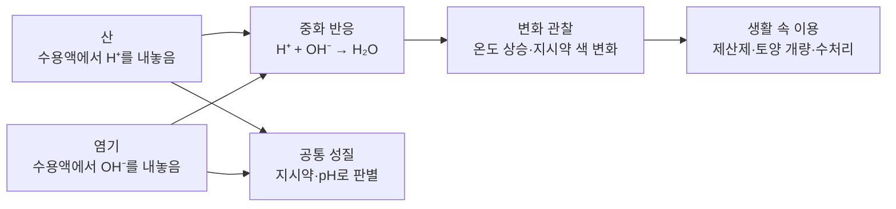

# 4-4. 산과 염기, 중화 반응 — H⁺와 OH⁻가 만나 물이 될 때

> [!NOTE]
> **성취기준 [10통과2-01-04]** 대표적인 산⋅염기 물질의 특징을 알고, 산과 염기를 혼합할 때 나타나는 중화 반응을 생활 속에서 이용할 수 있다.

**학습 목표**

1. 산과 염기를 아레니우스 정의(수용액에서 H⁺ 또는 OH⁻를 내놓는 물질)로 설명하고, 대표적인 산·염기의 이온화를 식으로 나타낼 수 있다.
2. 산과 염기의 공통적인 성질이 각각 H⁺와 OH⁻ 때문임을 설명할 수 있다.
3. 지시약의 색과 pH를 이용하여 용액의 산성·중성·염기성을 판별할 수 있다.
4. 중화 반응에서 나타나는 용액의 온도 변화와 지시약의 색 변화를 설명하고, 중화 반응을 생활 속에서 이용하는 사례를 제시할 수 있다.

**이 단원의 학습 사다리**

| 단계 | 무엇을 하나? |
|---|---|
| STEP 1. 중학교 다시 보기 | 이온, 화학 반응식, 화학 반응의 열 출입을 다시 꺼내 본다 |
| STEP 2. 기초 다지기 | 이온의 이름, 이온화, 이온 수 세기, '10배씩 커지는 눈금'을 디딤돌로 놓는다 |
| STEP 3. 핵심 개념 | 산 → 염기 → 지시약과 pH → 중화 반응의 온도·색 변화 → 생활 속 중화 반응 |
| STEP 4. 오개념 바로잡기 | "수소가 있으면 산이다?", "중화되면 항상 중성이다?" 같은 착각을 바로잡는다 |
| STEP 5. 선택과목·대학 | 브뢴스테드–로리 정의, pH 계산, 중화 적정, 완충 용액 |
| STEP 6. 산업·진로 | 수처리 pH 조절, 제산제·제약, 산성비 대책, 반도체 세정 |

---

## 🗺️ 단원 들어가기

매운 떡볶이를 먹고 속이 쓰릴 때 먹는 위장약, 생선 요리에 뿌리는 레몬즙, 농부가 밭에 뿌리는 하얀 석회 가루. 전혀 관계없어 보이는 이 세 가지 장면에는 공통점이 있다. 모두 **산과 염기가 만나 서로의 성질을 약하게 만드는 반응**, 즉 **중화 반응**을 이용한다.

그렇다면 산과 염기의 정체는 무엇일까? 식초와 레몬즙은 왜 모두 신맛이 날까? 산과 염기를 섞으면 눈에 보이지 않는 곳에서 무슨 일이 일어나고, 우리는 그것을 어떻게 알아챌 수 있을까? 이 단원에서는 두 주인공, **수소 이온(H⁺)** 과 **수산화 이온(OH⁻)** 을 따라가며 그 답을 찾아본다.

---

## STEP 1. 🔙 중학교 다시 보기

### 연계 개념표

| 중학교 성취기준 | 중학교에서 배운 것 | 고등학교에서 확장되는 것 |
|---|---|---|
| [9과11-04] | 물질은 원자, 분자, 이온으로 존재하며 이온은 전하를 띤다 | 산의 공통 입자는 **H⁺**, 염기의 공통 입자는 **OH⁻**이다 |
| [9과16-01] | 화학 변화에서는 새로운 물질이 생긴다 | 중화 반응으로 **물**과 **염**이라는 새로운 물질이 생긴다 |
| [9과16-02] | 화학 반응식을 쓰고 계수비를 입자 수의 비로 해석한다 | 이온화식, 알짜 이온 반응식($\mathrm{H^+ + OH^- \rightarrow H_2O}$)으로 나타낸다 |
| [9과16-06] | 화학 반응에서 열에너지가 출입한다 | 중화 반응에서 열이 발생해 온도가 오르며, **온도가 가장 높은 지점이 중화점**이다 |
| [9과09-02] | 광물(방해석)에 묽은 염산을 떨어뜨리면 거품이 생긴다 | 산이 탄산 칼슘과 반응하여 이산화 탄소를 발생시키는 것은 산의 공통 성질이다 |

> [!TIP]
> 초등학교 과학에서 리트머스 종이와 붉은 양배추 지시약으로 산성 용액과 염기성 용액을 분류해 본 경험, 고등학교 「통합과학1」에서 이온 결합 물질의 수용액이 전류를 흐르게 한다는 것을 배운 경험이 이 단원의 바탕이 된다.

### 준비 운동 (사전 진단)

**Q1.** 식초에 푸른색 리트머스 종이를 적시면 무슨 색으로 변하는가? 비눗물에 붉은색 리트머스 종이를 적시면 무슨 색으로 변하는가?

**Q2.** 다음 이온의 이름을 쓰시오. (1) Na⁺ (2) Cl⁻ (3) OH⁻

**Q3.** 설탕물은 전류가 흐르지 않지만 소금물은 전류가 흐른다. 그 이유는 무엇일까?

**Q4.** 방해석이나 달걀 껍데기에 묽은 염산을 떨어뜨리면 거품이 생긴다. 이 기체를 석회수에 통과시키면 석회수가 뿌옇게 흐려진다. 이 기체는 무엇인가?

정답 및 해설

**Q1.** 식초(산성)는 푸른색 리트머스 종이를 **붉은색**으로, 비눗물(염기성)은 붉은색 리트머스 종이를 **푸른색**으로 바꾼다.

**Q2.** (1) 나트륨 이온 (2) 염화 이온 (3) 수산화 이온

**Q3.** 소금(염화 나트륨)은 물에 녹아 **Na⁺와 Cl⁻ 이온**으로 나뉘고, 이 이온들이 움직이며 전하를 옮기기 때문이다. 설탕은 물에 녹아도 분자 상태로 있어 이온이 생기지 않는다.

**Q4. 이산화 탄소** — 방해석과 달걀 껍데기의 주성분인 탄산 칼슘이 산과 반응하여 이산화 탄소가 발생한다.

---

## STEP 2. 🧱 기초 다지기

### ① 이 단원에 나오는 이온 이름표

| 양이온 | 이름 | 음이온 | 이름 |
|---|---|---|---|
| H⁺ | 수소 이온 | OH⁻ | 수산화 이온 |
| Na⁺ | 나트륨 이온 | Cl⁻ | 염화 이온 |
| K⁺ | 칼륨 이온 | NO₃⁻ | 질산 이온 |
| Ca²⁺ | 칼슘 이온 | SO₄²⁻ | 황산 이온 |
| Mg²⁺ | 마그네슘 이온 | CH₃COO⁻ | 아세트산 이온 |
| NH₄⁺ | 암모늄 이온 | CO₃²⁻ | 탄산 이온 |

OH⁻, NO₃⁻, SO₄²⁻, NH₄⁺처럼 **여러 원자가 한 덩어리가 되어 전하를 띠는 이온**을 다원자 이온이라고 한다. 다원자 이온은 반응하는 동안 대개 한 덩어리로 움직인다.

### ② 물에 녹아 이온으로 나뉘는 현상 — 이온화

염화 나트륨처럼 이온으로 이루어진 물질이나, 염화 수소처럼 물과 만나 이온을 만드는 물질은 물에 녹으면 양이온과 음이온으로 나뉜다. 이것을 **이온화(ionization)** 라고 하고, 식으로 나타낸 것을 **이온화식**이라고 한다.

$$
\mathrm{NaCl \rightarrow Na^+ + Cl^-}
$$

이온이 생긴 수용액은 이온이 전하를 옮기므로 **전류가 흐른다.** 반대로 설탕이나 에탄올처럼 물에 녹아도 이온이 생기지 않는 물질의 수용액은 전류가 거의 흐르지 않는다.

### ③ 화학식에서 이온의 개수 세기

이온화식에서도 **원자 수**와 **전하의 합**이 화살표 양쪽에서 같아야 한다.

$$
\mathrm{H_2SO_4 \rightarrow 2H^+ + SO_4^{2-}} \qquad (\text{전하: } 0 = 2\times(+1) + (-2))
$$

$$
\mathrm{Ca(OH)_2 \rightarrow Ca^{2+} + 2OH^-} \qquad (\text{전하: } 0 = (+2) + 2\times(-1))
$$

황산 한 개는 H⁺를 2개, 수산화 칼슘 한 개는 OH⁻를 2개 내놓는다. 이 '개수'가 STEP 3의 중화 반응을 이해하는 데 쓰인다.

### ④ 한 칸 오를 때마다 10배 — 거듭제곱 눈금

STEP 3에서 배울 pH는 **한 칸 차이가 10배 차이**를 뜻하는 특별한 눈금이다.

| 10원짜리 | 100원짜리 | 1000원짜리 | 10000원짜리 |
|---|---|---|---|
| 1 | 10배 | 100배 | 1000배 |

지폐 단위가 한 단계 올라갈 때마다 금액이 10배씩 커지듯, pH가 1 작아질 때마다 수용액 속 H⁺의 농도는 10배씩 커진다. 그래서 pH 2와 pH 4는 '2 차이'가 아니라 **100배 차이**이다.

> [!TIP]
> 💡 **비유** — 소리의 크기를 나타내는 데시벨도 비슷하다. 10 dB 커질 때마다 소리의 세기는 10배가 된다. 아주 넓은 범위의 값을 다룰 때 과학자들은 이런 '10배 눈금'을 즐겨 쓴다.

---

## STEP 3. 📘 핵심 개념

### 4-4-① 산 — 수용액에서 H⁺를 내놓는 물질

스웨덴의 과학자 아레니우스는 19세기 말에 산과 염기를 이온으로 설명하였다. **아레니우스 정의**에 따르면 **산(acid)** 은 **물에 녹아 수소 이온(H⁺)을 내놓는 물질**이다.

| 산 | 이온화식 | 주로 쓰이는 곳 |
|---|---|---|
| 염산 (HCl) | $\mathrm{HCl \rightarrow H^+ + Cl^-}$ | 위액의 성분, 금속 표면의 녹 제거, 화학 공업 원료 |
| 황산 (H₂SO₄) | $\mathrm{H_2SO_4 \rightarrow 2H^+ + SO_4^{2-}}$ | 자동차 납축전지의 전해질, 비료·화학 공업 |
| 질산 (HNO₃) | $\mathrm{HNO_3 \rightarrow H^+ + NO_3^-}$ | 비료, 화약 원료 |
| 아세트산 (CH₃COOH) | $\mathrm{CH_3COOH \rightarrow H^+ + CH_3COO^-}$ | 식초의 신맛 성분 |
| 탄산 | 이산화 탄소가 물에 녹아 생기는 약한 산 | 탄산음료 |
| 시트르산 | 과일 속에 들어 있는 산 | 귤·레몬의 신맛, 식품 첨가물 |

> [!IMPORTANT]
> 아세트산에는 수소 원자가 4개 있지만, 물에 녹아 H⁺로 떨어져 나오는 것은 **1개뿐**이다. 화학식에 수소가 있다고 모두 산은 아니다. 메테인(CH₄), 에탄올, 포도당은 수소가 많지만 물에서 H⁺를 내놓지 않으므로 산이 아니다.

#### 산의 공통 성질 — 모두 H⁺ 때문이다

| 공통 성질 | 예 | 이유 |
|---|---|---|
| 신맛이 난다 | 식초, 레몬즙 | H⁺ |
| 마그네슘·아연·철 같은 금속과 반응하여 **수소 기체**가 발생한다 | $\mathrm{Mg + 2H^+ \rightarrow Mg^{2+} + H_2}$ | H⁺가 금속에서 전자를 얻어 수소 기체가 된다(4-3의 산화·환원) |
| 탄산 칼슘(달걀 껍데기, 조개껍데기, 대리석)과 반응하여 **이산화 탄소**가 발생한다 | $\mathrm{CaCO_3 + 2HCl \rightarrow CaCl_2 + H_2O + CO_2}$ | H⁺가 탄산 이온과 반응한다 |
| 수용액에서 **전류가 흐른다** | 묽은 염산, 식초 | 이온이 있다 |
| 지시약의 색을 바꾼다 | 푸른색 리트머스 종이 → 붉은색 | H⁺ |

> [!WARNING]
> 실험실의 산이나 염기는 **절대로 맛보거나 손으로 만져서 확인하지 않는다.** 신맛·쓴맛은 식품을 통해 알려진 성질일 뿐이다. 진한 황산을 묽힐 때는 반드시 **물에 산을 조금씩** 넣어야 한다(반대로 하면 열이 많이 나서 튈 수 있다).

#### 같은 산이라도 세기가 다르다

같은 농도의 묽은 염산과 아세트산 수용액에 각각 마그네슘 리본을 넣으면, 염산에서 기포가 훨씬 활발하게 생긴다. 염화 수소는 물에 녹으면 거의 모두 이온화하지만, 아세트산은 **일부만 이온화**하여 수용액 속 H⁺가 적기 때문이다. 이처럼 H⁺를 많이 내놓는 산을 강한 산, 조금 내놓는 산을 약한 산이라고 한다. 식초를 요리에 쓸 수 있는 것도 아세트산이 약한 산이고 농도가 묽기 때문이다.

#### 예제 1

다음 물질 중 아레니우스 산을 모두 고르고, 그 이온화식을 쓰시오.
ㄱ. HNO₃ ㄴ. CH₄ ㄷ. HCl ㄹ. C₂H₅OH(에탄올)

**풀이** 물에 녹아 H⁺를 내놓는 것은 ㄱ, ㄷ이다.
- ㄱ. $\mathrm{HNO_3 \rightarrow H^+ + NO_3^-}$
- ㄷ. $\mathrm{HCl \rightarrow H^+ + Cl^-}$

메테인과 에탄올은 수소 원자를 가지고 있지만 물에서 H⁺를 내놓지 않는다.

### 4-4-② 염기 — 수용액에서 OH⁻를 내놓는 물질

아레니우스 정의에 따르면 **염기(base)** 는 **물에 녹아 수산화 이온(OH⁻)을 내놓는 물질**이다.

| 염기 | 이온화식 | 주로 쓰이는 곳 |
|---|---|---|
| 수산화 나트륨 (NaOH) | $\mathrm{NaOH \rightarrow Na^+ + OH^-}$ | 비누 제조, 하수구 세정제, 화학 공업 |
| 수산화 칼륨 (KOH) | $\mathrm{KOH \rightarrow K^+ + OH^-}$ | 물비누 제조, 알칼리 전지의 전해질 |
| 수산화 칼슘 (Ca(OH)₂) | $\mathrm{Ca(OH)_2 \rightarrow Ca^{2+} + 2OH^-}$ | 석회수, 산성 토양 개량, 건축 재료 |
| 수산화 마그네슘 (Mg(OH)₂) | 물에 조금만 녹아 OH⁻를 낸다 | 제산제(위장약) |
| 암모니아 (NH₃) | $\mathrm{NH_3 + H_2O \rightarrow NH_4^+ + OH^-}$ | 암모니아수, 비료 원료 |

> [!IMPORTANT]
> **암모니아는 화학식에 OH가 없는데 왜 염기일까?** 암모니아는 물에 녹으면 **물과 반응하여** 암모늄 이온(NH₄⁺)과 **수산화 이온(OH⁻)** 을 만든다. 수용액 속에 OH⁻가 생기므로 아레니우스 정의로도 염기로 설명할 수 있다. 다만 일부 암모니아만 이렇게 반응하므로 암모니아수는 약한 염기이다.

#### 염기의 공통 성질 — 모두 OH⁻ 때문이다

| 공통 성질 | 예 | 이유 |
|---|---|---|
| 쓴맛이 난다 | 베이킹 소다를 너무 많이 넣은 빵의 씁쓸한 맛 | OH⁻ |
| 단백질을 녹여 **만지면 미끈거린다** | 비눗물 | OH⁻가 피부의 단백질과 반응 |
| **기름때**를 잘 없앤다 | 하수구 세정제, 오븐 세정제 | OH⁻가 기름 성분과 반응 |
| 수용액에서 **전류가 흐른다** | 수산화 나트륨 수용액 | 이온이 있다 |
| 지시약의 색을 바꾼다 | 붉은색 리트머스 종이 → 푸른색, 페놀프탈레인 → 붉은색 | OH⁻ |
| 대부분의 금속과 반응하지 않는다 | (알루미늄·아연 등 일부 금속은 예외) | — |

> [!WARNING]
> 비눗물이 미끈거리는 것은 피부의 단백질이 녹기 때문이다. 수산화 나트륨처럼 강한 염기는 피부와 눈에 심한 손상을 줄 수 있으므로, 피부에 묻으면 **즉시 많은 양의 흐르는 물로 오래 씻어야** 한다.

중학교에서 이산화 탄소를 확인할 때 쓴 **석회수**는 수산화 칼슘 수용액이다. 이산화 탄소를 통과시키면 물에 잘 녹지 않는 탄산 칼슘이 생겨 뿌옇게 흐려진다.

### 4-4-③ 지시약과 pH — 산성도를 눈으로 보기

#### (1) 지시약

**지시약(indicator)** 은 용액의 산성·중성·염기성에 따라 색이 달라지는 물질이다.

| 지시약 | 산성 | 중성 | 염기성 |
|---|---|---|---|
| 푸른색 리트머스 종이 | **붉은색** | 변화 없음 | 변화 없음 |
| 붉은색 리트머스 종이 | 변화 없음 | 변화 없음 | **푸른색** |
| 페놀프탈레인 용액 | 무색 | 무색 | **붉은색** |
| BTB 용액 | **노란색** | **초록색** | **파란색** |
| 메틸 오렌지 용액 | **붉은색** | 노란색 | 노란색 |
| 붉은 양배추 지시약 | 붉은색 계열 | 보라색 | 청록색~노란색 계열 |

> [!TIP]
> - **페놀프탈레인**은 산성과 중성에서 모두 무색이다. 무색이라고 해서 산성이라고 단정할 수 없다. 대신 염기성 확인에 아주 좋다.
> - **BTB**는 세 가지 상태를 모두 다른 색으로 보여 주어 중화 반응 실험에 편리하다.
> - **메틸 오렌지**는 pH 약 3.1보다 낮으면 붉은색, pH 약 4.4보다 높으면 노란색이다. 그래서 **약한 산성 용액(예: pH 5)도 노란색**으로 보인다. 강한 산성을 확인하는 데 쓴다.

#### (2) pH — 산성의 세기를 숫자로

용액 속 H⁺의 농도를 0~14 정도의 숫자로 간단히 나타낸 것이 **pH**(수소 이온 농도 지수)이다.

- 25 °C에서 **pH = 7이면 중성**, **7보다 작으면 산성**, **7보다 크면 염기성**이다.
- pH가 **작을수록** H⁺가 많아 **산성이 강하다.**
- pH가 **1 작아지면 H⁺의 농도는 10배** 커진다.

| 물질(대략적인 값) | pH | 성질 |
|---|---|---|
| 위액 | 약 1~2 | 산성 |
| 레몬즙 | 약 2 | 산성 |
| 식초, 탄산음료 | 약 3 | 산성 |
| 커피 | 약 5 | 약한 산성 |
| 오염되지 않은 빗물 | 약 5.6 | 약한 산성 |
| 순수한 물 | 7 | 중성 |
| 사람의 혈액 | 약 7.4 | 약한 염기성 |
| 바닷물 | 약 8 | 약한 염기성 |
| 베이킹 소다(탄산수소 나트륨) 수용액 | 약 8~9 | 약한 염기성 |
| 비눗물 | 약 9~10 | 염기성 |
| 하수구 세정제 | 약 13~14 | 강한 염기성 |

> [!NOTE]
> 오염되지 않은 빗물도 공기 중의 이산화 탄소가 녹아 약한 산성(pH 약 5.6)을 띤다. 그래서 보통 **pH 5.6보다 낮은 비**를 **산성비**라고 한다. 산성비는 화석 연료를 태울 때 나오는 황산화물·질소산화물이 빗물에 녹아 생긴다.

#### 예제 2

레몬즙(pH 약 2)과 커피(pH 약 5)의 H⁺ 농도는 몇 배 차이가 나는가?

**풀이** pH 차이는 $5 - 2 = 3$이다. pH가 1 작아질 때마다 10배이므로 $10 \times 10 \times 10 = 1000$배. 레몬즙의 H⁺ 농도가 커피의 **약 1000배**이다.

#### 예제 3

어떤 용액에 페놀프탈레인 용액을 떨어뜨렸더니 무색이었고, BTB 용액을 떨어뜨렸더니 노란색이었다. 이 용액의 성질은?

**풀이** 페놀프탈레인이 무색이므로 산성 또는 중성이다. BTB가 노란색이므로 **산성**이다. 지시약 하나로 알 수 없을 때는 두 가지 이상을 함께 쓴다.

### 4-4-④ 중화 반응 — 온도와 지시약 색으로 보는 변화

#### (1) 중화 반응의 본질

산과 염기를 섞으면 산의 **H⁺** 와 염기의 **OH⁻** 가 **1 : 1로 반응하여 물**이 된다. 이 반응을 **중화 반응(neutralization)** 이라고 한다.

$$
\boxed{\;\mathrm{H^+ + OH^- \rightarrow H_2O}\;}
$$

묽은 염산과 수산화 나트륨 수용액의 중화 반응을 이온으로 풀어 써 보자.

$$
\mathrm{H^+ + Cl^- + Na^+ + OH^- \rightarrow Na^+ + Cl^- + H_2O}
$$

Na⁺와 Cl⁻는 반응 전후에 그대로 있다. 이처럼 반응에 직접 참여하지 않는 이온을 **구경꾼 이온**이라고 한다. 구경꾼 이온을 빼고 실제로 반응한 이온만 쓴 식이 위의 상자 속 식이며, 이를 **알짜 이온 반응식**이라고 한다. 어떤 산과 어떤 염기를 섞어도 중화 반응의 알짜 이온 반응식은 같다.

중화 반응에서 산의 음이온과 염기의 양이온이 만나 생기는 물질을 **염(salt)** 이라고 한다.

| 산 + 염기 | 생기는 염 |
|---|---|
| 염산 + 수산화 나트륨 | 염화 나트륨 (NaCl) |
| 질산 + 수산화 칼륨 | 질산 칼륨 (KNO₃) |
| 염산 + 수산화 칼슘 | 염화 칼슘 (CaCl₂) |
| 황산 + 수산화 나트륨 | 황산 나트륨 (Na₂SO₄) |

> [!TIP]
> 💡 **비유** — 중화 반응은 **짝 맞추기 춤**과 같다. H⁺와 OH⁻는 만나자마자 한 쌍(물 분자)이 되어 무대에서 빠져나간다. Na⁺와 Cl⁻는 짝을 짓지 않고 무대 주변에 그대로 서 있는 구경꾼이다. 남는 H⁺가 있으면 용액은 산성, 남는 OH⁻가 있으면 염기성으로 남는다.

#### (2) 변화 ① — 용액의 온도가 올라간다

중화 반응이 일어나면 열이 발생한다. 이 열을 **중화열**이라고 한다. 그래서 산과 염기를 섞으면 혼합 용액의 온도가 올라간다.

- 반응한 H⁺와 OH⁻의 양이 **많을수록** 열이 많이 나고 온도가 많이 오른다.
- 산의 H⁺와 염기의 OH⁻가 남김없이 반응한 지점을 **중화점**이라고 한다. 같은 조건에서 섞을 때 **혼합 용액의 온도가 가장 높은 지점이 중화점**이다.

**실험 1: 전체 부피를 같게 하고 섞는 비율을 바꿀 때** (농도가 같은 묽은 염산과 수산화 나트륨 수용액)

| 비커 | 묽은 염산(mL) | 수산화 나트륨 수용액(mL) | 최고 온도의 변화 |
|---|---|---|---|
| A | 10 | 40 | 조금 상승 |
| B | 20 | 30 | 더 상승 |
| C | 25 | 25 | **가장 많이 상승 (중화점)** |
| D | 30 | 20 | 더 상승 (B와 비슷) |
| E | 40 | 10 | 조금 상승 (A와 비슷) |

C는 H⁺와 OH⁻가 같은 양만큼 들어 있어 **반응하는 양이 가장 많다.** A와 B는 산이 적어서, D와 E는 염기가 적어서 반응할 수 있는 양이 제한된다.

**실험 2: 묽은 염산에 수산화 나트륨 수용액을 조금씩 넣을 때**

- 중화점까지는 넣을 때마다 새로 중화 반응이 일어나 **온도가 계속 올라간다.**
- 중화점을 지나면 더 이상 반응할 H⁺가 없으므로 열이 나지 않는다. 오히려 실온의 수산화 나트륨 수용액이 섞이고 열이 주변으로 빠져나가 **온도가 조금씩 내려간다.**
- 따라서 그래프는 중화점에서 꼭짓점을 이루는 산 모양이 된다.

#### (3) 변화 ② — 지시약의 색이 바뀐다

혼합 용액에 지시약을 넣어 두면 색 변화로 중화가 어디까지 진행되었는지 알 수 있다.

| 실험 | 처음 | 중화점 | 중화점 이후 |
|---|---|---|---|
| 묽은 염산 + BTB, 여기에 수산화 나트륨 수용액을 조금씩 넣는다 | 노란색 (산성) | **초록색** (중성) | 파란색 (염기성) |
| 수산화 나트륨 수용액 + 페놀프탈레인, 여기에 묽은 염산을 조금씩 넣는다 | 붉은색 (염기성) | **무색이 됨** | 무색 (산성) |

> [!IMPORTANT]
> 염산과 수산화 나트륨처럼 강한 산과 강한 염기의 중화점에서는 혼합 용액이 중성이 된다. 하지만 중화점이 아니면 **남은 쪽의 성질**이 나타난다. H⁺가 남으면 산성, OH⁻가 남으면 염기성이다. "섞었다 = 중성"이 아니다.

#### 예제 4

농도가 같은 묽은 염산과 수산화 나트륨 수용액을 다음과 같이 섞고 BTB 용액을 넣었다. 각 혼합 용액의 색을 쓰고, 최고 온도가 가장 높은 것을 고르시오.
(가) 염산 10 mL + 수산화 나트륨 수용액 30 mL
(나) 염산 20 mL + 수산화 나트륨 수용액 20 mL
(다) 염산 30 mL + 수산화 나트륨 수용액 10 mL

**풀이**
- (가) OH⁻가 남음 → 염기성 → **파란색**
- (나) 중화점 → 중성 → **초록색**
- (다) H⁺가 남음 → 산성 → **노란색**

전체 부피(40 mL)가 같고 반응한 양이 가장 많은 것은 (나)이므로, 최고 온도가 가장 높은 것은 **(나)** 이다. (가)와 (다)는 반응한 양이 같으므로 온도 변화가 비슷하다.

### 4-4-⑤ 생활 속 중화 반응

| 상황 | 산 | 염기 | 중화 반응이 하는 일 |
|---|---|---|---|
| 속이 쓰릴 때 제산제를 먹는다 | 위산(주성분 염산) | 수산화 마그네슘, 수산화 알루미늄, 탄산수소 나트륨 등 | 지나치게 많은 위산을 중화하여 속쓰림을 줄인다 |
| 산성화된 토양에 석회를 뿌린다 | 토양 속 산성 물질 | 소석회(수산화 칼슘), 석회석 가루(탄산 칼슘) | 토양의 산성을 줄여 작물이 잘 자라게 한다 |
| 산성화된 호수에 석회를 뿌린다 | 산성비로 산성화된 호수 물 | 석회석 가루, 소석회 | 물고기 등 수중 생물이 살 수 있게 한다 |
| 생선 요리에 레몬즙·식초를 뿌린다 | 레몬즙(시트르산), 식초(아세트산) | 비린내를 내는 염기성 물질(아민류) | 비린내 물질이 냄새가 덜 나는 물질로 바뀐다 |
| 공장의 산성 폐수를 처리한다 | 산성 폐수 | 수산화 나트륨, 소석회 등 | 하천으로 보내기 전에 pH를 알맞게 맞춘다 |
| 발전소 배기가스를 처리한다 | 이산화 황 같은 산성 기체 | 석회석·소석회 | 산성비의 원인 물질을 줄인다 |
| 빵을 부풀린다 | 베이킹파우더 속 산성 물질 | 탄산수소 나트륨 | 반응으로 생긴 이산화 탄소 기포가 반죽을 부풀린다 |

> [!WARNING]
> **벌레에 물렸을 때 식초나 암모니아수를 바르면 중화되어 낫는다?** 개미 가운데 일부 종이 폼산(개미산)을 분비하는 것은 사실이다. 하지만 벌레의 독이나 침샘 물질은 **피부 속으로 들어가므로** 피부 겉에 바른 물질과 잘 만나지 않고, 붓기와 가려움은 주로 우리 몸의 **면역 반응** 때문에 생긴다. 따라서 '중화하면 낫는다'는 과학적으로 정확한 설명이 아니다. 물린 곳은 깨끗이 씻고 차갑게 하며, 숨이 차거나 심하게 부으면 즉시 병원에 가야 한다.

#### 예제 5

제산제에 수산화 마그네슘을 쓰는 이유를 중화 반응으로 설명하고, 반응식을 쓰시오.

**풀이** 위산의 주성분인 염산이 지나치게 많이 분비되면 속이 쓰리다. 수산화 마그네슘은 염기로서 위산의 H⁺와 중화 반응을 하여 위 속의 산을 줄인다.

$$
\mathrm{Mg(OH)_2 + 2HCl \rightarrow MgCl_2 + 2H_2O}
$$

수산화 마그네슘은 물에 조금만 녹아 OH⁻를 많이 내놓지 않으므로 몸에 부담이 적다.

---

## STEP 4. ⚠️ 오개념 바로잡기

| 흔한 오개념 | 올바른 개념 | 왜 그럴까? |
|---|---|---|
| 화학식에 수소(H)가 있으면 산이다 | **물에 녹아 H⁺를 내놓아야** 산이다 | 메테인·에탄올·포도당은 수소가 많지만 H⁺를 내놓지 않는다 |
| 암모니아는 OH가 없으니 염기가 아니다 | 암모니아는 **물과 반응하여 OH⁻를 만든다** | 수용액 속에 OH⁻가 생기므로 염기성을 나타낸다 |
| 산과 염기를 섞으면 항상 중성이 된다 | H⁺와 OH⁻의 양이 같을 때만 완전히 중화된다 | 남은 H⁺나 OH⁻가 있으면 산성이나 염기성이 된다 |
| 페놀프탈레인이 무색이면 산성이다 | 페놀프탈레인은 **산성과 중성에서 모두 무색**이다 | 산성과 중성을 구별하려면 BTB 같은 다른 지시약을 써야 한다 |
| pH 2는 pH 4보다 산성이 2배 강하다 | pH 2의 H⁺ 농도는 pH 4의 **100배**이다 | pH 1 차이는 H⁺ 농도 10배 차이이다 |
| 산과 염기를 많이 섞을수록 온도가 계속 올라간다 | **중화점에서 온도가 가장 높고** 그 뒤로는 더 오르지 않는다 | 중화점 이후에는 반응할 H⁺(또는 OH⁻)가 남아 있지 않다 |

---

## STEP 5. 🎓 선택과목·대학으로 한 걸음 더

> [!CAUTION]
> 이 절은 **통합과학 교육과정 범위 밖의 심화 내용**으로 평가 대상이 아니다. "이 개념이 앞으로 어디까지 이어지는가"를 맛보기로 보여 주기 위한 내용이다.

### 고2·3 선택과목과의 연결

| 과목 | 이어지는 내용 |
|---|---|
| 화학 | 역동적인 화학 반응 — 브뢴스테드–로리 산·염기, 물의 자동 이온화와 pH, 중화 반응의 양적 관계 등 |
| 화학 반응의 세계 | 산·염기 평형, 완충 용액 등 |
| 생명과학 | 우리 몸의 항상성 — 혈액의 pH 유지 |

### ① 아레니우스를 넘어서: 브뢴스테드–로리 정의

아레니우스 정의는 '물에 녹았을 때'만 다룰 수 있다. 1923년 브뢴스테드와 로리는 **H⁺를 주는 물질을 산, H⁺를 받는 물질을 염기**로 정의하였다. 이 정의로 보면 암모니아가 물에 녹는 반응이 더 자연스럽게 설명된다.

$$
\mathrm{NH_3 + H_2O \rightleftharpoons NH_4^+ + OH^-}
$$

물이 H⁺를 내주므로 산, 암모니아가 H⁺를 받으므로 염기이다. 물은 상대에 따라 산도 되고 염기도 된다. 대학에서는 전자쌍을 주고받는 것으로 정의하는 **루이스 산·염기**까지 배운다.

### ② pH의 정확한 정의와 물의 자동 이온화

pH는 수소 이온의 몰 농도 $[\mathrm{H^+}]$로 다음과 같이 정의한다.

$$
\mathrm{pH} = -\log[\mathrm{H^+}]
$$

예를 들어 $[\mathrm{H^+}] = 1.0\times10^{-3}\ \mathrm{mol/L}$이면 pH = 3이다. 순수한 물도 아주 조금 스스로 이온화하는데, 25 °C에서 $[\mathrm{H^+}][\mathrm{OH^-}] = 1.0\times10^{-14}$로 일정하다(물의 이온화 상수 $K_w$). 그래서 중성인 물은 $[\mathrm{H^+}] = 1.0\times10^{-7}\ \mathrm{mol/L}$, 즉 pH 7이다.

### ③ 중화 적정 — 모르는 농도를 알아내기

H⁺와 OH⁻가 1 : 1로 반응하므로, 중화점에서는 다음 관계가 성립한다($n$: 산 또는 염기 1개가 내놓는 H⁺ 또는 OH⁻의 수, $M$: 몰 농도, $V$: 부피).

$$
nMV = n'M'V'
$$

예를 들어 $0.1\ \mathrm{mol/L}$ 염산 20.0 mL를 완전히 중화하는 데 필요한 $0.2\ \mathrm{mol/L}$ 수산화 나트륨 수용액의 부피는 $1\times0.1\times20.0 = 1\times0.2\times V'$에서 $V' = 10.0\ \mathrm{mL}$이다. 식품의 산도, 의약품 성분, 하천 수질 분석에 쓰이는 **분석화학**의 기본 기술이다. 또 아세트산과 수산화 나트륨처럼 **약한 산과 강한 염기**의 중화점에서는 혼합 용액이 약한 염기성을 띠는데, 이것도 선택과목에서 배운다.

### ④ 완충 용액 — 생명을 지키는 pH 조절 장치

사람의 혈액은 pH 약 7.35~7.45의 좁은 범위로 유지된다. 혈액 속의 탄산과 탄산수소 이온이 산이나 염기가 들어와도 pH가 크게 변하지 않게 막아 주기 때문이다. 이런 용액을 **완충 용액(buffer)** 이라고 한다. 대학 「생화학」에서는 효소마다 가장 잘 작동하는 pH(최적 pH)가 있다는 것과 함께 배운다.

### 고등학교 vs 대학교

| 구분 | 고등학교 통합과학 | 대학교 일반화학·분석화학·생화학 |
|---|---|---|
| 산·염기 정의 | 아레니우스 정의(H⁺, OH⁻) | 브뢴스테드–로리, 루이스 정의 |
| 세기 | pH 눈금, 지시약 색 | $\mathrm{pH} = -\log[\mathrm{H^+}]$, 이온화 상수 $K_a, K_b$ |
| 중화 반응 | 온도 변화와 지시약 색 변화 | 적정 곡선, 중화 적정으로 농도 계산 |
| 생명·환경 | 제산제, 산성비, 토양 개량 | 완충 용액, 혈액의 pH 조절, 수질 화학 |
| 관련 전공 | — | 화학, 화학공학, 환경공학, 약학, 생명과학, 농화학 |

---

## STEP 6. 🏭 산업 현장과 진로 연결

### 사례 1. 수처리 — 물의 pH를 관리하는 일

- **원리** 정수장과 폐수 처리장에서는 물의 pH를 측정하고, 산성이면 염기(수산화 나트륨, 소석회 등)를, 염기성이면 산(황산, 염산, 이산화 탄소 등)을 넣어 중화한다.
- **어디에 쓰이나** 우리나라 **먹는물 수질 기준**에서 수돗물의 pH는 **5.8 이상 8.5 이하**여야 한다. 공장 폐수도 하천에 내보내기 전에 법으로 정한 pH 범위에 맞추어야 한다.
- **핵심 기술** pH 측정 장치가 물의 pH를 계속 측정하고, 그 값에 따라 약품 투입량을 자동으로 조절한다. 너무 많이 넣어 반대 성질이 되지 않게 하는 것이 중요하다.

### 사례 2. 제산제와 제약 산업

- **원리** 제산제는 위산을 중화하는 약한 염기성 물질(수산화 마그네슘, 수산화 알루미늄, 탄산수소 나트륨, 탄산 칼슘 등)을 이용한다.
- **약의 이름 속 중화 반응** 약 성분 이름에 '○○ 염산염'이라고 쓰인 경우가 많다. 염기성을 띠는 약 성분을 염산과 반응시켜 **염**의 형태로 만들면 물에 잘 녹아 몸에 흡수되기 쉬워지는 경우가 많기 때문이다.
- **진로** 약의 성분과 형태를 설계하는 제약 연구원, 약사, 품질 관리 연구원.

### 사례 3. 산성비 대책과 토양 개량

- **배연 탈황** 석탄을 태우는 발전소나 공장의 굴뚝 가스에는 산성비의 원인인 이산화 황이 들어 있다. 굴뚝 가스를 석회석(또는 소석회)을 푼 물에 통과시키면 이산화 황이 반응하여 제거되고, 그 결과 **석고**(황산 칼슘)가 생긴다. 이 석고는 건축 자재 원료로 다시 쓰인다.
- **토양 개량** 우리나라 토양은 산성을 띠는 경우가 많아, 농가에서는 토양 검사를 한 뒤 필요한 만큼 석회 비료를 뿌려 pH를 맞춘다. 작물마다 잘 자라는 pH가 다르다.

### 사례 4. 반도체 공정 — 산·염기 세정액과 폐수 중화

- **원리** 반도체 웨이퍼는 아주 작은 먼지나 금속 오염도 허용하지 않는다. 대표적인 세정 단계에서는 **암모니아수 + 과산화 수소 + 물**(염기성 세정액)로 미세 입자와 유기물을 없애고, **염산 + 과산화 수소 + 물**(산성 세정액)로 금속 오염을 녹여 낸다.
- **환경 관리** 세정에 쓴 산성·염기성 폐액은 그대로 버릴 수 없으므로, 공장 안의 폐수 처리 시설에서 **중화**하고 유해 물질을 제거한 뒤 내보낸다.

### 관련 진로와 학과

| 진로 | 하는 일 | 관련 학과 |
|---|---|---|
| 수처리·환경 엔지니어 | 정수·폐수 처리 공정 운영, pH와 수질 관리 | 환경공학, 화학공학, 토목공학 |
| 제약 연구원·약사 | 약 성분의 형태 설계, 제산제 등 의약품 개발·관리 | 약학, 화학, 생명공학 |
| 농화학·토양 연구원 | 토양 검사, 비료·토양 개량제 개발 | 농화학, 원예학, 환경학 |
| 반도체 공정 엔지니어 | 세정·식각 공정 관리, 약품·폐수 관리 | 화학공학, 재료공학, 전자공학 |
| 분석화학 연구원 | 식품·의약품·환경 시료의 산도와 성분 분석 | 화학, 식품공학 |

---

## 🔬 탐구 활동 — 산과 염기를 혼합할 때 용액의 온도를 측정하여 그래프로 나타내기

**목표** 같은 농도의 묽은 염산과 묽은 수산화 나트륨 수용액을 여러 비율로 섞어 온도 변화를 측정하고, 그래프에서 중화점을 찾는다. 지시약의 색 변화와 비교한다.

**준비물** 묽은 염산, 묽은 수산화 나트륨 수용액(두 용액은 교사가 같은 농도로 준비), 단열 컵(스타이로폼 컵) 5개, 온도계 또는 온도 센서, 눈금실린더 2개, 유리 막대, BTB 용액, 보안경, 실험용 장갑, 그래프 용지(또는 스프레드시트)

**과정**
1. 두 용액을 실험실에 충분히 놓아두어 처음 온도를 같게 맞추고, 처음 온도를 기록한다.
2. 단열 컵 A~E에 묽은 염산을 각각 10, 20, 25, 30, 40 mL 넣는다.
3. 각 컵에 BTB 용액을 2~3방울 넣는다.
4. 컵 A~E에 수산화 나트륨 수용액을 각각 40, 30, 25, 20, 10 mL 넣고(전체 부피 50 mL로 같게) 유리 막대로 저으면서 **가장 높이 올라간 온도**를 기록한다.
5. 혼합 용액의 색을 기록한다.
6. 가로축을 '염산의 부피', 세로축을 '최고 온도'로 하여 그래프를 그린다.

**결과 기록** (아래 '예시 값'은 처음 온도 20.0 °C, 열 손실이 없는 이상적인 경우를 가정한 것이다. 실제 측정값을 옆 칸에 쓴다.)

| 컵 | 염산(mL) | 수산화 나트륨 수용액(mL) | 최고 온도 예시 값(°C) | 측정한 최고 온도(°C) | BTB 색 |
|---|---|---|---|---|---|
| A | 10 | 40 | 22.7 | | |
| B | 20 | 30 | 25.5 | | |
| C | 25 | 25 | 26.8 | | |
| D | 30 | 20 | 25.5 | | |
| E | 40 | 10 | 22.7 | | |

**생각해 보기**
1. 그래프에서 온도가 가장 높은 지점은 어디인가? 그 컵의 BTB 색은 무엇이며, 이 지점을 무엇이라고 하는가?
2. 그래프가 C를 중심으로 거의 좌우 대칭 모양이 되는 이유를 '반응한 H⁺와 OH⁻의 양'으로 설명해 보자.
3. 실제 측정값이 예시 값보다 낮게 나온다면 그 원인은 무엇일까? (열 손실, 온도계가 열을 흡수함, 용액의 처음 온도 차이 등)
4. 수산화 나트륨 수용액의 농도가 염산의 2배였다면, 온도가 가장 높은 컵은 어떻게 달라질까?

> [!WARNING]
> **안전 수칙**
> - 보안경과 실험용 장갑을 반드시 착용한다. 수산화 나트륨 수용액은 피부의 단백질을 손상시키고, 눈에 들어가면 매우 위험하다.
> - 용액이 피부나 눈에 닿으면 즉시 많은 양의 흐르는 물로 충분히 오래 씻고 교사에게 알린다.
> - 진한 산·염기를 직접 묽히지 않는다. 묽은 용액은 교사가 준비한다.
> - 실험 후 혼합 용액은 교사의 지시에 따라 처리한다.

---

## ✅ 개념 확인 문제

### 기본

**1.** 다음 물질을 아레니우스 정의에 따라 산, 염기, 둘 다 아닌 것으로 분류하시오.
HCl, NaOH, CH₃COOH, CH₄, NH₃, HNO₃

정답 및 해설

**정답** 산: HCl, CH₃COOH, HNO₃ / 염기: NaOH, NH₃ / 둘 다 아님: CH₄

- HCl, CH₃COOH, HNO₃는 물에 녹아 H⁺를 내놓는다.
- NaOH는 물에 녹아 OH⁻를 내놓고, NH₃는 물과 반응하여 OH⁻를 만든다.
- CH₄(메테인)는 수소가 있지만 물에서 H⁺도 OH⁻도 내놓지 않는다.

**2.** 표의 빈칸에 지시약의 색을 쓰시오.

| 지시약 | 묽은 염산 | 수산화 나트륨 수용액 |
|---|---|---|
| 페놀프탈레인 | (ㄱ) | (ㄴ) |
| BTB | (ㄷ) | (ㄹ) |
| 메틸 오렌지 | (ㅁ) | (ㅂ) |

정답 및 해설

**정답** ㄱ: 무색, ㄴ: 붉은색, ㄷ: 노란색, ㄹ: 파란색, ㅁ: 붉은색, ㅂ: 노란색

**3.** 마그네슘 리본을 묽은 염산과 수산화 나트륨 수용액에 각각 넣었다. (1) 기체가 발생하는 쪽과 그 기체의 이름을 쓰고, (2) 기체가 발생하는 이유를 이온으로 설명하시오.

정답 및 해설

**정답**
(1) 묽은 염산, 수소 기체
(2) 염산 속의 H⁺가 마그네슘으로부터 전자를 얻어 수소 기체가 된다. $\mathrm{Mg + 2H^+ \rightarrow Mg^{2+} + H_2}$ 수산화 나트륨 수용액에는 H⁺가 거의 없어 마그네슘과 반응하지 않는다. 이 반응은 4-3에서 배운 산화·환원 반응이기도 하다(마그네슘 산화, 수소 이온 환원).

**4.** 묽은 질산과 수산화 칼륨 수용액의 중화 반응에서 (1) 알짜 이온 반응식, (2) 구경꾼 이온, (3) 생기는 염의 화학식을 쓰시오.

정답 및 해설

**정답** (1) $\mathrm{H^+ + OH^- \rightarrow H_2O}$ (2) K⁺, NO₃⁻ (3) KNO₃

질산은 H⁺와 NO₃⁻, 수산화 칼륨은 K⁺와 OH⁻로 이온화한다. H⁺와 OH⁻만 반응하여 물이 되고, K⁺와 NO₃⁻는 그대로 남아 있다가 물을 증발시키면 질산 칼륨(염)으로 얻을 수 있다.

### 응용

**5.** 농도가 같은 묽은 염산과 수산화 나트륨 수용액을 전체 부피가 50 mL가 되도록 섞고 최고 온도를 측정하였다(처음 온도 20.0 °C).

| 비커 | A | B | C | D | E |
|---|---|---|---|---|---|
| 염산(mL) | 10 | 20 | 25 | 30 | 40 |
| 수산화 나트륨 수용액(mL) | 40 | 30 | 25 | 20 | 10 |
| 최고 온도(°C) | 22.7 | 25.5 | 26.8 | 25.5 | 22.7 |

(1) 중화점에 해당하는 비커는? (2) 각 비커에 BTB 용액을 넣었을 때의 색을 쓰시오. (3) A와 E의 온도가 같은 이유를 설명하시오.

정답 및 해설

**정답**
(1) C
(2) A·B: 파란색(OH⁻가 남아 염기성), C: 초록색(중성), D·E: 노란색(H⁺가 남아 산성)
(3) A는 염산 10 mL가 모두 반응하고 수산화 나트륨 수용액이 남으며, E는 수산화 나트륨 수용액 10 mL가 모두 반응하고 염산이 남는다. 두 용액의 농도가 같으므로 **반응한 H⁺와 OH⁻의 양(생성된 물의 양)이 같아** 발생한 열과 온도 변화가 같다.

**6.** pH가 5인 용액 X와 pH가 9인 용액 Y가 있다. (1) X 속 H⁺의 농도는 순수한 물(pH 7)의 몇 배인가? (2) BTB 용액을 넣으면 X와 Y는 각각 무슨 색을 띠는가? (3) 메틸 오렌지 용액으로는 X와 Y를 구별하기 어려운 이유는?

정답 및 해설

**정답**
(1) 100배 — pH 차이가 2이므로 $10\times10 = 100$배
(2) X: 노란색(산성), Y: 파란색(염기성)
(3) 메틸 오렌지는 pH 약 4.4보다 높으면 노란색이므로, pH 5인 X와 pH 9인 Y가 **모두 노란색**으로 보이기 때문이다.

**7.** 수산화 나트륨 수용액은 같은 부피 속에 OH⁻를 묽은 염산의 H⁺보다 **2배** 많이 포함하고 있다. 두 용액을 섞어 전체 부피가 30 mL가 되게 할 때, 혼합 용액의 최고 온도가 가장 높으려면 염산과 수산화 나트륨 수용액을 각각 몇 mL씩 섞어야 하는가?

정답 및 해설

**정답** 염산 20 mL, 수산화 나트륨 수용액 10 mL

온도가 가장 높은 것은 H⁺와 OH⁻가 남김없이 반응하는 중화점이다. 염산을 $V$ mL 넣으면 수산화 나트륨 수용액은 $(30 - V)$ mL이다. H⁺의 양은 $V$에, OH⁻의 양은 $2(30 - V)$에 비례하므로 $V = 2(30 - V)$에서 $V = 20$이다. 확인: 염산 20 mL의 H⁺와 수산화 나트륨 수용액 10 mL의 OH⁻($10\times2 = 20$)가 같다.

### 융합·서술형

**8. [산업 연계]** 어느 도금 공장에서 pH 약 2인 산성 폐수가 나온다. (1) 이 폐수를 하천에 바로 버리면 안 되는 이유를 쓰고, (2) 폐수를 처리하기 위해 넣을 수 있는 물질과 그 원리를 설명하시오. (3) 처리 담당자가 약품을 넣으면서 pH를 계속 측정해야 하는 이유를 서술하시오.

정답 및 해설

**예시 답안**
(1) 강한 산성의 물은 하천의 물고기와 수중 생물에게 해를 주고, 하천 바닥의 생태계와 주변 토양을 산성화시킬 수 있다.
(2) 수산화 나트륨이나 소석회(수산화 칼슘) 같은 염기를 넣는다. 염기의 OH⁻가 폐수 속 H⁺와 중화 반응($\mathrm{H^+ + OH^- \rightarrow H_2O}$)을 하여 H⁺를 줄이므로 pH가 높아진다.
(3) 염기를 너무 많이 넣으면 중화점을 지나 남은 OH⁻ 때문에 폐수가 오히려 **염기성**이 되어 또 다른 오염을 일으킨다. 따라서 pH를 측정하며 법으로 정한 범위 안에 들도록 약품의 양을 조절해야 한다.

**채점 포인트** ① 생태계 피해 ② 염기를 넣는 중화 원리(H⁺ + OH⁻ → H₂O) ③ 과도하게 넣으면 염기성이 된다는 점

**9. [생활·대학 연계]** 제산제의 성분으로 수산화 마그네슘이나 탄산수소 나트륨은 쓰지만, 수산화 나트륨은 쓰지 않는다. (1) 그 이유를 염기의 세기와 몸에 미치는 영향으로 설명하시오. (2) 탄산수소 나트륨이 든 제산제를 먹으면 트림이 나올 수 있는 이유를 산의 공통 성질과 관련지어 설명하시오.

정답 및 해설

**예시 답안**
(1) 수산화 나트륨은 물에 잘 녹아 OH⁻를 많이 내놓는 강한 염기로, 입·식도·위의 점막(단백질)을 심하게 손상시킨다. 또 위산을 지나치게 중화하여 소화를 방해할 수 있다. 수산화 마그네슘은 물에 조금만 녹아 OH⁻를 천천히 조금씩 내놓고, 탄산수소 나트륨은 약한 염기성을 띠어 위산을 알맞게 중화할 수 있다.
(2) 위산(염산)이 탄산수소 나트륨과 반응하면 이산화 탄소 기체가 발생한다($\mathrm{NaHCO_3 + HCl \rightarrow NaCl + H_2O + CO_2}$). 산이 탄산 칼슘과 반응해 이산화 탄소를 내는 것과 같은 성질이다. 이 기체가 위에 차서 트림으로 나온다.

---

## 📝 한눈에 정리

### 핵심 요약

- **산**: 물에 녹아 **H⁺**를 내놓는 물질(염산, 황산, 질산, 아세트산 등). 신맛, 금속과 반응해 수소 발생, 탄산 칼슘과 반응해 이산화 탄소 발생.
- **염기**: 물에 녹아 **OH⁻**를 내놓는 물질(수산화 나트륨, 수산화 칼슘, 암모니아 등). 쓴맛, 단백질을 녹여 미끈거림. 암모니아는 물과 반응하여 OH⁻를 만든다.
- **지시약**: 페놀프탈레인(염기성 붉은색), BTB(산성 노란색·중성 초록색·염기성 파란색), 메틸 오렌지(산성 붉은색·중성과 염기성 노란색), 리트머스.
- **pH**: 7이 중성, 작을수록 산성이 강하며, 1 차이는 H⁺ 농도 10배 차이.
- **중화 반응**: $\mathrm{H^+ + OH^- \rightarrow H_2O}$. 중화열로 온도가 오르며 **최고 온도인 지점이 중화점**이다. 지시약의 색으로 중화의 진행을 확인한다.
- 제산제, 토양·호수의 산성화 개선, 폐수 처리, 배연 탈황 등에 중화 반응을 이용한다.

### 핵심 용어

| 용어 | 뜻 |
|---|---|
| 산(아레니우스) | 물에 녹아 수소 이온(H⁺)을 내놓는 물질 |
| 염기(아레니우스) | 물에 녹아 수산화 이온(OH⁻)을 내놓는 물질 |
| 지시약 | 용액의 액성에 따라 색이 달라지는 물질 |
| pH | 수용액 속 H⁺의 농도를 나타내는 수치. 7이 중성 |
| 중화 반응 | 산의 H⁺와 염기의 OH⁻가 1 : 1로 반응하여 물이 생기는 반응 |
| 중화점 | 산의 H⁺와 염기의 OH⁻가 남김없이 반응한 지점 |
| 중화열 | 중화 반응에서 발생하는 열 |
| 염 | 중화 반응에서 산의 음이온과 염기의 양이온이 만나 생기는 물질 |

### 다음 단원으로

중화 반응에서 용액의 온도가 올라가는 것을 보았다. 이처럼 화학 변화나 상태 변화가 일어날 때는 에너지가 함께 출입한다. 다음 단원에서는 **에너지를 방출하는 변화와 흡수하는 변화**를 찾아보고, 손난로·냉각 팩·발열 도시락처럼 그 에너지 출입을 생활에 이용하는 방법과, 광합성·호흡·구름 생성 같은 지구와 생명의 현상까지 연결해 본다.
