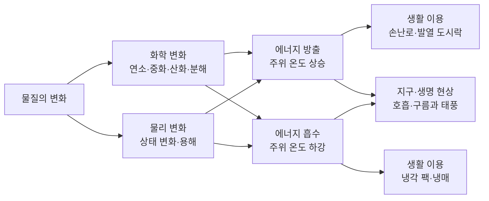
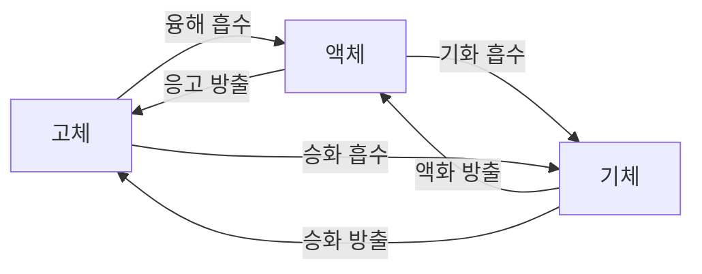
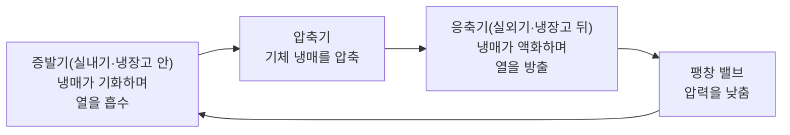
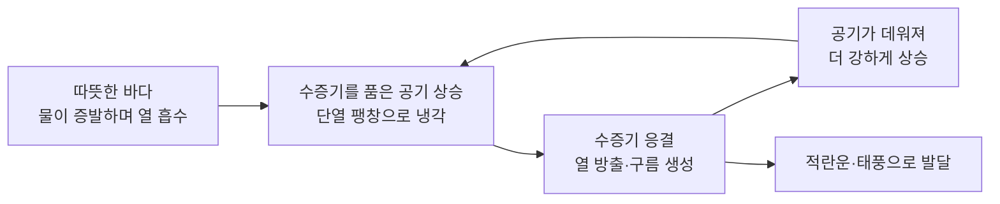

# 4-5. 물질 변화와 에너지 출입 — 따뜻해지고 차가워지는 변화의 과학

> [!NOTE]
> **성취기준 [10통과2-01-05]** 생활 주변에서 에너지를 흡수하거나 방출하는 현상을 찾아 에너지의 흡수 방출이 우리 생활에 어떻게 이용되는지 토의할 수 있다.

**학습 목표**

1. 생활 주변의 화학 변화와 물리 변화에서 에너지를 방출하는 현상과 흡수하는 현상을 찾아 구분할 수 있다.
2. 상태 변화가 일어날 때 열에너지가 출입하는 방향을 입자 사이의 거리 변화와 관련지어 설명할 수 있다.
3. 손난로, 냉각 팩, 발열 도시락, 냉매 등 에너지 출입을 이용한 제품의 원리를 설명하고, 더 나은 이용 방법을 토의할 수 있다.
4. 광합성, 호흡, 구름의 생성 등 지구와 생명 현상에서 에너지 출입이 어떤 역할을 하는지 설명할 수 있다.

**이 단원의 학습 사다리**

| 단계 | 무엇을 하나? |
|---|---|
| STEP 1. 중학교 다시 보기 | 열평형, 비열, 상태 변화와 열, 화학 반응과 열을 다시 꺼내 본다 |
| STEP 2. 기초 다지기 | 온도와 열의 구분, '계와 주위', 열량 계산 $Q = cm\Delta t$, 에너지 보존을 디딤돌로 놓는다 |
| STEP 3. 핵심 개념 | 에너지 방출·흡수 → 상태 변화와 열 → 열을 내는 제품 → 열을 흡수하는 제품 → 지구·생명 현상 |
| STEP 4. 오개념 바로잡기 | "냉각 팩은 냉기를 내보낸다?" 같은 착각을 바로잡는다 |
| STEP 5. 선택과목·대학 | 엔탈피와 열화학 반응식, 결합 에너지, 엔트로피, 잠열의 계산 |
| STEP 6. 산업·진로 | 발열·냉각 제품, 냉매와 히트 펌프, 석회·시멘트 산업, 축열 기술 |

---

## 🗺️ 단원 들어가기

추운 겨울 아침, 일회용 손난로의 포장을 뜯어 흔들면 몇 분 뒤 따뜻해진다. 불도 없고 전지도 없는데 열은 어디에서 왔을까? 반대로 운동하다 다쳤을 때 쓰는 냉각 팩은 손으로 꾹 눌러 터뜨리기만 하면 금세 차가워진다. 냉장고도 없는데 어떻게 차가워질까?

캠핑장에서 끈을 당기기만 하면 김이 나며 데워지는 발열 도시락, 땀이 마르면서 시원해지는 몸, 소나기가 오기 전의 후텁지근한 공기, 엄청난 에너지를 품은 태풍. 이 모든 현상 뒤에는 **물질이 변할 때 에너지가 들어오거나 나간다**는 공통된 원리가 있다. 이 단원에서는 그 원리를 찾아 생활과 지구, 생명 현상에 적용해 본다.

---

## STEP 1. 🔙 중학교 다시 보기

### 연계 개념표

| 중학교 성취기준 | 중학교에서 배운 것 | 고등학교에서 확장되는 것 |
|---|---|---|
| [9과03-01] | 온도가 다른 두 물체가 접촉하면 열평형에 도달한다 | 반응하는 물질(계)과 주위 사이에서 열이 이동하는 방향으로 **방출·흡수**를 판단한다 |
| [9과03-03] | 물질마다 비열이 다르다 | 물의 온도 변화로 출입한 열의 양을 어림한다($Q = cm\Delta t$) |
| [9과04-04] | 상태 변화 시 열에너지가 출입하고, 상태 변화 동안 온도가 일정하다 | 상태 변화의 열 출입을 냉매, 냉해 방지, 체온 조절, 구름 생성에 적용한다 |
| [9과16-06] | 화학 반응에서 열에너지가 출입하며, 생활 속 사례가 있다 | 에너지를 방출·흡수하는 반응을 분류하고, 제품을 **설계**하고 이용 방법을 **토의**한다 |
| [9과12-02] | 광합성과 호흡에서 에너지와 물질이 출입한다 | 광합성은 에너지를 **흡수**하고 호흡은 에너지를 **방출**하는 변화이다 |
| [9과17-03] | 단열 팽창과 응결로 구름이 생긴다 | 응결할 때 방출되는 열이 구름과 태풍을 키우는 에너지원이 된다 |

### 준비 운동 (사전 진단)

**Q1.** 얼음을 가열하면서 온도를 측정하면, 얼음이 녹는 동안 온도가 0 °C에서 한동안 변하지 않는다. 이때 가해 준 열은 어디에 쓰였을까?

**Q2.** 운동한 뒤 땀이 마르면 시원해진다. 그 이유를 '열'이라는 말을 넣어 설명하시오.

**Q3.** 다음 중 열에너지를 방출하는 화학 반응을 고르시오.
ㄱ. 가스레인지에서 가스가 탄다. ㄴ. 묽은 염산과 수산화 나트륨 수용액을 섞는다. ㄷ. 질산 암모늄을 물에 녹인다.

**Q4.** 80 °C의 물과 20 °C의 물을 섞었다. 열은 어느 쪽에서 어느 쪽으로 이동하며, 언제 멈추는가?

정답 및 해설

**Q1.** 가해 준 열은 온도를 높이는 데 쓰이지 않고, 얼음 입자 사이의 규칙적인 배열을 무너뜨려 **고체를 액체로 바꾸는 데(상태 변화)** 쓰였다.

**Q2.** 땀(물)이 증발(기화)할 때 피부로부터 **열을 흡수**하므로 피부의 온도가 내려간다.

**Q3. ㄱ, ㄴ** — 연소와 중화 반응은 열을 방출한다. ㄷ. 질산 암모늄이 물에 녹을 때는 열을 흡수하여 용액이 차가워진다. (용해는 물리 변화로 볼 수 있지만 열 출입이 일어난다.)

**Q4.** 열은 온도가 높은 **80 °C의 물에서 20 °C의 물로** 이동하며, 두 물의 온도가 같아지면(열평형) 겉으로 보이는 열의 이동이 멈춘다.

---

## STEP 2. 🧱 기초 다지기

### ① 온도와 열은 다르다

- **온도(temperature)**: 물질을 이루는 입자의 운동이 얼마나 활발한지를 나타내는 정도. 단위는 °C 또는 K.
- **열(heat)**: 온도 차이 때문에 한 물체에서 다른 물체로 **이동하는 에너지**. 단위는 J(줄).

열은 언제나 **온도가 높은 곳에서 낮은 곳으로** 이동한다. "열이 들어왔다"는 것은 에너지가 들어왔다는 뜻이고, 그 결과 온도가 오르거나 상태가 변한다.

### ② 계와 주위 — 열이 어디에서 어디로 가는가?

「통합과학1」에서 관심 있는 대상을 하나의 **시스템(계)** 으로 보고, 그 밖을 주위로 보는 방법을 배웠다. 에너지 출입도 같은 방식으로 본다.

- **계(system)**: 반응하거나 상태가 변하는 물질 (예: 손난로 속 철 가루, 냉각 팩 속 질산 암모늄과 물)
- **주위(surroundings)**: 계를 둘러싼 나머지 (예: 손, 용기, 공기, 물)

| 구분 | 열의 이동 | 주위의 온도 |
|---|---|---|
| 에너지 **방출** | 계 → 주위 | **올라간다** (따뜻해진다) |
| 에너지 **흡수** | 주위 → 계 | **내려간다** (차가워진다) |

> [!TIP]
> 💡 **비유** — 계를 '나', 주위를 '친구들'이라고 하자. 내가 친구들에게 간식을 나누어 주면(방출) 친구들이 기뻐하고(주위 온도 상승), 내가 친구들에게서 간식을 받아 가면(흡수) 친구들의 간식이 줄어든다(주위 온도 하강). 우리가 손으로 느끼는 것은 늘 **주위(친구들)의 변화**이다.

### ③ 열의 양을 어림하는 방법

물질이 얻거나 잃은 열의 양(열량 $Q$)은 비열 $c$, 질량 $m$, 온도 변화 $\Delta t$로 구할 수 있다.

$$
Q = cm\Delta t
$$

- 물의 비열은 약 $4.2\ \mathrm{J/(g\cdot ^\circ C)}$이다. 물 1 g의 온도를 1 °C 높이는 데 약 4.2 J이 필요하다는 뜻이다.
- 예: 물 100 g의 온도를 10 °C 높이려면 $Q = 4.2 \times 100 \times 10 = 4200\ \mathrm{J}$

반응이 일어나는 용기 속 물의 온도 변화를 재면, 반응이 방출하거나 흡수한 열을 거꾸로 어림할 수 있다.

### ④ 에너지는 사라지지 않고 모습만 바뀐다

물질은 그 안에 **화학 에너지**를 저장하고 있다. 물질이 변하면서 화학 에너지가 줄어들면 줄어든 만큼 열이나 빛 같은 에너지로 나오고(방출), 화학 에너지가 늘어나려면 그만큼 주위에서 에너지가 들어와야 한다(흡수). 에너지의 총량은 변하지 않는다.

---

## STEP 3. 📘 핵심 개념

### 4-5-① 에너지를 방출하는 변화와 흡수하는 변화

물질이 변할 때 에너지를 내보내면 주위가 따뜻해지고, 에너지를 받아들이면 주위가 차가워진다. 화학 반응 가운데 에너지를 방출하는 반응을 **발열 반응(exothermic reaction)**, 에너지를 흡수하는 반응을 **흡열 반응(endothermic reaction)** 이라고 한다.

| 에너지를 **방출**하는 화학 변화 (발열 반응) | 에너지를 **흡수**하는 화학 변화 (흡열 반응) |
|---|---|
| 연료의 연소: $\mathrm{CH_4 + 2O_2 \rightarrow CO_2 + 2H_2O}$ | 광합성: 빛에너지를 흡수하여 포도당을 만든다 |
| 세포호흡: 포도당이 산화되어 에너지를 낸다 | 탄산수소 나트륨의 열분해: $\mathrm{2NaHCO_3 \rightarrow Na_2CO_3 + H_2O + CO_2}$ |
| 중화 반응: $\mathrm{H^+ + OH^- \rightarrow H_2O}$ | 석회석의 열분해: $\mathrm{CaCO_3 \rightarrow CaO + CO_2}$ |
| 철의 산화(손난로): $\mathrm{4Fe + 3O_2 \rightarrow 2Fe_2O_3}$ | 수산화 바륨과 염화 암모늄의 반응(용기가 매우 차가워진다) |
| 산화 칼슘과 물의 반응: $\mathrm{CaO + H_2O \rightarrow Ca(OH)_2}$ | 물의 전기 분해: 전기 에너지를 흡수하여 수소와 산소로 나뉜다 |
| 금속과 산의 반응: $\mathrm{Mg + 2HCl \rightarrow MgCl_2 + H_2}$ | |

물에 녹는 **용해**에서도 에너지가 출입한다.

| 물에 녹을 때 열을 **방출**(용액이 따뜻해짐) | 물에 녹을 때 열을 **흡수**(용액이 차가워짐) |
|---|---|
| 수산화 나트륨, 염화 칼슘, 진한 황산 | 질산 암모늄, 요소 |

> [!TIP]
> **열분해 반응은 대부분 흡열 반응이다.** 탄산수소 나트륨이나 석회석은 계속 가열해 주어야 분해되고, 가열을 멈추면 분해도 멈춘다. 반대로 연소는 처음에 불을 붙여 주어야 하지만 **일단 시작되면 스스로 열을 내며 계속된다.** 시작할 때 열이 필요하다고 해서 흡열 반응인 것은 아니다.

#### 예제 1

다음 현상을 에너지를 방출하는 것과 흡수하는 것으로 분류하시오.
ㄱ. 숯불이 탄다. ㄴ. 빵 반죽 속 베이킹 소다가 오븐에서 분해되어 이산화 탄소를 낸다. ㄷ. 생석회(산화 칼슘)에 물을 부었더니 김이 났다. ㄹ. 질산 암모늄을 물에 녹였더니 비커 바깥에 물방울이 맺혔다.

**풀이**
- 방출: **ㄱ**(연소), **ㄷ**(산화 칼슘과 물의 반응, 물이 끓을 만큼 뜨거워진다)
- 흡수: **ㄴ**(열분해, 오븐의 열을 계속 흡수), **ㄹ**(용액이 차가워져 공기 중 수증기가 비커 표면에서 액화했다)

#### 예제 2

냉각 팩 속에서 질산 암모늄이 물 200 g에 녹아 물의 온도가 25 °C에서 5 °C로 내려갔다. 이 물이 잃은 열은 약 몇 J인가? (물의 비열은 $4.2\ \mathrm{J/(g\cdot ^\circ C)}$로 하고, 질산 암모늄의 질량에 의한 영향은 무시한다.)

**풀이** $Q = cm\Delta t = 4.2 \times 200 \times (25 - 5) = 16\,800\ \mathrm{J}$

물은 약 **16 800 J(16.8 kJ)** 의 열을 잃었다. 이 열은 질산 암모늄이 녹는 과정에 흡수되었다. 냉각 팩을 다친 부위에 대면, 냉각 팩이 이번에는 피부로부터 열을 흡수하여 피부를 차갑게 한다.

### 4-5-② 상태 변화와 에너지 출입

중학교에서 물질의 상태가 변할 때 열이 출입한다는 것을 배웠다. 입자 모형으로 보면 그 방향을 쉽게 정리할 수 있다.

- 입자 사이의 거리가 **멀어지는** 변화(고체 → 액체 → 기체): 입자 사이의 인력을 이겨 내야 하므로 **열을 흡수**한다.
- 입자 사이의 거리가 **가까워지는** 변화(기체 → 액체 → 고체): **열을 방출**한다.

| 열을 **흡수**하는 상태 변화 | 열을 **방출**하는 상태 변화 |
|---|---|
| 융해 (고체 → 액체) | 응고 (액체 → 고체) |
| 기화 (액체 → 기체) | 액화 (기체 → 액체) |
| 승화 (고체 → 기체) | 승화 (기체 → 고체, '증착'이라고도 한다) |

#### 상태 변화 동안 온도가 일정한 이유

얼음을 일정하게 가열하면 얼음이 녹는 동안(0 °C)과 물이 끓는 동안(1기압에서 100 °C)에는 온도가 변하지 않는다. 이때 흡수한 열은 입자의 운동을 활발하게 하는 데(온도 상승) 쓰이지 않고, **입자의 배열을 바꾸는 데(상태 변화)** 쓰이기 때문이다. 반대로 물이 얼 때는 열을 방출하면서도 다 얼 때까지 0 °C를 유지한다.

#### 생활과 자연 속 상태 변화의 열 출입

| 현상 | 상태 변화 | 열의 출입 |
|---|---|---|
| 땀이 마르면 시원하다 | 기화 | 피부에서 열을 **흡수** |
| 알코올 솜으로 소독하면 피부가 차갑다 | 기화 | 피부에서 열을 **흡수** |
| 아이스박스에 얼음을 넣어 음식을 차갑게 한다 | 융해 | 음식에서 열을 **흡수** |
| 드라이아이스로 아이스크림을 차갑게 유지한다 | 승화(고체 → 기체) | 주위에서 열을 **흡수** |
| 한여름 마당에 물을 뿌리면 시원해진다 | 기화 | 땅과 공기에서 열을 **흡수** |
| 추운 날 과수원에 물을 뿌려 냉해를 막는다 | 응고 | 물이 얼면서 열을 **방출**하여 꽃눈이 0 °C 아래로 내려가는 것을 늦춘다 |
| 이글루 안에 물을 뿌리면 따뜻해진다 | 응고 | 물이 얼면서 열을 **방출** |
| 100 °C 수증기에 데면 100 °C 물보다 심한 화상을 입는다 | 액화 | 수증기가 피부에서 물이 되며 많은 열을 **방출** |
| 소나기가 오기 전에는 후텁지근하다 | 액화(응결) | 수증기가 응결하며 열을 **방출** |

#### 예제 3

같은 100 °C인데도 끓는 물에 데는 것보다 수증기에 데는 것이 더 위험한 이유를 상태 변화의 열 출입으로 설명하시오.

**풀이** 100 °C의 끓는 물은 피부에 닿아 온도가 내려가는 만큼만 열을 준다. 그런데 100 °C의 수증기는 피부에 닿으면 먼저 **액화하면서 많은 열을 방출**하고, 그렇게 생긴 100 °C의 물이 다시 식으면서 열을 또 준다. 따라서 같은 질량이라면 수증기가 피부에 훨씬 많은 열을 전달한다.

### 4-5-③ 열을 내는 변화의 이용

#### (1) 일회용 손난로 — 철의 산화

| 구성 성분 | 역할 |
|---|---|
| 철 가루 | 공기 중의 산소와 반응(산화)하며 열을 낸다 |
| 물 | 철의 산화가 잘 일어나도록 돕는다 |
| 소금 | 철의 산화를 빠르게 한다 (소금물에서 철이 더 빨리 녹스는 것과 같은 원리) |
| 활성탄 | 구멍이 많아 공기와 수분을 머금어 철 가루 주변에 공급한다 |
| 질석 등 | 수분을 머금고 열을 보존한다 |

4-3에서 배운 철의 부식과 같은 반응이다. 다만 **철을 가루로 만들어** 산소와 닿는 면적을 넓히고, 소금으로 반응을 빠르게 하여 짧은 시간에 따뜻해지게 했다. 사용하기 전에는 공기가 통하지 않는 바깥 포장으로 산소를 막아 두고, 안쪽 포장지는 미세한 구멍으로 **산소가 들어오는 속도를 조절**하여 몇 시간 동안 따뜻함이 유지되도록 설계한다.

#### (2) 똑딱이 손난로 — 응고할 때 나오는 열

투명한 주머니 속 액체에 든 금속판을 꺾으면, 액체가 순식간에 하얀 고체로 굳으면서 따뜻해진다. 주머니 속에는 아세트산 나트륨이 물에 아주 많이 녹아 있는 용액(과포화 용액)이 들어 있다. 금속판을 꺾는 자극으로 결정이 생기기 시작하면 용액이 **고체로 굳으면서(결정화) 열을 방출**한다. 다 쓴 손난로를 끓는 물에 넣어 고체를 다시 녹이면(열을 흡수) 재사용할 수 있다.

#### (3) 발열 도시락 — 산화 칼슘과 물

발열 도시락의 아래 칸에는 **산화 칼슘(생석회)** 이 든 발열 팩이 있다. 끈을 당기거나 물을 부으면 산화 칼슘이 물과 반응하여 수산화 칼슘이 되면서 많은 열을 낸다. 이 열로 위 칸의 음식을 데운다.

$$
\mathrm{CaO + H_2O \rightarrow Ca(OH)_2} \quad (\text{열 방출})
$$

반응 과정에서 물의 일부가 끓어 김(수증기)이 나오므로, 발열 도시락은 수증기가 빠져나갈 구멍을 두고 밀폐된 공간에서는 사용하지 않도록 안내한다.

#### (4) 제설제 — 염화 칼슘

겨울철 도로에 뿌리는 염화 칼슘은 물에 녹을 때 **열을 방출**하여 주변의 눈과 얼음을 녹이는 것을 돕는다. 또 염화 칼슘이 녹은 물은 0 °C보다 낮은 온도에서 얼기 때문에 녹은 물이 다시 잘 얼지 않는다. 다만 염화 칼슘이 녹은 물은 4-3에서 배운 것처럼 자동차와 철 구조물의 **부식을 빠르게** 하고 가로수와 토양에도 영향을 줄 수 있어, 적절한 양을 쓰는 것이 중요하다.

#### (5) 연소 — 가장 오래된 열 이용

난방용 보일러, 가스레인지, 화력 발전소는 연료의 연소로 방출되는 열을 이용한다. 연소는 많은 열을 쉽게 얻을 수 있지만 이산화 탄소와 대기 오염 물질을 내놓는다는 문제가 있다.

### 4-5-④ 열을 흡수하는 변화의 이용

#### (1) 냉각 팩 — 질산 암모늄의 용해

냉각 팩 속에는 질산 암모늄(또는 요소) 고체와 물주머니가 따로 들어 있다. 팩을 세게 눌러 물주머니를 터뜨리면 질산 암모늄이 물에 녹으면서 **주위에서 열을 흡수**하므로 팩이 차가워진다. 냉장고가 없는 운동장이나 야외에서 응급 처치에 쓰인다.

#### (2) 냉매 — 에어컨과 냉장고의 심장

에어컨과 냉장고는 **냉매**라는 물질의 상태 변화를 이용해 열을 옮긴다.

- 실내기(냉장고 안)에서는 액체 냉매가 **기화하며 열을 흡수**하므로 실내가 시원해진다.
- 실외기(냉장고 뒷면)에서는 기체 냉매가 **액화하며 열을 방출**하므로 뜨거운 바람이 나온다.
- 즉, 에어컨은 차가움을 만드는 기계가 아니라 **실내의 열을 실외로 옮기는 기계**이다.

#### (3) 증발을 이용한 냉각

- 전기가 부족한 지역에서는 흙으로 빚은 큰 그릇 안에 작은 그릇을 넣고, 그 사이의 모래에 물을 적셔 두어 채소를 보관한다. 물이 바깥 그릇 표면으로 스며 나와 **증발하면서 열을 흡수**하여 안쪽 그릇을 시원하게 유지한다.
- 더운 날 도로나 운동장에 물을 뿌리거나 안개처럼 물을 뿜는 장치(쿨링 포그)를 설치하는 것도 같은 원리이다.

#### (4) 흡열 반응을 이용한 조리

빵이나 과자를 구울 때 반죽에 넣은 베이킹 소다(탄산수소 나트륨)는 오븐의 **열을 흡수하여 분해**되면서 이산화 탄소를 내놓는다. 이 기체가 반죽을 부풀린다.

#### 생활 속 에너지 출입 이용 정리

| 제품·기술 | 이용하는 변화 | 에너지 |
|---|---|---|
| 일회용 손난로 | 철의 산화 | 방출 |
| 똑딱이 손난로 | 아세트산 나트륨의 결정화(응고) | 방출 |
| 발열 도시락 | 산화 칼슘과 물의 반응 | 방출 |
| 제설제 | 염화 칼슘의 용해 | 방출 |
| 냉각 팩 | 질산 암모늄의 용해 | 흡수 |
| 에어컨·냉장고 | 냉매의 기화(실내) / 액화(실외) | 흡수 / 방출 |
| 아이스박스의 얼음 | 얼음의 융해 | 흡수 |
| 빵 굽기 | 탄산수소 나트륨의 열분해 | 흡수 |

### 4-5-⑤ 지구와 생명 현상 속 에너지 출입

#### (1) 광합성과 호흡 — 생명의 에너지 저장과 사용

- **광합성**: 식물은 **빛에너지를 흡수**하여 이산화 탄소와 물로 포도당을 만든다. 흡수한 에너지는 포도당 속에 화학 에너지로 저장된다.
- **세포호흡**: 생물은 포도당을 산소와 반응시켜 **에너지를 방출**한다. 이 에너지의 일부는 근육 운동, 물질 합성 같은 생명 활동에 쓰이고, 일부는 열로 나와 **체온을 유지**하는 데 쓰인다.

4-3에서 광합성(이산화 탄소의 환원)과 호흡(포도당의 산화)을 산화·환원으로 보았다면, 여기서는 에너지 출입으로 본다. 두 관점은 같은 현상의 두 얼굴이다.

#### (2) 체온 조절

사람은 더울 때 땀을 흘리고, 땀이 **증발하면서 피부의 열을 흡수**하여 체온을 낮춘다. 습도가 높은 날 더 덥게 느끼는 것은 땀이 잘 증발하지 않기 때문이다. 개가 혀를 내밀고 헐떡이는 것도 혀와 입 안의 물기를 증발시켜 열을 내보내는 행동이다.

#### (3) 구름과 태풍 — 응결할 때 나오는 열

중학교에서 공기가 상승하면 단열 팽창으로 온도가 내려가 수증기가 응결하여 구름이 생긴다고 배웠다. 이때 수증기가 물방울로 **응결하면서 열을 방출**한다.

- 응결로 나온 열은 상승하는 공기를 데워 주위 공기보다 따뜻하게(가볍게) 만든다.
- 그래서 공기가 더 높이 올라가고, 더 많은 수증기가 응결하며, 또 열이 나온다.
- 이 과정이 되풀이되면 높이 솟은 **적란운**이 생기고, 소나기와 천둥·번개가 나타난다.

**태풍**의 주된 에너지원도 따뜻한 바다에서 증발한 수증기가 응결하며 방출하는 열이다. 그래서 태풍은 수증기를 계속 공급받는 따뜻한 바다 위에서는 강해지고, **육지에 상륙하거나 차가운 바다로 이동하면** 수증기 공급이 줄어 약해진다.

#### (4) 물의 순환과 열의 운반

바다에서 증발할 때 흡수된 열은 수증기 속에 숨어 있다가, 수증기가 바람을 타고 이동해 다른 곳에서 응결할 때 방출된다. 즉, 물의 순환은 **열을 바다에서 대기로, 저위도에서 고위도로 운반**하는 역할을 한다. 또 큰 호수나 바다가 얼 때 방출하는 열, 얼음이 녹을 때 흡수하는 열은 주변 지역의 급격한 기온 변화를 누그러뜨린다.

#### 예제 4

한여름 오후, 지면이 뜨겁게 달아오른 뒤 높이 솟은 구름이 생기고 소나기가 내렸다. 이 과정에서 '열을 흡수하는 변화'와 '열을 방출하는 변화'를 각각 찾고, 방출된 열이 구름의 발달에 어떤 역할을 하는지 설명하시오.

**풀이**
- 열을 흡수하는 변화: 지면과 호수·식물의 물이 **증발(기화)** 할 때
- 열을 방출하는 변화: 상승한 공기 속 수증기가 **응결(액화)** 하여 구름이 될 때
- 역할: 응결할 때 방출된 열이 상승하는 공기를 데워 주위보다 가볍게 만들므로, 공기가 계속 상승하여 구름이 더 높이 발달한다.

---

## STEP 4. ⚠️ 오개념 바로잡기

| 흔한 오개념 | 올바른 개념 | 왜 그럴까? |
|---|---|---|
| 냉각 팩은 '냉기'를 내보내서 차갑게 한다 | 냉각 팩은 주위(피부)에서 **열을 흡수**한다 | 차가움은 에너지가 아니다. 열이 피부에서 냉각 팩으로 이동하여 피부의 온도가 내려간다 |
| 처음에 불을 붙여 줘야 하는 연소는 흡열 반응이다 | 연소는 **발열 반응**이다 | 처음에만 열이 필요할 뿐, 일단 시작되면 스스로 열을 내며 계속된다 |
| 흡열 반응은 저절로 일어날 수 없다 | 질산 암모늄의 용해처럼 **저절로 일어나는 흡열 변화도 있다** | 냉각 팩은 아무 장치 없이 섞기만 해도 차가워진다 |
| 상태 변화 동안 온도가 변하지 않으니 열의 출입도 없다 | 상태 변화 동안에도 **열은 계속 출입**한다 | 출입한 열이 온도 변화가 아니라 입자 배열의 변화에 쓰인다 |
| 물이 얼면 주위가 더 추워진다 | 물이 얼 때는 **열을 방출**한다 | 그래서 과수원에 물을 뿌려 냉해를 막고, 이글루 안에 물을 뿌리면 따뜻해진다 |
| 구름이 생길 때는 공기가 차가워지므로 열을 흡수한다 | 공기는 단열 팽창으로 차가워지지만, 수증기가 **응결할 때는 열을 방출**한다 | 이 응결열이 구름과 태풍을 키우는 에너지원이다 |

---

## STEP 5. 🎓 선택과목·대학으로 한 걸음 더

> [!CAUTION]
> 이 절은 **통합과학 교육과정 범위 밖의 심화 내용**으로 평가 대상이 아니다. "이 개념이 앞으로 어디까지 이어지는가"를 맛보기로 보여 주기 위한 내용이다.

### 고2·3 선택과목과의 연결

| 과목 | 이어지는 내용 |
|---|---|
| 물질과 에너지 | 물질의 상태와 용액, 화학 반응에서의 에너지 변화(엔탈피 등) |
| 역학과 에너지 | 열과 에너지 — 열역학 법칙, 열기관과 냉동기 |
| 지구과학 | 대기와 해양의 상호작용 — 잠열과 대기의 안정도, 태풍 |
| 생명과학, 세포와 물질대사 | 세포호흡과 광합성의 에너지 전환 |

### ① 엔탈피와 열화학 반응식

일정한 압력에서 물질이 가진 에너지를 **엔탈피($H$)** 라는 양으로 다루고, 반응 전후의 차이를 **반응 엔탈피 $\Delta H$** 라고 한다.

$$
\Delta H = H_{\text{생성물}} - H_{\text{반응물}}
$$

발열 반응은 생성물의 엔탈피가 더 작으므로 $\Delta H < 0$, 흡열 반응은 $\Delta H > 0$이다. 반응식에 물질의 상태와 $\Delta H$를 함께 적은 것을 **열화학 반응식**이라고 한다.

$$
\mathrm{CH_4(g) + 2O_2(g) \rightarrow CO_2(g) + 2H_2O(l)} \qquad \Delta H = -890\ \mathrm{kJ}
$$

$$
\mathrm{CaO(s) + H_2O(l) \rightarrow Ca(OH)_2(s)} \qquad \Delta H \approx -65\ \mathrm{kJ}
$$

메테인 1 mol(약 16 g)이 완전히 연소하면 약 890 kJ의 열이 나온다는 뜻이다. 반응 엔탈피는 경로와 관계없이 처음과 나중 상태로만 정해지는데, 이를 **헤스 법칙**이라 하며 직접 측정하기 어려운 반응의 열을 계산하는 데 쓴다.

### ② 결합 에너지 — 열은 어디에서 나올까?

화학 반응은 반응물의 결합이 끊어지고 생성물의 결합이 새로 만들어지는 과정이다. **결합을 끊을 때는 에너지를 흡수하고, 결합을 만들 때는 에너지를 방출**한다. 새로 만든 결합에서 나오는 에너지가 끊는 데 든 에너지보다 크면 전체적으로 발열 반응이 된다.

### ③ 흡열 반응이 저절로 일어나는 이유 — 엔트로피

질산 암모늄의 용해는 열을 흡수하는데도 저절로 일어난다. 대학 「물리화학」에서는 이를 **엔트로피($S$, 무질서도)** 와 **깁스 자유 에너지($G$)** 로 설명한다.

$$
\Delta G = \Delta H - T\Delta S
$$

$\Delta G < 0$이면 반응이 저절로 일어난다. 고체 결정이 녹아 이온들이 물속에 흩어지면 엔트로피가 크게 늘어나($\Delta S > 0$), $\Delta H > 0$이어도 $\Delta G < 0$이 될 수 있다.

### ④ 잠열의 계산

상태 변화에 출입하는 열(잠열)은 질량에 비례한다. 물의 경우 대략 다음과 같다.
- 융해열: 약 $334\ \mathrm{J/g}$ (0 °C)
- 기화열: 약 $2260\ \mathrm{J/g}$ (100 °C)

물 1 g이 100 °C 수증기에서 액화하면 약 2260 J을 내놓는다. 같은 1 g의 100 °C 물이 체온(37 °C)까지 식으며 내놓는 열은 $4.2\times1\times63 \approx 265\ \mathrm{J}$이다. 수증기 화상이 훨씬 위험한 이유를 숫자로 확인할 수 있다.

### 고등학교 vs 대학교

| 구분 | 고등학교 통합과학 | 대학교 일반화학·물리화학·대기과학 |
|---|---|---|
| 열 출입 | 방출·흡수, 주위의 온도 변화로 판단 | 엔탈피 $\Delta H$, 열화학 반응식, 헤스 법칙 |
| 원인 | 물질이 가진 화학 에너지의 변화(정성적) | 결합 에너지, 엔트로피, 깁스 자유 에너지 |
| 상태 변화 | 흡수·방출 방향, 온도 일정 | 잠열 계산, 상평형 그림 |
| 생활 이용 | 손난로·냉각 팩·냉매 원리 | 열량계로 측정, 냉동 사이클 효율(성능 계수) 계산 |
| 지구·생명 | 구름·태풍의 응결열, 광합성·호흡 | 대기 열역학, 생체 에너지학 |
| 관련 전공 | — | 화학, 화학공학, 기계공학(열·유체), 대기과학, 생명과학 |

---

## STEP 6. 🏭 산업 현장과 진로 연결

### 사례 1. 발열·냉각 제품 — 반응 속도를 설계하는 일

- **원리** 손난로는 철의 산화, 발열 도시락은 산화 칼슘과 물의 반응, 냉각 팩은 질산 암모늄의 용해를 이용한다.
- **핵심 기술** 같은 반응이라도 **얼마나 빨리, 얼마나 오래** 열이 나오는지가 제품의 품질을 결정한다. 철 가루의 입자 크기, 소금과 활성탄의 비율, 포장지의 공기 구멍 크기를 조절하여 온도와 지속 시간을 맞춘다.
- **안전** 손난로를 피부에 오래 직접 대고 있으면 높지 않은 온도에서도 **저온 화상**을 입을 수 있다. 그래서 제품에는 '피부에 직접 붙이지 말 것', '잘 때 사용하지 말 것' 같은 주의 문구가 들어간다.

### 사례 2. 냉매와 히트 펌프 — 열을 옮기는 산업

- **원리** 냉매가 낮은 압력에서 기화하며 열을 흡수하고, 높은 압력에서 액화하며 열을 방출하는 순환을 이용한다(4-5-④의 냉매 순환).
- **히트 펌프** 같은 순환을 거꾸로 돌리면 바깥의 열을 실내로 옮겨 **난방**을 할 수 있다. 연료를 태워 열을 만드는 것이 아니라 열을 '옮기는' 것이어서, 쓰는 전기 에너지보다 더 많은 열을 실내로 옮길 수 있다.
- **냉매의 역사와 환경** 과거에 널리 쓰인 염화 플루오린화 탄소(CFC, 프레온 가스)는 오존층을 파괴하는 것으로 밝혀져 **몬트리올 의정서(1987년)** 로 사용이 규제되었다. 대체 물질로 쓰인 수소 플루오린화 탄소(HFC)는 오존층은 파괴하지 않지만 강한 온실가스여서 **키갈리 개정서(2016년)** 로 단계적 감축이 합의되었다. 지금은 지구온난화에 영향이 적은 새로운 냉매와 이산화 탄소, 암모니아, 프로페인 같은 자연 냉매를 쓰는 기술이 개발되고 있다.

### 사례 3. 석회와 시멘트 산업 — 흡열과 발열의 연결 고리

- **원리** 석회석(탄산 칼슘)을 가마에서 약 900 °C 안팎의 고온으로 가열하면 **열을 흡수하여** 산화 칼슘(생석회)과 이산화 탄소로 분해된다. 이렇게 만든 생석회는 물과 만나면 다시 **열을 방출**한다.
- **어디에 쓰이나** 시멘트 원료, 제철(4-3), 산성 토양 개량과 배연 탈황(4-4), 발열 팩(이 단원).
- **핵심 과제** 가마를 가열하는 연료의 연소와 석회석의 분해 반응 양쪽에서 이산화 탄소가 나온다. 그래서 대체 원료와 연료, 이산화 탄소 포집 기술이 연구되고 있다.

### 사례 4. 축열 기술 — 상태 변화로 에너지를 저장한다

- **빙축열 냉방** 전기 수요가 적은 밤에 냉동기로 얼음을 얼려 두고, 낮에 얼음이 **녹으면서 흡수하는 열**로 건물을 냉방한다. 낮의 전력 사용을 줄여 전력 수요를 고르게 하는 데 도움이 된다.
- **상변화 물질(PCM)** 특정 온도에서 녹고 어는 물질을 건물 벽재, 보냉 택배 포장, 기능성 의류 등에 넣어 온도가 오르면 녹으면서 열을 흡수하고, 내려가면 굳으면서 열을 방출하게 한다. 백신·신선 식품을 일정한 온도로 운반하는 **콜드 체인**에서도 중요하다.

### 관련 진로와 학과

| 진로 | 하는 일 | 관련 학과 |
|---|---|---|
| 화학공학자 | 발열·냉각 제품, 석회·시멘트 공정 설계 | 화학공학, 화학 |
| 냉동공조 엔지니어 | 에어컨·냉장고·히트 펌프 설계, 친환경 냉매 적용 | 기계공학, 에너지공학 |
| 소재 연구원 | 상변화 물질, 단열재, 축열 소재 개발 | 재료공학, 신소재공학, 화학 |
| 기상 연구원·예보관 | 구름·태풍 발달 분석, 수치 예보 | 대기과학, 지구환경과학 |
| 식품 포장·물류 전문가 | 발열 도시락, 보냉 포장, 콜드 체인 관리 | 식품공학, 포장학, 산업공학 |

---

## 🔬 탐구 활동 — 가열장치 없이 물과 산화 칼슘을 이용한 음식 조리 방법 설계하고 실험하기

**목표** 산화 칼슘과 물이 반응할 때 방출되는 열을 이용하여, 불이나 전기 없이 음식을 데우는 장치를 설계하고 성능을 측정·개선한다.

**준비물** 산화 칼슘(생석회, 교사가 나누어 줌), 물, 스테인리스 바깥 용기(또는 큰 내열 용기), 음식을 담을 작은 스테인리스 컵(또는 내열 지퍼 백), 데울 음식(소시지, 레토르트 식품 등 이미 익혀 판매하는 식품) 또는 물 100 mL, 온도계 또는 온도 센서, 전자저울, 눈금실린더, 수건(단열용), 타이머, 보안경, 실험용 장갑(내열), 집게

### 1단계: 설계하기 (모둠 토의)

1. **탐구 질문 정하기** — 예: "산화 칼슘의 양을 늘리면 음식의 최고 온도가 얼마나 높아질까?", "단열을 하면 높은 온도가 더 오래 유지될까?", "물을 얼마나 넣어야 가장 효과적일까?"
2. **변인 정하기**

| 변인 | 우리 모둠의 설정 |
|---|---|
| 조작 변인(바꾸는 것) | 예: 산화 칼슘의 질량 25 g, 50 g |
| 통제 변인(같게 하는 것) | 예: 물의 양, 음식의 양, 용기, 처음 온도 |
| 종속 변인(측정하는 것) | 예: 음식(또는 컵 속 물)의 최고 온도, 60 °C 이상 유지된 시간 |

3. **장치 그림 그리기** — 바깥 용기 바닥에 산화 칼슘을 넣고, 그 위에 음식이 든 작은 컵을 올린 뒤, 산화 칼슘에 물을 붓는 구조를 기본으로 한다. **음식이 산화 칼슘이나 반응한 혼합물에 직접 닿지 않도록** 설계한다.

### 2단계: 실험하기

1. 바깥 용기에 산화 칼슘을 넣고, 음식(또는 물 100 mL)이 든 작은 컵을 그 위에 올린다. 작은 컵에 온도계를 꽂는다.
2. 산화 칼슘 위로 정해진 양의 물을 천천히 붓고 즉시 타이머를 누른다. **뚜껑은 살짝 얹기만 하고 완전히 밀폐하지 않는다.**
3. 1분마다 온도를 20분 동안 기록한다.
4. 조작 변인을 바꾸어 같은 실험을 반복한다.

**결과 기록**

| 시간(분) | 0 | 2 | 4 | 6 | 8 | 10 | 15 | 20 |
|---|---|---|---|---|---|---|---|---|
| 조건 1 온도(°C) | | | | | | | | |
| 조건 2 온도(°C) | | | | | | | | |

| 조건 | 최고 온도(°C) | 최고 온도까지 걸린 시간(분) | 60 °C 이상 유지 시간(분) | 음식의 상태 |
|---|---|---|---|---|
| 1 | | | | |
| 2 | | | | |

### 3단계: 개선하고 토의하기

**생각해 보기**
1. 산화 칼슘과 물의 반응을 반응식으로 쓰고, 이 반응이 열을 방출하는 반응임을 실험 결과로 설명해 보자.
2. 물을 너무 많이 넣으면 오히려 온도가 덜 올라갈 수 있다. 그 이유를 $Q = cm\Delta t$와 관련지어 설명해 보자. (같은 열을 더 많은 물이 나누어 받는다.)
3. 실험 결과를 바탕으로 장치를 한 가지 개선하고, 개선 전후를 비교해 보자. (예: 수건으로 단열하기, 음식과 닿는 면적 넓히기)
4. 시판되는 발열 도시락과 우리가 만든 장치를 비교하여, 안전과 편리함을 위해 어떤 점이 더 고려되어 있는지 토의해 보자.
5. 산화 칼슘은 석회석을 고온으로 가열(흡열)하여 만든다. 발열 도시락이 내는 열의 '근원'을 거슬러 올라가 보고, 이 제품의 환경적 장단점을 토의해 보자.

> [!WARNING]
> **안전 수칙 (반드시 지킬 것)**
> - 산화 칼슘은 **피부와 눈에 강한 자극**을 주고, 물과 반응하면 **물이 끓을 만큼 뜨거워진다.** 보안경과 내열 장갑을 반드시 착용하고, 산화 칼슘을 맨손으로 만지지 않는다.
> - 산화 칼슘이 눈에 들어가면 **즉시 흐르는 물로 15분 이상 씻고** 곧바로 교사에게 알려 의료 조치를 받는다. 피부에 묻으면 털어 내고 많은 물로 씻는다.
> - 산화 칼슘을 덜 때는 가루가 날리지 않게 조심하고 **가루를 들이마시지 않는다.** 젖은 손이나 젖은 장갑으로 만지면 그 자리에서 열이 나므로 손과 장갑을 마른 상태로 유지한다. 산화 칼슘과 물은 교사가 정해 준 양만 쓰고, 물은 한꺼번에 붓지 않는다.
> - 물을 부을 때 얼굴을 용기 위로 가까이 대지 않는다. 뜨거운 수증기와 튀는 물질에 데일 수 있다.
> - 용기를 **완전히 밀폐하지 않는다.** 수증기 때문에 압력이 높아져 위험하다.
> - 반응 중인 용기는 매우 뜨거우므로 집게나 내열 장갑으로만 다룬다. 실험 장소는 환기가 잘 되게 한다.
> - **알루미늄 용기나 알루미늄 포일**을 반응 혼합물에 닿게 하지 않는다. 반응 후 생기는 수산화 칼슘(강한 염기성)이 알루미늄과 반응할 수 있다.
> - 음식은 산화 칼슘에 직접 닿지 않게 하며, 먹는 것은 교사가 위생과 안전을 확인한 경우에만 한다.
> - 사용한 산화 칼슘과 반응 혼합물은 강한 염기성이므로 하수구에 버리지 말고 교사의 지시에 따라 처리한다. 남은 산화 칼슘은 습기를 흡수하므로 밀봉하여 보관한다.

---

## ✅ 개념 확인 문제

### 기본

**1.** 다음 변화를 에너지를 방출하는 것과 흡수하는 것으로 분류하시오.
ㄱ. 메테인의 연소 ㄴ. 광합성 ㄷ. 질산 암모늄의 용해 ㄹ. 묽은 염산과 수산화 나트륨 수용액의 중화 반응 ㅁ. 산화 칼슘과 물의 반응 ㅂ. 탄산수소 나트륨의 열분해

정답 및 해설

**정답** 방출: ㄱ, ㄹ, ㅁ / 흡수: ㄴ, ㄷ, ㅂ

광합성은 빛에너지를 흡수하고, 질산 암모늄의 용해는 주위의 열을 흡수하여 용액이 차가워지며, 탄산수소 나트륨은 계속 가열해야 분해된다.

**2.** 다음 상태 변화 중 열을 **흡수**하는 것을 모두 고르시오.
ㄱ. 융해 ㄴ. 응고 ㄷ. 기화 ㄹ. 액화 ㅁ. 고체 → 기체 승화

정답 및 해설

**정답 ㄱ, ㄷ, ㅁ**

입자 사이의 거리가 멀어지는 변화(고체 → 액체, 액체 → 기체, 고체 → 기체)는 입자 사이의 인력을 이겨 내야 하므로 열을 흡수한다. 응고와 액화는 열을 방출한다.

**3.** 냉각 팩을 눌러 속의 물주머니를 터뜨리면 팩이 차가워진다. 이 현상을 '계'와 '주위', '열의 이동 방향'이라는 말을 사용하여 설명하시오.

정답 및 해설

**정답** 질산 암모늄이 물에 녹는 과정(계)이 주위(팩 속의 물, 팩 겉면, 피부)로부터 **열을 흡수**한다. 열이 주위에서 계로 이동하므로 주위의 온도가 내려가 차갑게 느껴진다.

**4.** 빈칸에 알맞은 말을 쓰시오.
"일회용 손난로는 철 가루가 공기 중의 ( ㄱ )와/과 반응하여 산화될 때 열을 ( ㄴ )하는 원리를 이용한다. 발열 도시락은 ( ㄷ )이/가 물과 반응할 때 방출하는 열을 이용한다."

정답 및 해설

**정답** ㄱ: 산소, ㄴ: 방출, ㄷ: 산화 칼슘(생석회)

### 응용

**5.** 발열 팩 하나로 물 300 g을 20 °C에서 80 °C까지 데웠다. 발열 팩이 방출한 열이 모두 물에 전달되었다고 가정할 때, 물이 얻은 열량을 구하시오. (물의 비열은 $4.2\ \mathrm{J/(g\cdot ^\circ C)}$)

정답 및 해설

**정답** $75\,600\ \mathrm{J}$ (약 75.6 kJ)

$Q = cm\Delta t = 4.2 \times 300 \times (80 - 20) = 4.2 \times 300 \times 60 = 75\,600\ \mathrm{J}$

실제로는 용기와 공기로 빠져나가는 열이 있으므로, 발열 팩이 방출한 열은 이보다 많다.

**6.** −20 °C의 얼음을 1기압에서 일정하게 가열하여 120 °C의 수증기가 될 때까지 온도를 측정하였다. (1) 온도가 일정하게 유지되는 구간 두 곳의 온도와 그때 일어나는 상태 변화를 쓰고, (2) 이 구간에서 가해 준 열이 무엇에 쓰이는지 설명하시오.

정답 및 해설

**정답**
(1) 0 °C: 융해(얼음 → 물), 100 °C: 기화(끓음, 물 → 수증기)
(2) 가해 준 열은 입자의 운동을 활발하게 하여 온도를 올리는 데 쓰이지 않고, 입자 사이의 인력을 이겨 **입자의 배열을 바꾸는 데(상태 변화)** 쓰인다. 그래서 상태 변화가 끝날 때까지 온도가 일정하다.

**7.** 세 모둠이 산화 칼슘으로 음식을 데우는 장치를 만들어 컵 속 물 100 g의 최고 온도를 측정했다. 다음은 가상의 결과이다.

| 모둠 | 산화 칼슘 | 넣은 물 | 단열 | 컵 속 물의 최고 온도 |
|---|---|---|---|---|
| A | 50 g | 25 mL | 없음 | 52 °C |
| B | 50 g | 25 mL | 수건으로 감쌈 | 64 °C |
| C | 100 g | 50 mL | 수건으로 감쌈 | 85 °C |

(1) A와 B를 비교하여 알 수 있는 것은? (2) B와 C를 비교하여 알 수 있는 것은? (3) 이 실험에서 A와 C를 직접 비교하여 결론을 내리기 어려운 이유는?

정답 및 해설

**정답**
(1) 산화 칼슘과 물의 양이 같을 때 단열을 하면 바깥으로 빠져나가는 열이 줄어 컵 속 물에 더 많은 열이 전달된다.
(2) 단열 조건이 같을 때 산화 칼슘(과 물)의 양을 늘리면 반응으로 방출되는 열이 많아져 최고 온도가 높아진다.
(3) A와 C는 **산화 칼슘의 양과 단열 여부 두 가지 조건이 동시에** 다르다. 어느 조건 때문에 온도 차이가 생겼는지 구별할 수 없다(변인 통제가 되지 않음).

### 융합·서술형

**8. [산업 연계]** 여름철 에어컨을 켜면 실내는 시원해지지만, 실외기에서는 뜨거운 바람이 나온다. (1) 실내기와 실외기에서 냉매에 일어나는 상태 변화와 열 출입을 각각 쓰고, (2) "에어컨은 차가움을 만드는 기계가 아니라 열을 옮기는 기계"라는 말의 의미를 설명하시오. (3) 냉매를 바꾸어 온 역사를 환경 문제와 관련지어 간단히 서술하시오.

정답 및 해설

**예시 답안**
(1) 실내기: 액체 냉매가 **기화**하며 실내 공기에서 열을 **흡수**한다. 실외기: 압축된 기체 냉매가 **액화**하며 바깥 공기로 열을 **방출**한다.
(2) 에어컨은 냉매의 상태 변화를 이용해 실내의 열을 흡수하여 실외로 내보낸다. 실내의 온도가 내려가는 것은 '차가운 무언가'가 생겨서가 아니라 열이 실외로 옮겨졌기 때문이다. 그래서 실외기 주변은 오히려 더워진다.
(3) 과거의 CFC(프레온) 냉매는 오존층을 파괴하여 몬트리올 의정서로 규제되었고, 대체 냉매인 HFC는 강한 온실가스라서 키갈리 개정서로 감축이 합의되었다. 현재는 지구온난화 영향이 적은 냉매와 자연 냉매가 개발·사용되고 있다.

**채점 포인트** ① 기화–흡수, 액화–방출의 정확한 연결 ② 열의 이동으로 설명 ③ 오존층 파괴·온실효과 두 가지 환경 문제 언급

**9. [지구·생활 연계]** (1) 태풍은 따뜻한 바다 위에서는 강해지지만 육지에 상륙하면 빠르게 약해진다. 태풍의 에너지원과 관련지어 그 이유를 설명하시오. (2) 늦봄에 갑자기 서리가 내릴 것으로 예보되면, 과수원에서는 밤새 나무에 물을 뿌리기도 한다. 이 방법이 꽃눈을 보호하는 원리를 설명하시오.

정답 및 해설

**예시 답안**
(1) 태풍의 주된 에너지원은 따뜻한 바다에서 증발한 수증기가 상승하여 **응결할 때 방출하는 열**이다. 육지에 상륙하면 바다로부터의 수증기 공급이 크게 줄어 응결열도 줄어들므로 태풍이 약해진다. (육지 표면과의 마찰도 태풍을 약하게 한다.)
(2) 나무에 뿌린 물이 얼 때(응고) **열을 방출**한다. 물이 얼고 있는 동안에는 온도가 0 °C 부근에서 유지되므로, 꽃눈의 온도가 그보다 훨씬 낮게 떨어져 얼어 죽는 것을 늦출 수 있다.

---

## 📝 한눈에 정리

### 핵심 요약

- 물질이 변할 때 에너지를 **방출**하면 주위의 온도가 올라가고, 에너지를 **흡수**하면 주위의 온도가 내려간다.
- 에너지를 방출하는 반응(**발열 반응**): 연소, 호흡, 중화 반응, 철의 산화, 산화 칼슘과 물의 반응 / 흡수하는 반응(**흡열 반응**): 광합성, 열분해, 수산화 바륨과 염화 암모늄의 반응. 용해에서도 열이 출입한다(질산 암모늄은 흡수, 염화 칼슘은 방출).
- **융해·기화·승화(고체 → 기체)** 는 열을 흡수하고, **응고·액화·승화(기체 → 고체)** 는 열을 방출한다. 상태 변화 동안 온도는 일정하다.
- 손난로·발열 도시락·제설제는 방출되는 열을, 냉각 팩·냉매·증발 냉각은 흡수되는 열을 이용한다.
- 광합성은 빛에너지를 흡수하고 호흡은 에너지를 방출하며, 땀의 증발은 체온을 조절한다.
- 수증기가 응결할 때 방출하는 열은 구름과 **태풍**을 키우는 에너지원이며, 물의 순환은 열을 운반한다.

### 핵심 용어

| 용어 | 뜻 |
|---|---|
| 발열 반응 | 에너지를 방출하여 주위의 온도를 높이는 반응 |
| 흡열 반응 | 에너지를 흡수하여 주위의 온도를 낮추는 반응 |
| 계와 주위 | 관심을 두는 물질(계)과 그 밖의 나머지(주위) |
| 열량 | 이동한 열의 양. $Q = cm\Delta t$로 구한다 |
| 상태 변화의 열 출입 | 융해·기화·승화(고→기)는 흡수, 응고·액화·승화(기→고)는 방출 |
| 냉매 | 기화와 액화를 되풀이하며 열을 옮기는 물질 |
| 응결열 | 수증기가 물방울로 응결할 때 방출하는 열 |

### 다음 단원으로

이번 대단원에서는 산화·환원, 산과 염기, 에너지의 출입을 통해 물질이 끊임없이 변하고 그 과정에서 에너지가 흐른다는 것을 배웠다. 다음 단원부터는 **환경과 에너지**로 시야를 넓힌다. 먼저 광합성으로 저장된 에너지와 물질이 생물과 환경 사이를 어떻게 오가는지, **생태계의 구성 요소와 그 상호 관계**를 탐구해 보자.
