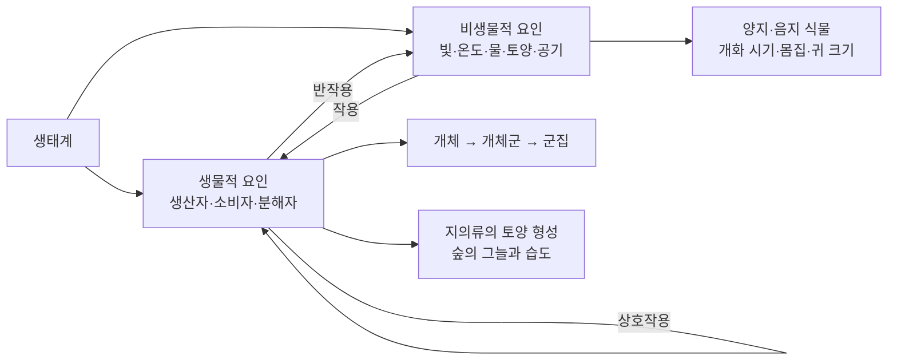
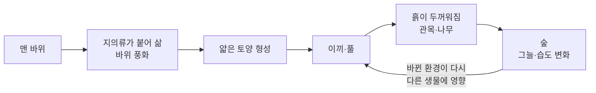

# 5-1. 생태계 구성 요소와 상호 관계 — 생물과 환경은 서로를 만든다

> [!NOTE]
> **성취기준 [10통과2-02-01]** 생태계 구성요소를 이해하고 생물과 환경 사이의 상호 관계를 설명할 수 있다.

**학습 목표**

1. 생태계를 이루는 생물적 요인(생산자·소비자·분해자)과 비생물적 요인(빛·온도·물·토양·공기)을 구분하고, 각각의 역할을 설명할 수 있다.
2. 개체–개체군–군집–생태계로 이어지는 생태계의 구성 단계를 중학교의 '생물의 유기적 구성 단계'와 연결하여 설명할 수 있다.
3. 빛·온도·물·토양·공기가 생물에 영향을 주는 사례(양지 식물과 음지 식물, 일조 시간과 개화, 베르그만 규칙과 알렌 규칙 등)를 들어 설명할 수 있다.
4. 생물이 거꾸로 환경을 바꾸는 사례(지의류와 토양 형성, 숲과 미기후 등)를 들어 생물과 환경이 서로 영향을 주고받는다는 것을 설명할 수 있다.

**이 단원의 학습 사다리**

| 단계 | 무엇을 하나? |
|---|---|
| STEP 1. 중학교 다시 보기 | 생물의 구성 단계, 생물다양성, 광합성과 환경 요인을 다시 꺼내 본다 |
| STEP 2. 기초 다지기 | '시스템'과 '요인'의 뜻, 표면적과 부피의 비, 그래프 읽기를 디딤돌로 놓는다 |
| STEP 3. 핵심 개념 | 생태계 구성 요소 → 구성 단계 → 빛 → 온도 → 물·토양·공기 → 생물이 환경을 바꾼다 |
| STEP 4. 오개념 바로잡기 | "분해자는 없어도 되는 생물?" 같은 착각을 바로잡는다 |
| STEP 5. 선택과목·대학 | 생물 사이의 상호작용, 광주기의 진짜 신호, 천이와 생태학 |
| STEP 6. 산업·진로 | 생태 조사와 환경영향평가, 스마트팜, 생물 계절 관측 |

---

## 🗺️ 단원 들어가기

북극여우는 귀가 작고 둥글다. 사하라 사막에 사는 사막여우(페넥여우)는 얼굴보다 큰 귀를 가졌다. 같은 여우 무리인데 왜 이렇게 다를까? 국화는 왜 하필 해가 짧아지는 가을에 꽃이 피고, 농가에서는 왜 밤에 국화 밭에 전등을 켜 둘까? 아무것도 자라지 않던 바위 위에 어떻게 흙이 생기고 숲이 들어설까?

이 질문들의 답은 모두 하나로 모인다. **생물은 환경의 영향을 받고, 동시에 환경을 바꾼다.** 이 단원에서는 생태계를 하나의 '시스템'으로 보고, 그 구성 요소와 구성 요소 사이의 관계를 살펴본다.

---

## STEP 1. 🔙 중학교 다시 보기

### 연계 개념표

| 중학교 성취기준 | 중학교에서 배운 것 | 고등학교에서 확장되는 것 |
|---|---|---|
| [9과02-02] | 생물의 유기적 구성 단계: 동물은 세포 → 조직 → 기관 → 기관계 → 개체, 식물은 세포 → 조직 → 조직계 → 기관 → 개체 | 개체 **위로** 이어지는 단계: 개체 → 개체군 → 군집 → 생태계 |
| [9과02-03] | 생물다양성의 뜻, 변이와 생물다양성의 관계 | 다양한 생물이 서로 다른 환경 조건에 **적응**한 결과로서의 다양성 |
| [9과02-05] | 생물다양성 보전의 필요성과 보전 방안 | 생물과 환경이 얽혀 있으므로 환경을 지켜야 생물도 지킬 수 있다 |
| [9과12-01] | 광합성 과정, 빛의 세기·온도·이산화 탄소 농도와 광합성의 관계 | 빛과 온도는 **생태계의 비생물적 요인**이며, 식물의 분포와 모양까지 바꾼다 |
| [9과12-02] | 식물의 호흡과 광합성의 관계, 출입하는 에너지와 물질 | 광합성량과 호흡량이 같아지는 빛의 세기(보상점)로 양지·음지 식물 비교 |

> [!NOTE]
> 고등학교 통합과학1의 **3-1 지구시스템**에서 배운 "권역들이 물질과 에너지를 주고받는다"는 생각을 기억하자. 생태계는 그중 생물권이 기권·수권·지권과 맞닿은 곳에서 벌어지는 상호작용을 확대해서 보는 것이다.

### 준비 운동 (사전 진단)

**Q1.** 생물의 유기적 구성 단계 중 '개체'보다 한 단계 아래의 단계를 동물과 식물에서 각각 쓰시오.

**Q2.** 광합성이 활발하게 일어나는 데 영향을 주는 환경 요인 세 가지를 쓰시오.

**Q3.** 같은 종의 생물이라도 생김새·크기 등이 조금씩 다른 것을 무엇이라고 하는가?

**Q4.** 버섯과 곰팡이는 광합성을 하지 못한다. 이들은 무엇으로부터 양분을 얻을까?

정답 및 해설

**Q1.** 동물: 기관계(예: 소화계), 식물: 기관(예: 잎, 줄기, 뿌리) — 식물에는 기관계 단계가 없다.

**Q2.** 빛의 세기, 온도, 이산화 탄소 농도 — 모두 이 단원에서 '비생물적 요인'으로 다시 등장한다.

**Q3.** 변이 — 변이가 있기 때문에 환경이 달라져도 살아남는 개체가 생기고, 그 결과 생물다양성이 나타난다.

**Q4.** 죽은 생물의 몸이나 배설물 같은 유기물을 분해하여 양분을 얻는다. 이 단원에서는 이런 생물을 **분해자**라고 부른다.

---

## STEP 2. 🧱 기초 다지기

### ① '시스템'과 '구성 요소', 그리고 '상호작용'

**시스템(system)** 은 여러 구성 요소가 서로 영향을 주고받으며 하나의 전체로 작동하는 것이다. 자전거를 예로 들면 바퀴·체인·페달이 구성 요소이고, 페달을 밟으면 체인이 바퀴를 돌리는 것이 상호작용이다. 체인 하나가 끊기면 자전거 전체가 멈춘다.

생태계도 마찬가지이다. 구성 요소(생물과 환경)가 서로 영향을 주고받기 때문에, **한 요소가 변하면 다른 요소들도 연쇄적으로 변한다.**

> [!TIP]
> 💡 **비유** — 생태계는 '한 반 학생들과 교실'과 비슷하다. 학생(생물)은 교실의 온도, 밝기, 환기 상태(환경)에 영향을 받는다. 동시에 학생들은 창문을 열고, 에어컨을 켜고, 교실을 꾸미며 교실 환경을 바꾼다. 학생들끼리도 서로 영향을 주고받는다.

### ② '요인'이라는 말

**요인(factor)** 은 어떤 결과에 영향을 주는 원인이다. 생태계에서 생물에 영향을 주는 원인은 크게 두 가지로 나눌 수 있다.

- 살아 있는 것에서 오는 영향 → **생물적 요인**
- 살아 있지 않은 것에서 오는 영향 → **비생물적 요인**

### ③ 표면적과 부피의 비 — 몸집과 체온을 잇는 수학

몸에서 열이 빠져나가는 통로는 **몸의 표면**이고, 열을 만들어 내는 것은 **몸 전체(부피)** 의 세포들이다. 그래서 '부피에 비해 표면적이 얼마나 넓은가'가 체온 유지에 중요하다.

한 변의 길이가 $a$인 정육면체를 생각하자.

$$
\text{표면적} = 6a^2, \qquad \text{부피} = a^3, \qquad \frac{\text{표면적}}{\text{부피}} = \frac{6}{a}
$$

| 한 변의 길이 | 표면적 | 부피 | 표면적 ÷ 부피 |
|---|---|---|---|
| 1 cm | 6 cm² | 1 cm³ | 6 |
| 2 cm | 24 cm² | 8 cm³ | 3 |
| 3 cm | 54 cm² | 27 cm³ | 2 |

**몸집이 커질수록 부피에 대한 표면적의 비가 작아진다.** 즉, 큰 몸은 만든 열에 비해 열을 잃는 면적이 상대적으로 좁다. 이 수학이 STEP 3의 '베르그만 규칙'을 이해하는 열쇠이다.

> [!TIP]
> 💡 **비유** — 갓 끓인 국을 큰 냄비 그대로 두면 오래 뜨겁지만, 작은 그릇 여러 개에 나눠 담으면 금방 식는다. 작은 그릇들은 국의 양에 비해 공기와 닿는 면이 넓기 때문이다.

### ④ 광합성량–빛의 세기 그래프 읽기

중학교에서 빛이 강할수록 광합성이 활발해지다가 어느 정도 이상에서는 더 늘지 않는다는 것을 배웠다. 여기에 **호흡**을 함께 생각하면 그래프를 더 정확히 읽을 수 있다.

- 식물은 빛이 있든 없든 **항상 호흡**한다(이산화 탄소 방출).
- 빛이 있으면 **광합성**도 한다(이산화 탄소 흡수).
- 겉으로 드러나는 이산화 탄소 흡수량 = 광합성으로 흡수한 양 − 호흡으로 방출한 양

이 겉보기 광합성량을 **순광합성량**, 호흡량까지 더한 실제 광합성량을 **총광합성량**이라고 한다.

$$
\text{총광합성량} = \text{순광합성량} + \text{호흡량}
$$

---

## STEP 3. 📘 핵심 개념

### 5-1-① 생태계의 구성 요소 — 생물적 요인과 비생물적 요인

**생태계(ecosystem)** 는 일정한 지역에서 생물과 그 생물을 둘러싼 환경이 서로 영향을 주고받으며 이루는 시스템이다. 작은 연못도, 학교 화단도, 넓은 바다도 하나의 생태계로 볼 수 있다.

#### 생물적 요인(biotic factor)

| 구분 | 하는 일 | 예 |
|---|---|---|
| **생산자(producer)** | 빛에너지를 이용해 무기물(이산화 탄소, 물)로부터 유기물을 만든다(광합성) | 식물, 식물성 플랑크톤, 해조류 |
| **소비자(consumer)** | 다른 생물을 먹어 유기물(양분)을 얻는다 | 초식 동물(1차 소비자), 육식 동물(2차·3차 소비자) |
| **분해자(decomposer)** | 죽은 생물이나 배설물의 유기물을 무기물로 분해하여 양분을 얻는다 | 세균, 곰팡이, 버섯 |

> [!IMPORTANT]
> 분해자가 유기물을 무기물로 되돌려 놓아야 생산자가 그 무기물을 다시 쓸 수 있다. 분해자가 없다면 낙엽과 사체가 끝없이 쌓이고, 흙 속의 무기 양분은 점점 바닥나 생산자부터 무너진다. 분해자는 생태계의 **'재활용 담당'** 이다.

#### 비생물적 요인(abiotic factor)

| 요인 | 생물에 주는 영향의 예 |
|---|---|
| 빛 | 광합성의 에너지원. 빛의 세기·파장·비추는 시간(일조 시간)이 식물의 생장·개화, 동물의 번식 시기에 영향 |
| 온도 | 효소의 작용과 물질대사 속도에 영향. 생물의 분포, 몸의 크기, 겨울잠·낙엽 등에 영향 |
| 물 | 몸의 대부분을 이루며 물질 운반과 화학 반응의 장소. 건조 지역 생물의 특이한 구조를 만든다 |
| 토양 | 식물의 지지대이자 물·무기 양분의 공급처. 토양 생물의 서식지 |
| 공기 | 산소(호흡)와 이산화 탄소(광합성)의 공급원. 바람은 꽃가루·씨의 이동에 관여 |

#### 구성 요소 사이의 관계 — 작용, 반작용, 상호작용

| 관계 | 방향 | 예 |
|---|---|---|
| **작용** | 비생물적 요인 → 생물 | 일조 시간이 짧아지면 국화가 꽃을 피운다 |
| **반작용** | 생물 → 비생물적 요인 | 지의류가 바위를 부스러뜨려 토양을 만든다, 숲이 그늘을 만들어 기온을 낮춘다 |
| **상호작용** | 생물 ↔ 생물 | 토끼가 풀을 먹는다, 같은 먹이를 두고 두 종이 경쟁한다 |

> [!TIP]
> 💡 **비유** — '작용'은 날씨가 내 기분을 바꾸는 것, '반작용'은 내가 방 안 공기를 바꾸는 것, '상호작용'은 친구와 내가 서로의 기분을 바꾸는 것이다.

#### 예제 1

다음 현상을 작용, 반작용, 상호작용으로 분류하시오.
(가) 낙엽이 쌓여 분해되면서 흙에 양분이 많아졌다.
(나) 사슴이 많아지자 숲속 어린 나무가 줄었다.
(다) 기온이 낮아지자 개구리가 겨울잠을 잔다.

**풀이**
(가) 생물(낙엽·분해자)이 토양(비생물적 요인)을 바꾸었으므로 **반작용**
(나) 생물(사슴)이 생물(어린 나무)에 영향을 주었으므로 **상호작용**
(다) 온도(비생물적 요인)가 생물(개구리)에 영향을 주었으므로 **작용**

### 5-1-② 생태계의 구성 단계 — 개체에서 생태계까지

중학교에서는 세포에서 시작해 '개체'까지 올라갔다. 이제 개체 위로 계속 올라가 보자.

| 단계 | 뜻 | 예(어느 산의 소나무 숲) |
|---|---|---|
| **개체(individual)** | 독립적으로 생명 활동을 하는 하나의 생물 | 소나무 한 그루 |
| **개체군(population)** | 일정한 지역에 사는 **같은 종**의 개체들의 무리 | 이 산에 사는 소나무 전체 |
| **군집(community)** | 일정한 지역에 사는 **여러 개체군**의 모임 | 소나무, 참나무, 다람쥐, 딱따구리, 버섯… 모두 |
| **생태계(ecosystem)** | 군집 + 비생물적 환경 | 위의 생물 + 빛, 흙, 물, 공기, 기온 |

> [!WARNING]
> '개체군'과 '군집'을 헷갈리기 쉽다. 핵심은 **'같은 종이냐'** 이다. 학교 운동장의 참새들은 개체군이고, 운동장의 참새·비둘기·까치·잔디·개미를 모두 묶으면 군집이다.

#### 예제 2

어느 호수 생태계에 대한 설명 중 '개체군'에 해당하는 것을 고르시오.
ㄱ. 호수에 사는 붕어 전체 ㄴ. 호수에 사는 모든 어류 ㄷ. 호수의 물, 바닥 흙과 모든 생물 ㄹ. 호수에 사는 모든 생물

**풀이** 개체군은 같은 종의 무리이므로 **ㄱ**이다. ㄴ은 여러 종의 어류이므로 개체군이 아니고(군집의 일부), ㄹ은 군집, ㄷ은 생태계이다.

### 5-1-③ 빛과 생물

#### (1) 빛의 세기 — 양지 식물과 음지 식물

빛의 세기에 따라 광합성량이 어떻게 달라지는지 두 종류의 식물을 비교해 보자.

- **보상점(compensation point)**: 광합성량과 호흡량이 같아서 겉보기로는 이산화 탄소 출입이 없는 빛의 세기
- **광포화점(light saturation point)**: 빛을 더 세게 해도 광합성량이 더 이상 늘지 않기 시작하는 빛의 세기

| 구분 | **양지 식물(sun plant)** | **음지 식물(shade plant)** |
|---|---|---|
| 호흡량 | 많다 | 적다 |
| 보상점 | 높다 | 낮다 |
| 광포화점 | 높다 | 낮다 |
| 강한 빛에서 | 광합성량이 매우 많다 | 금방 포화되어 더 늘지 않는다 |
| 약한 빛에서 | 호흡량을 따라잡지 못해 살기 어렵다 | 보상점이 낮아 약한 빛에서도 살 수 있다 |
| 예 | 소나무, 해바라기, 민들레, 벼 | 고사리, 맥문동, 비비추 |

#### 예제 3 — 그래프 대신 표로 읽는 광합성

어느 두 식물 A, B의 빛의 세기에 따른 이산화 탄소 흡수량(순광합성량)을 측정했다. (음수는 이산화 탄소를 방출했다는 뜻이다. 상대값)

| 빛의 세기(상대값) | 0 | 1 | 2 | 4 | 8 | 12 |
|---|---|---|---|---|---|---|
| 식물 A | −4 | −2 | 0 | 4 | 12 | 16 |
| 식물 B | −1 | 0 | 2 | 4 | 4 | 4 |

(1) A와 B의 보상점은 각각 빛의 세기 얼마인가?
(2) 빛의 세기가 4일 때 A의 총광합성량은?
(3) 양지 식물은 어느 쪽인가?

**풀이**
(1) 순광합성량이 0인 지점이 보상점이다. A는 **2**, B는 **1**.
(2) 빛이 0일 때의 값 −4가 호흡량(4)을 나타낸다. 총광합성량 = 순광합성량 + 호흡량 = $4 + 4 = 8$
(3) 호흡량이 많고, 보상점이 높고, 강한 빛에서 광합성량이 계속 늘어나는 **A**가 양지 식물이다. B는 빛의 세기 4에서 이미 포화되었다.

> [!NOTE]
> 한 그루의 나무 안에서도 비슷한 차이가 나타난다. 햇빛을 잘 받는 바깥쪽·위쪽 잎(**양엽**)은 작고 두꺼우며 울타리 조직이 발달하고, 그늘진 안쪽·아래쪽 잎(**음엽**)은 넓고 얇아 약한 빛을 넓게 받아들인다.

#### (2) 빛을 받는 시간 — 일조 시간과 개화·번식

하루 중 낮의 길이(**일조 시간**)는 계절에 따라 규칙적으로 바뀐다. 생물은 이것을 '달력'처럼 이용해 꽃 피우는 시기와 번식 시기를 맞춘다.

| 구분 | 언제 꽃이 피나? | 예 |
|---|---|---|
| **장일 식물(long-day plant)** | 낮이 일정 시간보다 **길어지는** 봄~초여름 | 시금치, 상추, 무, 붓꽃 |
| **단일 식물(short-day plant)** | 낮이 일정 시간보다 **짧아지는** 가을 | 국화, 코스모스, 나팔꽃 |

동물도 일조 시간의 영향을 받는다. 꾀꼬리·종달새 같은 많은 새는 낮이 길어지는 봄~초여름에 번식하고, 송어·양(면양) 등은 낮이 짧아지는 가을에 번식한다.

> [!TIP]
> 💡 **비유** — 기온은 해마다 들쭉날쭉하지만 낮의 길이는 매년 같은 날짜에 정확히 같다. 그래서 생물에게 일조 시간은 날씨보다 믿을 만한 **'자연의 달력'** 이다. 따뜻한 날이 며칠 이어졌다고 해서 가을에 봄꽃이 피어 버리면 곧 닥칠 겨울에 씨를 맺지 못할 것이다.

#### 예제 4 — 국화 밭에 밤새 불을 켜는 이유

국화는 단일 식물이다. 농가에서 가을 밤에 국화 밭에 전등을 켜 두면 개화 시기가 어떻게 될지 쓰고, 그 이유를 설명하시오.

**풀이** 전등 때문에 국화가 '낮이 아직 길다'고 받아들이므로 **꽃이 피는 시기가 늦춰진다.** 이를 이용해 원하는 시기(예: 겨울 출하)에 맞춰 꽃을 피우는 재배법을 **전조 재배**라고 한다. 반대로 검은 천을 덮어 낮을 짧게 만들면 개화를 앞당길 수 있다.

### 5-1-④ 온도와 생물

온도는 몸속 **효소**의 작용 속도를 좌우한다(통합과학1 3-5 단원). 그래서 생물은 온도에 맞추어 몸의 구조와 생활 방식을 바꾸어 왔다.

#### (1) 온도와 동물의 몸 — 베르그만 규칙과 알렌 규칙

체온을 일정하게 유지하는 동물(**정온 동물**, 포유류·조류)에서는 다음과 같은 경향이 나타난다.

| 규칙 | 내용 | 예 | 원리 |
|---|---|---|---|
| **베르그만 규칙(Bergmann's rule)** | 가까운 종끼리 비교하면, 추운 지역에 사는 쪽이 **몸집이 큰** 경향 | 남극의 황제펭귄은 크고, 적도 부근의 갈라파고스펭귄은 작다 | 몸집이 클수록 표면적 ÷ 부피가 작아 열을 덜 잃는다 |
| **알렌 규칙(Allen's rule)** | 추운 지역에 사는 쪽이 귀·꼬리·주둥이 같은 **말단 부위가 작은** 경향 | 북극여우는 귀가 작고, 사막여우는 귀가 크다 | 튀어나온 부위가 작을수록 열을 잃는 표면이 줄어든다. 더운 곳에서는 큰 귀로 열을 내보낸다 |

> [!WARNING]
> 이것들은 '법칙'이 아니라 많은 사례에서 나타나는 **경향(규칙성)** 이다. 예외도 많고, 몸집에는 먹이·포식자 등 다른 요인도 함께 작용한다.

#### 예제 5

두 동물을 정육면체로 단순화하여 생각하자. 한 변이 1 단위인 작은 동물과 한 변이 3 단위인 큰 동물이 있다. 1 단위 부피당 열을 만드는 양과, 1 단위 표면적당 열을 잃는 양이 두 동물에서 같다고 가정하면, 어느 쪽이 추위에 더 유리한가?

**풀이** 표면적 ÷ 부피 = $\dfrac{6}{a}$이다.
- 작은 동물: $\dfrac{6}{1} = 6$
- 큰 동물: $\dfrac{6}{3} = 2$

큰 동물은 만든 열에 비해 잃는 열이 **3분의 1** 수준이므로 추운 곳에서 체온 유지에 더 유리하다. 베르그만 규칙의 원리이다.

#### (2) 온도와 생활 방식

| 생물 | 온도에 대한 적응 |
|---|---|
| 개구리, 뱀(변온 동물) | 기온이 낮아지면 활동이 어려워 땅속 등에서 **겨울잠**을 잔다 |
| 다람쥐, 곰 일부 | 먹이가 부족한 겨울에 활동을 줄이고 겨울잠 또는 겨울나기를 한다 |
| 낙엽수(단풍나무, 은행나무) | 기온이 낮아지고 낮이 짧아지는 가을에 잎을 떨어뜨려 겨울철 물 손실을 줄인다 |
| 상록수(소나무) | 잎이 바늘 모양이고 표면이 두꺼운 층으로 덮여 추위와 건조에 견딘다 |
| 가을보리 | 겨울 동안 일정 기간 낮은 온도를 겪어야 봄에 정상적으로 꽃이 핀다(**춘화**) |

### 5-1-⑤ 물·토양·공기와 생물

#### (1) 물과 생물

물은 대부분의 생물 몸에서 가장 많은 물질이다. 물이 부족한 곳의 생물은 **물을 얻고, 저장하고, 잃지 않는** 구조를 갖는다.

| 환경 | 생물 | 적응 |
|---|---|---|
| 건조한 사막 | 선인장 | 잎이 가시로 변해 증산을 줄이고, 줄기에 물을 저장하는 조직이 발달 |
| 건조한 사막 | 캥거루쥐 | 매우 진한 오줌을 배설해 물 손실을 줄이고, 먹이(씨앗)를 분해할 때 생기는 물도 이용 |
| 건조한 땅 | 파충류, 곤충 | 비늘·단단한 껍데기(외골격)가 몸 표면의 수분 증발을 막는다. 파충류·조류의 알은 껍데기로 싸여 있어 알 속 수분이 잘 마르지 않는다 |
| 물속·물가 | 연꽃, 수련 | 잎자루·뿌리줄기에 공기가 통하는 통로(통기 조직)가 발달 |
| 물 위 | 부레옥잠 | 공기가 든 부푼 잎자루로 물에 뜬다 |

#### (2) 토양과 생물

토양은 광물 알갱이, 물, 공기, 유기물과 수많은 생물로 이루어진 또 하나의 작은 세계이다.

- 식물은 토양에서 물과 **무기 양분**을 흡수하고, 뿌리로 몸을 지탱한다.
- 토양 속 세균과 곰팡이(분해자)는 낙엽과 사체를 분해해 무기 양분을 되돌린다.
- 지렁이는 굴을 파서 토양에 공기와 물이 잘 통하게 하고, 흙을 섞어 준다.

#### (3) 공기와 생물

- 산소는 세포 호흡에, 이산화 탄소는 광합성에 쓰인다.
- 높은 산에 올라가면 공기가 희박해 숨이 차다. 고산 지대에서 오래 지내면 몸속 **적혈구 수가 늘어나** 적은 산소를 더 효율적으로 운반하도록 적응한다.
- 바람은 꽃가루(소나무, 벼 등)와 씨(민들레 등)를 멀리 옮겨 준다.

> [!TIP]
> 💡 **정리 비유** — 비생물적 요인은 생물에게 '시험 조건'과 같다. 빛이 적은 반(숲 바닥), 물이 적은 반(사막), 추운 반(극지방)마다 시험 조건이 다르고, 각 반에서 높은 점수를 받는 학생(생물)의 특징도 다르다. 이것이 지역마다 서로 다른 생물이 사는 이유이며, 생물다양성의 한 원인이다(4-2 단원의 자연선택과 연결).

### 5-1-⑥ 생물도 환경을 바꾼다 — 반작용

생물은 환경에 맞춰 살아가기만 하는 것이 아니다. 생물은 환경을 적극적으로 바꾸고, 바뀐 환경은 다시 다른 생물에게 영향을 준다.

| 생물 | 환경을 어떻게 바꾸나? |
|---|---|
| **지의류(lichen)** | 균류와 조류(또는 남세균)가 함께 사는 생물. 맨 바위 표면에 붙어 살며 산성 물질을 내어 바위를 조금씩 부스러뜨린다. 여기에 죽은 지의류의 유기물이 섞여 **얇은 토양이 처음 만들어진다.** 그 위에 이끼, 풀, 나무가 차례로 들어선다 |
| 식물(숲) | 잎이 그늘을 만들어 숲속 기온을 낮추고, 증산 작용으로 습도를 높인다. 뿌리는 흙이 빗물에 쓸려 가는 것을 막는다 |
| 식물(광합성 생물) | 지구 역사에서 광합성 생물이 대기 중 **산소**를 늘려 지금의 대기를 만들었다(4-1 단원과 연결) |
| 낙엽과 분해자 | 낙엽이 분해되어 토양에 유기물과 무기 양분이 많아진다 |
| 지렁이, 두더지 | 토양을 갈아엎어 공기와 물이 잘 통하게 한다 |
| 비버 | 나무를 쓰러뜨려 댐을 쌓아 물길을 막고 연못(습지)을 만든다 |

#### 예제 6

다음은 생물과 환경의 관계에 대한 학생들의 의견이다. 옳게 말한 학생을 고르시오.
- 민지: "숲이 우거지면 숲 바닥이 어두워져서 음지 식물이 늘어날 수 있어."
- 준호: "지의류는 이미 만들어진 흙에서만 살 수 있어."
- 서연: "환경은 생물에게 영향을 주지만, 생물은 환경을 바꿀 수 없어."

**풀이** **민지**만 옳다. 숲(생물)이 빛 환경을 바꾸고(반작용), 바뀐 빛 환경이 다시 숲 바닥 식물의 종류를 바꾼다(작용). 준호: 지의류는 맨 바위에서도 살며 오히려 흙을 만든다. 서연: 생물은 반작용으로 환경을 바꾼다.

---

## STEP 4. ⚠️ 오개념 바로잡기

| 흔한 오개념 | 올바른 개념 | 왜 그럴까? |
|---|---|---|
| 분해자는 썩게 만드는 해로운 생물이라 없어도 된다 | 분해자는 유기물을 무기물로 되돌려 **물질이 다시 쓰이게** 하는 필수 구성 요소이다 | 분해자가 없으면 무기 양분이 순환하지 않아 생산자가 살 수 없다 |
| 식물은 낮에는 광합성만, 밤에는 호흡만 한다 | 식물은 **밤낮없이 항상 호흡**하며, 빛이 있을 때 광합성을 함께 한다 | 낮에는 광합성량이 호흡량보다 많아서 호흡이 겉으로 드러나지 않을 뿐이다 |
| 개체군은 한 지역에 사는 모든 생물이다 | 개체군은 **같은 종**의 무리이고, 여러 종의 모임은 군집이다 | '무리'라는 말 때문에 종을 따지지 않고 묶기 쉽다 |
| 음지 식물은 빛을 싫어한다 | 음지 식물도 광합성에 빛이 필요하다. 다만 **보상점이 낮아** 약한 빛에서도 살아갈 수 있다 | 음지 식물도 빛이 조금 더 강해지면 광합성량이 늘어난다(광포화점까지) |
| 단일 식물은 낮이 짧으면 언제든 꽃이 핀다, 낮의 길이만 중요하다 | 낮의 길이는 중요한 신호지만, 식물의 나이·온도 등 다른 조건도 함께 작용한다 | 생물의 반응에는 여러 요인이 겹쳐 작용한다 |
| 생물은 환경에 일방적으로 맞춰 살 뿐이다 | 생물은 **반작용**으로 환경을 바꾸고, 바뀐 환경이 다시 생물에 영향을 준다 | 지의류의 토양 형성, 숲의 그늘, 광합성 생물이 만든 산소 대기가 그 예이다 |

---

## STEP 5. 🎓 선택과목·대학으로 한 걸음 더

> [!CAUTION]
> 이 절은 **통합과학 교육과정 범위 밖의 심화 내용**으로 평가 대상이 아니다. "이 개념이 앞으로 어디까지 이어지는가"를 맛보기로 보여 주기 위한 내용이다.

### 고2·3 선택과목과의 연결

| 과목 | 이어지는 내용 |
|---|---|
| 생명과학 | 개체군의 특성(밀도, 생장 곡선), 군집의 구조, 생물 사이의 다양한 상호작용, 생태계의 구성과 기능 |
| 세포와 물질대사 | 광합성과 세포 호흡의 자세한 과정, 빛의 세기·파장과 광합성 |
| 기후변화와 환경생태 | 기후위기와 환경생태 변화, 기후위기에 대응하는 우리의 노력 |

### ① 생물과 생물 사이의 상호작용

이 단원에서는 생물과 **환경** 사이의 관계를 중심으로 배웠다. 선택과목 '생명과학'에서는 생물과 **생물** 사이의 관계를 더 자세히 다룬다.

| 관계 | 내용 | 예 |
|---|---|---|
| 종내 경쟁·텃세 | 같은 종끼리 먹이·공간을 두고 경쟁, 일정한 공간을 지킴 | 은어의 텃세 |
| 순위제·리더제 | 무리 안에서 서열이나 지도자를 정해 다툼을 줄임 | 닭의 서열, 기러기 무리의 리더 |
| 종간 경쟁 | 서로 다른 종이 같은 자원을 두고 경쟁 | 같은 먹이를 먹는 두 종의 짚신벌레 |
| 분서 | 경쟁을 피해 먹이·서식 공간·활동 시간을 나눔 | 같은 나무의 서로 다른 높이에서 먹이를 찾는 새들 |
| 포식과 피식 | 잡아먹고 잡아먹힘 | 스라소니와 눈신토끼 |
| 공생 | 두 종이 함께 살며 이익을 얻음 | 콩과식물과 뿌리혹박테리아, 지의류 |
| 기생 | 한쪽은 이익, 다른 쪽은 손해 | 겨우살이와 숙주 나무 |

### ② 광주기의 진짜 신호는 '밤의 길이'

'장일 식물', '단일 식물'이라는 이름은 낮의 길이를 기준으로 붙었지만, 실험해 보면 식물이 실제로 재는 것은 **연속된 어둠(밤)의 길이**이다. 단일 식물을 긴 밤 조건에 두고 한밤중에 잠깐 빛을 비추면(광중단) 꽃이 피지 않는다. 대학 '식물생리학'에서는 이 빛을 감지하는 색소 단백질(**피토크롬**)과 잎에서 만들어져 꽃눈으로 이동하는 개화 신호 물질을 배운다. 국화의 전조 재배도 바로 이 원리를 이용한다.

### ③ 생물이 만든 환경 변화가 쌓이면 — 천이

STEP 3의 '맨 바위 → 지의류 → 이끼 → 풀 → 나무' 과정을 **천이(succession)** 라고 한다. 숲이 자라면 숲 바닥이 어두워져 양지 식물(예: 소나무)의 어린 나무는 잘 자라지 못하고, 그늘에서도 잘 자라는 음지 식물 성향의 나무(예: 서어나무 등)가 점점 늘어난다. 생물의 반작용(그늘 만들기)이 다음 세대의 생물을 결정하는 것이다.

### ④ 대학 '생태학'의 시선 — 환경 요인을 수식과 그래프로

대학 생태학에서는 생물이 견딜 수 있는 환경 범위를 **내성 범위**라는 곡선으로 나타내고, 여러 환경 요인 중 가장 부족한 요인이 생장을 제한한다는 **제한 요인** 개념을 다룬다. 또 STEP 2의 표면적–부피 관계를 확장하여, 동물의 기초 대사량이 몸무게의 약 $\frac{3}{4}$ 제곱에 비례한다는 경험 법칙(클라이버 법칙)도 배운다.

$$
\text{대사량} \propto M^{3/4} \qquad (M: \text{몸무게})
$$

### 고등학교 vs 대학교

| 구분 | 고등학교 통합과학 | 대학교 생태학·생명과학 |
|---|---|---|
| 생태계 구성 요소 | 생산자·소비자·분해자, 빛·온도·물·토양·공기 | 에너지 흐름 모형, 영양소 순환 모형, 생태계 서비스 평가 |
| 빛과 생물 | 양지·음지 식물, 장일·단일 식물 | 광합성 생리, 피토크롬, 광합성 효율의 정량 분석 |
| 온도와 생물 | 베르그만·알렌 규칙의 사례 | 열 교환 방정식, 대사 규모 법칙, 생리적 내성 곡선 |
| 생물 ↔ 환경 | 지의류·숲의 사례로 정성적 설명 | 천이 모형, 생태계 공학자 개념, 원격 탐사와 통계 모델 |
| 관련 전공 | — | 생명과학, 생태학, 환경학, 산림자원학, 원예학, 농학 |

---

## STEP 6. 🏭 산업 현장과 진로 연결

### 사례 1. 생태 조사와 환경영향평가

- **원리** 개발 사업(도로, 댐, 산업 단지 등)은 빛·물·토양 같은 비생물적 요인과 서식 생물을 함께 바꾼다. 그래서 사업 전에 그 지역 생태계의 구성 요소와 상호 관계를 조사하여 영향을 예측하고 줄이는 방안을 세운다.
- **제도** 우리나라는 「환경영향평가법」에 따라 일정 규모 이상의 개발 사업에 대해 **환경영향평가**를 실시한다. 국립생태원 등 공공 기관은 전국의 자연환경을 정기적으로 조사하여 생태 자료를 쌓고 있다.
- **현장 기술** 방형구(일정한 크기의 틀)를 놓고 식물 수를 세는 조사, 무인 카메라(카메라 트랩), 드론 촬영, 물이나 흙에 남은 생물의 DNA 조각을 분석해 어떤 생물이 사는지 알아내는 **환경 DNA(eDNA)** 조사 등을 활용한다.

### 사례 2. 스마트팜과 식물 공장 — 비생물적 요인을 조절하는 농업

- **원리** 작물의 생장에 영향을 주는 **빛의 세기·빛의 색·일조 시간·온도·습도·이산화 탄소 농도**를 센서로 측정하고 자동으로 조절한다. 이 단원의 '비생물적 요인'을 기술로 제어하는 것이다.
- **어디에 쓰이나** 온실의 창문 자동 개폐와 난방, 양액(물에 녹인 무기 양분) 공급, 건물 안에서 인공 광원만으로 채소를 기르는 식물 공장 등.
- **핵심 기술** 식물은 엽록소가 잘 흡수하는 **붉은빛과 파란빛**을 광합성에 주로 쓰므로, 식물 공장에서는 이 파장의 LED를 많이 쓴다. 일조 시간을 조절해 장일·단일 식물의 개화 시기를 맞추기도 한다(전조 재배, 차광 재배).

### 사례 3. 생물 계절 관측과 농업 기상

- 기상청은 개나리·진달래·벚꽃의 개화, 단풍 등 생물의 계절 현상을 관측해 왔다. 이런 **생물 계절** 자료는 온도 변화가 생물에 미치는 영향을 보여 주는 지표로 쓰이며, 다음 5-3 단원의 기후변화와도 이어진다.
- 농업 분야에서는 기온·일조 자료로 작물의 생육 단계와 수확 시기를 예측하고, 서리·폭염 같은 피해에 대비한다.

### 사례 4. 생태 복원과 생태 공학

- 지의류와 식물이 토양을 만들고 숲이 습도를 조절한다는 원리를 이용하여, 훼손된 비탈면이나 폐광산에 흙이 쓸려 가지 않도록 식물을 먼저 심어 토양을 안정시키는 **생태 복원**을 한다.
- 도시에서는 옥상 녹화, 도시 숲을 조성해 여름철 기온을 낮추는 효과를 기대한다(숲의 반작용 이용).

### 관련 진로와 학과

| 진로 | 하는 일 | 관련 학과 |
|---|---|---|
| 생태 조사원·환경영향평가 전문가 | 동식물 조사, 개발 사업의 생태 영향 예측과 저감 방안 수립 | 생명과학, 생태학, 환경공학 |
| 스마트팜 엔지니어·농업 연구원 | 작물별 최적 환경 설계, 생육 데이터 분석, 재배 시스템 개발 | 원예학, 농학, 바이오시스템공학 |
| 산림·생태 복원 기술자 | 훼손지 복원 설계, 수목 식재와 관리 | 산림자원학, 조경학, 생태공학 |
| 생물 계절·농업 기상 연구원 | 생물 계절 자료 수집·분석, 기상 정보의 농업 활용 | 대기과학, 농학, 생명과학 |

---

## 🔬 탐구 활동 — 우리 학교 생태계의 구성 요소와 환경 요인 조사하기

> [!NOTE]
> 이 활동은 중학교에서 해 본 '우리 학교(마을) 생태 지도 만들기'를 확장하여, 다음 단원의 '개체군 변동 모의실험'을 위한 기초 자료를 얻는 활동이다.

### 활동 A. 양지와 음지의 생물 비교하기 (모둠 활동)

**목표** 빛의 세기가 다른 두 장소에서 비생물적 요인과 생물의 종류·수를 비교하여, 환경 요인이 생물의 분포에 미치는 영향을 설명한다.

**준비물** 방형구(가로·세로 50 cm 틀, 나무 막대와 끈으로 만들어도 된다), 줄자, 온도계, 스마트폰(조도 측정 앱), 토양 수분계 또는 손가락 촉감 기록표, 식물 도감 또는 식물 판별 앱, 기록지

**과정**
1. 학교 안에서 햇빛이 잘 드는 곳(양지)과 건물·나무 그늘이 진 곳(음지)을 한 곳씩 고른다.
2. 각 장소에 방형구를 3번씩 무작위로 놓는다.
3. 방형구마다 빛의 세기(조도), 지면 근처 기온, 흙의 촉촉한 정도를 측정·기록한다.
4. 방형구 안의 식물 종류와 종류별 개체 수를 센다. 개미·거미·지렁이 등 눈에 띄는 동물도 기록한다.
5. 각 식물 종의 **밀도**를 계산한다.

$$
\text{밀도} = \frac{\text{개체 수}}{\text{조사한 면적}}
$$

**결과 기록**

| 장소 | 방형구 | 조도(lx) | 기온(°C) | 흙의 수분 | 관찰한 식물(종류: 개체 수) | 관찰한 동물 |
|---|---|---|---|---|---|---|
| 양지 | 1 | | | | | |
| 양지 | 2 | | | | | |
| 양지 | 3 | | | | | |
| 음지 | 1 | | | | | |
| 음지 | 2 | | | | | |
| 음지 | 3 | | | | | |

**생각해 보기**
1. 양지와 음지에서 가장 크게 다른 비생물적 요인은 무엇이었나? 빛 외에 함께 달라진 요인도 있었는가?
2. 양지에만, 또는 음지에만 많이 나타난 식물이 있었는가? 그 식물의 잎 모양(크기, 두께)을 비교해 보자.
3. 그늘을 만든 건물이나 나무는 그곳의 생물에게 어떤 '반작용'을 한 것인가?
4. 방형구를 3번 놓은 까닭은 무엇일까? 1번만 놓았다면 어떤 문제가 생길까?

> [!WARNING]
> **안전 수칙** 조사는 교사가 정한 학교 안 구역에서만 한다. 벌·쐐기 등 쏘거나 독이 있는 생물은 손으로 만지지 않는다. 식물을 뽑지 말고, 조사가 끝나면 원래 상태로 되돌린다. 활동 후에는 손을 씻는다.

### 활동 B. 표면적과 부피의 비로 체온 유지 실험하기

1. 크기가 다른 두 용기(예: 작은 컵과 큰 비커)에 같은 온도(예: 약 60 °C)의 따뜻한 물을 각각 가득 채운다.
2. 같은 장소에 두고 5분마다 물의 온도를 측정해 20~30분 동안 기록한다.
3. 어느 쪽이 더 빨리 식는지 비교하고, 그 결과를 베르그만 규칙과 연결하여 설명한다.
4. (확장) 같은 양의 물을 넓고 얕은 그릇과 좁고 깊은 그릇에 담아 비교하고, 알렌 규칙(튀어나온 부위의 크기)과 연결해 보자.

> [!WARNING]
> 뜨거운 물을 다룰 때는 화상에 주의하고, 유리 기구는 받침 위에 안정되게 놓는다.

---

## ✅ 개념 확인 문제

### 기본

**1.** 생태계 구성 요소 중 '분해자'에 대한 설명으로 옳은 것은?
① 빛에너지를 이용해 유기물을 만든다.
② 다른 생물을 잡아먹어 양분을 얻는다.
③ 죽은 생물과 배설물의 유기물을 무기물로 분해한다.
④ 비생물적 요인에 속한다.

정답 및 해설

**정답 ③**

①은 생산자, ②는 소비자의 특징이다. 분해자(세균, 곰팡이 등)는 살아 있는 생물이므로 생물적 요인에 속한다(④ 틀림).

**2.** 다음을 생태계의 구성 단계에 맞게 짝지으시오.
(가) 지리산에 사는 반달가슴곰 전체 (나) 지리산의 모든 생물 (다) 지리산의 모든 생물과 흙·물·빛·공기

정답 및 해설

**정답** (가) 개체군 (나) 군집 (다) 생태계

같은 종의 무리는 개체군, 여러 개체군의 모임은 군집, 군집과 비생물적 환경을 합친 것이 생태계이다.

**3.** 다음 현상을 작용, 반작용, 상호작용 중 하나로 쓰시오.
(1) 일조 시간이 길어지자 꾀꼬리가 번식을 시작했다.
(2) 지렁이가 굴을 파서 흙에 공기가 잘 통하게 되었다.
(3) 진딧물이 많아지자 무당벌레가 늘어났다.

정답 및 해설

**정답** (1) 작용 (2) 반작용 (3) 상호작용

(1) 빛(비생물적 요인) → 생물, (2) 생물 → 토양(비생물적 요인), (3) 생물 ↔ 생물(포식과 피식)

**4.** 빈칸에 알맞은 말을 쓰시오.
"추운 지역에 사는 정온 동물은 가까운 종에 비해 몸집이 큰 경향이 있는데, 이를 ( ㄱ ) 규칙이라 한다. 몸집이 클수록 부피에 대한 ( ㄴ )의 비가 작아서 열을 덜 잃기 때문이다."

정답 및 해설

**정답** ㄱ: 베르그만, ㄴ: 표면적

### 응용

**5.** 표는 식물 X와 Y에서 빛의 세기에 따른 순광합성량(이산화 탄소 흡수량, 상대값)을 나타낸 것이다.

| 빛의 세기(상대값) | 0 | 2 | 4 | 6 | 10 |
|---|---|---|---|---|---|
| X | −1 | 1 | 3 | 3 | 3 |
| Y | −3 | −1 | 1 | 5 | 9 |

옳은 설명을 **모두** 고르시오.
ㄱ. 호흡량은 Y가 X보다 많다.
ㄴ. 빛의 세기가 2일 때 Y는 겉보기로 이산화 탄소를 방출한다.
ㄷ. 빛의 세기가 4일 때 총광합성량은 X가 Y보다 많다.
ㄹ. 숲 바닥처럼 빛이 약한 곳에서 살아가기에는 X가 유리하다.

정답 및 해설

**정답 ㄱ, ㄴ, ㄹ**

ㄱ. 빛이 0일 때 값의 크기가 호흡량이다. X는 1, Y는 3이므로 옳다.
ㄴ. Y의 순광합성량이 −1이므로 이산화 탄소를 방출한다. 옳다.
ㄷ. 총광합성량 = 순광합성량 + 호흡량이다. X: $3 + 1 = 4$, Y: $1 + 3 = 4$로 **같다.** 틀렸다.
ㄹ. X는 보상점이 낮고(0과 2 사이) 호흡량이 적어 약한 빛에서도 순광합성량이 양수가 된다. X는 음지 식물, Y는 양지 식물의 특징을 보인다. 옳다.

**6.** 장일 식물인 시금치와 단일 식물인 국화를 같은 온실에서 기른다. 한겨울(낮이 짧은 시기)에 두 식물 모두 꽃을 피우게 하려면 시금치와 국화에 각각 어떤 처리를 해야 할지 일조 시간과 관련지어 설명하시오. (온도 등 다른 조건은 알맞다고 가정한다.)

정답 및 해설

**예시 답안**
겨울에는 낮이 짧으므로 단일 식물인 **국화는 그대로 두어도** 꽃눈을 만들 수 있다. 반면 장일 식물인 **시금치는 전등을 켜서 빛을 받는 시간을 늘려** '낮이 길다'는 조건을 만들어 주어야 꽃이 핀다. 따라서 두 식물을 칸막이 등으로 분리하여 시금치 쪽에만 전등으로 일조 시간을 늘려 준다.

**7.** 그림 대신 설명으로 제시한다. 같은 여우 무리인 북극여우(북극 툰드라), 붉은여우(온대 지역), 사막여우(사하라 사막)는 귀의 크기가 순서대로 점점 커진다. (1) 이 경향을 나타내는 규칙의 이름을 쓰고, (2) 더운 사막에서 큰 귀가 유리한 이유를 열의 이동과 관련지어 설명하시오.

정답 및 해설

**정답** (1) 알렌 규칙

(2) 귀는 얇고 넓으며 혈관이 많이 분포하는 부위이다. 귀가 크면 몸에 비해 열을 내보내는 **표면적이 넓어져** 몸속의 열을 바깥 공기로 많이 내보낼 수 있다. 더운 사막에서는 체온이 지나치게 오르는 것을 막는 데 유리하다. 반대로 북극에서는 귀가 작아야 열 손실이 줄어든다.

### 융합·서술형

**8. [산업 연계]** 어느 스마트팜에서 실내 조명을 '하루 24시간 켜기'로 바꾸었더니 상추는 빨리 꽃대가 올라와 잎의 품질이 떨어졌고, 전기 요금도 많이 나왔다. (1) 상추에서 이런 일이 생긴 까닭을 일조 시간과 관련지어 설명하고, (2) 스마트팜 운영자로서 조명 계획을 어떻게 바꾸면 좋을지 이 단원의 개념(보상점·광포화점, 일조 시간)을 활용하여 제안하시오.

정답 및 해설

**예시 답안**
(1) 상추는 장일 식물이므로 빛을 받는 시간이 길어지면 꽃을 피우는 쪽으로 생장이 바뀐다(꽃대가 올라오는 현상). 잎을 수확하는 작물에서는 꽃대가 올라오면 잎이 질겨지고 품질이 떨어진다.
(2) ① 꽃대가 올라오지 않을 정도로 **조명 시간을 줄인다**(장일 조건을 피한다). ② 빛의 세기는 보상점보다 충분히 높되 **광포화점 근처까지만** 맞춘다. 광포화점보다 더 세게 비추어도 광합성량은 늘지 않고 전기만 낭비되기 때문이다. ③ 광합성에 잘 쓰이는 붉은빛·파란빛 위주의 LED를 사용한다.

**채점 포인트** ① 장일 식물과 일조 시간의 관계 ② 광포화점 이상의 빛은 낭비라는 점 ③ 환경 요인을 조절하는 구체적 제안

**9. [대학·생태 연계]** 화산 폭발로 용암이 굳어 생긴 맨 바위 섬이 있다. 수백 년 뒤 이 섬에 숲이 생겼다고 할 때, (1) 맨 바위에서 숲이 생기기까지 생물과 환경이 서로 영향을 주고받은 과정을 '작용'과 '반작용'이라는 용어를 넣어 서술하고, (2) 이 섬의 숲이 우거진 뒤 숲 바닥의 식물 구성이 어떻게 달라질지 예상하시오.

정답 및 해설

**예시 답안**
(1) 처음에는 흙과 물이 거의 없어 대부분의 식물이 살 수 없다(비생물적 요인의 **작용**). 맨 바위에서도 살 수 있는 지의류가 먼저 자리 잡고, 산성 물질로 바위를 풍화시키며 죽은 몸이 유기물로 쌓여 얇은 토양을 만든다(생물의 **반작용**). 토양이 생기자 이끼와 풀이 자랄 수 있게 되고(작용), 이들이 다시 토양을 두껍게 하고 수분을 붙잡아(반작용) 관목과 나무가 들어설 수 있게 된다.
(2) 숲이 우거지면 숲 바닥에 닿는 빛이 약해진다(나무의 반작용). 그 결과 보상점이 높은 양지 식물은 숲 바닥에서 자라기 어려워지고, 보상점이 낮은 **음지 식물이 늘어날** 것이다.

**채점 포인트** ① 지의류의 토양 형성 ② 작용·반작용 용어의 바른 사용 ③ 빛 환경 변화와 양지·음지 식물의 연결

---

## 📝 한눈에 정리

### 핵심 요약

- **생태계** = 생물적 요인(생산자·소비자·분해자) + 비생물적 요인(빛·온도·물·토양·공기).
- 구성 단계: **개체 → 개체군(같은 종) → 군집(여러 종) → 생태계(군집 + 환경)**.
- 관계: 환경 → 생물은 **작용**, 생물 → 환경은 **반작용**, 생물 ↔ 생물은 **상호작용**.
- **빛**: 양지 식물은 보상점·광포화점이 높고, 음지 식물은 낮다. 일조 시간에 따라 장일·단일 식물의 개화 시기가 정해진다.
- **온도**: 추운 곳의 정온 동물은 몸집이 크고(베르그만 규칙) 말단 부위가 작은(알렌 규칙) 경향이 있다. 원리는 표면적 ÷ 부피.
- **물·토양·공기**: 선인장의 가시, 연꽃의 통기 조직, 고산 지대의 적혈구 증가 등 환경에 맞춘 적응이 나타난다.
- **생물도 환경을 바꾼다**: 지의류의 토양 형성, 숲의 그늘과 습도, 광합성 생물이 만든 산소 대기.

### 핵심 용어

| 용어 | 뜻 |
|---|---|
| 생태계 | 일정 지역의 생물과 비생물적 환경이 상호작용하는 시스템 |
| 생산자·소비자·분해자 | 유기물을 만드는 생물, 다른 생물을 먹는 생물, 유기물을 무기물로 분해하는 생물 |
| 비생물적 요인 | 빛·온도·물·토양·공기처럼 생물을 둘러싼 살아 있지 않은 환경 |
| 개체군 | 일정 지역에 사는 같은 종 개체들의 무리 |
| 군집 | 일정 지역에 사는 여러 개체군의 모임 |
| 보상점 | 광합성량과 호흡량이 같아지는 빛의 세기 |
| 장일·단일 식물 | 낮이 길어질 때 / 짧아질 때 꽃이 피는 식물 |
| 베르그만·알렌 규칙 | 추운 곳의 정온 동물일수록 몸집이 크고 / 말단 부위가 작은 경향 |
| 반작용 | 생물이 비생물적 환경에 영향을 주어 바꾸는 것 |

### 다음 단원으로

지금까지 생태계를 이루는 '부품'과 부품 사이의 관계를 살펴보았다. 그렇다면 이 부품들은 어떻게 오랫동안 균형을 유지할까? 다음 단원 **5-2 생태계 평형**에서는 생산자에서 소비자로 이어지는 먹이 관계와 생태 피라미드를 따라 에너지와 물질이 어떻게 흐르는지, 그리고 생태계가 흔들렸다가 다시 균형을 되찾는 과정을 탐구한다.
