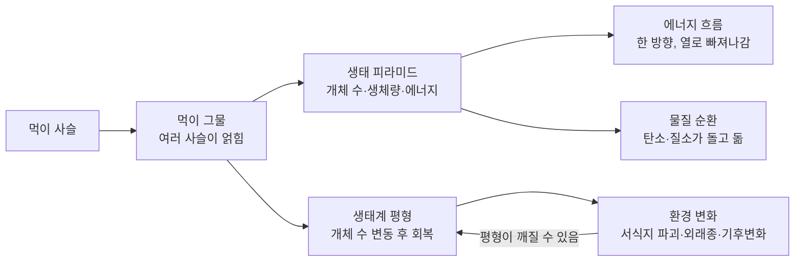
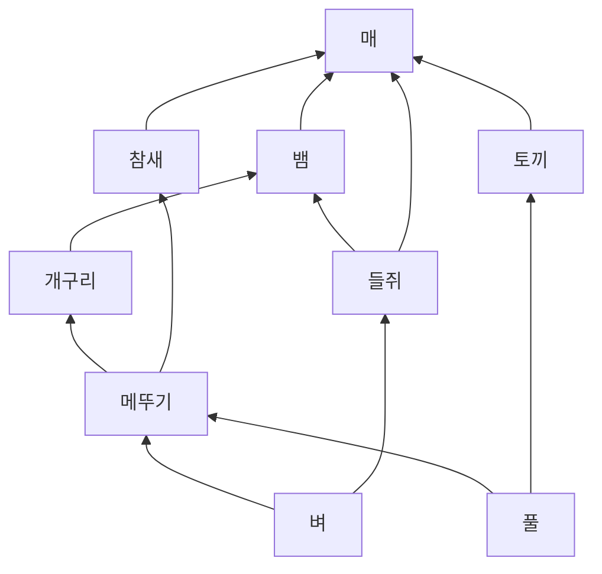
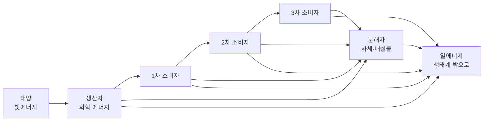
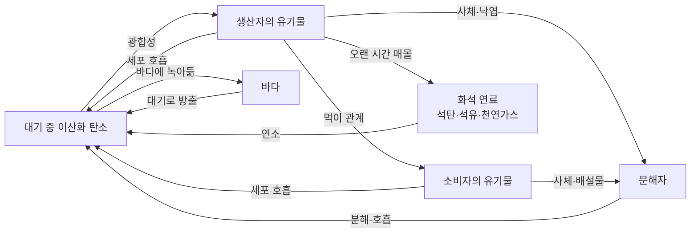
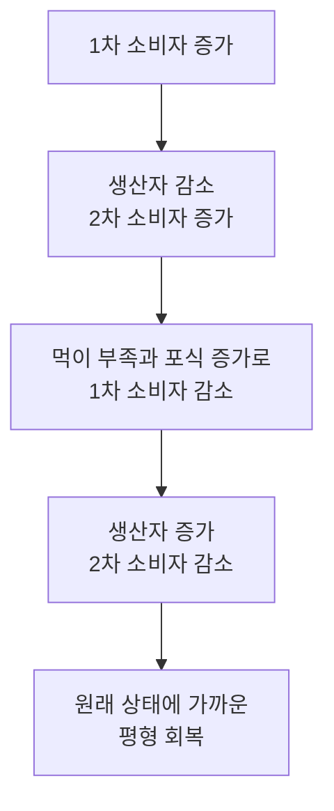

# 5-2. 생태계 평형 — 먹고 먹히며 지키는 균형

> [!NOTE]
> **성취기준 [10통과2-02-02]** 먹이 관계와 생태 피라미드를 중심으로 생태계 평형이 유지되는 과정을 이해하고, 환경의 변화가 생태계에 미칠 수 있는 영향에 대해 협력적으로 소통할 수 있다.

**학습 목표**

1. 먹이 사슬과 먹이 그물을 구분하고, 먹이 그물이 복잡할수록 생태계가 안정한 까닭을 설명할 수 있다.
2. 생태 피라미드(개체 수·생체량·에너지)의 뜻을 알고, 에너지 효율을 계산하며, '에너지는 흐르고 물질은 순환한다'는 것을 설명할 수 있다.
3. 포식자와 피식자의 개체 수 변동을 해석하여 생태계 평형이 유지되고 회복되는 과정을 설명할 수 있다.
4. 서식지 파괴, 외래종 유입, 기후변화 등 환경 변화가 생태계에 미치는 영향을 조사하고, 다양한 입장을 존중하며 협력적으로 의견을 나눌 수 있다.

**이 단원의 학습 사다리**

| 단계 | 무엇을 하나? |
|---|---|
| STEP 1. 중학교 다시 보기 | 광합성·세포 호흡의 에너지 출입, 생물다양성 보전을 다시 꺼내 본다 |
| STEP 2. 기초 다지기 | 에너지 전환과 열, 비율 계산, 시간차가 있는 두 그래프, 되먹임을 디딤돌로 놓는다 |
| STEP 3. 핵심 개념 | 먹이 관계 → 생태 피라미드 → 에너지 흐름과 물질 순환 → 평형과 회복 → 환경 변화 |
| STEP 4. 오개념 바로잡기 | "에너지도 물질처럼 돌고 돈다?" 같은 착각을 바로잡는다 |
| STEP 5. 선택과목·대학 | 개체군 생장 곡선, 포식자–피식자 방정식, 핵심종, 질소 순환 |
| STEP 6. 산업·진로 | 생물학적 방제, 수산 자원 관리, 멸종위기종 복원과 외래종 관리 |

---

## 🗺️ 단원 들어가기

미국 옐로스톤 국립 공원에서는 20세기 초 사냥 등으로 회색늑대가 사라졌다. 그 뒤 늑대의 먹잇감인 엘크(큰 사슴)가 늘어나 강가의 어린 버드나무와 사시나무를 많이 뜯어 먹었다. 1995년부터 늑대를 다시 풀어 놓자 엘크의 수와 행동이 달라졌고, 일부 지역에서는 강가 식물이 다시 자라났다는 연구가 보고되었다. (회복의 정도와 원인에 대해서는 연구자마다 해석이 다르다.)

늑대 한 종이 사라지고 돌아온 일이 어떻게 나무와 강가의 모습까지 바꿀 수 있을까? 이 단원에서는 생태계의 생물들이 **먹고 먹히는 관계**로 연결되어 있고, 그 연결을 따라 **에너지가 흐르고 물질이 순환**하며, 그 결과 생태계가 **평형**을 유지한다는 것을 알아본다.

---

## STEP 1. 🔙 중학교 다시 보기

### 연계 개념표

| 중학교 성취기준 | 중학교에서 배운 것 | 고등학교에서 확장되는 것 |
|---|---|---|
| [9과12-02] | 광합성으로 빛에너지가 양분의 화학 에너지로 저장되고, 호흡으로 에너지가 방출된다 | 생산자가 저장한 에너지가 먹이 관계를 따라 **영양 단계마다 줄어들며 전달**된다 |
| [9과12-03] | 광합성 산물은 생명 활동에 필요한 에너지원이다 | 생산자의 유기물이 생태계 전체 소비자의 에너지원이다(생태 피라미드의 바닥) |
| [9과13-05] | 동물은 세포 호흡으로 양분을 분해해 에너지를 얻는다 | 세포 호흡으로 쓴 에너지는 결국 **열**로 생태계 밖으로 빠져나간다 |
| [9과02-03] | 생물다양성의 뜻 | 먹이 그물이 복잡할수록(생물다양성이 높을수록) 생태계가 안정하다 |
| [9과02-05] | 생물다양성 보전의 필요성과 방안 | 서식지 파괴·외래종 등이 생태계 평형을 깨뜨리는 과정과 대책 |

> [!NOTE]
> 바로 앞 **5-1 단원**의 생산자·소비자·분해자, 개체군·군집 개념을 그대로 사용한다. 헷갈리면 5-1의 '핵심 용어' 표를 먼저 다시 보자.

### 준비 운동 (사전 진단)

**Q1.** 광합성에서 빛에너지는 어떤 형태의 에너지로 바뀌어 저장되는가?

**Q2.** 우리가 밥을 먹고 운동하면 몸이 더워진다. 음식 속 에너지는 결국 어떤 형태로 몸 밖으로 나가는가?

**Q3.** 생물다양성이 감소하는 원인을 두 가지 쓰시오.

정답 및 해설

**Q1.** 화학 에너지(양분 속에 저장된 에너지)

**Q2.** 열에너지 — 세포 호흡으로 얻은 에너지 중 상당 부분은 처음부터 열로 나가고, 운동 등에 쓰인 에너지도 결국 열로 흩어진다.

**Q3.** 서식지 파괴, 외래종 유입, 남획(지나친 사냥·채집), 환경 오염, 기후변화 중 두 가지

---

## STEP 2. 🧱 기초 다지기

### ① 에너지는 바뀌어도 사라지지 않는다 — 그러나 '열'이 되면 다시 쓰기 어렵다

에너지는 한 형태에서 다른 형태로 바뀔 뿐 전체 양은 보존된다. 그러나 생물이 에너지를 쓸 때마다 일부는 반드시 **열**로 바뀌어 주변으로 흩어진다. 흩어진 열은 생물이 다시 모아서 양분을 만드는 데 쓸 수 없다.

> [!TIP]
> 💡 **비유** — 휴대 전화 배터리의 전기 에너지는 화면 빛, 소리, 그리고 손에 느껴지는 따뜻한 열로 바뀐다. 이 열을 다시 모아 배터리를 충전할 수는 없다. 그래서 휴대 전화는 계속 새로 충전해야 하고, 생태계는 **태양에서 계속 새로운 에너지를 공급받아야** 한다.

### ② 비율과 백분율

$$
\text{백분율}(\%) = \frac{\text{부분}}{\text{전체}} \times 100
$$

- 1000 중 100 → $\dfrac{100}{1000}\times100 = 10\%$
- 100 중 15 → $\dfrac{15}{100}\times100 = 15\%$
- 반대로 "200의 10%"는 $200 \times 0.1 = 20$

### ③ 시간차가 있는 두 그래프 읽기

두 양이 함께 오르내리지만 **한쪽이 다른 쪽을 뒤따라가는** 그래프가 있다. 예를 들어 '기온'과 '아이스크림 판매량'은 함께 움직이고, '아이스크림 재고'는 판매량이 늘어난 뒤 조금 늦게 바닥난다. 이렇게 한 양의 변화가 원인이 되어 다른 양이 **조금 늦게** 변할 때 그래프의 봉우리가 어긋나게 나타난다. STEP 3의 포식자–피식자 그래프가 바로 이런 모양이다.

### ④ 되먹임 — 평형을 지키는 원리

어떤 변화의 결과가 다시 그 변화를 **억누르는** 방향으로 작용하는 것을 **음성 되먹임(negative feedback)** 이라고 한다.

> [!TIP]
> 💡 **비유** — 에어컨의 온도 조절 장치는 방이 더워지면 냉방을 세게 하고, 너무 시원해지면 냉방을 멈춘다. 그래서 방 온도는 오르내리면서도 설정 온도 근처에 머문다. 생태계에서 먹이와 포식자의 관계가 이런 역할을 한다.

---

## STEP 3. 📘 핵심 개념

### 5-2-① 먹이 사슬과 먹이 그물

#### (1) 먹이 사슬과 영양 단계

생태계에서 생물 사이의 먹고 먹히는 관계를 한 줄로 나타낸 것을 **먹이 사슬(food chain)** 이라고 한다.

> 벼 → 메뚜기 → 개구리 → 뱀 → 매

먹이 사슬에서 각 생물이 차지하는 단계를 **영양 단계(trophic level)** 라고 한다.

| 영양 단계 | 위 먹이 사슬에서 |
|---|---|
| 생산자 | 벼 |
| 1차 소비자(초식 동물) | 메뚜기 |
| 2차 소비자 | 개구리 |
| 3차 소비자 | 뱀 |
| 4차 소비자(최종 소비자) | 매 |

#### (2) 먹이 그물

실제 생태계에서 한 생물은 여러 종류의 먹이를 먹고, 여러 포식자에게 먹힌다. 그래서 먹이 사슬들이 그물처럼 얽히는데, 이것을 **먹이 그물(food web)** 이라고 한다.

(화살표는 '먹히는 생물 → 먹는 생물' 방향, 즉 **에너지가 이동하는 방향**이다.)

> [!IMPORTANT]
> **먹이 그물이 복잡할수록 생태계는 안정하다.** 위 그림에서 메뚜기가 갑자기 줄어도 개구리·참새는 다른 먹이를 찾을 수 있고, 매는 들쥐·토끼·뱀을 먹을 수 있다. 먹이 사슬이 단순하면 한 종이 사라질 때 그 위의 종이 바로 위기에 빠진다. 생물다양성이 중요한 이유 중 하나이다.

#### 예제 1

위 먹이 그물에서
(1) 매는 몇 차 소비자인가?
(2) 들쥐가 갑자기 사라지면 가장 직접적으로 먹이를 잃는 생물을 모두 고르시오.

**풀이**
(1) 경로에 따라 다르다. 토끼를 먹을 때는 2차 소비자(풀 → 토끼 → 매), 참새를 먹을 때는 3차 소비자(벼 → 메뚜기 → 참새 → 매), 개구리를 먹은 뱀을 먹을 때는 4차 소비자(벼 → 메뚜기 → 개구리 → 뱀 → 매)이다. **먹이 그물에서는 한 생물이 여러 영양 단계에 속할 수 있다.**
(2) 들쥐를 먹는 **뱀과 매**. 다만 뱀은 개구리를, 매는 토끼·참새·뱀을 먹을 수 있으므로 곧바로 사라지지는 않는다.

### 5-2-② 생태 피라미드

먹이 사슬의 각 영양 단계에 있는 생물의 양을 아래(생산자)부터 쌓아 올리면 대개 피라미드 모양이 된다. 이것을 **생태 피라미드(ecological pyramid)** 라고 한다.

| 피라미드 종류 | 무엇을 쌓나? | 항상 피라미드 모양인가? |
|---|---|---|
| **개체 수 피라미드** | 각 영양 단계의 개체 수 | 아니다. 큰 나무 한 그루에 수많은 애벌레가 살면 거꾸로 된 모양이 될 수 있다 |
| **생체량 피라미드** | 각 영양 단계 생물의 총 질량(생체량) | 대부분 피라미드 모양이지만, 바다에서는 식물성 플랑크톤이 빨리 번식하고 빨리 먹혀서 **어느 한 순간** 측정한 생체량이 동물성 플랑크톤보다 적을 수도 있다 |
| **에너지 피라미드** | 각 영양 단계가 일정 기간 얻은 에너지양 | **항상** 피라미드 모양이다. 위 단계는 아래 단계에서 받은 에너지의 일부만 얻기 때문이다 |

#### 왜 위로 갈수록 줄어드는가?

한 영양 단계가 얻은 에너지는 다음과 같이 나뉜다.

1. 자신의 **세포 호흡**에 쓰여 결국 열로 빠져나간다(가장 큰 몫).
2. 먹히지 않고 죽거나 배설되어 **분해자**에게 넘어간다.
3. 나머지 일부만 몸을 이루어 **다음 영양 단계**에게 먹힌다.

그래서 한 영양 단계에서 다음 단계로 전달되는 에너지는 **대략 10% 안팎**에 불과하다. (생태계와 생물의 종류에 따라 이보다 작거나 크며, 일정한 값은 아니다.)

$$
\text{에너지 효율}(\%) = \frac{\text{현재 영양 단계가 얻은 에너지양}}{\text{바로 아래 영양 단계가 얻은 에너지양}} \times 100
$$

#### 예제 2 — 에너지 효율 계산

어느 생태계에서 각 영양 단계가 1년 동안 얻은 에너지양(상대값)이 다음과 같다. (계산 연습을 위한 가상의 자료이다.)

| 영양 단계 | 생산자 | 1차 소비자 | 2차 소비자 | 3차 소비자 |
|---|---|---|---|---|
| 에너지양 | 1000 | 100 | 15 | 3 |

각 소비자 단계의 에너지 효율을 구하시오.

**풀이**
- 1차 소비자: $\dfrac{100}{1000}\times100 = 10\%$
- 2차 소비자: $\dfrac{15}{100}\times100 = 15\%$
- 3차 소비자: $\dfrac{3}{15}\times100 = 20\%$

이 자료에서는 위 단계로 갈수록 효율이 조금씩 높아졌다. 그래도 생산자가 가진 에너지 1000 중 3차 소비자에게 도달한 것은 3, 즉 $0.3\%$뿐이다.

#### 예제 3 — 꼭대기에 사는 생물은 왜 적은가

각 영양 단계의 에너지 효율이 모두 10%라고 가정하자. 3차 소비자가 1년에 $50\ \mathrm{kJ}$의 에너지를 얻으려면 생산자는 1년에 얼마의 에너지를 가져야 하는가?

**풀이** 거꾸로 거슬러 올라가면 각 단계마다 10배씩 필요하다.
3차 소비자 $50 \to$ 2차 소비자 $500 \to$ 1차 소비자 $5000 \to$ 생산자 $50\,000\ \mathrm{kJ}$

생산자에게 $50\,000\ \mathrm{kJ}$이 있어야 3차 소비자에게 $50\ \mathrm{kJ}$이 돌아간다. 그래서 호랑이·매 같은 최종 소비자는 개체 수가 적고, 넓은 영역이 필요하며, 먹이 사슬은 보통 4~5단계를 넘기 어렵다.

> [!TIP]
> 💡 **비유** — 에너지 피라미드는 '물을 양동이로 옮기는데 양동이마다 큰 구멍이 난' 상황과 같다. 한 번 옮길 때마다 대부분이 새어 나가(호흡으로 열 방출) 다음 양동이에는 조금만 남는다. 몇 번만 옮기면 남는 물이 거의 없다.

### 5-2-③ 에너지는 흐르고, 물질은 순환한다

#### (1) 에너지의 흐름 — 한 방향

- 태양의 빛에너지가 생산자의 광합성으로 **화학 에너지**가 되어 생태계에 들어온다. (생산자는 받은 빛에너지 중 매우 적은 일부만 화학 에너지로 저장한다.)
- 화학 에너지는 먹이 관계를 따라 소비자와 분해자에게 전달된다.
- 각 단계에서 세포 호흡으로 쓰인 에너지는 결국 **열**이 되어 생태계 밖으로 빠져나간다.
- 열에너지는 생산자가 다시 이용할 수 없으므로 **에너지는 순환하지 않고 한 방향으로 흐른다.** 생태계가 유지되려면 태양 에너지가 계속 공급되어야 한다.

#### (2) 물질의 순환 — 탄소의 여행

반면 탄소, 질소, 산소 같은 **물질**은 생물과 환경 사이를 돌고 돈다. 탄소를 예로 들어 보자.

| 과정 | 탄소의 이동 |
|---|---|
| 광합성 | 대기의 이산화 탄소 → 생산자의 유기물 |
| 먹이 관계 | 생산자의 유기물 → 소비자의 유기물 |
| 세포 호흡, 분해 | 생물의 유기물 → 대기의 이산화 탄소 |
| 화석 연료 형성 | 아주 오랜 시간 동안 땅속에 묻힌 생물의 유기물 → 석탄·석유·천연가스 |
| 연소 | 화석 연료의 탄소 → 대기의 이산화 탄소 (인간 활동으로 크게 늘어남, 5-3 단원과 연결) |

**질소**도 순환한다. 대기의 질소 기체는 대부분의 생물이 바로 쓰지 못하지만, 토양 속 일부 세균 등의 작용으로 식물이 흡수할 수 있는 형태로 바뀐다. 식물은 이것으로 단백질 등을 만들고, 먹이 관계를 따라 이동한 질소는 분해자에 의해 다시 토양으로, 일부는 대기로 돌아간다.

> [!IMPORTANT]
> **에너지 → 한 방향으로 흐르다가 열로 빠져나간다.**
> **물질 → 생물과 환경 사이를 순환한다. 이 순환에서 분해자가 핵심 역할을 한다.**

#### (3) 먹이 관계를 따라 쌓이는 물질 — 생물 농축

물질 중에는 생물 몸에 들어오면 잘 분해되거나 배출되지 않는 것이 있다. DDT 같은 일부 농약, 수은 같은 중금속이 그 예이다. 이런 물질은 먹이 관계를 따라 위 영양 단계로 갈수록 몸속 농도가 높아지는데, 이를 **생물 농축(biological magnification)** 이라고 한다.

#### 예제 4 — 생물 농축

어느 호수에서 잘 분해되지 않는 물질 X의 몸속 농도를 측정했다. (설명을 위한 가상의 자료이다.)

| 생물 | 동물성 플랑크톤 | 작은 물고기 | 큰 물고기 | 물새 |
|---|---|---|---|---|
| X의 농도(ppm) | 0.04 | 0.5 | 2 | 25 |

물새의 X 농도는 동물성 플랑크톤의 몇 배인가? 이런 일이 일어나는 까닭은?

**풀이** $\dfrac{25}{0.04} = 625$배. 위 영양 단계의 생물은 아래 단계의 생물을 **많이** 먹는데(에너지 효율이 낮으므로), 물질 X는 분해·배출되지 않고 몸에 남는다. 그래서 먹이 관계를 따라 올라갈수록 X가 쌓인다. 최종 소비자인 사람에게도 같은 일이 일어날 수 있다.

### 5-2-④ 생태계 평형의 유지와 회복

**생태계 평형(ecological balance)** 은 생태계를 이루는 생물의 종류와 개체 수, 물질의 양, 에너지의 흐름이 **크게 변하지 않고 안정된 상태를 유지하는 것**이다. 평형은 '아무 변화도 없는 상태'가 아니라, **변화가 생겨도 다시 원래 상태 근처로 돌아오는 상태**이다.

#### (1) 일시적으로 깨진 평형이 회복되는 과정

어떤 원인으로 1차 소비자가 갑자기 늘어났다고 하자.

먹는 쪽과 먹히는 쪽이 서로의 수를 조절하는 **음성 되먹임**이 일어나기 때문에, 평형은 일시적으로 흔들려도 회복된다.

#### (2) 포식자–피식자 개체 수의 주기적 변동

캐나다 북부의 **눈신토끼(피식자)** 와 **캐나다스라소니(포식자)** 는 대표적인 예이다. 19세기부터 쌓인 모피 거래 기록을 보면 두 동물의 수가 **약 10년 주기**로 오르내렸다.

| 단계 | 피식자(토끼) | 포식자(스라소니) |
|---|---|---|
| ① | 먹이가 풍부해 증가 | 먹이(토끼)가 늘어 뒤따라 증가 |
| ② | 포식자가 많아지고 먹이 식물이 줄어 감소 | 아직 많음(최고점) |
| ③ | 적은 상태 | 먹이 부족으로 감소 |
| ④ | 포식자가 줄어 다시 증가 | 적은 상태 → 다시 ①로 |

이때 **포식자의 봉우리는 피식자의 봉우리보다 조금 늦게** 나타난다(STEP 2-③의 시간차 그래프). 포식자의 수가 늘어나려면 먹이가 먼저 늘어나야 하기 때문이다.

> [!WARNING]
> 실제 눈신토끼의 수는 스라소니뿐 아니라 먹이 식물의 양, 다른 포식자, 질병 등 여러 요인의 영향을 함께 받는다. '포식자 한 종이 피식자의 수를 혼자 결정한다'고 단순하게 생각하지 말자.

<!-- sim:predator-prey -->

#### 예제 5

포식자와 피식자의 개체 수를 해마다 조사한 자료이다. (가상의 자료이다.)

| 연도 | 1 | 2 | 3 | 4 | 5 | 6 | 7 | 8 |
|---|---|---|---|---|---|---|---|---|
| 개체군 A | 200 | 400 | 700 | 500 | 250 | 200 | 400 | 700 |
| 개체군 B | 20 | 25 | 40 | 60 | 45 | 25 | 20 | 30 |

(1) 포식자는 A와 B 중 어느 것인가? (2) 그렇게 판단한 근거를 쓰시오.

**풀이**
(1) **B**
(2) ① A가 최고점(3년, 700)에 이른 **뒤에** B가 최고점(4년, 60)에 이른다. 먹이가 먼저 늘고 포식자가 뒤따른다. ② B의 개체 수가 A보다 훨씬 적다(위 영양 단계일수록 이용할 수 있는 에너지가 적어 대개 개체 수가 적다).

#### (3) 평형이 회복되지 못할 때

음성 되먹임에는 한계가 있다. 변화가 **너무 크거나, 너무 빠르거나, 오래 지속되면** 생태계는 원래 상태로 돌아가지 못하고 전혀 다른 상태로 바뀔 수 있다. 예를 들어 숲이 대규모로 불타거나 개간되면 그 지역의 생물 구성이 완전히 바뀌고, 원래 숲으로 돌아가는 데 매우 긴 시간이 걸리거나 아예 돌아가지 못한다.

### 5-2-⑤ 환경 변화가 생태계에 미치는 영향

생태계 평형을 깨뜨리는 원인 중 상당수는 인간 활동과 관련이 있다.

| 환경 변화 | 생태계에 미치는 영향 | 예와 대책 |
|---|---|---|
| **서식지 파괴·단편화** | 도로·택지 개발로 서식지가 줄고 잘게 나뉘어 개체군이 고립된다. 짝짓기·먹이 찾기가 어려워지고 로드킬이 늘어난다 | 생태 통로 설치, 보호 구역 지정 |
| **외래종 유입** | 천적이 없는 새 환경에서 빠르게 늘어나 토종 생물을 잡아먹거나 먹이·공간을 빼앗아 먹이 그물을 바꾼다 | 우리나라는 황소개구리, 뉴트리아, 큰입배스, 파랑볼우럭(블루길) 등을 **생태계 교란 생물**로 지정해 관리한다 |
| **남획** | 특정 종이 지나치게 줄면 그 종과 연결된 먹이 그물 전체가 흔들린다 | 어획량 제한, 금어기 지정 |
| **환경 오염** | 생활 하수·비료 속 영양염이 강·호수로 흘러들면 조류가 크게 늘어 녹조가 생기고, 물속 산소가 부족해져 물고기가 죽는다. 잘 분해되지 않는 물질은 생물 농축을 일으킨다 | 하수 처리, 비료·농약 사용 관리 |
| **기후변화** | 기온이 오르면 생물의 분포가 고위도·고지대로 옮겨 가고, 개화 시기·번식 시기가 바뀌어 먹이 관계의 '시기'가 어긋날 수 있다 | 온실기체 감축, 생물 서식지 연결(5-3 단원) |

> [!TIP]
> 💡 **비유** — 먹이 그물은 여러 줄로 엮은 **그물 침대**와 같다. 줄 몇 가닥이 끊어져도 침대는 버틴다(평형 회복). 그러나 줄이 계속 끊어지거나 굵은 중심 줄이 끊어지면 한순간에 무너진다(평형 붕괴).

#### 예제 6 — 외래종이 들어온 호수

토종 물고기 X와 수서 곤충 Y가 사는 호수에, X와 Y를 모두 잡아먹는 외래 어종 Z가 들어왔다. Z의 천적은 호수에 없다. 앞으로 일어날 수 있는 변화를 먹이 관계로 예상하시오.

**풀이** Z는 천적이 없어 빠르게 늘어난다. X와 Y는 Z에게 잡아먹혀 줄어든다. Y를 먹던 X는 먹이까지 줄어 더욱 감소한다. Y가 먹던 조류나 작은 생물은 오히려 늘어날 수도 있다. 결국 먹이 그물이 단순해지고 생태계가 불안정해진다. 따라서 외래종은 **들어오기 전에 막는 것**이 가장 중요하고, 들어온 뒤에는 조기에 발견해 제거해야 한다.

#### 협력적으로 소통하기

환경 변화의 영향에는 생태학적 사실뿐 아니라 사람들의 **생계·안전·편리함**이 함께 얽혀 있다. 예를 들어 "새 도로를 낼까?"라는 문제에는 생태학자, 주민, 지자체, 운전자 등 여러 입장이 있다. 협력적으로 소통하려면 다음을 지키자.

1. **근거**를 갖고 말한다. ("동물이 불쌍하다"보다 "이 구역의 로드킬 기록이 ○건이다")
2. 다른 입장의 **이익과 걱정을 먼저 정리**해 본다.
3. '찬성 vs 반대'보다 **모두의 걱정을 줄이는 대안**(생태 통로, 노선 조정, 공사 시기 조정 등)을 함께 찾는다.
4. 결론과 함께 **남은 쟁점**과 더 조사해야 할 것을 정리한다.

---

## STEP 4. ⚠️ 오개념 바로잡기

| 흔한 오개념 | 올바른 개념 | 왜 그럴까? |
|---|---|---|
| 에너지도 물질처럼 생태계 안에서 순환한다 | **에너지는 한 방향으로 흐르고** 열로 빠져나간다. 순환하는 것은 물질이다 | 열에너지는 생산자가 광합성에 다시 쓸 수 없다 |
| 생태 피라미드는 어떤 기준으로 그려도 항상 피라미드 모양이다 | **에너지 피라미드만 항상** 피라미드 모양이다. 개체 수·생체량은 거꾸로 될 수 있다 | 큰 나무 한 그루에 많은 곤충, 빨리 번식하고 빨리 먹히는 식물성 플랑크톤 |
| 영양 단계마다 에너지가 정확히 10%씩 전달된다 | 10%는 **대략적인 값**이며 생태계·생물에 따라 다르다 | 몸의 구조, 체온 유지 방식, 먹이의 소화 정도 등에 따라 효율이 달라진다 |
| 생태계 평형은 생물의 수가 전혀 변하지 않는 상태이다 | 개체 수가 **오르내리면서도 일정 범위 안에서 유지되는** 상태이다 | 포식자–피식자는 주기적으로 변동하면서 평형을 유지한다 |
| 포식자는 피식자를 줄이기만 하므로 없는 것이 낫다 | 포식자는 피식자의 지나친 증가를 막아 **생산자와 생태계 전체를 지킨다** | 옐로스톤에서 늑대가 사라진 뒤 엘크가 늘어 강가 식물이 줄었다는 보고가 있다 |
| 외래종은 모두 나쁘고, 토종은 모두 좋다 | 대부분의 외래종은 큰 문제를 일으키지 않으며, **생태계 평형을 깨뜨리는 일부 종**이 관리 대상이다 | 벼·감자·고추 등 외국에서 들어온 작물도 많다. 문제는 천적 없이 급격히 퍼지는 경우이다 |

---

## STEP 5. 🎓 선택과목·대학으로 한 걸음 더

> [!CAUTION]
> 이 절은 **통합과학 교육과정 범위 밖의 심화 내용**으로 평가 대상이 아니다. "이 개념이 앞으로 어디까지 이어지는가"를 맛보기로 보여 주기 위한 내용이다.

### 고2·3 선택과목과의 연결

| 과목 | 이어지는 내용 |
|---|---|
| 생명과학 | 개체군의 생장 곡선, 군집 내 상호작용, 에너지 흐름과 물질 순환(탄소·질소), 생물다양성 보전 |
| 기후변화와 환경생태 | 기후위기와 환경생태 변화, 기후위기에 대응하는 우리의 노력 |
| 세포와 물질대사 | 광합성과 세포 호흡에서의 에너지 전환 |

### ① 개체군은 어떻게 자라는가 — 로지스틱 생장

먹이와 공간이 무한하면 개체군은 일정한 비율로 계속 불어난다(J자 모양). 실제로는 환경이 수용할 수 있는 최대 개체 수인 **환경 수용력** $K$가 있어서, 개체 수가 $K$에 가까워질수록 증가 속도가 느려진다(S자 모양).

$$
\frac{dN}{dt} = rN\left(1 - \frac{N}{K}\right)
$$

($N$: 개체 수, $r$: 내적 증가율) 수산 자원 관리에서 "개체군이 가장 빨리 불어나는 크기"를 유지하며 잡자는 아이디어가 이 식에서 나온다.

### ② 포식자–피식자 방정식(로트카–볼테라 모형)

STEP 3의 토끼–스라소니 주기는 두 개의 연립 미분 방정식으로 흉내 낼 수 있다.

$$
\frac{dN}{dt} = aN - bNP, \qquad \frac{dP}{dt} = cNP - dP
$$

($N$: 피식자 수, $P$: 포식자 수) 첫 식은 "토끼는 스스로 불어나지만($aN$), 토끼와 스라소니가 만날수록($NP$) 잡아먹혀 줄어든다", 둘째 식은 "스라소니는 토끼를 잡아먹을수록 늘고, 스스로는 죽어서 줄어든다($dP$)"는 뜻이다. 이 식을 풀면 두 개체 수가 시간차를 두고 끝없이 오르내리는 그래프가 나온다. 대학 '수리생태학', '개체군생태학'에서 다룬다.

### ③ 핵심종 — 수는 적어도 영향은 큰 종

1960년대 미국 해안의 조간대 실험에서, 불가사리를 계속 제거하자 홍합이 바위를 뒤덮어 다른 종들이 사라지고 종 다양성이 줄었다. 이처럼 **개체 수에 비해 생태계 전체에 매우 큰 영향을 미치는 종**을 **핵심종(keystone species)** 이라고 한다. 옐로스톤의 늑대도 핵심종의 예로 자주 언급된다. 보전 정책에서 어떤 종을 우선 보호할지 정할 때 중요한 개념이다.

### ④ 질소 순환의 주인공은 미생물

대학 '생태학', '미생물학'에서는 질소 순환을 단계별로 배운다. 뿌리혹박테리아 등이 대기의 질소를 암모늄 형태로 바꾸는 **질소 고정**, 토양 세균이 이를 질산 이온으로 바꾸는 **질산화**, 다른 세균이 질산 이온을 다시 질소 기체로 되돌리는 **탈질산화** 등이다. 사람이 공업적으로 만든 질소 비료는 식량 생산을 크게 늘렸지만, 넘치는 질소가 강과 바다로 흘러가 녹조·적조의 원인이 되기도 한다.

### 고등학교 vs 대학교

| 구분 | 고등학교 통합과학 | 대학교 생태학·보전생물학 |
|---|---|---|
| 먹이 관계 | 먹이 사슬·먹이 그물 그리기와 해석 | 먹이 그물의 연결 구조를 네트워크(그래프 이론)로 분석 |
| 에너지 | 생태 피라미드, 에너지 효율 계산 | 총생산량·순생산량, 영양 단계별 에너지 수지 측정 |
| 평형 | 포식자–피식자 변동의 정성적 해석 | 로지스틱·로트카–볼테라 모형, 컴퓨터 시뮬레이션, 안정성 분석 |
| 환경 변화 | 서식지 파괴·외래종 사례 조사와 토의 | 개체군 생존력 분석, 종 분포 모형, 보호 구역 설계 |
| 관련 전공 | — | 생명과학, 생태학, 환경학, 수산학, 산림자원학, 농생물학 |

---

## STEP 6. 🏭 산업 현장과 진로 연결

### 사례 1. 생물학적 방제 — 천적으로 해충 잡기

- **원리** 먹이 관계를 이용해 해충의 **천적(포식자·기생자)** 을 풀어 해충 개체 수를 줄인다. 생태계 평형의 '음성 되먹임'을 농업에 활용하는 것이다.
- **어디에 쓰이나** 비닐하우스 등 시설 재배지에서 진딧물 몸속에 알을 낳는 진디벌(기생벌)과 진딧물을 잡아먹는 무당벌레, 잎의 즙을 빨아 먹는 점박이응애를 잡아먹는 칠레이리응애 같은 천적 곤충·응애를 길러 공급한다.
- **장점과 주의점** 농약 사용과 생물 농축 위험을 줄일 수 있다. 그러나 천적도 생물이므로, 외국에서 들여온 천적이 밖으로 퍼져 **새로운 외래종 문제**를 일으키지 않는지 꼼꼼히 평가해야 한다.

### 사례 2. 수산 자원 관리

- **원리** 물고기는 개체군이 스스로 회복할 수 있는 만큼만 잡아야 계속 잡을 수 있다(STEP 5의 로지스틱 생장).
- **제도와 기술** 우리나라는 일부 어종에 대해 1년 동안 잡을 수 있는 양의 상한을 정하는 **총허용어획량(TAC) 제도**, 금어기, 어린 물고기를 잡지 않도록 그물코 크기 제한 등을 운영한다. 과학자들은 조사선 관측과 어획 자료로 개체군 크기를 추정해 허용량을 정하는 데 근거를 제공한다.

### 사례 3. 멸종위기종 복원과 생태 통로

- 국립공원공단 등은 지리산에 **반달가슴곰**을 다시 풀어 개체군을 복원하는 사업을 2000년대부터 진행해 왔다. 최상위 소비자를 되살리는 일은 먹이 그물을 복원하는 일이기도 하다.
- 도로가 서식지를 끊어 놓은 곳에는 동물이 건너다닐 수 있는 **생태 통로**를 만든다. 무인 카메라로 실제 이용 여부를 확인하여 설계를 개선한다.

### 사례 4. 외래종 조기 발견 — 환경 DNA와 데이터

- 물을 한 컵 떠서 그 속에 남은 DNA 조각을 분석하면, 직접 잡지 않아도 특정 외래종이 사는지 확인할 수 있다(**환경 DNA 조사**).
- 시민이 스마트폰으로 생물 사진과 위치를 올리는 **시민 과학** 자료도 외래종의 확산을 빠르게 파악하는 데 쓰인다.

### 관련 진로와 학과

| 진로 | 하는 일 | 관련 학과 |
|---|---|---|
| 생태학자·보전생물학자 | 개체군 조사, 멸종위기종 복원, 외래종 관리 연구 | 생명과학, 생태학, 환경학 |
| 천적·친환경 농업 연구원 | 천적 곤충 증식과 방제 기술 개발, 안전성 평가 | 농생물학, 응용곤충학, 원예학 |
| 수산 자원 연구원 | 어족 자원 조사와 어획량 평가, 양식 기술 | 수산학, 해양학, 해양생명과학 |
| 생태 데이터 분석가 | 생물 분포·개체 수 자료 분석, 시뮬레이션 모형 개발 | 생태학, 통계학, 컴퓨터공학 |

---

## 🔬 탐구 활동 — 개체군 변동 모의실험하기

### 활동 A. 종이 카드로 하는 포식자–피식자 모의실험 (모둠 활동)

**목표** 간단한 규칙에 따라 포식자와 피식자의 개체 수 변화를 여러 세대 동안 흉내 내어, 두 개체군의 수가 시간차를 두고 주기적으로 변동하며 평형을 유지하는 과정을 설명한다.

**준비물** 토끼 카드(가로·세로 약 2 cm 종이 조각 200장 이상), 스라소니 카드(가로·세로 약 8 cm 두꺼운 종이 30장 이상), 가로·세로 약 50 cm 정도의 구역(바닥에 테이프로 표시), 기록지, 모눈종이 또는 스프레드시트

**규칙**
1. 처음에 토끼 카드 3장, 스라소니 카드 1장으로 시작한다.
2. **토끼 번식**: 매 세대가 시작될 때 구역 안의 토끼 수를 2배로 늘린다(카드를 더 뿌린다). 단, 구역이 꽉 차는 것을 막기 위해 토끼는 최대 200마리까지만 둔다.
3. **사냥**: 스라소니 카드를 1장씩 구역 위로 던진다. 스라소니 카드에 조금이라도 닿은 토끼는 잡아먹힌 것으로 보고 구역 밖으로 뺀다.
4. **스라소니 생존과 번식**: 한 세대에 토끼를 3마리 이상 잡은 스라소니는 살아남고 새끼 1마리를 낳는다(카드 +1). 3마리 미만을 잡은 스라소니는 굶어 죽는다(카드 −1).
5. **이주**: 스라소니가 0마리가 되면 다음 세대에 1마리가 이주해 온다. 토끼가 0마리가 되면 다음 세대에 3마리가 이주해 온다.
6. 각 세대가 끝날 때 남은 토끼 수와 스라소니 수를 기록하고, 이것을 20세대 이상 반복한다.

**결과 기록**

| 세대 | 세대 시작 토끼 수(번식 후) | 잡아먹힌 토끼 수 | 남은 토끼 수 | 스라소니 수(세대 끝) |
|---|---|---|---|---|
| 1 | | | | |
| 2 | | | | |
| 3 | | | | |
| … | | | | |
| 20 | | | | |

**분석**
1. 가로축을 세대, 세로축을 개체 수로 하여 두 개체군의 변화를 한 그래프에 그린다. (스라소니 수가 훨씬 적으므로 세로축을 왼쪽·오른쪽 두 개로 나누어 그리면 보기 좋다.)
2. 토끼 수가 최대인 세대와 스라소니 수가 최대인 세대를 비교한다.

**생각해 보기**
1. 두 개체군의 봉우리는 동시에 나타났는가, 시간차를 두고 나타났는가? 그 까닭은?
2. 규칙 4에서 '3마리 이상'을 '5마리 이상'으로 바꾸면 결과가 어떻게 달라질지 예상하고 실제로 해 보자. 이것은 실제 생태계의 어떤 변화(예: 포식자의 사냥 효율 감소)에 해당할까?
3. 이 모형이 실제 생태계와 다른 점을 두 가지 이상 찾아보자. (예: 먹이 식물이 없다, 다른 포식자가 없다, 번식률이 항상 같다 등)
4. 이 모의실험에 외래 포식자 카드(사냥은 잘하지만 굶어 죽지 않는 카드)를 추가한다면 어떤 일이 생길까?

> [!TIP]
> **디지털 확장** 스프레드시트에 세대별 규칙을 식으로 입력하면 수백 세대를 순식간에 계산할 수 있다. 예를 들어 다음 세대 토끼 수를 "지금 토끼 수 × 2 − 잡아먹힌 수"처럼 정해 보고, 규칙 속 숫자를 바꾸어 가며 결과를 비교해 보자. 이것이 STEP 5에서 소개한 대학 수준 개체군 모형의 출발점이다.

### 활동 B. 환경 변화가 생태계에 미치는 영향 — 역할 토의

**상황** "우리 지역 하천 옆 숲을 가로지르는 4차로 도로 건설 계획이 발표되었다. 이 숲에는 고라니, 너구리, 삵(멸종위기 야생생물) 등이 산다."

1. 모둠원은 생태학자, 지역 주민(통학·출퇴근 시간 단축을 원함), 지자체 도로 담당자, 하천 어민, 환경 단체 활동가 중 하나의 역할을 맡는다.
2. 각자 맡은 입장에서 근거 자료 2가지 이상을 조사한다(로드킬 통계, 교통량, 생태계 교란 생물 현황, 생태 통로 사례 등).
3. 다음 표를 함께 채운다.

| 입장 | 가장 중요하게 여기는 것 | 걱정하는 것 | 받아들일 수 있는 대안 |
|---|---|---|---|
| 생태학자 | | | |
| 지역 주민 | | | |
| 도로 담당자 | | | |
| 어민 | | | |
| 환경 단체 | | | |

4. 먹이 그물과 생태계 평형 개념을 사용하여 도로가 이 숲 생태계에 줄 수 있는 영향을 정리하고, 모둠의 합의안을 발표한다.

**평가 포인트** 과학적 근거 사용, 다른 입장 존중, 대안의 구체성

---

## ✅ 개념 확인 문제

### 기본

**1.** 먹이 그물에 대한 설명으로 옳지 **않은** 것은?
① 여러 개의 먹이 사슬이 그물처럼 얽힌 것이다.
② 한 생물이 여러 영양 단계에 속할 수 있다.
③ 먹이 그물이 단순할수록 생태계가 안정하다.
④ 화살표는 에너지가 이동하는 방향을 나타낸다.

정답 및 해설

**정답 ③**

먹이 그물이 **복잡할수록** 한 종이 줄어도 다른 먹이로 대체할 수 있어 생태계가 안정하다.

**2.** 생태 피라미드 중 어떤 생태계에서도 거꾸로 된 모양이 나타나지 않는 것은 무엇이며, 그 까닭은?

정답 및 해설

**정답** 에너지 피라미드

각 영양 단계는 아래 단계가 가진 에너지의 일부만 받는다(나머지는 호흡으로 열이 되어 빠져나가거나 분해자에게 간다). 따라서 위 단계의 에너지양이 아래 단계보다 클 수 없다.

**3.** 생산자 → 1차 소비자 → 2차 소비자로 이어지는 먹이 사슬에서 생산자의 에너지양이 $8000\ \mathrm{kJ}$, 1차 소비자가 $800\ \mathrm{kJ}$, 2차 소비자가 $120\ \mathrm{kJ}$이다. 1차 소비자와 2차 소비자의 에너지 효율을 각각 구하시오.

정답 및 해설

**정답** 1차 소비자 10%, 2차 소비자 15%

- 1차 소비자: $\dfrac{800}{8000}\times100 = 10\%$
- 2차 소비자: $\dfrac{120}{800}\times100 = 15\%$

**4.** 빈칸에 알맞은 말을 쓰시오.
"생태계에서 ( ㄱ )은/는 생물과 환경 사이를 순환하지만, ( ㄴ )은/는 한 방향으로 흐르다가 결국 ( ㄷ )의 형태로 생태계 밖으로 빠져나간다."

정답 및 해설

**정답** ㄱ: 물질(탄소, 질소 등), ㄴ: 에너지, ㄷ: 열(열에너지)

### 응용

**5.** 어느 초원 생태계에서 '풀 → 메뚜기 → 개구리 → 뱀'의 먹이 관계가 있다. 가뭄으로 메뚜기가 일시적으로 크게 줄었다가 생태계가 다시 평형을 되찾았다. 메뚜기가 줄어든 직후부터 평형이 회복될 때까지 풀과 개구리의 개체 수가 어떻게 변하는지 순서대로 서술하시오. (풀은 가뭄 뒤 곧 회복되었다고 가정한다.)

정답 및 해설

**예시 답안**
① 메뚜기가 줄면 메뚜기에게 먹히는 **풀은 늘어나고**, 먹이가 줄어든 **개구리는 줄어든다.** ② 풀(먹이)이 많아지고 포식자(개구리)가 줄어들었으므로 **메뚜기가 다시 늘어난다.** ③ 메뚜기가 늘어나면 풀은 다시 줄어들고 개구리는 다시 늘어난다. ④ 이렇게 오르내리다가 원래 상태에 가까운 평형을 되찾는다.

**채점 포인트** 아래 단계(풀)와 위 단계(개구리)의 변화 방향을 반대로 옳게 서술, 음성 되먹임에 의한 회복

**6.** 표는 어느 생태계에서 생물 A~C의 몸속에 축적된 물질 X의 농도를 나타낸 것이다. A~C는 하나의 먹이 사슬을 이룬다. (가상의 자료)

| 생물 | A | B | C |
|---|---|---|---|
| X의 농도(ppm) | 3.0 | 0.02 | 0.4 |

(1) 먹이 사슬을 '생산자 → … → 최종 소비자' 순서로 쓰시오. (2) A의 X 농도는 B의 몇 배인가?

정답 및 해설

**정답** (1) B → C → A (2) 150배

(1) 생물 농축이 일어나면 위 영양 단계일수록 농도가 높으므로 농도가 낮은 순서 B(0.02) → C(0.4) → A(3.0)가 먹이 사슬 순서이다.
(2) $\dfrac{3.0}{0.02} = 150$배

**7.** 다음은 포식자–피식자 관계에 있는 두 개체군 P, Q의 개체 수 변화에 대한 설명이다. 옳은 것을 **모두** 고르시오.
"P의 개체 수가 최대가 된 뒤 약 1~2년 뒤에 Q의 개체 수가 최대가 되었고, Q의 개체 수는 P의 약 10분의 1 수준이었다."
ㄱ. 피식자는 P이다.
ㄴ. Q가 늘어나면 P는 줄어드는 방향으로 영향을 받는다.
ㄷ. 두 개체군의 개체 수는 한 번 줄어들면 다시 늘어나지 않는다.

정답 및 해설

**정답 ㄱ, ㄴ**

ㄱ. 먼저 늘어나고 수가 많은 쪽이 피식자이다. 옳다.
ㄴ. 포식자(Q)가 늘면 피식자(P)가 더 많이 잡아먹혀 줄어든다. 옳다.
ㄷ. 포식자–피식자 관계에서는 개체 수가 주기적으로 오르내리며 다시 늘어난다. 틀렸다.

### 융합·서술형

**8. [산업 연계]** 어느 딸기 농장에서 진딧물 피해를 줄이기 위해 (가) 강한 농약을 자주 뿌리는 방법과 (나) 진딧물의 천적 곤충을 풀어 놓는 방법을 비교하고 있다. (1) (가) 방법을 오래 계속할 때 생길 수 있는 문제를 먹이 관계와 생물 농축의 관점에서 쓰고, (2) (나) 방법이 효과를 내는 원리를 생태계 평형과 관련지어 설명하시오. (3) (나) 방법을 쓸 때 주의할 점도 한 가지 쓰시오.

정답 및 해설

**예시 답안**
(1) 농약은 진딧물뿐 아니라 진딧물을 잡아먹는 무당벌레 같은 천적과 꽃가루를 옮기는 곤충까지 죽여 먹이 관계를 단순하게 만든다. 천적이 사라지면 진딧물이 다시 늘어날 때 막을 생물이 없다. 또 잘 분해되지 않는 성분은 먹이 관계를 따라 위 영양 단계로 갈수록 농축되어 사람을 포함한 상위 소비자에게 해를 줄 수 있다.
(2) 천적은 진딧물이 늘면 먹이가 많아져 함께 늘어나고, 진딧물을 많이 잡아먹어 진딧물 수를 줄인다. 진딧물이 줄면 천적도 줄어든다. 이러한 음성 되먹임으로 진딧물 수가 피해를 주지 않는 수준에서 유지된다.
(3) 외국에서 들여온 천적이 농장 밖으로 퍼져 새로운 외래종 문제를 일으키지 않는지, 해충이 아닌 다른 생물까지 먹지 않는지 확인해야 한다.

**채점 포인트** ① 천적 감소와 먹이 관계 단순화 ② 생물 농축 ③ 음성 되먹임 ④ 외래종 위험 언급

**9. [대학·식량 연계]** "같은 넓이의 농경지에서 곡물을 생산해 사람이 직접 먹을 때가, 그 곡물로 가축을 길러 고기로 먹을 때보다 훨씬 많은 사람을 먹여 살릴 수 있다." (1) 이 주장을 에너지 피라미드와 에너지 효율로 설명하시오. (2) 영양 단계 사이의 에너지 효율을 10%로 가정하면, 곡물 에너지 $10\,000\ \mathrm{kJ}$로 사람이 직접 얻는 에너지와 가축(1차 소비자)을 거쳐 얻는 에너지는 각각 얼마인지 계산하시오. (3) 그럼에도 이 주장을 그대로 적용하기 어려운 현실적 이유를 한 가지 쓰시오.

정답 및 해설

**예시 답안**
(1) 에너지는 영양 단계를 하나 거칠 때마다 대부분이 호흡으로 열이 되어 빠져나가 일부만 전달된다. 사람이 곡물을 직접 먹으면 1차 소비자가 되고, 가축을 먹으면 2차 소비자가 되므로 한 단계를 더 거치는 만큼 얻는 에너지가 크게 줄어든다.
(2) 직접 먹을 때: $10\,000 \times 0.1 = 1000\ \mathrm{kJ}$ / 가축을 거칠 때: 가축이 $10\,000 \times 0.1 = 1000\ \mathrm{kJ}$, 사람이 $1000 \times 0.1 = 100\ \mathrm{kJ}$ → 직접 먹을 때가 **10배** 많다.
(3) 예: 풀만 자라고 곡물 농사가 어려운 초원·산지에서는 가축을 기르는 것이 그 땅을 활용하는 방법이 된다 / 고기에는 사람에게 필요한 단백질 등 영양소가 많다 / 식문화와 경제 등 사회적 요인도 함께 고려해야 한다.

---

## 📝 한눈에 정리

### 핵심 요약

- 먹이 관계를 한 줄로 나타낸 것이 **먹이 사슬**, 여러 사슬이 얽힌 것이 **먹이 그물**이다. 먹이 그물이 복잡할수록 생태계는 안정하다.
- **생태 피라미드**: 개체 수·생체량은 거꾸로 될 수 있지만 **에너지 피라미드는 항상** 위로 갈수록 좁다.
- 한 영양 단계에서 다음 단계로 전달되는 에너지는 **대략 10% 안팎**이다. 나머지는 주로 호흡으로 열이 되어 빠져나간다.
- **에너지는 한 방향으로 흐르고, 물질(탄소·질소 등)은 순환한다.** 물질 순환에서는 분해자가 핵심이다.
- 잘 분해되지 않는 물질은 먹이 관계를 따라 위로 갈수록 쌓인다(**생물 농축**).
- **생태계 평형**은 개체 수가 오르내리면서도 다시 회복되는 상태이며, 포식자–피식자 사이의 음성 되먹임으로 유지된다.
- 서식지 파괴, 외래종, 남획, 오염, 기후변화는 평형을 깨뜨릴 수 있으며, 그 대책은 근거를 바탕으로 여러 입장이 함께 찾아야 한다.

### 핵심 용어

| 용어 | 뜻 |
|---|---|
| 먹이 사슬 | 생물 사이의 먹고 먹히는 관계를 한 줄로 나타낸 것 |
| 먹이 그물 | 여러 먹이 사슬이 그물처럼 복잡하게 얽힌 것 |
| 영양 단계 | 먹이 사슬에서 생물이 차지하는 단계(생산자, 1차·2차·3차 소비자) |
| 생태 피라미드 | 영양 단계별 개체 수·생체량·에너지양을 쌓아 올린 그림 |
| 에너지 효율 | 아래 영양 단계의 에너지 중 현재 영양 단계로 전달된 비율 |
| 생물 농축 | 분해·배출되지 않는 물질이 먹이 관계를 따라 상위 단계에 쌓이는 현상 |
| 생태계 평형 | 생물의 종류·개체 수, 물질의 양, 에너지 흐름이 안정된 상태를 유지하는 것 |
| 생태계 교란 생물 | 생태계 평형을 해칠 우려가 있어 법으로 지정해 관리하는 생물 |

### 다음 단원으로

생태계 평형을 흔드는 원인 가운데 오늘날 가장 넓은 범위에 영향을 주는 것은 **기후변화**이다. 탄소 순환에서 화석 연료의 연소로 대기 중 이산화 탄소가 늘어나면 어떤 일이 일어날까? 다음 단원 **5-3 지구온난화와 기후변화**에서는 온실효과가 강화되어 지구가 따뜻해지는 메커니즘과, 엘니뇨·사막화 같은 현상이 지구 환경과 인간 생활에 미치는 영향, 그리고 우리의 대처 방안을 탐구한다.
