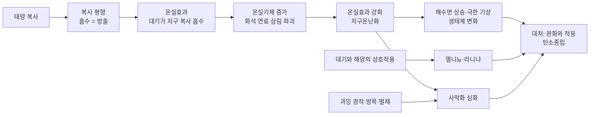
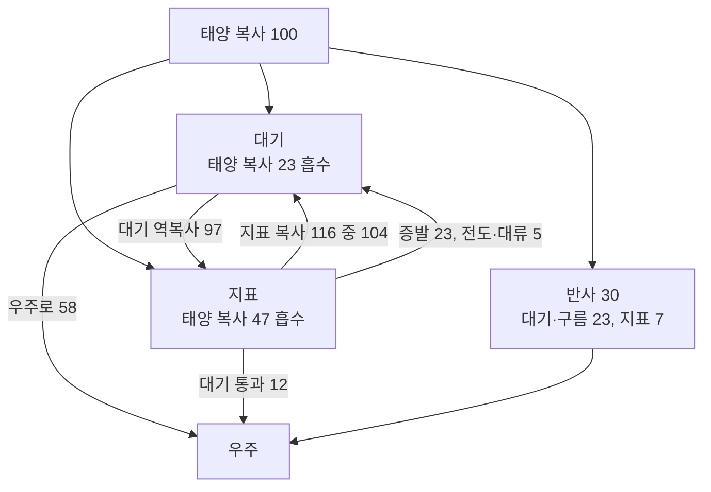
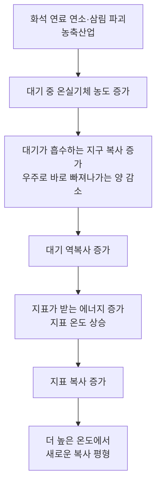
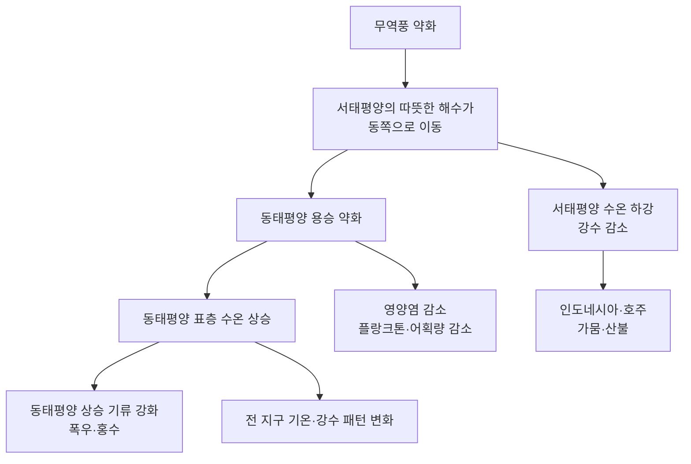
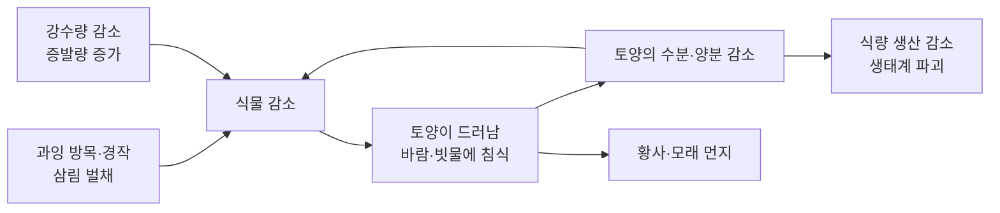
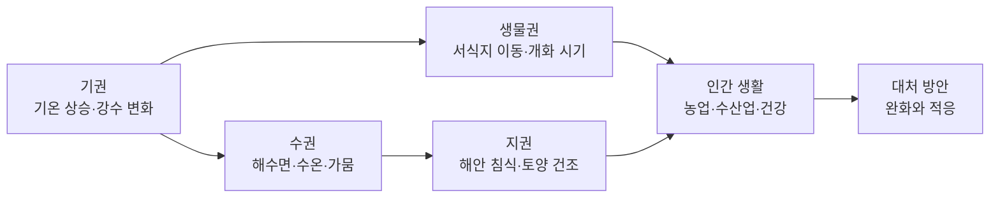

# 5-3. 지구온난화와 기후변화 — 두꺼워진 담요를 덮은 지구

> [!NOTE]
> **성취기준 [10통과2-02-03]** 온실효과 강화로 인한 지구온난화의 메커니즘을 이해하고, 엘니뇨, 사막화 등과 같은 현상이 지구 환경과 인간 생활에 미치는 영향과 대처 방안을 분석할 수 있다.

**학습 목표**

1. 복사 평형과 온실효과의 뜻을 알고, 지구 열수지 자료에서 들어오고 나가는 에너지의 균형을 확인할 수 있다.
2. 온실기체 농도 증가 → 온실효과 강화 → 지구 평균 기온 상승으로 이어지는 지구온난화의 메커니즘을 자료와 함께 설명할 수 있다.
3. 엘니뇨·라니냐를 대기와 해양의 상호작용으로 설명하고, 사막화의 원인과 영향을 분석할 수 있다.
4. 기후변화에 대한 대처 방안을 완화와 적응으로 구분하고, 탄소중립을 위한 개인·사회·국제적 노력을 제안할 수 있다.

**이 단원의 학습 사다리**

| 단계 | 무엇을 하나? |
|---|---|
| STEP 1. 중학교 다시 보기 | 대기권, 복사 평형과 온실효과, 대기 대순환, 해류를 다시 꺼내 본다 |
| STEP 2. 기초 다지기 | 복사, '들어온 만큼 나간다'는 평형, ppm, 반사율을 디딤돌로 놓는다 |
| STEP 3. 핵심 개념 | 온실효과 → 지구 열수지 → 지구온난화 → 엘니뇨·라니냐 → 사막화 → 대처 방안 |
| STEP 4. 오개념 바로잡기 | "온실효과는 나쁜 것?", "추운 겨울이면 온난화는 거짓?" 같은 착각을 바로잡는다 |
| STEP 5. 선택과목·대학 | 복사 평형 온도 계산, 복사 강제력과 기후 민감도, 남방 진동, 기후 시나리오 |
| STEP 6. 산업·진로 | 기후 모델링·기상 예보, 탄소 포집·저장, 기후 리스크 금융·보험, 사막화 방지 사업 |

---

## 🗺️ 단원 들어가기

달에는 대기가 거의 없다. 그래서 햇빛이 비치는 낮에는 표면 온도가 100 °C를 넘고, 밤에는 영하 100 °C 아래로 떨어진다. 태양에서 거의 같은 거리에 있는 지구는 왜 이렇게 극단적이지 않을까? 지구에는 열을 붙잡아 두는 **대기라는 담요**가 있기 때문이다.

그런데 산업혁명 이후 사람들이 석탄·석유를 태우면서 이 담요가 점점 두꺼워지고 있다. 담요가 두꺼워지면 어떤 일이 생길까? 또 남아메리카 페루 앞바다의 수온 변화가 어떻게 지구 반대편 인도네시아의 산불과 이어지고, 아프리카의 사막화가 어떻게 생태계와 사람들의 삶을 바꾸는지 이 단원에서 하나씩 연결해 본다.

---

## STEP 1. 🔙 중학교 다시 보기

### 연계 개념표

| 중학교 성취기준 | 중학교에서 배운 것 | 고등학교에서 확장되는 것 |
|---|---|---|
| [9과17-01] | 대기권의 4개 권역, 온실효과와 지구온난화를 복사 평형의 관점으로 설명 | 지구 열수지로 에너지 흐름을 **숫자로** 따져 보고, 온실효과 **강화**의 메커니즘을 분석 |
| [9과17-02] | 대기 대순환과 위도별 바람(무역풍, 편서풍 등) | **무역풍의 세기 변화**가 엘니뇨·라니냐를 일으킨다. 위도 30° 부근 하강 기류와 사막의 분포 |
| [9과18-03] | 대기 대순환과 해양 표층 순환, 해류의 에너지 재분배 | 바람과 바다가 서로 영향을 주고받는 **대기–해양 상호작용**과 기후변화 |
| [9과03-02] | 열은 전도·대류·복사로 전달된다 | 지구 열수지에서 복사뿐 아니라 전도·대류, 물의 증발로도 에너지가 이동함 |
| [9과22-01] | 재해·재난 사례의 발생 원인과 피해 분석 | 기후변화로 늘어나는 폭염·가뭄·홍수 등 기상 재해와 대처 방안 |

> [!NOTE]
> 바로 앞 **5-2 단원**의 '탄소 순환'에서 화석 연료의 연소가 대기 중 이산화 탄소를 늘린다는 것을 배웠다. 이 단원은 그 이산화 탄소가 지구의 에너지 수지를 어떻게 바꾸는지에서 출발한다.

### 준비 운동 (사전 진단)

**Q1.** 대기권 4개 권역 중 대부분의 기상 현상이 일어나는 권역은?

**Q2.** '복사 평형'의 뜻을 한 문장으로 쓰시오.

**Q3.** 적도 부근(위도 0°~30°)의 지상에서 부는 바람의 이름과 방향(북반구 기준)을 쓰시오.

**Q4.** 지구온난화의 주요 원인으로 꼽히는 기체 하나를 쓰시오.

정답 및 해설

**Q1.** 대류권 — 공기의 대류가 일어나고 수증기가 많아 구름·비·눈이 생긴다.

**Q2.** 물체가 흡수하는 복사 에너지양과 방출하는 복사 에너지양이 같아서 온도가 일정하게 유지되는 상태이다.

**Q3.** 무역풍 — 북반구에서는 북동쪽에서 남서쪽으로 분다(북동 무역풍). 즉 대체로 **동쪽에서 서쪽으로** 부는 바람이다.

**Q4.** 이산화 탄소(그 밖에 메테인, 산화 이질소 등)

---

## STEP 2. 🧱 기초 다지기

### ① 모든 물체는 복사 에너지를 내보낸다

온도를 가진 모든 물체는 **복사(radiation)** 의 형태로 에너지를 방출한다. 온도가 높을수록 더 많은 에너지를, 더 짧은 파장의 빛으로 내보낸다.

| 구분 | 표면 온도 | 주로 방출하는 빛 |
|---|---|---|
| **태양 복사** | 약 5800 K | 가시광선이 중심인 **짧은 파장** |
| **지구 복사** | 약 288 K(약 15 °C) | 눈에 보이지 않는 **적외선(긴 파장)** |

> [!TIP]
> 💡 **비유** — 난로를 켜면 처음에는 열만 느껴지다가(적외선), 더 뜨거워지면 붉게 빛난다(가시광선). 물체가 뜨거울수록 내보내는 빛의 파장이 짧아진다. 열화상 카메라는 사람·건물이 내보내는 적외선을 찍는 장치이다.

### ② '들어온 만큼 나간다' — 평형의 사고

수도꼭지를 틀어 둔 욕조에 배수구가 열려 있다고 하자. 물이 많아질수록 수압이 커져 배수구로 빠지는 물도 많아진다. 결국 **들어오는 양 = 나가는 양**이 되는 높이에서 물 높이가 일정해진다.

- 수도꼭지 = 흡수하는 태양 복사, 배수구 = 방출하는 지구 복사, 물 높이 = 지구의 온도
- 배수구를 조금 막으면(온실기체 증가) 물 높이가 올라가다가, **더 높은 수위에서 새로운 평형**을 이룬다.

### ③ 아주 작은 비율을 나타내는 단위, ppm

**ppm(parts per million)** 은 '100만 개 중 몇 개'를 뜻한다.

$$
1\ \mathrm{ppm} = \frac{1}{1\,000\,000} = 0.0001\%
$$

대기 중 이산화 탄소 농도가 420 ppm이라는 것은 공기 분자 100만 개 중 약 420개가 이산화 탄소라는 뜻이다. 백분율로는 $420 \times 0.0001\% = 0.042\%$이다. 아주 적은 양이지만 지구의 에너지 수지를 바꿀 만큼 큰 영향을 준다.

증가율은 다음과 같이 구한다.

$$
\text{증가율}(\%) = \frac{\text{나중 값} - \text{처음 값}}{\text{처음 값}} \times 100
$$

### ④ 반사율(알베도)

들어온 빛 가운데 반사되는 비율을 **반사율(albedo, 알베도)** 이라고 한다. 흰 눈과 얼음은 반사율이 높고(햇빛을 많이 튕겨 냄), 짙은 바다와 숲은 반사율이 낮다(햇빛을 많이 흡수함). 여름에 흰 옷이 검은 옷보다 덜 뜨거운 것과 같은 원리이다. 지구 전체의 평균 반사율은 **약 30%** 이다.

---

## STEP 3. 📘 핵심 개념

### 5-3-① 복사 평형과 온실효과

지구는 태양 복사 에너지를 흡수하고, 그만큼의 지구 복사 에너지를 우주로 방출하여 **복사 평형**을 이룬다. 그래서 지구의 연평균 기온은 오랜 기간 거의 일정하게 유지되어 왔다.

그런데 지구에 대기가 없다고 가정하고 복사 평형으로 계산하면 지구의 평균 표면 온도는 **약 −18 °C**가 된다. 실제 지구의 평균 기온은 **약 15 °C**이다. 이 약 33 °C의 차이를 만드는 것이 **온실효과(greenhouse effect)** 이다.

| 구분 | 대기가 없다면 | 실제 지구 |
|---|---|---|
| 평균 표면 온도 | 약 −18 °C | 약 15 °C |
| 지표가 받는 에너지 | 태양 복사만 | 태양 복사 + **대기가 다시 내려보내는 복사(대기 역복사)** |

**온실효과의 과정**
1. 짧은 파장의 태양 복사는 대기를 대부분 통과해 지표를 데운다.
2. 데워진 지표는 긴 파장의 적외선(지구 복사)을 방출한다.
3. 대기 중 **온실기체**는 이 적외선을 잘 흡수한다.
4. 온실기체가 흡수한 에너지의 일부를 다시 지표 쪽으로 방출(**대기 역복사**)하여 지표를 한 번 더 데운다.

#### 주요 온실기체

| 온실기체 | 주요 배출원 | 특징 |
|---|---|---|
| **수증기(H₂O)** | 바다·호수의 증발 | 온실효과에 기여하는 정도가 가장 크다. 그러나 농도는 주로 **기온**에 따라 정해진다(기온이 오르면 늘어남) |
| **이산화 탄소(CO₂)** | 화석 연료 연소, 삼림 파괴, 시멘트 생산 | 인간 활동으로 늘어난 양이 가장 많아 **지구온난화에 가장 큰 영향** |
| **메테인(CH₄)** | 가축의 소화 과정, 논, 쓰레기 매립지, 화석 연료 채굴 시 누출 | 같은 질량일 때 이산화 탄소보다 온실효과가 훨씬 크다 |
| **산화 이질소(N₂O)** | 질소 비료 사용, 일부 산업 공정 | 같은 질량일 때 온실효과가 매우 크다 |
| **염화 플루오린화 탄소(CFCs, 프레온) 등** | 과거의 냉장고·에어컨 냉매, 스프레이 | 오존층을 파괴하는 동시에 강한 온실기체. 몬트리올 의정서(1987)로 생산이 규제되었다 |

> [!NOTE]
> 대기의 대부분을 차지하는 **질소(N₂)와 산소(O₂)는 지구 복사(적외선)를 거의 흡수하지 않으므로 온실기체가 아니다.** 양이 아주 적은 기체가 온실효과를 좌우한다는 점이 흥미롭다.

#### 예제 1 — 복사 평형

지구에 들어오는 태양 복사 에너지를 100이라고 하자. 이 중 30이 반사되어 우주로 되돌아간다. 지구가 복사 평형 상태라면 지구가 우주로 방출하는 지구 복사 에너지는 얼마인가?

**풀이** 지구가 실제로 흡수하는 태양 복사 에너지는 $100 - 30 = 70$이다. 복사 평형 상태이므로 흡수한 만큼 방출한다. 따라서 지구 복사 에너지는 **70**이다.

### 5-3-② 지구 열수지 — 에너지의 가계부

지구에 들어오는 태양 복사 에너지를 100으로 두고, 그 에너지가 어디로 가는지 정리한 것을 **지구 열수지(Earth's energy budget)** 라고 한다. 아래 값은 여러 관측·연구 자료를 바탕으로 반올림한 대표값이다(자료와 교과서마다 조금씩 다를 수 있다).

| 구분 | 들어오는 에너지 | 나가는 에너지 |
|---|---|---|
| **지구 전체** (우주에서 보기) | 태양 복사 100 | 반사 30(대기·구름 23, 지표 7) + 대기의 방출 58 + 지표 복사 중 대기를 그대로 통과한 12 = **100** |
| **대기** | 태양 복사 흡수 23 + 지표 복사 흡수 104 + 물의 증발(숨은열) 23 + 전도·대류 5 = **155** | 지표로 내려보내는 대기 역복사 97 + 우주로 방출 58 = **155** |
| **지표** | 태양 복사 흡수 47 + 대기 역복사 97 = **144** | 지표 복사 116 + 물의 증발 23 + 전도·대류 5 = **144** |

> [!IMPORTANT]
> 지표가 방출하는 복사 에너지(116)는 지구에 들어오는 태양 복사(100)보다도 크다! 지표는 태양뿐 아니라 **대기 역복사(97)** 로도 데워지기 때문이다. 이것이 온실효과의 숫자 증거이다. 또한 지구 전체, 대기, 지표 **각각에서** 들어온 양과 나간 양이 같다. 이것이 복사 평형(넓게는 에너지 평형) 상태이다.

#### 예제 2 — 열수지 가계부 맞추기

위 표에서
(1) 지구 전체가 흡수하는 태양 복사 에너지와 우주로 방출하는 지구 복사 에너지를 각각 구하고 비교하시오.
(2) 지표에서 방출된 지구 복사 116 중 대기에 흡수되는 양은 얼마인가?

**풀이**
(1) 흡수한 태양 복사: 대기 23 + 지표 47 = **70**. 방출한 지구 복사: 대기 58 + 대기 통과 12 = **70**. 같으므로 지구는 복사 평형 상태이다. (예제 1의 결과와 같다.)
(2) $116 - 12 = $ **104**

### 5-3-③ 온실효과 강화와 지구온난화

#### (1) 늘어나는 온실기체

산업혁명 이전 대기 중 이산화 탄소 농도는 **약 280 ppm**이었다. 1958년부터 하와이 마우나로아 관측소 등에서 정밀하게 측정한 결과, 농도는 꾸준히 증가하여 2020년대에는 **420 ppm대**에 이르렀다. 메테인과 산화 이질소 농도도 산업혁명 이전보다 크게 늘었다.

#### 예제 3

이산화 탄소 농도가 280 ppm에서 420 ppm으로 늘었다. 증가율은 몇 %인가? 또 420 ppm은 공기 전체의 몇 %인가?

**풀이**
- 증가율: $\dfrac{420 - 280}{280}\times100 = \dfrac{140}{280}\times100 = 50\%$
- 백분율: $420\ \mathrm{ppm} = 420 \times 0.0001\% = 0.042\%$

공기의 0.042%에 불과하지만, 산업혁명 이전보다 절반이 늘어난 것이다.

#### (2) 지구온난화의 메커니즘

온실기체가 늘면 처음에는 **나가는 에너지가 들어오는 에너지보다 적어져** 지구에 에너지가 쌓인다. 쌓인 에너지로 지표와 바다의 온도가 올라가고, 온도가 오르면 지구 복사도 늘어나서 결국 **더 높은 온도에서** 다시 평형을 이룬다. 이것이 **지구온난화(global warming)** 이다. 이처럼 늘어난 에너지의 대부분(약 90%)은 바다에 저장되는 것으로 분석된다.

> [!TIP]
> 💡 **비유** — 같은 방에서 얇은 이불을 덮다가 두꺼운 이불로 바꾸었다고 하자. 몸이 만드는 열은 그대로인데 빠져나가는 열이 줄어드니 몸이 점점 따뜻해진다. 그러다 이불 안이 충분히 따뜻해지면 다시 들어오고 나가는 열이 같아진다. 이불이 두꺼워진 만큼 **새로운 평형 온도가 높아진** 것이다.

#### (3) 온난화를 키우는 되먹임

지구온난화는 스스로를 강화하는 **양성 되먹임(positive feedback)** 때문에 더 커질 수 있다.

| 되먹임 | 과정 |
|---|---|
| 얼음–반사율 되먹임 | 기온 상승 → 극지방 얼음 감소 → 반사율 감소(어두운 바다·땅 노출) → 태양 복사 흡수 증가 → 기온 상승 |
| 수증기 되먹임 | 기온 상승 → 증발 증가 → 대기 중 수증기(온실기체) 증가 → 온실효과 강화 → 기온 상승 |

#### (4) 지구온난화의 증거와 영향

**기후변화에 관한 정부 간 협의체(IPCC)** 는 세계 여러 과학자의 연구를 종합하여 평가 보고서를 낸다. 제6차 평가 보고서(2021~2023)는 "인간의 영향이 대기, 해양, 육지를 온난화시켜 왔다는 것은 명백하다"고 평가하였다.

| 관측된 변화 | 내용 |
|---|---|
| 기온 상승 | 2011~2020년 전 지구 평균 지표 온도는 1850~1900년보다 **약 1.1 °C** 높았다(IPCC 제6차 평가 보고서) |
| 해수면 상승 | 바닷물의 **열팽창**과 빙하·빙상이 녹은 물의 유입으로 1901~2018년에 전 지구 평균 해수면이 **약 0.2 m** 상승 |
| 빙하·해빙 감소 | 산악 빙하가 줄고, 북극 바다 얼음(해빙)의 면적이 줄어들고 있다 |
| 극한 기상 | 폭염·집중 호우 등 극한 기상 현상이 잦아지고 강해지는 경향 |
| 해양 산성화 | 바다가 이산화 탄소를 흡수하여 바닷물의 pH가 산업화 이전보다 약 0.1 낮아졌다(4-4 단원의 산성과 연결) |

| 영향을 받는 영역 | 예 |
|---|---|
| 생태계 | 생물 서식지가 고위도·고지대로 이동, 개화·번식 시기 변화, 산호의 백화 현상(5-2 단원과 연결) |
| 농업·수산업 | 작물 재배 지역의 북상, 우리나라 주변 바다의 어종 변화 |
| 건강 | 폭염으로 인한 온열 질환 증가, 감염병 매개 생물의 분포 변화 |
| 사회 기반 시설 | 해안 저지대 침수, 홍수·가뭄으로 인한 물 관리 부담 증가 |

#### 예제 4 — 계절에 따라 오르내리는 그래프

마우나로아 관측소의 이산화 탄소 농도 그래프를 보면 해마다 꾸준히 증가하면서도, 1년 안에서 톱니처럼 오르내린다. 북반구에서는 대체로 늦봄에 가장 높고 가을에 가장 낮다. 그 까닭을 설명하시오.

**풀이** 북반구는 남반구보다 육지와 식물이 훨씬 많다. 북반구의 봄~여름에는 식물이 활발하게 **광합성**을 하여 대기의 이산화 탄소를 흡수하므로 농도가 낮아지고(가을에 최저), 가을~겨울에는 광합성이 줄고 낙엽 분해·호흡이 이어져 농도가 다시 높아진다(늦봄에 최고). 이 계절 변동 위에 화석 연료 연소에 의한 **장기적인 증가 추세**가 겹쳐 있다. 5-2 단원의 탄소 순환이 그래프에 그대로 드러난 것이다.

### 5-3-④ 대기와 해양의 상호작용 — 엘니뇨와 라니냐

적도 태평양에서는 대기(바람)와 해양(바닷물)이 서로 영향을 주고받으며 지구 곳곳의 날씨를 바꾸는 현상이 일어난다.

#### (1) 평상시

- 적도 부근에서는 **무역풍**이 동쪽에서 서쪽으로 분다.
- 무역풍에 밀려 따뜻한 표층 해수가 **서태평양**(인도네시아·호주 쪽)에 두껍게 쌓인다. 서태평양은 수온이 높아 상승 기류가 생기고 비가 많이 내린다.
- **동태평양**(페루·에콰도르 연안)에서는 표층 해수가 밀려난 자리를 채우려고 깊은 곳의 차가운 바닷물이 올라온다. 이를 **용승(upwelling)** 이라고 한다. 용승한 물에는 영양염이 많아 플랑크톤이 번성하고 좋은 어장이 형성된다. 동태평양은 수온이 낮아 하강 기류가 생기고 건조하다.

#### (2) 엘니뇨와 라니냐

| 구분 | 평상시 | **엘니뇨(El Niño)** | **라니냐(La Niña)** |
|---|---|---|---|
| 무역풍 | 보통 | **약해짐** | **강해짐** |
| 따뜻한 해수 | 서태평양에 쌓임 | 동쪽으로 퍼져 이동 | 서태평양에 더 많이 쌓임 |
| 동태평양 용승 | 활발 | **약해짐** | **강해짐** |
| 동태평양 표층 수온 | 낮음 | 평년보다 **높음** | 평년보다 **더 낮음** |
| 동태평양 날씨 | 건조 | 비가 많아져 홍수 | 더 건조해져 가뭄 |
| 서태평양 날씨 | 비가 많음 | 비가 줄어 가뭄·산불 | 비가 더 많아져 홍수 |
| 동태평양 어장 | 좋음 | 영양염이 줄어 **어획량 감소** | 좋음 |

'엘니뇨'는 스페인어로 '남자아이(아기 예수)'라는 뜻으로, 크리스마스 무렵 페루 연안의 수온이 오르는 현상을 어민들이 부르던 이름에서 왔다. '라니냐'는 '여자아이'라는 뜻이다. 엘니뇨와 라니냐는 대체로 몇 년(대략 2~7년)마다 불규칙하게 번갈아 나타난다.

> [!IMPORTANT]
> 엘니뇨는 **바다만의 현상도, 바람만의 현상도 아니다.** 무역풍이 약해지면 해수의 분포가 바뀌고, 해수 온도가 바뀌면 다시 기압과 바람이 바뀐다. 이처럼 대기와 해양이 서로 원인이자 결과가 되는 **상호작용**이 엘니뇨의 핵심이다. 엘니뇨는 자연적으로 반복되는 현상이지만, 지구온난화와 겹치면 기록적인 고온이나 극한 기상이 나타나기 쉽다.

#### 예제 5

표는 어느 시기 적도 태평양의 표층 수온 편차(관측 수온 − 평년 수온)이다. (가상의 자료)

| 해역 | 서태평양 | 중앙 태평양 | 동태평양 |
|---|---|---|---|
| 수온 편차(°C) | −0.5 | +1.2 | +2.0 |

(1) 이 시기는 엘니뇨와 라니냐 중 어느 것인가? (2) 이 시기 무역풍의 세기와 페루 연안 용승의 변화를 쓰시오.

**풀이** (1) 동태평양의 수온이 평년보다 크게 높으므로 **엘니뇨** 시기이다. (2) 무역풍이 **약해져** 따뜻한 해수가 동쪽으로 이동했고, 페루 연안의 용승은 **약해졌다.**

### 5-3-⑤ 사막화

**사막화(desertification)** 는 건조·반건조 지역 등에서 기후 변동과 인간 활동 때문에 토지가 황폐해져 식물이 자라기 어려운 땅으로 바뀌는 현상이다. 이미 있는 사막이 저절로 넓어지는 것만을 뜻하지 않는다는 점에 주의하자.

#### (1) 사막화의 원인

| 구분 | 원인 |
|---|---|
| 자연적 원인 | 위도 30° 부근은 대기 대순환의 **하강 기류**가 나타나는 곳이라 구름이 생기기 어려워 강수량이 적다. 여기에 오랜 가뭄 등 강수량의 감소가 겹친다. 지구온난화로 증발량이 늘어나는 것도 건조화를 부추긴다 |
| 인위적 원인 | **과잉 경작**(땅을 쉬지 않고 계속 경작), **과잉 방목**(가축이 풀을 뿌리까지 먹어 치움), 땔감과 농지 확보를 위한 **삼림 벌채**, 지나친 관개로 인한 토양의 염류화 |

#### (2) 사막화의 영향

- **식량 생산 감소**: 농사지을 땅과 목초지가 줄어 식량 부족과 빈곤이 심해진다. 사하라 사막 남쪽의 사헬 지대에서는 1970~1980년대의 큰 가뭄으로 심각한 기근이 발생하였다.
- **생태계 파괴**: 식물이 사라지면 그 식물에 의지하던 동물이 사라져 먹이 그물이 무너진다(5-2 단원).
- **황사·모래 먼지 증가**: 식물이 없는 메마른 땅의 흙먼지가 바람에 날린다. 우리나라에 오는 황사는 주로 중국 북부와 몽골의 사막·건조 지대에서 발생한다.
- **환경 난민**: 살 수 없게 된 땅을 떠나는 사람들이 생기고, 물과 땅을 둘러싼 갈등이 커질 수 있다.

#### (3) 사막화 방지 노력

- **국제 협력**: 국제 연합은 **사막화 방지 협약(UNCCD)** 을 1994년에 채택하였다. 우리나라 창원에서 2011년에 이 협약의 당사국 총회가 열리기도 했다.
- **나무와 풀 심기**: 아프리카에서는 사하라 사막 남쪽 가장자리를 따라 식생 띠를 만드는 '녹색 장벽(Great Green Wall)' 사업이 진행되고 있다. 우리나라도 몽골 등에서 나무를 심는 사업에 참여해 왔다.
- **토지 관리**: 가축 수와 방목지를 조절하고, 땅을 쉬게 하는 휴경, 바람막이 숲(방풍림) 조성, 물을 아끼는 관개 기술을 보급한다.

### 5-3-⑥ 기후변화에 대처하기 — 완화, 적응, 탄소중립

기후변화에 대한 대처는 크게 두 가지로 나뉜다.

| 구분 | 뜻 | 예 |
|---|---|---|
| **완화(mitigation)** | 원인을 줄인다: 온실기체 배출을 줄이거나 흡수를 늘린다 | 재생 에너지 확대, 에너지 효율 향상, 전기·수소 차량, 숲 가꾸기, 탄소 포집·저장, 메테인 누출 방지 |
| **적응(adaptation)** | 이미 일어나고 있거나 피할 수 없는 변화에 대비해 피해를 줄인다 | 제방·배수 시설 강화, 폭염 쉼터, 고온·가뭄에 강한 품종 개발, 물 관리, 기상 재해 조기 경보 |

> [!TIP]
> 💡 **비유** — 비가 새는 집에서 '지붕의 구멍을 막는 것'이 완화이고, '양동이를 받치고 귀중품을 옮기는 것'이 적응이다. 구멍을 막지 않으면 양동이가 아무리 많아도 소용없고, 구멍을 막는 동안 쏟아지는 비도 받아 내야 한다. **둘 다 필요하다.**

#### 탄소중립

**탄소중립(carbon neutrality, net-zero)** 은 사람의 활동으로 배출하는 온실기체의 양에서 숲 등의 흡수량과 기술적 제거량을 뺀 값이 **0**이 되도록 하는 것이다.

$$
\text{순배출량} = \text{배출량} - (\text{흡수량} + \text{제거량}) = 0
$$

| 수준 | 노력 |
|---|---|
| 국제 | 유엔 기후변화 협약(1992년 채택), 교토 의정서(1997년), **파리 협정(2015년)**: 지구 평균 기온 상승을 산업화 이전 대비 2 °C보다 훨씬 낮게 유지하고 1.5 °C로 제한하도록 노력하기로 함 |
| 국가(우리나라) | 2020년 **2050 탄소중립**을 선언하고, 2021년 탄소중립 기본법을 제정하였다. 2030년까지 온실기체 배출량을 2018년 대비 40% 줄이는 목표를 세웠다. 2015년부터 **온실가스 배출권 거래제**를 운영한다 |
| 개인·학교 | 대중교통·자전거 이용, 에너지 절약, 음식물 쓰레기 줄이기, 재사용·재활용, 기후 문제에 관심을 갖고 의견 내기 |

#### 예제 6 — 완화와 적응 구분하기

다음을 완화와 적응으로 구분하시오.
(가) 해안 도시가 바닷물 침수에 대비해 방조제를 높였다.
(나) 공장이 굴뚝의 이산화 탄소를 모아 땅속 깊이 저장했다.
(다) 농촌진흥 기관이 더위에 강한 벼 품종을 개발했다.
(라) 학교 옥상에 태양광 발전 설비를 설치했다.

**풀이** 완화: (나), (라) — 온실기체 배출을 줄인다. 적응: (가), (다) — 기후변화의 피해에 대비한다.

---

## STEP 4. ⚠️ 오개념 바로잡기

| 흔한 오개념 | 올바른 개념 | 왜 그럴까? |
|---|---|---|
| 온실효과는 나쁜 현상이므로 없어져야 한다 | 온실효과 덕분에 지구 평균 기온이 약 15 °C로 유지된다. 문제는 온실효과의 **강화**이다 | 온실효과가 없으면 평균 기온이 약 −18 °C인 얼음 행성이 된다 |
| 오존층 파괴가 지구온난화의 주된 원인이다 | 오존층 파괴(자외선 증가)와 지구온난화(온실기체 증가)는 **다른 현상**이다 | 프레온은 둘 다에 관여하지만, 지구온난화의 가장 큰 원인은 이산화 탄소 증가이다 |
| 수증기는 온실기체가 아니다 / 수증기 배출을 줄이면 온난화를 막을 수 있다 | 수증기는 **가장 큰 온실효과**를 내지만, 그 농도는 주로 **기온에 따라 정해진다** | 기온이 오르면 수증기가 늘어 온난화를 키우는 되먹임 역할을 한다. 출발점은 이산화 탄소 등의 증가이다 |
| 올겨울이 유난히 추웠으니 지구온난화는 거짓이다 | **날씨**(며칠~몇 주의 상태)와 **기후**(보통 30년 평균)는 다르다 | 장기간의 전 지구 평균이 오르고 있으며, 온난화 속에서도 한파는 생길 수 있다 |
| 지구온난화로 모든 지역의 기온이 똑같이 오른다 | 지역마다 다르며, **북극 등 고위도는 훨씬 빠르게** 따뜻해진다. 극한 기상도 늘어난다 | 얼음–반사율 되먹임 등이 고위도에서 크게 작용한다 |
| 엘니뇨는 바다 수온만 변하는 현상이다 | 엘니뇨는 무역풍(대기)과 해수(해양)가 서로 영향을 주고받는 **대기–해양 상호작용**이다 | 바람이 바다를 바꾸고, 바뀐 바다가 다시 기압과 바람을 바꾼다 |
| 사막화는 원래 있는 사막이 자연적으로 넓어지는 것이다 | 사막화는 건조 지역의 **토지 황폐화**이며, 과잉 경작·방목·벌채 등 **인간 활동**이 큰 원인이다 | 사막과 떨어진 곳에서도 토지 관리에 실패하면 사막화가 일어난다 |

---

## STEP 5. 🎓 선택과목·대학으로 한 걸음 더

> [!CAUTION]
> 이 절은 **통합과학 교육과정 범위 밖의 심화 내용**으로 평가 대상이 아니다. "이 개념이 앞으로 어디까지 이어지는가"를 맛보기로 보여 주기 위한 내용이다.

### 고2·3 선택과목과의 연결

| 과목 | 이어지는 내용 |
|---|---|
| 지구과학 | 대기와 해양의 상호작용(용승, 엘니뇨·남방 진동), 기후변화의 원인과 영향 |
| 지구시스템과학 | 강수 과정과 대기의 운동, 해수의 운동 |
| 기후변화와 환경생태 | 기후위기와 환경생태 변화, 기후위기에 대응하는 우리의 노력 |
| 역학과 에너지 | 열과 에너지, 열역학 법칙 |

### ① 복사 평형 온도를 직접 계산하기

대학 '대기과학개론'에서는 물체가 방출하는 복사 에너지가 절대 온도의 네제곱에 비례한다는 **슈테판–볼츠만 법칙**을 쓴다.

$$
E = \sigma T^4, \qquad \sigma \approx 5.67\times10^{-8}\ \mathrm{W/(m^2\cdot K^4)}
$$

지구가 받는 태양 복사(태양 상수 $S \approx 1361\ \mathrm{W/m^2}$) 중 반사율 $A \approx 0.3$만큼을 뺀 나머지를 흡수하고, 이를 지구 전체 표면(단면적의 4배)에서 방출한다고 하면

$$
\frac{S(1-A)}{4} = \sigma T^4
\;\;\Rightarrow\;\;
T = \left(\frac{1361 \times 0.7}{4 \times 5.67\times10^{-8}}\right)^{1/4} \approx 255\ \mathrm{K} \approx -18\ ^\circ\mathrm{C}
$$

STEP 3에서 말한 '대기가 없을 때 약 −18 °C'가 바로 이 계산에서 나온다. 대기를 '적외선을 모두 흡수하는 한 겹의 층'으로 단순화하면 지표 온도는 $2^{1/4}\times255 \approx 303\ \mathrm{K}$가 되는데, 실제(약 288 K)보다 높다. 실제 대기는 적외선을 일부만 흡수하고, 대류와 증발로도 열을 옮기기 때문이다. 이런 차이를 하나씩 보태 가는 것이 **기후 모델**이다.

### ② 복사 강제력과 기후 민감도

온실기체가 늘어 지구의 에너지 수지가 얼마나 달라지는지를 **복사 강제력**(단위 $\mathrm{W/m^2}$)으로 나타낸다. 이산화 탄소에 대해서는 다음과 같은 근사식이 자주 쓰인다.

$$
\Delta F \approx 5.35 \ln\frac{C}{C_0}\ \mathrm{W/m^2}
$$

$C_0 = 280\ \mathrm{ppm}$, $C = 420\ \mathrm{ppm}$을 넣으면 $\Delta F \approx 5.35\times\ln 1.5 \approx 2.2\ \mathrm{W/m^2}$이다. 로그 함수이므로 농도가 늘수록 같은 양을 더해도 효과는 조금씩 줄지만, 사라지지는 않는다. 이산화 탄소 농도가 두 배가 되어 새로운 평형에 이르렀을 때의 기온 상승을 **평형 기후 민감도**라고 하며, IPCC 제6차 평가 보고서는 그 최적 추정값을 약 3 °C로 평가하였다.

### ③ 엘니뇨–남방 진동(ENSO)

엘니뇨 때 동태평양의 해수 온도가 오르면, 적도 태평양 동쪽과 서쪽의 해면 기압 차이도 함께 시소처럼 바뀐다. 이 기압의 시소를 **남방 진동**이라 하며, 해양의 엘니뇨와 대기의 남방 진동을 묶어 **ENSO**라고 부른다. 평상시 적도 태평양 상공에는 서쪽에서 상승하고 동쪽에서 하강하는 거대한 대기 순환(**워커 순환**)이 있는데, 엘니뇨 때는 이 순환이 약해지거나 위치가 바뀐다. 대학 '해양학', '기후역학'에서 수식과 관측 자료로 다룬다.

### ④ 기후변화 시나리오

IPCC 제6차 평가 보고서는 사회·경제 발전 경로와 온실기체 배출량에 따라 **공통 사회경제 경로(SSP)** 시나리오를 쓴다. 2081~2100년의 전 지구 평균 기온 상승(1850~1900년 대비) 최적 추정값은 대략 다음과 같다.

| 시나리오 | 성격 | 기온 상승(최적 추정, 약) |
|---|---|---|
| SSP1-1.9 | 매우 적극적으로 감축 | 1.4 °C |
| SSP1-2.6 | 적극적으로 감축 | 1.8 °C |
| SSP2-4.5 | 중간 수준 | 2.7 °C |
| SSP3-7.0 | 감축 노력이 약함 | 3.6 °C |
| SSP5-8.5 | 화석 연료 의존이 매우 큼 | 4.4 °C |

우리나라 기상청도 이 시나리오를 바탕으로 한반도의 미래 기후를 상세하게 계산한 자료를 공개하고 있다. 탐구 활동 B에서 이 시나리오를 활용해 보자.

### 고등학교 vs 대학교

| 구분 | 고등학교 통합과학 | 대학교 대기과학·해양학·환경공학 |
|---|---|---|
| 복사 평형 | 들어온 양 = 나간 양, 열수지 표 해석 | 슈테판–볼츠만 법칙, 복사 전달 방정식, 기체의 흡수 스펙트럼 |
| 지구온난화 | 온실기체 증가 → 역복사 증가의 정성적 메커니즘 | 복사 강제력, 기후 민감도, 되먹임의 정량 분석 |
| 엘니뇨 | 무역풍·용승·수온의 변화 | ENSO 역학, 워커 순환, 계절 예측 모델 |
| 대처 방안 | 완화와 적응, 탄소중립의 사례 | 탄소 예산, 감축 기술의 비용 분석, 기후 정책·경제 |
| 관련 전공 | — | 대기과학, 해양학, 지구환경과학, 환경공학, 에너지공학, 기후경제학 |

---

## STEP 6. 🏭 산업 현장과 진로 연결

### 사례 1. 기후 모델링과 기상 예보 산업

- **원리** 대기와 해양을 잘게 나눈 격자마다 열수지·운동·물의 상태 변화를 나타내는 식을 세우고, 슈퍼컴퓨터로 시간에 따라 계산한다(**수치 예보 모델**). 며칠 앞의 날씨를 계산하면 일기 예보, 수십~수백 년을 계산하면 기후 시나리오가 된다.
- **어디에 쓰이나** 기상청은 우리나라 실정에 맞게 개발한 한국형 수치 예보 모델을 운영하고, 엘니뇨 감시와 장기 전망 정보를 발표한다. 민간 기상 사업자는 날씨 정보를 바탕으로 유통업의 판매량 예측, 건설 현장의 작업 일정 관리, 태양광·풍력 발전량 예측 등의 서비스를 제공한다.
- **핵심 기술** 위성·레이더·해양 관측 자료를 모델에 넣는 자료 동화 기술, 인공지능을 이용한 예측 보완 기술이 빠르게 발전하고 있다.

### 사례 2. 탄소 포집·활용·저장(CCUS)

- **원리** 발전소·제철소·시멘트 공장처럼 이산화 탄소를 많이 배출하는 곳에서 배기가스 속 이산화 탄소를 분리해 모으고(**포집**), 파이프라인·선박으로 옮겨(**수송**), 땅속 깊은 지층에 가두거나(**저장**) 다른 제품의 원료로 쓴다(**활용**).
- **어디에 쓰이나** 생산이 끝난 해저 가스전이나 깊은 지층(대략 지하 800 m보다 깊은 곳)이 저장 후보지로 검토된다. 활용 분야로는 건축 자재, 화학 제품 원료 등이 연구되고 있다.
- **과제** 포집에 많은 에너지와 비용이 들고, 저장한 이산화 탄소가 새어 나오지 않는지 오랫동안 감시해야 한다. 그래서 CCUS는 배출을 줄이는 다른 노력을 대신하는 것이 아니라 **줄이기 어려운 배출을 처리하는 보완 수단**으로 여겨진다.

### 사례 3. 기후 리스크 금융과 보험

- **원리** 폭염·홍수·태풍 같은 기상 재해가 늘어나면 기업과 개인의 재산 피해도 커진다. 보험·금융 산업은 기후 모델과 과거 재해 자료로 **피해가 날 확률과 규모**를 계산하여 보험료와 투자 위험을 정한다.
- **어디에 쓰이나** 농작물 재해 보험, 강수량이나 기온 같은 기상 지수가 정해진 값을 넘으면 자동으로 보험금이 지급되는 **지수형 보험**, 보험회사의 위험을 다시 나누어 맡는 재보험 등이 있다. 또 기업이 기후변화로 받을 수 있는 위험과 대응 계획을 투자자에게 공개하는 **기후 관련 재무 정보 공개**가 세계적으로 확대되고 있다.
- **탄소 시장** 온실가스 배출권 거래제에서는 기업이 할당받은 배출 허용량을 사고팔 수 있어, 감축 비용이 적게 드는 곳부터 배출을 줄이도록 이끈다.

### 사례 4. 사막화 방지와 조림 사업

- 위성 사진으로 식생의 변화를 감시하여 사막화가 진행되는 지역을 찾고, 그 지역 기후에 맞는 나무와 풀을 골라 심는다.
- 나무만 심는 것이 아니라 **주민이 가축 수를 조절하고 땔감 대신 다른 연료를 쓸 수 있도록** 돕는 일이 함께 이루어져야 효과가 오래간다. 산림·국제 개발 협력 분야의 전문가들이 참여한다.

### 관련 진로와 학과

| 진로 | 하는 일 | 관련 학과 |
|---|---|---|
| 기상 예보관·기후 과학자 | 날씨 예보, 기후 모델 개발, 기후변화 시나리오 분석 | 대기과학, 지구환경과학, 해양학 |
| 탄소 포집·저장 엔지니어 | 포집 공정 설계, 저장 지층 탐사와 누출 감시 | 화학공학, 환경공학, 지질학, 에너지자원공학 |
| 기후 리스크 분석가 | 재해 확률 모델링, 보험료 산정, 기업의 기후 위험 평가 | 통계학, 경제·금융학, 대기과학 |
| 온실가스 관리 전문가 | 기업·기관의 배출량 산정과 감축 계획 수립, 배출권 관리 | 환경공학, 에너지공학, 경영학 |
| 국제 개발 협력·산림 전문가 | 개발도상국의 사막화 방지·조림 사업 기획과 운영 | 산림자원학, 농학, 국제개발학 |

---

## 🔬 탐구 활동 — 지구 열수지 변동 탐구와 기후변화 미래 시나리오 구상

### 활동 A. 지구온난화에 따른 지구 열수지 변동 탐구하기

#### A-1. 열수지 표로 '두꺼워진 담요' 예측하기 (자료 해석)

**목표** 온실기체가 늘어날 때 지구 열수지의 각 항목이 어떻게 달라지는지 예측하고, 새로운 평형에 이르는 과정을 설명한다.

**과정**
1. STEP 3의 지구 열수지 표를 옮겨 적는다.
2. 온실기체 농도가 늘어나면 다음 항목이 늘어날지(↑), 줄어들지(↓) 모둠별로 예측하고 근거를 쓴다.

| 항목 | 현재 값 | 온실기체 증가 직후 예측(↑/↓) | 근거 |
|---|---|---|---|
| 지표 복사 중 대기를 그대로 통과해 우주로 나가는 양 | 12 | | |
| 대기가 흡수하는 지표 복사 | 104 | | |
| 대기 역복사 | 97 | | |
| 지표가 흡수하는 총 에너지 | 144 | | |
| 우주로 나가는 지구 복사 전체 | 70 | | |

3. '온실기체 증가 직후'에는 지구가 흡수하는 에너지(70)와 방출하는 에너지가 어떤 관계가 될지 쓰고, 그 결과 지표 온도가 어떻게 변할지 설명한다.
4. 지표 온도가 오른 뒤 결국 우주로 나가는 지구 복사 전체가 다시 얼마가 되어야 새로운 평형에 이르는지 쓴다.

> [!TIP]
> **예상 결과 확인 포인트** 직후에는 대기를 그대로 통과하는 양이 줄어 우주로 나가는 지구 복사가 70보다 적어진다. 들어오는 에너지가 더 많으므로 지구에 에너지가 쌓이고 지표 온도가 올라간다. 지표 온도가 오르면 지표 복사가 늘어나고, 우주로 나가는 양이 다시 **70**이 되는 지점에서 새로운 평형을 이룬다. 그때 지표 온도는 처음보다 높다.

#### A-2. 페트병 온실 모형 실험

**목표** 이산화 탄소 농도가 높은 공기와 보통 공기를 비교하여 온실기체가 온도 변화에 미치는 영향을 관찰한다.

**준비물** 같은 크기의 투명 페트병 2개, 디지털 온도계(또는 온도 센서) 2개, 백열전구나 적외선 램프 등 같은 광원, 이산화 탄소 발생 재료(예: 식초와 베이킹 소다, 또는 발포 비타민과 물), 고무 마개 또는 랩과 고무줄, 타이머

**과정**
1. 페트병 A에는 보통 공기를, 페트병 B에는 이산화 탄소를 채운다. (B 바닥에서 이산화 탄소를 발생시켜 병 속 공기를 밀어낸 뒤 반응물을 꺼내거나, 별도 용기에서 발생시킨 기체를 관으로 옮긴다.)
2. 두 병에 온도계를 같은 높이로 꽂고 입구를 막는다.
3. 두 병을 광원에서 **같은 거리**에 나란히 놓고, 처음 온도가 같은지 확인한다.
4. 광원을 켜고 2분마다 20분 동안 온도를 기록한다. 이어서 광원을 끄고 10분 동안 식는 과정도 기록한다.

**결과 기록**

| 시간(분) | 0 | 2 | 4 | 6 | 8 | 10 | 12 | 14 | 16 | 18 | 20 | 끈 뒤 5 | 끈 뒤 10 |
|---|---|---|---|---|---|---|---|---|---|---|---|---|---|
| A: 공기(°C) | | | | | | | | | | | | | |
| B: 이산화 탄소(°C) | | | | | | | | | | | | | |

**생각해 보기**
1. 어느 병의 온도가 더 많이 올라갔는가? 광원을 끈 뒤에는 어느 병이 더 천천히 식었는가?
2. 이 실험에서 같게 해야 할 조건(통제 변인)을 세 가지 이상 쓰시오.
3. 이 모형은 실제 대기와 어떤 점이 다른가? (예: 병 속 이산화 탄소 농도는 실제 대기보다 수천 배 높다, 병 안에서는 공기가 순환하지 않는다, 페트병 벽도 열을 흡수·방출한다, 기체마다 열을 저장하는 성질이 달라 온도 차이의 일부는 온실효과가 아닌 다른 이유일 수 있다)
4. 모형 실험의 한계에도 불구하고 이 결과가 알려 주는 것은 무엇인가?

> [!WARNING]
> **안전 수칙** 백열전구와 적외선 램프는 매우 뜨거워지므로 맨손으로 만지지 않는다. 광원을 페트병에 너무 가까이 두면 병이 녹거나 변형될 수 있다. 식초가 눈에 들어가지 않도록 보안경을 쓰고, 실험 후 환기한다.

### 활동 B. 기후변화로 인한 생태계와 지구계의 미래 시나리오 구상하기 (모둠 프로젝트)

**목표** 서로 다른 온실기체 배출 시나리오에 따라 2100년 무렵 우리 지역의 생태계와 지구계가 어떻게 달라질지 과학적 근거를 바탕으로 구상하고 발표한다.

**과정**
1. 모둠별로 '적극 감축 시나리오(예: SSP1-2.6)' 또는 '고배출 시나리오(예: SSP5-8.5)' 중 하나를 맡는다.
2. 기상청 등 공공 기관이 공개한 기후변화 시나리오 자료에서 우리 지역의 미래 기온·강수량·폭염 일수 전망을 찾아 정리한다.
3. 다음 연결 고리 틀을 이용하여 기권 → 수권 → 지권 → 생물권 → 인간 생활로 이어지는 영향을 3단계 이상 연결한다.

4. 5-1, 5-2 단원의 개념(비생물적 요인, 먹이 그물, 생태계 평형)을 최소 2개 이상 사용하여 생태계 변화를 설명한다.
5. 같은 지역을 다른 시나리오로 구상한 모둠과 결과를 비교하고, "지금의 선택이 미래를 어떻게 바꾸는가"를 정리한다.

**발표 평가 기준**

| 기준 | 내용 |
|---|---|
| 과학적 근거 | 공공 기관 자료와 단원 개념을 정확히 사용했는가 |
| 시스템적 사고 | 여러 권역의 영향을 원인–결과로 연결했는가 |
| 대처 방안 | 완화와 적응을 구분하여 구체적으로 제안했는가 |
| 협력과 소통 | 모둠원이 역할을 나누고 다른 모둠의 의견을 존중했는가 |

---

## ✅ 개념 확인 문제

### 기본

**1.** 다음 중 온실기체가 **아닌** 것은?
① 이산화 탄소 ② 메테인 ③ 질소 ④ 수증기

정답 및 해설

**정답 ③**

질소(N₂)는 대기의 약 78%를 차지하지만 지구 복사(적외선)를 거의 흡수하지 않으므로 온실기체가 아니다.

**2.** 빈칸에 알맞은 말을 쓰시오.
"지표에서 방출된 지구 복사의 일부를 대기 중 ( ㄱ )이/가 흡수한 뒤 다시 지표로 방출하는 것을 ( ㄴ )(이)라 하며, 이 때문에 지구의 평균 기온이 대기가 없을 때보다 높게 유지되는 현상을 ( ㄷ )(이)라고 한다."

정답 및 해설

**정답** ㄱ: 온실기체, ㄴ: 대기 역복사, ㄷ: 온실효과

**3.** 어느 해 대기 중 이산화 탄소 농도가 420 ppm이었다. (1) 이것은 공기 전체의 몇 %인가? (2) 산업혁명 이전 농도를 280 ppm이라 할 때, 몇 % 증가한 것인가?

정답 및 해설

**정답** (1) 0.042% (2) 50%

(1) $1\ \mathrm{ppm} = 0.0001\%$이므로 $420 \times 0.0001\% = 0.042\%$
(2) $\dfrac{420-280}{280}\times100 = 50\%$

**4.** 엘니뇨 시기에 대한 설명으로 옳은 것은 O, 틀린 것은 X를 쓰시오.
(1) 적도 부근의 무역풍이 평상시보다 강해진다.
(2) 페루 연안의 용승이 약해진다.
(3) 동태평양의 표층 수온이 평상시보다 높아진다.
(4) 인도네시아 등 서태평양 지역에 홍수가 잦아진다.

정답 및 해설

**정답** (1) X (2) O (3) O (4) X

엘니뇨 때는 무역풍이 **약해져** 따뜻한 해수가 동쪽으로 이동하므로 동태평양 용승이 약해지고 수온이 오른다. 서태평양은 강수가 줄어 **가뭄**과 산불이 잦아진다.

### 응용

**5.** 그림 대신 자료로 제시한다. 지구에 들어오는 태양 복사를 100이라 할 때, 30은 반사되고 23은 대기에 흡수된다. 지표는 지구 복사 116을 방출하고, 물의 증발로 23, 전도·대류로 5의 에너지를 대기에 전달한다. 지표가 받는 에너지는 태양 복사 (가)와 대기 역복사 (나)이다. 지표 복사 중 12는 대기를 그대로 통과하여 우주로 나간다. 지구 전체, 대기, 지표가 모두 평형 상태일 때 (가), (나), 그리고 대기가 우주로 방출하는 에너지 (다)를 구하시오.

정답 및 해설

**정답** (가) 47 (나) 97 (다) 58

- (가) 태양 복사 중 반사 30, 대기 흡수 23을 뺀 나머지가 지표에 흡수된다: $100 - 30 - 23 = 47$
- (나) 지표 평형: 들어온 양 = 나간 양 → $47 + (\text{나}) = 116 + 23 + 5 = 144$ → (나) $= 97$
- (다) 지구 전체 평형: 흡수한 태양 복사 $23 + 47 = 70$ = 우주로 나가는 지구 복사 $(\text{다}) + 12$ → (다) $= 58$

확인: 대기에 들어온 양 $23 + (116-12) + 23 + 5 = 155$, 나간 양 $97 + 58 = 155$로 대기도 평형이다.

**6.** 표는 서로 다른 두 시기 A, B에 적도 동태평양에서 관측한 자료를 평상시와 비교한 것이다. (가상의 자료)

| 구분 | 표층 수온 편차(°C) | 용승 | 무역풍 |
|---|---|---|---|
| A | +1.8 | 약함 | ( ㄱ ) |
| B | −1.5 | ( ㄴ ) | 강함 |

(1) A와 B는 각각 엘니뇨와 라니냐 중 어느 시기인가? (2) ㄱ, ㄴ에 알맞은 말을 쓰시오. (3) A 시기에 페루 연안의 어획량이 줄어드는 까닭을 쓰시오.

정답 및 해설

**정답** (1) A: 엘니뇨, B: 라니냐 (2) ㄱ: 약함, ㄴ: 강함

(3) 무역풍이 약해져 깊은 곳의 차가운 물이 올라오는 용승이 약해지면, 표층으로 공급되는 **영양염이 줄어든다.** 영양염이 줄면 플랑크톤이 줄고, 플랑크톤을 먹는 물고기도 줄어 어획량이 감소한다(5-2 단원의 먹이 관계).

**7.** 북극의 바다 얼음(해빙)이 줄어들면 지구온난화가 더 빨라질 수 있다. 그 과정을 '반사율'이라는 용어를 사용하여 단계적으로 설명하시오.

정답 및 해설

**예시 답안**
기온이 오르면 해빙이 녹는다 → 반사율이 높은 흰 얼음 대신 반사율이 낮은 어두운 바다가 드러난다 → 지표(해수면)가 흡수하는 태양 복사 에너지가 늘어난다 → 바다와 대기의 온도가 더 오른다 → 해빙이 더 많이 녹는다. 이처럼 결과가 원인을 더 강하게 만드는 **양성 되먹임**이 일어난다.

### 융합·서술형

**8. [산업 연계]** 어느 시멘트 공장이 2050년 탄소중립 계획을 세우고 있다. 시멘트는 원료인 석회석이 분해될 때와 연료를 태울 때 모두 이산화 탄소가 나와 배출을 '0'으로 만들기 어렵다. 이 공장이 검토하는 방안은 다음과 같다.
(가) 연료를 화석 연료에서 재생 가능한 연료·전기로 바꾼다.
(나) 굴뚝에서 이산화 탄소를 포집해 깊은 지층에 저장한다.
(다) 여름철 폭염에 대비해 작업자 휴게 시설과 냉방 설비를 늘린다.
(1) (가)~(다)를 완화와 적응으로 구분하시오. (2) (나) 방안의 원리와 한계를 각각 한 가지씩 쓰시오. (3) '탄소중립'의 뜻을 이용하여 이 공장이 (가), (나) 외에 추가로 고려할 수 있는 방법을 한 가지 제안하시오.

정답 및 해설

**예시 답안**
(1) 완화: (가), (나) / 적응: (다)
(2) 원리: 배기가스에서 이산화 탄소를 분리·압축하여 땅속 깊은 지층에 가두어 대기로 나가지 않게 한다. 한계: 포집과 수송에 많은 에너지와 비용이 들고, 저장한 이산화 탄소가 새어 나오지 않는지 오랫동안 감시해야 한다.
(3) 탄소중립은 '배출량 − (흡수량 + 제거량) = 0'이다. 따라서 배출량을 줄이는 것 외에 흡수량을 늘리는 방법, 예를 들어 숲을 조성·관리하여 이산화 탄소 흡수를 늘리거나, 석회석 사용을 줄이는 새로운 원료·공정을 개발하는 방법, 포집한 이산화 탄소를 건축 자재 등에 활용하는 방법을 고려할 수 있다.

**채점 포인트** ① 완화·적응의 바른 구분 ② CCUS의 원리와 한계 ③ 탄소중립 식에 근거한 제안

**9. [생태·지구계 연계]** 몽골의 어느 초원에서 가축 수가 크게 늘어난 뒤 몇 년 동안 비가 적게 내리자, 풀이 사라지고 모래땅이 드러났다. 그 뒤 우리나라에서는 봄철 황사가 잦아졌다는 보도가 나왔다. (1) 이 초원에서 사막화가 진행된 원인을 자연적 원인과 인위적 원인으로 나누어 쓰시오. (2) 사막화가 이 초원 생태계의 먹이 그물과 생태계 평형에 미치는 영향을 5-2 단원의 개념으로 설명하시오. (3) 이 문제를 해결하기 위해 현지 주민, 우리나라, 국제 사회가 할 수 있는 일을 하나씩 제안하시오.

정답 및 해설

**예시 답안**
(1) 자연적 원인: 몇 년 동안 이어진 강수량 감소(가뭄). 인위적 원인: 가축 수 증가에 따른 과잉 방목.
(2) 생산자인 풀이 사라지면 풀을 먹던 초식 동물(1차 소비자)이 먹이를 잃어 줄고, 이들을 먹던 육식 동물(2차 소비자)도 줄어든다. 먹이 그물이 단순해지고 생산자의 양 자체가 크게 줄어 에너지 피라미드의 바닥이 좁아지므로, 생태계가 원래 평형을 회복하기 어렵다. 또 식물이 사라지면 토양이 침식되어 다시 식물이 자라기 어려운 악순환이 생긴다.
(3) 현지 주민: 가축 수를 조절하고 방목지를 돌아가며 사용해 풀이 회복할 시간을 준다. 우리나라: 조림 사업과 사막화 방지 기술을 지원하고, 황사 관측·예보 체계를 강화한다(적응). 국제 사회: 사막화 방지 협약을 통해 재정과 기술을 지원하고, 사막화를 부추기는 지구온난화를 막기 위해 온실기체 감축에 협력한다.

**채점 포인트** ① 자연적·인위적 원인 구분 ② 먹이 그물·생태계 평형 개념의 정확한 사용 ③ 주체별 실현 가능한 제안

---

## 📝 한눈에 정리

### 핵심 요약

- 지구는 흡수한 태양 복사만큼 지구 복사를 방출하는 **복사 평형** 상태이다. 지구 전체의 반사율은 약 30%이다.
- **온실효과**: 대기 중 온실기체가 지구 복사(적외선)를 흡수했다가 일부를 지표로 다시 방출(**대기 역복사**)하여 지구를 따뜻하게 유지한다. 온실효과가 없으면 평균 기온은 약 −18 °C, 실제는 약 15 °C이다.
- **지구 열수지**: 지구 전체·대기·지표 각각에서 들어온 에너지와 나간 에너지가 같다. 지표 복사(116)가 태양 복사(100)보다 큰 것은 대기 역복사 때문이다.
- 이산화 탄소 농도는 산업혁명 이전 약 280 ppm에서 2020년대 420 ppm대로 늘었다 → 온실효과 **강화** → 더 높은 온도에서 새로운 평형 = **지구온난화**.
- **엘니뇨**: 무역풍 약화 → 따뜻한 해수 동쪽 이동 → 동태평양 용승 약화·수온 상승 → 동태평양 폭우, 서태평양 가뭄. **라니냐**는 반대. 대기–해양 상호작용의 대표 사례이다.
- **사막화**: 건조 지역의 토지 황폐화. 원인은 강수량 감소와 과잉 경작·과잉 방목·삼림 벌채. 식량 감소, 생태계 파괴, 황사 증가를 일으킨다.
- 대처는 **완화**(원인 줄이기)와 **적응**(피해 줄이기)이 모두 필요하며, 목표는 순배출량 0인 **탄소중립**이다.

### 핵심 용어

| 용어 | 뜻 |
|---|---|
| 복사 평형 | 흡수하는 복사 에너지와 방출하는 복사 에너지가 같아 온도가 일정한 상태 |
| 온실효과 | 대기 중 온실기체가 지구 복사를 흡수·재방출하여 지표를 따뜻하게 유지하는 현상 |
| 대기 역복사 | 대기가 흡수한 에너지를 다시 지표 쪽으로 방출하는 복사 |
| 지구 열수지 | 지구에 들어오고 나가는 에너지의 수입과 지출을 정리한 것 |
| 지구온난화 | 온실효과 강화로 지구의 평균 기온이 상승하는 현상 |
| 용승 | 깊은 곳의 차가운 바닷물이 표층으로 올라오는 현상 |
| 엘니뇨·라니냐 | 적도 동태평양 표층 수온이 평년보다 높아지는 / 낮아지는 현상 |
| 사막화 | 건조 지역에서 기후 변동과 인간 활동으로 토지가 황폐해지는 현상 |
| 완화·적응 | 기후변화의 원인을 줄이는 대응 / 피해를 줄이는 대응 |
| 탄소중립 | 온실기체 배출량에서 흡수·제거량을 뺀 순배출량을 0으로 만드는 것 |

### 다음 단원으로

지구의 기후를 움직이는 에너지의 근원은 결국 **태양**이다. 그렇다면 태양은 어떻게 그렇게 막대한 에너지를 만들어 내고, 그 에너지는 지구에서 바람·물의 순환·생물의 양분 같은 다양한 형태로 어떻게 바뀔까? 다음 단원 **5-4 태양 에너지와 에너지 전환**에서는 태양의 수소 핵융합에서 출발하여 지구의 에너지 흐름과 에너지 전환 과정을 추론해 본다.
