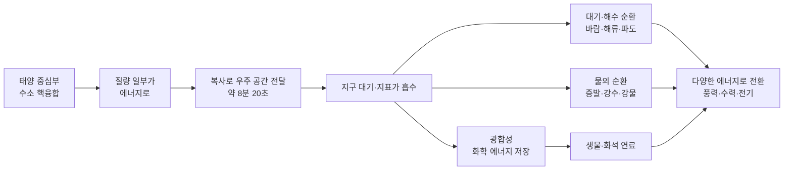
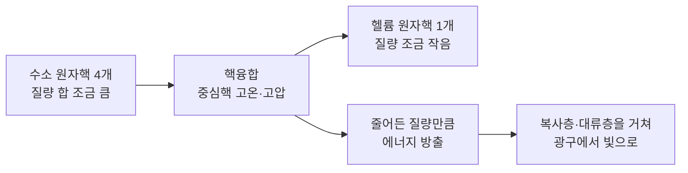
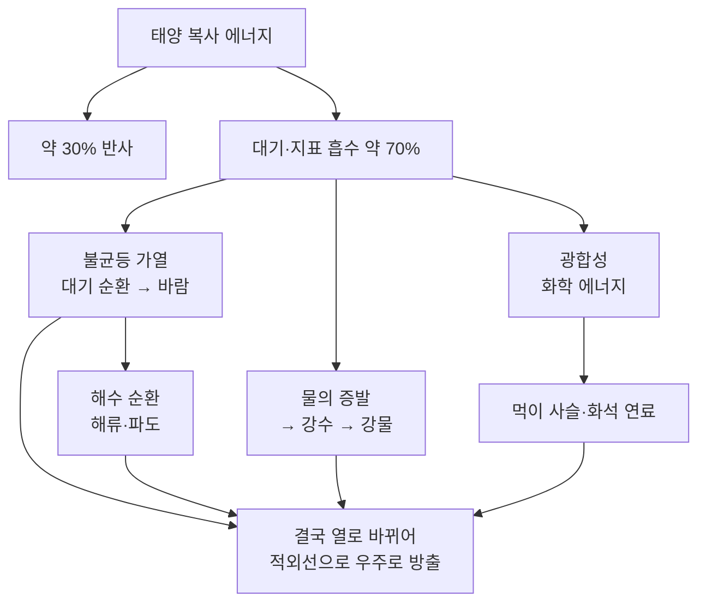

# 5-4. 태양 에너지와 에너지 전환 — 모든 에너지의 고향, 태양

> [!NOTE]
> **성취기준 [10통과2-02-04]** 태양에서 수소 핵융합 반응을 통해 질량 일부가 에너지로 바뀌고, 그중 일부가 지구에서 에너지 흐름을 일으키며 다양한 에너지로 전환되는 과정을 추론할 수 있다.

**학습 목표**

1. 태양 중심부에서 수소 원자핵이 헬륨 원자핵으로 핵융합하는 과정에서 질량이 줄어들고, 줄어든 질량이 에너지로 바뀐다는 것을 정성적으로 설명할 수 있다.
2. 태양 에너지가 지구에 도달하여 대기와 해수의 순환, 물의 순환, 광합성 같은 에너지 흐름을 일으키는 과정을 설명할 수 있다.
3. 바람, 흐르는 물, 생물, 화석 연료가 가진 에너지의 근원이 태양 에너지임을 에너지 전환 과정을 따라가며 추론할 수 있다.
4. 일상생활과 지구 시스템에서 일어나는 에너지 전환을 흐름도로 나타낼 수 있다.

**이 단원의 학습 사다리**

| 단계 | 무엇을 하나? |
|---|---|
| STEP 1. 중학교 다시 보기 | 태양 활동, 광합성, 대기 대순환, 역학적 에너지 보존을 다시 꺼내 본다 |
| STEP 2. 기초 다지기 | 에너지와 단위(J, W), 원자핵의 구성, 화학 반응과 핵반응의 차이를 디딤돌로 놓는다 |
| STEP 3. 핵심 개념 | 수소 핵융합 → 태양 에너지의 여행 → 지구의 에너지 흐름 → 다양한 에너지 전환 |
| STEP 4. 오개념 바로잡기 | "태양은 거대한 불덩이?", "모든 에너지는 태양에서 온다?" 같은 착각을 바로잡는다 |
| STEP 5. 선택과목·대학 | $E = mc^2$, 양성자–양성자 연쇄 반응, 역제곱 법칙으로 구하는 태양 상수 |
| STEP 6. 산업·진로 | 핵융합 연구(KSTAR·ITER), 우주 기상 예보, 인공 광합성, 기상·기후 예측 |

---

## 🗺️ 단원 들어가기

오늘 아침에 먹은 밥, 등굣길에 탄 버스의 연료, 창문을 흔드는 바람, 댐에 고인 물……. 겉보기에는 아무 관계도 없어 보이는 이것들의 에너지를 거꾸로 거슬러 올라가면 놀랍게도 **한 곳**에서 만난다. 바로 약 1억 5천만 km 떨어진 **태양**이다.

태양은 46억 년 가까이 쉬지 않고 빛나고 있다. 만약 태양이 석탄 덩어리였다면 수천 년 만에 다 타 버렸을 것이다. 그렇다면 태양은 무엇을 '연료'로 이렇게 오랫동안 빛날까? 그리고 그 빛은 지구에 와서 무슨 일을 할까? 이 단원에서는 **태양 중심부의 핵융합**에서 출발해 **지구 곳곳의 에너지 흐름**까지 에너지의 긴 여행을 따라가 본다.

---

## STEP 1. 🔙 중학교 다시 보기

### 연계 개념표

| 중학교 성취기준 | 중학교에서 배운 것 | 고등학교에서 확장되는 것 |
|---|---|---|
| [9과07-02] | 태양 표면(광구, 흑점, 쌀알 무늬)과 대기(채층, 코로나, 홍염, 플레어)의 현상, 태양 활동이 지구에 미치는 영향 | 태양이 빛나는 **근본 원인** = 중심부의 수소 핵융합 |
| [9과03-02] | 열은 전도, 대류, 복사로 전달된다 | 진공인 우주 공간을 건너오는 태양 에너지는 **복사**로만 전달된다 |
| [9과12-01], [9과12-02] | 광합성은 빛에너지를 이용해 물과 이산화 탄소로 포도당과 산소를 만든다. 호흡과 광합성의 에너지 출입 | 빛에너지 → **화학 에너지** 전환. 생물 에너지의 출발점 |
| [9과12-03] | 광합성 산물은 저장되었다가 생명 활동의 에너지원으로 쓰인다 | 오래전 저장된 산물이 묻혀 **화석 연료**가 된다 |
| [9과17-02], [9과18-03] | 대기 대순환과 위도별 바람, 해양 표층 순환, 해류의 에너지 재분배 | 위도별로 받는 태양 에너지 차이가 **대기·해수 순환**을 일으킨다 |
| [9과04-04] | 상태 변화 시 열에너지가 출입한다(기화 시 흡수, 액화 시 방출) | 증발에 쓰인 태양 에너지가 **물의 순환**과 강물의 위치 에너지가 된다 |
| [9과19-04] | 역학적 에너지의 전환과 보존 | 높은 곳의 물(위치 에너지) → 흐르는 물(운동 에너지) → 수력 발전 |

### 준비 운동 (사전 진단)

**Q1.** 태양의 표면에서 볼 수 있는 어둡게 보이는 점으로, 주변보다 온도가 낮은 곳을 무엇이라고 하는가?

**Q2.** 우주 공간은 거의 진공이다. 태양의 열이 지구까지 전달되는 방법은 전도, 대류, 복사 중 무엇인가?

**Q3.** 광합성에 필요한 물질 두 가지와 에너지 한 가지를 쓰시오.

**Q4.** 롤러코스터가 높은 곳에서 내려올 때 어떤 에너지가 어떤 에너지로 전환되는가?

정답 및 해설

**Q1. 흑점** — 주변 광구보다 온도가 낮아 상대적으로 어둡게 보인다. 흑점 수가 많을 때 태양 활동이 활발하다.

**Q2. 복사** — 전도와 대류는 물질(입자)이 있어야 일어난다. 복사는 물질 없이도 에너지가 전달된다.

**Q3.** 물질: 물, 이산화 탄소 / 에너지: 빛에너지

**Q4.** 위치 에너지 → 운동 에너지. 마찰과 공기 저항이 없다면 두 에너지의 합(역학적 에너지)은 일정하다.

---

## STEP 2. 🧱 기초 다지기

### ① 에너지와 그 단위

**에너지(energy)** 는 일을 할 수 있는 능력이다. 물체를 움직이거나, 온도를 높이거나, 빛을 내거나, 물질을 변화시키는 데에는 모두 에너지가 필요하다.

- 에너지의 단위: **J(줄)**. 1 J은 1 N의 힘으로 물체를 힘의 방향으로 1 m 움직일 때 하는 일이다.
- **일률(power)** 은 1초 동안 전달·전환되는 에너지이다. 단위는 **W(와트)**.

$$
\text{일률} = \frac{\text{에너지}}{\text{시간}}, \qquad 1\ \mathrm{W} = 1\ \mathrm{J/s}
$$

> [!TIP]
> 💡 **비유** — 에너지는 '물통에 든 물의 양', 일률은 '수도꼭지에서 1초 동안 나오는 물의 양'이다. 100 W 전등을 10초 켜면 $100 \times 10 = 1000\ \mathrm{J}$의 전기 에너지가 쓰인다.

### ② 원자와 원자핵 다시 보기

중학교에서 원자는 **원자핵**과 **전자**로, 원자핵은 **양성자**와 **중성자**로 이루어져 있다고 배웠다.

| 입자 | 구성 | 전하 |
|---|---|---|
| 수소 원자핵 | 양성자 1개 | (+) |
| 헬륨 원자핵 | 양성자 2개 + 중성자 2개 | (+) |

원자핵은 모두 (+)전하를 띠므로 서로 **밀어낸다.** 원자핵끼리 합쳐지려면 이 반발을 이겨 낼 만큼 아주 빠르게 부딪혀야 한다. 이것이 핵융합에 엄청난 온도가 필요한 이유이다. (통합과학1의 2-2 '별의 진화와 원소의 생성'에서 배운 내용이다.)

### ③ 화학 반응과 핵반응은 다르다

| 구분 | 화학 반응 (예: 석탄의 연소) | 핵반응 (예: 수소 핵융합) |
|---|---|---|
| 무엇이 변하나? | 원자의 **배열**(결합)만 바뀐다 | **원자핵 자체**가 바뀌어 다른 원소가 된다 |
| 원소의 종류 | 반응 전후 같다 | 수소 → 헬륨처럼 바뀐다 |
| 질량 | 보존된다(질량 보존 법칙) | 반응 후 질량이 **줄어든다** |
| 나오는 에너지 | 상대적으로 작다 | 같은 질량에서 비교할 수 없을 만큼 크다 |

중학교에서 배운 질량 보존 법칙은 화학 반응에서 성립한다. 핵반응에서는 반응 후 질량이 줄어들고, **줄어든 질량이 에너지로 바뀐다.** 이것이 이 단원의 출발점이다.

### ④ 에너지 전환과 에너지 보존

에너지는 한 형태에서 다른 형태로 바뀔 수 있다. 이를 **에너지 전환(energy conversion)** 이라고 한다. 중학교에서 역학적 에너지가 보존되는 것을 배웠듯이, 넓게 보면 **에너지가 전환되어도 에너지의 총량은 변하지 않는다(에너지 보존 법칙).** 이 법칙은 5-6에서 효율과 함께 더 자세히 다룬다.

### ⑤ 아주 큰 수 다루기

태양을 다룰 때는 숫자가 매우 커진다. $10^n$은 1 뒤에 0이 $n$개 붙은 수이다.

- 1억 = $10^8$, 1억 5천만 km = $1.5 \times 10^8\ \mathrm{km}$
- 1500만 = $1.5 \times 10^7$

---

## STEP 3. 📘 핵심 개념

### 5-4-① 태양 에너지의 근원 — 수소 핵융합

#### 태양의 구조

태양은 거대한 기체 덩어리이며, 안쪽부터 다음과 같이 나뉜다.

| 영역 | 특징 |
|---|---|
| 중심핵 | 온도 약 1,500만 K, 밀도와 압력이 매우 높다. **핵융합이 일어나는 곳** |
| 복사층 | 중심핵에서 만든 에너지가 복사의 형태로 천천히 바깥으로 전달된다 |
| 대류층 | 뜨거운 기체가 오르내리며(대류) 에너지를 표면으로 나른다 |
| 광구 | 우리 눈에 보이는 태양의 표면. 온도 약 5,800 K. 쌀알 무늬는 대류의 흔적이다 |

#### 수소가 헬륨으로 — 핵융합

태양 중심핵처럼 온도가 매우 높으면 원자는 전자를 잃고 원자핵과 전자가 따로 떠다니는 **플라스마(plasma)** 상태가 된다. 이때 수소 원자핵(양성자)들은 엄청난 속력으로 움직이므로 서로 밀어내는 힘을 이겨 내고 충돌하여 합쳐진다. 이처럼 가벼운 원자핵이 합쳐져 더 무거운 원자핵이 되는 반응을 **핵융합(nuclear fusion)** 이라고 한다.

태양 중심부에서는 여러 단계를 거쳐 결과적으로 다음과 같은 일이 일어난다.

$$
\text{수소 원자핵 4개} \;\longrightarrow\; \text{헬륨 원자핵 1개} + \text{에너지}
$$

#### 질량이 줄어서 에너지가 된다

핵융합 전후의 질량을 정밀하게 비교하면, **헬륨 원자핵 1개의 질량은 수소 원자핵 4개의 질량을 합한 것보다 조금 작다.** 반응하는 동안 사라진 이 질량이 에너지로 바뀌어 빛과 열로 방출된다.

> [!TIP]
> 💡 **비유** — 질량을 '꽁꽁 얼려 둔 에너지'라고 생각해 보자. 수소 원자핵 4개가 헬륨 원자핵 1개로 합쳐지면, 얼려 둔 에너지의 아주 작은 일부가 녹아 밖으로 흘러나온다. 녹아 나온 양은 질량으로 보면 아주 작지만, 에너지로 바꾸면 어마어마하게 크다.

> [!IMPORTANT]
> 통합과학에서는 **"질량이 줄어서 그만큼 에너지가 생긴다"는 사실을 정성적으로만** 이해하면 된다. 줄어든 질량으로 에너지의 양을 계산하는 식($E = mc^2$)은 STEP 5에서 맛보기로 다룬다.

#### 태양은 '타는' 것이 아니다

| 구분 | 석탄의 연소 | 태양의 핵융합 |
|---|---|---|
| 반응 종류 | 화학 반응(산소와 결합) | 핵반응(원자핵이 합쳐짐) |
| 산소가 필요한가? | 필요하다 | 필요 없다 |
| 반응 후 생기는 것 | 이산화 탄소, 물 등 | 헬륨 |
| 같은 질량의 연료가 내는 에너지 | 작다 | 연소와 비교할 수 없을 만큼 크다 |
| 태양 정도의 연료로 버틸 수 있는 시간 | 수천 년 정도 | 약 100억 년(현재 약 46억 년 지남) |

태양은 지금 나이가 약 46억 년이며, 중심핵의 수소를 앞으로 약 50억 년 동안 더 태울 수 있을 것으로 추정된다. 연소로는 이렇게 긴 시간을 설명할 수 없다. 이것이 태양의 에너지원이 핵융합이라는 중요한 근거 중 하나이다.

#### 예제 1

다음 중 태양 중심부의 핵융합에 대한 설명으로 옳은 것을 모두 고르시오.
ㄱ. 수소 원자핵이 합쳐져 헬륨 원자핵이 된다.
ㄴ. 반응 후 입자들의 질량 합은 반응 전보다 크다.
ㄷ. 산소가 공급되어야 반응이 계속 일어난다.
ㄹ. 온도와 압력이 매우 높은 중심핵에서 일어난다.

**풀이**
- ㄱ. 옳다. 수소 원자핵 4개가 헬륨 원자핵 1개가 된다.
- ㄴ. 틀렸다. 반응 후 질량이 **줄어들고**, 줄어든 질량이 에너지가 된다.
- ㄷ. 틀렸다. 핵융합은 연소가 아니므로 산소가 필요 없다.
- ㄹ. 옳다. 원자핵끼리의 반발을 이기려면 매우 높은 온도와 압력이 필요하다.

**정답 ㄱ, ㄹ**

### 5-4-② 태양 에너지가 지구에 도착하기까지

#### 복사로 우주를 건너온다

광구에서 나온 에너지는 빛(가시광선)뿐만 아니라 적외선, 자외선 등 여러 종류의 **전자기파**에 실려 사방으로 퍼져 나간다. 우주 공간은 거의 진공이라 전도나 대류가 일어날 수 없으므로, 태양 에너지는 **복사(radiation)** 로만 지구에 도착한다.

- 태양–지구 평균 거리: 약 1억 5천만 km
- 빛이 태양에서 지구까지 오는 데 걸리는 시간: 약 8분 20초
- 우리가 보는 태양은 '약 8분 20초 전의 태양'이다.

#### 지구는 아주 작은 일부만 받는다

태양 에너지는 모든 방향으로 퍼져 나가므로 지구가 받는 것은 그중 **아주 작은 일부(약 20억분의 1 정도)** 이다. 그래도 그 양은 인류가 쓰는 에너지와 비교할 수 없을 만큼 많다.

지구 대기의 맨 위에서 태양 빛에 **수직인 면 1 m²** 가 1초 동안 받는 태양 복사 에너지는 약 1,360 J이다. 이 값을 **태양 상수(solar constant)** 라고 한다.

$$
\text{태양 상수} \approx 1360\ \mathrm{W/m^2} \quad (1\ \mathrm{m^2}\text{당 1초에 약 } 1360\ \mathrm{J})
$$

#### 지구에 도착한 에너지는 어디로 갈까?

| 경로 | 대략적 비율 | 결과 |
|---|---|---|
| 구름, 대기, 지표(눈·얼음 등)에서 반사되어 우주로 | 약 30% | 지구를 데우지 않고 되돌아간다 |
| 대기가 흡수 | 약 23% | 대기를 데운다 |
| 지표(땅과 바다)가 흡수 | 약 47% | 땅과 바다를 데우고, 물을 증발시킨다 |

(5-3의 지구 열수지에서 들어오는 태양 복사를 100으로 두었을 때의 반사 30, 대기 흡수 23, 지표 흡수 47과 같은 값이다.)

흡수된 약 70%(23 + 47)의 에너지는 지구에서 여러 가지 일(바람, 해류, 물의 순환, 광합성)을 한 뒤 결국 열이 되어 **적외선으로 우주에 다시 방출**된다. 들어오는 에너지와 나가는 에너지가 같아 평균 기온이 일정하게 유지되는 상태가 5-3에서 배운 **복사 평형**이다.

#### 예제 2

대기 상단에서 태양 빛에 수직으로 놓인 넓이 $2\ \mathrm{m^2}$의 판이 1분 동안 받는 태양 복사 에너지는 약 몇 J인가? (태양 상수는 $1360\ \mathrm{W/m^2}$로 한다.)

**풀이**
1초 동안 받는 에너지: $1360 \times 2 = 2720\ \mathrm{J}$
1분(60초) 동안: $2720 \times 60 = 163\,200\ \mathrm{J}$

**정답** 약 $163\,200\ \mathrm{J}$ (약 16만 J)

> [!WARNING]
> 태양 상수는 '대기 상단, 태양 빛에 수직인 면'의 값이다. 지표면에서는 대기가 일부를 반사·흡수하고, 태양 빛이 비스듬히 비치기도 하며, 밤과 구름도 있으므로 **실제로 지표 1 m²가 받는 평균 에너지는 이보다 훨씬 작다.**

### 5-4-③ 태양이 움직이는 지구 — 지구의 에너지 흐름

지구에 흡수된 태양 에너지는 그냥 머물지 않고 대기와 바다, 물, 생물을 움직이며 **에너지 흐름(energy flow)** 을 만든다.

#### (1) 대기와 해수의 순환 — 바람과 해류

지구는 둥글기 때문에 **저위도(적도 부근)는 태양 빛을 거의 수직으로 받고, 고위도(극 부근)는 비스듬히 받는다.** 같은 양의 빛이라도 비스듬히 비치면 더 넓은 면적에 퍼지므로 단위 면적당 받는 에너지가 줄어든다.

- 저위도: 흡수하는 에너지 > 방출하는 에너지 → **에너지 남음**
- 고위도: 흡수하는 에너지 < 방출하는 에너지 → **에너지 부족**

그런데도 적도는 계속 뜨거워지지 않고, 극은 계속 차가워지지 않는다. **대기 대순환과 해류가 남는 에너지를 저위도에서 고위도로 운반**하기 때문이다.

- 지표가 고르지 않게 가열 → 기압 차이 → **바람**(공기의 운동 에너지)
- 바람이 바다 표면을 밀어 → **표층 해류**와 **파도**(물의 운동 에너지)

> [!TIP]
> 💡 **비유** — 지구는 한쪽(적도)만 계속 데우는 커다란 냄비와 같다. 냄비 속 물이 대류로 빙글빙글 돌며 열을 고르게 나누듯, 대기와 바다는 끊임없이 움직이며 적도의 열을 극 쪽으로 나른다. 그 '움직임'이 바로 바람과 해류이다.

#### (2) 물의 순환 — 강물의 위치 에너지

1. 바다와 땅의 물이 태양 에너지를 흡수해 **증발**한다(열에너지를 흡수, [9과04-04]).
2. 수증기가 상승하여 높은 곳에서 **응결**해 구름이 된다(열에너지를 방출하여 대기를 데움).
3. 비나 눈이 되어 산과 같은 **높은 곳**에 내린다 → 물이 **위치 에너지**를 갖게 된다.
4. 물이 강을 따라 흐르며 위치 에너지가 **운동 에너지**로 전환된다 → 침식·운반, 수력 발전.

즉, 댐에 고인 물의 위치 에너지는 원래 **물을 증발시켜 높이 들어 올린 태양 에너지**이다.

#### (3) 광합성 — 화학 에너지로 저장

식물, 조류 등 광합성 생물은 빛에너지를 흡수하여 물과 이산화 탄소로 포도당을 만든다.

$$
\text{이산화 탄소} + \text{물} \xrightarrow{\text{빛에너지}} \text{포도당} + \text{산소}
$$

- 빛에너지가 포도당 속 **화학 에너지**로 전환·저장된다.
- 생물은 **세포 호흡**으로 이 화학 에너지를 꺼내 생명 활동에 쓴다.
- 이 에너지는 **먹이 사슬**을 따라 초식 동물, 육식 동물로 전달된다(5-1, 5-2와 연결).

#### (4) 화석 연료 — 수억 년 동안 저금한 태양 에너지

오래전 지질 시대에 살았던 생물(주로 육상 식물은 석탄, 바다의 플랑크톤 등은 석유와 천연가스)의 유해가 땅속에 묻혀 높은 열과 압력을 오랫동안 받으면 **화석 연료**가 된다.

- 화석 연료 속 화학 에너지 = **과거 광합성으로 저장된 태양 에너지**
- 만들어지는 데 수백만 년 이상 걸리므로 인간의 시간 기준으로는 **다시 만들 수 없는(재생 불가능한) 자원**이다.
- 태우면 오랫동안 땅속에 갇혀 있던 탄소가 이산화 탄소로 대기에 나온다 → 5-3의 지구온난화와 연결된다.

#### 지구 시스템의 에너지 흐름 정리

| 현상 | 태양 에너지가 바뀐 형태 | 관련 지구 시스템 | 우리가 이용하는 방법 |
|---|---|---|---|
| 바람 | 공기의 운동 에너지 | 기권 | 풍력 발전 |
| 해류·파도 | 물의 운동 에너지 | 수권 | 파력·해류 발전 |
| 강물·호수의 물 | 위치 에너지 → 운동 에너지 | 수권 | 수력 발전 |
| 생물 | 화학 에너지 | 생물권 | 식량, 바이오 에너지 |
| 석탄·석유·천연가스 | 화학 에너지 | 지권 | 화력 발전, 자동차 연료 |
| 햇빛 그 자체 | 빛·열에너지 | — | 태양광 발전, 태양열 이용 |

### 5-4-④ 다양한 에너지와 에너지 전환

#### 에너지의 여러 형태

| 에너지 형태 | 뜻 | 예 |
|---|---|---|
| 운동 에너지 | 움직이는 물체가 가진 에너지 | 바람, 흐르는 물, 달리는 자동차 |
| 위치 에너지 | 높은 곳에 있는 물체가 가진 에너지 | 댐에 고인 물 |
| 열에너지 | 물질을 이루는 입자의 운동과 관련된 에너지 | 데워진 땅과 바다 |
| 빛에너지 | 빛(전자기파)이 전달하는 에너지 | 햇빛, 전등 빛 |
| 화학 에너지 | 물질 속에 저장된 에너지 | 포도당, 석유, 전지 |
| 전기 에너지 | 전류가 흐를 때 전달되는 에너지 | 가전제품을 작동시키는 에너지 |
| 핵에너지 | 원자핵이 변할 때 나오는 에너지 | 태양의 핵융합, 원자력 발전의 핵분열 |
| 소리 에너지 | 물체의 진동이 전달하는 에너지 | 천둥, 스피커 소리 |

#### 태양에서 오지 않은 에너지도 있다

지구에서 쓰는 에너지의 대부분은 태양에서 왔지만, 모두가 그런 것은 아니다.

| 에너지 | 근원 | 태양 기원인가? |
|---|---|---|
| 풍력, 수력, 파력, 바이오, 화석 연료, 태양광·태양열 | 태양 복사 에너지 | 예 |
| 조력(밀물·썰물) | 주로 달(과 태양)의 **인력**과 지구의 자전 | 아니요 |
| 지열 | 지구 내부의 열(방사성 원소의 붕괴 등) | 아니요 |
| 원자력(핵분열) | 우라늄 원자핵 속에 저장된 핵에너지 | 아니요 |

> [!NOTE]
> 조력의 근원에 '태양'이 일부 포함되는 것은 태양의 **중력** 때문이지, 태양의 **복사 에너지** 때문이 아니다. 둘을 구분하자.

#### 예제 3 — 강물이 가진 에너지

높이 100 m에 있는 댐에서 물 1000 kg(1톤)이 떨어질 때, 이 물이 가진 위치 에너지는 몇 J인가? 이 에너지의 근원을 거슬러 올라가 설명하시오.

**풀이** 중학교에서 배운 위치 에너지 식을 쓴다.

$$
E_p = 9.8 \times m \times h = 9.8 \times 1000 \times 100 = 980\,000\ \mathrm{J}
$$

약 98만 J이다. 이 물은 원래 바다나 땅에서 **태양 에너지를 흡수해 증발**한 뒤 높은 곳에서 비로 내린 것이다. 따라서 물의 위치 에너지는 **태양 에너지가 전환된 것**이다.

#### 예제 4 — 에너지의 여행 추적하기

학생이 밥을 먹고 자전거 발전기를 돌려 전구를 켰다. 이 과정에서 일어나는 에너지 전환을 태양부터 순서대로 쓰시오.

**풀이**

핵에너지 → 빛에너지 → 화학 에너지 → 운동 에너지 → 전기 에너지 → 빛에너지·열에너지. 각 단계에서 일부 에너지는 열로 흩어지지만, **에너지의 총량은 보존**된다.

> [!IMPORTANT]
> 에너지 전환이 일어날 때마다 일부가 **열**로 흩어진다. 흩어진 열은 다시 모아 쓰기 어렵기 때문에 '쓸모 있는 에너지'는 점점 줄어든다. 에너지 총량은 그대로인데 왜 에너지를 아껴야 하는지, 그 답은 5-6 '에너지 효율'에서 찾을 수 있다.

---

## STEP 4. ⚠️ 오개념 바로잡기

| 흔한 오개념 | 올바른 개념 | 왜 그럴까? |
|---|---|---|
| 태양은 거대한 불덩이라서 타면서 빛난다 | 태양은 **수소 핵융합**으로 에너지를 만든다. 연소가 아니다 | 연소는 산소가 필요한 화학 반응이고, 태양 정도 질량의 연료라도 연소로는 수천 년밖에 버티지 못한다 |
| 핵융합에서도 질량은 보존된다 | 핵융합 후 질량이 **줄어들고**, 그만큼 에너지가 생긴다 | 질량 보존 법칙은 원자핵이 변하지 않는 **화학 반응**에서 성립한다 |
| 지구의 모든 에너지는 태양에서 온다 | **지열, 조력, 원자력**은 태양 복사 에너지에서 온 것이 아니다 | 지구 내부의 열, 달의 인력, 우라늄의 핵에너지가 근원이다 |
| 석탄·석유는 태양과 관계없는 땅속 자원이다 | 화석 연료는 **과거 생물이 광합성으로 저장한 태양 에너지**이다 | 화석 연료는 오래전 생물의 유해에서 만들어졌다 |
| 바람은 지구가 자전하기 때문에 분다 | 바람의 근본 원인은 **태양 에너지에 의한 불균등 가열**이다 | 자전은 바람의 방향에 영향을 줄 뿐, 공기를 움직이는 에너지를 주지는 않는다 |
| 에너지가 전환되면 일부가 사라진다 | 에너지는 사라지지 않고 **총량이 보존**된다. 다만 일부가 쓰기 어려운 열로 바뀐다 | 전환 과정에서 마찰 등으로 열이 발생해 주변으로 흩어진다 |

---

## STEP 5. 🎓 선택과목·대학으로 한 걸음 더

> [!CAUTION]
> 이 절은 **통합과학 교육과정 범위 밖의 심화 내용**으로 평가 대상이 아니다. "이 개념이 앞으로 어디까지 이어지는가"를 맛보기로 보여 주기 위한 내용이다.

### 고2·3 선택과목과의 연결

| 과목 | 이어지는 내용 |
|---|---|
| 전자기와 양자 | 별에서 핵융합에 의해 에너지가 생성되고 빛이 방출되는 원리 [12전자03-05] |
| 물리학 | 역학적 에너지 보존, 역학적 에너지가 열로 전환될 때의 에너지 총량 보존 [12물리01-04], [12물리01-05] |
| 지구과학 | 대기와 해양의 상호작용, 해수의 순환과 기후 |
| 세포와 물질대사 | 광합성과 세포호흡, ATP의 에너지 전달 [12세포02-02] |
| 행성우주과학 | 태양의 광구와 대기에서 나타나는 현상과 관측 [12행우02-01] |

### ① 질량–에너지 등가: $E = mc^2$

아인슈타인의 특수 상대성 이론에 따르면 질량은 에너지의 한 형태이며, 줄어든 질량 $\Delta m$과 나오는 에너지 $E$ 사이에는 다음 관계가 있다.

$$
E = \Delta m\, c^2 \qquad (c \approx 3 \times 10^8\ \mathrm{m/s}: \text{빛의 속력})
$$

$c^2$은 $9 \times 10^{16}$으로 엄청나게 큰 수이므로, 아주 작은 질량도 막대한 에너지가 된다.

- 수소 원자핵 4개가 헬륨 원자핵 1개가 될 때 줄어드는 질량은 처음 질량의 **약 0.7%** 이다.
- 수소 1 kg이 모두 헬륨으로 바뀌면 약 0.007 kg이 줄어든다.

$$
E = 0.007 \times (3\times10^8)^2 = 6.3 \times 10^{14}\ \mathrm{J}
$$

석탄 1 kg을 태울 때 나오는 에너지를 약 $3 \times 10^7\ \mathrm{J}$이라고 가정하면, 수소 1 kg의 핵융합 에너지는 그 **약 2000만 배**에 이른다.

태양 전체가 1초 동안 내보내는 에너지(광도)는 약 $3.8 \times 10^{26}\ \mathrm{J}$이다. 이를 $c^2$으로 나누면 태양은 **1초마다 약 $4 \times 10^9\ \mathrm{kg}$, 즉 약 400만 톤의 질량**을 에너지로 바꾸고 있다. 그래도 태양의 질량(약 $2 \times 10^{30}\ \mathrm{kg}$)에 비하면 아주 작은 양이다.

### ② 양성자–양성자 연쇄 반응

대학 천체물리학에서는 태양의 핵융합을 단계별로 다룬다. 태양 같은 별에서는 주로 **양성자–양성자 연쇄 반응(p–p chain)** 이 일어난다.

1. 양성자 2개 → 중수소 원자핵 + 양전자 + 중성미자
2. 중수소 원자핵 + 양성자 → 헬륨-3 원자핵 + 감마선
3. 헬륨-3 원자핵 2개 → 헬륨-4 원자핵 + 양성자 2개

태양보다 무거운 별의 중심에서는 탄소·질소·산소를 '촉매'처럼 쓰는 **CNO 순환**이 더 중요해진다. 2-2에서 배운 '별의 진화와 원소의 생성'이 여기서 다시 이어진다. 1단계에서 나오는 **중성미자**는 물질과 거의 반응하지 않아 태양 중심부에서 곧바로 지구까지 날아온다. 과학자들은 거대한 지하 검출기로 이 중성미자를 관측해 태양 중심부에서 실제로 핵융합이 일어난다는 증거를 얻었다.

### ③ 역제곱 법칙으로 태양 상수 구하기

태양이 1초에 내보내는 에너지 $L$은 반지름 $d$인 거대한 구 껍질 전체에 고르게 퍼진다. 구의 겉넓이는 $4\pi d^2$이므로

$$
S = \frac{L}{4\pi d^2} = \frac{3.8\times10^{26}}{4\pi \times (1.5\times10^{11})^2} \approx 1.3 \times 10^3\ \mathrm{W/m^2}
$$

STEP 3의 태양 상수(약 1360 W/m²)와 거의 같다. 거리가 2배가 되면 받는 에너지는 $\frac{1}{4}$이 된다(**역제곱 법칙**). 화성이 지구보다 훨씬 춥고, 목성 탐사선이 태양 전지판을 매우 크게 만들어야 하는 이유이다.

### 고등학교 vs 대학교

| 구분 | 고등학교 통합과학 | 대학교 물리학·천문학·지구과학 |
|---|---|---|
| 핵융합 | 수소 → 헬륨, 질량이 줄어 에너지 생성(정성적) | $E = mc^2$, 반응 단계별 에너지 계산, 플라스마 물리 |
| 태양 에너지 전달 | 복사로 전달, 태양 상수 약 1360 W/m² | 흑체 복사, 역제곱 법칙, 복사 전달 방정식 |
| 지구의 에너지 흐름 | 대기·해수 순환, 물의 순환, 광합성을 정성적으로 | 지구 에너지 수지의 정량 모델, 기후 모델, 광합성 효율 |
| 관련 전공 | — | 물리학, 천문학, 대기과학, 해양학, 원자핵공학, 생명과학 |

---

## STEP 6. 🏭 산업 현장과 진로 연결

### 사례 1. 핵융합 에너지 연구 — 지구 위의 '인공 태양'

- **원리** 태양처럼 가벼운 원자핵을 융합시켜 에너지를 얻는다. 다만 지구의 장치는 태양처럼 거대한 중력으로 연료를 눌러 모을 수 없어 밀도가 훨씬 낮다. 그래서 반응을 충분히 일으키려면 **태양 중심(약 1,500만 K)보다 훨씬 높은 1억 ℃ 이상**의 플라스마가 필요하다. 연료도 일반 수소보다 융합이 쉬운 **중수소와 삼중수소**를 쓴다.
- **토카막(tokamak)** 이렇게 뜨거운 플라스마는 어떤 그릇에도 담을 수 없으므로, 도넛 모양의 진공 용기 안에서 강한 **자기장**으로 플라스마를 공중에 띄워 가둔다.
- **KSTAR** 우리나라 한국핵융합에너지연구원(대전)이 운영하는 초전도 토카막 장치이다. 2008년 처음 플라스마를 만들었고, 2021년에는 이온 온도 1억 ℃의 플라스마를 30초 동안 유지하는 데 성공하는 등 '초고온 플라스마를 오래 유지하는 기술'을 연구하고 있다.
- **ITER(국제핵융합실험로)** 우리나라를 포함한 7개 회원(유럽연합, 미국, 일본, 중국, 러시아, 인도, 한국)이 프랑스 남부에 함께 건설 중인 실험로이다. 넣어 준 가열 에너지(50 MW)의 10배인 500 MW의 핵융합 출력을 내는 것을 목표로 한다. 우리나라도 진공 용기 일부 등 핵심 부품 제작에 참여하고 있다.
- **현실적 과제** 초고온 플라스마를 오래 안정하게 유지하기, 고속 중성자에 견디는 벽 재료 개발, 삼중수소 생산 등 해결할 과제가 많아 상업 발전까지는 상당한 시간이 걸릴 것으로 보인다.

### 사례 2. 우주 기상 예보 — 태양 활동 감시

- **원리** 태양 표면의 폭발(플레어)과 코로나 물질 방출이 일어나면, 강한 전자기파와 고에너지 입자가 지구로 날아와 **인공위성 고장, 단파 통신 장애, GPS 오차, 전력망 이상**을 일으킬 수 있다([9과07-02]의 '태양 활동이 지구에 미치는 영향').
- **현장** 우리나라에서는 국립전파연구원 우주전파센터가 태양 활동을 관측해 우주 기상 특보를 낸다. 항공사, 위성 운영 기관, 전력 회사가 이 정보를 활용한다.

### 사례 3. 인공 광합성과 바이오 에너지

- **원리** 식물이 하는 광합성(빛에너지 → 화학 에너지)을 흉내 내어, 햇빛과 물, 이산화 탄소로 수소나 액체 연료 같은 **화학 연료를 직접 만드는 기술**을 연구한다. 대기의 이산화 탄소를 원료로 쓰므로 탄소중립 기술로도 주목받는다.
- **바이오 에너지** 옥수수·사탕수수로 만든 바이오에탄올, 식물성 기름으로 만든 바이오디젤, 음식물 쓰레기에서 얻는 바이오가스는 모두 **최근의 광합성으로 저장된 태양 에너지**를 쓰는 것이다(5-6에서 자세히).

### 사례 4. 기상·기후 예측 — 태양 에너지 흐름의 계산

- **원리** 날씨와 기후는 '태양 에너지가 지구에서 어떻게 흐르는가'의 결과이다. 기상청은 대기에 들어오고 나가는 에너지, 공기와 물의 움직임을 슈퍼컴퓨터로 계산하는 **수치 예보 모델**로 날씨를 예측한다.
- **활용** 태양광 발전소는 일사량 예보로, 풍력 발전소는 바람 예보로 내일의 발전량을 예측하여 전력망 운영에 활용한다.

### 관련 진로와 학과

| 진로 | 하는 일 | 관련 학과 |
|---|---|---|
| 핵융합 연구원 | 플라스마 가열·제어, 초전도 자석, 내열 재료 연구 | 원자핵공학, 물리학, 전기공학, 재료공학 |
| 태양·우주 기상 연구원 | 태양 활동 관측, 우주 기상 예보 | 천문우주학, 대기과학, 물리학 |
| 기상·기후 예보관 | 수치 예보 모델 운영, 기후 변화 분석 | 대기과학, 해양학, 지구환경과학 |
| 바이오 에너지·인공 광합성 연구원 | 광촉매·바이오 연료 개발 | 화학공학, 생명공학, 신소재공학 |

---

## 🔬 탐구 활동 — 태양 에너지의 흐름과 전환 추적하기

### 활동 A. 간이 태양열 집열기로 태양 에너지 어림하기

**목표** 햇빛이 물에 전달하는 열에너지를 측정하여 태양 에너지가 열에너지로 전환됨을 확인하고, 지표 1 m²가 1초 동안 받는 에너지를 어림한다.

**준비물** 같은 크기의 알루미늄 캔 2개(하나는 검은색, 하나는 흰색으로 칠함), 물, 온도계(또는 디지털 온도 센서), 전자저울, 투명 랩, 자, 초시계

**과정**
1. 두 캔에 같은 질량(예: 0.3 kg)의 물을 넣고 입구를 투명 랩으로 덮는다.
2. 맑은 날 햇빛이 잘 드는 곳에 두 캔을 나란히 놓고 처음 수온을 잰다.
3. 20분 동안 5분마다 수온을 기록한다.
4. 캔이 햇빛을 받는 면적(햇빛 방향에서 본 캔의 단면적: 지름 × 높이)을 잰다.
5. 물이 얻은 열에너지를 다음 식으로 구한다(물의 비열 약 $4200\ \mathrm{J/(kg\cdot ℃)}$).

$$
\text{열에너지} = \text{비열} \times \text{질량} \times \text{온도 변화}
$$

**결과 기록**

| 시간(분) | 0 | 5 | 10 | 15 | 20 |
|---|---|---|---|---|---|
| 검은 캔 수온(℃) | | | | | |
| 흰 캔 수온(℃) | | | | | |

**예시 자료로 계산해 보기** 검은 캔(물 0.3 kg)의 수온이 20분 동안 8 ℃ 올랐고, 햇빛을 받는 면적이 $0.02\ \mathrm{m^2}$였다고 가정하자.
- 물이 얻은 열에너지: $4200 \times 0.3 \times 8 = 10\,080\ \mathrm{J}$
- 1 m²가 1초에 받은 에너지: $\dfrac{10\,080}{0.02 \times 1200} = 420\ \mathrm{W/m^2}$

**생각해 보기**
1. 검은 캔과 흰 캔의 결과가 다른 까닭을 '흡수'와 '반사'로 설명해 보자. 지구에서 눈과 얼음이 많은 지역은 어느 캔과 비슷할까?
2. 측정값이 태양 상수(약 1360 W/m²)보다 훨씬 작은 까닭을 세 가지 이상 써 보자. (힌트: 대기, 햇빛의 각도, 캔에서 빠져나간 열)
3. 이 실험에서 일어난 에너지 전환을 태양 중심부부터 흐름도로 나타내 보자.

> [!WARNING]
> **안전 수칙** 어떤 경우에도 태양을 맨눈이나 쌍안경·망원경으로 직접 보지 않는다. 오랜 시간 햇빛 아래에서 활동할 때는 모자를 쓰고 물을 충분히 마신다. 햇빛을 받은 캔은 뜨거울 수 있으니 장갑을 낀다.

### 활동 B. 모둠별 '에너지 족보' 그리기

1. 모둠마다 일상의 장면 카드를 하나씩 뽑는다(예: 전기 주전자로 라면 끓이기, 버스 타기, 풍력 발전기 아래에서 연 날리기, 갯벌의 조력 발전소, 온천욕).
2. 그 장면에서 쓰이는 에너지가 **어디에서 왔는지** 근원까지 거슬러 올라가 흐름도를 그린다.
3. 각 화살표 위에 '어떤 에너지 → 어떤 에너지'인지 쓰고, 열로 흩어지는 부분은 다른 색으로 표시한다.
4. 근원이 태양이 **아닌** 장면을 찾은 모둠은 그 근원(달의 인력, 지구 내부의 열, 핵에너지)을 발표한다.

---

## ✅ 개념 확인 문제

### 기본

**1.** 태양이 에너지를 만드는 방법으로 옳은 것은?
① 수소가 산소와 결합하여 탄다.
② 무거운 원자핵이 쪼개진다.
③ 수소 원자핵이 융합하여 헬륨 원자핵이 된다.
④ 태양 내부의 방사성 원소가 붕괴한다.

정답 및 해설

**정답 ③**

태양 중심부에서는 수소 원자핵 4개가 핵융합하여 헬륨 원자핵 1개가 되며, 이때 줄어든 질량이 에너지로 바뀐다. ①은 연소(화학 반응), ②는 핵분열(원자력 발전)이다.

**2.** 다음 중 에너지의 근원이 **태양 복사 에너지가 아닌** 것을 모두 고르시오.
ㄱ. 풍력 ㄴ. 조력 ㄷ. 지열 ㄹ. 석유 ㅁ. 원자력 ㅂ. 수력

정답 및 해설

**정답 ㄴ, ㄷ, ㅁ**

조력은 달과 태양의 인력, 지열은 지구 내부의 열, 원자력은 우라늄의 핵에너지가 근원이다. 풍력·수력은 태양 에너지가 일으킨 대기 순환과 물의 순환, 석유는 과거 광합성으로 저장된 태양 에너지에서 온다.

**3.** 빈칸에 알맞은 에너지의 형태를 쓰시오.
"바다의 물이 태양 에너지를 흡수하여 증발하고, 높은 산에 비로 내리면 물은 ( ㄱ ) 에너지를 갖게 된다. 이 물이 강을 따라 흐르면 ( ㄱ ) 에너지가 ( ㄴ ) 에너지로 전환된다."

정답 및 해설

**정답** ㄱ: 위치, ㄴ: 운동

증발에 쓰인 태양 에너지가 결국 높은 곳에 있는 물의 위치 에너지가 되고, 흐르면서 운동 에너지로 바뀐다. 수력 발전은 이 에너지를 이용한다.

**4.** 대기 상단에서 태양 빛에 수직으로 놓인 넓이 $0.5\ \mathrm{m^2}$의 판이 10초 동안 받는 태양 복사 에너지는 몇 J인가? (태양 상수는 $1360\ \mathrm{W/m^2}$로 한다.)

정답 및 해설

**정답** $6800\ \mathrm{J}$

$1360 \times 0.5 \times 10 = 6800\ \mathrm{J}$

### 응용

**5.** 태양 중심부의 핵융합에 대한 설명으로 옳은 것만을 있는 대로 고르시오.
ㄱ. 반응 전 수소 원자핵 4개의 질량 합은 반응 후 헬륨 원자핵 1개의 질량보다 크다.
ㄴ. 원자핵들이 서로 밀어내는 힘을 이기려면 매우 높은 온도가 필요하다.
ㄷ. 화학 반응과 같이 반응 전후의 질량이 보존된다.

정답 및 해설

**정답 ㄱ, ㄴ**

ㄱ. 핵융합 후 질량이 줄어들고, 줄어든 질량이 에너지가 된다.
ㄴ. 원자핵은 모두 (+)전하를 띠어 서로 밀어내므로, 매우 빠르게 충돌해야(고온) 융합할 수 있다.
ㄷ. 질량 보존 법칙은 원자핵이 변하지 않는 화학 반응에서 성립한다. 핵융합에서는 질량이 줄어든다.

**6.** 산 위의 저수지에 있는 물 500 kg이 40 m 아래의 발전기까지 내려온다.
(1) 이 물이 처음 가진 위치 에너지는 몇 J인가?
(2) 이 에너지가 근원적으로 어디에서 왔는지 물의 순환 과정을 이용하여 설명하시오.

정답 및 해설

**정답** (1) $196\,000\ \mathrm{J}$ (2) 해설 참고

(1) $E_p = 9.8 \times 500 \times 40 = 196\,000\ \mathrm{J}$

(2) 바다·땅의 물이 태양 에너지를 흡수하여 증발 → 수증기가 상승·응결하여 구름 → 비가 되어 산 위에 내림. 즉 태양 에너지가 물을 높은 곳으로 '들어 올린' 셈이므로, 이 위치 에너지의 근원은 태양 에너지이다.

**7.** 적도 지방은 극지방보다 1년 동안 훨씬 많은 태양 에너지를 흡수하지만, 적도의 기온이 해마다 계속 올라가지는 않는다. 그 까닭을 지구의 에너지 흐름으로 설명하시오.

정답 및 해설

**예시 답안**
저위도는 흡수하는 에너지가 방출하는 에너지보다 많아 에너지가 남고, 고위도는 부족하다. 이 차이로 대기가 고르지 않게 가열되어 **대기 대순환(바람)** 이 일어나고, 바람이 **해류**를 일으킨다. 대기와 해수의 순환이 남는 에너지를 저위도에서 고위도로 운반하므로 적도의 기온이 계속 오르지 않는다.

**채점 포인트** ① 위도별 에너지 과잉·부족 ② 대기와 해수의 순환 ③ 저위도 → 고위도 에너지 운반

### 융합·서술형

**8. [산업 연계]** 핵융합 연구 장치 KSTAR는 1억 ℃가 넘는 플라스마를 만든다. 태양 중심부의 온도(약 1,500만 K)보다 훨씬 높은 온도가 필요한 까닭과, 이렇게 뜨거운 플라스마를 그릇에 담지 않고 자기장으로 가두는 까닭을 각각 서술하시오.

정답 및 해설

**예시 답안**
(1) 태양은 질량이 매우 커서 중력이 연료를 강하게 눌러 중심부의 밀도와 압력이 매우 높다. 원자핵끼리 부딪힐 기회가 많으므로 비교적 낮은 온도에서도 핵융합이 충분히 일어난다. 지구의 장치는 이런 중력이 없어 연료의 밀도가 훨씬 낮으므로, 온도를 더 높여 원자핵을 더 빠르게 움직이게 해야 서로 밀어내는 힘을 이기고 충분히 자주 융합할 수 있다.
(2) 1억 ℃가 넘는 플라스마가 벽에 닿으면 벽이 녹거나 손상되고, 플라스마도 순식간에 식어 반응이 멈춘다. 플라스마는 전하를 띤 입자들로 이루어져 있으므로 자기장으로 공중에 띄워 벽에 닿지 않게 가둘 수 있다.

**채점 포인트** ① 태양의 중력·고밀도와 장치의 저밀도 비교 ② 원자핵 사이의 반발을 이기는 고온 ③ 플라스마가 전하를 띤 입자임을 이용한 자기장 가둠

**9. [생명·지구 연계]** 석탄 화력 발전소에서 만든 전기로 교실 전등을 켰다.
(1) 전등에서 나오는 빛에너지의 근원을 태양 중심부까지 거슬러 올라가는 에너지 전환 흐름도로 나타내시오.
(2) 같은 '태양 에너지에서 온' 자원이라도 석탄은 재생 불가능한 자원이고 바람은 재생 가능한 자원으로 분류되는 까닭을 설명하시오.

정답 및 해설

**예시 답안**
(1) 태양 중심부의 핵융합(핵에너지) → 햇빛(빛에너지) → 고대 식물의 광합성(화학 에너지) → 땅속에 묻혀 석탄이 됨(화학 에너지) → 발전소에서 연소(열에너지) → 증기가 터빈을 돌림(운동 에너지) → 발전기(전기 에너지) → 전등(빛에너지, 열에너지)
(2) 석탄은 수억 년 전의 광합성 산물이 오랜 시간 땅속에서 변해 만들어진 것이라, 한번 쓰면 인간의 시간 기준으로는 다시 만들어지지 않는다. 바람은 지금 이 순간에도 태양 에너지가 대기를 고르지 않게 데우며 계속 만들어지므로 다시 채워진다.

**채점 포인트** ① 광합성 → 화석 연료 → 연소 → 발전의 순서 ② 생성에 걸리는 시간의 차이 ③ '지금 공급되는 태양 에너지'와 '과거에 저장된 태양 에너지'의 구분

---

## 📝 한눈에 정리

### 핵심 요약

- 태양 중심핵에서는 **수소 원자핵 4개가 헬륨 원자핵 1개로 핵융합**한다. 반응 후 **질량이 줄어들고, 줄어든 질량이 에너지**로 바뀐다.
- 태양 에너지는 진공인 우주 공간을 **복사**로 건너 약 8분 20초 만에 지구에 도착한다. 대기 상단에서 수직인 면 1 m²는 1초에 약 1360 J을 받는다(태양 상수).
- 지구에 도착한 에너지의 약 30%는 반사되고, 약 70%는 흡수되어 지구의 **에너지 흐름**을 일으킨 뒤 결국 적외선으로 우주에 방출된다.
- 위도별 불균등 가열 → **대기·해수 순환**(바람, 해류, 파도). 증발·강수 → **물의 순환**(강물의 위치 에너지). **광합성** → 화학 에너지 → 먹이 사슬, 화석 연료.
- 풍력, 수력, 파력, 바이오, 화석 연료, 태양광·태양열의 근원은 태양이다. **조력, 지열, 원자력**은 예외이다.
- 에너지는 여러 형태로 전환되며 **총량은 보존**되지만, 전환될 때마다 일부가 열로 흩어진다.

### 핵심 용어

| 용어 | 뜻 |
|---|---|
| 핵융합 | 가벼운 원자핵들이 합쳐져 더 무거운 원자핵이 되는 반응. 질량이 줄며 에너지가 나온다 |
| 플라스마 | 매우 높은 온도에서 원자핵과 전자가 분리되어 떠다니는 물질의 상태 |
| 태양 상수 | 대기 상단에서 태양 빛에 수직인 면 1 m²가 1초 동안 받는 태양 복사 에너지(약 1360 W/m²) |
| 복사 | 물질의 도움 없이 전자기파로 에너지가 전달되는 방식 |
| 에너지 흐름 | 지구에 흡수된 태양 에너지가 대기·해수·물·생물을 거치며 형태를 바꾸어 이동하는 과정 |
| 에너지 전환 | 에너지가 한 형태에서 다른 형태로 바뀌는 것 |
| 화석 연료 | 과거 생물의 유해가 땅속에서 변해 만들어진 연료. 과거에 저장된 태양 에너지 |
| 에너지 보존 법칙 | 에너지가 전환되어도 에너지의 총량은 변하지 않는다는 법칙 |

### 다음 단원으로

태양 에너지는 바람과 강물, 화석 연료 등 여러 모습으로 지구에 저장되어 있다. 하지만 우리가 집과 학교에서 가장 편리하게 쓰는 에너지는 **전기 에너지**이다. 다음 단원에서는 터빈의 **운동 에너지가 발전기에서 어떻게 전기 에너지로 바뀌는지**, 그리고 화석 연료와 핵에너지를 쓰는 발전소가 우리 생활에 어떤 영향을 주는지 탐구한다.
