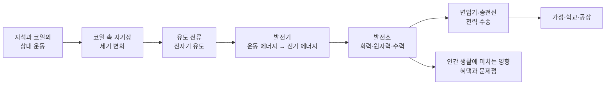
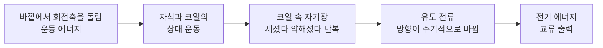
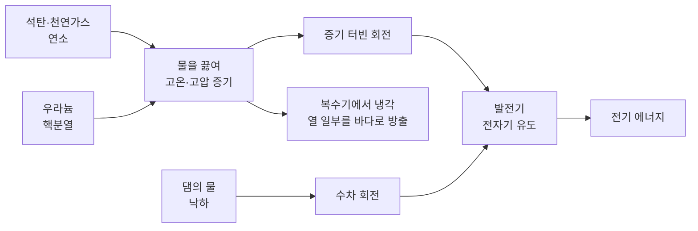
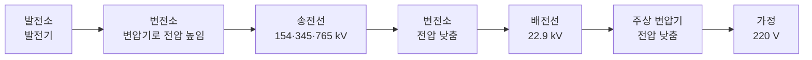

# 5-5. 발전기와 전기 에너지 — 움직임을 전기로 바꾸는 기술

> [!NOTE]
> **성취기준 [10통과2-02-05]** 발전기에서 운동 에너지가 전기 에너지로 전환되는 과정을 이해하고, 열원으로서 화석 연료, 핵에너지를 이용하는 발전소가 인간 생활에 미치는 영향을 조사⋅발표할 수 있다.

**학습 목표**

1. 코일을 통과하는 자기장의 세기가 변할 때 전류가 흐르는 전자기 유도 현상을 관찰하고 정성적으로 설명할 수 있다.
2. 발전기에서 자석과 코일의 상대 운동으로 운동 에너지가 전기 에너지로 전환되는 과정을 설명하고, 간이 발전기를 만들 수 있다.
3. 화력·원자력·수력 발전소에서 터빈을 돌리는 에너지원을 비교하여 발전소에서 전기 에너지를 만드는 방법을 설명할 수 있다.
4. 화석 연료와 핵에너지를 이용하는 발전소가 인간 생활에 미치는 영향을 조사하고, 장점과 문제점을 균형 있게 발표할 수 있다.

**이 단원의 학습 사다리**

| 단계 | 무엇을 하나? |
|---|---|
| STEP 1. 중학교 다시 보기 | 자기장, 전동기, 전기 에너지의 전환, 역학적 에너지 보존을 다시 꺼내 본다 |
| STEP 2. 기초 다지기 | 자기장과 자기력선, 전자석, 상대 운동, 직류와 교류를 디딤돌로 놓는다 |
| STEP 3. 핵심 개념 | 전자기 유도 → 발전기 → 발전소 → 발전소가 생활에 미치는 영향 → 전력 수송 |
| STEP 4. 오개념 바로잡기 | "발전기는 전기를 공짜로 만든다?", "원자력 발전은 핵폭발로?" 같은 착각을 바로잡는다 |
| STEP 5. 선택과목·대학 | 패러데이 법칙, 렌츠 법칙, 교류 발전기의 식, 변압기와 송전 손실 계산 |
| STEP 6. 산업·진로 | 발전기·터빈 제조, 초고압 송전과 HVDC, 원전 운영·해체, 회생 제동 |

---

## 🗺️ 단원 들어가기

스마트폰 충전기를 콘센트에 꽂는 순간, 전기는 어디에서 오는 걸까? 콘센트 뒤의 전선을 따라 끝까지 거슬러 올라가면 수십~수백 km 떨어진 발전소에 닿는다. 그곳에서는 집채만 한 **발전기** 속에서 자석이 1초에 수십 바퀴씩 돌고 있다.

놀랍게도 이 거대한 발전기와 자전거 바퀴에 다는 작은 전조등 발전기는 **같은 원리**로 움직인다. 1831년 영국의 과학자 패러데이가 발견한 이 원리 — "**자석을 코일 속에서 움직이면 전류가 흐른다**" — 는 오늘날 우리가 쓰는 전기의 대부분을 만들어 낸다. 이 단원에서는 그 원리에서 출발해 발전소, 그리고 발전소가 우리 삶에 주는 혜택과 고민까지 살펴본다.

---

## STEP 1. 🔙 중학교 다시 보기

### 연계 개념표

| 중학교 성취기준 | 중학교에서 배운 것 | 고등학교에서 확장되는 것 |
|---|---|---|
| [9과14-04] | 전류가 흐르는 코일 주위에 자기장이 생기고, 자기장 안의 전류가 흐르는 코일은 힘을 받는다 → **전동기** | 거꾸로, 코일 속 자기장이 변하면 전류가 흐른다 → **발전기** |
| [9과14-02] | 전기 회로에서 전류, 전압, 저항의 관계 | 유도 전류, 송전선의 저항과 전력 손실 |
| [9과14-03] | 전기 에너지가 빛·열·운동 에너지 등으로 전환된다(소비 전력) | 발전기는 그 반대로 **다른 에너지를 전기 에너지로** 전환한다 |
| [9과19-04] | 역학적 에너지의 전환과 보존 | 수력 발전: 물의 위치 에너지 → 운동 에너지 → 전기 에너지 |
| [9과16-06] | 화학 반응에서 열에너지가 출입한다(연소는 열을 방출) | 화력 발전: 연료의 화학 에너지 → 열에너지 |
| [9과04-04] | 상태 변화와 열에너지 출입(기화 시 흡수, 액화 시 방출) | 발전소에서 물을 끓여 증기를 만들고, 다시 식혀 물로 되돌린다 |

### 준비 운동 (사전 진단)

**Q1.** 에나멜선을 감은 코일에 전류를 흘려 보내면 코일 주위에 무엇이 생기는가?

**Q2.** 선풍기의 전동기는 어떤 에너지를 어떤 에너지로 전환하는가?

**Q3.** 막대자석 바깥에서 자기력선은 어느 극에서 나와 어느 극으로 들어가는가?

**Q4.** 전기 에너지가 주로 열에너지로 전환되는 가전제품의 예를 두 가지 쓰시오.

정답 및 해설

**Q1. 자기장** — 전류가 흐르는 코일은 막대자석처럼 행동한다(전자석). 전류가 셀수록, 감은 수가 많을수록 자기장이 세다.

**Q2.** 전기 에너지 → 운동 에너지(회전). 일부는 열과 소리로도 전환된다.

**Q3.** N극에서 나와 S극으로 들어간다.

**Q4.** 예: 전기 주전자, 전기다리미, 헤어드라이어, 전기난로 등

---

## STEP 2. 🧱 기초 다지기

### ① 자석과 자기장

자석 주위에서 자기력이 작용하는 공간을 **자기장(magnetic field)** 이라고 한다. 자기장은 **자기력선**으로 나타낸다.

- 자기력선은 N극에서 나와 S극으로 들어간다.
- 자기력선이 **빽빽할수록** 자기장이 **세다.** → 자석의 극 가까이에서 자기장이 가장 세다.
- 자석에서 멀어질수록 자기장은 약해진다.

> [!TIP]
> 💡 **비유** — 자기력선은 '자기장의 지도에 그린 등고선'과 비슷하다. 선이 촘촘한 곳일수록 자기장이 강하다. 그래서 자석을 코일에 **가까이 가져가면** 코일을 지나는 자기장이 **세지고**, **멀리 하면 약해진다.**

### ② 전류와 자기장 — 전자석

중학교에서 전류가 흐르는 코일이 자석처럼 행동한다는 것을 배웠다. 이것을 **전자석**이라고 한다. "전류가 자기장을 만든다." 이 단원에서는 이 문장을 뒤집어 본다. "**자기장이 변하면 전류가 만들어진다.**"

### ③ 전동기 복습 — 전기 에너지 → 운동 에너지

자석 사이에 놓인 코일에 전류를 흘리면 코일이 힘을 받아 회전한다. 이것이 **전동기(모터)** 이다.

$$
\text{전동기: 전기 에너지} \;\longrightarrow\; \text{운동 에너지}
$$

이 단원의 **발전기**는 전동기와 구조가 거의 같지만 에너지 전환의 방향이 반대이다.

### ④ 상대 운동 — 누가 움직였는지는 중요하지 않다

기차 안에서 옆 선로의 기차를 보면, 내 기차가 움직이는지 옆 기차가 움직이는지 헷갈릴 때가 있다. 두 물체의 거리가 변하는 '서로에 대한 움직임'을 **상대 운동**이라고 한다. 전자기 유도에서는 **자석이 움직이든 코일이 움직이든** 둘 사이에 상대 운동이 있어 코일 속 자기장이 변하기만 하면 전류가 흐른다.

### ⑤ 직류와 교류

| 구분 | 직류(DC) | 교류(AC) |
|---|---|---|
| 전류 방향 | 한 방향으로 일정 | 주기적으로 방향이 바뀐다 |
| 예 | 건전지, 스마트폰 배터리 | 가정용 콘센트 |
| 특징 | 저장하기 쉽다(전지) | 변압기로 전압을 쉽게 바꿀 수 있다 |

우리나라 가정의 전기는 **전압 220 V, 1초에 60번 진동하는(60 Hz) 교류**이다. 전류가 한 방향으로 흘렀다가 반대 방향으로 흐르고 다시 처음 방향으로 돌아오는 한 번의 왕복이 1초에 60번 일어난다는 뜻이다. 가정의 전기가 교류인 것은 발전소의 발전기가 회전하면서 자연스럽게 교류를 만들기 때문이다.

---

## STEP 3. 📘 핵심 개념

### 5-5-① 전자기 유도 — 자기장의 변화가 전류를 만든다

#### 실험으로 보기

코일의 양 끝을 **검류계**(아주 약한 전류도 감지하는 전류계)에 연결하고 막대자석을 움직여 보자.

| 조작 | 코일 속 자기장의 세기 | 검류계 바늘 |
|---|---|---|
| 자석을 코일 속에 **넣는다** | 세진다 | 한쪽으로 움직인다 |
| 자석을 코일 속에 **가만히 둔다** | 변하지 않는다 | 움직이지 않는다(0) |
| 자석을 코일에서 **뺀다** | 약해진다 | **반대쪽**으로 움직인다 |
| 자석은 그대로 두고 **코일을** 자석 쪽으로 움직인다 | 세진다 | 자석을 넣을 때와 같은 쪽으로 움직인다 |
| 자석을 **더 빠르게** 넣는다 | 더 빨리 세진다 | 더 크게 움직인다 |

#### 핵심 정리

**코일을 통과하는 자기장의 세기가 변할 때 코일에 전류가 흐른다.** 이 현상을 **전자기 유도(electromagnetic induction)** 라 하고, 이때 흐르는 전류를 **유도 전류(induced current)** 라고 한다.

- 자기장이 **변하지 않으면**(자석이 정지) 아무리 강한 자석이라도 전류가 흐르지 않는다.
- 자기장이 세질 때와 약해질 때 유도 전류의 **방향이 반대**이다.
- 유도 전류를 크게 하려면 → **자석을 빠르게** 움직이거나, **센 자석**을 쓰거나, 코일의 **감은 수를 늘린다.**

> [!TIP]
> 💡 **비유** — 코일은 '변화에만 반응하는 감지기'이다. 교실이 계속 시끄러우면 금방 익숙해져 신경 쓰지 않지만, 갑자기 조용해지거나 갑자기 시끄러워지면 바로 알아차린다. 코일도 자기장이 **변하는 순간에만** 전류로 반응한다. 변화가 **빠를수록** 더 크게 반응한다.

> [!IMPORTANT]
> 통합과학에서는 전자기 유도를 **정성적으로**만 다룬다. "자기장의 세기가 변하면 전류가 흐른다, 빠르게·세게·많이 감으면 커진다, 변화 방향이 반대면 전류 방향도 반대다"까지가 범위이다. 유도 전류의 크기를 계산하는 식(패러데이 법칙)과 방향을 정하는 규칙(렌츠 법칙)은 STEP 5에서 맛보기로 본다.

<!-- sim:induction -->

#### 생활 속 전자기 유도

| 기술 | 전자기 유도가 쓰이는 곳 |
|---|---|
| 교통카드 | 단말기가 만든 변하는 자기장이 카드 속 코일에 전류를 유도해 칩이 작동한다 |
| 인덕션 레인지 | 변하는 자기장이 냄비 바닥에 전류를 유도하고, 이 전류가 열을 낸다 |
| 무선 충전기 | 충전 패드의 코일이 만든 변하는 자기장이 스마트폰 속 코일에 전류를 유도한다 |
| 흔들어 켜는 손전등 | 손전등을 흔들면 안의 자석이 코일 속을 오가며 전류가 유도된다 |
| 발전기 | 자석과 코일의 상대 운동으로 전류를 계속 만든다(5-5-②) |

#### 예제 1

코일에 검류계를 연결하고 다음과 같이 실험하였다. 검류계 바늘이 움직이는 경우를 모두 고르시오.
ㄱ. 센 자석을 코일 속에 넣어 둔 채로 가만히 있었다.
ㄴ. 자석은 고정하고 코일을 자석에서 멀어지게 움직였다.
ㄷ. 자석과 코일을 같은 속도로 함께 나란히 움직였다.
ㄹ. 자석을 코일 속에서 빠르게 뺐다.

**풀이**
- ㄱ. 자기장이 세더라도 **변하지 않으므로** 전류가 흐르지 않는다.
- ㄴ. 코일 속 자기장이 약해지므로 전류가 흐른다(상대 운동).
- ㄷ. 둘 사이의 거리가 변하지 않아 **상대 운동이 없다.** 코일 속 자기장이 변하지 않으므로 전류가 흐르지 않는다.
- ㄹ. 자기장이 빠르게 약해지므로 전류가 흐른다.

**정답 ㄴ, ㄹ**

### 5-5-② 발전기 — 운동 에너지를 전기 에너지로

#### 발전기의 구조와 원리

**발전기(generator)** 는 자석과 코일 중 하나를 **계속 회전**시켜 코일 속 자기장의 세기를 끊임없이 변하게 하는 장치이다.

| 구성 요소 | 역할 |
|---|---|
| 자석(또는 전자석) | 자기장을 만든다 |
| 코일 | 자기장의 변화로 유도 전류가 흐르는 곳 |
| 회전축 | 바깥의 힘(물, 증기, 바람, 사람의 손)이 돌린다 |
| 전선(출력 단자) | 유도 전류를 바깥 회로로 내보낸다 |

회전하는 동안 코일을 지나는 자기장은 세졌다 약해졌다를 반복하므로, 유도 전류의 방향도 주기적으로 바뀐다. 그래서 발전기는 기본적으로 **교류**를 만든다. 우리나라 발전소의 발전기는 1초에 60번 진동하는(60 Hz) 교류를 만들도록 일정한 속도로 돈다.

#### 에너지는 공짜가 아니다

손으로 돌리는 발전기에 전구를 연결하고 돌리면, 전구가 켜진 순간 **손잡이가 갑자기 뻑뻑해진다.** 코일에 유도 전류가 흐르면 그 전류와 자석 사이에 회전을 방해하는 힘이 생기기 때문이다. 결국 우리는 이 방해를 이기며 **일을 해야** 하고, 그 일(운동 에너지)이 전기 에너지로 바뀐다.

$$
\text{발전기: 운동 에너지} \;\longrightarrow\; \text{전기 에너지}\;(+\;\text{일부 열})
$$

전구를 더 많이 연결하여 전기 에너지를 더 많이 쓸수록 손잡이는 더 뻑뻑해진다. **에너지 보존 법칙** 때문이다. 아무것도 연결하지 않으면 전류가 흐르지 않아 손잡이가 가볍다.

#### 발전기와 전동기는 형제

| 구분 | 전동기(모터) | 발전기 |
|---|---|---|
| 구조 | 자석 + 코일 + 회전축 | 자석 + 코일 + 회전축 |
| 입력 | 전기 에너지(전류를 흘려 줌) | 운동 에너지(회전축을 돌려 줌) |
| 출력 | 운동 에너지(회전) | 전기 에너지(유도 전류) |
| 원리 | 자기장 속 전류가 받는 힘 | 전자기 유도 |
| 예 | 선풍기, 세탁기, 전기차 구동 | 발전소, 자전거 발전기, 풍력 발전기 |

같은 장치를 상황에 따라 두 가지로 쓸 수도 있다. 전기 자동차는 달릴 때 모터로 바퀴를 돌리고, **속력을 줄일 때는 바퀴가 모터를 거꾸로 돌려 발전기로 쓴다.** 이렇게 운동 에너지를 전기 에너지로 되돌려 배터리에 저장하는 기술을 **회생 제동**이라고 한다.

#### 예제 2 — 손발전기 실험

손발전기에 꼬마전구를 연결하였다.
(1) 손잡이를 더 빠르게 돌리면 전구의 밝기는 어떻게 되는가? 그 까닭은?
(2) 꼬마전구를 1개에서 3개로 늘려(병렬연결) 같은 밝기로 켜려면 손잡이를 돌리기가 어떻게 되는가? 그 까닭은?

**풀이**
(1) 밝아진다. 빠르게 돌리면 코일 속 자기장이 **더 빠르게 변하므로** 유도 전류가 커진다.
(2) 더 힘들어진다. 전구 3개가 쓰는 전기 에너지가 더 많으므로, 에너지 보존 법칙에 따라 손이 해 주어야 하는 일(운동 에너지)도 더 많아야 한다.

### 5-5-③ 발전소 — 무엇으로 터빈을 돌리는가

#### 공통 구조: 터빈 + 발전기

대부분의 발전소는 **터빈(turbine)** 을 돌려 발전기를 돌린다. 터빈은 날개가 달린 커다란 바퀴로, 증기·물·바람이 날개를 밀면 회전한다. 터빈과 발전기는 같은 축으로 연결되어 있다.

> **발전소마다 다른 것은 '무엇으로 터빈을 돌리는가'뿐이다.**

#### 화력 발전 — 연료를 태워서

1. 석탄이나 천연가스(LNG) 같은 **화석 연료를 태운다**(화학 에너지 → 열에너지).
2. 그 열로 보일러의 물을 끓여 **고온·고압의 증기**를 만든다.
3. 증기가 터빈의 날개를 밀어 회전시킨다(열에너지 → 운동 에너지).
4. 터빈과 연결된 발전기가 전기를 만든다(운동 에너지 → 전기 에너지).
5. 터빈을 지난 증기는 **복수기**에서 차가운 물(주로 바닷물)로 식혀 다시 물로 되돌린 뒤 보일러로 보낸다.

천연가스 발전소 중에는 가스를 태운 뜨거운 기체로 **가스 터빈**을 직접 돌리고, 남은 열로 다시 증기를 만들어 증기 터빈까지 돌리는 **복합 화력 발전**도 많다.

#### 원자력 발전 — 원자핵을 쪼개서

1. 원자로 속 **우라늄** 원자핵이 중성자를 흡수하여 둘로 쪼개진다. 이를 **핵분열(nuclear fission)** 이라고 한다.
2. 핵분열 때 반응 후 질량이 조금 줄어들고, 줄어든 질량이 **많은 열**로 나온다(5-4의 핵융합과 같은 '질량 → 에너지' 원리, 반응 종류만 다름).
3. 쪼개질 때 나온 중성자가 다른 우라늄 원자핵을 다시 쪼개는 **연쇄 반응**이 일어난다. 원자로는 **제어봉**으로 중성자 수를 조절하여 반응이 일정한 빠르기로 일어나게 한다.
4. 이 열로 물을 끓여 증기를 만들고, **증기 터빈**과 발전기를 돌린다. → 이후 과정은 화력 발전과 같다.

<!-- fig:5-5-thermal-nuclear -->

#### 수력 발전 — 물을 떨어뜨려서

댐에 가둔 물이 아래로 떨어지면서 수차(물 터빈)를 돌린다. 물의 **위치 에너지 → 운동 에너지 → 전기 에너지**. 증기를 만들 필요가 없다. 5-4에서 보았듯 물의 위치 에너지는 원래 태양 에너지에서 왔다.

<!-- fig:5-5-hydro-plant -->

#### 발전 방식 비교

| 발전 방식 | 터빈을 돌리는 것 | 열원·동력원 | 에너지 전환 |
|---|---|---|---|
| 석탄 화력 | 증기 | 석탄의 연소열 | 화학 → 열 → 운동 → 전기 |
| 천연가스(복합) 화력 | 연소 기체 + 증기 | 천연가스의 연소열 | 화학 → 열 → 운동 → 전기 |
| 원자력 | 증기 | 우라늄의 핵분열 열 | 핵 → 열 → 운동 → 전기 |
| 수력 | 떨어지는 물 | 물의 위치 에너지 | 위치 → 운동 → 전기 |
| 풍력 | 바람 | 공기의 운동 에너지 | 운동 → 전기 |
| 태양광 | (터빈·발전기 없음) | 햇빛 | 빛 → 전기 (5-6) |

> [!NOTE]
> 화력·원자력 발전소에서는 연료가 낸 열에너지 가운데 **상당 부분이 복수기의 냉각수를 통해 열로 버려진다.** 그래서 연료 에너지 중 전기로 바뀌는 비율은 대략 30~40%대에 그친다(복합 화력은 이보다 높다). 이 '버려지는 열'과 효율 이야기는 5-6에서 이어진다. 많은 양의 냉각수가 필요하므로 우리나라의 원자력·석탄 발전소는 대부분 **바닷가**에 있다.

#### 예제 3 — 수력 발전소의 에너지

어느 수력 발전소에서 1초마다 물 10 000 kg이 50 m 높이에서 떨어져 수차를 돌린다.
(1) 1초 동안 떨어지는 물의 위치 에너지는 몇 J인가?
(2) 이 에너지의 90%가 전기 에너지로 전환된다고 가정하면, 1초 동안 만들어지는 전기 에너지는 몇 J인가?

**풀이**
(1) $E_p = 9.8 \times 10\,000 \times 50 = 4\,900\,000\ \mathrm{J}$ (490만 J)
(2) $4\,900\,000 \times 0.9 = 4\,410\,000\ \mathrm{J}$ (441만 J)

1초에 441만 J이므로 이 발전소의 전기 출력은 약 441만 W(약 4.4 MW)이다. 나머지 10%는 물의 소용돌이, 마찰, 발전기 속 열 등으로 흩어진다.

### 5-5-④ 화석 연료·핵에너지 발전소가 인간 생활에 미치는 영향

전기는 현대 생활을 떠받치는 에너지이다. 그러나 전기를 만드는 방식마다 혜택과 대가가 함께 있다. 어느 한쪽만 보지 말고 **근거를 들어 균형 있게** 따져 보아야 한다.

#### 화석 연료 발전소

| 측면 | 장점(혜택) | 문제점(대가) |
|---|---|---|
| 공급 | 연료만 있으면 날씨와 관계없이 원하는 때 발전할 수 있다. 특히 천연가스 발전은 출력을 빠르게 조절할 수 있어 전력 수요 변화에 대응하기 좋다 | 연료가 한정된 자원이다. 우리나라는 에너지 자원의 대부분(90% 이상)을 수입하여 국제 연료 가격 변동에 영향을 받는다 |
| 환경 | 기술이 오래 축적되어 오염 물질 저감 설비(탈황·탈질 설비, 집진기 등)가 발전해 왔다 | 연소할 때 **이산화 탄소**가 나와 지구온난화의 주요 원인이 된다. 석탄은 황산화물·질소산화물·미세먼지 등 **대기 오염 물질**도 많이 배출한다 |
| 경제·사회 | 발전소 건설과 운영 기술이 성숙하여 비교적 짧은 기간에 지을 수 있다 | 대기 오염에 따른 건강 피해, 온배수에 의한 주변 해양 환경 변화 |

#### 핵에너지(원자력) 발전소

| 측면 | 장점(혜택) | 문제점(대가) |
|---|---|---|
| 공급 | 적은 양의 연료로 많은 전기를 오랫동안 안정적으로 만든다. 한 번 넣은 연료로 오래 운전할 수 있다 | 출력을 자주 바꾸기 어려워 주로 일정한 양을 계속 발전하는 데 쓴다 |
| 환경 | 발전하는 동안 **이산화 탄소와 대기 오염 물질을 거의 배출하지 않는다** | 쓰고 난 핵연료(**사용후핵연료**)는 매우 강한 방사선을 오랫동안 내므로 안전하게 보관·처분해야 한다. 영구 처분 시설 마련이 중요한 사회적 과제이다 |
| 안전·사회 | 엄격한 안전 기준과 다중 안전 설비로 관리한다 | 체르노빌(1986), 후쿠시마(2011)처럼 큰 사고가 나면 넓은 지역에 오랫동안 피해를 준다. 발전소와 방사성 폐기물 시설의 입지를 둘러싼 갈등이 있다. 수명이 다한 원전은 **해체**하는 데 오랜 시간과 비용이 든다 |

> [!IMPORTANT]
> **조사·발표할 때의 기준**
> 1. **근거**: 공공기관 통계, 학술 자료 등 믿을 수 있는 출처를 밝힌다.
> 2. **균형**: 장점과 문제점을 모두 다룬다. 다른 발전 방식과 **비교**한다.
> 3. **관점**: 지역 주민, 전기 사용자, 미래 세대, 환경 등 여러 입장을 고려한다.
> 4. **대안**: 문제점을 줄이는 기술이나 정책(효율 향상, 신재생 에너지, 안전 규제 등)을 함께 제시한다.

> [!TIP]
> 💡 **비유** — 발전 방식 고르기는 '식단 짜기'와 비슷하다. 영양소마다 장단점이 있어 한 가지 음식만 먹으면 탈이 나듯, 한 나라의 전기도 여러 발전 방식을 조합해 만든다. 이 조합을 **에너지 믹스(energy mix)** 라고 하며, 사회가 무엇을 더 중요하게 여기는지(안정성, 비용, 환경, 안전)에 따라 달라진다.

### 5-5-⑤ 전기 에너지의 수송 — 발전소에서 우리 집까지

발전소는 대개 사람이 많이 사는 곳에서 멀리 떨어져 있다. 만든 전기를 먼 곳까지 보내는 과정을 **송전**, 동네와 집으로 나누어 보내는 과정을 **배전**이라고 한다.

#### 왜 아주 높은 전압으로 보낼까?

전선에도 **저항**이 있어 전류가 흐르면 전기 에너지의 일부가 **열로 바뀌어 손실**된다. 같은 양의 전기 에너지를 보낼 때 **전압을 높이면 전선에 흐르는 전류가 작아지고**, 전류가 작을수록 전선에서 열로 사라지는 에너지가 크게 줄어든다. 그래서 발전소에서 만든 전기는 변압기로 전압을 수십만 볼트까지 높여 보낸 뒤, 쓰는 곳 가까이에서 다시 낮춘다.

> [!TIP]
> 💡 **비유** — 같은 양의 물건을 옮길 때, 작은 손수레 수백 대로 좁은 길을 지나가면 길이 막히고 바퀴 마찰로 힘이 많이 든다. 큰 트럭 몇 대에 꽉꽉 실어 보내면 길도 덜 붐비고 손실도 적다. 전압을 높이는 것은 '한 번에 꽉꽉 실어 보내기'에 해당한다.

#### 변압기도 전자기 유도로 작동한다

**변압기(transformer)** 는 철심에 두 개의 코일을 감은 장치이다. 한쪽 코일에 **교류**를 흘리면 철심 속 자기장의 세기가 계속 변하고, 그 변화가 다른 쪽 코일에 전류를 유도한다. 두 코일의 감은 수를 다르게 하면 전압을 높이거나 낮출 수 있다.

- 직류는 자기장이 변하지 않으므로 보통의 변압기로 전압을 바꿀 수 없다. 교류가 전력망의 기본이 된 큰 이유이다.
- 다만 아주 먼 거리나 바다 밑으로 많은 전력을 보낼 때는 교류를 직류로 바꾸어 보내는 **초고압 직류 송전(HVDC)** 을 쓰기도 한다(STEP 6).

<!-- fig:5-5-transformer -->

#### 예제 4

다음 중 발전소에서 고전압으로 송전하는 까닭으로 가장 알맞은 것은?
① 전기 에너지를 더 많이 만들기 위해
② 전선에 흐르는 전류를 줄여 전선에서 열로 손실되는 에너지를 줄이기 위해
③ 가정에서 220 V 전기를 그대로 쓰기 위해
④ 직류를 교류로 바꾸기 위해

**풀이** 전압을 높여도 전기 에너지가 새로 만들어지지는 않는다. 같은 전력을 보낼 때 전압을 높이면 전류가 작아져 전선에서 열로 잃는 에너지가 줄어든다.

**정답 ②**

---

## STEP 4. ⚠️ 오개념 바로잡기

| 흔한 오개념 | 올바른 개념 | 왜 그럴까? |
|---|---|---|
| 강한 자석을 코일 속에 넣어 두기만 해도 전류가 흐른다 | 코일 속 자기장의 세기가 **변할 때만** 전류가 흐른다 | 전자기 유도는 자기장의 '세기'가 아니라 '변화'에 반응한다 |
| 발전기는 전기를 새로 만들어 낸다 | 발전기는 운동 에너지를 전기 에너지로 **전환**할 뿐이다 | 전기를 많이 쓸수록 발전기를 돌리기 힘들어진다. 에너지 보존 법칙 때문이다 |
| 발전기와 전동기는 전혀 다른 장치이다 | 구조가 거의 같고 **에너지 전환 방향만 반대**이다 | 전기차는 같은 모터를 달릴 때는 전동기로, 감속할 때는 발전기로 쓴다 |
| 원자력 발전소는 작은 핵폭발로 전기를 만든다 | 핵분열의 **열로 물을 끓여 증기 터빈을 돌린다** | 제어봉으로 연쇄 반응의 빠르기를 일정하게 조절한다. 열을 얻는 방법만 화력과 다르다 |
| 모든 발전소는 터빈과 발전기를 쓴다 | **태양광 발전**과 연료 전지는 터빈·발전기 없이 전기를 만든다 | 태양 전지는 빛에너지를, 연료 전지는 화학 에너지를 직접 전기로 바꾼다(5-6) |
| 고전압으로 송전하면 더 많은 전기가 전달된다 | 전기 에너지가 늘어나는 것이 아니라 **손실이 줄어든다** | 전압을 높이면 전류가 작아져 전선에서 열로 잃는 에너지가 줄어든다 |

---

## STEP 5. 🎓 선택과목·대학으로 한 걸음 더

> [!CAUTION]
> 이 절은 **통합과학 교육과정 범위 밖의 심화 내용**으로 평가 대상이 아니다. "이 개념이 앞으로 어디까지 이어지는가"를 맛보기로 보여 주기 위한 내용이다.

### 고2·3 선택과목과의 연결

| 과목 | 이어지는 내용 |
|---|---|
| 물리학 | 전류의 자기 작용을 이용한 전동기·스피커 [12물리02-05], 전자기 유도의 활용 기술(센서, 무선통신, 무선충전) [12물리02-06] |
| 전자기와 양자 | 로런츠 힘 [12전자01-04], 자기선속의 변화로 이해하는 전자기 유도와 변압기·인덕터 [12전자01-05] |
| 역학과 에너지 | 열기관의 순환 과정과 열효율, 열기관이 산업과 환경에 미친 영향 [12역학02-04] |

### ① 패러데이 전자기 유도 법칙

대학과 진로 선택 과목에서는 '코일을 지나는 자기장의 양'을 **자기 선속** $\Phi = BA$ ($B$: 자기장의 세기, $A$: 코일의 넓이, 단위 Wb)로 정의한다. 코일에 생기는 **유도 기전력** $\varepsilon$ (전류를 흐르게 하는 전압)은

$$
\varepsilon = -N\frac{\Delta \Phi}{\Delta t}
$$

($N$: 코일의 감은 수) 이다. STEP 3의 정성적 결론 "빠르게($\Delta t$ 작게), 센 자석($\Delta\Phi$ 크게), 많이 감을수록($N$ 크게) 유도 전류가 커진다"가 이 식 하나에 모두 들어 있다.

**예** 감은 수 100회인 코일을 지나는 자기 선속이 0.1초 동안 0.02 Wb만큼 변하면
$\varepsilon = 100 \times \dfrac{0.02}{0.1} = 20\ \mathrm{V}$ 의 유도 기전력이 생긴다.

### ② 렌츠 법칙 — 유도 전류는 변화를 방해한다

식의 (−) 부호는 **렌츠 법칙**을 뜻한다. "유도 전류는 코일을 지나는 자기 선속의 **변화를 방해하는 방향**으로 흐른다." 자석의 N극을 코일에 가까이 하면 코일은 N극을 밀어내는 쪽으로, 멀리 하면 끌어당기는 쪽으로 전류가 흐른다. STEP 3에서 손발전기가 뻑뻑해진 까닭이 바로 이것이며, 렌츠 법칙은 **에너지 보존 법칙**의 전자기적 표현이다. 구리관 속에 강한 자석을 떨어뜨리면 관에 유도된 전류(맴돌이 전류)가 낙하를 방해해 자석이 천천히 떨어지는 것도 같은 원리이다.

### ③ 교류 발전기의 식

넓이 $A$, 감은 수 $N$인 코일이 세기 $B$인 자기장 속에서 각속도 $\omega$로 회전하면 유도 기전력은 사인 함수 모양으로 변한다.

$$
\varepsilon(t) = NBA\omega \sin \omega t
$$

우리나라 전력망은 $f = 60\ \mathrm{Hz}$ ($\omega = 2\pi f$) 로 운전된다. 대학 '전기기기'에서는 세 개의 코일을 120°씩 엇갈리게 배치한 **3상 교류 발전기**를 배우는데, 실제 발전소와 송전선이 모두 3상 방식이다.

### ④ 변압기와 송전 손실의 정량 계산

이상적인 변압기에서 전압의 비는 감은 수의 비와 같다.

$$
\frac{V_1}{V_2} = \frac{N_1}{N_2}
$$

송전 전력 $P = VI$, 전선 저항 $R$에서 열로 손실되는 전력은 $P_{\text{손실}} = I^2R$ 이다.

**예** 전력 $1\,000\,000\ \mathrm{W}$를 저항 $10\ \Omega$인 송전선으로 보낼 때
- 10 000 V로 보내면: $I = 100\ \mathrm{A}$, $P_{\text{손실}} = 100^2 \times 10 = 100\,000\ \mathrm{W}$ (보낸 전력의 10%)
- 100 000 V로 보내면: $I = 10\ \mathrm{A}$, $P_{\text{손실}} = 10^2 \times 10 = 1\,000\ \mathrm{W}$ (0.1%)

전압을 10배로 높이면 손실은 $\frac{1}{100}$ 로 줄어든다. STEP 3에서 '크게 줄어든다'고만 했던 내용의 정체이다.

### 고등학교 vs 대학교

| 구분 | 고등학교 통합과학 | 대학교 전자기학·전기공학 |
|---|---|---|
| 전자기 유도 | 자기장 세기가 변하면 전류가 흐른다(정성적) | 패러데이 법칙 $\varepsilon = -N\,d\Phi/dt$, 맥스웰 방정식 |
| 유도 전류의 방향 | 넣을 때와 뺄 때 반대(관찰) | 렌츠 법칙, 벡터로 계산 |
| 발전기 | 운동 에너지 → 전기 에너지, 교류 생성 | 3상 동기 발전기, 출력·효율 설계 |
| 송전 | 고전압으로 손실 줄이기(정성적) | $I^2R$ 손실, 전력 계통 해석, HVDC, 전력전자 |
| 관련 전공 | — | 전기공학, 전자공학, 기계공학, 원자핵공학, 에너지공학 |

---

## STEP 6. 🏭 산업 현장과 진로 연결

### 사례 1. 발전기·터빈 제조 — 거대한 정밀 기계

- **원리** 발전소의 발전기는 STEP 3의 손발전기와 같은 원리지만 크기와 정밀도가 전혀 다르다. 원자력 발전소 한 기의 전기 출력은 약 1,000~1,400 MW에 이르고, 터빈과 발전기 회전축은 1초에 수십 바퀴씩 쉬지 않고 돈다.
- **핵심 기술** 고온·고압 증기나 연소 기체를 견디는 터빈 날개 소재와 냉각 기술, 진동을 줄이는 회전체 설계, 발전기 코일의 냉각과 절연 기술이 필요하다. 특히 발전용 대형 가스 터빈은 소수의 나라만 만들 수 있는 고난도 기술인데, 최근 우리나라도 국산화에 성공하였다.
- **변화** 풍력 발전기(5-6), 소형 수력, 선박·항공기 엔진 등으로 터빈·발전기 기술의 활용 범위가 넓어지고 있다.

### 사례 2. 전력망 — 초고압 송전과 HVDC

- **원리** 우리나라는 154 kV, 345 kV, 765 kV의 송전 전압을 써서 손실을 줄인다(5-5-⑤).
- **HVDC** 교류를 직류로 바꾸어 보내는 **초고압 직류 송전**은 먼 거리나 바다 밑 케이블 송전에서 손실과 비용을 줄일 수 있다. 우리나라에서는 제주와 육지(전라남도)를 잇는 해저 HVDC 송전선이 운영되고 있으며, 서해안 해상풍력 등 대규모 신재생 에너지를 수도권으로 보내는 수단으로도 주목받는다.
- **스마트 그리드** 전력망에 정보 통신 기술을 결합하여 공급과 수요를 실시간으로 조절하는 지능형 전력망으로 발전하고 있다(5-6과 연결).

### 사례 3. 원자력 발전소의 운영과 해체

- **운영** 원자로 운전원은 국가 면허를 받아 원자로 출력, 냉각수 온도·압력, 방사선량을 24시간 감시한다. 원자력안전위원회가 안전 규제를 맡는다.
- **해체** 우리나라 최초의 상업용 원자력 발전소인 고리 1호기는 2017년 영구 정지되어 해체 절차를 밟고 있다. 해체는 사용후핵연료 반출, 방사성 오염 제거, 구조물 철거, 부지 복원까지 오랜 기간이 걸리는 작업으로, 세계적으로 수명이 다한 원전이 늘면서 새로운 산업 분야로 주목받는다.
- **방사성 폐기물 관리** 사용후핵연료를 안전하게 저장하고 최종 처분하는 기술과 제도를 마련하는 일이 중요한 과제이다.

### 사례 4. 회생 제동과 무선 충전 — 생활 속 전자기 유도

- **회생 제동** 전기차·하이브리드차·전동차(지하철)는 감속할 때 모터를 발전기로 바꾸어 운동 에너지를 전기 에너지로 회수한다. 브레이크 패드 마모가 줄고 주행 거리가 늘어난다.
- **무선 충전·교통카드** 변하는 자기장으로 코일에 전류를 유도하여 선 없이 에너지와 신호를 전달한다(고2·3 '물리학'에서 무선 충전기를 직접 구현해 본다).

### 관련 진로와 학과

| 진로 | 하는 일 | 관련 학과 |
|---|---|---|
| 발전 설비 엔지니어 | 터빈·발전기 설계, 제작, 정비 | 기계공학, 전기공학, 재료공학 |
| 전력 계통 엔지니어 | 송전·변전 설비 운영, 전력망 계획, HVDC | 전기공학, 전자공학 |
| 원자력 엔지니어·운전원 | 원자로 운전·안전 관리, 해체·방사성 폐기물 관리 | 원자핵공학, 기계공학, 화학공학 |
| 전기차 구동계 엔지니어 | 모터·인버터·회생 제동 시스템 개발 | 전기공학, 자동차공학, 기계공학 |
| 에너지 정책 연구원 | 에너지 믹스, 발전소 입지·환경 영향 분석 | 에너지공학, 환경공학, 경제학, 정책학 |

---

## 🔬 탐구 활동 — 자석과 코일의 상대 운동에 의해 운동 에너지가 전기 에너지로 전환되는 과정 탐구하기

### 활동 A. 자석과 코일의 상대 운동 탐구

**목표** 코일 속 자기장의 세기 변화와 유도 전류의 관계를 관찰하고, 유도 전류의 세기에 영향을 주는 요인을 찾는다.

**준비물** 감은 수가 다른 코일 2개(예: 200회, 400회), 세기가 다른 막대자석 2개, 검류계(또는 디지털 전류 센서), 집게 전선

**과정**
1. 200회 코일을 검류계에 연결한다.
2. 자석의 N극을 코일 속에 천천히 넣고, 잠시 멈추었다가, 천천히 뺀다. 각 순간 바늘의 방향과 크기를 기록한다.
3. 같은 자석을 빠르게 넣고 뺀다.
4. 자석은 고정하고 코일을 움직여 2~3을 반복한다.
5. 센 자석으로 바꾸어 반복한다.
6. 400회 코일로 바꾸어 같은 속력으로 반복한다.

**결과 기록**

| 조건 | 넣을 때 바늘 방향·크기 | 정지할 때 | 뺄 때 바늘 방향·크기 |
|---|---|---|---|
| 200회, 약한 자석, 천천히 | | | |
| 200회, 약한 자석, 빠르게 | | | |
| 200회, 코일을 움직임 | | | |
| 200회, 센 자석, 빠르게 | | | |
| 400회, 약한 자석, 빠르게 | | | |

**생각해 보기**
1. 자석이 코일 속에 정지해 있을 때 전류가 흐르지 않은 까닭은?
2. 유도 전류를 크게 하는 조건 세 가지를 실험 결과로 정리해 보자.
3. 자석을 넣고 뺄 때 손이 한 일은 어떤 에너지로 전환되었을까?

### 활동 B. 간이 발전기 만들기 — '흔들이 발전기'

**목표** 전자기 유도를 이용한 간이 발전기를 만들고, 운동 에너지가 전기 에너지로 전환되는 과정을 확인한다.

**준비물** 투명 플라스틱 관(지름 약 2 cm, 길이 약 15 cm), 에나멜선(약 20~30 m), 원통형 네오디뮴 자석, 발광 다이오드(LED) 2개(빨강), 사포, 고무마개 2개, 테이프

**과정**
1. 플라스틱 관 가운데에 에나멜선을 같은 방향으로 촘촘히 감는다(수백 회 이상).
2. 에나멜선 양 끝을 사포로 문질러 피복을 벗긴다.
3. LED 2개의 극을 서로 반대로 하여 나란히 연결한 뒤 에나멜선 양 끝에 연결한다(교류이므로 두 방향 전류를 모두 확인할 수 있다).
4. 관 속에 자석을 넣고 양 끝을 고무마개로 막는다.
5. 관을 앞뒤로 세게 흔들며 LED를 관찰한다. 흔드는 빠르기를 바꾸어 본다.

**생각해 보기**
1. 두 LED가 번갈아 켜지는 까닭을 유도 전류의 방향으로 설명해 보자.
2. LED를 더 밝게 하려면 무엇을 바꾸면 좋을까? (감은 수, 자석, 흔드는 빠르기)
3. 이 장치와 발전소의 발전기에서 '바깥에서 공급하는 운동 에너지'는 각각 무엇인가?

> [!WARNING]
> **안전 수칙** 네오디뮴 자석은 매우 강해 두 개가 갑자기 달라붙으면 손가락이 끼거나 자석이 깨질 수 있다. 스마트폰, 교통카드, 심장 박동기를 가진 사람에게서 멀리 둔다. 작은 자석은 절대 입에 넣지 않는다. 에나멜선 끝은 날카로우므로 조심한다.

### 활동 C. 조사·발표 — 발전소가 인간 생활에 미치는 영향

1. 모둠별로 **석탄 화력, 천연가스 화력, 원자력** 중 하나를 맡는다.
2. 다음 항목을 공공기관 자료 등 믿을 수 있는 출처로 조사한다: 발전 원리, 우리나라의 발전소 위치, 장점, 문제점(환경·안전·경제·사회), 문제점을 줄이기 위한 기술과 노력.
3. 역할극으로 발표한다: 발전소 인근 주민, 전기를 많이 쓰는 도시 주민, 환경 단체, 발전소 운영자, 미래 세대.
4. 다른 모둠의 발표를 평가표로 평가한다.

| 평가 항목 | 잘함 | 보통 | 노력 필요 |
|---|---|---|---|
| 발전 원리를 에너지 전환으로 정확히 설명했는가 | | | |
| 장점과 문제점을 균형 있게 제시했는가 | | | |
| 근거 자료의 출처를 밝혔는가 | | | |
| 다른 발전 방식과 비교하고 대안을 제시했는가 | | | |

---

## ✅ 개념 확인 문제

### 기본

**1.** 코일에 검류계를 연결하였다. 검류계에 전류가 흐르지 **않는** 경우는?
① 자석을 코일 속으로 넣을 때
② 자석을 코일 속에서 뺄 때
③ 자석을 코일 속에 넣고 가만히 둘 때
④ 자석은 고정하고 코일을 자석 쪽으로 움직일 때

정답 및 해설

**정답 ③**

자석이 코일 속에 정지해 있으면 코일을 지나는 자기장의 세기가 변하지 않으므로 유도 전류가 흐르지 않는다. ①, ②, ④는 모두 상대 운동으로 자기장의 세기가 변한다.

**2.** 전동기와 발전기에서 일어나는 에너지 전환을 각각 쓰시오.

정답 및 해설

**정답** 전동기: 전기 에너지 → 운동 에너지 / 발전기: 운동 에너지 → 전기 에너지

두 장치는 구조가 거의 같고 에너지 전환의 방향이 반대이다.

**3.** 표의 빈칸에 알맞은 말을 쓰시오.

| 발전 방식 | 터빈을 돌리는 것 | 열이나 에너지를 얻는 방법 |
|---|---|---|
| 화력 | ( ㄱ ) | 화석 연료의 연소 |
| 원자력 | 증기 | ( ㄴ ) |
| 수력 | 떨어지는 물 | 물의 ( ㄷ ) 에너지 |

정답 및 해설

**정답** ㄱ: 증기(천연가스 복합 화력은 연소 기체와 증기), ㄴ: 우라늄의 핵분열, ㄷ: 위치

화력과 원자력은 열을 얻는 방법만 다르고, 물을 끓여 증기로 터빈을 돌리는 과정은 같다.

**4.** 발전소에서 만든 전기를 변압기로 전압을 높여 송전하는 까닭을 '전류'와 '열'이라는 낱말을 넣어 쓰시오.

정답 및 해설

**예시 답안** 같은 양의 전기 에너지를 보낼 때 전압을 높이면 송전선에 흐르는 **전류**가 작아져, 송전선의 저항 때문에 **열**로 손실되는 에너지가 줄어들기 때문이다.

### 응용

**5.** 코일과 자석을 이용해 유도 전류를 더 크게 만드는 방법으로 옳은 것만을 있는 대로 고르시오.
ㄱ. 자석을 더 빠르게 움직인다.
ㄴ. 코일의 감은 수를 늘린다.
ㄷ. 더 센 자석을 사용한다.
ㄹ. 자석을 코일 속에 더 오래 넣어 둔다.

정답 및 해설

**정답 ㄱ, ㄴ, ㄷ**

유도 전류는 코일 속 자기장이 더 빠르게, 더 크게 변할수록, 코일을 많이 감을수록 커진다. ㄹ은 자기장이 변하지 않으므로 전류가 흐르지 않는다.

**6.** 소수력 발전소에서 1초마다 물 2000 kg이 30 m 높이에서 떨어진다.
(1) 1초 동안 떨어지는 물의 위치 에너지는 몇 J인가?
(2) 그중 85%가 전기 에너지로 전환된다고 가정할 때, 1초 동안 생산되는 전기 에너지는 몇 J인가?

정답 및 해설

**정답** (1) $588\,000\ \mathrm{J}$ (2) $499\,800\ \mathrm{J}$

(1) $E_p = 9.8 \times 2000 \times 30 = 588\,000\ \mathrm{J}$
(2) $588\,000 \times 0.85 = 499\,800\ \mathrm{J}$ (약 50만 J, 출력 약 50만 W)

나머지 15%는 마찰, 물의 소용돌이, 발전기 속 열 등으로 흩어진다.

**7.** 손발전기 A에는 꼬마전구 1개를, 손발전기 B에는 같은 꼬마전구 3개를 병렬로 연결하였다. 두 발전기의 전구가 모두 같은 밝기로 켜지도록 돌릴 때, 손잡이를 돌리기가 더 힘든 쪽은 어느 것이며 그 까닭은 무엇인가?

정답 및 해설

**정답** B

B는 같은 밝기의 전구 3개를 켜므로 1초 동안 소비하는 전기 에너지가 A의 약 3배이다. 발전기는 손이 한 일(운동 에너지)을 전기 에너지로 전환할 뿐이므로, 에너지 보존 법칙에 따라 B를 돌리는 손이 더 많은 일을 해야 한다. 실제로 유도 전류가 클수록 회전을 방해하는 힘도 커져 손잡이가 뻑뻑해진다.

### 융합·서술형

**8. [사회·환경 연계]** 어느 지역에 새로운 대형 발전소를 짓기로 하고, 석탄 화력 발전소와 원자력 발전소 중 하나를 고르려 한다. (1) 두 발전소의 공통점을 에너지 전환 과정으로 쓰고, (2) 환경과 안전 측면에서 각각의 장점과 문제점을 한 가지씩 비교하시오. (3) 결정 과정에서 함께 고려해야 할 것을 한 가지 제안하시오.

정답 및 해설

**예시 답안**
(1) 두 발전소 모두 열에너지로 물을 끓여 만든 증기로 터빈을 돌리고, 발전기에서 운동 에너지를 전기 에너지로 전환한다(열 → 운동 → 전기). 열을 얻는 방법이 연소(화학 에너지)와 핵분열(핵에너지)로 다를 뿐이다.
(2) 석탄 화력: 연료 수급과 출력 조절이 비교적 쉽다는 장점이 있으나, 이산화 탄소와 미세먼지 등 대기 오염 물질을 많이 배출한다. 원자력: 발전 중 이산화 탄소와 대기 오염 물질을 거의 배출하지 않으나, 사용후핵연료 처분과 사고 시 방사성 물질 누출 위험이 문제가 된다.
(3) 예: 지역 주민의 의견 수렴과 정보 공개, 송전선 경로, 장기적인 탄소중립 목표, 신재생 에너지와 함께 쓰는 에너지 믹스, 발전소 수명이 끝난 뒤의 해체 비용 등

**채점 포인트** ① 공통 과정(증기 터빈과 발전기) ② 두 방식의 장점·문제점을 균형 있게 비교 ③ 사회적 고려 사항 제안

**9. [산업·대학 연계]** 전기 자동차는 내리막길이나 감속할 때 '회생 제동'을 이용한다. (1) 회생 제동에서 모터가 어떤 장치로 바뀌어 어떤 에너지 전환이 일어나는지 설명하고, (2) 일반 브레이크(마찰로 멈춤)와 비교하여 에너지 측면의 장점을 서술하시오.

정답 및 해설

**예시 답안**
(1) 감속할 때 바퀴의 회전이 모터의 회전축을 거꾸로 돌리게 되어 모터가 **발전기**로 작동한다. 자석과 코일의 상대 운동으로 유도 전류가 흐르고, 자동차의 **운동 에너지가 전기 에너지로 전환**되어 배터리에 저장된다. 이때 유도 전류가 회전을 방해하므로 자동차의 속력도 줄어든다.
(2) 일반 브레이크는 마찰로 운동 에너지를 대부분 **열로 바꾸어 버리지만**, 회생 제동은 그 일부를 다시 쓸 수 있는 전기 에너지로 회수한다. 따라서 같은 배터리로 더 먼 거리를 달릴 수 있고 브레이크 마모도 줄어든다.

**채점 포인트** ① 모터 → 발전기 ② 운동 에너지 → 전기 에너지 ③ 마찰 브레이크는 열로 버림, 회생 제동은 회수

---

## 📝 한눈에 정리

### 핵심 요약

- 코일을 통과하는 **자기장의 세기가 변할 때** 코일에 전류가 흐른다(**전자기 유도**, 유도 전류). 자기장이 변하지 않으면 전류는 흐르지 않는다.
- 유도 전류는 자석을 **빠르게** 움직일수록, **센 자석**일수록, 코일을 **많이 감을수록** 크다. 자기장이 세질 때와 약해질 때 전류의 방향은 반대이다.
- **발전기**는 자석과 코일의 상대 운동(회전)으로 **운동 에너지를 전기 에너지로** 전환하며, 교류를 만든다. 전동기와 구조는 같고 전환 방향이 반대이다.
- 발전소는 **무엇으로 터빈을 돌리는가**가 다르다: 화력(연료의 연소열 → 증기), 원자력(핵분열 열 → 증기), 수력(물의 위치 에너지).
- 화석 연료 발전은 공급이 유연하지만 이산화 탄소·대기 오염 물질을, 원자력 발전은 탄소 배출이 적지만 방사성 폐기물·사고 위험을 고민해야 한다. **근거를 들어 균형 있게** 판단한다.
- 전기는 **변압기로 전압을 높여 송전**하여 전선에서 열로 잃는 에너지를 줄이고, 쓰는 곳 가까이에서 다시 낮춘다.

### 핵심 용어

| 용어 | 뜻 |
|---|---|
| 전자기 유도 | 코일을 통과하는 자기장의 세기가 변할 때 코일에 전류가 흐르는 현상 |
| 유도 전류 | 전자기 유도로 코일에 흐르는 전류 |
| 발전기 | 자석과 코일의 상대 운동으로 운동 에너지를 전기 에너지로 바꾸는 장치 |
| 터빈 | 증기·물·바람의 흐름으로 회전하여 발전기를 돌리는 날개 달린 바퀴 |
| 핵분열 | 무거운 원자핵(우라늄 등)이 쪼개지며 많은 에너지를 내는 반응 |
| 교류 | 방향과 세기가 주기적으로 바뀌는 전류. 우리나라 가정은 220 V, 60 Hz |
| 변압기 | 전자기 유도를 이용해 교류의 전압을 높이거나 낮추는 장치 |
| 송전 | 발전소에서 만든 전기를 먼 곳까지 보내는 과정 |

### 다음 단원으로

발전소에서 연료가 낸 에너지 가운데 상당 부분은 전기가 되지 못하고 열로 버려졌다. 에너지는 보존된다는데, 왜 '버려진다'고 말할까? 다음 단원에서는 **에너지 효율**의 의미를 계산으로 확인하고, 효율을 높이는 기술과 태양광·풍력·수소 같은 **신재생 에너지**를 활용해 지속가능한 발전과 지구 환경 문제를 해결하는 방안을 탐색한다.
