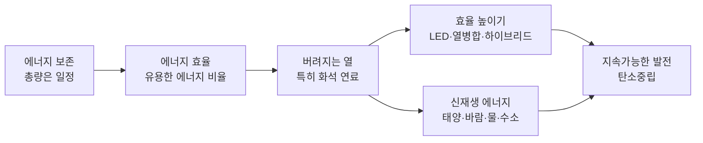
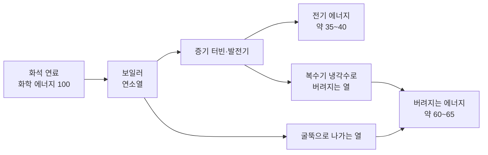
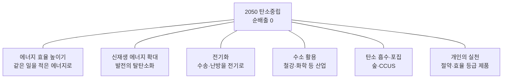

# 5-6. 에너지 효율과 신재생 에너지 — 지속가능한 에너지 미래 설계하기

> [!NOTE]
> **성취기준 [10통과2-02-06]** 에너지 효율의 의미와 중요성을 이해하고, 지속가능한 발전과 지구 환경 문제 해결에 신재생 에너지 기술을 활용하는 방안을 탐색할 수 있다.

**학습 목표**

1. 에너지가 다양한 형태로 존재하고, 다른 형태로 전환될 때 에너지의 총량이 보존됨을 일상생활의 사례로 설명할 수 있다.
2. 에너지 효율의 의미를 알고, 전기 기구와 발전소 등의 에너지 효율을 계산할 수 있다.
3. 에너지를 사용하는 과정에서 열이 발생하며, 특히 화석 연료를 사용할 때 버려지는 열에너지 때문에 효율이 낮아짐을 설명하고, 효율을 높이는 방안을 제시할 수 있다.
4. 여러 가지 신재생 에너지의 원리와 장단점을 비교하고, 지속가능한 발전과 탄소중립을 위해 신재생 에너지 기술을 활용하는 방안을 탐색할 수 있다.

**이 단원의 학습 사다리**

| 단계 | 무엇을 하나? |
|---|---|
| STEP 1. 중학교 다시 보기 | 역학적 에너지 보존, 소비 전력, 열평형, 지속가능한 삶을 다시 꺼내 본다 |
| STEP 2. 기초 다지기 | 에너지 보존 법칙, 백분율, 전력과 전력량(kWh), '흩어지는 열'을 디딤돌로 놓는다 |
| STEP 3. 핵심 개념 | 에너지 보존 → 에너지 효율 → 버려지는 열 → 효율 높이기 → 신재생 에너지 → 탄소중립 |
| STEP 4. 오개념 바로잡기 | "에너지는 보존되는데 왜 아껴야 해?", "신재생 에너지는 환경 영향이 0?" 같은 착각을 바로잡는다 |
| STEP 5. 선택과목·대학 | 열역학 제2법칙과 카르노 효율, 풍력의 베츠 한계, 태양 전지 효율의 한계 |
| STEP 6. 산업·진로 | 태양광 셀·모듈, 해상풍력, ESS·스마트 그리드, 에너지 효율 등급제, 수소 경제 |

---

## 🗺️ 단원 들어가기

5-5에서 보았듯 화력 발전소에 석탄을 100만큼 넣으면 전기는 대략 30~40만큼만 나온다. 나머지는 어디로 갔을까? 그리고 그 전기로 옛날 백열전구를 켜면, 빛이 되는 것은 다시 그중 아주 작은 일부뿐이다.

에너지 보존 법칙에 따르면 에너지는 절대 사라지지 않는다. 그런데도 우리는 "에너지를 아끼자", "에너지가 부족하다"라고 말한다. 이 단원에서는 이 모순처럼 보이는 질문의 답을 **에너지 효율**에서 찾고, 지구 환경을 지키면서 에너지를 계속 쓸 수 있는 방법, 즉 **신재생 에너지**와 **탄소중립**의 길을 탐색한다.

---

## STEP 1. 🔙 중학교 다시 보기

### 연계 개념표

| 중학교 성취기준 | 중학교에서 배운 것 | 고등학교에서 확장되는 것 |
|---|---|---|
| [9과19-04] | 마찰이 없으면 역학적 에너지가 보존된다 | 마찰이 있어도 **열까지 포함하면** 에너지 총량이 보존된다 |
| [9과14-03] | 전기 에너지가 빛·열·운동 에너지 등으로 전환된다, 소비 전력, 효율적인 전기 사용의 중요성 | 전환된 에너지 중 **유용한 부분의 비율 = 에너지 효율** |
| [9과03-01] | 온도가 다른 두 물체는 열평형에 도달한다 | 높은 온도의 열은 주변으로 흩어져 다시 모아 쓰기 어렵다 → **버려지는 열** |
| [9과16-06] | 화학 반응에서 열에너지가 출입한다 | 연료의 연소열, 연료 전지(화학 에너지 → 전기 에너지) |
| [9과17-01] | 온실효과와 지구온난화를 복사 평형으로 설명한다 | 화석 연료 사용을 줄이는 **탄소중립**이 필요한 까닭 |
| [9과01-03] | 인류의 지속가능한 삶을 위한 과학기술의 중요성과 역할 | **신재생 에너지 기술**로 지속가능한 발전 방안 탐색 |

### 준비 운동 (사전 진단)

**Q1.** 바닥에 떨어뜨린 공이 튀어 오를 때마다 높이가 점점 낮아진다. 공의 역학적 에너지는 어디로 갔을까?

**Q2.** 소비 전력 10 W인 LED 전등을 1시간 동안 켰을 때 쓴 전기 에너지는 몇 J인가?

**Q3.** 지구온난화의 주요 원인으로 꼽히는, 화석 연료를 태울 때 나오는 온실 기체는 무엇인가?

**Q4.** 전기난로와 선풍기는 전기 에너지를 주로 어떤 에너지로 전환하는가?

정답 및 해설

**Q1.** 바닥과 부딪힐 때와 공기 속을 움직일 때 **열에너지와 소리 에너지** 등으로 전환되었다. 에너지가 사라진 것은 아니다.

**Q2.** $36\,000\ \mathrm{J}$ — $10\ \mathrm{W} \times 3600\ \mathrm{s} = 36\,000\ \mathrm{J}$

**Q3.** 이산화 탄소

**Q4.** 전기난로: 열에너지 / 선풍기: 운동 에너지(일부는 열과 소리)

---

## STEP 2. 🧱 기초 다지기

### ① 에너지 보존 법칙

**에너지는 새로 생기거나 사라지지 않고, 한 형태에서 다른 형태로 전환될 뿐이며, 전환 전후 에너지의 총량은 일정하다.** 이것이 **에너지 보존 법칙(law of conservation of energy)** 이다. 중학교의 역학적 에너지 보존은 '마찰이 없을 때'만 성립했지만, 마찰로 생긴 열까지 모두 더하면 에너지는 언제나 보존된다.

### ② 비율과 백분율

전체 중 일부가 차지하는 비율을 100을 기준으로 나타낸 것이 백분율(%)이다.

$$
\text{백분율}(\%) = \frac{\text{부분}}{\text{전체}} \times 100
$$

예: 전체 200 J 중 50 J → $\dfrac{50}{200} \times 100 = 25\%$

### ③ 전력과 전력량

- **전력(power)**: 1초 동안 쓰는 전기 에너지. 단위 W(= J/s).
- **전력량**: 일정 시간 동안 쓴 전기 에너지의 양 = 전력 × 시간.
- 전기 요금 고지서에는 **kWh(킬로와트시)** 를 쓴다. 1 kWh는 1000 W를 1시간 쓴 전기 에너지이다.

$$
1\ \mathrm{kWh} = 1000\ \mathrm{W} \times 3600\ \mathrm{s} = 3\,600\,000\ \mathrm{J}
$$

### ④ 흩어지는 열은 다시 모으기 어렵다

물 한 컵에 잉크 한 방울을 떨어뜨리면 잉크는 저절로 퍼져 나가지만, 퍼진 잉크가 저절로 다시 한 방울로 모이지는 않는다. 열도 마찬가지이다. 뜨거운 엔진에서 나온 열은 주변 공기로 퍼져 나가 열평형을 이루고, **한번 넓게 흩어진 열은 다시 모아 일을 시키기가 매우 어렵다.**

> [!TIP]
> 💡 **비유** — 에너지는 '돈', 흩어진 열은 '전국에 1원짜리 동전으로 흩뿌려진 돈'과 같다. 돈의 총액은 그대로지만, 이미 흩어진 동전을 다시 모아 쓰기는 사실상 불가능하다. 에너지를 '아낀다'는 것은 총액이 아니라 **쓸 수 있는 형태의 에너지**를 아끼는 것이다.

---

## STEP 3. 📘 핵심 개념

### 5-6-① 에너지는 사라지지 않는다 — 에너지 보존

일상에서 일어나는 에너지 전환을 살펴보면, 공급한 에너지는 **원하는 형태의 에너지**와 **원하지 않는 형태의 에너지**(대부분 열)로 나뉠 뿐, 그 합은 항상 공급한 에너지와 같다.

| 장치·현상 | 공급한 에너지 | 원하는(유용한) 에너지 | 원하지 않는 에너지 |
|---|---|---|---|
| 전등 | 전기 에너지 | 빛에너지 | 열에너지 |
| 선풍기 | 전기 에너지 | 날개의 운동 에너지 | 열, 소리 |
| 휴대 전화 충전 | 전기 에너지 | 배터리의 화학 에너지 | 열(충전기·휴대 전화가 따뜻해짐) |
| 자동차 엔진 | 연료의 화학 에너지 | 바퀴를 굴리는 운동 에너지 | 배기가스와 냉각수의 열, 소리 |
| 사람의 운동 | 음식의 화학 에너지 | 근육의 운동 | 체온, 땀으로 빠져나가는 열 |

$$
\text{공급한 에너지} = \text{유용한 에너지} + \text{버려지는 에너지(주로 열)}
$$

#### 예제 1

높이 2 m에서 떨어뜨린 공(처음 위치 에너지 10 J)이 바닥에 튕긴 뒤 1.4 m 높이까지 올라갔다(그 순간 위치 에너지 7 J). 사라진 것처럼 보이는 3 J은 어디로 갔는가?

**풀이** 에너지는 사라지지 않는다. 공이 바닥과 충돌하며 찌그러졌다 펴질 때와 공기 저항을 받을 때 **약 3 J이 열에너지와 소리 에너지로 전환**되었다. 공과 바닥, 주변 공기가 아주 조금 따뜻해졌고, '통' 하는 소리가 났다. 이를 모두 더하면 처음 10 J과 같다.

### 5-6-② 에너지 효율 — 얼마나 쓸모 있게 바꾸었나

**에너지 효율(energy efficiency)** 은 공급한 에너지 중 **목적에 맞게 유용하게 쓰인 에너지의 비율**이다.

$$
\boxed{\;\text{에너지 효율}(\%) = \frac{\text{유용하게 쓰인 에너지}}{\text{공급한 에너지}} \times 100\;}
$$

- 에너지 전환 과정에서 열이 생기는 것을 완전히 막을 수 없으므로, **효율은 항상 100%보다 작다.**
- 같은 일을 할 때 효율이 높은 장치일수록 **에너지를 덜 쓰고**, 화석 연료로 만든 에너지라면 **이산화 탄소도 덜 배출**한다.

#### 여러 장치의 대략적인 에너지 효율

| 장치 | 대략적인 효율 | 버려지는 에너지 |
|---|---|---|
| 백열전구(빛) | 약 5% 이하 | 대부분 열 |
| LED 전등(빛) | 같은 밝기에 백열전구의 약 4분의 1 이하의 전력을 쓴다 | 열 |
| 휘발유 자동차 엔진 | 약 20~30% | 배기가스·냉각수의 열 |
| 전기 자동차 구동 모터 | 약 90% 안팎 | 열 |
| 석탄 화력 발전 | 약 30~40%대 | 복수기 냉각수·굴뚝의 열 |
| 천연가스 복합 화력 발전 | 약 50~60% | 열 |
| 원자력 발전 | 약 30%대 | 복수기 냉각수의 열 |
| 대형 수력 발전 | 약 80~90% | 마찰, 물의 소용돌이 |
| 상용 태양광 모듈 | 약 20% 안팎 | 반사, 열 |

> [!NOTE]
> 효율 값은 기기의 종류, 크기, 사용 조건에 따라 달라지므로 **대략적인 범위**로만 기억하자. 중요한 것은 정확한 숫자보다 **"열기관(엔진, 화력·원자력 발전)은 효율이 낮고, 전기 모터나 수력처럼 열을 거치지 않는 전환은 효율이 높다"** 는 경향이다.

#### 예제 2 — 전동기의 효율

전동기에 전기 에너지 500 J을 공급하였더니 물체를 들어 올리는 데 400 J이 쓰였다.
(1) 이 전동기의 효율은?
(2) 나머지 에너지는 어떻게 되었는가?

**풀이**
(1) $\dfrac{400}{500} \times 100 = 80\%$
(2) $500 - 400 = 100\ \mathrm{J}$이 코일의 저항과 마찰 등으로 **열**(일부는 소리)이 되어 주변으로 흩어졌다. 에너지 총량은 $400 + 100 = 500\ \mathrm{J}$로 보존된다.

#### 예제 3 — 백열전구와 LED

같은 밝기를 내는 백열전구(60 W)와 LED 전등(10 W)이 있다. 두 전등이 1초에 내는 빛에너지는 모두 3 J이라고 가정하자.
(1) 각 전등의 효율을 구하시오.
(2) 하루 5시간씩 30일 동안 켤 때 각각 쓰는 전력량(kWh)을 구하시오.

**풀이**
(1) 백열전구: $\dfrac{3}{60}\times 100 = 5\%$, LED: $\dfrac{3}{10}\times 100 = 30\%$
(2) 사용 시간: $5 \times 30 = 150$시간
- 백열전구: $60\ \mathrm{W} \times 150\ \mathrm{h} = 9000\ \mathrm{Wh} = 9\ \mathrm{kWh}$
- LED: $10\ \mathrm{W} \times 150\ \mathrm{h} = 1500\ \mathrm{Wh} = 1.5\ \mathrm{kWh}$

같은 밝기인데 LED는 전기를 $\frac{1}{6}$만 쓴다. 이 차이가 집집마다, 나라 전체로 쌓이면 발전소 여러 기를 덜 지어도 되는 양이 된다.

### 5-6-③ 버려지는 열 — 화석 연료 사용의 낮은 효율

#### 열을 일로 바꾸면 반드시 열이 버려진다

자동차 엔진과 화력·원자력 발전소처럼 **열을 이용해 일(운동)을 얻는 장치**를 **열기관**이라고 한다. 열기관은 높은 온도의 열을 받아 일부를 일로 바꾸고, 나머지 열은 **반드시 낮은 온도의 주변(대기, 바닷물)으로 내보내야** 다시 작동할 수 있다. 그래서 화석 연료를 태워 에너지를 얻는 과정은 구조적으로 효율이 낮다.

| 화석 연료 사용 사례 | 열이 버려지는 곳 |
|---|---|
| 화력 발전소 | 복수기의 냉각수(바다로 나가는 따뜻한 물), 굴뚝의 배기가스 |
| 휘발유·경유 자동차 | 배기가스, 라디에이터(냉각수), 브레이크 마찰 |
| 가정용 보일러 | 굴뚝으로 나가는 뜨거운 배기가스 |

> [!IMPORTANT]
> 에너지의 **총량은 보존**되지만, 에너지가 전환될 때마다 일부는 넓게 흩어진 열이 되어 **다시 쓰기 어려운 형태**로 바뀐다. 그래서 '쓸 수 있는 에너지'는 계속 줄어든다. **에너지를 아껴야 하는 이유**, **효율이 중요한 이유**가 바로 이것이다. 화석 연료는 한정된 자원이고, 태울 때 이산화 탄소가 나오므로 효율을 높이는 것은 자원 절약과 지구온난화 대응을 동시에 하는 일이다.

#### 효율은 단계마다 곱해진다

전기가 발전소에서 우리 손에 오기까지 여러 단계를 거치면, 각 단계의 효율이 **곱해져** 최종 효율은 더 낮아진다.

$$
\text{전체 효율} = \text{발전 효율} \times \text{송전 효율} \times \text{기기 효율}
$$

예를 들어 발전 효율 40%, 송전 효율 95%, 전기 기기 효율 90%라고 가정하면 전체 효율은 $0.40 \times 0.95 \times 0.90 = 0.342$, 즉 약 34%이다. 연료 에너지의 약 3분의 1만 최종적으로 쓰인다.

<!-- fig:5-6-power-sankey -->

### 5-6-④ 효율을 높이는 기술

| 분야 | 기술 | 효율을 높이는 원리 |
|---|---|---|
| 조명 | 백열전구 → 형광등 → **LED** | 열로 버려지는 에너지를 줄이고 빛으로 바뀌는 비율을 높인다 |
| 발전 | **열병합 발전** | 발전하고 버리던 열을 지역 난방·온수·공장 열로 다시 쓴다 |
| 발전 | **복합 화력 발전** | 가스 터빈을 돌린 뜨거운 배기가스로 다시 증기 터빈을 돌린다 |
| 수송 | **하이브리드 자동차** | 엔진과 전기 모터를 함께 쓰고, 감속할 때 회생 제동으로 운동 에너지를 회수한다 |
| 수송 | 전기 자동차, 철도 | 효율이 높은 전기 모터로 구동한다 |
| 건물 | 단열재, 이중·삼중 유리창, 패시브 하우스 | 실내의 열이 밖으로 빠져나가는 것을 막아 냉난방 에너지를 줄인다 |
| 가전 | **에너지소비효율등급** 1등급 제품, 대기 전력 차단 | 같은 기능을 더 적은 전기로 수행한다 |

#### 열병합 발전 — 버리던 열을 다시 쓰다

일반 화력 발전소는 터빈을 돌리고 남은 열을 바다나 대기로 버린다. **열병합 발전(combined heat and power)** 은 이 열로 물을 데워 아파트 단지와 건물에 **지역 난방**과 온수로 공급한다. 전기만 만들 때보다 연료 에너지를 이용하는 전체 비율(총 이용 효율)이 훨씬 높아진다.

#### 예제 4 — 열병합 발전의 효율

어느 열병합 발전소에 연료 에너지 1000 MJ을 공급하였더니 전기 에너지 350 MJ과 지역 난방에 쓰는 열 450 MJ을 얻었다고 가정하자.
(1) 전기만 생각할 때의 효율(발전 효율)은?
(2) 전기와 난방열을 모두 생각할 때의 총 이용 효율은?

**풀이**
(1) $\dfrac{350}{1000}\times100 = 35\%$
(2) $\dfrac{350 + 450}{1000}\times100 = 80\%$

버리던 열을 다시 쓰는 것만으로 연료 에너지의 이용 비율이 35%에서 80%로 크게 늘어난다.

> [!TIP]
> 💡 **비유** — 라면을 끓이고 남은 뜨거운 물을 그냥 버리지 않고 설거지에 쓰는 것과 같다. 끓이는 데 쓴 가스는 같은데, 뜨거운 물을 한 번 더 쓰니 가스의 '쓸모'가 늘어난다.

### 5-6-⑤ 신재생 에너지 — 고갈되지 않고 깨끗한 에너지를 향해

**신재생 에너지**는 **신에너지**(수소, 연료 전지 등 새로운 방식의 에너지)와 **재생 에너지**(태양, 바람, 물, 지열, 해양, 바이오 등 자연에서 계속 다시 채워지는 에너지)를 합친 말이다. 우리나라는 「신에너지 및 재생에너지 개발·이용·보급 촉진법」(신재생에너지법)에서 이 둘을 구분하여 정하고 있다. 신에너지는 '새로운 방식으로 이용하는' 에너지일 뿐 저절로 다시 채워지는 에너지는 아니므로, 수소처럼 **어떻게 만들었는가**에 따라 이산화 탄소 배출이 달라질 수 있다.

**왜 필요할까?**
- 화석 연료는 매장량이 한정되어 있고, 우리나라는 에너지 자원의 대부분을 수입한다.
- 화석 연료를 태울 때 나오는 이산화 탄소가 지구온난화(5-3)의 주요 원인이다.
- 재생 에너지는 발전 과정에서 이산화 탄소를 거의 배출하지 않고, 자원이 고갈되지 않는다.

#### 신재생 에너지의 원리와 장단점

| 에너지 | 원리(에너지 전환) | 장점 | 단점·한계 |
|---|---|---|---|
| **태양광** | 반도체로 만든 태양 전지에 빛이 닿으면 전류가 흐른다(빛 → 전기) | 터빈 없이 바로 전기, 소음 없음, 지붕·벽 등 어디든 설치 가능 | 밤에는 발전 불가, 날씨에 따라 변동, 넓은 면적 필요 |
| **태양열** | 집열판이나 거울로 햇빛을 모아 열을 얻는다(빛 → 열, 필요하면 증기 터빈으로 전기) | 온수·난방에 바로 쓸 수 있다 | 일사량이 많은 지역에 유리, 날씨 영향 |
| **풍력** | 바람이 날개를 돌리고 발전기가 전기를 만든다(운동 → 전기) | 대형화하면 발전량이 크다. 해상풍력은 바람이 세고 고르다 | 바람이 불 때만 발전, 소음·경관 문제, 조류 충돌, 해상은 건설비가 높다 |
| **수력** | 높은 곳의 물을 떨어뜨려 수차를 돌린다(위치 → 운동 → 전기) | 효율이 높고 출력을 빠르게 조절할 수 있다 | 댐을 지을 지형이 한정, 수몰과 생태계 변화 |
| **지열** | 땅속의 열을 냉난방에 쓰거나, 뜨거운 증기로 터빈을 돌린다 | 날씨·계절과 관계없이 안정적 | 발전은 화산 지대 등 지역 한정, 땅속 깊은 시추는 지반 안전 검토 필요 |
| **해양** | 조력(밀물·썰물의 높이 차), 조류(빠른 바닷물 흐름), 파력(파도) 등을 이용 | 조석은 시간을 정확히 예측할 수 있다 | 적합한 장소가 한정, 갯벌·해양 생태계 영향 |
| **바이오** | 식물·음식물 쓰레기·가축 분뇨 등을 연료(바이오에탄올, 바이오디젤, 바이오가스)로 만든다(화학 → 열·전기) | 폐기물을 줄이며 에너지를 얻는다. 저장·수송이 쉽다 | 원료 작물 재배가 식량·숲과 경쟁할 수 있다 |
| **수소·연료 전지** | 수소와 산소가 반응해 물이 되면서 화학 에너지가 **전기 에너지로 직접** 전환된다 | 사용할 때 물만 나온다. 효율이 비교적 높다 | 수소를 만드는 데 에너지가 필요, 저장·운송이 어렵고 안전 관리 필요 |

<!-- fig:5-6-renewables -->

#### 몇 가지 더 알아 두기

- **해상풍력** 바다 위는 바람을 가로막는 장애물이 없어 바람이 세고 고르게 분다. 큰 날개를 설치해도 주거지 소음·경관 민원이 상대적으로 적다. 대신 바다 밑 기초 공사와 해저 송전선 비용이 많이 들고, 어업과 해양 생태계에 미치는 영향을 함께 따져야 한다.
- **조력 발전** 경기도 시화호 조력 발전소는 밀물과 썰물의 높이 차를 이용하며, 세계적으로 손꼽히는 규모(설비 용량 254 MW)이다. 밀물·썰물은 주로 달(과 태양)의 인력에서 비롯되므로 근원이 태양 복사 에너지가 아니다(5-4).
- **지열** 우리나라는 화산 지대가 아니어서 지열 발전보다는 땅속의 일정한 온도를 이용한 **건물 냉난방**에 주로 쓴다. 2017년 포항 지진은 인근 지열 발전 실증 연구 과정의 물 주입이 촉발했다는 정부 조사 연구단의 결론(2019년)이 나와, 땅속 깊이 시추하는 기술은 지반 안전을 신중히 검토해야 한다는 교훈을 남겼다.
- **수소** 수소는 자연에 홀로 거의 존재하지 않으므로 **만들어서 쓰는 '에너지 운반체'** 이다. 천연가스에서 뽑아 이산화 탄소가 나오는 **그레이 수소**, 그 이산화 탄소를 포집하는 **블루 수소**, 재생 에너지 전기로 물을 분해해 만드는 **그린 수소**로 구분한다. 수소가 정말 깨끗한지는 **어떻게 만들었는가**에 달려 있다.

#### 해결해야 할 과제 — 간헐성

태양광과 풍력은 **해가 지거나 바람이 멎으면 발전량이 줄어든다(간헐성).** 그런데 전기는 만드는 양과 쓰는 양이 매 순간 맞아야 한다. 그래서 다음 기술이 함께 필요하다.

| 기술 | 역할 |
|---|---|
| **에너지 저장 장치(ESS)** | 남는 전기를 배터리에 저장했다가 부족할 때 꺼내 쓴다 |
| **양수 발전** | 전기가 남을 때 물을 위쪽 저수지로 퍼 올렸다가, 필요할 때 떨어뜨려 발전한다(거대한 '물 배터리') |
| **스마트 그리드** | 정보 통신 기술로 전기의 생산과 소비를 실시간으로 파악하고 조절하는 지능형 전력망 |
| **수소 저장** | 남는 재생 에너지 전기로 수소를 만들어 저장했다가 연료 전지로 다시 전기를 만든다 |

#### 예제 5 — 태양광 패널의 출력

넓이 $1.6\ \mathrm{m^2}$인 태양광 패널에 1 m²당 1000 W의 햇빛이 비친다고 가정하자(맑은 날 한낮 지표면 근처의 대략적인 값). 패널의 효율이 20%일 때
(1) 패널의 전기 출력은 몇 W인가?
(2) 이 출력으로 5시간 발전하면 전력량은 몇 kWh인가?

**풀이**
(1) 패널이 받는 빛에너지: $1000 \times 1.6 = 1600\ \mathrm{W}$
전기 출력: $1600 \times 0.20 = 320\ \mathrm{W}$
(2) $320\ \mathrm{W} \times 5\ \mathrm{h} = 1600\ \mathrm{Wh} = 1.6\ \mathrm{kWh}$

실제로는 해의 높이가 하루 종일 변하고 구름도 있으므로 이보다 적을 수 있다.

### 5-6-⑥ 지속가능한 발전과 탄소중립

**지속가능한 발전(sustainable development)** 은 "미래 세대가 그들의 필요를 충족할 능력을 해치지 않으면서 현재 세대의 필요를 충족하는 발전"이다(1987년 국제연합 세계환경개발위원회 보고서 「우리 공동의 미래」). 에너지 분야에서는 **오늘 편리하게 에너지를 쓰면서도 미래 세대에게 고갈된 자원과 뜨거워진 지구를 물려주지 않는 것**을 뜻한다.

**탄소중립(carbon neutrality)** 은 인간 활동으로 배출하는 온실가스 양에서 숲이 흡수하거나 기술로 제거하는 양을 빼서 **순배출량을 0으로 만드는 것**이다('넷제로'라고도 한다).

- 2015년 **파리 협정**: 지구 평균 기온 상승을 산업화 이전 대비 2 ℃보다 훨씬 낮게 유지하고, 1.5 ℃로 제한하도록 노력하기로 국제 사회가 합의하였다.
- 우리나라는 2020년 **2050 탄소중립**을 선언하고, 이를 법(「기후위기 대응을 위한 탄소중립·녹색성장 기본법」)으로 정하였다.

> [!TIP]
> 💡 **비유** — 탄소중립은 '욕조의 물 높이 유지하기'와 같다. 수도꼭지(배출)를 최대한 잠그고(효율 향상, 신재생 에너지), 그래도 조금 나오는 물은 배수구(숲, 탄소 포집)로 같은 양만큼 빼내면 물 높이(대기 중 온실가스)가 더 올라가지 않는다.

---

## STEP 4. ⚠️ 오개념 바로잡기

| 흔한 오개념 | 올바른 개념 | 왜 그럴까? |
|---|---|---|
| 에너지는 보존되므로 아낄 필요가 없다 | 총량은 보존되지만 **쓸 수 있는 형태의 에너지는 줄어든다** | 전환될 때마다 일부가 흩어진 열이 되어 다시 모아 쓰기 어렵다 |
| 기술이 발전하면 효율 100%인 기계를 만들 수 있다 | 에너지 전환에서 열의 발생을 완전히 없앨 수 없어 **효율은 항상 100%보다 작다** | 특히 열기관은 반드시 열의 일부를 낮은 온도 쪽으로 버려야 한다 |
| 효율이 높은 기기는 출력(힘)도 세다 | 효율은 **비율**, 출력은 1초에 내는 **에너지의 양**이다 | 작은 LED는 효율이 높아도 출력이 작고, 큰 백열등은 효율이 낮아도 소비 전력이 크다 |
| 신재생 에너지는 환경에 아무 영향을 주지 않는다 | 설치 부지, 소음, 생태계, 폐패널·폐날개 처리 등 **영향이 있다** | 다만 화석 연료보다 이산화 탄소 배출이 훨씬 적어, 영향을 줄이며 확대하는 것이 과제이다 |
| 전기 자동차는 무조건 탄소 배출이 0이다 | 달릴 때는 배출이 없지만 **전기를 만드는 방식**에 따라 전체 배출량이 달라진다 | 석탄 발전 전기로 충전하면 발전소에서 이산화 탄소가 나온다 |
| 수소는 석유처럼 캐내 쓰는 에너지 자원이다 | 수소는 **만들어서 쓰는 에너지 운반체**이다 | 자연에 홑원소 상태로 거의 없어, 물이나 천연가스에서 에너지를 들여 만들어야 한다 |

---

## STEP 5. 🎓 선택과목·대학으로 한 걸음 더

> [!CAUTION]
> 이 절은 **통합과학 교육과정 범위 밖의 심화 내용**으로 평가 대상이 아니다. "이 개념이 앞으로 어디까지 이어지는가"를 맛보기로 보여 주기 위한 내용이다.

### 고2·3 선택과목과의 연결

| 과목 | 이어지는 내용 |
|---|---|
| 물리학 | 역학적 에너지가 열로 전환될 때의 에너지 보존 [12물리01-05], 열 → 역학적 에너지 전환의 효율과 영구기관의 불가능성 [12물리01-06] |
| 역학과 에너지 | 열기관의 순환 과정과 열효율 [12역학02-04], 엔트로피와 비가역 현상 [12역학02-05] |
| 화학반응의 세계 | 화학 전지의 원리를 산화·환원 반응으로 설명 [12반응02-03] (연료 전지로 연결) |
| 기후변화와 환경생태 | 탄소중립 사회를 위한 탄소 저감 과학기술 [12기환03-03] |

### ① 열역학 제2법칙과 카르노 효율

열기관의 효율이 왜 100%가 될 수 없는지는 **열역학 제2법칙**이 설명한다. 높은 온도 $T_H$의 열원에서 열을 받아 일을 하고 낮은 온도 $T_C$로 열을 버리는 열기관의 **최대 효율(카르노 효율)** 은 절대 온도로

$$
\eta_{\text{최대}} = 1 - \frac{T_C}{T_H}
$$

이다. 예를 들어 증기 온도 600 ℃(873 K), 냉각수 온도 30 ℃(303 K)인 발전소의 최대 효율은 $1 - \dfrac{303}{873} \approx 0.65$, 약 65%이다. 실제 발전소는 마찰과 열 손실 때문에 이보다 훨씬 낮다. 효율을 높이려면 **더 높은 온도의 증기**를 써야 하므로, 고온에 견디는 재료 개발이 발전 기술의 핵심이 된다.

### ② 엔트로피 — '흩어진 정도'의 척도

STEP 2에서 '흩어진 열은 다시 모으기 어렵다'고 했다. 대학 열역학에서는 이 흩어진 정도를 **엔트로피(entropy)** 라는 양으로 다룬다. 고립된 계에서 엔트로피는 저절로 줄어들지 않는다. 에너지 총량은 보존되지만(제1법칙) 엔트로피는 늘어나므로(제2법칙) 쓸 수 있는 에너지는 줄어든다.

### ③ 풍력의 베츠 한계

바람이 가진 운동 에너지를 1초 동안 넓이 $A$인 날개 회전면이 받을 때, 그 일률은

$$
P = \frac{1}{2}\rho A v^3 \qquad (\rho: \text{공기 밀도}, v: \text{풍속})
$$

이다. **풍속이 2배가 되면 에너지는 8배**가 되므로, 바람이 센 바다와 높은 곳에 큰 날개를 설치한다. 또 날개를 지난 바람도 계속 흘러가야 하므로 바람의 에너지를 모두 뽑아낼 수는 없다. 이론적 최대값은 $\frac{16}{27} \approx 59.3\%$이며, 이를 **베츠 한계**라고 한다.

### ④ 태양 전지 효율의 한계

태양 전지 재료는 특정 에너지 이상의 빛만 전기로 바꿀 수 있고, 너무 큰 에너지의 빛은 남는 부분이 열이 된다. 이 때문에 한 종류의 반도체 접합으로 만든 태양 전지의 이론 효율은 약 33%로 제한된다(쇼클리–콰이서 한계). 그래서 서로 다른 빛을 흡수하는 두 재료를 겹치는 **탠덤 태양 전지**(예: 페로브스카이트–실리콘) 연구가 활발하다.

### 고등학교 vs 대학교

| 구분 | 고등학교 통합과학 | 대학교 열역학·에너지공학 |
|---|---|---|
| 에너지 보존 | 총량 보존, 일상 사례로 설명 | 열역학 제1법칙 $\Delta U = Q - W$ |
| 효율 | 유용한 에너지 / 공급 에너지 × 100 | 카르노 효율, 실제 사이클(랭킨·브레이턴) 해석 |
| 버려지는 열 | 열기관은 열을 버려야 한다(정성적) | 열역학 제2법칙, 엔트로피, 엑서지(유효 에너지) |
| 신재생 에너지 | 원리와 장단점 비교 | 베츠 한계, 반도체 물리, 전기화학, 전력 계통 연계 |
| 관련 전공 | — | 기계공학, 에너지공학, 전기공학, 화학공학, 신소재공학, 환경공학 |

---

## STEP 6. 🏭 산업 현장과 진로 연결

### 사례 1. 태양광 셀·모듈 산업

- **가치 사슬** 고순도 실리콘(폴리실리콘) → 잉곳·웨이퍼 → **태양 전지(셀)** → 셀을 여러 장 연결하고 유리·프레임으로 보호한 **모듈** → 발전 시스템(인버터로 직류를 교류로 변환) 순서로 만들어진다.
- **핵심 숫자** 시중의 상용 모듈 효율은 대략 20% 안팎이며, 효율을 1%만 높여도 같은 면적에서 얻는 전기가 늘어 경쟁력이 크게 달라진다.
- **새로운 설치 방식** 농사와 발전을 함께 하는 영농형 태양광, 저수지·호수 위의 수상 태양광, 건물 외벽·창호를 태양광 패널로 만드는 건물 일체형 태양광(BIPV) 등이 있다.
- **과제** 수명이 다한 패널에서 유리, 알루미늄, 실리콘, 은 등을 회수하는 **재활용 기술**이 중요해지고 있다.

### 사례 2. 해상풍력

- **원리** 바다의 세고 고른 바람으로 거대한 풍력 발전기를 돌린다. 최근에는 날개가 그리는 원의 지름이 200 m를 넘는 초대형 터빈도 개발되었다.
- **기술** 얕은 바다에서는 바다 밑에 기초를 박는 고정식, 깊은 바다에서는 떠 있는 구조물 위에 터빈을 올리는 **부유식** 해상풍력을 쓴다.
- **연계 산업** 대형 구조물을 만드는 조선·해양 플랜트 기술, 해저 케이블, HVDC 송전(5-5)이 함께 필요하다.

### 사례 3. 에너지 저장 장치(ESS)와 스마트 그리드

- **ESS** 리튬 이온 배터리 등으로 낮에 남는 태양광 전기를 저장했다가 저녁에 공급한다. 우리나라에서는 한때 ESS 화재 사고가 잇따라 배터리 안전 관리 기준이 강화되었다. 배터리의 열 관리와 안전 기술이 핵심 경쟁력이다.
- **스마트 그리드** 전력망에 센서와 통신 기술을 결합해 전기의 생산·저장·소비를 실시간으로 조절한다. 우리나라는 제주에 스마트 그리드 실증 단지를 운영하며 관련 기술을 시험하였다.
- **수요 반응** 전기가 부족한 시간에 사용을 줄인 소비자에게 보상하여 수요를 조절하는 제도도 운영되고 있다.

### 사례 4. 에너지 효율 등급제와 수소 경제

- **에너지소비효율등급** 냉장고, 에어컨, 세탁기 등에 1~5등급을 표시하는 제도로, 한국에너지공단이 운영한다. 1등급에 가까울수록 같은 기능에 전기를 적게 쓴다. 소비자의 선택이 제조사의 효율 경쟁을 이끈다.
- **수소 경제** 수소를 만들고(수전해 등) → 저장·운송하고(고압 탱크, 액화, 배관) → 쓰는(수소 전기차, 연료 전지 발전, 철강 공정) 전 과정이 하나의 산업 생태계를 이룬다. 그린 수소를 값싸게 만드는 **수전해 기술**과 안전한 저장 기술이 핵심이다.

### 관련 진로와 학과

| 진로 | 하는 일 | 관련 학과 |
|---|---|---|
| 태양광 소재·소자 연구원 | 고효율 태양 전지·모듈 개발, 재활용 기술 | 신소재공학, 전자공학, 화학공학, 물리학 |
| 풍력 발전 엔지니어 | 터빈·날개 설계, 해상 구조물·단지 설계 | 기계공학, 조선해양공학, 토목공학 |
| 전력·ESS 엔지니어 | 배터리 시스템, 스마트 그리드, 전력망 운영 | 전기공학, 전자공학, 화학공학 |
| 에너지 효율 진단사 | 건물·공장의 에너지 사용 분석과 절감 방안 설계 | 건축공학, 기계공학, 에너지공학 |
| 수소·연료 전지 연구원 | 수전해, 연료 전지, 수소 저장 기술 개발 | 화학공학, 화학, 신소재공학 |
| 탄소중립 정책 전문가 | 온실가스 감축 계획, 에너지 전환 정책 수립 | 환경공학, 에너지정책학, 경제학 |

---

## 🔬 탐구 활동 — 에너지 효율 측정과 신재생 에너지 활용 방안 탐색하기

### 활동 A. 전기 주전자의 에너지 효율 측정하기

**목표** 전기 주전자가 공급받은 전기 에너지 중 물을 데우는 데 쓰인 에너지의 비율(효율)을 측정하고, 버려진 에너지가 어디로 갔는지 추론한다.

**준비물** 전기 주전자(소비 전력 표시 확인), 물, 전자저울, 디지털 온도계, 초시계

**과정**
1. 주전자 바닥의 표시에서 **소비 전력(W)** 을 확인한다.
2. 물 1.0 kg을 넣고 처음 온도를 잰다.
3. 전원을 켜고 초시계를 누른다. 수온이 80 ℃가 되면 전원을 끄고 시간을 기록한다.
4. 다음을 계산한다(물의 비열 약 $4200\ \mathrm{J/(kg\cdot ℃)}$).

$$
\text{공급한 전기 에너지} = \text{소비 전력} \times \text{시간}, \qquad
\text{물이 얻은 열} = 4200 \times \text{질량} \times \text{온도 변화}
$$

**결과 기록**

| 소비 전력(W) | 시간(s) | 공급한 전기 에너지(J) | 처음 온도(℃) | 나중 온도(℃) | 물이 얻은 열(J) | 효율(%) |
|---|---|---|---|---|---|---|
| | | | | | | |

**예시 자료로 계산해 보기** 소비 전력 1500 W, 물 1.0 kg을 20 ℃에서 80 ℃로 데우는 데 200초가 걸렸다고 가정하자.
- 공급한 전기 에너지: $1500 \times 200 = 300\,000\ \mathrm{J}$
- 물이 얻은 열: $4200 \times 1.0 \times 60 = 252\,000\ \mathrm{J}$
- 효율: $\dfrac{252\,000}{300\,000} \times 100 = 84\%$

**생각해 보기**
1. 물을 데우지 못한 나머지 약 16%의 에너지는 어디로 갔을까? (주전자 몸체, 주변 공기, 수증기 등)
2. 뚜껑을 열고 끓일 때와 닫고 끓일 때 효율은 어떻게 달라질까? 직접 비교해 보자.
3. 같은 양의 물을 가스레인지와 냄비로 데울 때의 효율과 비교한다면, 어떤 점을 측정해야 할까?

> [!WARNING]
> **안전 수칙** 뜨거운 물과 수증기에 데지 않도록 주의하고, 온도계를 넣을 때 손이 주전자 입구 위에 오지 않게 한다. 젖은 손으로 전원 플러그를 만지지 않는다.

### 활동 B. 프로젝트 — 우리 학교 탄소중립 에너지 설계

1. **현황 조사** 행정실의 도움을 받아 학교의 월별 전기 사용량(kWh)을 조사하고, 계절별로 많이 쓰는 까닭을 분석한다.
2. **효율 진단** 교실 조명(LED 여부), 냉난방기 효율 등급, 창문 단열, 대기 전력 등을 점검표로 진단한다.
3. **신재생 에너지 설계** 옥상·주차장 넓이를 재고, 태양광 패널을 설치한다면 얼마나 발전할 수 있을지 예제 5의 방법으로 어림한다. 지역 특성(일조량, 바람, 하천)을 고려해 다른 신재생 에너지도 검토한다.
4. **제안서 발표** '효율 향상 + 신재생 에너지 + 실천 수칙'으로 이루어진 제안서를 만들어 발표한다.

| 제안 항목 | 예상 절감·생산 전력량(kWh/년) | 필요한 비용·조건 | 장점 | 한계 |
|---|---|---|---|---|
| | | | | |

---

## ✅ 개념 확인 문제

### 기본

**1.** 어떤 전기 기구에 전기 에너지 2000 J을 공급하였더니 유용한 에너지 500 J을 얻었다.
(1) 이 기구의 에너지 효율은?
(2) 유용하게 쓰이지 못한 에너지는 몇 J이며, 주로 어떤 형태로 전환되었는가?

정답 및 해설

**정답** (1) 25% (2) 1500 J, 주로 열에너지

(1) $\dfrac{500}{2000}\times100 = 25\%$
(2) $2000 - 500 = 1500\ \mathrm{J}$. 에너지는 보존되므로 나머지는 사라지지 않고 주로 열(일부는 소리 등)로 전환되어 주변으로 흩어졌다.

**2.** 에너지에 대한 설명으로 옳은 것은?
① 에너지가 전환되면 에너지의 총량이 줄어든다.
② 에너지 효율이 100%인 장치를 만들 수 있다.
③ 에너지가 전환될 때 일부는 다시 쓰기 어려운 열로 흩어진다.
④ 에너지 총량은 보존되므로 에너지를 절약할 필요가 없다.

정답 및 해설

**정답 ③**

① 에너지 총량은 보존된다. ② 열의 발생을 완전히 없앨 수 없어 효율은 항상 100%보다 작다. ④ 총량은 보존되지만 쓸 수 있는 형태의 에너지는 줄어들므로 절약해야 한다.

**3.** 신재생 에너지와 그 에너지 전환을 바르게 연결하시오.
(가) 태양광 발전 (나) 풍력 발전 (다) 연료 전지 (라) 수력 발전
ㄱ. 화학 에너지 → 전기 에너지 ㄴ. 빛에너지 → 전기 에너지 ㄷ. 위치 에너지 → 운동 에너지 → 전기 에너지 ㄹ. 공기의 운동 에너지 → 전기 에너지

정답 및 해설

**정답** (가)-ㄴ, (나)-ㄹ, (다)-ㄱ, (라)-ㄷ

태양광과 연료 전지는 터빈·발전기 없이 전기를 직접 만들고, 풍력과 수력은 발전기의 전자기 유도를 이용한다.

**4.** 다음 중 에너지 효율을 높이는 방법으로 알맞지 **않은** 것은?
① 백열전구를 LED 전등으로 바꾼다.
② 발전 후 버리던 열을 지역 난방에 쓴다.
③ 자동차가 감속할 때 운동 에너지를 전기 에너지로 회수한다.
④ 창문의 단열을 없애 환기를 자주 한다.

정답 및 해설

**정답 ④**

단열을 없애면 실내의 열이 쉽게 빠져나가 냉난방에 더 많은 에너지가 필요하다. ①은 조명 효율, ②는 열병합 발전, ③은 회생 제동으로 효율을 높이는 방법이다.

### 응용

**5.** 화력 발전소의 발전 효율이 40%, 송전 효율이 95%, 전동기의 효율이 90%라고 하자.
(1) 연료에서 전동기의 운동 에너지까지 전체 효율은 몇 %인가?
(2) 연료 에너지 1000 MJ을 공급하면 전동기에서 얻는 운동 에너지는 몇 MJ인가?

정답 및 해설

**정답** (1) 34.2% (2) 342 MJ

(1) $0.40 \times 0.95 \times 0.90 = 0.342$ → 34.2%
(2) $1000 \times 0.342 = 342\ \mathrm{MJ}$

각 단계의 효율이 곱해지므로, 여러 단계를 거칠수록 최종 효율이 낮아진다. 연료 에너지의 약 3분의 2가 열로 버려진다.

**6.** 소비 전력 60 W인 백열전구와 10 W인 LED 전등의 밝기가 같고, 둘 다 1초에 3 J의 빛에너지를 낸다고 가정하자.
(1) 두 전등의 효율을 각각 구하시오.
(2) 하루 4시간씩 30일 동안 켤 때 LED로 바꾸면 절약되는 전력량은 몇 kWh인가?

정답 및 해설

**정답** (1) 백열전구 5%, LED 30% (2) 6 kWh

(1) 백열전구: $\dfrac{3}{60}\times100 = 5\%$, LED: $\dfrac{3}{10}\times100 = 30\%$
(2) 사용 시간 $4 \times 30 = 120\ \mathrm{h}$. 전력 차이 $60 - 10 = 50\ \mathrm{W}$
절약량 $= 50\ \mathrm{W} \times 120\ \mathrm{h} = 6000\ \mathrm{Wh} = 6\ \mathrm{kWh}$

**7.** 어느 열병합 발전소에 연료 에너지 200 MJ을 공급하여 전기 에너지 70 MJ과 지역 난방열 90 MJ을 얻었다.
(1) 발전 효율과 총 이용 효율을 각각 구하시오.
(2) 같은 연료로 전기만 생산하는 발전소와 비교할 때, 열병합 발전이 지구온난화 대응에 도움이 되는 까닭을 쓰시오.

정답 및 해설

**정답** (1) 발전 효율 35%, 총 이용 효율 80% (2) 해설 참고

(1) 발전 효율 $\dfrac{70}{200}\times100 = 35\%$, 총 이용 효율 $\dfrac{70+90}{200}\times100 = 80\%$
(2) 버리던 열로 난방을 대신하므로, 집집마다 보일러로 연료를 따로 태울 필요가 줄어든다. 같은 양의 전기와 난방을 얻는 데 드는 화석 연료가 줄어 이산화 탄소 배출도 줄어든다.

### 융합·서술형

**8. [산업 연계]** 어느 지역은 맑은 날 낮 12시 무렵 태양광 발전량이 가장 많고 밤에는 0이 된다. 그런데 이 지역의 전기 사용량은 저녁 7시 무렵 가장 많다. (1) 이때 생길 수 있는 문제를 '간헐성'이라는 말을 넣어 설명하고, (2) 이를 해결할 수 있는 기술을 두 가지 이상 제시하여 각각의 원리를 쓰시오.

정답 및 해설

**예시 답안**
(1) 태양광은 햇빛이 있을 때만 발전하는 **간헐성**이 있어, 낮에는 전기가 남고 정작 사용량이 가장 많은 저녁에는 발전량이 부족해진다. 전기는 생산과 소비가 매 순간 맞아야 하므로 전력망이 불안정해질 수 있다.
(2) ① **에너지 저장 장치(ESS)**: 낮에 남는 전기를 배터리에 저장했다가 저녁에 공급한다. ② **양수 발전**: 낮에 남는 전기로 물을 위쪽 저수지로 퍼 올렸다가 저녁에 떨어뜨려 발전한다. ③ **스마트 그리드·수요 반응**: 전력 사용 정보를 실시간으로 파악해 전기 사용이 많은 시간의 수요를 낮 시간으로 옮기거나 줄인다. ④ **그린 수소**: 남는 전기로 물을 분해해 수소로 저장했다가 연료 전지로 다시 전기를 만든다.

**채점 포인트** ① 간헐성과 수요·공급 시간 불일치 ② 해결 기술 두 가지 이상 ③ 각 기술의 원리를 에너지 저장·전환으로 설명

**9. [대학·사회 연계]** "수소 전기차는 배기구에서 물만 나오므로 완벽한 친환경 자동차이다."라는 주장을 평가하시오. 수소를 만드는 방법(그레이·그린 수소)과 에너지 효율을 근거로 들어 서술하시오.

정답 및 해설

**예시 답안**
주장은 **부분적으로만 옳다.** 수소 전기차는 달릴 때 연료 전지에서 수소와 산소가 반응해 물만 나오므로 주행 중에는 이산화 탄소와 대기 오염 물질을 배출하지 않는다. 그러나 수소는 자연에 홀로 거의 없어 만들어 써야 하는 에너지 운반체이다. 천연가스에서 만드는 **그레이 수소**는 생산 과정에서 이산화 탄소가 나오므로 전체 과정으로 보면 친환경이라고 하기 어렵다. 재생 에너지 전기로 물을 분해한 **그린 수소**를 쓸 때 비로소 탄소 배출이 크게 줄어든다. 또한 전기 → 수소 → 다시 전기로 바꾸는 과정에서 단계마다 효율이 곱해지므로 에너지 손실이 생긴다. 따라서 수소차의 친환경성은 '생산–운송–사용' 전체 과정과 효율을 함께 따져 평가해야 한다.

**채점 포인트** ① 주행 중 배출은 물뿐임을 인정 ② 수소 생산 방식에 따른 탄소 배출 차이 ③ 다단계 전환에 따른 효율 저하 ④ 전체 과정 관점의 결론

---

## 📝 한눈에 정리

### 핵심 요약

- 에너지는 여러 형태로 존재하며, 전환되어도 **총량은 보존**된다. 공급한 에너지 = 유용한 에너지 + 버려지는 에너지(주로 열).
- **에너지 효율(%) = 유용하게 쓰인 에너지 ÷ 공급한 에너지 × 100**. 열의 발생을 없앨 수 없으므로 항상 100%보다 작다. 여러 단계를 거치면 효율이 곱해진다.
- 열기관은 열의 일부를 반드시 주변으로 버려야 하므로, **화석 연료를 태워 쓰는 과정은 버려지는 열 때문에 효율이 낮다**(화력 발전 약 30~40%대).
- 흩어진 열은 다시 쓰기 어려워 **쓸 수 있는 에너지는 줄어든다** → 에너지 절약과 효율 향상이 필요하다.
- 효율 높이기: **LED, 열병합 발전, 복합 화력, 하이브리드·회생 제동, 단열, 효율 등급 1등급 제품**.
- **신재생 에너지**(태양광·태양열, 풍력, 수력, 지열, 해양, 바이오, 수소·연료 전지)는 화석 연료보다 이산화 탄소 배출이 적고 그중 재생 에너지는 고갈되지 않지만, 간헐성·부지·비용 등의 과제가 있어 **ESS, 스마트 그리드**가 함께 필요하다.
- **지속가능한 발전**과 **탄소중립**(순배출 0)을 위해 효율 향상, 신재생 에너지 확대, 개인의 실천을 함께 추진한다.

### 핵심 용어

| 용어 | 뜻 |
|---|---|
| 에너지 보존 법칙 | 에너지가 전환되어도 총량은 변하지 않는다는 법칙 |
| 에너지 효율 | 공급한 에너지 중 유용하게 쓰인 에너지의 비율(%) |
| 열기관 | 열을 이용해 일을 얻는 장치. 열의 일부를 반드시 버려야 한다 |
| 열병합 발전 | 발전하고 남은 열을 난방·온수 등에 다시 이용하는 발전 방식 |
| 신재생 에너지 | 신에너지(수소, 연료 전지 등)와 재생 에너지(태양, 바람, 물, 지열, 해양, 바이오 등)를 합친 말 |
| 연료 전지 | 수소와 산소의 반응으로 화학 에너지를 전기 에너지로 직접 바꾸는 장치 |
| 에너지 저장 장치(ESS) | 남는 전기를 저장했다가 필요할 때 공급하는 장치 |
| 탄소중립 | 온실가스 배출량에서 흡수·제거량을 빼 순배출량을 0으로 만드는 것 |

### 다음 단원으로

지금까지 생태계, 기후변화, 에너지 문제를 과학의 언어로 이해하고 해결 방안을 탐색해 보았다. 인류가 마주한 문제는 환경과 에너지만이 아니다. 다음 대단원 '과학과 미래 사회'에서는 먼저 **감염병을 진단하고 추적하는 과학기술**을 사례로, 과학이 미래 사회의 문제를 해결하는 데 왜 필요한지 논증해 본다.
