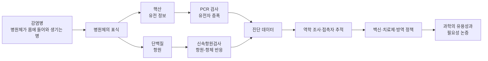
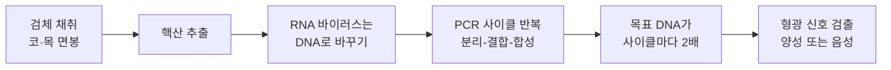
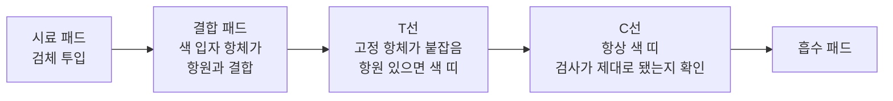
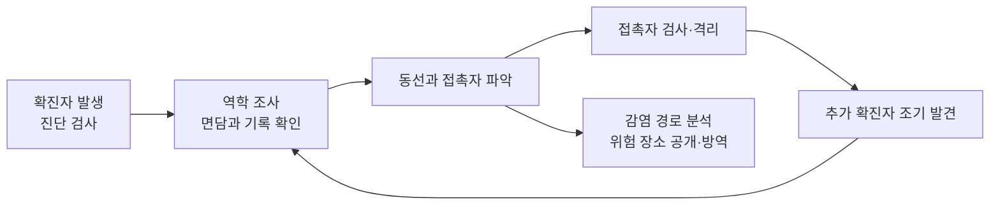

# 6-1. 감염병과 과학의 유용성 — 보이지 않는 적을 찾아내는 과학

> [!NOTE]
> **성취기준 [10통과2-03-01]** 감염병의 진단, 추적 등을 사례로 과학의 유용성을 설명하고, 미래 사회 문제 해결에서 과학의 필요성에 대해 논증할 수 있다.

**학습 목표**

1. 감염병의 뜻을 알고, 세균과 바이러스 등 병원체의 특징을 비교하여 설명할 수 있다.
2. 핵산 기반 진단(PCR)과 단백질 기반 진단(신속항원검사)의 원리를 '유전자 증폭'과 '항원–항체 반응' 수준에서 설명하고, 두 방법의 장단점을 비교할 수 있다.
3. 역학 조사와 접촉자 추적에 데이터가 활용되는 사례를 들어 감염병 대응에서 과학의 유용성을 설명할 수 있다.
4. 감염병 대응 사례를 근거로 들어 미래 사회 문제 해결에서 과학이 왜 필요한지 논증할 수 있다.

**이 단원의 학습 사다리**

| 단계 | 무엇을 하나? |
|---|---|
| STEP 1. 중학교 다시 보기 | 재해·재난으로서의 감염병, 세포와 유전자, 그리고 앞 단원(유전자와 단백질)을 꺼내 본다 |
| STEP 2. 기초 다지기 | 상보적 염기, '2배씩 늘어나는 수', 특이성(자물쇠와 열쇠), 2×2 표 읽기를 디딤돌로 놓는다 |
| STEP 3. 핵심 개념 | 병원체 → 핵산 진단(PCR) → 단백질 진단(신속항원검사) → 역학 조사·추적 → 백신·치료제와 과학의 필요성 논증 |
| STEP 4. 오개념 바로잡기 | "감기에는 항생제", "음성이면 확실히 안전" 같은 착각을 바로잡는다 |
| STEP 5. 선택과목·대학 | 감염병 수학 모형(SIR), 집단 면역 문턱값, 검사의 민감도·특이도 |
| STEP 6. 산업·진로 | 체외 진단 기기, 백신·바이오의약품, 감염병 감시, 원헬스 |

---

## 🗺️ 단원 들어가기

2020년 1월 20일, 우리나라에서 코로나19 첫 확진자가 확인되었다. 그로부터 약 50일 뒤인 2020년 3월 11일, 세계보건기구(WHO)는 코로나19를 **세계적 대유행(pandemic)** 으로 선언하였다. 눈에 보이지도 않는 지름 약 100 nm(나노미터)의 바이러스 하나가 전 세계의 학교, 공항, 공장을 멈추게 한 것이다.

그런데 이 바이러스를 상대로 인류가 처음 한 일은 무엇이었을까? 바로 **"누가 감염되었는지 알아내는 것"** 과 **"어디로 퍼지고 있는지 따라가는 것"** 이었다. 눈에 보이지 않는 적을 찾아내려면 그 적만이 가진 **표식**을 알아야 한다. 과학자들은 바이러스의 **유전 정보(핵산)** 와 바이러스를 이루는 **단백질**을 표식으로 삼았다.

> 코 안쪽을 면봉으로 훑어 낸 검사 하나에는 어떤 과학이 숨어 있을까? 15분 만에 결과가 나오는 자가 검사 키트가 있는데, 왜 시간이 더 걸리는 PCR 검사도 계속 필요했을까?

이 단원에서는 감염병을 **진단**하고 **추적**하는 과학을 살펴보고, 이를 근거로 "미래 사회의 문제를 해결하는 데 과학이 왜 필요한가?"라는 질문에 스스로 답해 본다.

---

## STEP 1. 🔙 중학교 다시 보기

### 연계 개념표 — 중학교 연계

| 중학교 성취기준 | 중학교에서 배운 것 | 고등학교에서 확장되는 것 |
|---|---|---|
| [9과22-01] | 재해·재난 사례(감염병 질병 확산 등)를 조사하고 발생 원인과 피해를 과학적으로 분석한다 | 감염병의 원인을 **병원체**와 **전파 경로**로 분석하고, 확산을 **데이터**로 추적한다 |
| [9과22-02] | 과학적 원리를 이용하여 재해·재난의 대비 및 대처 방안을 세운다(사전 예방 포함) | 진단 → 추적 → 격리·치료 → 백신으로 이어지는 **과학 기반 대응 체계**를 이해한다 |
| [9과01-01] | 과학적 탐구 방법을 이해하고 일상 문제의 과학적 해결 방안을 제안한다 | 가설 → 검사 → 증거로 감염 여부를 판단하고, 미래 문제 해결에서 과학의 필요성을 **논증**한다 |
| [9과02-01] | 세포는 생명 활동이 일어나는 기본 단위이다 | 세포로 이루어진 **세균**과 세포 구조가 없는 **바이러스**를 구분한다 |
| [9과21-02] | 염색체와 유전자의 관계 | 유전자의 본체인 핵산을 **증폭**하여 병원체를 찾아낸다 |

### 연계 개념표 — 앞 단원 연계

이 단원은 통합과학의 마무리 단원이다. 앞에서 배운 개념들이 감염병 대응 곳곳에서 다시 등장한다.

| 앞 단원 | 거기서 배운 것 | 이 단원에서 쓰이는 곳 |
|---|---|---|
| 3-6 유전자와 단백질 | DNA의 유전 정보 → (전사) → RNA → (번역) → 단백질 | 핵산 검사는 병원체의 **유전 정보**를, 항원 검사는 병원체의 **단백질**을 찾는다. mRNA 백신은 '번역'을 이용한다 |
| 3-5 생명 시스템과 물질대사 | 효소는 특정한 기질에만 작용한다(기질 특이성) | PCR에서 DNA를 복사하는 **효소**, 항원과 항체의 **특이적 결합** |
| 1-4 정보와 신호 | 측정한 신호가 디지털 정보가 된다 | 검사 결과와 위치 기록이 **디지털 데이터**가 되어 역학 조사에 쓰인다 |
| 1-3 측정과 어림 | 모든 측정에는 오차가 있다 | 검사에도 **위양성·위음성**이라는 오류가 있다 |
| 4-2 진화와 생물다양성 | 변이와 자연선택 | 바이러스의 **변이**, 항생제에 견디는 **내성 세균**의 등장 |

### 준비 운동 (사전 진단)

**Q1.** 바이러스는 크기가 아주 작은 세균이다. (O / X)

**Q2.** 중학교에서 배운 재해·재난 중 감염병이 지진이나 태풍과 다른 점을 한 가지 쓰시오.

**Q3.** 유전자에 대한 설명으로 옳은 것을 모두 고르시오.
ㄱ. 유전자는 DNA의 특정 부분이다. ㄴ. 생물마다 유전 정보(염기 서열)가 다르다. ㄷ. 유전 정보에 따라 단백질이 만들어진다.

**Q4.** 1개가 1번 나뉠 때마다 2배가 된다면, 10번 나뉜 뒤에는 약 몇 개가 될까?

정답 및 해설

**Q1. X** — 세균은 스스로 물질대사를 하는 **세포**이지만, 바이러스는 세포 구조가 없고 살아 있는 세포 안에서만 증식한다. 크기만 다른 것이 아니라 **구조와 생활 방식이 근본적으로 다르다.**

**Q2.** (예시) 감염병은 사람에서 사람으로 **전파되어 스스로 확산**된다. 따라서 피해 규모가 시간에 따라 빠르게 커질 수 있고, 사람들의 행동(마스크, 거리 두기, 예방 접종)에 따라 피해가 달라진다.

**Q3. ㄱ, ㄴ, ㄷ** — 3-6 단원에서 배운 것처럼 유전자의 유전 정보는 전사와 번역을 거쳐 단백질로 나타난다. 생물(병원체)마다 염기 서열이 다르다는 점이 **진단의 열쇠**가 된다.

**Q4.** $2^{10} = 1024$, 약 1000개이다. 이 '2배씩 늘어나기'가 PCR의 핵심이다.

---

## STEP 2. 🧱 기초 다지기

### ① 핵산의 두 가닥은 서로 '짝'이 맞는다

3-6 단원에서 배운 것처럼 DNA는 **두 가닥**이 마주 보며 꼬여 있고, 각 가닥의 염기는 정해진 짝끼리만 마주 본다.

- **A(아데닌)** 는 **T(타이민)** 와, **G(구아닌)** 는 **C(사이토신)** 와 짝을 이룬다. 이를 **상보적(complementary) 결합**이라 한다.
- 따라서 한 가닥의 염기 서열을 알면 다른 가닥의 서열도 알 수 있다. 예: `ATGC` ↔ `TACG`
- RNA는 보통 한 가닥이며, T 대신 **U(유라실)** 를 가진다.

> [!TIP]
> 💡 **비유** — DNA 두 가닥은 '지퍼'와 같다. 지퍼의 이가 정확히 맞물려야 잠기듯, 염기도 짝이 맞아야 붙는다. 열을 가하면 지퍼가 열리듯 두 가닥이 떨어지고, 식으면 짝이 맞는 상대와 다시 붙는다.

### ② 2배씩 늘어나는 수 — 지수적 증가

어떤 양이 일정한 단계마다 2배가 되면, $n$번 뒤의 양은 처음 양의 $2^n$배이다.

$$
N = N_0 \times 2^{n}
$$

| 단계 수 $n$ | 5 | 10 | 20 | 30 |
|---|---|---|---|---|
| $2^n$ | 32 | 1024 | 약 105만 | 약 10억 7천만 |

- 기억 요령: $2^{10} = 1024 \approx 10^3$ 이므로 $2^{20} \approx 10^6$, $2^{30} \approx 10^9$이다.
- 처음에는 느리게 늘어나는 것 같지만 단계가 쌓이면 폭발적으로 커진다. PCR도, 감염병의 초기 확산도 이런 모양을 보인다.

### ③ 특이성 — 자물쇠와 열쇠

3-5 단원에서 효소는 모양이 맞는 **특정한 기질에만** 작용한다고 배웠다. 이처럼 상대를 골라서 결합하는 성질을 **특이성(specificity)** 이라 한다.

- 진단 기술은 모두 이 특이성을 이용한다. **병원체에만 있는 표식**에만 결합하는 물질을 쓰면, 수많은 물질이 섞인 콧물 속에서도 병원체만 골라 찾아낼 수 있다.
- 핵산 진단: 병원체의 특정 염기 서열에만 짝이 맞는 짧은 핵산 조각을 쓴다.
- 단백질 진단: 병원체의 특정 단백질에만 결합하는 **항체**를 쓴다.

> [!TIP]
> 💡 **비유** — 학교 사물함 수백 개 중 내 사물함을 여는 방법은 '내 열쇠'를 꽂아 보는 것이다. 열쇠가 맞는 단 하나의 자물쇠만 열린다. 진단 키트는 병원체라는 자물쇠에 맞는 열쇠를 들고 다니는 셈이다.

### ④ 2×2 표 읽기

검사 결과는 '실제로 감염되었는가'와 '검사가 양성으로 나왔는가'의 두 기준으로 나눌 수 있다.

| | 실제 감염됨 | 실제 감염 안 됨 |
|---|---|---|
| **검사 양성** | 참양성(맞게 찾아냄) | **위양성**(없는데 있다고 함) |
| **검사 음성** | **위음성**(있는데 놓침) | 참음성(맞게 없다고 함) |

1-3 단원에서 배운 것처럼 모든 측정에는 오차가 있다. 진단 검사도 측정이므로 **완벽한 검사는 없다.** 어떤 오류가 얼마나 생기는지 아는 것이 중요하다.

---

## STEP 3. 📘 핵심 개념

### 6-1-① 감염병과 병원체

**감염병(infectious disease)** 은 **병원체(pathogen)** 가 사람이나 동물의 몸에 들어와 증식하면서 생기는 병이다. 사람에서 사람으로, 또는 동물·물·음식·매개 곤충을 통해 **전파**될 수 있다는 점이 다른 질병과 다르다.

| 병원체 | 특징 | 대표적인 감염병 | 주요 치료·예방 |
|---|---|---|---|
| **세균(bacteria)** | 핵막이 없는 단세포 생물. 스스로 물질대사와 증식을 한다. 크기 대략 1~수 μm | 결핵, 콜레라, 세균성 이질 | 항생제, 예방 접종(일부) |
| **바이러스(virus)** | 세포 구조가 없다. 유전 물질(DNA 또는 RNA)을 단백질 껍질이 감싼 구조. 살아 있는 세포 안에서만 증식. 크기 대략 수십~수백 nm | 독감(인플루엔자), 코로나19, 홍역, 수두 | 항바이러스제(일부), 예방 접종 |
| **원생생물** | 핵이 있는 단세포 생물 | 말라리아(모기가 매개) | 항말라리아제, 모기 방제 |
| **균류(곰팡이)** | 핵이 있는 세포. 포자로 번식 | 무좀 | 항진균제 |

> [!IMPORTANT]
> 세균과 바이러스는 크기만 다른 것이 아니다. **세균은 세포이고, 바이러스는 세포가 아니다.** 그래서 세균의 세포벽이나 물질대사를 공격하는 **항생제는 바이러스에 효과가 없다.**

**전파 경로**를 알아야 막는 방법을 정할 수 있다.

| 전파 경로 | 예 | 막는 방법 |
|---|---|---|
| 비말(침방울)·공기 | 독감, 코로나19, 결핵, 홍역 | 마스크, 환기, 거리 두기 |
| 접촉 | 손에 묻은 병원체가 눈·코·입으로 | 손 씻기, 표면 소독 |
| 물·음식 | 콜레라, 장티푸스 | 끓인 물, 상하수도 분리, 위생적인 조리 |
| 매개 동물·곤충 | 말라리아(모기), 일본뇌염(모기) | 모기장, 방충망, 서식지 관리 |

#### 과학은 어떻게 '보이지 않는 원인'을 찾았나

19세기 중반까지 많은 사람은 감염병이 나쁜 공기(독기)에서 생긴다고 믿었다. 1860년대 파스퇴르는 미생물이 들어가지 못하게 한 플라스크에서는 고기즙이 썩지 않음을 보였고, 1882년 코흐는 결핵의 원인이 되는 세균을 찾아냈다. **"특정한 병원체가 특정한 병을 일으킨다"** 는 생각(세균설)이 증거로 확립되면서 손 씻기, 소독, 상하수도 정비, 백신 개발이 체계적으로 시작되었다. 감염병과의 싸움에서 과학의 첫 번째 쓸모는 **원인을 정확히 아는 것**이었다.

### 6-1-② 핵산을 이용한 진단 — PCR 검사

병원체마다 유전 정보, 즉 **염기 서열**이 다르다. 그러므로 환자의 검체(콧물, 가래 등)에서 **특정 병원체에만 있는 염기 서열**을 찾으면 그 병원체에 감염되었는지 알 수 있다. 문제는 검체 속 병원체의 핵산이 **너무 적어서** 그대로는 검출하기 어렵다는 점이다.

**중합 효소 연쇄 반응(PCR, polymerase chain reaction)** 은 원하는 DNA 부분만 골라 **수억 배 이상 복사(증폭)** 하는 기술이다. 1983년 멀리스(K. Mullis)가 고안하였고, 이 공로로 1993년 노벨 화학상을 받았다.

#### PCR의 한 사이클 — 세 단계

| 단계 | 온도(대략) | 일어나는 일 | 지퍼 비유 |
|---|---|---|---|
| ① 분리 | 약 95 °C | 높은 온도에서 DNA 두 가닥이 떨어진다 | 지퍼를 연다 |
| ② 결합 | 약 55~65 °C | 온도를 낮추면 **프라이머**(찾고 싶은 부분의 양 끝에 짝이 맞는 짧은 핵산 조각)가 상보적인 위치에 붙는다 | 찾는 구간 양 끝에 표시를 붙인다 |
| ③ 합성 | 약 72 °C | **DNA 중합 효소**가 프라이머에서 시작해 짝이 맞는 염기를 이어 붙여 새 가닥을 만든다 | 표시 사이를 새 지퍼 이로 채운다 |

한 사이클이 끝나면 목표 DNA가 **2배**가 된다. 이 사이클을 30~40번 되풀이하면 처음 몇 개였던 목표 DNA가 수억~수십억 개로 늘어나 검출할 수 있게 된다.

- **프라이머가 열쇠이다.** 찾고 싶은 병원체에만 있는 서열에 짝이 맞도록 만들기 때문에, 다른 생물의 DNA는 거의 증폭되지 않는다(특이성).
- 높은 온도를 반복해도 망가지지 않는 효소가 필요하다. 그래서 뜨거운 온천에 사는 세균에서 얻은 **열에 강한 DNA 중합 효소**를 쓴다.
- 코로나19 바이러스처럼 **RNA를 유전 물질로 가진 바이러스**는 먼저 RNA를 DNA로 바꾸는 단계(역전사)를 거친 뒤 PCR을 한다.

#### 예제 1 — 얼마나 늘어날까?

검체 속에 목표 DNA가 10개 들어 있었다. PCR을 30사이클 진행하면 목표 DNA는 약 몇 개가 될까? (매 사이클마다 정확히 2배가 된다고 가정한다.)

**풀이**
$N = N_0 \times 2^{n} = 10 \times 2^{30} = 10 \times 1\,073\,741\,824 \approx 1.07 \times 10^{10}$

약 **107억 개**가 된다. 처음에는 검출할 수 없을 만큼 적던 양이 30번의 반복만으로 검출 가능한 양이 된다.

#### 실시간 PCR과 Ct 값 — 결과를 '숫자'로 읽기

요즘 진단에 쓰는 **실시간 PCR(real-time PCR)** 은 목표 DNA가 늘어날 때 함께 강해지는 **형광 신호**를 매 사이클 측정한다. 형광이 기준선을 처음 넘는 사이클 수를 **Ct 값(cycle threshold)** 이라 한다.

- 처음 검체에 병원체 핵산이 **많을수록** 빨리 기준선에 도달하므로 **Ct 값이 작다.**
- 적을수록 오래 걸리므로 **Ct 값이 크다.**
- 일정 사이클(예: 40사이클)까지 기준선을 넘지 않으면 음성으로 판정한다.

#### 예제 2 — Ct 값 해석하기 (자료 해석)

두 사람 A, B의 실시간 PCR 결과 Ct 값이 A는 20, B는 26이었다. (1) 누구의 검체에 바이러스 핵산이 더 많았는가? (2) 약 몇 배 많았는가? (매 사이클 2배 증폭을 가정한다.)

**풀이**
(1) Ct 값이 작은 **A**이다. 더 적은 사이클만에 기준선에 도달했기 때문이다.
(2) B는 A보다 6사이클을 더 증폭해야 같은 양에 도달했다. 따라서 처음 양은 A가 $2^{6} = 64$배 많았다.

> [!WARNING]
> Ct 값은 검체를 얼마나 잘 채취했는지, 어떤 장비와 시약을 썼는지에 따라서도 달라진다. 따라서 Ct 값만으로 "전염력이 몇 배"라고 단정해서는 안 된다. **측정 조건이 같을 때** 비교해야 의미가 있다(1-3 단원: 측정 조건과 오차).

### 6-1-③ 단백질을 이용한 진단 — 신속항원검사

바이러스는 유전 물질과 함께 **단백질**로 이루어져 있다. 우리 몸의 면역 체계는 이런 외부 물질을 알아보고 대응하는데, 이때 면역 반응을 일으키는 물질을 **항원(antigen)**, 항원에 특이적으로 결합하는 단백질을 **항체(antibody)** 라 한다.

- 항체는 자신과 모양이 맞는 **특정 항원에만** 결합한다. 이를 **항원–항체 반응**이라 한다(특이성).
- 진단 키트는 병원체의 특정 단백질(항원)에 결합하는 항체를 미리 만들어 넣어 둔다.

#### 신속항원검사 키트의 구조

신속항원검사 키트는 종이처럼 얇은 막 위로 액체가 **한 방향으로 스며 이동**하는 성질을 이용한다(측면 흐름 방식).

| 위치 | 들어 있는 것 | 하는 일 |
|---|---|---|
| ① 시료 패드 | — | 검체 용액을 떨어뜨리는 곳 |
| ② 결합 패드 | **색 입자가 붙은 항체** | 검체에 항원이 있으면 항원과 결합한다. 결합한 채로 함께 이동한다 |
| ③ 검사선(T선) | 막에 고정된 항체 | '항원 + 색 입자 항체' 덩어리를 붙잡는다 → **색 띠가 나타난다** |
| ④ 대조선(C선) | 색 입자 항체를 붙잡는 물질 | 항원 유무와 상관없이 액체가 잘 흘러왔다면 **항상 색 띠가 나타난다** |
| ⑤ 흡수 패드 | — | 남은 액체를 빨아들여 흐름을 유지한다 |

#### 결과 읽기

| C선 | T선 | 판정 | 이유 |
|---|---|---|---|
| 나타남 | 나타나지 않음 | **음성** | 액체는 잘 흘렀지만 붙잡힌 항원이 없다 |
| 나타남 | 나타남(흐려도) | **양성** | 항원이 색 입자 항체와 함께 T선에 붙잡혔다 |
| 나타나지 않음 | 상관없음 | **무효** — 다시 검사 | 액체가 제대로 흐르지 않았거나 키트가 불량이다 |

#### 예제 3 — 키트 판정하기

네 명의 검사 결과가 다음과 같다. 각각 판정하시오.
가: C선만 진함 나: C선 진함, T선 아주 흐림 다: T선만 나타남 라: 아무 선도 없음

**풀이**
- 가: **음성**
- 나: **양성** — T선은 흐려도 나타나면 양성으로 본다(항원 양이 적을 수 있다).
- 다: **무효** — C선이 없으면 검사 과정 자체를 믿을 수 없다.
- 라: **무효**

> [!TIP]
> 💡 **비유** — C선은 시험지의 '이름 쓰는 칸'과 같다. 이름 칸이 비어 있으면 답이 맞든 틀리든 채점할 수 없다. C선이 없으면 T선이 있든 없든 결과를 믿을 수 없다.

#### 핵산 진단과 단백질 진단 비교

| 구분 | PCR 검사(핵산 기반) | 신속항원검사(단백질 기반) |
|---|---|---|
| 찾는 표식 | 병원체의 **유전 정보(염기 서열)** | 병원체의 **단백질(항원)** |
| 핵심 원리 | 유전자 증폭(상보적 결합 + 효소) | 항원–항체 반응(특이적 결합) |
| 증폭 단계 | 있다 → 아주 적은 양도 찾는다 | 없다 → 항원이 어느 정도 많아야 보인다 |
| 정확도 | 높다 | PCR보다 낮다. 특히 **위음성**이 더 많다 |
| 결과까지 시간 | 검사실에서 수 시간(이송 포함 보통 하루 이내) | 약 15~30분 |
| 장비·인력 | 검사실, 정밀 장비, 숙련된 인력 | 장비 없이 현장·가정에서 가능 |
| 쓰임 | **확진**(정확한 판정) | **선별**(많은 사람을 빠르게 거르기) |

> [!IMPORTANT]
> 두 검사는 경쟁 관계가 아니라 **역할 분담** 관계이다. 신속항원검사로 많은 사람을 빠르게 거르고, 양성이거나 의심되는 사람은 PCR로 정확히 확인한다. "빠름"과 "정확함"을 함께 얻는 과학적 설계이다.

#### 예제 4 — 위음성과 위양성 (자료 해석)

어떤 감염병의 신속항원검사를 실제 감염자 100명과 비감염자 900명에게 실시한 결과가 다음과 같았다. (설명을 위해 가정한 값이다.)

| | 실제 감염 100명 | 실제 비감염 900명 |
|---|---|---|
| 검사 양성 | 80명 | 9명 |
| 검사 음성 | 20명 | 891명 |

(1) 위음성은 몇 명인가? 실제 감염자 중 몇 %를 놓쳤는가?
(2) 검사 양성이 나온 사람 중 실제 감염자의 비율은 약 몇 %인가?
(3) 이 결과로 볼 때, 증상이 뚜렷한데 신속항원검사가 음성인 사람에게 어떤 조언을 해야 할까?

**풀이**
(1) 감염자인데 음성이 나온 사람이 위음성이다. **20명**, $\dfrac{20}{100} \times 100 = 20\%$를 놓쳤다.
(2) 양성은 $80 + 9 = 89$명이고 그중 실제 감염자는 80명이다. $\dfrac{80}{89} \times 100 \approx 90\%$
(3) 감염자 5명 중 1명꼴로 음성이 나오므로 **음성이라고 감염되지 않았다고 단정할 수 없다.** 증상이 있으면 다시 검사하거나 PCR 검사를 받고, 그동안 다른 사람과의 접촉을 줄이는 것이 좋다.

### 6-1-④ 역학 조사와 추적 — 데이터로 감염의 길을 따라가다

**역학(epidemiology)** 은 질병이 **누구에게, 언제, 어디서, 왜** 생기고 퍼지는지를 집단 수준에서 연구하는 학문이다. 한 사람의 진단이 '점'이라면, 역학 조사는 그 점들을 이어 **감염의 길(선)** 을 찾아내는 일이다.

#### 역학의 출발 — 1854년 런던의 지도

1854년 영국 런던에서 콜레라가 크게 유행하였다. 의사 존 스노(J. Snow)는 사망자가 나온 집을 지도에 점으로 표시하였고, 사망자가 **특정 거리의 공용 물 펌프 주변에 몰려 있다**는 사실을 발견하였다. 그 펌프의 손잡이를 떼어 사용을 막자 그 지역의 유행이 잦아들었다. 콜레라균이 발견되기도 전에 **데이터를 모으고 시각화하여 원인을 추론**한 것이다. 이는 오늘날 역학 조사의 원형이 되었다.

#### 접촉자 추적의 과정

코로나19 유행 초기 우리나라는 **검사(Test) – 추적(Trace) – 치료(Treat)** 를 중심으로 대응하였다. 이 과정에서 다음과 같은 데이터가 쓰였다.

| 데이터 | 무엇을 알 수 있나 | 생각해 볼 점 |
|---|---|---|
| 면담 기록 | 확진자가 기억하는 방문 장소와 만난 사람 | 기억이 부정확할 수 있다 |
| 카드 사용 기록 | 결제한 시각과 장소 | 현금 사용은 남지 않는다 |
| 휴대전화 위치 정보 | 이동 경로 | 위치 정확도에 한계, **개인정보 침해** 우려 |
| 전자출입명부(QR 코드) | 특정 시설에 같은 시간대에 있었던 사람 | 수집 목적 외 사용 금지, 일정 기간 뒤 파기 |
| 하수(생활 하수) 검사 | 지역 전체의 바이러스 유행 추세 | 개인을 특정하지 않는 감시 방법 |

#### 예제 5 — 추적이 왜 효과가 있을까? (모형 해석)

한 감염자가 평균적으로 새로 감염시키는 사람 수가 2명이라고 하자. 처음 감염자가 1명이면 감염 세대가 지날 때마다 새 감염자 수는 1 → 2 → 4 → 8 → … 로 늘어난다.
(1) 5번째 세대의 새 감염자 수는 몇 명인가?
(2) 접촉자 추적과 격리로 한 감염자가 감염시키는 사람 수를 평균 0.5명으로 줄였다면 새 감염자 수는 어떻게 변할까?

**풀이**
(1) 세대마다 2배이므로 $1 \times 2^{5} = 32$명이다.
(2) 세대마다 0.5배가 되므로 1 → 0.5 → 0.25 → … 로 **줄어들어** 유행이 잦아든다.

이처럼 감염자 한 명이 평균 몇 명을 감염시키는지가 **1보다 큰가, 작은가**에 따라 유행이 커지거나 줄어든다. 접촉자를 빨리 찾아 격리하면 이 수를 1보다 작게 만들 수 있다. 이것이 **추적의 과학적 의미**이다.

> [!WARNING]
> 추적은 강력한 도구이지만 **개인정보와 사생활**을 다룬다. 확진자의 동선을 지나치게 자세히 공개하면 사생활 침해와 낙인 문제가 생길 수 있다. 방역의 공익과 개인의 권리를 어떻게 조화시킬지는 6-2(빅데이터)와 6-4(과학기술과 윤리)에서 더 깊이 다룬다.

### 6-1-⑤ 백신·치료제, 그리고 과학의 필요성 논증

#### 백신 — 몸에 '수배 전단'을 미리 보내기

**백신(vaccine)** 은 병원체 전체나 그 일부(단백질 등), 또는 그 단백질을 만들 정보를 몸에 넣어 **실제 감염 전에 면역 기억을 만들어 두는 것**이다. 다음에 진짜 병원체가 들어오면 면역 체계가 빠르게 알아보고 대응한다.

| 백신 방식 | 몸에 넣는 것 | 비고 |
|---|---|---|
| 약독화·불활성화 백신 | 약하게 만들거나 죽인 병원체 | 오래 쓰인 전통적 방식 |
| 단백질(합성항원) 백신 | 병원체의 특정 단백질 | 항원만 넣어 면역 유도 |
| **mRNA 백신** | 병원체 단백질을 만드는 정보가 담긴 **mRNA** | 우리 세포가 mRNA를 **번역**하여 항원 단백질을 만들고, 면역 체계가 이를 기억한다 |

> [!TIP]
> 💡 **3-6 단원과 연결** — mRNA 백신은 '유전 정보 → 단백질'이라는 세포 내 정보의 흐름 중 **번역** 과정을 그대로 이용한다. mRNA는 세포질에서 단백질을 만드는 데 쓰인 뒤 분해되며, 핵 속 DNA로 들어가 유전 정보를 바꾸지 않는다. mRNA 백신의 바탕 기술을 연구한 커리코(K. Karikó)와 와이스먼(D. Weissman)은 2023년 노벨 생리의학상을 받았다.

백신의 역사는 과학의 유용성을 보여 주는 대표 사례이다. 1796년 제너(E. Jenner)가 우두를 이용한 천연두 예방법을 시험하였고, 이후 전 세계적인 예방 접종 사업으로 세계보건기구는 1980년 **천연두 근절**을 선언하였다. 인류가 감염병 하나를 지구에서 완전히 없앤 첫 사례이다.

#### 치료제 — 항생제와 항바이러스제

- **항생제**: 세균의 세포벽, 단백질 합성 등 세균만의 구조와 기능을 공격한다. 1928년 플레밍(A. Fleming)이 푸른곰팡이에서 페니실린의 작용을 발견하였다.
- **항바이러스제**: 바이러스는 우리 세포 안에서 증식하므로, 우리 세포는 해치지 않으면서 바이러스의 증식 단계만 막는 약을 만들기가 어렵다. 그래서 바이러스 감염병은 **예방(백신)** 이 특히 중요하다.
- **항생제 내성**: 항생제를 함부로 쓰면 우연히 내성을 가진 세균만 살아남아 늘어난다(4-2 단원의 **자연선택**). 그래서 항생제는 꼭 필요할 때, 처방대로 끝까지 먹어야 한다.

#### 과학의 필요성을 논증하기

**논증(argument)** 은 근거를 들어 주장을 정당화하는 것이다. 다음 세 요소를 갖추면 설득력 있는 논증이 된다.

| 요소 | 뜻 | 예시 |
|---|---|---|
| 주장 | 내가 말하고 싶은 결론 | 미래 사회의 감염병 문제를 해결하려면 과학이 반드시 필요하다 |
| 근거 | 주장을 뒷받침하는 사실·자료 | 코로나19 유행 초기 PCR 진단법이 빠르게 개발되어 대규모 검사가 가능했다. 천연두는 백신으로 근절되었다 |
| 이유(연결) | 근거가 왜 주장을 뒷받침하는지 | 병원체는 눈에 보이지 않으므로 핵산·단백질 같은 과학적 표식과 데이터 없이는 감염자를 찾고 확산을 막을 수 없다 |

#### 예제 6 — 논증 완성하기 (논증형)

다음 자료를 근거로 "미래 사회 문제 해결에 과학이 필요하다"는 주장을 논증하는 글을 3~4문장으로 쓰시오.
- 자료 1: 기후변화로 기온이 오르면 모기 같은 매개 곤충이 살 수 있는 지역이 넓어질 수 있다(5-3 단원).
- 자료 2: 새로운 감염병의 상당수는 동물에서 사람으로 넘어온다.
- 자료 3: 바이러스는 증식하면서 계속 변이가 생긴다.

**예시 답안**
미래 사회에는 기후변화로 매개 곤충의 서식 범위가 넓어지고, 동물에서 사람으로 넘어오는 새로운 병원체도 계속 나타날 수 있다(근거). 이런 병원체는 눈에 보이지 않고 계속 변이하기 때문에, 그 유전 정보를 빠르게 분석하여 진단법을 만들고 확산 데이터를 추적하는 과학적 방법 없이는 대응할 수 없다(이유). 따라서 미래의 감염병 문제를 해결하려면 진단·감시·백신 개발 같은 과학기술 역량을 미리 갖추어야 한다(주장).

> [!NOTE]
> 과학이 필요하다는 주장에는 **한계도 함께 인정**하는 것이 좋은 논증이다. 예를 들어 "과학기술만으로는 부족하며, 사람들의 협조, 공정한 백신 분배, 사생활 보호 같은 사회적 합의가 함께 필요하다"는 내용을 덧붙이면 더 균형 잡힌 논증이 된다.

---

## STEP 4. ⚠️ 오개념 바로잡기

| 흔한 오개념 | 올바른 개념 | 왜 그럴까? |
|---|---|---|
| 감기나 독감에 걸리면 항생제를 먹어야 빨리 낫는다 | 항생제는 **세균**에 작용하며 **바이러스**에는 효과가 없다 | 바이러스는 세포가 아니어서 항생제가 공격할 세포벽 등이 없다. 불필요한 항생제는 내성균만 늘린다 |
| 바이러스는 아주 작은 세균이다 | 세균은 **세포**, 바이러스는 **세포가 아닌** 핵산과 단백질 덩어리이다 | 바이러스는 스스로 물질대사를 하지 못하고 숙주 세포 안에서만 증식한다 |
| 신속항원검사에서 음성이면 감염되지 않은 것이 확실하다 | 신속항원검사는 **위음성**이 비교적 많다 | 증폭 단계가 없어 항원이 적으면 T선이 나타나지 않을 수 있다 |
| PCR은 바이러스를 키워서(배양해서) 찾는 검사이다 | PCR은 바이러스가 아니라 **핵산의 특정 부분만** 복사한다 | 증폭되는 것은 DNA 조각이며, 살아 있는 바이러스가 늘어나는 것이 아니다 |
| mRNA 백신은 내 유전자(DNA)를 바꾼다 | mRNA는 세포질에서 단백질을 만드는 데 쓰인 뒤 **분해**된다 | 3-6 단원의 정보 흐름에서 mRNA는 번역의 '설계도 복사본'일 뿐, 핵 속 DNA로 되돌아가지 않는다 |
| 백신을 맞으면 그 병에 절대 걸리지 않는다 | 백신은 감염·중증 위험을 **크게 줄이지만** 100%는 아니다 | 면역 반응은 사람마다 다르고, 시간이 지나면 약해지거나 변이로 효과가 줄 수 있다 |

---

## STEP 5. 🎓 선택과목·대학으로 한 걸음 더

> [!CAUTION]
> 이 절은 **통합과학 교육과정 범위 밖의 심화 내용**으로 평가 대상이 아니다. "이 개념이 앞으로 어디까지 이어지는가"를 맛보기로 보여 주기 위한 내용이다.

### 고2·3 선택과목과의 연결

| 과목 | 이어지는 내용 |
|---|---|
| 생명과학 | 항상성과 몸의 조절에서 우리 몸의 **방어 작용(면역)**, 병원체의 종류와 질병 |
| 생물의 유전 | 유전자와 유전 물질, 유전자 발현, PCR 등 **생명공학 기술** |
| 세포와 물질대사 | 세포의 구조, 효소의 작용 원리 |
| 확률과 통계(수학) | 조건부 확률 → 검사 결과의 해석 |
| 기후변화와 환경생태 | 기후변화와 감염병 매개체 분포의 변화 |

### ① 역학 — 감염병을 수식으로 그리기 (SIR 모형)

대학의 **역학(epidemiology)**, 수리생물학에서는 인구를 감수성자 $S$(아직 감염되지 않음), 감염자 $I$, 회복자 $R$로 나누어 시간에 따른 변화를 미분방정식으로 나타낸다.

$$
\frac{dS}{dt} = -\beta \frac{SI}{N}, \qquad
\frac{dI}{dt} = \beta \frac{SI}{N} - \gamma I, \qquad
\frac{dR}{dt} = \gamma I
$$

($\beta$: 전파율, $\gamma$: 회복률, $N$: 전체 인구) 이때 아무도 면역이 없는 집단에서 감염자 1명이 평균적으로 감염시키는 사람 수를 **기초 감염 재생산 수** $R_0 = \beta/\gamma$라 한다. STEP 3의 예제 5에서 본 "1보다 크면 확산, 작으면 감소"가 바로 이 수의 의미이다.

**집단 면역 문턱값** 인구 중 면역을 가진 사람의 비율이 다음 값을 넘으면, 감염자 1명이 실제로 감염시키는 사람 수가 1보다 작아져 유행이 커지지 못한다.

$$
p_c = 1 - \frac{1}{R_0}
$$

예를 들어 $R_0 = 3$이면 $p_c = 1 - \frac{1}{3} \approx 67\%$이다. 전파력이 매우 강한 홍역은 $R_0$를 흔히 약 12~18로 보는데, 이때 $p_c$는 약 92~94%가 되어 매우 높은 예방 접종률이 필요하다.

### ② 진단 검사의 통계 — 민감도, 특이도, 양성 예측도

| 지표 | 정의 | STEP 3 예제 4의 값 |
|---|---|---|
| **민감도(sensitivity)** | 실제 감염자 중 양성이 나온 비율 | $80/100 = 80\%$ |
| **특이도(specificity)** | 실제 비감염자 중 음성이 나온 비율 | $891/900 = 99\%$ |
| **양성 예측도(PPV)** | 양성이 나온 사람 중 실제 감염자 비율 | $80/89 \approx 90\%$ |

양성 예측도는 검사의 성능뿐 아니라 **그 집단에 감염자가 얼마나 많은가(유병률)** 에 따라 크게 달라진다. 민감도 90%, 특이도 98%인 검사를 1만 명에게 한다고 하자.

| 유병률 | 참양성 | 위양성 | 양성 예측도 |
|---|---|---|---|
| 1%(감염자 100명) | $100 \times 0.9 = 90$ | $9900 \times 0.02 = 198$ | $90/288 \approx 31\%$ |
| 20%(감염자 2000명) | $2000 \times 0.9 = 1800$ | $8000 \times 0.02 = 160$ | $1800/1960 \approx 92\%$ |

같은 검사라도 감염자가 드문 집단에서는 양성 중 상당수가 위양성일 수 있다. 대학 통계학에서는 이를 **베이즈 정리(Bayes' theorem)** 로 다룬다.

### ③ 분자진단과 면역학

- **정량 PCR**: 실제 증폭 효율 $E$($0 < E \le 1$)를 고려하면 $N = N_0(1+E)^n$이다. 대학 분자생물학 실험에서는 표준 곡선을 그려 Ct 값으로부터 처음 핵산의 양을 계산한다.
- **유전자 가위 기반 진단**: 특정 염기 서열을 알아보는 유전자 가위(CRISPR) 단백질을 이용해 짧은 시간에 핵산을 검출하는 기술이 연구되고 있다.
- **면역학**: 항체를 만드는 B 림프구, 감염된 세포를 제거하는 T 림프구, 면역 기억의 원리, 항체의 구조와 다양성을 배운다.

### 고등학교 vs 대학교

| 구분 | 고등학교 통합과학 | 대학교(역학·분자생물학·면역학) |
|---|---|---|
| 병원체 | 세균·바이러스 등의 특징 비교 | 병원체의 유전체, 증식 단계, 병원성 기작 |
| 핵산 진단 | 분리–결합–합성 반복으로 2배씩 증폭 | 프라이머 설계, 증폭 효율, 정량 분석 |
| 단백질 진단 | 항원–항체 반응, C선·T선 판정 | 항체 생산, 검출 한계, 효소면역분석법 |
| 확산 | 감염자 1명이 감염시키는 수가 1보다 큰가 | SIR 미분방정식, $R_0$, 시뮬레이션 |
| 검사 해석 | 위양성·위음성 개수 세기 | 민감도·특이도·예측도, 베이즈 정리 |
| 관련 전공 | — | 보건학·예방의학, 임상병리학, 생명과학, 약학, 의학, 통계학 |

---

## STEP 6. 🏭 산업 현장과 진로 연결

### 사례 1. 체외 진단(IVD) 의료기기 산업

- **원리** 몸 밖으로 꺼낸 검체(혈액, 콧물, 소변 등)로 질병을 진단하는 기기와 시약을 **체외 진단 의료기기**라 한다. PCR 시약·장비와 신속항원검사 키트가 모두 여기에 속한다.
- **어디에 쓰이나** 감염병뿐 아니라 혈당 측정, 임신 진단, 암 관련 유전자 검사 등에 쓰인다. 병원 검사실 장비와 함께, 환자 곁이나 가정에서 바로 쓰는 **현장 진단 검사(POCT)** 가 빠르게 늘고 있다.
- **핵심 기술** 표적 염기 서열과 프라이머 설계, 항원에 잘 결합하는 항체 확보, 위양성·위음성을 줄이는 성능 검증. 우리나라 진단 기업들은 2020년 코로나19 유행 초기에 식품의약품안전처의 **긴급사용승인** 제도를 통해 진단 시약을 빠르게 공급하였다.

### 사례 2. 백신과 바이오의약품

- **원리** 병원체의 항원 정보를 이용해 면역 기억을 만드는 백신, 특정 항원에 결합하는 항체를 약으로 쓰는 항체 의약품 등이 있다.
- **현장 기술** 세포를 대량으로 배양하는 생물 반응기, 단백질 정제, 품질 관리(GMP) 기준에 따른 생산. 다른 회사가 개발한 의약품을 대신 생산해 주는 위탁 생산 산업도 크게 성장하였다.
- **우리나라 사례** 2022년 국내에서 개발한 첫 코로나19 백신(합성항원 방식)이 품목 허가를 받았다.

### 사례 3. 감염병 감시와 데이터

- 2020년 9월 질병관리본부가 **질병관리청**으로 승격되어 감염병 감시·역학 조사·검사 체계를 총괄하고 있다.
- **하수 기반 감시**는 생활 하수 속 바이러스 핵산을 PCR로 측정해, 개인을 검사하지 않고도 지역의 유행 추세를 미리 파악하는 방법이다.
- 병원체의 **유전체 분석**으로 변이를 추적하고, 국제 기관과 데이터를 공유한다. 이 내용은 6-2 단원의 빅데이터와 바로 이어진다.

### 사례 4. 원헬스(One Health) — 사람·동물·환경은 하나

- 새로운 감염병 상당수가 동물에서 사람으로 넘어오기 때문에, 사람의 건강·동물의 건강·환경을 **함께 관리**해야 한다는 접근을 **원헬스**라 한다.
- 조류 인플루엔자, 아프리카돼지열병(우리나라는 2019년 처음 발생) 같은 가축 감염병의 진단에도 PCR과 항원 검사가 쓰이며, 수의학·환경과학·보건학이 협력한다.

### 관련 진로와 학과

| 진로 | 하는 일 | 관련 학과 |
|---|---|---|
| 임상병리사 | 병원 검사실에서 PCR·면역 검사 등 진단 검사 수행 | 임상병리학 |
| 진단 기기·시약 연구원 | 진단 키트와 PCR 시약 설계, 성능 검증 | 생명공학, 화학공학, 의공학 |
| 역학 조사관·보건 연구원 | 감염 경로 조사, 감염병 데이터 분석 | 보건학, 예방의학, 간호학, 통계학 |
| 백신·바이오의약품 연구원 | 백신 설계, 세포 배양, 품질 관리 | 생명과학, 약학, 생물공학 |
| 수의사·방역 전문가 | 가축 감염병 진단과 방역 | 수의학, 동물자원학 |

---

## 🔬 탐구 활동 — 핵산과 단백질을 이용한 감염병 진단 기술 체험하기

> [!WARNING]
> **안전 수칙** 이 탐구에서는 **실제 사람의 검체(침, 콧물, 혈액 등)를 절대 사용하지 않는다.** 교육용 모의 시료와 일상 재료만 쓴다. 교육용 진단 체험 키트를 쓸 때는 보안경과 장갑을 착용하고, 시약은 교사의 지시에 따라 처리한다.

### 활동 A. 종이 모형과 스프레드시트로 PCR 원리 체험하기 (핵산 기반)

**목표** 상보적 결합과 반복 복사로 특정 DNA 부분만 증폭되는 원리를 모형으로 이해한다.

**준비물** 염기 서열이 적힌 종이 띠(두 가닥), 프라이머 카드, 빈 종이 띠, 가위, 테이프, 컴퓨터(스프레드시트)

**과정**
1. 두 가닥 종이 띠의 가운데 부분 중 '찾고 싶은 병원체 서열'에 형광펜으로 표시한다.
2. **분리**: 두 가닥을 떼어 놓는다(높은 온도 단계).
3. **결합**: 표시 구간의 양 끝과 짝이 맞는 프라이머 카드를 찾아 각 가닥에 붙인다. 짝이 맞지 않는 다른 서열에는 붙지 않음을 확인한다.
4. **합성**: 빈 종이 띠에 상보적인 염기를 써서 새 가닥을 완성한다(효소 역할).
5. 모둠이 1~4를 3사이클 반복하며 가닥 수를 센다.
6. 스프레드시트에 사이클 수(A열)와 개수(B열, `=B2*2`)를 입력해 40사이클까지 계산하고 그래프로 나타낸다.

**결과 기록**

| 사이클 | 0 | 1 | 2 | 3 | 10 | 20 | 30 |
|---|---|---|---|---|---|---|---|
| 목표 DNA 수(처음 1개) | 1 | | | | | | |

### 활동 B. 측면 흐름 원리와 항원–항체 반응 체험하기 (단백질 기반)

**목표** 신속항원검사 키트에서 액체가 이동하는 원리와 C선·T선의 의미를 이해한다.

**준비물** 크로마토그래피용 거름종이 띠, 수성 사인펜, 물, 투명 컵, 항원·항체 모양 카드(서로 맞물리는 모양과 맞지 않는 모양)

**과정**
1. 거름종이 띠 아래쪽에 수성 사인펜으로 점을 찍고, 끝을 물에 담가 물이 위로 스며 올라가며 색소를 옮기는 모습을 관찰한다(측면 흐름).
2. 거름종이 띠에 시료 패드–결합 패드–T선–C선–흡수 패드 위치를 그린다.
3. 카드 모형으로 '항원이 있는 시료'와 '항원이 없는 시료'를 각각 흘려보내며, 어떤 카드가 T선과 C선에 붙잡히는지 순서대로 놓아 본다.
4. (선택) 학교에 교육용 효소면역 체험 키트가 있으면, 모의 항원 시료를 이용해 색 변화를 관찰한다.

**결과 기록**

| 시료 | T선 | C선 | 판정 | 이유 |
|---|---|---|---|---|
| 항원 있음 | | | | |
| 항원 없음 | | | | |
| 흐름이 막힌 키트 | | | | |

**생각해 보기**
1. 활동 A와 B에서 '특이성'을 담당한 것은 각각 무엇인가?
2. 증폭 단계가 있는 검사와 없는 검사는 위음성 측면에서 어떤 차이가 있을까?
3. 학교 전체 학생을 하루 만에 검사해야 한다면 두 방법을 어떻게 조합할지 계획을 세워 보자.

---

## ✅ 개념 확인 문제

### 기본

**1.** 세균과 바이러스에 대한 설명으로 옳은 것을 **모두** 고르시오.
ㄱ. 세균은 스스로 물질대사를 하는 세포이다.
ㄴ. 바이러스는 살아 있는 세포 밖에서도 스스로 증식한다.
ㄷ. 항생제는 바이러스 감염병의 치료에 효과적이다.
ㄹ. 바이러스는 유전 물질과 단백질로 이루어져 있다.

정답 및 해설

**정답 ㄱ, ㄹ**

ㄴ. 바이러스는 살아 있는 숙주 세포 안에서만 증식한다. ㄷ. 항생제는 세균의 구조와 기능을 공격하므로 바이러스에는 효과가 없다.

**2.** PCR의 한 사이클을 이루는 세 단계를 순서대로 쓰고, 각 단계에서 일어나는 일을 간단히 설명하시오.

정답 및 해설

**정답** ① 분리: 높은 온도에서 DNA 두 가닥이 떨어진다. ② 결합: 온도를 낮추면 프라이머가 목표 서열의 양 끝에 상보적으로 붙는다. ③ 합성: DNA 중합 효소가 프라이머에서부터 새 가닥을 만든다.

**3.** 신속항원검사 결과 C선은 나타나지 않고 T선만 나타났다. 판정 결과와 그 이유를 쓰시오.

정답 및 해설

**정답** 무효(다시 검사해야 한다)

C선은 검사가 제대로 진행되었는지 확인하는 대조선이다. C선이 없으면 액체가 제대로 흐르지 않았거나 키트가 불량일 수 있으므로 T선의 유무와 상관없이 결과를 믿을 수 없다.

**4.** 빈칸에 알맞은 말을 쓰시오.
"PCR 검사는 병원체의 ( ㄱ )을/를 찾고, 신속항원검사는 병원체의 ( ㄴ )을/를 찾는다. 신속항원검사는 ( ㄷ ) 반응을 이용한다."

정답 및 해설

**정답** ㄱ: 핵산(유전 정보, 염기 서열), ㄴ: 단백질(항원), ㄷ: 항원–항체

### 응용

**5.** 검체 속 목표 DNA가 4개였다. 매 사이클 2배로 증폭된다고 할 때, (1) 10사이클 뒤의 개수와 (2) 처음 개수의 약 100만 배가 되려면 필요한 사이클 수를 구하시오.

정답 및 해설

**정답** (1) 4096개 (2) 약 20사이클

(1) $4 \times 2^{10} = 4 \times 1024 = 4096$
(2) $2^{20} = 1\,048\,576 \approx 100$만이므로 약 20사이클이 필요하다.

**6.** 같은 장비와 같은 방법으로 검사한 세 사람의 실시간 PCR Ct 값이 다음과 같다. 옳은 설명을 **모두** 고르시오. (매 사이클 2배 증폭을 가정한다.)

| 사람 | 갑 | 을 | 병 |
|---|---|---|---|
| Ct 값 | 18 | 23 | 40까지 기준선 넘지 않음 |

ㄱ. 처음 검체 속 바이러스 핵산의 양은 갑이 가장 많다.
ㄴ. 갑의 처음 핵산 양은 을의 약 32배이다.
ㄷ. 병은 양성으로 판정된다.

정답 및 해설

**정답 ㄱ, ㄴ**

ㄱ. Ct 값이 작을수록 처음 양이 많다.
ㄴ. Ct 차이가 $23 - 18 = 5$이므로 $2^{5} = 32$배이다.
ㄷ. 40사이클까지 기준선을 넘지 않았으므로 음성으로 판정한다.

**7.** 어떤 학교에서 신속항원검사를 실시한 결과가 다음과 같다(이후 PCR로 실제 감염 여부를 확인함).

| | 실제 감염 | 실제 비감염 |
|---|---|---|
| 신속항원 양성 | 6명 | 4명 |
| 신속항원 음성 | 4명 | 486명 |

(1) 위양성과 위음성은 각각 몇 명인가? (2) 신속항원검사가 양성인 학생 중 실제 감염자의 비율은? (3) 이 학교에서 신속항원검사만으로 판정했을 때 생길 수 있는 문제를 두 가지 쓰시오.

정답 및 해설

**정답** (1) 위양성 4명, 위음성 4명 (2) 60% (3) 아래 해설 참고

(1) 비감염인데 양성 = 위양성 4명, 감염인데 음성 = 위음성 4명
(2) 양성 $6 + 4 = 10$명 중 실제 감염자 6명 → $\dfrac{6}{10} = 60\%$
(3) ① 실제 감염자 10명 중 4명을 놓쳐(위음성) 이들이 계속 등교하면 감염이 퍼질 수 있다. ② 감염되지 않은 4명이 불필요하게 격리되어 학습권 침해가 생길 수 있다. 따라서 양성자와 증상자는 PCR로 확인하는 것이 바람직하다.

### 융합·서술형

**8. [역학·데이터 연계]** 1854년 존 스노의 콜레라 지도와 2020년 코로나19 접촉자 추적은 약 170년의 차이가 있지만 공통된 과학적 방법을 사용하였다. (1) 두 사례의 공통점을 '데이터'와 '추론'이라는 말을 넣어 설명하고, (2) 현대의 추적 방법이 가진 장점과 새롭게 생긴 문제를 한 가지씩 쓰시오.

정답 및 해설

**예시 답안**
(1) 두 사례 모두 환자가 발생한 **장소와 시간에 대한 데이터**를 모으고, 이를 지도나 표로 정리하여 공통된 감염원(오염된 펌프, 같은 시간에 같은 장소에 있었던 사람)을 **추론**하였다. 원인을 직접 보지 못해도 데이터의 패턴으로 감염 경로를 찾아 차단했다는 점이 같다.
(2) 장점: 카드 기록, 휴대전화 위치, 전자출입명부 등 디지털 데이터를 이용해 접촉자를 훨씬 빠르고 넓게 찾을 수 있다. 문제: 위치와 이동 경로 같은 민감한 **개인정보**가 수집·공개되어 사생활 침해나 낙인이 생길 수 있다.

**채점 포인트** ① 데이터 수집·시각화 ② 패턴으로부터 원인 추론 ③ 디지털 추적의 속도·범위 장점 ④ 개인정보 문제

**9. [산업·미래 연계]** 한 바이오 기업이 "앞으로는 PCR 검사가 필요 없다. 신속항원검사가 더 빠르고 싸므로 모든 진단을 신속항원검사로 바꾸자."라고 주장하였다. 이 주장을 두 검사의 원리를 근거로 평가하고, 미래의 새로운 감염병에 대비하기 위해 진단 기술 측면에서 어떤 과학적 준비가 필요한지 논증하시오.

정답 및 해설

**예시 답안**
신속항원검사는 장비 없이 15~30분 만에 결과를 얻을 수 있어 대규모 선별에 유리하다. 그러나 증폭 단계가 없어 항원 양이 적으면 검출하지 못하는 **위음성**이 많다. 반면 PCR은 목표 핵산을 2배씩 반복 증폭하므로 아주 적은 양도 찾을 수 있어 **확진**에 적합하다. 따라서 모든 진단을 신속항원검사로 바꾸자는 주장은 정확성을 희생하므로 타당하지 않으며, 두 검사를 선별과 확진으로 **역할 분담**하는 것이 합리적이다.
또한 새로운 병원체가 나타나면 PCR은 병원체의 염기 서열만 알면 프라이머를 설계해 비교적 빨리 만들 수 있지만, 항원 검사는 그 단백질에 결합하는 항체를 새로 확보해야 한다. 그러므로 미래 감염병에 대비하려면 병원체의 **유전체를 빠르게 분석하는 능력**, 진단법을 신속히 개발·검증하는 체계, 대규모 검사 인프라를 미리 갖추는 과학적 준비가 필요하다.

**채점 포인트** ① 신속항원검사의 장점과 위음성 한계 ② PCR의 증폭 원리와 정확성 ③ 역할 분담 결론 ④ 미래 대비 방안을 과학적 근거와 연결

---

## 📝 한눈에 정리

### 핵심 요약

- **감염병**은 병원체가 몸에 들어와 증식하며 생기는 병으로, 사람·동물·물·매개 곤충을 통해 **전파**된다.
- **세균**은 스스로 물질대사를 하는 세포이고, **바이러스**는 세포 구조 없이 핵산과 단백질로 이루어져 숙주 세포 안에서만 증식한다. 항생제는 바이러스에 효과가 없다.
- **PCR 검사**: 분리–결합–합성 사이클마다 목표 DNA가 2배로 증폭된다($N = N_0 \times 2^n$). 정확하여 확진에 쓴다.
- **신속항원검사**: 색 입자가 붙은 항체가 항원과 결합해 T선에 붙잡히는 **항원–항체 반응**을 이용한다. 빠르지만 위음성이 비교적 많아 선별에 쓴다. C선이 없으면 무효이다.
- **역학 조사와 접촉자 추적**은 데이터를 모아 감염 경로를 추론하고, 감염자 1명이 감염시키는 수를 1보다 작게 만들어 확산을 막는다. 개인정보 보호와의 조화가 필요하다.
- **백신**은 면역 기억을 미리 만들어 감염을 예방한다. mRNA 백신은 3-6 단원의 '번역'을 이용한다.
- 보이지 않고 계속 변이하는 병원체에 맞서려면 진단·추적·백신 개발 같은 **과학이 반드시 필요**하며, 사회적 협력이 함께해야 한다.

### 핵심 용어

| 용어 | 뜻 |
|---|---|
| 병원체 | 감염병을 일으키는 세균, 바이러스, 원생생물, 균류 등 |
| PCR(중합 효소 연쇄 반응) | 분리–결합–합성을 반복하여 특정 DNA 부분을 대량으로 복사하는 기술 |
| 프라이머 | 증폭할 DNA 부분의 양 끝에 상보적으로 결합하는 짧은 핵산 조각 |
| Ct 값 | 실시간 PCR에서 형광 신호가 기준선을 처음 넘는 사이클 수. 작을수록 처음 핵산이 많다 |
| 항원 / 항체 | 면역 반응을 일으키는 물질 / 특정 항원에 특이적으로 결합하는 단백질 |
| 위양성 / 위음성 | 감염되지 않았는데 양성 / 감염되었는데 음성으로 나온 검사 결과 |
| 역학 조사 | 질병이 누구에게, 언제, 어디서, 왜 생기고 퍼지는지 조사하는 일 |
| 백신 | 병원체의 항원(또는 그 정보)을 넣어 면역 기억을 미리 만드는 물질 |

### 다음 단원으로

감염병을 추적하면서 우리는 진단 결과, 카드 기록, 위치 정보, 하수 검사 결과처럼 **엄청난 양의 데이터**를 다루게 되었다. 다음 단원에서는 이처럼 과학 실험, 기상 관측, 유전체 분석, 신약 개발에서 쏟아지는 **빅데이터**가 과학기술사회를 어떻게 바꾸고 있는지, 그리고 그 장점과 문제점은 무엇인지 탐구한다.
