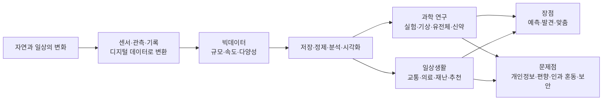
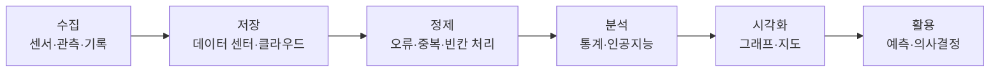

# 6-2. 빅데이터와 과학기술사회 — 데이터가 과학과 일상을 바꾸다

> [!NOTE]
> **성취기준 [10통과2-03-02]** 빅데이터를 과학기술사회에서 사용하고 있는 사례를 조사하고, 빅데이터 활용의 장점과 문제점을 추론할 수 있다.
>
> **성취기준 해설** 과학 실험, 기상 관측, 유전체 분석, 신약 개발 등과 같은 분야에서 많은 정보를 디지털 형태로 전환하여 대량의 데이터를 축적할 수 있게 되면서, 일상생활의 다양한 분야에서 폭넓게 활용할 수 있음을 소개한다.

**학습 목표**

1. 빅데이터의 뜻과 특징(규모, 속도, 다양성 등)을 설명하고, 데이터가 폭발적으로 늘어난 까닭을 디지털 전환과 관련지어 설명할 수 있다.
2. 과학 실험, 기상 관측, 유전체 분석, 신약 개발 등 과학기술 분야와 일상생활에서 빅데이터가 활용되는 사례를 조사하여 발표할 수 있다.
3. 빅데이터 활용의 장점과 문제점(개인정보, 편향, 상관과 인과의 혼동, 보안 등)을 자료를 근거로 추론할 수 있다.
4. 디지털 탐구 도구로 실시간 생활 데이터를 수집·저장·처리하고, 그 결과를 비판적으로 평가할 수 있다.

**이 단원의 학습 사다리**

| 단계 | 무엇을 하나? |
|---|---|
| STEP 1. 중학교 다시 보기 | 빅데이터로 재해·재난과 지진대를 분석했던 경험, 앞 단원(정보와 신호)을 꺼내 본다 |
| STEP 2. 기초 다지기 | 비트와 바이트, 정형·비정형 데이터, 그래프 읽기, 상관과 인과, 표본을 디딤돌로 놓는다 |
| STEP 3. 핵심 개념 | 빅데이터의 특징 → 과학 연구 속 빅데이터 → 일상 속 빅데이터 → 장점 → 문제점과 대응 |
| STEP 4. 오개념 바로잡기 | "데이터가 많으면 무조건 정확하다" 같은 착각을 바로잡는다 |
| STEP 5. 선택과목·대학 | 데이터 집약적 과학, 회귀 분석, 생물정보학, 수치예보 |
| STEP 6. 산업·진로 | 기상 산업, 바이오헬스 데이터, 스마트 교통, 제조·에너지 데이터 |

---

## 🗺️ 단원 들어가기

아침에 일어나 스마트폰을 켜면 오늘의 날씨와 미세먼지 예보가 나오고, 등굣길 버스가 몇 분 뒤 도착하는지 알려 준다. 내비게이션은 지금 막히는 길을 피해 돌아가라고 안내하고, 동영상 앱은 내가 좋아할 만한 영상을 골라 준다. 이 모든 것의 뒤에는 **엄청난 양의 데이터**가 있다.

과학자들의 연구 방식도 크게 바뀌었다. 2019년 공개된 최초의 블랙홀 사진은 지구 곳곳의 전파 망원경이 모은 약 5 PB(페타바이트)의 관측 자료를 분석해서 얻었다. 사람 한 명의 유전체를 처음 해독하는 데는 1990년부터 2003년까지 13년이 걸렸지만, 지금은 하루 이틀이면 해독할 수 있다.

> 데이터가 많아지면 세상을 더 정확하게 알 수 있을까? 내가 남긴 데이터는 누가, 어떻게 쓰고 있을까?

이 단원에서는 **빅데이터**가 과학기술사회에서 어떻게 쓰이는지 사례를 조사하고, 그 **장점과 문제점**을 근거를 들어 추론해 본다.

---

## STEP 1. 🔙 중학교 다시 보기

### 연계 개념표 — 중학교 연계

| 중학교 성취기준 | 중학교에서 배운 것 | 고등학교에서 확장되는 것 |
|---|---|---|
| [9과22-01] | 재해·재난의 원인과 피해를 분석한다(탐구: 빅데이터를 이용하여 재해·재난 사례 분석하기) | 재난뿐 아니라 과학 연구 전반에서 빅데이터가 쓰이는 방식과 그 **한계**를 추론한다 |
| [9과09-05] | 지진과 화산 분포를 판의 경계와 관련짓는다(빅데이터 활용) | 전 지구 관측 데이터를 모아 숨은 **패턴**을 찾는 과학 방법으로 일반화한다 |
| [9과17-04] | 일기도로 날씨를 해석한다(실시간 데이터 활용) | 관측 데이터를 컴퓨터로 계산하는 **수치예보**의 원리를 이해한다 |
| [9과01-02] | 인공지능 등 첨단 과학기술이 가져올 미래 사회의 변화를 조사한다 | 인공지능의 '연료'인 빅데이터의 장점과 문제점을 구체적으로 분석한다 |
| [9과19-01] | 운동을 그래프로 나타내고 해석한다 | 데이터를 **시각화**하여 추세와 이상값을 찾는다 |

### 연계 개념표 — 앞 단원 연계

| 앞 단원 | 거기서 배운 것 | 이 단원에서 쓰이는 곳 |
|---|---|---|
| 1-4 정보와 신호 | 아날로그 신호가 센서를 통해 디지털 정보(0과 1)가 된다 | 모든 빅데이터는 **디지털로 변환된 정보**이다 |
| 1-3 측정과 어림 | 측정에는 오차가 있고, 측정 표준이 중요하다 | 데이터의 **품질**과 기준이 다르면 분석 결과도 틀어진다 |
| 3-6 유전자와 단백질 | 유전 정보는 염기 서열로 저장된다 | **유전체 분석**은 염기 서열이라는 거대한 데이터를 읽는 일이다 |
| 5-3 지구온난화와 기후변화 | 대기 중 이산화 탄소 농도의 장기 관측 자료 | 수십 년 쌓인 **기후 관측 데이터**가 기후변화의 증거가 된다 |
| 6-1 감염병과 과학의 유용성 | 역학 조사와 접촉자 추적 | 방역에 쓰인 위치·결제 데이터의 **유용성과 개인정보 문제** |

### 준비 운동 (사전 진단)

**Q1.** 1바이트(byte)는 몇 비트(bit)인가?

**Q2.** 다음 중 디지털 데이터가 **아닌** 것은?
① 스마트폰으로 찍은 사진 ② 디지털 체온계에 표시된 36.5 ③ 종이에 연필로 그린 그림 ④ 스마트워치에 기록된 걸음 수

**Q3.** "여름에 아이스크림 판매량이 늘면 물놀이 사고도 늘어난다. 그러므로 아이스크림이 물놀이 사고의 원인이다." 이 추론의 문제점은?

**Q4.** 우리 반 학생들의 하루 수면 시간을 조사하려고 한다. 조사 대상을 '시험 전날 밤샘한 학생 5명'으로 정하면 어떤 문제가 생길까?

정답 및 해설

**Q1. 8비트** — 1-4 단원에서 배운 것처럼 비트는 0 또는 1을 나타내는 가장 작은 단위이고, 8비트를 묶어 1바이트라 한다.

**Q2. ③** — 종이 그림은 연속적인 아날로그 정보이다. 스캐너로 읽어 들이면 디지털 데이터가 된다.

**Q3.** 두 현상이 함께 늘어난다고 해서 한쪽이 다른 쪽의 원인이라고 할 수 없다. 둘 다 **기온이 높다**는 공통 원인 때문에 함께 늘어난 것이다(상관관계 ≠ 인과관계).

**Q4.** 표본이 전체를 대표하지 못해(편향된 표본) 수면 시간이 실제보다 훨씬 짧게 나온다.

---

## STEP 2. 🧱 기초 다지기

### ① 비트와 바이트 — 데이터의 크기를 재는 단위

1-4 단원에서 배운 것처럼 디지털 정보는 0과 1로 표현한다. 데이터의 크기는 바이트(B) 단위로 나타내며, 1000배씩 커질 때마다 접두어가 바뀐다(1-2 단원의 SI 접두어와 같다).

| 단위 | 크기 | 대략 어느 정도? |
|---|---|---|
| 킬로바이트(KB) | $10^3$ B | 짧은 문서 한 장 |
| 메가바이트(MB) | $10^6$ B | 스마트폰 사진 한 장(수 MB) |
| 기가바이트(GB) | $10^9$ B | 고화질 영화 한 편(수 GB) |
| 테라바이트(TB) | $10^{12}$ B | 개인용 외장 하드 한 개 |
| 페타바이트(PB) | $10^{15}$ B | 대형 연구 시설의 연간 관측 자료 |
| 엑사바이트(EB) | $10^{18}$ B | 국가·세계 규모의 데이터 센터 |
| 제타바이트(ZB) | $10^{21}$ B | 전 세계에서 한 해에 만들어지는 데이터 규모 |

> [!NOTE]
> 컴퓨터 분야에서는 $1\ \mathrm{KB} = 2^{10} = 1024\ \mathrm{B}$로 쓰기도 한다. 이 단원에서는 계산을 쉽게 하려고 1000배씩으로 계산한다.

### ② 정형 데이터와 비정형 데이터

| 구분 | 뜻 | 예 |
|---|---|---|
| **정형 데이터** | 표의 행과 열처럼 형식이 정해진 데이터 | 기온 관측표, 성적표, 결제 기록 |
| **비정형 데이터** | 형식이 정해지지 않은 데이터 | 사진, 동영상, 음성, SNS 글, 위성 영상 |

빅데이터의 상당 부분은 비정형 데이터이다. 사진 속에서 구름을 찾거나 글에서 감정을 읽어 내려면 별도의 분석 기술이 필요하다.

### ③ 그래프 읽기 — 추세, 주기, 이상값

데이터를 그래프로 나타내면(시각화) 숫자 표에서는 보이지 않던 것이 보인다.

- **추세**: 오랜 기간에 걸쳐 커지거나 작아지는 경향(예: 대기 중 이산화 탄소 농도의 꾸준한 증가)
- **주기**: 일정한 간격으로 반복되는 변화(예: 하루 중 기온 변화, 계절 변화)
- **이상값**: 다른 값과 동떨어진 값. 측정 오류일 수도, 중요한 발견일 수도 있다

### ④ 상관관계와 인과관계

- **상관관계(correlation)**: 한 양이 변할 때 다른 양도 함께 변하는 관계
- **인과관계(causation)**: 한 양의 변화가 **원인**이 되어 다른 양이 변하는 관계

> [!TIP]
> 💡 **비유** — 아침마다 수탉이 울고 나서 해가 뜬다. 둘은 매일 함께 일어나지만(상관), 수탉이 해를 띄우는 것은 아니다(인과 아님). 빅데이터는 '함께 일어나는 패턴'을 찾는 데 매우 강하지만, 그것이 원인인지는 따로 확인해야 한다.

<!-- fig:6-2-common-cause -->

### ⑤ 표본과 대표성

전체(모집단)를 모두 조사할 수 없을 때는 일부(표본)를 조사한다. 이때 표본이 전체를 고르게 대표해야 결론을 믿을 수 있다. 데이터가 **아무리 많아도 한쪽으로 치우쳐 있으면** 결론도 치우친다.

---

## STEP 3. 📘 핵심 개념

### 6-2-① 빅데이터란 무엇인가

**빅데이터(big data)** 는 기존의 방법으로는 저장·처리·분석하기 어려울 만큼 **규모가 크고, 빠르게 생성되며, 형태가 다양한** 데이터를 말한다. 흔히 영어 머리글자를 따서 **3V**로 특징을 정리한다.

| 특징 | 뜻 | 예 |
|---|---|---|
| **규모(Volume)** | 데이터의 양이 매우 많다 | 전 세계 기상 관측소·위성 자료, 수많은 사람의 유전체 |
| **속도(Velocity)** | 데이터가 실시간으로 빠르게 생성·처리된다 | 실시간 교통 정보, 지진 관측 자료 |
| **다양성(Variety)** | 숫자·문자·사진·음성 등 형태가 다양하다 | 진료 기록 + 의료 영상 + 유전체 자료 |

여기에 **정확성(Veracity, 데이터를 믿을 수 있는가)** 과 **가치(Value, 쓸모 있는 정보를 얻을 수 있는가)** 를 더해 5V로 설명하기도 한다.

#### 데이터는 왜 폭발적으로 늘어났을까?

1. **디지털 전환** — 관측·실험·기록이 처음부터 디지털로 이루어진다(1-4 단원).
2. **센서의 확산** — 스마트폰, 자동차, 가전제품, 공장 설비에 센서가 들어가 쉬지 않고 데이터를 만든다.
3. **저장 비용의 하락** — 같은 양을 저장하는 비용이 크게 줄었다(2-6 단원의 반도체 기술 발전).
4. **통신망과 계산 능력의 발전** — 데이터를 빠르게 모으고 여러 컴퓨터가 나누어 계산할 수 있게 되었다.

#### 빅데이터 처리 과정

> [!IMPORTANT]
> '정제' 단계는 눈에 잘 띄지 않지만 매우 중요하다. 잘못 측정된 값이나 빠진 값을 그대로 분석하면 엉뚱한 결론이 나온다. 컴퓨터 분야에는 **"쓰레기를 넣으면 쓰레기가 나온다(Garbage In, Garbage Out)"** 라는 말이 있다.

#### 예제 1 — 센서 하나가 만드는 데이터 (어림)

온도 센서가 1초에 한 번씩 온도를 측정하고, 측정값 하나를 저장하는 데 4바이트가 필요하다고 하자.
(1) 이 센서 하나가 1년(365일) 동안 만드는 데이터는 약 몇 MB인가?
(2) 이런 센서 1000개가 있는 관측망이라면 1년에 약 몇 GB인가?

**풀이**
(1) 1년의 초: $365 \times 24 \times 3600 = 31\,536\,000\ \mathrm{s}$
데이터: $31\,536\,000 \times 4 = 126\,144\,000\ \mathrm{B} \approx 126\ \mathrm{MB}$
(2) $126\ \mathrm{MB} \times 1000 = 126\,000\ \mathrm{MB} \approx 126\ \mathrm{GB}$

숫자 하나만 기록하는 단순한 센서도 모이면 큰 데이터가 된다. 여기에 위성 사진, 레이더 영상 같은 비정형 데이터가 더해지면 규모는 훨씬 커진다.

### 6-2-② 과학 연구 속 빅데이터

성취기준 해설에서 제시한 네 분야를 중심으로 살펴보자.

| 분야 | 어떤 데이터인가? | 빅데이터로 무엇이 달라졌나? |
|---|---|---|
| **과학 실험** | 입자 가속기의 충돌 기록, 천체 망원경의 관측 영상 | 사람이 다 볼 수 없는 양의 기록 속에서 아주 드문 사건을 찾아낸다 |
| **기상 관측** | 지상 관측소, 기상 레이더, 기상 위성, 고층 기상 관측 자료 | 관측 자료를 슈퍼컴퓨터로 계산하여 미래 날씨를 예측한다(수치예보) |
| **유전체 분석** | 수많은 사람·생물의 염기 서열 | 질병 관련 유전자 탐색, 병원체 변이 추적, 맞춤 의료 |
| **신약 개발** | 화합물 정보, 단백질 구조, 임상 시험 자료 | 후보 물질을 컴퓨터로 먼저 걸러 내어 개발 기간과 비용을 줄인다 |

#### 과학 실험 — 수십억 번 중 한 번을 찾아라

대형 입자 가속기에서는 입자들이 1초에 수억 번 이상 충돌한다. 모든 충돌을 저장할 수 없으므로 컴퓨터가 실시간으로 '흥미로운 충돌'만 골라 저장하는데도, 1년에 수십 PB의 자료가 쌓인다. 2012년 유럽 입자물리연구소(CERN)가 발표한 **힉스 입자**의 발견은 이런 방대한 충돌 자료 속에서 아주 드물게 나타나는 신호를 통계적으로 찾아낸 결과이다.

천문학에서도 마찬가지이다. 하늘 전체를 반복 촬영하는 대형 탐사 망원경은 하룻밤에 약 20 TB(테라바이트) 규모의 영상을 만들어 내며, 컴퓨터가 그중에서 새로 나타나거나 밝기가 변한 천체를 자동으로 찾아낸다.

#### 기상 관측 — 지구 전체를 계산하는 일기예보

기상청은 지상 관측소, 기상 레이더, 정지궤도 기상위성(천리안위성 2A호), 고층 기상 관측 등에서 모은 자료를 **슈퍼컴퓨터**에 넣는다. 슈퍼컴퓨터는 대기를 촘촘한 격자로 나누고, 각 격자에서 기온·기압·바람·수증기가 어떻게 변할지 물리 법칙에 따라 계산한다. 이를 **수치예보**라 하며, 우리나라는 2020년부터 독자적으로 개발한 **한국형 수치예보모델**을 실제 예보에 활용하고 있다.

#### 예제 2 — 유전체는 몇 바이트일까? (1-4 단원 연계 계산)

사람의 유전체는 약 30억($3 \times 10^9$) 개의 염기쌍으로 이루어져 있다. 염기는 A, T, G, C 네 종류이다.
(1) 염기 하나를 0과 1로 나타내려면 최소 몇 비트가 필요한가?
(2) 한 가닥의 염기 서열 전체를 저장하는 데 필요한 데이터는 약 몇 MB인가?

**풀이**
(1) 2비트로 $2^2 = 4$가지를 나타낼 수 있다(예: A=00, T=01, G=10, C=11). 따라서 **2비트**이다.
(2) $3 \times 10^9 \times 2 = 6 \times 10^9\ \text{비트}$
$6 \times 10^9 \div 8 = 7.5 \times 10^8\ \mathrm{B} = 750\ \mathrm{MB}$

한 사람의 염기 서열은 CD 한 장(약 700 MB) 정도에 담을 수 있다. 그런데 실제 해독 과정에서는 정확도를 높이려고 같은 부분을 수십 번씩 겹쳐 읽고 품질 정보까지 함께 저장하므로, 한 사람의 원자료는 이보다 훨씬 크다. 여기에 수만~수십만 명의 자료를 모아 비교하면 그야말로 빅데이터가 된다.

> [!TIP]
> 💡 **3-6 단원과 연결** — 유전체 분석은 3-6 단원에서 배운 '유전 정보 → 단백질'의 흐름 중 맨 앞의 **설계도 전체를 읽는 일**이다. 비용도 크게 떨어졌다. 인간 유전체 사업(1990~2003년)에는 약 27억 달러가 들었지만, 지금은 한 사람의 유전체를 약 1000달러 이하로 해독할 수 있다.

#### 신약 개발 — 컴퓨터로 먼저 찾아보기

신약 하나를 개발하는 데는 흔히 10년 이상이 걸리고, 수많은 후보 물질 가운데 실제 약이 되는 것은 극히 일부이다. 이제는 화합물 데이터베이스, 단백질 구조 데이터, 임상 시험 자료를 분석하여 **약이 될 가능성이 높은 후보를 먼저 골라내는** 방법이 쓰인다. 단백질의 아미노산 서열 정보로부터 입체 구조를 예측하는 인공지능 연구는 그 공로로 2024년 노벨 화학상을 받았다. 이 인공지능은 이미 알려진 수많은 단백질 구조 데이터를 학습하여 만들어졌다.

### 6-2-③ 일상 속 빅데이터

| 분야 | 사용하는 데이터 | 활용 |
|---|---|---|
| 교통 | 차량 위치, 교통카드 승하차 기록 | 실시간 빠른 길 안내, 버스 도착 예정 시간, 대중교통 노선 조정 |
| 의료·건강 | 진료 기록, 건강검진 자료, 웨어러블 기기 기록 | 질병 위험 예측, 의료 영상 판독 보조 |
| 재난·안전 | 지진 관측망, 기상 레이더, 하천 수위 | 지진 조기 경보, 홍수 예측, 재난 문자 |
| 에너지 | 전력 사용량(스마트 계량기), 기상 예보 | 전력 수요 예측, 발전량 조절 |
| 유통·서비스 | 구매 기록, 검색 기록, 시청 기록 | 상품·콘텐츠 추천, 재고 관리 |
| 환경 | 대기질 측정망, 위성 관측 | 미세먼지 예보, 산불 감시 |
| 방역 | 검사 결과, 이동 기록, 하수 검사 | 감염 경로 추적, 유행 예측(6-1 단원) |

#### 예제 3 — 데이터로 노선 정하기 (자료 해석)

어느 도시가 심야 버스 노선을 새로 만들려고 한다. 다음 두 방법 중 어느 쪽이 더 나은 근거가 될지 판단하고 이유를 쓰시오.
- 방법 A: 시청 직원 5명이 회의를 열어 "사람이 많을 것 같은 곳"을 정한다.
- 방법 B: 심야 시간대의 교통카드 기록, 택시 승하차 위치, 유동 인구 데이터를 지도에 나타내 사람이 많이 이동하는 길을 찾는다.

**풀이**
방법 B가 더 나은 근거이다. 실제로 사람들이 **언제, 어디서, 어디로** 이동하는지를 측정한 데이터에 기반하므로 추측보다 정확하다. 다만 B도 **한계**가 있다. 예를 들어 교통카드를 쓰지 않거나 택시를 이용하지 못하는 사람의 수요는 데이터에 잘 드러나지 않으므로, 주민 의견 조사 등을 함께 활용하는 것이 좋다.

### 6-2-④ 빅데이터 활용의 장점

| 장점 | 설명 | 사례 |
|---|---|---|
| **더 정확한 예측** | 과거와 현재의 방대한 자료로 미래를 예측한다 | 수치예보, 전력 수요 예측 |
| **숨은 패턴의 발견** | 사람이 알아채기 어려운 관계를 찾아낸다 | 질병 위험 요인, 지진대 분포 |
| **실시간 대응** | 상황을 즉시 파악하고 대처한다 | 교통 정보, 재난 경보 |
| **맞춤형 서비스** | 개인의 특성에 맞는 정보를 제공한다 | 맞춤 학습, 맞춤 의료 |
| **연구 방법의 변화** | 가설을 세우기 전에 데이터에서 새로운 질문을 발견하기도 한다 | 유전체 연구, 천문 탐사 |
| **자원 절약** | 낭비를 줄이고 효율을 높인다 | 설비 고장 예측, 물류 경로 최적화 |

### 6-2-⑤ 빅데이터 활용의 문제점과 대응

| 문제점 | 무엇이 문제인가? | 대응 방안 |
|---|---|---|
| **개인정보 침해** | 위치·건강·구매 기록 등 민감한 정보가 수집·유출될 수 있다 | 수집 최소화, 동의, 가명·익명 처리, 법적 보호 |
| **재식별 위험** | 이름을 지워도 여러 정보를 결합하면 누구인지 알아낼 수 있다 | 결합 가능한 정보까지 고려한 비식별 처리 |
| **편향(치우침)** | 데이터가 특정 집단만 대표하면 결론도 치우친다 | 표본의 대표성 점검, 다양한 데이터 확보 |
| **상관과 인과의 혼동** | 함께 변하는 패턴을 원인으로 착각한다 | 실험·추가 연구로 인과관계 확인 |
| **데이터 오류** | 잘못 측정·입력된 값이 결론을 왜곡한다 | 정제, 측정 표준(1-3 단원) 준수 |
| **보안** | 대량의 데이터가 한곳에 모이면 해킹 피해가 커진다 | 암호화, 접근 권한 관리 |
| **정보 격차** | 데이터와 분석 능력을 가진 쪽이 더 큰 이익을 얻는다 | 공공 데이터 개방, 디지털 교육 |
| **에너지 사용** | 데이터 센터는 많은 전력을 소비한다 | 효율 향상, 재생 에너지 사용(5-6 단원) |

#### 예제 4 — 검색어로 독감을 예측할 수 있을까? (사례 분석)

2008년 한 인터넷 검색 기업은 사람들이 '독감 증상', '해열제' 같은 단어를 검색하는 횟수를 분석하여, 보건 당국보다 1~2주 빨리 독감 유행을 예측하는 서비스를 내놓았다. 처음에는 꽤 잘 맞는 것처럼 보였으나, 2012~2013년 겨울에는 보건 당국이 병원 보고로 집계한 독감 의심 환자 비율보다 약 2배나 높게 예측하는 큰 오류를 냈고, 결국 2015년 서비스 공개가 중단되었다.
(1) 검색량이 독감 환자 수를 정확히 반영하지 못한 까닭을 추론하시오.
(2) 이 사례에서 얻을 수 있는 교훈을 쓰시오.

**풀이**
(1) 검색은 실제로 독감에 걸린 사람만 하는 것이 아니다. 독감에 대한 **언론 보도가 많아지면** 걸리지 않은 사람도 걱정이 되어 검색을 늘린다. 또 감기와 독감을 헷갈린 사람의 검색, 검색 서비스 자체의 변화도 영향을 준다. 즉 검색량과 독감 환자 수의 관계는 **상관관계**일 뿐 직접적인 측정이 아니었다.
(2) 데이터의 양이 많다고 해서 정확한 것은 아니다. 데이터가 **무엇을 실제로 측정하는지** 확인하고, 전통적인 관측 자료(병원 보고 등)와 **함께 검증**해야 한다.

#### 예제 5 — 이름을 지우면 안전할까? (추론)

어느 학교가 학생 건강 자료를 연구에 제공하면서 이름과 학번을 지우고 '생일(월·일), 성별, 키'만 남겼다. 한 반 학생은 30명이다.
(1) 생일(월·일)과 성별을 조합한 경우의 수는 최대 몇 가지인가?
(2) 이 자료만으로 특정 학생을 알아낼 수 있을지 추론하시오.

**풀이**
(1) 생일은 최대 366가지, 성별은 2가지이므로 $366 \times 2 = 732$가지이다.
(2) 732가지 조합에 30명이 나뉘므로 대부분의 학생은 **자기만의 조합**을 가질 가능성이 크다. 같은 반 친구의 생일과 성별을 아는 사람이라면 그 학생의 키와 건강 자료를 알아낼 수 있다. 이처럼 이름을 지워도 다른 정보를 **결합**하면 다시 개인을 알아볼 수 있는데, 이를 **재식별**이라 한다. 실제로 미국에서 우편번호·생년월일·성별 세 가지만으로 인구의 상당수(약 87%)를 특정할 수 있다는 연구 결과도 있다.

<!-- fig:6-2-reidentification -->

#### 사회는 어떻게 대응하고 있나

- 우리나라는 2011년 **개인정보 보호법**을 제정하였고, 2020년 이른바 **데이터 3법**을 개정하여 추가 정보 없이는 개인을 알아볼 수 없게 처리한 **가명정보**를 통계·연구 등에 활용할 수 있게 하면서 보호 장치를 함께 두었다.
- 유럽 연합은 2018년부터 **일반 개인정보 보호법(GDPR)** 을 시행하여, 자기 정보의 삭제를 요구할 권리 등을 보장한다.

> [!IMPORTANT]
> 빅데이터의 문제점은 "데이터를 쓰지 말자"로 해결되지 않는다. **데이터 활용의 이익**과 **개인의 권리 보호**를 함께 지키는 방법(동의, 최소 수집, 가명 처리, 투명성)을 찾는 것이 핵심이다. 교육과정이 강조하는 **디지털 소양**도 바로 정보를 선별하고 **비판적으로 평가**하는 능력이다.

#### 데이터를 비판적으로 읽는 체크리스트

| 질문 | 확인할 것 |
|---|---|
| 누가 모았나? | 출처의 신뢰성, 이해관계 |
| 무엇을 측정했나? | 실제로 알고 싶은 것을 직접 측정했는가 |
| 누구의 데이터인가? | 표본이 전체를 대표하는가, 빠진 집단은 없는가 |
| 어떻게 정리했나? | 이상값·빈칸 처리, 그래프 축의 눈금 |
| 상관인가 인과인가? | 다른 공통 원인은 없는가 |
| 내 정보는 안전한가? | 수집 목적, 보관 기간, 동의 여부 |

---

## STEP 4. ⚠️ 오개념 바로잡기

| 흔한 오개념 | 올바른 개념 | 왜 그럴까? |
|---|---|---|
| 데이터가 많을수록 결론은 무조건 정확하다 | 데이터가 **치우치거나 오류가 많으면** 양이 많아도 틀린 결론이 나온다 | 독감 검색량 사례처럼 측정 대상과 실제 현상이 다를 수 있다 |
| 두 값이 함께 변하면 하나가 다른 하나의 원인이다 | **상관관계는 인과관계가 아니다** | 공통 원인(예: 기온)이 두 값을 함께 변화시킬 수 있다 |
| 이름만 지우면 개인정보는 안전하다 | 여러 정보를 **결합**하면 다시 개인을 알아낼 수 있다(재식별) | 생일·성별·지역 같은 정보의 조합만으로도 특정될 수 있다 |
| 빅데이터는 크기만 크면 된다 | 규모뿐 아니라 **속도·다양성·정확성·가치**가 함께 중요하다 | 쓸모없는 데이터는 아무리 커도 가치가 없다 |
| 데이터와 알고리즘은 사람이 아니므로 객관적·중립적이다 | 데이터를 **무엇을, 누구에게서, 어떻게** 모았는지에 사람의 선택이 들어간다 | 과거 자료에 있던 차별이 분석 결과에 그대로 반복될 수 있다 |
| 내 데이터는 하찮아서 아무 가치가 없다 | 개인의 데이터가 모이면 **큰 경제적·사회적 가치**가 생긴다 | 그래서 데이터를 둘러싼 권리와 책임이 중요하다 |

---

## STEP 5. 🎓 선택과목·대학으로 한 걸음 더

> [!CAUTION]
> 이 절은 **통합과학 교육과정 범위 밖의 심화 내용**으로 평가 대상이 아니다. "이 개념이 앞으로 어디까지 이어지는가"를 맛보기로 보여 주기 위한 내용이다.

### 고2·3 선택과목과의 연결

| 과목 | 이어지는 내용 |
|---|---|
| 정보 / 데이터 과학 | 데이터 수집·전처리·분석·시각화, 프로그래밍으로 데이터 다루기 |
| 인공지능 기초 | 데이터를 학습하는 인공지능의 원리(6-3 단원과 연결) |
| 확률과 통계(수학) | 표본과 모집단, 통계적 추정 |
| 지구과학 / 지구시스템과학 | 기상·기후·지진 관측 자료의 해석 |
| 생물의 유전 | 유전체와 유전자 분석 기술 |

### ① 과학의 네 번째 방법 — 데이터 집약적 과학

과학은 오랫동안 **실험·관찰**(경험), **이론**, **계산**(컴퓨터 시뮬레이션)의 방법으로 발전해 왔다. 2000년대 후반부터는 거대한 데이터에서 직접 패턴과 법칙을 찾아내는 **데이터 집약적 과학**이 '네 번째 패러다임'으로 불리기 시작했다. 대학의 **데이터과학** 과목에서는 이 흐름을 통계학, 컴퓨터과학, 각 분야 지식의 결합으로 배운다.

### ② 데이터에서 관계식 찾기 — 회귀 분석

데이터 점 $(x_i, y_i)$들이 직선에 가깝게 놓여 있으면, 다음 오차의 제곱합이 가장 작아지는 직선 $y = ax + b$를 찾는다. 이를 **최소제곱법**이라 한다.

$$
E(a, b) = \sum_{i=1}^{n} \bigl(y_i - (a x_i + b)\bigr)^2 \quad \longrightarrow \quad \text{최소}
$$

두 변수가 함께 변하는 정도는 $-1$에서 $1$ 사이의 값을 갖는 **상관 계수** $r$로 나타낸다. 대학 통계학에서는 $r$이 커도 인과관계를 보장하지 않으며, 인과를 확인하려면 **무작위 대조 실험**이나 인과 추론 기법이 필요함을 배운다.

### ③ 생물정보학 — 염기 서열 비교하기

**생물정보학(bioinformatics)** 은 컴퓨터로 생물 데이터를 분석하는 학문이다. 두 염기 서열이 얼마나 비슷한지 비교하는 **서열 정렬** 알고리즘, 수많은 짧은 조각을 이어 붙여 전체 유전체를 복원하는 **조립** 알고리즘, 병원체의 변이로 계통수를 그리는 방법 등을 배운다. 6-1 단원의 변이 추적이 바로 이 기술로 이루어진다.

### ④ 대기과학 — 수치예보와 앙상블 예보

수치예보 모델은 유체의 운동, 열역학, 수증기의 상태 변화를 나타내는 방정식을 격자마다 시간 간격으로 나누어 계산한다. 처음 관측값이 아주 조금만 달라도 며칠 뒤의 결과가 크게 달라질 수 있으므로(혼돈), 처음 조건을 조금씩 바꾼 여러 번의 계산 결과를 모아 **확률**로 예보하는 **앙상블 예보**를 한다. "내일 비 올 확률 60%"는 이런 계산에서 나온다.

### ⑤ 개인정보를 지키면서 분석하기

대학과 연구소에서는 데이터에 일부러 통계적 잡음을 섞어 개인은 알아볼 수 없지만 전체 통계는 유지하는 **차분 프라이버시**, 데이터를 한곳에 모으지 않고 각 기관에서 학습한 결과만 모으는 **연합 학습** 같은 기술을 연구한다.

### 고등학교 vs 대학교

| 구분 | 고등학교 통합과학 | 대학교(데이터과학·통계학·생물정보학·대기과학) |
|---|---|---|
| 빅데이터 | 3V 특징, 활용 사례 조사 | 분산 저장·처리 시스템, 데이터베이스 설계 |
| 분석 | 그래프의 추세·이상값 읽기 | 회귀 분석, 가설 검정, 기계학습 |
| 상관과 인과 | 사례로 구분하기 | 상관 계수, 무작위 대조 실험, 인과 추론 |
| 유전체 | 염기 서열 = 데이터 | 서열 정렬·조립 알고리즘, 유전체 연관 분석 |
| 기상 | 관측 자료로 예보한다 | 대기 운동 방정식의 수치 해법, 앙상블 예보 |
| 개인정보 | 재식별 위험과 법적 보호 | 차분 프라이버시, 암호 기술, 데이터 거버넌스 |
| 관련 전공 | — | 통계학, 컴퓨터공학, 데이터사이언스, 생명정보학, 대기과학, 산업공학 |

---

## STEP 6. 🏭 산업 현장과 진로 연결

### 사례 1. 기상 예보와 기상 산업

- **원리** 관측 자료(지상·레이더·위성·고층) → 슈퍼컴퓨터 수치예보 → 예보관의 해석 → 예보 발표.
- **어디에 쓰이나** 기상 정보는 농업(파종·수확 시기), 항공·해운(운항 계획), 에너지(냉난방 전력 수요, 태양광·풍력 발전량 예측), 유통(계절 상품 재고)에 쓰인다. 날씨 데이터를 가공해 기업에 맞춤 정보를 제공하는 **기상 산업**도 있다.
- **누구나 쓸 수 있는 데이터** 기상청의 기상자료개방포털, 정부의 공공데이터포털에서 과거 관측 자료를 내려받아 분석할 수 있다.

### 사례 2. 바이오헬스 데이터

- **원리** 유전체 자료, 진료 기록, 의료 영상, 생활 습관 데이터를 함께 분석하여 질병 위험을 예측하고 치료법을 고른다.
- **어디에 쓰이나** 암 환자의 유전자 변이에 맞춘 표적 치료제 선택, 신약 후보 물질 탐색, 감염병 변이 감시(6-1 단원).
- **핵심 과제** 의료 데이터는 가장 민감한 개인정보이므로, 가명 처리와 엄격한 접근 관리 아래에서만 연구에 활용한다. 국가 차원에서도 대규모 유전체·임상 데이터를 모으는 사업이 진행되고 있다.

### 사례 3. 스마트 교통과 스마트 도시

- 교통 신호를 실시간 교통량에 맞춰 조절하고, 교통카드 데이터로 버스 배차 간격과 노선을 조정한다.
- 도시 곳곳의 센서(대기질, 소음, 주차 공간 등) 데이터를 모아 시민에게 제공하고 도시 정책에 활용한다. 이 내용은 6-3 단원의 사물인터넷으로 이어진다.

### 사례 4. 제조·에너지 데이터

- **예지 정비** 공장 설비의 진동, 온도, 전류 데이터를 분석해 고장이 나기 전에 미리 부품을 교체한다. 갑작스러운 생산 중단을 막는다.
- **전력 수요 예측** 기상 예보, 요일, 과거 사용량 데이터로 내일의 전력 수요를 예측하여 발전량을 계획한다(5-5, 5-6 단원과 연결).

### 관련 진로와 학과

| 진로 | 하는 일 | 관련 학과 |
|---|---|---|
| 데이터 과학자·분석가 | 데이터를 분석해 문제를 해결하고 의사결정을 돕는다 | 통계학, 컴퓨터공학, 산업공학, 데이터사이언스 |
| 데이터 엔지니어 | 대량의 데이터를 모으고 저장·처리하는 시스템을 만든다 | 컴퓨터공학, 소프트웨어학 |
| 생물정보학자 | 유전체·단백질 데이터를 분석한다 | 생명정보학, 생명과학, 컴퓨터공학 |
| 기상 예보관·수치모델 연구원 | 기상 자료를 해석하고 예보 모델을 개발한다 | 대기과학, 지구과학, 물리학 |
| 개인정보 보호·정보 보안 전문가 | 데이터를 안전하게 지키는 체계와 기술을 만든다 | 정보보호학, 컴퓨터공학, 법학 |
| 데이터 시각화 디자이너 | 복잡한 데이터를 이해하기 쉬운 그래픽으로 표현한다 | 디자인, 정보통계, 컴퓨터공학 |

---

## 🔬 탐구 활동 — 디지털 탐구 도구를 활용한 실시간 생활 데이터 측정하기

교육과정은 이 영역에서 **마이크로프로세서를 탑재한 피지컬 컴퓨팅 기기** 등 디지털 탐구 도구로 생활 주변의 실시간 데이터를 **수집·저장·처리**하고, 이를 바탕으로 **창의적인 문제해결 방안**을 도출하도록 안내한다.

### 활동 A. 스마트폰 센서로 교실 환경 데이터 측정하기

**목표** 스마트폰의 센서로 교실의 소리 크기와 밝기를 실시간으로 측정·기록하고, 시간대별 변화를 분석한다.

**준비물** 스마트폰(센서 측정 앱), 스프레드시트, 측정 계획서

**과정**
1. 모둠별로 측정할 양(소리 크기 dB, 밝기 lx 등)과 장소(교실 앞·뒤, 창가·복도 쪽)를 정한다.
2. 측정 간격(예: 1초)과 측정 시간(예: 쉬는 시간 10분 + 수업 시작 10분)을 정한다.
3. 스마트폰을 같은 높이·같은 방향으로 고정하고 측정 앱으로 데이터를 기록한다.
4. 데이터를 파일로 내보내 스프레드시트에 정리하고, 시간–측정값 그래프를 그린다.
5. 평균, 최댓값, 이상값을 찾고, 그 원인을 추론한다.

> [!WARNING]
> **개인정보 보호** 소리를 측정할 때는 **소리 크기 수치만** 기록하고 대화 내용을 녹음하지 않는다. 사진이나 영상에 다른 사람의 얼굴이 찍히지 않도록 한다.

### 활동 B. 피지컬 컴퓨팅 기기로 '교실 환경 모니터' 만들기

**목표** 마이크로비트, 아두이노 같은 피지컬 컴퓨팅 기기로 교실 환경 데이터를 자동으로 수집·저장하고, 데이터에 근거한 문제해결 방안을 제안한다.

**준비물** 피지컬 컴퓨팅 기기(마이크로비트 또는 아두이노), 온도·밝기 센서(마이크로비트는 내장), 선택: 이산화 탄소 센서 모듈, 컴퓨터, USB 케이블

**과정**
1. 블록 코딩 등으로 다음 동작을 프로그래밍한다: 1분마다 온도와 밝기(선택: 이산화 탄소 농도)를 측정 → 시각과 함께 기록 → 기준값을 넘으면 화면에 경고 표시.
2. 기기를 교실 가운데 높이 약 1 m 지점에 두고 하루(또는 수업 시간 동안) 데이터를 수집한다.
3. 수집한 데이터를 컴퓨터로 옮겨 시간에 따른 그래프를 그린다.
4. 창문을 연 시각, 학생 수가 바뀐 시각 등 **사건 기록**을 그래프 위에 표시한다.
5. 다른 모둠과 데이터를 공유하여 교실 위치에 따른 차이를 비교한다.
6. 분석 결과를 바탕으로 '언제, 얼마나 자주 환기하면 좋을지' 같은 문제해결 방안을 제안한다.

> [!NOTE]
> 바깥 공기의 이산화 탄소 농도는 약 420 ppm이다(5-3 단원). 사람이 많은 교실을 환기하지 않으면 농도가 빠르게 올라가며, 학교보건법 시행규칙은 교실 이산화 탄소 기준을 1000 ppm 이하로 정하고 있다. 센서가 측정하는 원리는 다루지 않고, 측정값을 **데이터로 활용**하는 데 집중한다.

**결과 기록**

| 시각 | 온도(°C) | 밝기 | (선택) CO₂(ppm) | 사건 기록 |
|---|---|---|---|---|
| 09:00 | | | | 1교시 시작 |
| 09:30 | | | | |
| 09:50 | | | | 쉬는 시간, 창문 열기 |
| 10:00 | | | | |

**생각해 보기**
1. 측정 간격을 1분에서 1초로 줄이면 데이터의 양은 몇 배가 될까? 그만큼 더 유용해질까?
2. 우리 모둠의 데이터에 영향을 준 **오차의 원인**(기기 위치, 햇빛, 사람의 숨 등)은 무엇이었을까?
3. 학교 전체 교실에 이 기기를 설치해 데이터를 모으면 어떤 장점이 있을까? 반대로 어떤 데이터는 모으지 말아야 할까?
4. 우리가 제안한 해결 방안은 데이터의 어떤 부분을 근거로 하는가?

---

## ✅ 개념 확인 문제

### 기본

**1.** 빅데이터의 특징을 나타내는 3V를 쓰고, 각각의 뜻을 간단히 설명하시오.

정답 및 해설

**정답** 규모(Volume): 데이터의 양이 매우 많다. 속도(Velocity): 데이터가 실시간으로 빠르게 생성·처리된다. 다양성(Variety): 숫자·문자·사진·음성 등 형태가 다양하다.

**2.** 성취기준 해설에서 빅데이터가 축적되는 과학기술 분야로 제시한 예를 **세 가지 이상** 쓰시오.

정답 및 해설

**정답** 과학 실험, 기상 관측, 유전체 분석, 신약 개발 중 세 가지 이상

**3.** 다음 중 **비정형 데이터**를 모두 고르시오.
ㄱ. 시간별 기온 관측표 ㄴ. 기상 위성 구름 사진 ㄷ. 진료실에서 녹음한 음성 ㄹ. 교통카드 승하차 시각 기록

정답 및 해설

**정답 ㄴ, ㄷ**

ㄱ과 ㄹ은 행과 열로 정리된 정형 데이터이다. 사진과 음성은 형식이 정해지지 않은 비정형 데이터이다.

**4.** 빈칸에 알맞은 말을 쓰시오.
"이름을 지운 데이터라도 생일, 성별, 지역 같은 정보를 ( ㄱ )하면 개인을 다시 알아볼 수 있는데, 이를 ( ㄴ )(이)라고 한다."

정답 및 해설

**정답** ㄱ: 결합, ㄴ: 재식별

### 응용

**5.** 어떤 소리 센서가 1초에 10번 측정하고, 측정값 하나는 2바이트이다. 이 센서를 하루(24시간) 동안 작동시키면 데이터는 약 몇 MB인가?

정답 및 해설

**정답** 약 1.7 MB

하루의 초: $24 \times 3600 = 86\,400\ \mathrm{s}$
측정 횟수: $86\,400 \times 10 = 864\,000$번
데이터: $864\,000 \times 2 = 1\,728\,000\ \mathrm{B} \approx 1.7\ \mathrm{MB}$

**6.** 한 연구에서 "스마트폰 건강 앱 사용자 100만 명의 걸음 수 데이터를 분석한 결과, 우리나라 국민은 하루 평균 9000걸음을 걷는다."라고 발표하였다. 이 결론을 비판적으로 평가하시오.

정답 및 해설

**예시 답안**
100만 명이라는 큰 데이터이지만 **건강 앱을 쓰는 사람**만의 데이터이므로 전체 국민을 대표한다고 보기 어렵다. 건강 앱 사용자는 운동에 관심이 많아 평소 더 많이 걸을 가능성이 크고, 스마트폰을 덜 쓰는 고령층이나 어린이는 적게 포함되었을 것이다. 또 스마트폰을 집에 두고 걸은 걸음은 기록되지 않는다. 따라서 '우리나라 국민 평균'이라는 결론은 **표본 편향** 때문에 실제보다 높게 나왔을 수 있다.

**7.** 다음은 어느 도시의 월별 자료이다. 이 자료로부터 "에어컨 판매량이 늘면 전력 사용량이 늘어난다"와 "전력 사용량이 늘면 아이스크림 판매량이 늘어난다" 중 어느 것이 인과관계로서 더 타당한지 판단하고, 두 번째 주장의 문제점을 설명하시오.

| 월 | 평균 기온 | 에어컨 판매량 | 전력 사용량 | 아이스크림 판매량 |
|---|---|---|---|---|
| 4월 | 낮음 | 적음 | 보통 | 적음 |
| 7월 | 높음 | 많음 | 많음 | 많음 |
| 10월 | 낮음 | 적음 | 보통 | 적음 |

정답 및 해설

**정답** 첫 번째 주장이 더 타당하다.

에어컨은 전기를 사용하므로 에어컨 사용 증가가 전력 사용량 증가로 이어지는 **작동 원리**가 있다. 반면 전력 사용량과 아이스크림 판매량은 둘 다 **기온 상승**이라는 공통 원인 때문에 함께 늘어난 것일 뿐, 전력 사용이 아이스크림을 사게 만드는 것은 아니다. 함께 변한다는 상관관계만으로 인과관계를 주장한 것이 문제이다.

### 융합·서술형

**8. [과학 연구·대학 연계]** 사람의 유전체 약 30억 염기쌍을 한 염기당 2비트로 저장하면 약 750 MB가 된다. 그런데 실제 유전체 연구에서는 한 사람당 이보다 훨씬 큰 데이터가 생기고, 연구에 따라 수십만 명의 데이터를 모으기도 한다. (1) 한 사람의 실제 데이터가 750 MB보다 큰 까닭을 쓰고, (2) 대규모 유전체 데이터를 모을 때의 장점과 문제점을 한 가지씩 근거를 들어 서술하시오.

정답 및 해설

**예시 답안**
(1) 해독 과정에서 정확도를 높이기 위해 같은 부분을 여러 번 겹쳐 읽고, 각 염기를 얼마나 믿을 수 있는지 나타내는 품질 정보도 함께 저장하기 때문이다.
(2) 장점: 많은 사람의 유전체와 건강 정보를 비교하면 특정 질병과 관련된 유전자 변이를 찾을 수 있어 질병 예측과 맞춤 치료에 도움이 된다. 문제점: 유전 정보는 평생 바뀌지 않고 가족과도 공유되는 매우 민감한 개인정보이므로, 유출되거나 재식별되면 보험·취업 차별 등 되돌릴 수 없는 피해가 생길 수 있다. 따라서 동의, 가명 처리, 엄격한 접근 관리가 필요하다.

**채점 포인트** ① 중복 판독·품질 정보 ② 장점을 과학적 근거와 연결 ③ 유전 정보의 특수성(평생 불변, 가족 공유)과 피해 ④ 보호 방안

**9. [산업·사회 연계]** 어느 시가 "모든 버스 정류장에 카메라와 센서를 설치하여 시민의 이동 데이터를 실시간으로 모으면 대중교통을 크게 개선할 수 있다."라는 계획을 발표하였다. 빅데이터 활용의 장점과 문제점을 각각 두 가지 이상 들어 이 계획을 평가하고, 문제점을 줄이면서 장점을 살리는 수정안을 제안하시오.

정답 및 해설

**예시 답안**
장점: ① 정류장별·시간대별 승객 수를 실시간으로 파악하여 배차 간격을 조정할 수 있다. ② 실제 이동 패턴에 근거해 새 노선을 설계할 수 있어 추측보다 정확하다.
문제점: ① 카메라 영상에는 얼굴 같은 민감한 개인정보가 담겨 사생활 침해와 감시 우려가 있다. ② 많은 데이터가 한곳에 모이면 해킹 시 피해가 크다. ③ 정류장을 이용하지 않는 사람(교통 약자 등)의 필요는 데이터에 드러나지 않을 수 있다.
수정안: 얼굴을 저장하지 않고 **사람 수만 세는** 방식으로 수집 정보를 최소화하고, 데이터는 일정 기간 뒤 삭제하며, 수집 목적과 방법을 시민에게 공개한다. 또한 주민 의견 조사를 함께 하여 데이터에 드러나지 않는 수요를 보완한다.

**채점 포인트** ① 장점 2가지 ② 문제점 2가지(개인정보, 보안, 편향 등) ③ 최소 수집·익명화·투명성을 포함한 구체적 수정안

---

## 📝 한눈에 정리

### 핵심 요약

- **빅데이터**는 기존 방법으로 처리하기 어려울 만큼 규모가 크고(Volume), 빠르게 생성되며(Velocity), 형태가 다양한(Variety) 데이터이다.
- 디지털 전환, 센서의 확산, 저장 비용 하락, 통신·계산 능력의 발전으로 데이터가 폭발적으로 늘었다.
- 빅데이터는 **수집 → 저장 → 정제 → 분석 → 시각화 → 활용**의 과정을 거친다. 잘못된 데이터는 잘못된 결론을 낳는다.
- 과학 실험, 기상 관측(수치예보), 유전체 분석, 신약 개발 등 과학 연구와 교통·의료·재난·에너지 등 일상생활에서 폭넓게 활용된다.
- **장점**: 정확한 예측, 숨은 패턴 발견, 실시간 대응, 맞춤 서비스, 연구 방법의 변화.
- **문제점**: 개인정보 침해와 재식별, 편향, 상관과 인과의 혼동, 데이터 오류, 보안, 정보 격차, 에너지 사용.
- 데이터를 **비판적으로 평가**하는 디지털 소양과, 활용과 보호를 함께 지키는 사회적 장치가 필요하다.

### 핵심 용어

| 용어 | 뜻 |
|---|---|
| 빅데이터 | 규모가 크고 빠르게 생성되며 형태가 다양하여 기존 방법으로 처리하기 어려운 데이터 |
| 정형 / 비정형 데이터 | 표처럼 형식이 정해진 데이터 / 사진·음성·글처럼 형식이 정해지지 않은 데이터 |
| 데이터 정제 | 분석 전에 오류·중복·빈칸을 찾아 고치는 과정 |
| 수치예보 | 관측 자료를 컴퓨터로 계산하여 미래 날씨를 예측하는 방법 |
| 유전체 분석 | 생물이 가진 유전 정보 전체(염기 서열)를 해독하고 비교하는 일 |
| 상관관계 / 인과관계 | 두 양이 함께 변하는 관계 / 한 양이 원인이 되어 다른 양이 변하는 관계 |
| 재식별 | 이름을 지운 데이터라도 다른 정보와 결합하여 개인을 다시 알아내는 것 |
| 가명정보 | 추가 정보 없이는 특정 개인을 알아볼 수 없도록 처리한 정보 |

### 다음 단원으로

빅데이터는 그 자체로는 숫자의 더미이다. 이 데이터에서 스스로 규칙을 배우는 **인공지능**, 센서로 세상을 감지하고 움직이는 **로봇**, 모든 사물을 인터넷으로 연결하는 **사물인터넷**이 만나면 데이터는 실제 행동으로 바뀐다. 다음 단원에서는 이러한 기술이 인간의 삶과 환경을 어떻게 개선하고 있는지, 그리고 그 유용성과 한계는 무엇인지 예측해 본다.
