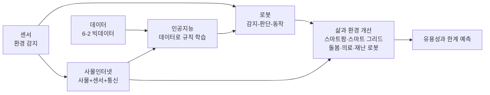
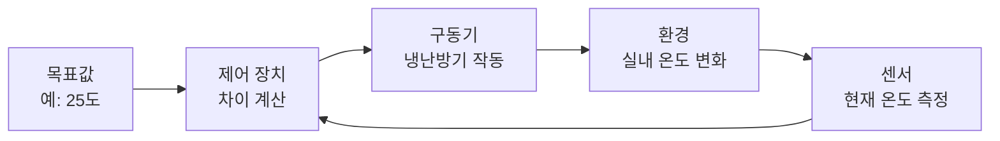
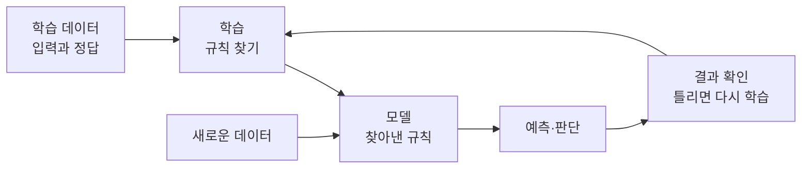
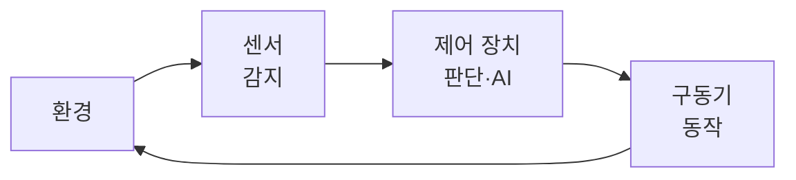
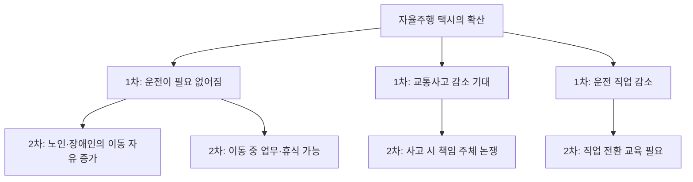

# 6-3. 인공지능 로봇과 사물인터넷 — 스스로 배우고, 감지하고, 연결되는 기계

> [!NOTE]
> **성취기준 [10통과2-03-03]** 인공지능 로봇, 사물인터넷 등과 같이 과학기술의 발전을 인간 삶과 환경 개선에 활용하는 사례를 찾고, 이러한 과학기술의 발전이 미래 사회에 미치는 유용성과 한계를 예측할 수 있다.

**학습 목표**

1. 인공지능이 데이터로부터 규칙을 학습하는 원리를 간단한 예를 들어 설명할 수 있다.
2. 로봇을 '감지(센서) – 판단(제어) – 동작(구동)'의 구조로 분석하고, 사물인터넷의 구성과 작동 흐름을 설명할 수 있다.
3. 인공지능 로봇과 사물인터넷이 인간의 삶과 환경을 개선하는 사례(스마트팜, 스마트 그리드, 돌봄·의료 로봇, 재난 로봇 등)를 찾아 설명할 수 있다.
4. 이러한 과학기술이 미래 사회에 미칠 유용성과 한계를 근거를 들어 예측할 수 있다.

**이 단원의 학습 사다리**

| 단계 | 무엇을 하나? |
|---|---|
| STEP 1. 중학교 다시 보기 | 자극과 반응, 전동기, 첨단 과학기술과 미래 사회, 그리고 앞 단원(신호·반도체·빅데이터)을 꺼내 본다 |
| STEP 2. 기초 다지기 | 입력–처리–출력, 알고리즘, 되먹임 제어, 네트워크를 디딤돌로 놓는다 |
| STEP 3. 핵심 개념 | 인공지능 → 로봇 → 사물인터넷 → 삶과 환경 개선 사례 → 유용성과 한계 예측 |
| STEP 4. 오개념 바로잡기 | "AI는 사람처럼 이해한다", "로봇은 사람 모양이다" 같은 착각을 바로잡는다 |
| STEP 5. 선택과목·대학 | 기계학습의 수학(퍼셉트론·경사 하강법), 로봇 제어(PID), 임베디드 시스템 |
| STEP 6. 산업·진로 | 스마트 제조, 스마트팜, 의료·돌봄 로봇, 재난 로봇, 스마트 그리드 |

---

## 🗺️ 단원 들어가기

2016년 3월 서울에서 열린 바둑 대국에서 인공지능 바둑 프로그램이 세계 최정상급 프로 기사를 4승 1패로 이겼다. 바둑은 둘 수 있는 경우의 수가 우주의 원자 수보다 많다고 할 만큼 복잡해서, 사람이 모든 규칙을 일일이 입력하는 방식으로는 정복할 수 없다고 여겨졌다. 이 프로그램은 수많은 기보 **데이터**와 스스로 둔 대국에서 **학습**하여 강해졌다.

오늘날 인공지능은 바둑판을 벗어나 우리 곁에 있다. 집에서는 로봇청소기가 장애물을 피해 바닥을 청소하고, 식당에서는 서빙 로봇이 음식을 나르며, 비닐하우스에서는 센서가 온도를 재고 창문을 스스로 연다. 병원에서는 수술 로봇이 의사를 돕고, 사람이 들어갈 수 없는 재난 현장에는 로봇이 먼저 들어간다.

> 기계는 어떻게 '배우고', '느끼고', '움직일까'? 이 기술은 우리의 삶과 환경을 얼마나 좋게 만들 수 있고, 어디까지가 한계일까?

---

## STEP 1. 🔙 중학교 다시 보기

### 연계 개념표 — 중학교 연계

| 중학교 성취기준 | 중학교에서 배운 것 | 고등학교에서 확장되는 것 |
|---|---|---|
| [9과01-02] | 과학의 발전이 인류 문명에 미친 영향, 인공지능 등 첨단 과학기술이 가져올 미래 사회의 변화 조사 | 인공지능의 **학습 원리**와 로봇·사물인터넷의 **구조**를 이해하고 유용성과 한계를 예측한다 |
| [9과20-01] | 자극이 감각기관에서 뇌로 전달되는 과정 | 로봇의 **센서**가 환경 변화를 감지하는 것과 비교한다 |
| [9과20-02] | 뉴런과 신경계의 구조와 기능, 자극에서 반응이 일어나기까지의 과정 | 감지 → 판단 → 동작으로 이어지는 **로봇의 구조**, 뉴런을 본뜬 **인공 신경망** |
| [9과14-04] | 자기장 속 전류가 흐르는 코일이 받는 힘, 전동기 | 로봇의 관절과 바퀴를 움직이는 **구동기(전동기)** |
| [9과23-01] | 과학기술의 발달로 생기는 미래 사회의 직업 변화 | 인공지능·로봇이 일자리와 사회에 미칠 영향을 예측한다 |

### 연계 개념표 — 앞 단원 연계

| 앞 단원 | 거기서 배운 것 | 이 단원에서 쓰이는 곳 |
|---|---|---|
| 1-4 정보와 신호 | 센서가 아날로그 신호를 전기 신호로 바꾸어 디지털 정보가 된다 | 로봇과 사물인터넷의 '감각' |
| 2-6 물질의 전기적 성질 | 반도체는 불순물을 넣어 전기적 성질을 제어하기 쉽다 | 인공지능 계산과 로봇 제어를 담당하는 **반도체 칩** |
| 3-4 운동량과 충격량 | 충돌 시간을 늘려 힘을 줄인다 | 사람과 함께 일하는 로봇의 **충돌 안전 설계** |
| 5-5, 5-6 발전과 에너지 효율 | 발전 방식과 신재생 에너지의 변동성 | 전력망을 데이터로 조절하는 **스마트 그리드** |
| 6-2 빅데이터와 과학기술사회 | 빅데이터의 특징과 장단점 | 인공지능을 학습시키는 **연료**이자 편향의 출발점 |

### 준비 운동 (사전 진단)

**Q1.** 뜨거운 냄비에 손이 닿으면 손을 재빨리 뗀다. 이 반응에서 '자극을 받아들이는 곳', '판단(명령)하는 곳', '움직이는 곳'을 각각 쓰시오.

**Q2.** 전기 에너지를 운동 에너지로 바꾸어 물체를 돌리는 장치는?

**Q3.** 다음 중 사람이 미리 정한 규칙대로만 동작하는 것과, 데이터를 통해 규칙을 스스로 찾아내는 것을 구분하시오.
ㄱ. 정해진 시각마다 울리는 알람 시계 ㄴ. 수많은 사진을 보고 고양이를 알아보게 된 사진 분류 프로그램

**Q4.** 6-2 단원에서 "쓰레기를 넣으면 쓰레기가 나온다"는 말은 무엇을 뜻했는가?

정답 및 해설

**Q1.** 자극을 받아들이는 곳: 피부(감각기관), 판단하는 곳: 척수(무조건 반사의 경우)·뇌, 움직이는 곳: 근육. 로봇에서는 각각 **센서, 제어 장치, 구동기**에 해당한다.

**Q2. 전동기(모터)** — 중학교 [9과14-04]에서 배웠다. 로봇의 관절과 바퀴를 움직이는 대표적인 구동기이다.

**Q3.** ㄱ은 사람이 정한 규칙대로만 동작한다. ㄴ은 데이터로부터 규칙을 찾아낸다(학습).

**Q4.** 잘못되거나 치우친 데이터를 넣으면 분석 결과도 잘못된다는 뜻이다. 인공지능도 학습 데이터의 품질에 결과가 크게 좌우된다.

---

## STEP 2. 🧱 기초 다지기

### ① 입력 – 처리 – 출력

컴퓨터, 로봇, 스마트 기기는 모두 같은 틀로 이해할 수 있다.

| 단계 | 컴퓨터 | 우리 몸 | 로봇청소기 |
|---|---|---|---|
| 입력 | 키보드, 마우스, 센서 | 감각기관 | 장애물·바닥 감지 센서 |
| 처리 | 중앙 처리 장치(반도체 칩) | 뇌·척수 | 제어 장치(칩과 프로그램) |
| 출력 | 화면, 스피커 | 근육 | 바퀴 모터, 솔 모터 |

### ② 알고리즘 — 문제를 해결하는 절차

**알고리즘(algorithm)** 은 문제를 해결하기 위한 순서와 규칙이다. 가장 기본적인 형태는 "만약 ~이면 ~한다(if–then)"이다.

- 만약 앞에 장애물이 있으면 → 방향을 바꾼다.
- 만약 온도가 28 °C보다 높으면 → 창문을 연다.

> [!TIP]
> 💡 **비유** — 알고리즘은 요리법과 같다. 같은 재료라도 요리법(순서와 규칙)에 따라 결과가 달라진다. 전통적인 프로그램은 사람이 요리법을 직접 쓰고, 인공지능은 수많은 완성 요리(데이터)를 보고 요리법을 스스로 찾아낸다.

### ③ 되먹임(피드백) 제어

결과를 측정하여 다시 입력으로 되돌려 목표에 맞게 조절하는 방식을 **되먹임 제어(feedback control)** 라 한다.

우리 몸이 체온을 일정하게 유지하는 **항상성**도 되먹임의 예이다. 로봇과 사물인터넷 기기는 거의 모두 이 원리로 움직인다.

### ④ 네트워크 — 기기를 잇는 길

- **인터넷**: 전 세계 컴퓨터와 기기를 연결하는 통신망
- **무선 통신**: 와이파이, 블루투스, 이동 통신망(5G 등)으로 선 없이 데이터를 주고받는다
- **클라우드**: 인터넷으로 연결된 원격 데이터 센터의 저장·계산 능력을 빌려 쓰는 것

### ⑤ 패턴을 찾아 예측하기

6-2 단원에서 데이터 그래프의 추세를 읽었다. 데이터에 일정한 경향이 있으면 아직 측정하지 않은 값을 **예측**할 수 있다. 인공지능의 학습은 이 '패턴 찾기와 예측'을 컴퓨터가 대규모로 하는 것이다.

---

## STEP 3. 📘 핵심 개념

### 6-3-① 인공지능 — 데이터로 규칙을 배우는 기계

**인공지능(AI, artificial intelligence)** 은 학습, 추론, 인식, 판단처럼 사람의 지능이 하는 일을 컴퓨터가 수행하도록 만든 기술이다. 1950년 튜링(A. Turing)은 "기계가 생각할 수 있는가?"라는 질문을 던졌고, 1956년 미국 다트머스 학술회의에서 '인공지능'이라는 이름이 처음 쓰였다.

#### 규칙 기반 방식과 학습 기반 방식

| 구분 | 규칙 기반 방식 | 학습 기반 방식(기계학습) |
|---|---|---|
| 규칙을 누가 만드나? | **사람**이 규칙을 직접 프로그래밍한다 | 컴퓨터가 **데이터에서** 규칙을 찾는다 |
| 잘하는 일 | 규칙이 분명하고 단순한 일 | 규칙을 말로 설명하기 어려운 일(얼굴 인식, 음성 인식, 번역) |
| 약점 | 예외가 많으면 규칙을 다 쓸 수 없다 | 데이터가 부족하거나 치우치면 틀린 규칙을 배운다 |

**기계학습(machine learning)** 은 데이터를 이용해 컴퓨터가 스스로 규칙(모델)을 만들고, 이를 새로운 데이터에 적용해 예측하는 방법이다.

#### 예제 1 — 데이터로 규칙 찾기 (지도학습)

학교 화단 관리 담당 선생님이 화분의 토양 수분을 재고, 그때마다 물을 줘야 하는지 판단해 기록하였다.

| 토양 수분(%) | 12 | 18 | 22 | 27 | 33 | 38 | 45 | 52 |
|---|---|---|---|---|---|---|---|---|
| 물 줘야 함? | 예 | 예 | 예 | 예 | 아니요 | 아니요 | 아니요 | 아니요 |

(1) 이 데이터에서 "토양 수분이 몇 % 미만이면 물을 준다"는 규칙을 찾으시오.
(2) 찾은 규칙으로 토양 수분이 25%, 41%인 화분을 판단하시오.

**풀이**
(1) '예'인 가장 큰 값은 27%, '아니요'인 가장 작은 값은 33%이다. 경계를 그 사이, 예를 들어 가운데인 **30%** 로 정하면 모든 데이터를 올바르게 나눈다. → "토양 수분이 30% 미만이면 물을 준다."
(2) 25%는 30% 미만이므로 **물을 준다**. 41%는 30% 이상이므로 **주지 않는다**.

이처럼 **입력(토양 수분)과 정답(물 여부)이 함께 주어진 데이터**로 규칙을 배우는 방식을 **지도학습**이라 한다. 실제 인공지능은 입력이 수천~수백만 가지(사진의 모든 화소 등)이고 데이터도 훨씬 많을 뿐, '데이터로 경계를 찾는다'는 기본 생각은 같다.

#### 예제 2 — 학습 데이터가 치우치면? (추론)

예제 1의 데이터는 모두 **봄**에 모은 것이었다. 이 규칙을 그대로 한여름에 썼더니 식물이 시드는 일이 생겼다. 그 까닭을 추론하고 개선 방법을 제안하시오.

**풀이**
여름에는 기온이 높고 증발이 빨라 같은 토양 수분이라도 식물에 필요한 물의 양이 다를 수 있다. 그런데 학습 데이터에는 여름 상황이 없었으므로 인공지능은 그 경우를 **배운 적이 없다**. 개선하려면 ① 여러 계절의 데이터를 고르게 모으고, ② 기온·일사량 같은 입력을 추가하며, ③ 사용하면서 결과를 확인해 다시 학습시킨다.

> [!IMPORTANT]
> 인공지능은 **학습한 데이터 범위 안에서** 가장 잘 작동한다. 학습 데이터에 없던 상황, 특정 집단이 적게 포함된 데이터에서는 오류가 늘어난다. 6-2 단원에서 배운 **편향**의 문제가 인공지능에서도 그대로 나타난다.

#### 학습 방식의 종류

| 방식 | 뜻 | 예 |
|---|---|---|
| **지도학습** | 입력과 정답이 함께 있는 데이터로 학습 | 스팸 메일 분류, 의료 영상에서 이상 부위 찾기 |
| **비지도학습** | 정답 없이 데이터의 비슷한 것끼리 묶는다 | 비슷한 소비 패턴의 고객 묶기 |
| **강화학습** | 행동의 결과로 받는 보상이 커지도록 시행착오로 학습 | 바둑·게임 인공지능, 로봇의 걷기 학습 |

#### 인공 신경망과 딥러닝

중학교에서 배운 **뉴런**은 여러 신호를 받아 일정 기준을 넘으면 다음 뉴런으로 신호를 전달한다. **인공 신경망**은 이를 본떠 여러 입력값에 각각 가중치(중요도)를 곱해 더하고, 그 결과에 따라 다음 단계로 값을 넘기는 계산 단위를 층층이 연결한 것이다. 층을 깊게 쌓은 인공 신경망으로 학습하는 것을 **딥러닝(deep learning)** 이라 한다. 인공 신경망 연구의 기초를 놓은 공로로 2024년 노벨 물리학상이 수여되었다.

최근에는 대량의 글·그림 데이터를 학습하여 새로운 글, 그림, 음성을 만들어 내는 **생성형 인공지능**이 널리 쓰인다. 그럴듯하지만 사실과 다른 내용을 만들어 내기도 하므로, 결과를 반드시 확인해야 한다.

### 6-3-② 로봇 — 감지하고, 판단하고, 움직이는 기계

'로봇(robot)'이라는 말은 1920년 체코의 작가 차페크(K. Čapek)의 희곡에서 처음 쓰였으며, 체코어로 '힘든 노동'을 뜻하는 말에서 왔다. 오늘날 **로봇**은 **외부 환경을 감지하고, 스스로 판단하여, 물리적으로 동작하는 기계**를 말한다.

| 구성 요소 | 하는 일 | 우리 몸과 비교 | 예 |
|---|---|---|---|
| **센서(감지)** | 주변 환경과 자신의 상태를 측정한다 | 감각기관 | 카메라, 거리 센서, 충돌 센서, 기울기 센서 |
| **제어 장치(판단)** | 센서 정보를 처리하고 동작을 결정한다 | 뇌·척수 | 반도체 칩, 프로그램, 인공지능 |
| **구동기(동작)** | 실제로 힘을 내어 움직인다 | 근육 | 전동기(모터), 유압 장치, 바퀴, 로봇 팔 |
| **전원** | 에너지를 공급한다 | 영양소·세포 호흡 | 배터리, 전력선 |
| **몸체** | 부품을 지탱하고 보호한다 | 뼈대 | 금속·플라스틱 프레임 |

> [!NOTE]
> 센서가 빛·거리·기울기를 **어떤 원리로** 측정하는지는 이 과목에서 다루지 않는다(1-4 단원과 같은 범위). 여기서는 센서를 '환경을 측정해 전기 신호(데이터)로 바꾸는 장치'로 이해하고, 그 정보가 **어떻게 쓰이는지**에 집중한다.

#### 로봇의 종류

| 종류 | 특징 | 예 |
|---|---|---|
| 산업용 로봇 | 공장에서 같은 작업을 빠르고 정밀하게 반복 | 용접·도장·조립 로봇 팔 |
| 협동 로봇 | 사람 곁에서 함께 일하며, 사람과 닿으면 멈추거나 힘을 줄인다 | 소형 조립, 포장 보조 |
| 서비스 로봇 | 일상 공간에서 사람을 돕는다 | 로봇청소기, 서빙 로봇, 안내 로봇 |
| 의료·돌봄 로봇 | 수술 보조, 재활, 돌봄 | 수술 로봇, 착용형 재활 로봇, 돌봄 로봇 |
| 탐사·재난 로봇 | 사람이 가기 어렵거나 위험한 곳에서 작업 | 화성 탐사 로버, 해저 탐사 로봇, 재난 대응 로봇 |
| 자율주행 자동차 | 도로 환경을 감지하고 스스로 주행 판단 | 바퀴 달린 로봇이라고 볼 수 있다 |

#### 예제 3 — 로봇청소기 분석하기

로봇청소기의 다음 동작을 센서–제어–구동으로 나누어 분석하시오.
"청소 중 앞에 의자 다리가 나타나자 멈추고 방향을 바꾸었다. 계단 앞에서는 떨어지지 않고 돌아섰다. 배터리가 부족해지자 충전대로 돌아갔다."

**풀이**

| 상황 | 센서(감지) | 제어(판단) | 구동(동작) |
|---|---|---|---|
| 의자 다리 | 장애물 감지 센서·충돌 센서 | "앞에 장애물 → 회전" | 좌우 바퀴 모터의 회전 방향·속도 조절 |
| 계단 | 바닥 감지 센서(아래쪽 거리) | "바닥이 없음 → 후진·회전" | 바퀴 모터 |
| 배터리 부족 | 배터리 상태 측정 | "충전량 부족 → 충전대로 경로 계산" | 바퀴 모터로 이동 |

### 6-3-③ 사물인터넷 — 사물이 서로 연결되어 대화하다

**사물인터넷(IoT, Internet of Things)** 은 센서와 통신 기능을 가진 사물들이 인터넷으로 연결되어 **데이터를 주고받고, 사람의 개입을 최소화하며 스스로 작동**하는 기술이다. 1999년 무렵부터 이 용어가 쓰이기 시작했다.

| 계층 | 하는 일 | 예(스마트 홈) |
|---|---|---|
| **감지** | 센서가 환경 데이터를 측정한다 | 온도·습도·문 열림·전력 사용량 측정 |
| **연결(네트워크)** | 데이터를 무선 통신으로 보낸다 | 와이파이, 블루투스, 이동 통신망 |
| **분석(플랫폼)** | 모인 데이터를 저장·분석하고 판단한다 | 클라우드 서버, 인공지능 |
| **서비스(응용)** | 판단 결과에 따라 기기를 제어하거나 사람에게 알린다 | 냉난방기 자동 조절, 스마트폰 알림 |

로봇이 '혼자서 감지–판단–동작'한다면, 사물인터넷은 **여러 사물이 네트워크로 연결되어** 감지·판단·동작을 나누어 맡는다. 두 기술은 서로 결합하여 쓰인다(예: 로봇청소기가 집 안의 다른 기기와 연결되어 사람이 외출하면 청소를 시작).

#### 예제 4 — 스마트 화분 설계하기

예제 1에서 찾은 규칙을 이용해 학교 화단을 관리하는 사물인터넷 시스템을 설계하려 한다. 감지 – 연결 – 분석 – 서비스 단계에 해당하는 구성 요소와 동작을 각각 쓰시오.

**풀이**

| 단계 | 구성 요소와 동작 |
|---|---|
| 감지 | 화분마다 토양 수분 센서와 온도 센서를 설치해 10분마다 측정한다 |
| 연결 | 측정값을 무선 통신으로 학교 서버(클라우드)에 보낸다 |
| 분석 | "토양 수분 30% 미만이면 물 주기" 규칙(또는 학습한 인공지능)으로 판단하고, 기록을 쌓아 계절별로 규칙을 고친다 |
| 서비스 | 자동 급수 펌프를 켜고, 관리 담당 학생의 스마트폰에 알림을 보낸다. 고장이 나서 값이 이상하면 경고를 보낸다 |

### 6-3-④ 인간의 삶과 환경을 개선하는 사례

| 분야 | 해결하려는 문제 | 기술 | 개선 효과 | 남은 과제 |
|---|---|---|---|---|
| **스마트팜** | 농촌 고령화, 기후 변동, 노동력 부족 | 온도·습도·이산화 탄소·일사량 센서, 자동 환기·관수·양액 공급, 원격 제어, 생육 데이터 분석 | 생산성 향상, 물·비료 절약, 원격 관리 | 높은 초기 설치비, 운영 지식 필요 |
| **스마트 그리드** | 전력 수요 변동, 신재생 에너지의 발전량 변동(5-6 단원) | 스마트 계량기, 실시간 수요·공급 데이터, 에너지 저장 장치 연계 | 전력 낭비 감소, 신재생 에너지 비중 확대, 정전 위험 감소 | 전력망 보안, 설비 투자 |
| **돌봄 로봇** | 고령화, 홀로 사는 노인의 건강·안전 | 대화형 인공지능, 복약 알림, 활동 감지, 응급 상황 알림 | 돌봄 공백 보완, 위급 상황 조기 발견 | 사람의 정서적 돌봄 대체 불가, 사생활 |
| **의료 로봇** | 정밀한 수술, 재활 인력 부족 | 수술 보조 로봇, 착용형 재활 로봇, 의료 영상 판독 보조 인공지능 | 작은 절개, 정밀도 향상, 재활 훈련 반복 | 비용, 오류 시 책임 소재 |
| **재난 로봇** | 붕괴·화재·방사능 등 사람이 들어가기 위험한 현장 | 원격 조종·자율 이동 로봇, 드론, 열화상 카메라 | 구조대원의 위험 감소, 신속한 수색 | 험한 지형·통신 두절에서의 한계 |
| **환경 감시** | 대기 오염, 산불, 수질 오염 | 대기질 측정망, 산불 감시 카메라·드론, 수질 센서 네트워크 | 오염원 추적, 조기 경보 | 센서 정확도, 설치·관리 비용 |
| **스마트 교통** | 교통 체증, 사고, 탄소 배출 | 실시간 신호 제어, 자율주행, 차량 간 통신 | 이동 시간·연료 절약, 사고 감소 기대 | 안전성 검증, 사고 시 책임 |

#### 예제 5 — 스마트팜 데이터 해석 (자료 해석)

어느 스마트 비닐하우스는 "실내 온도가 28 °C 이상이면 천창(지붕 창)을 열고, 24 °C 이하로 내려가면 닫는다"는 규칙으로 작동한다. 다음은 어느 맑은 날의 기록이다.

| 시각 | 08시 | 10시 | 11시 | 12시 | 13시 | 14시 | 16시 | 18시 |
|---|---|---|---|---|---|---|---|---|
| 실내 온도(°C) | 18 | 24 | 28 | 27 | 26 | 28 | 25 | 22 |
| 천창 | 닫힘 | 닫힘 | 열림 | 열림 | 열림 | 열림 | 열림 | 닫힘 |

(1) 11시에 천창이 열린 이유는? (2) 16시에 25 °C인데도 천창이 열려 있는 이유는? (3) 이 시스템에서 '되먹임 제어'가 일어나는 과정을 설명하시오.

**풀이**
(1) 실내 온도가 기준인 28 °C에 도달했기 때문이다.
(2) 닫는 기준은 24 °C 이하이다. 25 °C는 아직 24 °C보다 높으므로 열린 상태를 유지한다. 여는 온도와 닫는 온도를 다르게 하면 기준 근처에서 창문이 너무 자주 열고 닫히는 것을 막을 수 있다.
(3) 온도 센서가 실내 온도를 측정 → 제어 장치가 기준과 비교해 판단 → 구동기(모터)가 천창을 열어 온도가 내려감 → 센서가 다시 측정하는 과정이 반복되며 온도를 적정 범위로 유지한다.

#### 재난 현장의 로봇 — 실제 사례

2011년 일본 후쿠시마 원자력 발전소 사고 때 사람이 들어갈 수 없는 건물 내부를 조사하는 데 원격 조종 로봇이 투입되었다. 이 경험을 계기로 재난 현장에서 차량 운전, 문 열기, 밸브 돌리기, 계단 오르기 같은 과제를 수행하는 국제 재난 로봇 대회가 열렸고, 2015년 결선에서 우리나라 대학 연구팀의 인간형 로봇이 우승하였다. 재난 로봇은 아직 사람의 원격 조종에 상당 부분 의존하며, 험한 지형과 통신이 끊긴 환경에서 스스로 판단하는 능력이 핵심 과제로 남아 있다.

### 6-3-⑤ 유용성과 한계를 예측하기

새로운 기술의 미래를 예측할 때는 **좋은 점만 보거나 나쁜 점만 보지 않고**, 여러 영역에 미칠 영향을 차례로 따져 보아야 한다.

| 영역 | 유용성(기대) | 한계·우려 |
|---|---|---|
| 기술 | 정밀하고 지치지 않는 작업, 위험한 일 대신 수행 | 학습하지 않은 상황에서 오류, 그럴듯한 오답(생성형 AI), 판단 근거를 설명하기 어려움 |
| 개인의 삶 | 편리함, 장애인·노인의 이동·생활 지원 | 사생활 침해, 기술 의존, 디지털 격차 |
| 사회·경제 | 생산성 향상, 새로운 산업과 직업 | 일부 직업 감소, 이익의 쏠림, 사고 시 **책임 소재** 불분명 |
| 환경 | 에너지·물·비료 절약, 환경 감시 | 데이터 센터의 전력 소비, 전자 폐기물 증가 |
| 안전·보안 | 재난 대응, 사고 감소 기대 | 해킹으로 기기가 오작동하거나 공격에 동원될 위험 |

> [!WARNING]
> **환경에 대한 양면성** 인공지능 학습과 데이터 센터 운영에는 많은 전기가 필요하다. 국제에너지기구는 2024년 전 세계 데이터 센터가 세계 전력 소비의 약 1.5%를 사용한 것으로 추정하였다. 기술이 환경을 개선하는 효과와 기술 자체가 환경에 주는 부담을 **함께** 따져야 한다.

> [!WARNING]
> **보안의 양면성** 사물인터넷 기기가 많아질수록 해킹될 수 있는 문도 많아진다. 2016년에는 보안이 허술한 인터넷 카메라 등 수많은 사물인터넷 기기가 악성 코드에 감염되어 대규모 사이버 공격에 동원되는 일이 있었다. 초기 비밀번호를 바꾸고 소프트웨어를 업데이트하는 것만으로도 위험을 크게 줄일 수 있다.

#### 미래를 예측하는 도구 — 미래 바퀴

가운데에 기술을 쓰고, 그 기술이 가져올 **1차 결과**, 그 결과가 다시 낳을 **2차 결과**를 바퀴처럼 그려 나가면 숨은 영향까지 예측할 수 있다.

#### 예제 6 — 유용성과 한계 예측하기 (논증형)

"홀로 사는 노인 가정에 인공지능 돌봄 로봇을 보급하자."는 정책에 대해, 유용성과 한계를 각각 두 가지씩 예측하고 이를 바탕으로 보완책을 제시하시오.

**예시 답안**
- 유용성: ① 복약 시간 알림과 대화 기능으로 일상 관리를 돕는다. ② 일정 시간 움직임이 감지되지 않으면 보호자나 관할 기관에 알려 위급 상황을 일찍 발견할 수 있다.
- 한계: ① 집 안의 소리·움직임 데이터가 수집되어 **사생활** 침해 우려가 있다. ② 로봇이 사람과의 정서적 교류를 완전히 대신할 수 없고, 기기 사용이 어려운 노인은 효과를 보기 어렵다(디지털 격차).
- 보완책: 수집하는 데이터를 최소화하고 본인 동의를 받으며, 로봇은 사람 돌봄의 **보조 수단**으로 쓰고 방문 돌봄과 함께 운영한다. 사용법 교육도 함께 제공한다.

> [!TIP]
> 💡 **좋은 예측의 조건** — ① 근거(사례·데이터)를 든다. ② 유용성과 한계를 **모두** 본다. ③ 누구에게 이익이고 누구에게 부담인지(이해관계자)를 나눈다. ④ 한계를 줄일 방법까지 제시한다.

---

## STEP 4. ⚠️ 오개념 바로잡기

| 흔한 오개념 | 올바른 개념 | 왜 그럴까? |
|---|---|---|
| 인공지능은 사람처럼 뜻을 이해하고 생각한다 | 현재 인공지능은 데이터에서 **패턴을 학습해 계산**한다 | 그럴듯한 문장을 만들어도 사실 여부를 스스로 확인하지 못할 때가 있다 |
| 인공지능은 기계이므로 틀리지 않고 객관적이다 | 학습 데이터가 치우치면 **편향된 판단**을 하고, 처음 보는 상황에서 틀린다 | 인공지능의 판단은 학습한 데이터와 설계한 사람의 선택을 반영한다 |
| 로봇은 사람처럼 생긴 기계이다 | 감지–판단–동작을 하는 기계는 **모양과 상관없이** 로봇이다 | 로봇청소기, 산업용 로봇 팔, 자율주행 자동차도 로봇이다 |
| 인터넷에 연결되는 기기는 모두 사물인터넷이다 | 사물인터넷은 센서로 **데이터를 수집·공유하고 자동으로 작동**하는 것이 핵심이다 | 단순히 인터넷에 접속만 하는 것과 사물끼리 데이터로 협력하는 것은 다르다 |
| 자동화가 되면 사람의 일은 모두 사라진다 | 일부 작업은 줄지만 **새로운 직업과 역할**도 생기며, 사람과 기계의 협업이 늘어난다 | 기술 변화의 영향은 직업마다 다르며 사회의 대응에 따라 달라진다 |
| 학습 데이터는 많기만 하면 된다 | **품질과 다양성(대표성)** 이 함께 중요하다 | 한 계절, 한 집단의 데이터만 많으면 다른 상황에서 실패한다 |

---

## STEP 5. 🎓 선택과목·대학으로 한 걸음 더

> [!CAUTION]
> 이 절은 **통합과학 교육과정 범위 밖의 심화 내용**으로 평가 대상이 아니다. "이 개념이 앞으로 어디까지 이어지는가"를 맛보기로 보여 주기 위한 내용이다.

### 고2·3 선택과목과의 연결

| 과목 | 이어지는 내용 |
|---|---|
| 정보 / 인공지능 기초 | 알고리즘과 프로그래밍, 기계학습의 원리와 활용 |
| 인공지능 수학(수학) | 데이터의 표현(벡터·행렬), 최적화, 확률 |
| 물리학 / 전자기와 양자 | 전기 회로, 전동기, 센서와 반도체 소자의 물리 |
| 생명과학 | 신경계와 뉴런 → 인공 신경망의 영감 |
| 기술·가정 계열 진로 선택 과목 | 로봇의 구조와 제어, 공학 설계 |

### ① 기계학습의 수학 — 퍼셉트론과 경사 하강법

가장 단순한 인공 신경망인 **퍼셉트론**(1958년 제안)은 입력 $x_1, x_2$에 가중치 $w_1, w_2$를 곱해 더한 값으로 판단한다.

$$
y = \begin{cases} 1 & (w_1x_1 + w_2x_2 + b > 0) \\ 0 & (\text{그 외}) \end{cases}
$$

예제 1의 화분이라면 $x_1$ = 토양 수분, $x_2$ = 기온으로 두고, 데이터에 맞는 $w_1, w_2, b$를 찾는 것이 학습이다. 대학의 **기계학습** 과목에서는 예측과 정답의 차이(손실 $L$)가 줄어드는 방향으로 가중치를 조금씩 고치는 **경사 하강법**을 배운다.

$$
w \leftarrow w - \eta \frac{\partial L}{\partial w}
$$

($\eta$: 학습률) 층이 많은 신경망에서는 출력의 오차를 뒤쪽 층에서 앞쪽 층으로 전달하며 가중치를 고치는 **오차 역전파** 방법을 쓴다.

### ② 로봇 제어 — PID 제어

STEP 2의 되먹임 제어를 대학 **제어공학**에서는 수식으로 다룬다. 목표값과 현재값의 차이(오차) $e(t)$를 이용해 구동기에 줄 신호 $u(t)$를 정한다.

$$
u(t) = K_p\,e(t) + K_i \int_0^t e(\tau)\,d\tau + K_d \frac{de(t)}{dt}
$$

- 비례(P): 오차가 클수록 세게 조절한다.
- 적분(I): 오래 남아 있는 작은 오차를 없앤다.
- 미분(D): 오차가 빠르게 변할 때 미리 브레이크를 건다(지나치게 넘치는 것을 막는다).

로봇 팔이 정확한 위치에 부드럽게 멈추고, 드론이 바람 속에서도 자세를 유지하는 것이 이 원리 덕분이다. **로봇공학**에서는 관절 각도로 팔 끝의 위치를 계산하는 **기구학**, 센서 정보로 지도를 만들며 자기 위치를 추정하는 기술 등도 배운다.

### ③ 센서와 임베디드 시스템

통합과학에서는 다루지 않은 센서의 원리를 대학 전자공학에서 배운다. 예를 들어 거리 센서 중에는 빛이나 초음파를 보낸 뒤 되돌아오기까지의 시간 $t$를 재어 거리 $d = \dfrac{vt}{2}$를 계산하는 것이 있다. 기기 안에 작은 컴퓨터를 넣어 특정 기능을 수행하게 만드는 **임베디드 시스템**, 적은 전력으로 멀리 통신하는 사물인터넷 **통신 규약**도 배운다.

### 고등학교 vs 대학교

| 구분 | 고등학교 통합과학 | 대학교(기계학습·로봇공학·임베디드 시스템) |
|---|---|---|
| 인공지능 | 데이터로 규칙(경계)을 찾는다 | 손실 함수, 경사 하강법, 신경망·딥러닝 모델 설계 |
| 로봇 | 센서–제어–구동의 구조 | 기구학·동역학, PID·최적 제어, 경로 계획 |
| 센서 | 환경을 측정해 데이터로 바꾸는 장치 | 센서의 물리 원리, 신호 처리, 잡음 제거 |
| 사물인터넷 | 감지–연결–분석–서비스 | 통신 규약, 저전력 설계, 보안 기술 |
| 영향 예측 | 미래 바퀴로 유용성과 한계 예측 | 기술 영향 평가, 인간–로봇 상호작용 연구 |
| 관련 전공 | — | 컴퓨터공학, 인공지능학, 전자공학, 기계공학, 로봇공학, 제어계측공학 |

---

## STEP 6. 🏭 산업 현장과 진로 연결

### 사례 1. 스마트 제조(스마트 팩토리)

- **원리** 공장 설비에 센서를 붙여 사물인터넷으로 연결하고, 생산 데이터를 실시간으로 분석해 공정을 자동으로 조절한다. 1961년 미국의 자동차 공장에 처음 산업용 로봇이 설치된 이후, 로봇은 용접·도장·조립의 핵심 설비가 되었다.
- **현장 기술** 카메라 영상으로 불량품을 찾는 인공지능 검사, 진동·온도 데이터로 고장을 미리 아는 예지 정비(6-2 단원), 실제 공장을 컴퓨터 속에 똑같이 만들어 미리 시험해 보는 **디지털 트윈**.
- **핵심 숫자** 우리나라는 제조업 노동자 수 대비 산업용 로봇 대수(로봇 밀도)가 세계 최상위권(근로자 1만 명당 약 1000대 수준)이다.

### 사례 2. 스마트팜

- **원리** 온실의 온도·습도·이산화 탄소·일사량 센서 데이터에 따라 환기창, 보온 커튼, 양액(물과 영양분) 공급 장치가 자동으로 작동한다. 농민은 스마트폰으로 원격 관리할 수 있다.
- **발전 방향** 생육 데이터를 쌓아 인공지능이 최적 환경을 제시하고, 수확·운반 로봇과 결합한다. 건물 안에서 층층이 작물을 기르는 **수직 농장**도 연구된다.

### 사례 3. 의료·돌봄 로봇

- **수술 로봇** 의사가 조종하는 로봇 팔이 작은 구멍으로 정밀한 수술을 돕는다. 손 떨림을 걸러 내고 움직임을 축소해 정밀도를 높인다.
- **착용형 재활 로봇** 다리에 착용해 보행 훈련을 돕는다. 같은 동작을 정확히 반복할 수 있어 재활 치료 인력의 부담을 줄인다.
- **돌봄 로봇·인공지능 스피커** 일부 지방자치단체는 홀로 사는 노인에게 대화형 인공지능 기기를 보급하여 안부 확인과 응급 상황 알림에 활용하고 있다.

### 사례 4. 재난 로봇과 드론

- 붕괴 현장 수색, 화재 현장 진입, 방사능 지역 조사에 쓰인다. 열화상 카메라를 단 드론은 실종자 수색과 산불 감시에 활용된다.
- 2015년 국제 재난 로봇 대회에서 우리나라 대학 연구팀이 우승하는 등 국내 연구 역량도 높다.

### 사례 5. 스마트 그리드

- **원리** 전력망에 정보통신 기술을 결합해 전력의 생산과 소비를 실시간 데이터로 조절한다. 스마트 계량기가 사용량을 실시간으로 전송하고, 수요가 많은 시간에는 요금 신호를 주어 사용을 분산시킨다.
- **연결** 날씨에 따라 발전량이 바뀌는 태양광·풍력(5-6 단원)을 안정적으로 쓰려면 수요 예측과 에너지 저장 장치의 제어가 필수이다. 우리나라는 2009년부터 제주에서 스마트 그리드 실증 사업을 진행하였다.

### 관련 진로와 학과

| 진로 | 하는 일 | 관련 학과 |
|---|---|---|
| 인공지능 엔지니어·연구원 | 기계학습 모델 개발, 데이터 학습·평가 | 컴퓨터공학, 인공지능학, 수학, 통계학 |
| 로봇 공학자 | 로봇의 기구·제어·인식 시스템 설계 | 로봇공학, 기계공학, 전자공학 |
| 사물인터넷·임베디드 개발자 | 센서 기기와 통신, 제어 소프트웨어 개발 | 전자공학, 컴퓨터공학, 정보통신공학 |
| 스마트팜 전문가 | 시설 원예 환경 제어, 생육 데이터 분석 | 원예학, 농업공학, 바이오시스템공학 |
| 스마트 제조 엔지니어 | 자동화 공정 설계, 공장 데이터 분석 | 산업공학, 기계공학, 전기공학 |
| 의료 로봇·재활공학 연구원 | 수술·재활 로봇 개발 | 의공학, 기계공학, 재활공학 |
| 에너지 시스템 엔지니어 | 스마트 그리드, 에너지 저장 시스템 운영 | 전기공학, 에너지공학 |

---

## 🔬 탐구 활동 — 일상생활에 활용되는 로봇의 특징 분석 및 개선방안 고안하기

### 활동 A. 일상 로봇 해부하기 (모둠 조사)

**목표** 일상에서 쓰이는 로봇을 센서–제어–구동의 구조로 분석하고, 사용자의 관점에서 문제점을 찾는다.

**준비물** 조사할 로봇의 사용 설명서·영상·관찰 기록, 분석 활동지, (가능하면) 실제 로봇 관찰

**과정**
1. 모둠별로 조사할 로봇을 하나 고른다(예: 로봇청소기, 식당 서빙 로봇, 안내 로봇, 무인 주차 로봇, 자율주행 배달 로봇, 키오스크와 결합된 바리스타 로봇).
2. 로봇이 하는 일을 관찰하거나 영상으로 확인하고, 아래 표를 채운다.
3. 실제 사용자(가족, 식당 직원, 손님 등) 2명 이상에게 불편했던 점을 묻는다(이름 등 개인정보는 기록하지 않는다).

**결과 기록**

| 항목 | 내용 |
|---|---|
| 로봇 이름·용도 | |
| 센서(무엇을 감지하나?) | |
| 제어(어떤 규칙·판단을 하나? 인공지능을 쓰나?) | |
| 구동기(어떻게 움직이나?) | |
| 연결(다른 기기·인터넷과 연결되나?) | |
| 주요 사용자 | |
| 좋은 점 | |
| 문제점(관찰·인터뷰) | |

### 활동 B. 개선 방안 고안하기 (설계)

**목표** 활동 A에서 찾은 문제를 해결하는 개선안을 설계하고 발표한다.

**과정**
1. 문제점 중 하나를 골라 **원인**이 센서, 제어, 구동, 연결 중 어디에 있는지 분석한다.
2. 다양한 사용자(어린이, 노인, 휠체어 사용자, 시각·청각 장애인 등)의 입장에서 개선안을 생각한다.
3. 개선안이 새로 만들 수 있는 **한계나 부작용**(비용, 사생활, 안전, 에너지)을 미래 바퀴로 예측한다.
4. (선택) 마이크로비트·아두이노 등 피지컬 컴퓨팅 기기로 개선 기능의 일부를 간단한 시제품으로 만든다. 예: 서빙 로봇이 다가오면 소리와 빛으로 알리는 기능.
5. 모둠별로 발표하고 다른 모둠의 평가를 받는다.

**개선안 정리 표**

| 문제점 | 원인(센서·제어·구동·연결) | 개선 아이디어 | 혜택을 받는 사람 | 예상되는 한계 |
|---|---|---|---|---|
| (예) 서빙 로봇이 바닥의 가방을 피하지 못함 | 센서가 낮은 물체를 감지하지 못함 | 아래쪽을 보는 센서 추가 | 손님, 직원 | 비용 증가 |
| | | | | |

**생각해 보기**
1. 우리가 고른 로봇은 사람의 일을 '대신'하는가, '돕는'가? 그 차이는 무엇인가?
2. 개선안 때문에 로봇이 더 많은 데이터를 수집하게 된다면, 어떤 보호 장치가 필요할까?
3. 이 로봇이 10년 뒤 어떻게 바뀌어 있을지 예측해 보자.

> [!WARNING]
> **안전 수칙** 실제 로봇을 관찰할 때는 작동 중인 로봇의 움직이는 부분(바퀴, 팔)에 손을 넣지 않는다. 식당·상점에서 관찰할 때는 관리자의 허락을 받고, 다른 사람의 얼굴이 나오지 않도록 촬영한다.

---

## ✅ 개념 확인 문제

### 기본

**1.** 다음 중 로봇의 구성 요소와 우리 몸의 기관을 옳게 짝지은 것을 **모두** 고르시오.
ㄱ. 센서 – 감각기관 ㄴ. 제어 장치 – 근육 ㄷ. 구동기 – 뇌

정답 및 해설

**정답 ㄱ**

제어 장치는 판단을 담당하므로 뇌(신경계)에, 구동기는 실제로 움직이므로 근육에 해당한다.

**2.** 규칙 기반 방식과 학습 기반 방식(기계학습)의 차이를 '규칙을 누가 만드는가'를 중심으로 설명하시오.

정답 및 해설

**정답** 규칙 기반 방식은 사람이 규칙을 직접 프로그래밍하고, 학습 기반 방식은 컴퓨터가 데이터로부터 규칙을 스스로 찾아낸다.

**3.** 사물인터넷 시스템의 네 단계(계층)를 순서대로 쓰시오.

정답 및 해설

**정답** 감지 → 연결(네트워크) → 분석(플랫폼) → 서비스(응용)

센서가 데이터를 측정하고, 통신으로 전송하며, 서버에서 분석·판단한 뒤, 기기를 제어하거나 사람에게 알린다.

**4.** 빈칸에 알맞은 말을 쓰시오.
"입력과 정답이 함께 있는 데이터로 학습하는 방식을 ( ㄱ )이라 하고, 행동의 결과로 받는 보상이 커지도록 시행착오를 통해 학습하는 방식을 ( ㄴ )이라 한다."

정답 및 해설

**정답** ㄱ: 지도학습, ㄴ: 강화학습

### 응용

**5.** 어떤 공장에서 부품의 길이(mm)를 측정하고 검사원이 정상·불량을 판정한 데이터가 다음과 같다.

| 길이(mm) | 48.2 | 49.1 | 49.6 | 50.0 | 50.4 | 50.9 | 51.8 |
|---|---|---|---|---|---|---|---|
| 판정 | 불량 | 정상 | 정상 | 정상 | 정상 | 정상 | 불량 |

(1) 이 데이터로부터 정상 범위에 대한 규칙을 찾으시오. (2) 길이가 51.5 mm인 부품은 어떻게 판정할까? (3) 이 규칙의 정확성을 높이려면 데이터를 어떻게 보완해야 하는가?

정답 및 해설

**정답** (1) (예) 48.2와 49.1 사이, 50.9와 51.8 사이에 경계를 두어 "약 48.7 mm 이상 약 51.4 mm 이하이면 정상" (2) 불량 (3) 아래 해설

(1) 불량과 정상이 바뀌는 두 구간의 가운데를 경계로 삼으면 $\dfrac{48.2+49.1}{2} \approx 48.7$, $\dfrac{50.9+51.8}{2} \approx 51.4$이다.
(2) 51.5 mm는 위쪽 경계(약 51.4 mm)보다 크므로 불량으로 판정한다. 단, 경계에 매우 가까워 판정이 불확실하므로 검사원이 다시 확인하는 것이 좋다.
(3) 데이터가 7개뿐이고 특히 경계 근처(48.2~49.1, 50.9~51.8)의 데이터가 없다. 경계 근처의 데이터를 더 모으면 경계를 더 정확히 정할 수 있다.

**6.** 한 회사가 과거 10년간의 합격자 서류를 학습시켜 지원자를 평가하는 인공지능을 만들었다. 그런데 과거 합격자 대부분이 특정 성별이었다. 이 인공지능을 그대로 사용할 때 생길 수 있는 문제를 추론하고, 해결 방안을 두 가지 쓰시오.

정답 및 해설

**예시 답안**
인공지능은 과거 합격자의 특징을 '좋은 지원자의 규칙'으로 학습하므로, 실력과 상관없이 특정 성별과 관련된 특징을 가진 지원자를 높게 평가하는 **편향**이 생길 수 있다. 과거의 불공정이 인공지능을 통해 반복·강화되는 것이다.
해결 방안: ① 학습 데이터에서 성별을 짐작할 수 있는 정보를 점검하고, 다양한 집단의 데이터를 고르게 포함한다. ② 인공지능의 판단 결과를 집단별로 비교해 차별이 없는지 정기적으로 검사하고, 최종 결정은 사람이 검토한다.

**7.** 스마트 그리드에서 다음 상황이 일어날 때, 각각 어떤 데이터를 이용해 어떻게 대응할 수 있는지 쓰시오.
(가) 맑은 낮에 태양광 발전량이 전력 수요보다 많아졌다. (나) 무더운 여름 저녁에 냉방 수요가 갑자기 늘었다.

정답 및 해설

**예시 답안**
(가) 실시간 발전량과 수요 데이터를 보고 남는 전기를 에너지 저장 장치에 충전하거나, 전기차 충전처럼 미룰 수 있는 사용을 낮 시간으로 옮기도록 요금 신호를 보낸다.
(나) 기상 예보와 과거 사용 데이터로 수요 증가를 미리 예측해 발전량을 준비하고, 낮에 저장해 둔 전기를 내보내며, 스마트 계량기를 통해 수요가 몰리는 시간의 사용을 분산하도록 알린다.

### 융합·서술형

**8. [산업·환경 연계]** 어느 지역이 기후 변동과 농촌 고령화 문제를 해결하기 위해 스마트팜을 도입하려 한다. (1) 스마트팜이 감지–판단–동작의 구조로 작동하는 과정을 예를 들어 설명하고, (2) 이 기술이 인간의 삶과 환경에 주는 유용성과 한계를 각각 두 가지씩 예측하시오.

정답 및 해설

**예시 답안**
(1) 온실 안의 온도·습도·토양 수분 센서가 환경을 측정하면(감지), 제어 장치가 미리 정한 기준이나 생육 데이터를 학습한 인공지능으로 판단하여(판단), 환기창 모터를 열거나 관수 펌프를 작동한다(동작). 동작의 결과로 바뀐 환경을 센서가 다시 측정하는 되먹임이 반복된다.
(2) 유용성: ① 사람이 늘 지키지 않아도 원격으로 관리할 수 있어 고령 농민의 노동 부담이 줄어든다. ② 필요한 만큼만 물과 비료를 주어 자원을 절약하고 수질 오염을 줄인다.
한계: ① 설치 비용이 크고 장비 운영 지식이 필요해 소규모·고령 농가가 도입하기 어렵다. ② 센서 고장이나 정전, 해킹 시 작물 전체가 피해를 볼 수 있으며, 설비 운영에 전기가 필요해 에너지 사용이 늘어날 수 있다.

**채점 포인트** ① 센서–제어–구동과 되먹임 설명 ② 삶 측면의 유용성 ③ 환경 측면의 유용성 ④ 경제·기술·환경 측면의 한계

**9. [대학·사회 연계]** 자율주행 자동차가 확산된 미래를 예측하려 한다. (1) 미래 바퀴 방법으로 1차 결과 두 가지와 각각의 2차 결과를 쓰고, (2) 자율주행 자동차가 사고를 냈을 때 책임을 누가 져야 하는지에 대해 서로 다른 두 관점을 근거와 함께 제시하시오.

정답 및 해설

**예시 답안**
(1) 1차: 운전자가 운전할 필요가 없어진다 → 2차: 노인·장애인 등 운전이 어려운 사람의 이동 자유가 커진다.
1차: 사람의 실수로 인한 사고가 줄어들 수 있다 → 2차: 그럼에도 생기는 사고의 책임과 보험 제도를 새로 정해야 한다.
(그 밖에 1차: 운전 관련 직업 감소 → 2차: 직업 전환 교육 필요 등도 가능)
(2) 관점 A(제조사 책임): 운전을 판단한 주체가 자동차의 소프트웨어이므로, 그 판단 알고리즘을 설계·판매한 제조사가 책임져야 한다. 관점 B(공동 책임): 사람이 개입해야 하는 단계의 자율주행에서는 운전자가 경고에 대응할 의무가 있으므로, 상황에 따라 운전자와 제조사가 책임을 나누어야 한다. 이 문제는 기술 수준(자율주행 단계), 사고 원인 분석 데이터, 법과 보험 제도가 함께 고려되어야 하며, 6-4 단원에서 더 깊이 다룬다.

**채점 포인트** ① 1차·2차 결과의 논리적 연결 ② 서로 다른 두 관점 ③ 각 관점의 근거

---

## 📝 한눈에 정리

### 핵심 요약

- **인공지능**은 사람의 지능적 행동을 컴퓨터로 구현한 기술이며, **기계학습**은 데이터로부터 규칙을 스스로 찾아 새로운 데이터에 적용하는 방법이다(지도학습·비지도학습·강화학습).
- 인공지능은 학습 데이터의 범위와 품질에 좌우되며, 데이터가 치우치면 **편향**된 판단을 한다.
- **로봇**은 센서(감지) – 제어 장치(판단) – 구동기(동작)로 이루어지며, 우리 몸의 감각기관–신경계–근육과 비슷하다. 대부분 **되먹임 제어**로 작동한다.
- **사물인터넷**은 센서와 통신 기능을 가진 사물이 인터넷으로 연결되어 감지–연결–분석–서비스 과정으로 스스로 작동하는 기술이다.
- 스마트팜, 스마트 그리드, 돌봄·의료 로봇, 재난 로봇, 환경 감시, 스마트 교통 등으로 **인간의 삶과 환경을 개선**한다.
- 유용성(효율·안전·접근성·자원 절약)과 함께 한계(오류·편향, 사생활, 책임 소재, 일자리 변화, 보안, 에너지 소비)를 **함께 예측**해야 한다.

### 핵심 용어

| 용어 | 뜻 |
|---|---|
| 인공지능 | 학습·추론·인식·판단 등 사람의 지능적 행동을 컴퓨터로 구현한 기술 |
| 기계학습 | 데이터로부터 컴퓨터가 스스로 규칙을 찾아 예측하는 방법 |
| 지도학습 | 입력과 정답이 함께 있는 데이터로 학습하는 방식 |
| 인공 신경망 / 딥러닝 | 뉴런을 본뜬 계산 단위를 연결한 모델 / 층을 깊게 쌓은 신경망으로 학습하는 것 |
| 로봇 | 환경을 감지하고 판단하여 물리적으로 동작하는 기계 |
| 구동기 | 로봇에서 실제로 힘을 내어 움직이는 장치(전동기 등) |
| 되먹임 제어 | 결과를 측정해 다시 입력으로 되돌려 목표에 맞게 조절하는 방식 |
| 사물인터넷 | 센서와 통신 기능을 가진 사물이 인터넷으로 연결되어 데이터를 주고받으며 작동하는 기술 |

### 다음 단원으로

인공지능 로봇과 사물인터넷은 삶을 편리하게 만들지만, "사고가 나면 누구 책임인가?", "내 데이터는 누가 지켜 주는가?", "기술이 차별을 반복한다면?"과 같은 새로운 질문도 던진다. 마지막 단원에서는 유전자 편집, 유전자 변형 생물, 원자력, 인공지능처럼 과학기술의 발전 과정에서 생기는 **과학 관련 사회적 쟁점(SSI)** 을 살펴보고, 과학기술을 이용할 때 왜 **과학 윤리**가 중요한지 근거를 들어 논증해 본다.
