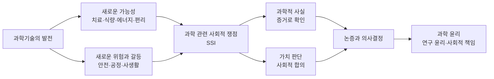
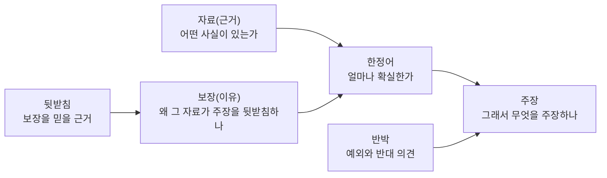

# 6-4. 과학기술과 윤리 — '할 수 있는 것'과 '해야 하는 것' 사이에서

> [!NOTE]
> **성취기준 [10통과2-03-04]** 과학기술의 발전 과정에서 발생할 수 있는 과학 관련 사회적 쟁점(SSI)과 과학기술 이용에서 과학 윤리의 중요성에 대해 논증할 수 있다.

**학습 목표**

1. 과학 관련 사회적 쟁점(SSI)의 뜻과 특징을 설명하고, 쟁점 속에서 '과학적 사실'과 '가치 판단'을 구분할 수 있다.
2. 유전자 편집, 유전자 변형 생물(GMO), 원자력, 인공지능 등의 쟁점에 대해 서로 다른 관점의 근거를 균형 있게 비교·평가할 수 있다.
3. 연구 윤리(위조·변조·표절, 생명윤리, 동물실험의 3R)와 과학기술자의 사회적 책임을 사례를 들어 설명할 수 있다.
4. 주장–근거–반박을 갖춘 논증으로 과학기술 이용에서 과학 윤리가 왜 중요한지 논증하고, 합리적인 의사결정 과정에 참여할 수 있다.

**이 단원의 학습 사다리**

| 단계 | 무엇을 하나? |
|---|---|
| STEP 1. 중학교 다시 보기 | 과학기술과 지속가능한 삶, 과학 관련 쟁점 토의, 그리고 앞 단원 전체를 다시 꺼내 본다 |
| STEP 2. 기초 다지기 | 사실 판단과 가치 판단, 논증의 구조, 위험과 불확실성, 이해관계자, 논리적 오류를 디딤돌로 놓는다 |
| STEP 3. 핵심 개념 | 과학기술의 양면성과 SSI → 대표적인 쟁점 → 연구 윤리 → 과학기술자의 사회적 책임 → 논증과 의사결정 |
| STEP 4. 오개념 바로잡기 | "과학은 가치 중립이다", "자연적인 것은 안전하다" 같은 착각을 바로잡는다 |
| STEP 5. 선택과목·대학 | 생명윤리의 4원칙, 과학기술학(STS), 위험 분석, 인공지능 윤리 |
| STEP 6. 산업·진로 | 연구윤리 체계, 인공지능 신뢰성 검증, 규제 과학, 과학기술 정책·소통 |

---

## 🗺️ 단원 들어가기

2018년 11월, 한 연구자가 유전자 가위로 배아의 유전자를 편집하여 쌍둥이 아기를 태어나게 했다고 발표하였다. 특정 바이러스에 감염되지 않게 하려는 목적이었다고 했다. 그러나 전 세계 과학계는 즉시 강하게 비판하였다. 안전성이 확인되지 않았고, 편집된 유전자가 **자손에게 대대로 전해질 수 있으며**, 충분한 사회적 논의와 정당한 동의 절차도 없었기 때문이다. 이 연구자는 이후 자국 법원에서 징역형을 선고받았다.

같은 유전자 가위 기술은 2020년 노벨 화학상을 받았고, 지금은 유전 질환 치료제 개발에 쓰이고 있다. **같은 기술이 어떤 때는 칭찬받고, 어떤 때는 비판받는다.** 무엇이 그 차이를 만들까?

> 과학기술로 **할 수 있는 것**과 **해도 되는 것(해야 하는 것)** 은 같을까? 정답이 하나로 정해지지 않은 문제를 우리는 어떻게 판단해야 할까?

이 단원은 통합과학의 마지막 단원이다. 지금까지 배운 과학 지식을 바탕으로, 과학기술이 사회와 만나는 지점에서 생기는 쟁점을 **근거를 들어 논증**하고 **책임 있게 판단**하는 방법을 익힌다.

---

## STEP 1. 🔙 중학교 다시 보기

### 연계 개념표 — 중학교 연계

| 중학교 성취기준 | 중학교에서 배운 것 | 고등학교에서 확장되는 것 |
|---|---|---|
| [9과01-03] | 인류의 지속가능한 삶을 위한 과학기술의 중요성과 역할을 토의하고 실천 방안을 찾는다 (적용 시 고려 사항: 에너지·환경 같은 과학 관련 쟁점에 대해 자신의 의견을 과학적으로 제시) | 쟁점을 **SSI**로 정의하고, 주장–근거–반박을 갖춘 **논증**으로 의견을 제시한다 |
| [9과01-02] | 과학의 발전이 인류 문명에 미친 영향, 첨단 과학기술이 가져올 변화 | 과학기술의 **양면성**과 그에 따르는 윤리적 책임을 분석한다 |
| [9과21-05] | 사람의 유전 연구 방법, 가계도 분석 (적용 시 고려 사항: 개인 정보 유출 문제가 발생하지 않도록 함) | 유전 정보 이용과 유전자 편집에서의 **생명윤리**, 연구 대상자 보호 |
| [9과22-01] | 재해·재난 사례 조사 (적용 시 고려 사항: 편향된 관점을 갖지 않도록 다양한 자료를 조사·비교) | 쟁점에 대해 **다양한 관점의 자료**를 균형 있게 평가한다 |
| [9과02-05] | 생물다양성 보전의 필요성과 유지 방안 | 유전자 변형 생물이 생태계에 미칠 수 있는 영향을 평가한다 |

### 연계 개념표 — 앞 단원 연계

마지막 단원인 만큼 통합과학 전체가 연결된다.

| 앞 단원 | 거기서 배운 것 | 이 단원의 쟁점 |
|---|---|---|
| 3-6 유전자와 단백질 | 유전 정보 → 단백질 → 형질 | **유전자 편집**, 유전자 변형 생물(GMO) |
| 4-2 진화와 생물다양성 | 변이, 자연선택, 생물다양성 | 유전자 변형 작물과 생태계, 제초제 저항성 잡초 |
| 5-3 지구온난화와 기후변화 | 온실기체와 기후변화 | 탄소 배출을 줄이는 에너지 선택의 쟁점 |
| 5-5, 5-6 발전과 신재생 에너지 | 발전 방식별 장단점, 에너지 효율 | **원자력 발전**의 이익과 위험 |
| 6-1 감염병과 과학의 유용성 | 진단·추적·백신 | 방역(공익)과 사생활(개인의 권리)의 조화 |
| 6-2 빅데이터와 과학기술사회 | 개인정보, 재식별, 편향 | **데이터 윤리** |
| 6-3 인공지능 로봇과 사물인터넷 | 학습 데이터의 편향, 사고 시 책임 | **인공지능 윤리**(편향·책임·딥페이크) |

### 준비 운동 (사전 진단)

**Q1.** 다음 문장을 '사실 판단'과 '가치 판단'으로 구분하시오.
ㄱ. 원자력 발전은 발전 과정에서 이산화 탄소를 거의 배출하지 않는다.
ㄴ. 우리나라는 원자력 발전을 늘려야 한다.
ㄷ. 이 유전자 변형 옥수수는 특정 해충에 저항성을 가진다.

**Q2.** 3-6 단원에서 배운 내용을 떠올려, 유전자를 바꾸면 생물의 형질이 바뀔 수 있는 까닭을 설명하시오.

**Q3.** 실험 결과가 가설과 맞지 않았다. 다음 중 과학자로서 올바른 태도는?
① 가설에 맞도록 결과값을 조금 고친다. ② 맞지 않는 결과는 빼고 맞는 결과만 발표한다. ③ 결과를 그대로 기록하고 원인을 분석하거나 가설을 수정한다.

**Q4.** 어떤 새로운 기술이 "사고 확률은 매우 낮지만, 사고가 나면 피해가 매우 크다." 이 기술의 위험을 판단할 때 함께 고려해야 할 두 가지는?

정답 및 해설

**Q1.** 사실 판단: ㄱ, ㄷ / 가치 판단: ㄴ — 사실 판단은 관찰·실험으로 참인지 확인할 수 있고, 가치 판단은 '좋다·나쁘다·해야 한다'처럼 무엇을 더 중요하게 여기는지에 따라 달라진다.

**Q2.** 유전자의 유전 정보에 따라 단백질이 만들어지고, 단백질이 생물의 구조와 기능, 즉 형질을 결정한다. 따라서 유전자가 바뀌면 만들어지는 단백질이 바뀌어 형질이 달라질 수 있다.

**Q3. ③** — ①은 변조, ②는 결과를 선택적으로 숨기는 부정한 행위이다. 예상과 다른 결과는 새로운 발견의 출발점이 될 수도 있다.

**Q4.** 사고가 일어날 **가능성(확률)** 과 일어났을 때의 **피해 크기**. 둘 중 하나만 보면 위험을 잘못 판단할 수 있다.

---

## STEP 2. 🧱 기초 다지기

### ① 사실 판단과 가치 판단

| 구분 | 뜻 | 확인 방법 | 예 |
|---|---|---|---|
| **사실 판단** | 세계가 어떠한지에 대한 판단 | 관찰, 실험, 데이터 | "이 작물은 가뭄에 견디는 능력이 높다" |
| **가치 판단** | 무엇이 옳고 좋은지, 무엇을 해야 하는지에 대한 판단 | 가치와 원칙에 근거한 논의, 사회적 합의 | "가뭄 피해를 줄이기 위해 이 작물을 재배해야 한다" |

> [!IMPORTANT]
> 과학은 사실 판단에 강력한 근거를 준다. 그러나 사실만으로 가치 판단이 저절로 결정되지는 않는다. SSI에서는 **"과학이 답할 질문"과 "사회가 함께 결정할 질문"을 구분**하는 것이 첫걸음이다.

### ② 논증의 기본 구조

6-1 단원에서 배운 논증의 세 요소(주장–근거–이유)에 **반박**과 **한정**을 더하면 더 튼튼한 논증이 된다.

- **주장**: 내가 내세우는 결론
- **근거**: 주장을 뒷받침하는 사실·자료
- **이유(보장)**: 근거가 왜 주장을 뒷받침하는지에 대한 설명
- **반박**: 주장이 성립하지 않는 경우나 반대 의견에 대한 고려
- **한정어**: "대부분", "아마도", "현재까지의 증거로는"처럼 주장의 확실성 정도

### ③ 위험과 불확실성

**위험(risk)** 은 나쁜 일이 일어날 **가능성**과 그 **피해의 크기**를 함께 고려한 개념이다.

$$
\text{위험의 크기} \approx \text{일어날 가능성} \times \text{피해의 크기}
$$

- 가능성은 낮지만 피해가 엄청난 위험(대형 사고)과, 가능성은 높지만 피해가 작은 위험(작은 불편)을 같은 방식으로 비교하기는 어렵다.
- 새로운 기술은 아직 데이터가 부족하여 가능성 자체를 정확히 알 수 없는 **불확실성**이 크다.
- 사람들은 스스로 선택한 위험(스키 타기)보다 남이 정한 위험(내 동네의 시설)을 더 크게 느끼는 경향이 있다.

### ④ 이해관계자

**이해관계자(stakeholder)** 는 어떤 결정에 따라 이익이나 피해를 보는 모든 사람과 집단이다. 예를 들어 유전자 변형 작물의 재배 허용 여부에는 농민, 소비자, 종자 회사, 과학자, 환경 단체, 정부, 수입국, 그리고 **미래 세대**와 **다른 생물**도 관련된다. 목소리를 내기 어려운 이해관계자를 빠뜨리지 않는 것이 공정한 판단의 조건이다.

### ⑤ 흔한 논리적 오류

| 오류 | 예 | 무엇이 문제인가? |
|---|---|---|
| 자연에 호소하는 오류 | "자연에서 나온 것이므로 안전하다" | 독버섯도 자연에서 나온다. 안전성은 증거로 판단한다 |
| 성급한 일반화 | "사고가 한 번 났으니 그 기술은 전부 위험하다" | 사례 하나로 전체를 판단했다 |
| 인신공격 | "그 과학자는 ○○ 출신이라 믿을 수 없다" | 주장의 근거가 아닌 사람을 공격했다 |
| 거짓 딜레마 | "전면 허용 아니면 전면 금지뿐이다" | 조건부 허용, 단계적 도입 등 다른 선택지를 무시했다 |
| 미끄러운 비탈길 | "치료 목적의 편집을 허용하면 결국 맞춤 아기 시대가 온다" | 중간 단계에서 멈출 장치가 있는지 따져 보지 않았다(다만 우려 자체는 정당한 논의 주제일 수 있다) |

---

## STEP 3. 📘 핵심 개념

### 6-4-① 과학기술의 양면성과 과학 관련 사회적 쟁점(SSI)

과학기술은 그 자체로 좋거나 나쁜 것이 아니라 **어떻게 쓰이느냐**에 따라 결과가 달라진다. 이를 과학기술의 **양면성**이라 한다.

| 과학기술 | 밝은 면 | 어두운 면 |
|---|---|---|
| 공기 중 질소로 암모니아를 합성하는 기술(20세기 초) | 질소 비료를 대량 생산하여 세계 식량 생산을 크게 늘렸다 | 같은 시기 화약 원료 생산에도 쓰였다. 이 기술을 개발해 1918년 노벨 화학상을 받은 과학자는 제1차 세계 대전에서 독가스 개발도 이끌었다 |
| 원자핵 분열의 발견(1938년) | 원자력 발전, 방사선 의료 | 핵무기 |
| 유전자 가위(2012년) | 유전 질환 치료, 작물 개량 | 안전성이 확인되지 않은 배아 편집 |
| 인공지능 | 질병 진단 보조, 신약 개발, 번역 | 딥페이크, 차별적 판단, 감시 |

**과학 관련 사회적 쟁점(SSI, socioscientific issues)** 은 과학기술과 관련이 있으면서 사회적·윤리적·경제적 가치가 얽혀 있어 **사람들 사이에 의견이 갈리는** 문제이다.

| SSI의 특징 | 설명 |
|---|---|
| 과학 지식이 필요하다 | 쟁점을 이해하려면 관련 과학 개념과 증거를 알아야 한다 |
| 가치가 얽혀 있다 | 안전, 건강, 자유, 공정, 경제적 이익, 환경 등이 충돌한다 |
| 정답이 하나가 아니다 | 같은 사실을 보고도 무엇을 더 중시하느냐에 따라 결론이 다르다 |
| 불확실성이 있다 | 새로운 기술일수록 장기적인 영향에 대한 증거가 부족하다 |
| 이해관계자가 다양하다 | 결정에 따라 이익과 피해를 보는 집단이 다르다 |
| 사회적 결정이 필요하다 | 법, 제도, 개인의 선택으로 이어진다 |

#### 예제 1 — 과학이 답할 질문과 사회가 답할 질문 (분석)

"유전자 변형 쌀을 국내에서 재배해도 되는가?"라는 쟁점과 관련된 다음 질문을 '과학적 증거로 답할 수 있는 질문'과 '가치 판단이 필요한 질문'으로 나누시오.
ㄱ. 이 쌀을 먹었을 때 기존 쌀과 다른 알레르기 반응이 나타나는가?
ㄴ. 이 쌀의 유전자가 주변 야생 벼로 옮겨 갈 가능성은 얼마나 되는가?
ㄷ. 수확량이 늘어나는 이익과 생태계에 대한 불확실한 위험 중 무엇을 더 중시해야 하는가?
ㄹ. 소비자에게 유전자 변형 여부를 반드시 알려야 하는가?

**풀이**
- 과학적 증거로 답할 수 있는 질문: **ㄱ, ㄴ** — 실험과 관찰로 확인할 수 있다(물론 연구가 더 필요할 수 있다).
- 가치 판단이 필요한 질문: **ㄷ, ㄹ** — 이익과 위험의 비교, 알 권리와 비용 등 무엇을 중시할지에 대한 판단이다.

좋은 의사결정은 ㄱ·ㄴ에 대한 **정확한 과학적 증거** 위에서 ㄷ·ㄹ에 대한 **사회적 논의**를 하는 것이다.

### 6-4-② 대표적인 과학 관련 사회적 쟁점 — 다양한 관점의 근거

> [!NOTE]
> 아래 표는 결론을 정해 주려는 것이 아니다. 각 쟁점에 대해 **서로 다른 관점의 근거**를 균형 있게 정리하였다. 어떤 결론을 내리든 그 근거가 얼마나 타당한지가 중요하다.

#### (1) 유전자 편집

2012년 발표된 **유전자 가위(CRISPR-Cas9)** 기술은 원하는 위치의 염기 서열을 비교적 쉽고 정확하게 자르고 바꿀 수 있게 하였다. 이 기술을 개발한 두 과학자는 2020년 노벨 화학상을 받았다.

- **체세포 편집**: 환자 몸의 일부 세포만 편집 → 그 사람에게만 영향을 준다. 유전 질환 치료 연구가 활발하다.
- **생식세포·배아 편집**: 정자·난자·배아를 편집 → 변화가 **자손에게 대대로 유전**된다. 많은 나라가 법으로 금지하거나 엄격히 제한한다.

| 기대·찬성 측 근거 | 우려·신중 측 근거 |
|---|---|
| 치료법이 없던 유전 질환을 근본적으로 치료할 수 있다 | 원하지 않은 위치가 잘리는 등 예상치 못한 부작용 가능성 |
| 질병에 강한 작물·가축을 빠르게 개발할 수 있다 | 배아 편집은 아직 태어나지 않은 사람의 동의를 받을 수 없다 |
| 기존 육종보다 정밀하고 빠르다 | 치료가 아닌 '능력 향상'에 쓰이면 불평등과 차별을 키울 수 있다 |

#### (2) 유전자 변형 생물(GMO)

**유전자 변형 생물(GMO, genetically modified organism)** 은 다른 생물의 유전자를 넣는 등 유전자 재조합 기술로 새로운 형질을 갖게 만든 생물이다. 1994년 미국에서 처음으로 유전자 변형 농산물이 식품으로 판매되기 시작했다.

| 기대·찬성 측 근거 | 우려·신중 측 근거 |
|---|---|
| 해충·가뭄에 강한 작물로 수확량을 늘리고 농약 사용을 줄일 수 있다 | 유전자가 주변 야생 식물로 옮겨 가거나 생태계에 영향을 줄 가능성 |
| 비타민 A 전구 물질을 강화한 쌀처럼 영양을 개선할 수 있다 | 제초제 저항성 작물을 쓰면서 제초제에 견디는 잡초가 늘어난 사례 |
| 여러 국제 과학 기관의 검토에서 승인된 GM 식품이 기존 식품보다 건강에 더 위험하다는 근거는 확인되지 않았다 | 종자 특허가 소수 기업에 집중되어 농민의 선택권이 줄어들 수 있다 |
| 승인 전에 안전성 심사를 거친다 | 소비자가 알고 선택할 권리(표시제)가 충분히 보장되어야 한다 |

> [!TIP]
> 💡 **과학적 합의와 가치 논쟁 구분하기** — "승인된 GM 식품을 먹는 것이 건강에 해로운가?"에 대해서는 상당한 과학적 증거가 쌓여 있다. 반면 "종자 독점을 어떻게 막을까?", "표시를 어디까지 해야 할까?"는 경제·권리의 문제이다. 한 쟁점 안에도 성격이 다른 질문들이 섞여 있다.

#### (3) 원자력 발전

| 기대·찬성 측 근거 | 우려·신중 측 근거 |
|---|---|
| 발전 과정에서 온실기체를 거의 배출하지 않아 기후변화 대응에 기여할 수 있다(5-3 단원) | 확률은 낮아도 대형 사고(1986년 체르노빌, 2011년 후쿠시마)가 나면 피해가 넓고 오래간다 |
| 날씨와 관계없이 안정적으로 많은 전력을 생산한다 | 사용후핵연료 등 고준위 방사성 폐기물을 매우 오랜 기간 안전하게 격리해야 한다 |
| 연료의 부피가 작아 에너지 안보에 유리하다 | 처분 시설 부지 선정 과정에서 지역 간 갈등과 미래 세대에 대한 부담 문제가 생긴다 |

#### (4) 인공지능

| 쟁점 | 내용 | 대응 노력 |
|---|---|---|
| **편향과 차별** | 치우친 데이터로 학습한 인공지능이 채용·대출·얼굴 인식에서 특정 집단에 불리한 판단을 한다(6-3 단원) | 데이터 점검, 집단별 오류율 검사, 사람의 최종 검토 |
| **책임** | 자율주행 사고, 의료 인공지능의 오진 시 책임이 개발자·제조사·사용자 중 누구에게 있는가 | 책임 기준을 정하는 법과 보험 제도 |
| **딥페이크** | 인공지능으로 만든 가짜 영상·음성이 사기, 명예 훼손, 성범죄, 선거 혼란에 악용된다 | 생성물 표시 의무, 탐지 기술, 처벌 강화. 우리나라는 2024년 법을 고쳐 성적 허위영상물을 소지·시청하는 행위까지 처벌하도록 하였다 |
| **사생활·감시** | 얼굴 인식과 데이터 수집으로 개인이 늘 감시될 수 있다 | 수집 최소화, 사용 목적 제한 |
| **투명성** | 인공지능이 왜 그런 판단을 했는지 설명하기 어렵다 | 설명 가능성 연구, 고위험 분야의 기록·공개 의무 |

유럽 연합은 2024년 인공지능의 위험 정도에 따라 의무를 달리 부과하는 인공지능법을 제정하였고, 우리나라도 인공지능의 발전과 신뢰 기반 조성에 관한 기본법을 만들어 2026년 1월부터 시행하고 있다.

#### 예제 2 — 이해관계자 분석 (쟁점 분석)

어느 학교가 "학교 폭력 예방을 위해 교내 모든 복도에 인공지능 얼굴 인식 카메라를 설치하자."라는 안건을 논의하고 있다. 이 쟁점의 이해관계자를 네 집단 이상 쓰고, 각 집단이 중시할 가치를 하나씩 쓰시오.

**풀이(예시)**

| 이해관계자 | 중시할 가치 |
|---|---|
| 학교 폭력 피해 경험 학생 | 안전 |
| 일반 학생 | 사생활, 자유로운 생활 |
| 교사 | 안전, 생활 지도의 효율, 교사 자신의 사생활 |
| 학부모 | 자녀의 안전, 자녀 정보의 보호 |
| 학교 관리자·교육청 | 사고 예방 책임, 비용 |
| 카메라 업체 | 경제적 이익 |

같은 기술을 놓고도 집단마다 중시하는 가치가 다르다. 그러므로 결정 과정에 여러 이해관계자의 목소리를 반영해야 한다.

### 6-4-③ 연구 윤리 — 과학을 믿을 수 있게 하는 약속

과학은 서로의 연구 결과를 믿고 그 위에 새로운 지식을 쌓아 가는 활동이다. 한 사람의 부정행위는 그 위에 쌓인 다른 연구와 사회의 신뢰를 함께 무너뜨린다. **연구 윤리**는 연구를 정직하고 책임 있게 수행하기 위해 지켜야 할 원칙이다.

#### 대표적인 연구 부정행위

| 부정행위 | 뜻 | 예 |
|---|---|---|
| **위조(fabrication)** | 존재하지 않는 데이터나 결과를 **만들어 내는** 것 | 하지 않은 실험의 결과를 지어내 기록한다 |
| **변조(falsification)** | 연구 재료·장비·과정을 조작하거나 데이터를 **임의로 바꾸거나 빼서** 결과를 왜곡하는 것 | 가설에 맞지 않는 측정값을 지우거나 사진을 편집한다 |
| **표절(plagiarism)** | 다른 사람의 아이디어·문장·자료를 **출처 없이** 자기 것처럼 쓰는 것 | 인터넷 글을 출처 없이 보고서에 옮긴다 |
| 부당한 저자 표시 | 기여한 사람을 빼거나, 기여하지 않은 사람을 저자로 넣는 것 | 연구에 참여하지 않은 지인을 공동 저자로 넣는다 |
| 중복 게재 | 이미 발표한 자기 연구를 새것처럼 다시 발표하는 것 | 같은 결과를 제목만 바꿔 두 학술지에 낸다 |

#### 예제 3 — 연구 부정행위 판정하기

다음 사례가 어떤 부정행위에 해당하는지 쓰시오.
(가) 과학 탐구 대회 보고서에 한 번도 측정하지 않은 5회차 실험 결과를 그럴듯하게 적어 넣었다.
(나) 그래프가 매끄러워 보이도록 직선에서 벗어난 두 측정값을 지우고, 지웠다는 사실을 밝히지 않았다.
(다) 백과사전의 설명 세 문단을 출처 표시 없이 보고서 서론에 그대로 썼다.

**풀이**
(가) **위조** — 없는 데이터를 만들어 냈다.
(나) **변조** — 실제 데이터를 임의로 빼서 결과를 왜곡했다. 측정 오류라고 판단해 뺄 수는 있지만, 그 사실과 이유를 **반드시 밝혀야** 한다.
(다) **표절** — 출처를 밝히고 인용 표시를 하면 정당한 인용이 된다.

#### 우리나라의 교훈

2004~2005년 국내 한 연구팀이 국제 학술지에 발표한 인간 배아 줄기세포 논문의 데이터가 조작된 것으로 2005년 말~2006년 초에 밝혀져 논문이 철회되었다. 연구에 필요한 난자를 얻는 과정에서도 윤리적 문제가 드러났다. 이 사건은 사회에 큰 충격을 주었고, 이후 연구 기관의 연구윤리 지침과 검증 체계가 강화되는 계기가 되었다.

#### 생명윤리 — 사람과 동물을 대상으로 하는 연구

| 원칙·제도 | 내용 |
|---|---|
| 뉘른베르크 강령(1947년) | 제2차 세계 대전 중 강제로 이루어진 인체 실험에 대한 반성으로, **자발적 동의**를 인체 실험의 절대 조건으로 제시하였다 |
| 헬싱키 선언(1964년) | 세계의사회가 채택한 사람 대상 의학 연구의 윤리 원칙. 연구 대상자의 건강과 권리가 과학적 이익보다 우선한다 |
| **설명 후 동의** | 연구의 목적·방법·위험을 충분히 설명받은 뒤 **자유로운 의사로** 참여에 동의하며, 언제든 그만둘 수 있다 |
| **기관생명윤리위원회(IRB)** | 사람을 대상으로 하는 연구가 윤리적인지 연구 시작 전에 심의한다 |
| 생명윤리 및 안전에 관한 법률 | 우리나라는 2005년부터 이 법을 시행하여 배아·유전자 연구 등을 규율한다 |

**동물실험의 3R 원칙**은 1959년 영국의 두 과학자가 제안한 것으로, 오늘날 동물실험 윤리의 기본이다.

| 원칙 | 뜻 | 예 |
|---|---|---|
| **대체(Replacement)** | 가능하면 동물을 쓰지 않는 방법으로 바꾼다 | 세포 배양, 컴퓨터 모의실험, 장기 유사체 |
| **감소(Reduction)** | 사용하는 동물의 수를 줄인다 | 통계적으로 필요한 최소 수 계산, 데이터 공유 |
| **개선(Refinement)** | 동물이 받는 고통을 최소화한다 | 마취·진통제 사용, 사육 환경 개선 |

연구 기관은 **동물실험윤리위원회**의 심의를 거쳐 동물실험을 승인한다.

### 6-4-④ 과학기술자의 사회적 책임

과학기술자는 자신의 연구가 사회에 미칠 영향을 가장 먼저, 가장 잘 알 수 있는 사람이다. 그래서 정직하게 연구할 책임뿐 아니라 **연구의 사회적 결과를 고려하고 알릴 책임**도 있다.

| 연도 | 사례 | 의미 |
|---|---|---|
| 1955년 | 러셀–아인슈타인 선언: 핵무기의 위험을 경고하고 평화적 해결을 호소. 1957년 과학자들의 퍼그워시 회의로 이어짐(1995년 노벨 평화상) | 과학자가 자신이 만든 지식의 위험을 사회에 경고했다 |
| 1962년 | 『침묵의 봄』 출간: 살충제가 생태계에 미치는 영향을 알림 | 과학적 증거가 환경 정책 변화로 이어졌다 |
| 1975년 | 아실로마 회의: 유전자 재조합 연구의 위험을 과학자들이 스스로 논의하고 안전 지침을 마련 | 과학계의 **자율 규제** |
| 1987년 | 몬트리올 의정서: 오존층을 파괴하는 염화 플루오린화 탄소(CFC) 사용 규제 | 과학적 경고가 국제 협력으로 이어진 성공 사례 |
| 2015년 | 국제 인간 유전자 편집 정상 회의: 생식세포 편집의 임상 적용에 신중할 것을 촉구 | 새로운 기술에 대한 국제적 논의 |

#### 과학기술자의 책임 — 정리

1. **정직성**: 데이터를 있는 그대로 기록하고 발표한다.
2. **안전과 생명 존중**: 연구 대상자, 동물, 환경의 안전을 지킨다.
3. **소통**: 연구의 이익과 위험, 불확실성을 사회에 정확하게 알린다. 과장하지도 축소하지도 않는다.
4. **경고와 거부**: 연구가 심각한 해를 끼칠 수 있다면 경고하고, 비윤리적인 연구 참여를 거부할 수 있다.
5. **공익 신고**: 연구 부정이나 위험을 알게 되면 정당한 절차로 알린다.

#### 시민의 역할 — 사전 예방 원칙과 참여

1992년 유엔 환경 개발 회의(리우 선언)는 "심각하거나 되돌릴 수 없는 피해의 우려가 있을 때는 과학적 확실성이 부족하다는 이유로 대책을 미뤄서는 안 된다"는 **사전 예방 원칙**을 제시하였다. 한편 이 원칙을 지나치게 엄격하게 적용하면 유익한 기술의 개발까지 막을 수 있다는 비판도 있다. 결국 **얼마나 신중해야 하는지**도 사회가 함께 논의해야 할 문제이다.

과학기술의 방향은 과학자만이 아니라 **시민**도 함께 정한다. 시민은 투표, 소비 선택, 공청회와 공론화 참여 등으로 의사결정에 참여한다. 이때 필요한 것이 바로 통합과학이 목표로 하는 **과학적 소양**이다.

### 6-4-⑤ 논증과 의사결정

#### 툴민의 논증 모형

영국의 철학자 툴민(S. Toulmin)이 1958년 제시한 논증 모형은 과학적 논증을 분석하는 데 널리 쓰인다.

#### 예제 4 — 논증 분석하기

다음 글을 툴민의 논증 요소로 나누시오.
"유전 질환 치료를 위한 체세포 유전자 편집 임상 시험은 허용되어야 한다. 최근 임상 시험에서 일부 환자의 증상이 크게 좋아졌다는 결과가 보고되었기 때문이다. 체세포 편집은 환자 본인에게만 영향을 주고 자손에게 전해지지 않으므로, 본인의 동의로 위험과 이익을 선택할 수 있다. 의학 연구 윤리에서 충분한 설명 후 동의는 치료 선택의 정당한 근거로 인정된다. 다만 장기적인 부작용에 대한 자료가 부족하므로, 엄격한 심의와 장기 추적 조사를 조건으로 해야 한다."

**풀이**

| 요소 | 해당 부분 |
|---|---|
| 주장 | 체세포 유전자 편집 임상 시험은 허용되어야 한다 |
| 자료(근거) | 임상 시험에서 일부 환자의 증상이 크게 좋아졌다 |
| 보장(이유) | 체세포 편집은 본인에게만 영향을 주므로 본인의 동의로 선택할 수 있다 |
| 뒷받침 | 의학 연구 윤리에서 설명 후 동의는 정당한 근거로 인정된다 |
| 한정어·반박 | 장기 부작용 자료가 부족하므로 엄격한 심의와 장기 추적을 조건으로 한다 |

#### 합리적 의사결정 과정

| 단계 | 할 일 |
|---|---|
| ① 문제 확인 | 무엇을 결정해야 하는지, 과학적 질문과 가치 질문을 구분한다 |
| ② 정보 수집 | 믿을 수 있는 출처에서 다양한 관점의 자료를 모은다(6-2 단원의 체크리스트) |
| ③ 대안 만들기 | 전면 허용·전면 금지 외에 조건부 허용, 단계적 도입 등 여러 대안을 만든다 |
| ④ 기준 정하기 | 안전, 효용, 공정, 자율(선택권), 지속가능성, 비용 등 판단 기준과 그 중요도를 정한다 |
| ⑤ 평가와 결정 | 기준에 따라 대안을 비교하고 결정한다 |
| ⑥ 반성과 수정 | 새로운 증거가 나오면 결정을 다시 검토한다 |

#### 예제 5 — 가치의 무게가 결론을 바꾼다 (다기준 의사결정)

예제 2의 학교가 출입 관리 방법으로 세 가지 대안을 비교하려 한다. 각 기준에 대해 1~5점(높을수록 좋음)으로 점수를 매겼다. (설명을 위해 가정한 값이다.)

| 기준 | A 얼굴 인식 카메라 | B 학생증 카드 | C 사람이 직접 확인 |
|---|---|---|---|
| 안전 | 5 | 4 | 3 |
| 개인정보 보호 | 1 | 4 | 5 |
| 비용(낮을수록 높은 점수) | 2 | 4 | 2 |
| 편리성 | 5 | 3 | 2 |

다음 두 모둠은 기준의 중요도(가중치)를 다르게 정했다. 각 모둠의 대안별 총점을 구하고, 어떤 대안이 선택되는지 쓰시오.
- 모둠 1(안전 중시): 안전 0.5, 개인정보 0.1, 비용 0.1, 편리성 0.3
- 모둠 2(개인정보 중시): 안전 0.2, 개인정보 0.5, 비용 0.2, 편리성 0.1

**풀이** 총점 = (점수 × 가중치)의 합

| 대안 | 모둠 1 총점 | 모둠 2 총점 |
|---|---|---|
| A | $2.5 + 0.1 + 0.2 + 1.5 = 4.3$ | $1.0 + 0.5 + 0.4 + 0.5 = 2.4$ |
| B | $2.0 + 0.4 + 0.4 + 0.9 = 3.7$ | $0.8 + 2.0 + 0.8 + 0.3 = 3.9$ |
| C | $1.5 + 0.5 + 0.2 + 0.6 = 2.8$ | $0.6 + 2.5 + 0.4 + 0.2 = 3.7$ |

모둠 1은 **A**(4.3점), 모둠 2는 **B**(3.9점)를 선택한다. 같은 사실(점수)을 보고도 **어떤 가치를 더 중시하느냐(가중치)** 에 따라 결론이 달라진다. 그래서 SSI에서는 결론만이 아니라 **어떤 기준을 왜 그만큼 중시했는지**를 투명하게 밝히고 토론하는 것이 중요하다.

#### 함께 결정하는 방법들

| 방법 | 특징 |
|---|---|
| 찬반 토론 | 찬성·반대 측이 근거를 들어 논쟁한다. 쟁점을 선명하게 드러낸다 |
| 역할극 | 여러 이해관계자의 입장이 되어 논의한다. 다른 관점을 이해하게 된다 |
| 합의 회의 | 1980년대 덴마크에서 시작된 방식으로, 일반 시민 패널이 전문가에게 질문하고 토론하여 합의문을 만든다 |
| 공론화 | 무작위로 뽑은 시민이 충분한 정보를 받고 숙의한 뒤 의견을 낸다. 우리나라는 2017년 원자력 발전소 건설 재개 여부를 두고 시민참여단 471명이 숙의하였고, 건설 재개를 권고하면서 장기적으로는 원자력 발전 비중을 줄이자는 의견도 함께 제시하였다 |

---

## STEP 4. ⚠️ 오개념 바로잡기

| 흔한 오개념 | 올바른 개념 | 왜 그럴까? |
|---|---|---|
| 과학은 가치 중립이므로 연구자에게는 책임이 없고, 기술을 쓰는 사람만 책임이 있다 | 과학 지식 자체는 사실을 다루지만, **무엇을 연구하고 어떻게 쓰는지**에는 연구자의 선택과 책임이 따른다 | 연구 주제 선택, 연구 방법, 결과 공개 방식에 모두 가치 판단이 들어간다 |
| 과학 지식만 충분하면 SSI의 정답을 찾을 수 있다 | SSI에는 과학적 사실과 함께 **가치 판단**이 필요하다 | 같은 사실을 보고도 무엇을 중시하느냐에 따라 결론이 달라진다(예제 5) |
| 자연적인 것은 안전하고, 인공적인 것은 위험하다 | 안전성은 '자연적인가'가 아니라 **증거**로 판단해야 한다 | 자연에도 독소가 많고, 인공물도 충분히 검증되면 안전할 수 있다 |
| 위험이 조금이라도 있는 기술은 쓰면 안 된다 | 위험이 0인 기술은 없다. **이익과 위험, 다른 대안의 위험**을 함께 비교한다 | 기술을 쓰지 않는 선택에도 위험이 따른다(예: 백신을 맞지 않을 때의 감염 위험) |
| 연구 윤리는 큰 부정만 하지 않으면 된다 | 데이터를 조금 고치거나 출처를 빼는 것도 **변조·표절**이다 | 작은 부정도 과학 지식에 대한 신뢰를 무너뜨린다 |
| 다수가 찬성하면 윤리적으로 옳다 | 다수결은 결정 방법일 뿐, **소수의 권리와 미래 세대**를 함께 고려해야 한다 | 피해가 소수에게 몰리는 결정은 다수가 찬성해도 공정하지 않을 수 있다 |

---

## STEP 5. 🎓 선택과목·대학으로 한 걸음 더

> [!CAUTION]
> 이 절은 **통합과학 교육과정 범위 밖의 심화 내용**으로 평가 대상이 아니다. "이 개념이 앞으로 어디까지 이어지는가"를 맛보기로 보여 주기 위한 내용이다.

### 고2·3 선택과목과의 연결

| 과목 | 이어지는 내용 |
|---|---|
| 과학의 역사와 문화 | 과학과 사회의 상호작용, 과학 지식의 변화와 과학의 본성 |
| 융합과학 탐구 | 실제 문제를 과학적으로 탐구하고 해결 방안을 제안 |
| 생명과학 / 생물의 유전 | 생명공학 기술과 그 이용에 따른 윤리적 문제 |
| 기후변화와 환경생태 | 기후 위기 대응과 환경 정의 |
| 정보 / 인공지능 기초 | 인공지능의 사회적 영향과 윤리 |
| 도덕 계열 선택 과목 | 생명 윤리, 과학기술 윤리, 정보 윤리 |

### ① 생명윤리의 네 가지 원칙

대학의 **생명윤리** 과목에서는 1979년 비첨(T. Beauchamp)과 칠드러스(J. Childress)가 정리한 네 원칙을 배운다.

| 원칙 | 뜻 | 예 |
|---|---|---|
| 자율성 존중 | 스스로 결정할 권리를 존중한다 | 설명 후 동의 |
| 악행 금지 | 해를 끼치지 않는다 | 부작용 위험의 최소화 |
| 선행 | 이익을 주도록 노력한다 | 효과적인 치료 제공 |
| 정의 | 이익과 부담을 공정하게 나눈다 | 신약 접근의 공정성, 연구 대상자 선정의 공정성 |

실제 사례에서는 원칙들이 서로 충돌한다(예: 환자의 자율적 선택이 해를 끼칠 위험이 있을 때). 대학에서는 이런 **윤리적 딜레마**를 사례 중심으로 분석한다.

### ② 과학기술학(STS) — 기술과 사회는 함께 만들어진다

**과학기술학(STS, Science and Technology Studies)** 은 과학기술과 사회가 서로 영향을 주고받는 과정을 연구한다.

- **콜링리지 딜레마**(1980년): 기술 초기에는 영향을 예측하기 어려워 규제하기 어렵고, 기술이 널리 퍼진 뒤에는 영향은 알지만 바꾸기 어렵다. 그래서 개발 초기부터 사회적 논의를 함께 해야 한다.
- **ELSI 연구**: 인간 유전체 사업(1990년 시작)은 예산의 약 3~5%를 연구의 윤리적·법적·사회적 함의(ELSI) 연구에 배정하였다. 기술 개발과 윤리 연구를 **동시에** 진행한 대표 사례이다.
- **책임 있는 연구와 혁신**: 연구 계획 단계부터 시민과 이해관계자의 의견을 반영하자는 접근이다.

### ③ 위험 분석 — 위험을 수로 다루기

위험 분석에서는 가능한 사건 $i$의 확률 $p_i$와 피해 크기 $C_i$로 **기대 피해**를 계산한다.

$$
\text{기대 피해} = \sum_i p_i \times C_i
$$

예를 들어 확률 0.001로 피해 10000이 생기는 사건과, 확률 0.5로 피해 20이 생기는 사건의 기대 피해는 각각 $0.001 \times 10000 = 10$, $0.5 \times 20 = 10$으로 같다. 그러나 사람들은 첫 번째(드물지만 끔찍한 사고)를 훨씬 두렵게 느낀다. 대학에서는 이처럼 **계산된 위험과 인식된 위험의 차이**, 그리고 둘을 함께 고려하는 위험 소통 방법을 배운다.

### ④ 인공지능 윤리 — 공정성을 수로 재기

인공지능이 공정한지 확인하려면 집단별 결과를 비교한다. 예를 들어 집단 1과 집단 2의 **잘못 탈락시킨 비율**(위음성률)이 크게 다르면 불공정의 신호이다. 그런데 공정성의 정의는 여러 가지이며, 수학적으로 **모든 공정성 기준을 동시에 만족시키기 어렵다**는 사실이 알려져 있다. 결국 어떤 공정성을 우선할지는 다시 가치 판단의 문제가 된다. 판단 근거를 사람이 이해할 수 있게 보여 주는 **설명 가능한 인공지능** 연구도 활발하다.

### 고등학교 vs 대학교

| 구분 | 고등학교 통합과학 | 대학교(생명윤리·STS·공학윤리·AI 윤리) |
|---|---|---|
| 쟁점 분석 | 사실 판단과 가치 판단 구분, 이해관계자 | 윤리 이론(결과주의·의무론·덕 윤리), 원칙 간 충돌 분석 |
| 논증 | 툴민 모형으로 주장·근거·반박 정리 | 논증 이론, 정책 논증, 학술적 글쓰기 |
| 위험 | 가능성 × 피해 크기 | 기대 피해 계산, 위험 인식, 위험 소통 |
| 연구 윤리 | 위조·변조·표절, 3R, 설명 후 동의 | 연구 설계 단계의 윤리 심의, 데이터 관리 계획 |
| 기술과 사회 | 양면성, 사회적 책임 | 콜링리지 딜레마, ELSI, 기술 영향 평가 |
| 관련 전공 | — | 철학(윤리학), 과학기술정책, 법학, 의학·간호학, 공학 전 분야, 과학 커뮤니케이션 |

---

## STEP 6. 🏭 산업 현장과 진로 연결

### 사례 1. 연구윤리와 연구 대상자 보호 체계

- **현장** 대학과 병원에는 **기관생명윤리위원회(IRB)** 와 **동물실험윤리위원회**가 있어, 연구 계획을 미리 심의하고 진행 과정을 점검한다. 연구 부정 의혹이 생기면 연구진실성위원회가 조사한다.
- **필요한 역량** 연구 방법과 윤리 원칙을 모두 이해하고, 연구자와 연구 대상자 사이에서 공정하게 판단하는 능력.

### 사례 2. 인공지능 신뢰성 검증

- **현장** 인공지능을 개발하는 기관은 출시 전에 편향, 안전성, 개인정보 침해 가능성을 점검한다. 일부러 공격자의 입장에서 인공지능의 약점을 찾는 시험, 집단별 오류율 비교, 판단 근거의 기록 등이 이루어진다.
- **제도** 위험 수준에 따라 의무를 달리하는 법(유럽 연합 인공지능법, 우리나라 인공지능 기본법)에 대응하기 위해 인공지능 윤리·신뢰성 전문 인력의 수요가 늘고 있다.

### 사례 3. 규제 과학 — 안전성을 과학으로 판단하기

- **원리** 신약, 의료기기, 유전자 변형 식품 등은 시장에 나오기 전에 과학적 자료로 **안전성과 효과**를 심사받는다. 이를 위한 평가 방법을 연구하는 분야를 **규제 과학**이라 한다.
- **예** 신약은 동물실험 등 비임상 시험 → 사람을 대상으로 한 임상 1·2·3상 시험 → 식품의약품안전처의 허가 심사를 거친다. 각 단계에 IRB 승인과 연구 대상자 동의가 필요하다.

### 사례 4. 과학기술 정책과 과학 소통

- 새로운 기술이 사회에 미칠 영향을 미리 분석하는 **기술 영향 평가**, 공청회와 공론화 운영, 과학 정책 연구 등이 있다.
- **과학 저널리스트와 과학 커뮤니케이터**는 과학적 사실과 불확실성을 시민에게 정확하게 전달하여, 시민이 SSI에 대해 합리적으로 판단하도록 돕는다.

### 관련 진로와 학과

| 진로 | 하는 일 | 관련 학과 |
|---|---|---|
| 연구윤리 전문가·IRB 간사 | 연구 계획 심의 지원, 연구윤리 교육 | 생명과학, 간호학, 보건학, 철학 |
| 생명윤리·과학기술학 연구자 | 첨단 기술의 윤리적·사회적 영향 연구 | 철학, 과학기술학, 사회학 |
| 인공지능 윤리·신뢰성 전문가 | 인공지능의 편향·안전성 검증, 윤리 기준 수립 | 컴퓨터공학, 통계학, 법학, 철학 |
| 규제 과학 전문가·임상 연구 코디네이터 | 의약품·의료기기 안전성 심사, 임상 시험 관리 | 약학, 생명과학, 의공학, 간호학 |
| 과학기술 정책 연구원 | 기술 영향 평가, 과학기술 정책 개발 | 과학기술정책학, 행정학, 이공계 전공 |
| 과학 저널리스트·커뮤니케이터 | 과학 뉴스 보도, 대중 과학 콘텐츠 제작 | 언론정보학, 이공계 전공, 과학커뮤니케이션 |
| 변리사·과학기술 법률가 | 기술 특허, 과학기술 관련 법률 자문 | 이공계 전공 + 법학 |

---

## 🔬 탐구 활동 — 과학 관련 사회적 쟁점(SSI)에 대한 합의 회의 열기

> [!NOTE]
> 교육과정의 <탐구 활동> 세 가지는 앞의 6-1~6-3 단원에서 다루었다. 이 단원의 탐구는 성취기준 적용 시 고려 사항(조사 학습, 프로젝트 학습, 디지털 도구로 찾은 정보를 비판적으로 평가하기)을 바탕으로 구성하였다. **결론은 모둠마다 달라도 된다. 평가는 결론이 아니라 근거의 질과 논증 과정으로 한다.**

### 활동 A. 역할극 합의 회의

**목표** 하나의 SSI에 대해 여러 이해관계자의 입장에서 근거를 조사하고, 논증과 숙의를 거쳐 합의문을 작성한다.

**준비물** 쟁점 카드, 역할 카드, 논증 카드(툴민 모형 양식), 인터넷 검색 도구, 합의문 양식

**쟁점 예시(모둠별 하나 선택)**
1. 병충해에 강하도록 유전자를 편집한 작물의 국내 재배를 허용할 것인가?
2. 학교 출입 관리에 인공지능 얼굴 인식 카메라를 도입할 것인가?
3. 감염병 유행 시 확진자의 이동 경로를 어디까지 공개할 것인가?
4. 우리 지역에 대규모 데이터 센터를 유치할 것인가?(전력 사용, 일자리, 환경)

**과정**
1. **쟁점 정리(10분)**: 쟁점 속 질문을 '과학적 질문'과 '가치 질문'으로 나눈다.
2. **역할 배정**: 과학자, 시민(찬성·반대·중립), 관련 기업, 시민 단체, 정부 담당자, 미래 세대 대변인 등 역할을 나눈다.
3. **자료 조사(1차시)**: 역할에 맞는 근거를 조사한다. 6-2 단원의 데이터 체크리스트로 출처의 신뢰성을 평가하고, 출처를 반드시 기록한다(표절 금지).
4. **논증 카드 작성**: 주장–자료–보장–한정어–반박을 채운다.
5. **합의 회의(1차시)**: 역할별 발표 → 질의응답 → 시민 패널(역할을 맡지 않은 학생)의 숙의 → 합의문 작성. 합의가 어려운 부분은 **소수 의견**으로 함께 기록한다.
6. **성찰**: 역할을 벗고 자신의 실제 생각이 바뀌었는지, 왜 바뀌었는지 쓴다.

**결과 기록 — 논증 카드**

| 역할 | 주장 | 자료(근거와 출처) | 보장(이유) | 예상되는 반박과 답변 |
|---|---|---|---|---|
| | | | | |
| | | | | |

**합의문 양식**

| 항목 | 내용 |
|---|---|
| 우리가 합의한 결정 | |
| 결정의 근거(과학적 사실) | |
| 결정의 근거(가치 판단) | |
| 조건과 보완책 | |
| 소수 의견 | |
| 다시 검토해야 할 상황 | |

### 활동 B. 연구 윤리 사례 판정 카드

1. 모둠별로 교사가 나누어 준 연구 상황 카드(예: 측정값 일부 삭제, 설문 응답 대신 작성, 보고서 문장 복사, 동의 없이 친구 사진 사용 등)를 읽는다.
2. 각 상황이 위조·변조·표절·기타 중 어디에 해당하는지, 또는 문제가 없는지 판정하고 이유를 쓴다.
3. 같은 상황에서 **올바르게 행동하는 방법**을 제안한다(예: 측정값을 뺀 이유를 보고서에 밝힌다).

**생각해 보기**
1. 합의 회의에서 '과학적 사실'에 대한 의견 차이와 '가치'에 대한 의견 차이 중 어느 쪽이 더 해결하기 어려웠는가? 그 이유는?
2. 미래 세대 대변인 역할은 왜 필요할까?
3. 내가 과학자라면 이 쟁점에 대해 사회에 무엇을 알릴 책임이 있을까?

---

## ✅ 개념 확인 문제

### 기본

**1.** 과학 관련 사회적 쟁점(SSI)의 특징으로 옳은 것을 **모두** 고르시오.
ㄱ. 과학 지식과 사회적·윤리적 가치가 얽혀 있다.
ㄴ. 과학적 증거만 충분하면 하나의 정답이 정해진다.
ㄷ. 결정에 따라 이익과 피해를 보는 이해관계자가 다양하다.
ㄹ. 새로운 기술의 경우 장기적 영향에 대한 불확실성이 있다.

정답 및 해설

**정답 ㄱ, ㄷ, ㄹ**

ㄴ. SSI는 과학적 사실뿐 아니라 가치 판단이 필요하므로, 같은 증거를 보고도 결론이 달라질 수 있다.

**2.** 위조, 변조, 표절의 뜻을 각각 한 문장으로 쓰시오.

정답 및 해설

**정답**
- 위조: 존재하지 않는 데이터나 결과를 만들어 내는 것
- 변조: 연구 과정이나 데이터를 임의로 바꾸거나 빼서 결과를 왜곡하는 것
- 표절: 다른 사람의 아이디어나 글, 자료를 출처 없이 자신의 것처럼 쓰는 것

**3.** 동물실험의 3R 원칙을 쓰고, 각각의 예를 하나씩 드시오.

정답 및 해설

**정답**
- 대체(Replacement): 세포 배양이나 컴퓨터 모의실험으로 동물실험을 대신한다.
- 감소(Reduction): 통계적으로 필요한 최소한의 동물만 사용한다.
- 개선(Refinement): 마취·진통제를 사용하여 동물의 고통을 줄인다.

**4.** 빈칸에 알맞은 말을 쓰시오.
"사람을 대상으로 하는 연구에서는 연구의 목적과 위험을 충분히 설명받은 뒤 자유로운 의사로 참여에 동의하는 ( ㄱ )이/가 필요하며, 연구 시작 전에 ( ㄴ )의 심의를 받는다."

정답 및 해설

**정답** ㄱ: 설명 후 동의, ㄴ: 기관생명윤리위원회(IRB)

### 응용

**5.** 다음 주장에 담긴 논리적 오류를 찾아 이름을 쓰고, 어떻게 고치면 더 좋은 논증이 되는지 쓰시오.
(가) "이 유기농 해충 퇴치제는 식물에서 추출한 천연 성분이니 사람에게 완전히 안전하다."
(나) "자율주행차가 사고를 한 번 냈다. 따라서 자율주행 기술은 사람이 운전하는 것보다 위험하다."

정답 및 해설

**정답**
(가) **자연에 호소하는 오류** — 천연 성분이라도 독성이 있을 수 있다. 독성 시험 자료 등 **안전성 증거**를 근거로 제시해야 한다.
(나) **성급한 일반화** — 사고 한 건으로 전체를 판단했다. 같은 주행 거리당 사고율을 사람의 운전과 비교하는 **통계 자료**를 근거로 제시해야 한다.

**6.** 다음 글을 읽고 주장, 자료(근거), 보장(이유), 반박에 해당하는 부분을 찾아 쓰시오.
"도시 하천에 인공지능 수질 감시 센서망을 설치해야 한다. 지난해 이 하천에서 오염 사고가 세 번 있었는데 모두 하루가 지나서야 발견되었다. 실시간으로 수질을 측정하면 오염이 생긴 즉시 원인을 찾아 피해를 줄일 수 있기 때문이다. 물론 설치비와 관리비가 들지만, 오염으로 물고기가 떼죽음을 당하고 정화하는 비용이 더 크다."

정답 및 해설

**정답**
- 주장: 도시 하천에 인공지능 수질 감시 센서망을 설치해야 한다.
- 자료(근거): 지난해 오염 사고 세 번이 모두 하루가 지나서야 발견되었다.
- 보장(이유): 실시간 측정은 오염 즉시 원인을 찾아 피해를 줄일 수 있다.
- 반박(과 재반박): 설치·관리비가 든다는 반대 의견을 고려하고, 오염 피해와 정화 비용이 더 크다고 답하였다.

**7.** 예제 5에서 모둠 3이 가중치를 '안전 0.3, 개인정보 0.3, 비용 0.2, 편리성 0.2'로 정했다. 대안 A, B, C의 총점을 구하고 어떤 대안을 선택하게 되는지 쓰시오.

정답 및 해설

**정답** A 3.2점, B 3.8점, C 3.2점 → **B 선택**

- A: $5\times0.3 + 1\times0.3 + 2\times0.2 + 5\times0.2 = 1.5 + 0.3 + 0.4 + 1.0 = 3.2$
- B: $4\times0.3 + 4\times0.3 + 4\times0.2 + 3\times0.2 = 1.2 + 1.2 + 0.8 + 0.6 = 3.8$
- C: $3\times0.3 + 5\times0.3 + 2\times0.2 + 2\times0.2 = 0.9 + 1.5 + 0.4 + 0.4 = 3.2$

A와 C는 3.2점으로 같고, 가장 높은 B를 선택한다. 가중치를 고르게 나누면 한 기준에서만 뛰어난 대안보다 여러 기준에서 고르게 좋은 대안이 선택되기 쉽다.

### 융합·서술형

**8. [생명과학·대학 연계]** "유전 질환을 막기 위해 인간 배아의 유전자를 편집하는 것을 허용해야 한다."라는 주장에 대해, (1) 3-6 단원의 내용을 이용해 유전자 편집이 질병을 막을 수 있는 원리를 설명하고, (2) 체세포 편집과 배아 편집의 차이를 근거로 찬성과 신중(반대) 측의 논증을 각각 하나씩 쓴 뒤, (3) 자신의 입장을 한정어와 조건을 포함하여 밝히시오.

정답 및 해설

**예시 답안**
(1) 유전 질환은 유전자의 염기 서열 이상으로 정상 단백질이 만들어지지 않아 생긴다. 유전자 편집으로 염기 서열을 바로잡으면 정상 단백질이 만들어져 질환을 막을 수 있다.
(2) 찬성 측: 배아 단계에서 편집하면 몸의 모든 세포가 정상 유전자를 갖게 되어 질환을 근본적으로 예방할 수 있고, 그 자손도 같은 질환의 위험에서 벗어날 수 있다. 신중 측: 배아 편집은 체세포 편집과 달리 변화가 자손에게 대대로 전해지는데, 예상치 못한 부작용이 생기면 되돌릴 수 없고, 영향을 받을 미래 세대는 동의할 수 없다. 또한 체외 수정 후 정상 배아를 고르는 등 다른 대안이 있는 경우도 있다.
(3) (예시) 현재의 증거로는 배아 편집의 안전성이 충분히 확인되지 않았으므로 임상 적용은 허용하지 않는 것이 바람직하다. 다만 다른 대안이 없는 심각한 질환에 대해, 충분한 연구로 안전성이 확인되고 사회적 합의와 엄격한 심의 제도가 마련된다면 다시 검토할 수 있다.

**채점 포인트** ① 유전자–단백질–형질 연결 ② 체세포·배아 편집의 차이(유전 여부) ③ 양쪽 관점의 타당한 근거 ④ 한정어·조건을 갖춘 입장

**9. [산업·사회 연계]** 한 기업이 인공지능으로 만든 가짜 영상(딥페이크)을 찾아내는 탐지 기술을 개발하려 한다. 그런데 탐지 인공지능을 학습시키려면 실제 사람들의 얼굴 영상이 대량으로 필요하다. (1) 이 상황에서 충돌하는 가치 두 가지를 쓰고, (2) 과학기술자로서 이 연구를 윤리적으로 진행하기 위한 방안을 세 가지 이상 제시하며, (3) 과학 윤리가 과학기술의 발전에 걸림돌인지, 오히려 필요한 조건인지 논증하시오.

정답 및 해설

**예시 답안**
(1) 딥페이크 피해를 막는 **사회의 안전(공익)** 과 얼굴 영상이 학습에 쓰이는 사람들의 **사생활·초상권(개인의 권리)** 이 충돌한다.
(2) ① 영상 제공자에게 사용 목적과 위험을 설명하고 동의를 받는다. ② 수집하는 정보를 학습에 필요한 최소한으로 하고, 학습 후에는 원본을 안전하게 삭제하거나 가명 처리한다. ③ 연구 시작 전에 윤리 심의를 받는다. ④ 다양한 집단의 데이터를 고르게 모아 특정 집단에서 탐지가 잘 안 되는 편향을 막는다. ⑤ 탐지 기술이 오히려 더 정교한 가짜를 만드는 데 악용되지 않도록 공개 범위를 관리한다.
(3) (예시) 과학 윤리는 걸림돌이 아니라 필요한 조건이다. 동의 없이 얼굴 데이터를 모은 기술은 사회의 신뢰를 잃어 사용이 거부되거나 법적 문제로 중단될 수 있다. 반대로 윤리 원칙을 지킨 기술은 시민이 믿고 사용할 수 있어 오래 발전할 수 있다. 연구 부정 사건이 그 분야 전체의 신뢰를 무너뜨렸던 사례처럼, **신뢰는 과학기술이 사회에서 쓰이기 위한 기반**이기 때문이다. 다만 윤리 기준이 지나치게 모호하거나 절차가 과도하면 유익한 연구가 늦어질 수 있으므로, 명확하고 합리적인 기준을 함께 만들어 가야 한다.

**채점 포인트** ① 충돌하는 두 가치 ② 동의·최소 수집·심의·편향 방지 등 구체적 방안 ③ 주장–근거–반박을 갖춘 논증

---

## 📝 한눈에 정리

### 핵심 요약

- 과학기술은 쓰임에 따라 이익과 해를 함께 가져오는 **양면성**이 있다.
- **과학 관련 사회적 쟁점(SSI)** 은 과학 지식과 사회적·윤리적 가치가 얽혀 의견이 갈리는 문제로, 정답이 하나가 아니고 불확실성과 다양한 이해관계자가 있다.
- SSI를 판단할 때는 **과학적 사실(증거로 확인)** 과 **가치 판단(사회적 합의)** 을 구분하고, 여러 관점의 근거를 균형 있게 비교한다.
- **연구 윤리**: 위조·변조·표절 금지, 사람 대상 연구의 설명 후 동의와 IRB 심의, 동물실험의 3R(대체·감소·개선).
- **과학기술자의 사회적 책임**: 정직, 안전과 생명 존중, 이익과 위험의 정확한 소통, 위험에 대한 경고.
- 주장–자료–보장–한정어–반박을 갖춘 **논증**과, 기준과 가치를 투명하게 밝히는 **의사결정**으로 책임 있게 참여한다.
- 과학 윤리는 과학기술의 걸림돌이 아니라, 사회의 **신뢰** 속에서 과학기술이 지속적으로 발전하기 위한 조건이다.

### 핵심 용어

| 용어 | 뜻 |
|---|---|
| 과학 관련 사회적 쟁점(SSI) | 과학기술과 관련되며 사회적·윤리적 가치가 얽혀 의견이 갈리는 문제 |
| 과학기술의 양면성 | 같은 과학기술이 쓰임에 따라 이익과 해를 함께 가져오는 성질 |
| 사실 판단 / 가치 판단 | 증거로 참거짓을 확인할 수 있는 판단 / 무엇이 옳고 좋은지에 대한 판단 |
| 위조·변조·표절 | 데이터를 만들어 냄 / 데이터·과정을 임의로 바꿈 / 남의 것을 출처 없이 씀 |
| 설명 후 동의 | 연구의 목적·방법·위험을 충분히 설명받은 뒤 자유로운 의사로 참여에 동의하는 것 |
| 동물실험의 3R | 대체(Replacement), 감소(Reduction), 개선(Refinement) |
| 사전 예방 원칙 | 심각한 피해의 우려가 있으면 과학적 확실성이 부족해도 대책을 미루지 않는다는 원칙 |
| 툴민 논증 모형 | 주장·자료·보장·뒷받침·한정어·반박으로 논증을 분석하는 모형 |

### 교재를 마치며

통합과학의 여정을 돌아보자. 우리는 **과학의 기초**에서 시간과 공간, 단위와 측정, 신호와 정보라는 과학의 언어를 익혔다. **물질과 규칙성**에서는 우주 초기의 원소에서 출발해 지각과 생명체, 첨단 소재를 이루는 물질의 규칙을 찾았다. **시스템과 상호작용**에서는 지구, 운동하는 물체, 세포가 각각 하나의 시스템으로서 상호작용하는 모습을 보았고, **변화와 다양성**에서는 지질시대와 진화, 산화·환원과 산·염기 반응으로 변화 속의 규칙성을 발견했다. **환경과 에너지**에서는 생태계와 기후, 에너지의 흐름과 전환을 다루었으며, 마지막 **과학과 미래 사회**에서는 이 모든 지식을 감염병, 빅데이터, 인공지능, 그리고 윤리라는 현실의 문제에 적용하였다.

통합과학이 길러 준 것은 지식만이 아니다. **증거를 바탕으로 생각하고, 다른 관점을 존중하며, 책임 있게 판단하는 과학적 소양**이다. 이제 이 길은 여러 갈래로 이어진다.

| 통합과학에서 배운 영역 | 이어지는 선택과목 |
|---|---|
| 과학의 기초, 운동과 에너지 | 물리학, 역학과 에너지, 전자기와 양자 |
| 물질과 규칙성, 화학 반응 | 화학, 물질과 에너지, 화학 반응의 세계 |
| 생명 시스템, 유전과 진화 | 생명과학, 세포와 물질대사, 생물의 유전 |
| 지구시스템, 우주와 기후 | 지구과학, 지구시스템과학, 행성우주과학 |
| 환경, 과학과 미래 사회 | 기후변화와 환경생태, 과학의 역사와 문화, 융합과학 탐구 |

어떤 길을 고르든, 이 교재에서 연습한 방법 — 중학교에서 배운 것과 연결하고, 기초를 다진 뒤 핵심 개념으로 나아가며, 대학과 산업 현장으로 시야를 넓히는 방법 — 은 계속 쓸모가 있을 것이다. 과학기술이 만들어 갈 미래 사회를 이끄는 사람은 과학자만이 아니라, **과학적 소양을 갖추고 더불어 살아가는 시민인 바로 여러분**이다.
